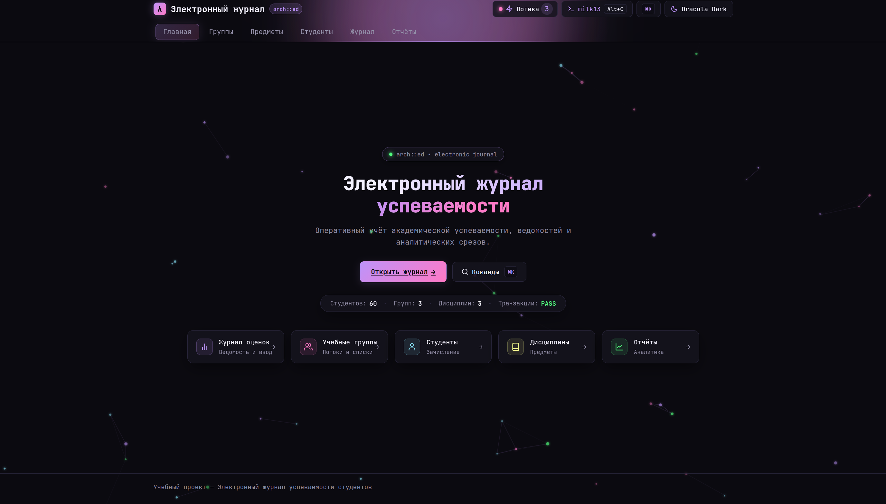
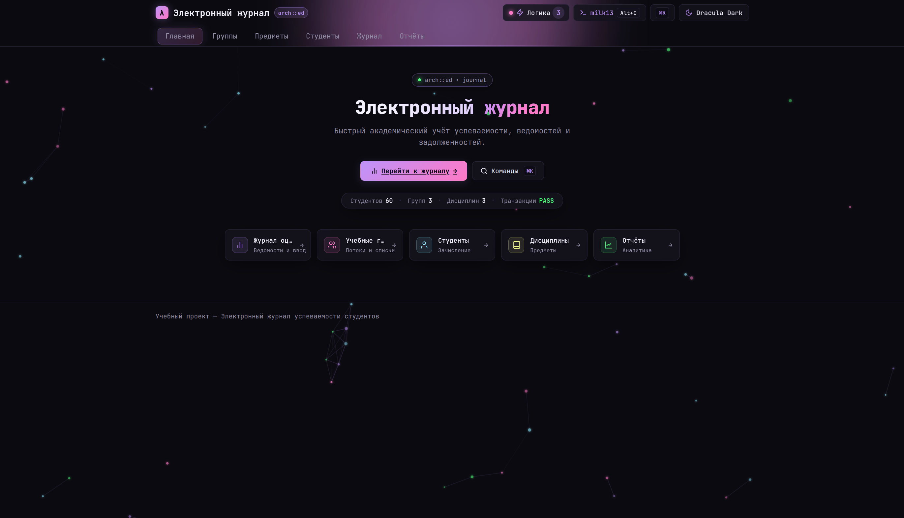
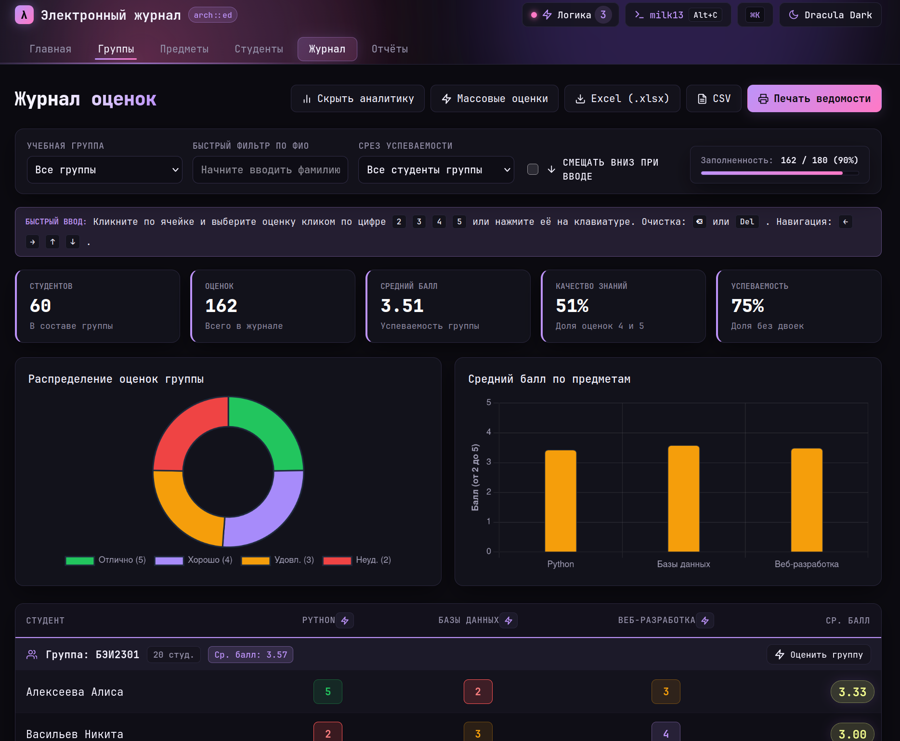
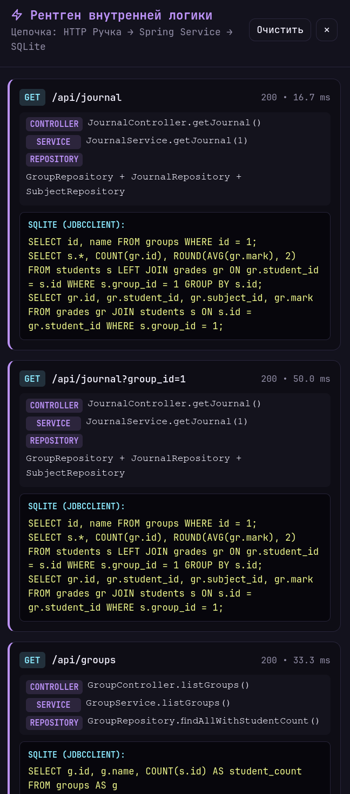
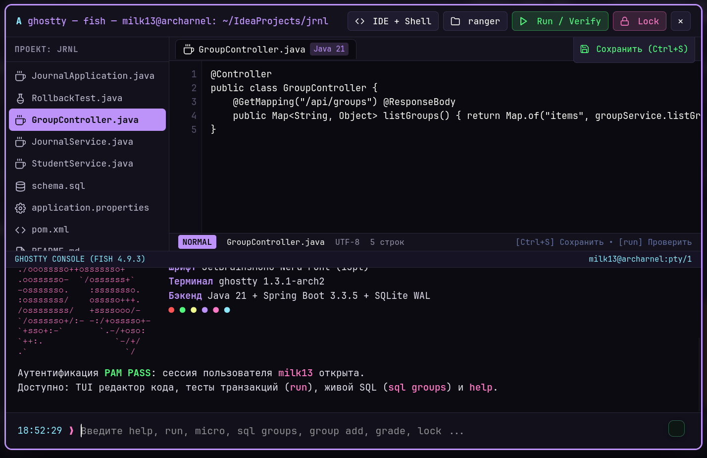
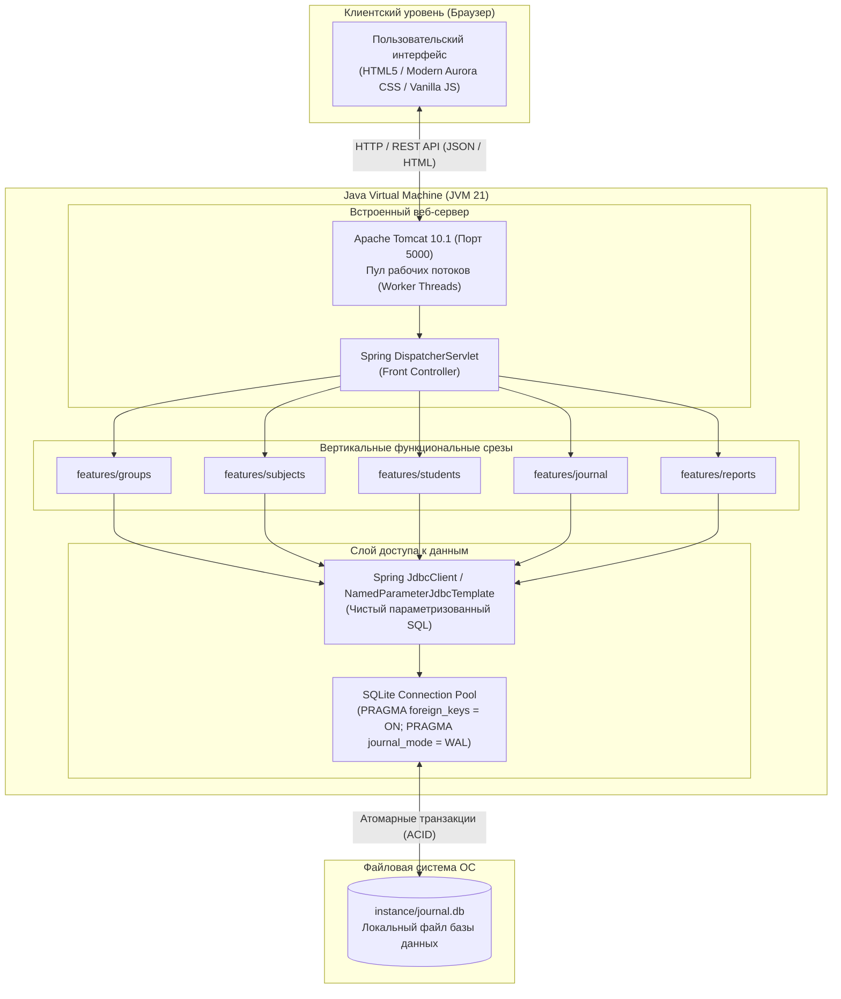
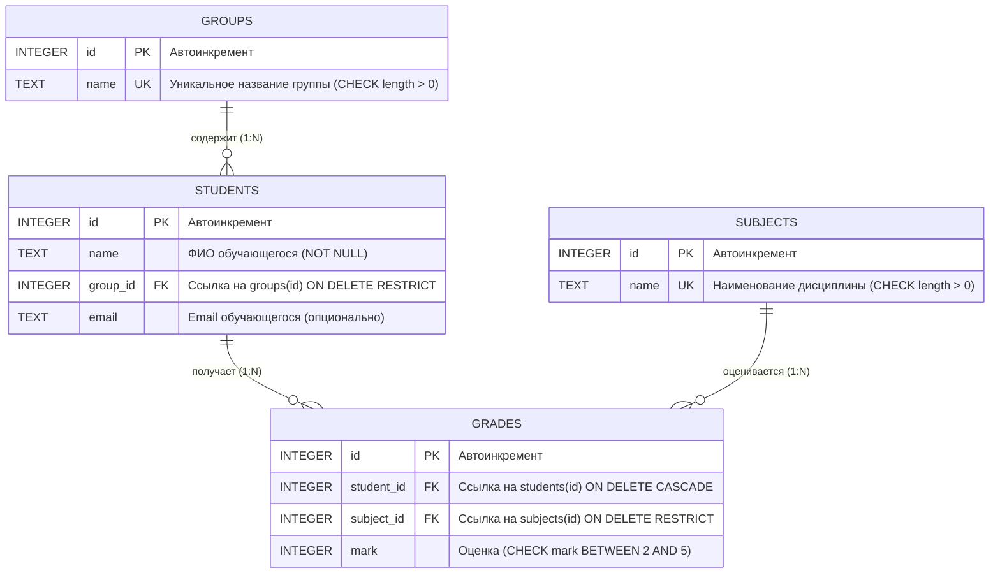
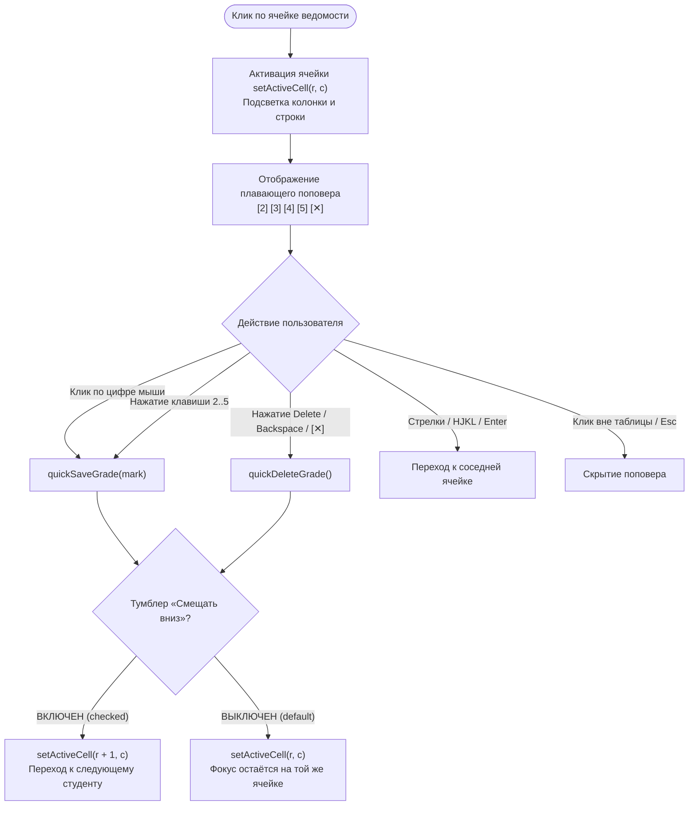

# 🎓 Электронный журнал успеваемости студентов (jrnl)

<p align="center">
  
</p>

<p align="center">
  <a href="https://www.oracle.com/java/technologies/downloads/#java21"></a>
  <a href="https://spring.io/projects/spring-boot"></a>
  <a href="https://www.sqlite.org/"></a>
  <a href="https://poi.apache.org/"></a>
  <a href="https://developer.mozilla.org/ru/docs/Web/JavaScript"></a>
  <a href="#тестирование-и-верификация"></a>
  <a href="https://github.com/NikitaLozinsky/journal---/releases"></a>
</p>

---

## 📌 О проекте

**«Электронный журнал успеваемости студентов» (jrnl v2.0.0)** — высокопроизводительная академическая система для ведения экзаменационных ведомостей, мониторинга контингента и анализа успеваемости высшего учебного заведения. 

Разработано на современном стеке **Java 21 (LTS)** и **Spring Boot 3.3.5** с архитектурой **вертикальных функциональных срезов (Vertical Slice Architecture)**, прямым быстрым доступом к данным через **Spring `JdbcClient`** без тяжелых ORM-абстракций, транзакционным хранилищем **SQLite в режиме WAL (Write-Ahead Logging)** и реактивным интерфейсом в эстетике **Modern Aurora** (с плавающими световыми градиентами, физическим полем невесомости **Google Antigravity**, встроенным Linux-терминалом и инспектором SQL-запросов).

---

## 🖼️ Галерея интерфейса (v2.0.0)

| 🌌 Главная страница (Google Antigravity Experience) | 📊 Журнал оценок и быстрый поповер ввода |
| :---: | :---: |
| [](screens/2026-11-10_21-51.png) | [](screens/2026-11-10_20-50.png) |

| 💻 Встроенный Linux TUI-терминал (PAM & Ranger) | ⚡ Рентген логики (X-Ray SQL & Service Inspector) | ⌘ Командная палитра (Ctrl+K) |
| :---: | :---: | :---: |
| [](screens/2026-11-10_21-52.png) | [](screens/2026-11-10_21-52_1.png) | [](screens/2026-11-10_21-53.png) |

---

## ⚡ Ключевые возможности

### 1. Академический журнал и тактильный ввод
* **Интерактивный плавающий поповер (Quick Mark Popover):** клик мышкой по ячейке вызывает аккуратный виджет быстрого выбора `[2] [3] [4] [5] [✕]`. Оценку можно поставить как кликом мыши, так и клавишей на клавиатуре.
* **Excel-режим с гибким автопереходом:**
  * Навигация стрелками `←`, `↑`, `→`, `↓`, `Enter` и клавишами Vim (`h`, `j`, `k`, `l`).
  * Тумблер **«Смещать вниз при вводе»**: при отключении фокус остается ровно на той же ячейке для мгновенного исправления без скачков; при включении — автоматически шагает на строку вниз.
* **Массовое выставление оценок (Bulk Grading):** возможность выставить или очистить баллы сразу для всей группы или всех групп по отдельной дисциплине либо по всем предметам сразу в один клик.
* **Живой индикатор прогресса (Progress Bar):** неоновый анимированный трек заполненности ведомости с переходом в изумрудное сияние при 100% заполнении.

### 2. Экспорт и печать
* **Microsoft Excel (.xlsx):** потоковая генерация стилизованных таблиц средствами **Apache POI 5.3.0** с цветовым кодированием должников, автоматическим расчетом ширины колонок и академическими статусами.
* **Формат CSV:** выгрузка с разделителем `;` и обязательным префиксом **UTF-8 BOM** для корректного открытия в Excel и LibreOffice на любой ОС.
* **Официальная печатная ведомость:** шаблон `@media print` альбомного формата А4 с шапкой ведомости, блоками подписей экзаменаторов и скрытием служебного UI.

### 3. Инструменты разработчика и прозрачность логики
* **Рентген логики (X-Ray Inspector):** боковая шторка с изменяемой шириной (drag-resize handle), отображающая трассировку вызовов `Controller → Service → JdbcClient`, точный выполняемый SQL и время выполнения каждого запроса в миллисекундах.
* **Встроенный Linux TUI-терминал:** консоль `milk13@archarnel` с эмуляцией PAM-аутентификации (`sudo`), файловым проводником `ranger`, просмотром исходного кода и системными утилитами.
* **Командная палитра (`Ctrl+K` / `⌘K`):** быстрый переход по разделам, запуск инструментов и экспорт ведомостей с поддержкой клавиатуры.

### 4. Дизайн Modern Aurora и эргономика
* **3 темы оформления:** Dracula Dark (по умолчанию), OLED Pitch Black и Alabaster Light.
* **Интерактивный отклик шапки (Header Aurora Glow):** плавающее неоновое свечение, отслеживающее курсор мыши и адаптирующее цветовую гамму под активную вкладку.
* **Физика Google Antigravity Experience:** парящие частицы в невесомости на домашней странице с антигравитационным полем отталкивания мыши и гравитационными волнами.

---

## 🏛️ Архитектура системы

### 1. Системная модель автономного Fat JAR
Приложению не требуются внешние веб-серверы и СУБД: встроенный контейнер Apache Tomcat и легковесная СУБД SQLite упакованы непосредственно в исполняемый Java-пакет.



---

### 2. Сквозной цикл обработки запроса и X-Ray трассировка

Диаграмма ниже демонстрирует путь HTTP-запроса от клика в браузере до сохранения в SQLite с параллельной фиксацией в инспекторе логики X-Ray:

```mermaid
sequenceDiagram
    autonumber
    actor User as Преподаватель (Браузер)
    participant UI as JavaScript (journal.js)
    participant DS as DispatcherServlet
    participant Ctrl as JournalController
    participant Srv as JournalService
    participant Repo as JournalRepository
    participant DB as SQLite WAL (journal.db)
    participant XRay as X-Ray Inspector HUD

    User->>UI: Клик по ячейке / нажатие клавиши «5»
    UI->>UI: Тактильная анимация вспышки ячейки
    UI->>DS: POST /api/journal/grades {"student_id": 1, "subject_id": 2, "mark": 5}
    
    rect rgb(30, 25, 45)
        Note over DS,Ctrl: Диспетчеризация и валидация DTO
        DS->>Ctrl: saveGrade(@Valid GradeSaveRequest)
        Ctrl->>Srv: saveGrade(studentId, subjectId, mark)
    end

    rect rgb(25, 35, 45)
        Note over Srv,Repo: Бизнес-логика и UPSERT
        Srv->>Repo: upsertGrade(studentId, subjectId, mark)
        Repo->>DB: INSERT INTO grades ... ON CONFLICT DO UPDATE ...
        DB-->>Repo: 1 row affected (Время: 0.8 ms)
        Repo-->>Srv: GradeDto (id, studentId, subjectId, mark)
    end

    Srv-->>Ctrl: Результат операции
    Ctrl-->>DS: JSON {"item": GradeDto, "message": "Оценка сохранена"}
    DS-->>UI: HTTP 200 OK (application/json)

    par Обновление интерфейса и X-Ray
        UI->>UI: Обновление среднего балла студента и прогресс-бара
        UI->>XRay: Добавление трассировки (Ручка + SQL + 1.2 ms)
    end
```



---

### 3. Модель данных и реляционные связи

Реляционная схема хранится в [`src/main/resources/db/schema.sql`](file:///home/milk13/IdeaProjects/jrnl/src/main/resources/db/schema.sql) и гарантирует ссылочную целостность на уровне ядра базы данных:



* **Каскадное удаление оценок студента:** при удалении студента все его оценки атомарно удаляются благодаря `ON DELETE CASCADE`.
* **Защита целостности справочников:** группу нельзя удалить, пока в ней есть студенты (`RESTRICT`). Дисциплину нельзя удалить, пока по ней есть хотя бы одна оценка (`RESTRICT`).
* **Уникальный индекс:** пара `(student_id, subject_id)` защищена уникальным композитным индексом `idx_grades_student_subject`.

---

### 4. Алгоритм интерактивного ввода оценок



---

## 📂 Структура проекта (Vertical Slices)

```
jrnl/
├── pom.xml                                  # Дескриптор Maven (Java 21, Spring Boot 3.3.5)
├── README.md                                # Документация проекта
├── project_context.md                       # Полный снимок контекста системы
├── screens/                                 # Скриншоты интерфейса
├── docs/                                    # Подробные руководства по архитектуре
│   └── 01-how-it-works-and-architecture.md  # Детальный архитектурный гайд
├── src/
│   ├── main/
│   │   ├── java/ru/edu/journal/
│   │   │   ├── JournalApplication.java      # Точка входа Spring Boot и CLI
│   │   │   ├── config/                      # Конфигурация WebMvc и SQLite DataSource
│   │   │   ├── common/                      # Инициализатор БД и GlobalExceptionHandler
│   │   │   └── features/                    # Вертикальные функциональные срезы:
│   │   │       ├── groups/                  # Контроллер, Сервис, Репозиторий и DTO групп
│   │   │       ├── subjects/                # Реестр дисциплин и бизнес-правила
│   │   │       ├── students/                # Учет контингента, переводы и средние баллы
│   │   │       ├── journal/                 # Матрица успеваемости, поповер и экспорт POI
│   │   │       └── reports/                 # Академические аналитические срезы
│   │   └── resources/
│   │       ├── application.properties       # Конфигурация портов и базы данных
│   │       ├── db/                          # SQL-скрипты: schema.sql и seed.sql
│   │       ├── static/                      # CSS стили Aurora, JS-модули и vendor Chart.js
│   │       └── templates/                   # Шаблоны Thymeleaf (HTML5)
│   └── test/java/ru/edu/journal/            # Интеграционные тесты и тесты транзакций
└── target/
    └── journal-2.0.0.jar                    # Готовый автономный исполняемый дистрибутив
```

---

## ⌨️ Горячие клавиши (Keymap)

| Сочетание клавиш | Контекст | Назначение |
|---|---|---|
| <kbd>Ctrl</kbd> + <kbd>K</kbd> / <kbd>⌘</kbd><kbd>K</kbd> | Глобально | Открыть командную палитру поиска и действий |
| <kbd>Alt</kbd> + <kbd>T</kbd> | Глобально | Циклическое переключение темы (Dracula → OLED → Light) |
| <kbd>Alt</kbd> + <kbd>C</kbd> / <kbd>Ctrl</kbd> + <kbd>~</kbd> | Глобально | Открыть встроенный Linux TUI-терминал (`milk13@archarnel`) |
| <kbd>Alt</kbd> + <kbd>L</kbd> | Глобально | Открыть шторку рентгена логики и SQL-запросов (X-Ray) |
| <kbd>2</kbd>, <kbd>3</kbd>, <kbd>4</kbd>, <kbd>5</kbd> | Журнал оценок | Мгновенное выставление оценки активному студенту |
| <kbd>Delete</kbd> / <kbd>Backspace</kbd> / <kbd>0</kbd> | Журнал оценок | Очистка (удаление) оценки в текущей ячейке |
| <kbd>←</kbd> <kbd>→</kbd> <kbd>↑</kbd> <kbd>↓</kbd> / <kbd>Enter</kbd> | Журнал оценок | Навигация по таблице ведомости |
| <kbd>h</kbd> <kbd>j</kbd> <kbd>k</kbd> <kbd>l</kbd> | Журнал оценок | Навигация по ячейкам в стиле Vim |
| <kbd>Esc</kbd> | Модальные окна | Закрытие поповера, палитры, терминала или шторки |

---

## 🚀 Инструкция по сборке и запуску

Для запуска требуется установленная виртуальная машина **Java 21 (LTS)** или новее.

### 1. Быстрый запуск скомпилированного JAR
```bash
# Запуск автономного сервера (порт 5000)
java -jar target/journal-2.0.0.jar
```
После старта веб-интерфейс доступен в любом браузере по адресу:
👉 **`http://localhost:5000`** *(или `http://127.0.0.1:5000`)*

> [!NOTE]
> При первом запуске файл базы данных `instance/journal.db` создается автоматически и заполняется демонстрационным набором (3 учебные группы, 60 студентов, 3 дисциплины, 162 оценки).

### 2. Сборка из исходного кода
```bash
# Сборка пакета без тестов
./mvnw clean package -DskipTests

# Полный цикл сборки с выполнением верификационных тестов
./mvnw clean package
```

### 3. Запуск в режиме разработки
```bash
./mvnw spring-boot:run
```

---

## 🧪 Тестирование и верификация

В проект включены компонентные и интеграционные тесты с верификацией транзакционной целостности SQLite и сценариев отката:

```bash
# Запуск всего набора тестов
./mvnw test
```

### Реализованные тест-сьюты:
1. **`RollbackTest`** — проверка атомарности транзакций: эмуляция сбоя в середине составной операции гарантирует полный откат изменений в SQLite WAL.
2. **`JournalIntegrationTest`** — сквозная проверка REST API: создание, редактирование, каскадные запреты удаления непустых справочников и корректность расчета аналитики.
3. **`DatabaseBaselineTest`** — валидация схемы данных и автоматической инициализации таблиц.

---

## 📚 Дополнительная документация

* 📖 [**Руководство 01: Архитектура и веб-сервер (01-how-it-works-and-architecture.md)**](docs/01-how-it-works-and-architecture.md) — жизненный цикл Spring Boot, DispatcherServlet, Embedded Tomcat и гибридный SSR/REST.
* 💾 [**Руководство 02: База данных SQLite и Spring JdbcClient (02-database-sqlite-and-jdbc-client.md)**](docs/02-database-sqlite-and-jdbc-client.md) — режим WAL, чистый SQL без ORM, транзакции ACID, каскадное удаление и автотест отката.
* 🎨 [**Руководство 03: Клиентский интерфейс и Modern Aurora UI (03-frontend-vanilla-js-and-modern-aurora-ui.md)**](docs/03-frontend-vanilla-js-and-modern-aurora-ui.md) — реактивный Vanilla JS, физика Antigravity на Canvas, поповер оценок, темы Zero-FOUC и X-Ray.
* 📋 [**Полный снимок контекста системы (project_context.md)**](project_context.md) — актуальное дерево всех файлов проекта с их исходным кодом.

---

<p align="center">
  <sub>Разработано для учебного процесса • 2026</sub>
</p>
