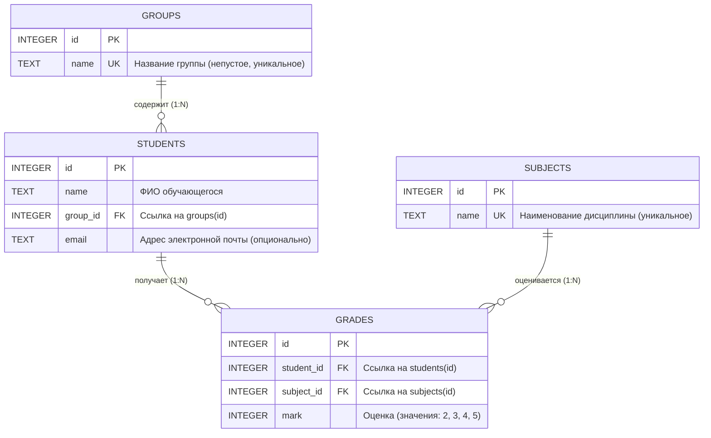

# Электронный журнал успеваемости студентов

Информационная система учёта успеваемости, академической успеваемости и аналитики учебного процесса высшего учебного заведения. Проект разработан на стеке **Java 21 (LTS)** и **Spring Boot 3** с архитектурой вертикальных функциональных срезов, чистым SQL без тяжелых ORM-абстракций, интерактивным пользовательским интерфейсом и подсистемой формирования аналитической отчетности.

---

## Оглавление

1. [Ключевые функциональные возможности](#ключевые-функциональные-возможности)
2. [Технологический стек](#технологический-стек)
3. [Архитектура приложения](#архитектура-приложения)
4. [Модель данных](#модель-данных)
5. [Спецификация REST API](#спецификация-rest-api)
6. [Инструкция по развертыванию и запуску](#инструкция-по-развертыванию-и-запуску)
   - [Запуск автономного JAR-пакета](#1-запуск-автономного-jar-пакета)
   - [Запуск через Maven Wrapper](#2-запуск-через-maven-wrapper)
   - [Открытие и запуск в IntelliJ IDEA](#3-открытие-и-запуск-в-intellij-idea)
7. [Консольные утилиты и обслуживание БД](#консольные-утилиты-и-обслуживание-бд)
8. [Тестирование и верификация](#тестирование-и-верификация)
9. [Руководство по интерфейсу и горячие клавиши](#руководство-по-интерфейсу-и-горячие-клавиши)

---

## Ключевые функциональные возможности

### 1. Управление контингентом и справочниками
- **Учебные группы:** просмотр перечня групп с автоматическим подсчетом численности контингента, создание новых групп, переименование, каскадная защита от удаления групп, содержащих активных студентов.
- **Дисциплины (предметы):** ведение реестра академических дисциплин с контролем уникальности наименований; строгая блокировка удаления дисциплин, по которым в системе зафиксированы выставленные оценки.
- **Студенты:** учет личных данных обучающихся (ФИО, email, академическая группа); регистрация новых студентов; процедура межкафедрального перевода между группами с безусловным сохранением всех накопленных ранее оценок; транзакционное удаление записи студента и всех связанных с ним оценок в рамках единой атомарной транзакции SQLite.

### 2. Поиск, фильтрация и многофакторная сортировка
- Полнотекстовый поиск обучающихся в реальном времени по подстроке ФИО, адресу электронной почты или названию группы.
- Динамический фильтр контингента по выбранной учебной группе.
- Многофакторная сортировка реестра:
  - по алфавиту ФИО (А → Я, Я → А);
  - по учебным группам (А → Я, Я → А);
  - по академическому среднему баллу (по возрастанию / убыванию);
  - по общему количеству полученных оценок.
- Интерактивная сортировка в один клик по кликабельным заголовкам столбцов таблицы с визуальной индикацией текущего направления.
- Отображение точного среднего балла студента с цветовой градацией академического уровня.

### 3. Академический журнал успеваемости и быстрый ввод (Excel-режим)
- Матричное представление успеваемости: студенты группы расположены построчно, дисциплины — по столбцам.
- Пустые ячейки наглядно маркируются прочерком при отсутствии записи в базе данных.
- Визуальная подсветка академических задолженностей (двойки выделяются контрастным фоном).
- Модальное окно для выставления, изменения и удаления оценки с валидацией значений (строго 2, 3, 4, 5).
- **Режим быстрого клавиатурного редактирования (Excel-style):**
  - Навигация по таблице клавишами стрелок (вверх, вниз, влево, вправо) и Enter.
  - Мгновенное выставление оценки нажатием клавиш 2, 3, 4, 5 (основной ряд или Numpad) с немедленным фоновым сохранением через REST API и автоматическим шагом фокуса на строку вниз.
  - Моментальное удаление оценки клавишами Delete или Backspace.
  - Однократный клик мыши переносит фокус; двойной клик открывает полное диалоговое окно.

### 4. Экспорт данных и печатные формы
- **Экспорт в Microsoft Excel (.xlsx):**
  - Генерация валидного XLSX-файла средствами Apache POI 5.3.0.
  - Фирменная стилизация заголовка ведомости, даты формирования и колонок таблицы.
  - Автоматический расчет ширины столбцов по длине содержимого.
  - Подсветка неудовлетворительных результатов и автоматическое определение академического статуса каждого обучающегося (*«Отличник»*, *«Хорошист»*, *«Успевает»*, *«Академическая задолженность»*, *«Нет оценок»*).
- **Экспорт в CSV (.csv):**
  - Формат данных с разделителем точка с запятой (`;`).
  - Префикс UTF-8 BOM для безупречного открытия во всех версиях Microsoft Excel и LibreOffice без искажения кодировки.
- **Печатная версия ведомости (Print / PDF):**
  - Специализированная таблица стилей `@media print` с альбомной ориентацией страницы А4.
  - Автоматическое скрытие служебных интерфейсных элементов (меню, фильтров, кнопок управления).
  - Формирование официальной академической шапки ведомости и блоков для подписей преподавателя и сотрудников деканата.

### 5. Аналитический модуль и интерактивные графики
- Локальная автономная интеграция библиотеки Chart.js (полное функционирование в изолированных сетях без доступа в интернет).
- Сводные KPI-карточки (число групп, студентов, зафиксированных оценок, общий средний балл).
- Сравнительные столбчатые диаграммы успеваемости групп и распределения контингента.
- Круговые диаграммы структуры оценок и доли академических задолженностей.
- Аналитический блок в журнале конкретной группы с расчетом абсолютной успеваемости (процент без двоек) и качественной успеваемости (процент четверок и пятерок).

### 6. Эргономика интерфейса и тёмная тема
- Тёмная графическая тема установлена по умолчанию.
- Полное предотвращение эффекта мигания белого экрана при переходах между страницами (Zero Flash of Unstyled Content, FOUC) за счет предварительной инициализации цветовых токенов в секции `<head>`.
- Быстрое переключение между тёмной и светлой темами с сохранением выбора в `localStorage`.
- Зебра-расцветка строк (`zebra striping`) с плавным выделением при наведении курсора для комфортной работы с большими табличными массивами данных.

---

## Технологический стек

| Компонент | Технология | Назначение |
|---|---|---|
| Язык программирования | Java 21 (LTS, OpenJDK) | Базовая программная платформа |
| Фреймворк | Spring Boot 3.3.5 | Инверсия управления, MVC, REST, сборка |
| СУБД | SQLite 3 (`org.xerial:sqlite-jdbc`) | Локальное реляционное хранилище данных |
| Доступ к данным | Spring JDBC (`NamedParameterJdbcTemplate`) | Чистый параметризованный SQL |
| Шаблонизатор | Thymeleaf 3 | Серверная визуализация HTML-страниц |
| Экспорт в электронные таблицы | Apache POI 5.3.0 (`poi-ooxml`) | Формирование документов формата Microsoft Excel |
| Графическая аналитика | Chart.js 4.4.1 (автономный бандл) | Клиентская визуализация диаграмм |
| Клиентский слой | Стандартный ES6+ JavaScript, CSS3 | Реактивный интерфейс без сторонних тяжелых фреймворков |
| Сборщик проектов | Apache Maven 3.9+ | Управление зависимостями и сборка артефактов |

---

## Архитектура приложения

Проект построен по принципу вертикального разделения на функциональные домены (`Feature-Driven Architecture`). Каждый функциональный срез полностью инкапсулирует контроллер, сервис, репозиторий с прямым SQL и DTO-модели.

```
src/main/java/ru/edu/journal/
├── JournalApplication.java                  # Главный класс приложения и обработчик CLI-команд
├── config/
│   ├── DatabaseConfig.java                  # Конфигурация SQLite DataSource (PRAGMA foreign_keys = ON)
│   └── WebMvcConfig.java                    # Конфигурация статических ресурсов и кэширования
├── common/
│   ├── DatabaseInitializer.java             # Первичная инициализация схемы и демонстрационных данных
│   ├── GlobalExceptionHandler.java          # Централизованная обработка ошибок и трансляция в JSON
│   └── exception/                           # Пользовательские исключения (ValidationException, NotFoundException)
└── features/
    ├── groups/                              # Модуль «Учебные группы»
    │   ├── GroupController.java             # Маршруты /groups и /api/groups
    │   ├── GroupService.java                # Бизнес-правила валидации и уникальности групп
    │   ├── GroupRepository.java             # SQL-запросы к таблице groups
    │   └── dto/                             # GroupDto, GroupSaveRequest
    ├── subjects/                            # Модуль «Дисциплины»
    │   ├── SubjectController.java           # Маршруты /subjects и /api/subjects
    │   ├── SubjectService.java              # Защита от удаления предметов с выставленными оценками
    │   ├── SubjectRepository.java           # SQL-запросы к таблице subjects
    │   └── dto/                             # SubjectDto, SubjectSaveRequest
    ├── students/                            # Модуль «Студенты»
    │   ├── StudentController.java           # Маршруты /students и /api/students
    │   ├── StudentService.java              # Транзакционный перевод, каскадное удаление
    │   ├── StudentRepository.java           # Фильтрация, поиск, расчет средних баллов
    │   └── dto/                             # StudentDto, StudentSaveRequest
    ├── journal/                             # Модуль «Журнал успеваемости»
    │   ├── JournalController.java           # Страница /journal, эндпоинты оценок и экспорта
    │   ├── JournalService.java              # Логика выставления и обновления оценок (upsert)
    │   ├── JournalRepository.java           # Построение матрицы оценок группы
    │   ├── JournalExportService.java        # Потоковая генерация XLSX и CSV с BOM
    │   └── dto/                             # JournalResponse, GradeDto, GradeSaveRequest
    └── reports/                             # Модуль «Отчёты и аналитика»
        ├── ReportController.java            # Страница /reports и REST /api/reports
        ├── ReportService.java               # Диспетчеризация аналитических срезов
        └── ReportRepository.java            # Аналитические SQL-агрегации (GROUP BY, HAVING)
```

---

## Модель данных

Реляционная схема хранится в файле `src/main/resources/db/schema.sql` и разворачивается в SQLite с обязательным контролем внешних ключей.



### Ограничения целостности и индексы
- Таблица `groups`: ограничение `CHECK(length(trim(name)) > 0)`, индекс `idx_groups_name`.
- Таблица `subjects`: ограничение `CHECK(length(trim(name)) > 0)`, индекс `idx_subjects_name`.
- Таблица `students`: внешняя ссылка `REFERENCES groups(id) ON DELETE RESTRICT`, индекс `idx_students_group`.
- Таблица `grades`: внешние ссылки `REFERENCES students(id) ON DELETE CASCADE` и `REFERENCES subjects(id) ON DELETE RESTRICT`, ограничение `CHECK(mark BETWEEN 2 AND 5)`, уникальный композитный индекс `idx_grades_student_subject UNIQUE(student_id, subject_id)`.

---

## Спецификация REST API

### 1. Учебные группы
- `GET /api/groups` — получение списка всех групп с количеством студентов.
- `POST /api/groups` — создание новой группы (`{"name": "БЭИ2301"}`).
- `POST /api/groups/{id}` — переименование группы.
- `DELETE /api/groups/{id}` — удаление пустой группы (возвращает 400 при наличии студентов).

### 2. Дисциплины
- `GET /api/subjects` — получение списка дисциплин.
- `POST /api/subjects` — добавление дисциплины (`{"name": "Базы данных"}`).
- `POST /api/subjects/{id}` — переименование дисциплины.
- `DELETE /api/subjects/{id}` — удаление дисциплины (возвращает 400 при наличии связанных оценок).

### 3. Студенты
- `GET /api/students` — перечень студентов с поддержкой параметров `?q=...` (поиск по строке) и `?group_id=...` (фильтр по группе). Возвращает средний балл каждого обучающегося.
- `GET /api/students/{id}` — получение подробных данных студента.
- `POST /api/students` — регистрация студента (`{"name": "...", "group_id": 1, "email": "..."}`).
- `POST /api/students/{id}` — изменение данных или перевод в другую группу.
- `DELETE /api/students/{id}` — транзакционное каскадное удаление студента и всех его оценок.

### 4. Журнал успеваемости и экспорт
- `GET /api/journal?group_id={id}` — получение матрицы журнала выбранной группы (группа, список предметов, список студентов, массив оценок).
- `POST /api/journal/grades` — выставление или обновление оценки (`{"student_id": 1, "subject_id": 2, "mark": 5}`).
- `DELETE /api/journal/grades/{studentId}/{subjectId}` — удаление оценки по предмету.
- `GET /api/journal/export/excel?group_id={id}` — выгрузка ведомости группы в бинарный файл Microsoft Excel (.xlsx).
- `GET /api/journal/export/csv?group_id={id}` — выгрузка ведомости группы в текстовый файл CSV (разделитель `;`, кодировка UTF-8 BOM).

### 5. Аналитические отчёты
- `GET /api/reports?kind=groups` — сводные статистические показатели по группам (контингент, сумма оценок, средний балл).
- `GET /api/reports?kind=no_grades` — список обучающихся без единой выставленной оценки.
- `GET /api/reports?kind=failing` — список неуспевающих обучающихся (имеющих хотя бы одну оценку «2»).

---

## Инструкция по развертыванию и запуску

Для работы приложения требуется установленная виртуальная машина **Java 21** или выше.

### 1. Запуск автономного JAR-пакета

В дистрибутив входит предварительно скомпилированный Fat-JAR архив, содержащий внутри сервер приложений и все библиотеки:

```bash
# Запуск веб-сервера из директории проекта
java -jar target/journal-1.0.0.jar
```

После старта веб-интерфейс доступен в браузере по адресу:
```
http://127.0.0.1:5000/
```

При первом запуске приложение автоматически создаст локальную базу данных `instance/journal.db` и наполнит её демонстрационным набором данных (3 учебные группы, 60 студентов, 3 дисциплины, 162 оценки).

### 2. Запуск через Maven Wrapper

Сборка и запуск из исходного кода с помощью входящего в проект скрипта Maven Wrapper (не требует предварительно установленного Maven):

```bash
# Запуск веб-сервера
./mvnw spring-boot:run

# Сборка нового JAR-пакета после внесения изменений
./mvnw clean package
```

Собранный исполняемый файл будет помещен по пути: `target/journal-1.0.0.jar`.

### 3. Открытие и запуск в IntelliJ IDEA

1. Запустите IntelliJ IDEA.
2. Выберите пункт меню **File → Open...** и укажите корневой каталог проекта: `/home/milk13/IdeaProjects/jrnl`.
3. Среда разработки автоматически распознает файл `pom.xml`, выполнит импорт зависимостей и настроит структуру модулей.
4. Убедитесь, что в **Project Structure → Project SDK** выбран Java 21 (или 22/27).
5. Перейдите к файлу `src/main/java/ru/edu/journal/JournalApplication.java`.
6. Нажмите кнопку **Run** рядом с объявлением метода `main`.

---

## Консольные утилиты и обслуживание БД

Приложение поддерживает запуск со специальными аргументами командной строки для административного обслуживания и валидации базы данных без запуска постоянного веб-сервера:

### Восстановление исходного состояния базы данных
Пересоздает таблицы из `src/main/resources/db/schema.sql` и заполняет их исходными данными из `src/main/resources/db/seed.sql` в рамках единой транзакции:

```bash
# Через JAR
java -jar target/journal-1.0.0.jar --prepare

# Через Maven Wrapper
./mvnw spring-boot:run -Dspring-boot.run.arguments="--prepare"
```

### Проверка контрольных показателей базы данных
Выполняет сверку связности, включения внешних ключей и контрольных сумм записей:

```bash
java -jar target/journal-1.0.0.jar --check-baseline
```
Ожидаемый результат:
```
foreign_keys: 1
foreign_key_check: 0
groups: 3
students: 60
subjects: 3
grades: 162
students_without_grades: 6
PASS: база прошла проверку
```

### Проверка отката транзакций при сбое
Имитирует непредвиденную ошибку в середине транзакции удаления студента и проверяет сохранность данных после аварийного отката:

```bash
java -jar target/journal-1.0.0.jar --check-rollback
```
Ожидаемый результат:
```
Учебный сбой: Учебная ошибка после удаления оценок.
PASS: студент и все оценки сохранены после отката
PASS: обычное удаление убрало студента и его оценки
```

---

## Тестирование и верификация

В проект включен комплекс автоматических интеграционных и модульных тестов на платформе JUnit 5 и Spring Test:

```bash
./mvnw test
```

### Состав тестового набора:
1. `DatabaseBaselineTest` — проверка соответствия реляционной схемы и корректности начального наполнения БД.
2. `RollbackTest` — проверка механизма транзакционного отката Spring JDBC при искусственных аппаратных или программных сбоях.
3. `JournalIntegrationTest` — сквозное тестирование всех разделов REST API:
   - валидация операций с группами и защита от удаления непустых групп;
   - создание предметов и блокировка удаления дисциплин с оценками;
   - создание, поиск, фильтрация студентов и межкафедральный перевод с сохранением оценок;
   - матричный журнал, выставление оценок 2..5, защита от некорректных значений;
   - генерация бинарных выгрузок Excel (.xlsx) и CSV с проверкой заголовков;
   - аналитические выборки модуля отчетов.

---

## Руководство по интерфейсу и горячие клавиши

### Раздел «Журнал» — режим быстрого ввода
Для активации быстрого ввода установите флажок **«Режим быстрого ввода (клавиатура)»** в верхней части страницы журнала.

| Клавиша / Сочетание | Выполняемое действие |
|---|---|
| Стрелка вверх (`ArrowUp`) | Перемещение фокуса на строку выше (предыдущий студент) |
| Стрелка вниз (`ArrowDown`) / `Enter` | Перемещение фокуса на строку ниже (следующий студент) |
| Стрелка влево (`ArrowLeft`) | Перемещение фокуса на столбец левее (предыдущий предмет) |
| Стрелка вправо (`ArrowRight`) | Перемещение фокуса на столбец правее (следующий предмет) |
| Цифры `2`, `3`, `4`, `5` | Немедленная фиксация оценки в БД и переход к следующему студенту |
| `Delete` / `Backspace` | Мгновенное удаление оценки из БД в активной ячейке |
| Одиночный клик мыши | Фокусировка выбранной ячейки таблицы |
| Двойной клик мыши | Открытие детального модального окна управления оценкой |

### Раздел «Студенты»
- Ввод любого текста в поле **«Поиск по студентам»** мгновенно фильтрует таблицу без перезагрузки страницы.
- Нажатие на заголовки столбцов **«ФИО»**, **«Группа»**, **«Оценок»**, **«Средний балл»** упорядочивает список по возрастанию или убыванию.
- Кнопка **«Добавить студента»** открывает форму привязки к группе с валидацией имени.
- Кнопка **«Изменить»** в строке студента позволяет перевести его в другую академическую группу с сохранением истории оценок.
