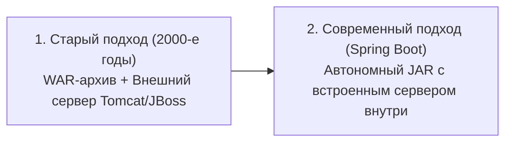
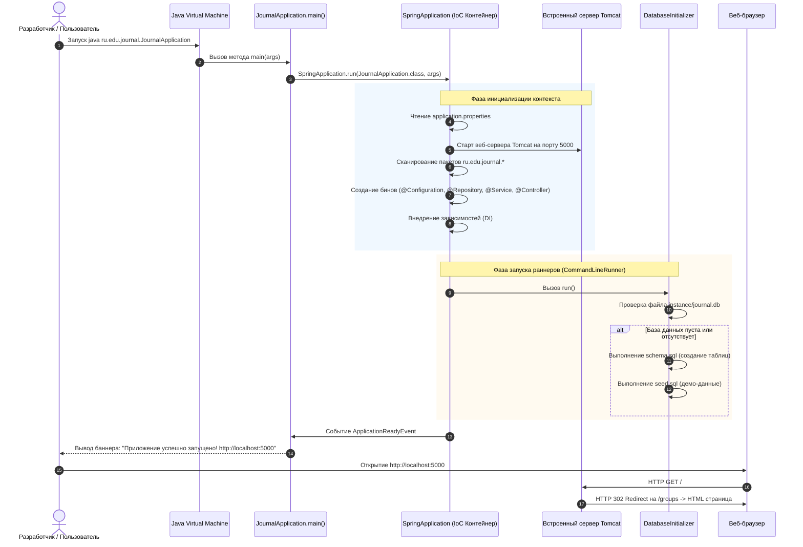
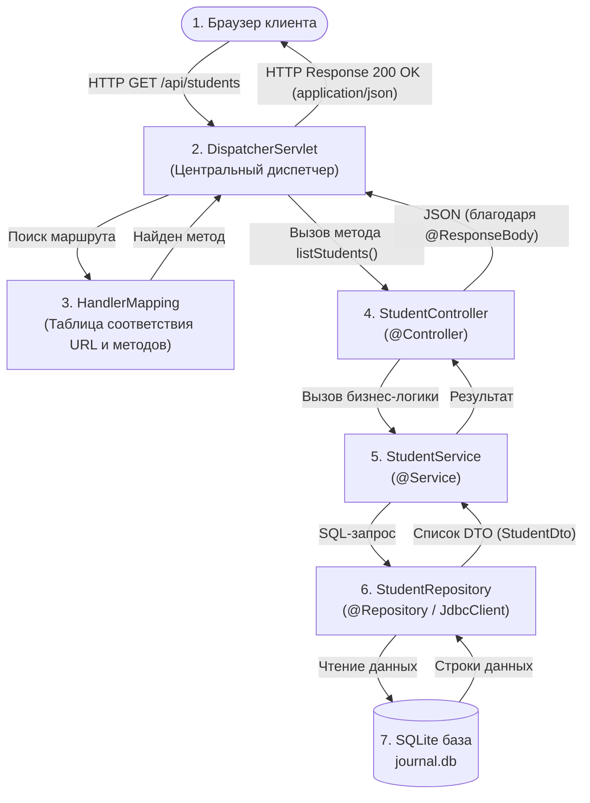
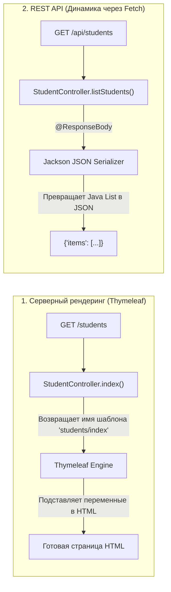
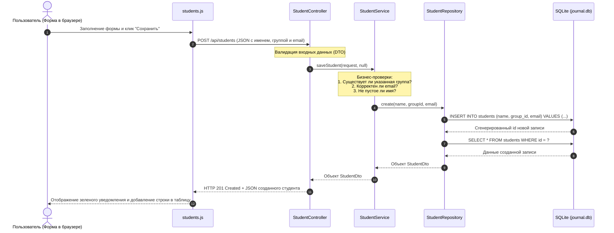

# Руководство 01: Как работает проект, веб-сервер и Spring Boot

Добро пожаловать в первое руководство по архитектуре проекта **«Электронный журнал успеваемости студентов» (jrnl)**!

Этот документ создан для того, чтобы простыми словами, на понятных примерах и наглядных схемах объяснить фундаментальные вещи:
1. Как вообще программа на Java становится работающим веб-сайтом.
2. Что такое веб-сервер, откуда он берется и как запускается.
3. Какую работу за нас выполняет фреймворк **Spring Boot**.
4. Как данные проходят путь от браузера пользователя до файла базы данных SQLite и обратно.

---

## 1. Ментальная модель: что представляет собой проект?

Если говорить простыми словами, этот проект — **автономное сетевое приложение**.

Вам не нужно отдельно скачивать или настраивать серверы баз данных (как PostgreSQL или MySQL) и внешние веб-серверы (как Apache или Nginx). Всё необходимое упаковано прямо внутрь приложения:

```
+------------------------------------------------------------------------+
|                          Java-процесс (JVM)                            |
|                                                                        |
|  +--------------------+   +-------------------+   +-----------------+  |
|  | Встроенный веб-    |   | Фреймворк         |   | Локальная БД    |  |
|  | сервер Tomcat      |-->| Spring Boot       |-->| SQLite          |  |
|  | (порт 5000)        |   | (бизнес-логика)   |   | (файл на диске) |  |
|  +--------------------+   +-------------------+   +-----------------+  |
|           ^                                                 |          |
+-----------|-------------------------------------------------|----------+
            | HTTP-запросы                                    | journal.db
            v                                                 v
      [ Браузер ]                                     [ Диск компьютера ]
```

Когда проект запускается:
1. В памяти компьютера стартует виртуальная машина Java (**JVM**).
2. Поднимается встроенный веб-сервер (**Apache Tomcat**), который открывает сетевой порт **5000** и начинает слушать входящие подключения.
3. Проверяется и подключается файл базы данных [instance/journal.db](file:///home/milk13/IdeaProjects/jrnl/instance/journal.db).
4. Вы открываете браузер по адресу `http://localhost:5000` и начинаете работать с журналом.

---

## 2. Как в Java создаются сайты и веб-приложения?

### Что такое веб-сайт с точки зрения компьютера?
Любой веб-сайт — это диалог по протоколу **HTTP** (HyperText Transfer Protocol) между двумя программами:
* **Клиент (браузер)** отправляет текстовый запрос: *«Привет, дай мне страницу `/students`»*.
* **Сервер** отправляет текстовый ответ: заголовок `200 OK` и содержимое (HTML-разметку, стили CSS, картинки или JSON-данные).

### Как это устроено в Java: эволюция от сервлетов до Spring Boot



#### Исторический экскурс: как было раньше
Раньше, чтобы запустить Java-сайт, программисту требовалось:
1. Установить на операционную систему тяжелый сервер приложений (например, Apache Tomcat или GlassFish).
2. Написать Java-классы, наследующие `HttpServlet`, и вручную в XML-файлах расписывать, какой URL какому классу соответствует.
3. Собрать проект в `.war` (Web Application Archive) и вручную скопировать в папку сервера.

#### Современный стандарт: Fat JAR и Embedded Tomcat
В Spring Boot всё перевернули: **не приложение загружается в сервер, а сервер встроен прямо внутрь приложения!**
В файле сборщика [pom.xml](file:///home/milk13/IdeaProjects/jrnl/pom.xml) подключен один стартовый модуль:

```xml
<dependency>
    <groupId>org.springframework.boot</groupId>
    <artifactId>spring-boot-starter-web</artifactId>
</dependency>
```

Этот модуль автоматически подтягивает библиотеки **Apache Tomcat**. При компиляции проект упаковывается в один исполняемый файл `.jar`. Чтобы запустить сайт, достаточно выполнить команду в консоли:
```bash
java -jar target/journal-1.0.0.jar
```
Или запустить метод `main()` в вашей IDE.

---

## 3. Что делает Spring Boot в этом проекте?

Фреймворк Spring — это «дирижер оркестра». Без него программисту пришлось бы вручную писать тысячи строк инфраструктурного кода: открывать сокеты, разбирать HTTP-заголовки, создавать объекты, передавать их друг другу и следить за памятью.

Spring Boot берет на себя 4 ключевые задачи:

### 1. Инверсия управления (IoC) и внедрение зависимостей (DI)
В обычном Java-коде, если одному классу нужен другой, мы пишем:
```java
StudentService service = new StudentService(new StudentRepository(...));
```
Если классов десятки, связывать их вручную становится кошмаром.

Spring использует подход **Inversion of Control (IoC)**:
* Он сам создает объекты нужных классов при старте приложения. Такие управляемые объекты называются **Бинами (Beans)**.
* Контейнер, где они живут, называется **ApplicationContext**.
* Через **Dependency Injection (DI)** Spring сам передает (внедряет) нужные зависимости через конструктор.

Посмотрим на реальный пример из проекта — [StudentController.java](file:///home/milk13/IdeaProjects/jrnl/src/main/java/ru/edu/journal/features/students/StudentController.java#L13-L20):
```java
@Controller
public class StudentController {

    private final StudentService studentService;

    // Spring сам находит созданный ранее бин StudentService и передает его сюда!
    public StudentController(StudentService studentService) {
        this.studentService = studentService;
    }
    ...
}
```

### 2. Главные аннотации и их роли

| Аннотация | Что означает для Spring | Пример в проекте |
|---|---|---|
| `@SpringBootApplication` | Главная точка входа. Включает сканирование компонентов и автоконфигурацию. | [`JournalApplication`](file:///home/milk13/IdeaProjects/jrnl/src/main/java/ru/edu/journal/JournalApplication.java#L23) |
| `@Controller` | Класс отвечает за обработку входящих HTTP-запросов (веб-страницы и API). | [`StudentController`](file:///home/milk13/IdeaProjects/jrnl/src/main/java/ru/edu/journal/features/students/StudentController.java#L13) |
| `@Service` | Класс содержит чистую бизнес-логику и бизнес-правила системы. | [`StudentService`](file:///home/milk13/IdeaProjects/jrnl/src/main/java/ru/edu/journal/features/students/StudentService.java) |
| `@Repository` | Класс отвечает за работу с базой данных (выполнение SQL-запросов). | [`StudentRepository`](file:///home/milk13/IdeaProjects/jrnl/src/main/java/ru/edu/journal/features/students/StudentRepository.java#L12) |
| `@Configuration` | Класс объявляет глобальные настройки приложения и создает системные бины. | [`DatabaseConfig`](file:///home/milk13/IdeaProjects/jrnl/src/main/java/ru/edu/journal/config/DatabaseConfig.java#L12) |
| `@Bean` | Метод, возвращающий объект, который Spring должен взять под управление. | Метод `dataSource()` в [`DatabaseConfig`](file:///home/milk13/IdeaProjects/jrnl/src/main/java/ru/edu/journal/config/DatabaseConfig.java#L19) |

### 3. Автоконфигурация (Autoconfiguration)
Spring Boot анализирует файлы в вашем `classpath` (зависимости из [pom.xml](file:///home/milk13/IdeaProjects/jrnl/pom.xml)):
* Нашел `spring-boot-starter-web`? Автоматически сконфигурирует Tomcat и диспетчер запросов `DispatcherServlet`.
* Нашел `spring-boot-starter-thymeleaf`? Автоматически настроит шаблонизатор для рендеринга HTML-страниц из папки `src/main/resources/templates`.
* Нашел `application.properties`? Считает настройки (порт, путь к БД) и применит их.

### 4. Внешняя конфигурация ([application.properties](file:///home/milk13/IdeaProjects/jrnl/src/main/resources/application.properties))
Вместо того чтобы зашивать настройки в код, они вынесены в понятный конфигурационный файл:
```properties
server.port=5000                       # На каком сетевом порту запускать веб-сервер
spring.application.name=journal        # Имя приложения
app.db.path=instance/journal.db        # Где лежит файл базы данных SQLite
app.db.auto-init=true                  # Нужно ли автоматически создать таблицы при старте
spring.thymeleaf.cache=false           # Отключение кэша шаблонов для мгновенного обновления верстки
```

---

## 4. Как запускается веб-приложение: пошаговый жизненный цикл

Ниже показана полная последовательность событий от клика «Run» до готовности сервера принимать клиентов:



### Разбор ключевых фаз:

1. **Точка входа**: Метод `main` в файле [`JournalApplication.java`](file:///home/milk13/IdeaProjects/jrnl/src/main/java/ru/edu/journal/JournalApplication.java#L40-L42):
   ```java
   public static void main(String[] args) {
       SpringApplication.run(JournalApplication.class, args);
   }
   ```
2. **Создание сетевого слушателя**: Внутри `SpringApplication.run()` создается `ServletWebServerApplicationContext`. Он запускает веб-сервер Tomcat, связывает его с сокетом `0.0.0.0:5000` и запускает фоновый пул потоков (Worker Threads), готовых параллельно обрабатывать запросы пользователей.
3. **Инициализация базы данных**: Класс [`DatabaseInitializer`](file:///home/milk13/IdeaProjects/jrnl/src/main/java/ru/edu/journal/common/DatabaseInitializer.java) реализует интерфейс `CommandLineRunner`. Это значит, что метод `run()` вызовется автоматически сразу после поднятия контекста, но до того, как сервер начнет принимать реальных пользователей. Он проверяет, есть ли таблицы в SQLite, и если база пустая — накатывает схему [schema.sql](file:///home/milk13/IdeaProjects/jrnl/src/main/resources/db/schema.sql) и начальные данные [seed.sql](file:///home/milk13/IdeaProjects/jrnl/src/main/resources/db/seed.sql).
4. **Готовность к работе**: Слушатель [`onApplicationReady`](file:///home/milk13/IdeaProjects/jrnl/src/main/java/ru/edu/journal/JournalApplication.java#L44-L68) перехватывает событие готовности и печатает в консоль красивое сообщение с ссылкой для перехода в браузер.

---

## 5. Как обрабатываются HTTP-запросы (Архитектура Spring MVC)

Когда пользователь нажимает ссылку или кнопку в браузере, в приложение прилетает HTTP-запрос. Кто его встречает и как он добирается до нужного метода?

За это отвечает **Spring MVC** и его центральный компонент — **`DispatcherServlet`** (паттерн *Front Controller*):



### Два типа ответов в нашем проекте: HTML vs JSON

Наш проект использует современную гибридную архитектуру:



1. **Серверные страницы (SSR — Server-Side Rendering)**:
   * Вы переходите на страницу `http://localhost:5000/students`.
   * Контроллер [`StudentController`](file:///home/milk13/IdeaProjects/jrnl/src/main/java/ru/edu/journal/features/students/StudentController.java#L22-L26) возвращает строку `"students/index"`.
   * Шаблонизатор **Thymeleaf** берет файл [src/main/resources/templates/students/index.html](file:///home/milk13/IdeaProjects/jrnl/src/main/resources/templates/students/index.html), собирает его вместе с шапкой ([header.html](file:///home/milk13/IdeaProjects/jrnl/src/main/resources/templates/partials/header.html)) и подвалом ([footer.html](file:///home/milk13/IdeaProjects/jrnl/src/main/resources/templates/partials/footer.html)) и отдает браузеру готовый HTML-каркас.
2. **REST API для динамики**:
   * Страница в браузере загрузилась, и клиентский JavaScript ([students.js](file:///home/milk13/IdeaProjects/jrnl/src/main/resources/static/js/students.js)) делает фоновый запрос `fetch('/api/students')`.
   * Метод [`listStudents`](file:///home/milk13/IdeaProjects/jrnl/src/main/java/ru/edu/journal/features/students/StudentController.java#L28-L33) помечен аннотацией `@ResponseBody`. Это говорит Spring: *«Не ищи HTML-шаблон, а преврати возвращаемые Java-объекты прямо в формат JSON!»*.
   * Браузер получает чистые данные и мгновенно перерисовывает таблицу без перезагрузки всей страницы.

---

## 6. Архитектурный стиль проекта: Вертикальные срезы (Vertical Slices)

Большинство традиционных руководств предлагают раскладывать код «горизонтально»: все контроллеры в один общий пакет `controllers`, все сервисы в `services`, а все репозитории в `repositories`. Когда проект разрастается, в такой структуре становится сложно ориентироваться.

В нашем проекте применен более продвинутый подход — **Vertical Slice Architecture (Архитектура вертикальных срезов)**:

```
src/main/java/ru/edu/journal/
├── JournalApplication.java          # Главная точка входа
├── config/                          # Глобальные конфигурации
│   ├── DatabaseConfig.java          # Настройка подключения к SQLite
│   └── WebMvcConfig.java            # Маршрутизация, перенаправления, статика
├── common/                          # Общие утилиты и обработчики
│   ├── DatabaseInitializer.java     # Инициализация БД при старте
│   └── GlobalExceptionHandler.java  # Перехват и форматирование ошибок
└── features/                        # ВЕРТИКАЛЬНЫЕ СРЕЗЫ (Функциональные модули):
    ├── students/                    # Всё, что касается студентов
    │   ├── dto/                     # Объекты передачи данных (StudentDto, StudentSaveRequest)
    │   ├── StudentController.java   # HTTP эндпоинты
    │   ├── StudentService.java      # Бизнес-правила
    │   └── StudentRepository.java   # SQL-запросы к таблице students
    ├── groups/                      # Всё, что касается учебных групп
    ├── subjects/                    # Всё, что касается предметов
    ├── journal/                     # Матрица оценок и Excel-режим
    └── reports/                     # Аналитика, графики и отчеты
```

### Преимущества такой структуры:
* **Высокая связность (High Cohesion):** если вам нужно доработать логику студентов, вы открываете папку `features/students` — контроллер, сервис, репозиторий и DTO находятся в одном месте.
* **Изолированность:** изменения в модуле `reports` никак случайно не сломают модуль `students`.

---

## 7. Внутреннее устройство одного среза: от контроллера до базы данных

Давайте разберем пошагово, как устроен срез на примере сохранения нового студента:



### За что отвечает каждый класс в этой цепочке:

1. **[`StudentSaveRequest`](file:///home/milk13/IdeaProjects/jrnl/src/main/java/ru/edu/journal/features/students/dto/StudentSaveRequest.java)** — DTO (Data Transfer Object). Простой Java-класс (или Record), описывающий контракт входящих данных: какие поля мы ждем от клиента.
2. **[`StudentController`](file:///home/milk13/IdeaProjects/jrnl/src/main/java/ru/edu/journal/features/students/StudentController.java)** — принимает HTTP-запрос, переводит JSON в Java-объект, вызывает сервис и возвращает соответствующий HTTP-статус (`201 CREATED` при успехе или `400 BAD REQUEST` при ошибке).
3. **[`StudentService`](file:///home/milk13/IdeaProjects/jrnl/src/main/java/ru/edu/journal/features/students/StudentService.java)** — «мозг» приложения. Проверяет бизнес-правила (например, что группа действительно существует), управляет транзакциями и координирует действия.
4. **[`StudentRepository`](file:///home/milk13/IdeaProjects/jrnl/src/main/java/ru/edu/journal/features/students/StudentRepository.java)** — общается с SQLite через современный Spring API `JdbcClient`. Здесь пишутся прямые, быстрые и понятные SQL-запросы без лишней магии.
5. **[`StudentDto`](file:///home/milk13/IdeaProjects/jrnl/src/main/java/ru/edu/journal/features/students/dto/StudentDto.java)** — объект, в который упаковываются данные из базы для отправки клиенту (включая вычисленный средний балл и количество оценок).

---

## 8. Итоговая шпаргалка терминов

| Термин | Что это простыми словами |
|---|---|
| **JVM** | Виртуальная машина Java — среда, которая непосредственно выполняет скомпилированный байткод Java. |
| **Веб-сервер (Tomcat)** | Сетевая программа, которая слушает порт (в нашем случае 5000), принимает подключения по TCP/IP и общается по протоколу HTTP. |
| **Spring Boot** | Фреймворк, который автоматически настраивает компоненты приложения, внедряет зависимости и запускает встроенный Tomcat. |
| **IoC / Bean** | Контейнер Spring сам создает объекты классов (бины) и связывает их между собой. |
| **Controller** | Класс-приемная для веб-запросов. Связывает URL адрес страницы или API с кодом на Java. |
| **Thymeleaf** | Шаблонизатор, который генерирует HTML на сервере перед отправкой в браузер. |
| **REST API** | Набор эндпоинтов, возвращающих "сырые" данные в формате JSON (для асинхронных скриптов фронтенда). |
| **JdbcClient** | Легковесный и удобный инструмент Spring для выполнения SQL-запросов в базу данных. |
| **SQLite** | Встраиваемая база данных, хранящаяся в одном файле на диске, не требующая установки отдельного сервера СУБД. |

---

## Что изучать дальше?

В следующем руководстве [02-database-and-sqlite.md] мы детально разберем:
* Как устроен файл [schema.sql](file:///home/milk13/IdeaProjects/jrnl/src/main/resources/db/schema.sql) и реляционная структура таблиц (`groups`, `students`, `subjects`, `grades`).
* Почему мы выбрали чистый SQL и `JdbcClient` вместо Hibernate/JPA.
* Как обеспечивается целостность данных, внешние ключи (Foreign Keys) и транзакции при переводе и удалении студентов.
