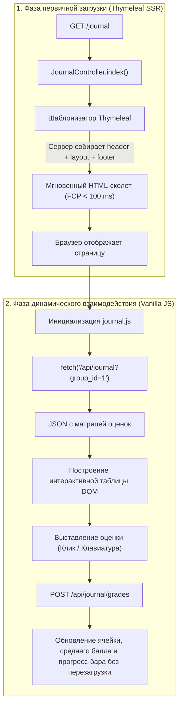
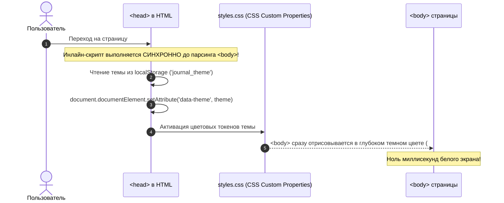
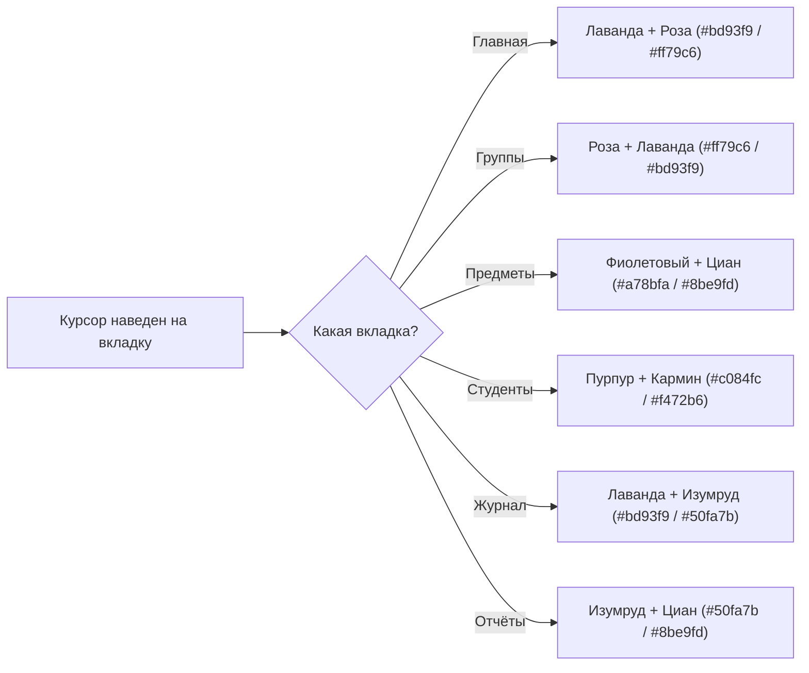
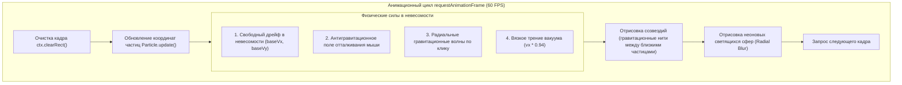
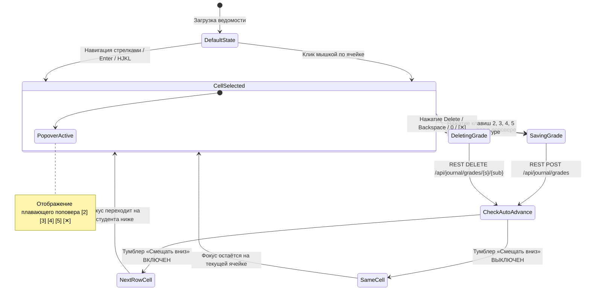

# Руководство 03: Клиентский интерфейс, Vanilla JS и Modern Aurora UI

Добро пожаловать в третье руководство по архитектуре проекта **«Электронный журнал успеваемости студентов» (jrnl)**!

В этом руководстве мы разберем устройство пользовательского интерфейса (Frontend):
1. Почему мы выбрали **Vanilla ES6+ JavaScript и чистый CSS3**, отказавшись от тяжелых SPA-фреймворков (React, Angular, Vue).
2. Как работает гибридная модель: **Server-Side Rendering (Thymeleaf)** для базовой верстки + **REST API (`fetch`)** для реактивной динамики.
3. Как устроена система тем (**Dracula Dark**, **OLED Pitch Black**, **Alabaster Light**) и как мы добились **Zero-FOUC** (полного отсутствия мигания белого экрана при переходах).
4. Как работает **Sliding Glider** (скользящая каретка навигации) и адаптивный неоновый градиент шапки (**Header Aurora Glow**).
5. Как устроен интерактивный физический движок **Google Antigravity Experience** на HTML5 Canvas.
6. Как работает матрица журнала: тактильный ввод, плавающий поповер быстрых оценок (`QuickMarkPopover`) и тумблер автоперехода вниз.
7. Как устроены встроенный **Linux TUI-терминал** и **Рентген внутренней логики (X-Ray Inspector)**.

---

## 1. Ментальная модель: Гибридная архитектура (SSR + REST)

Традиционный веб часто делят на две крайности:
* **Старый Web 1.0 (чистый SSR):** каждый клик по ссылке или кнопке перезагружает страницу целиком, экран моргает, скролл сбрасывается.
* **Тяжелые SPA (React / Next.js):** мегабайты JavaScript-бандлов, долгое время до первого интерактивного действия (TTI), сложный tooling (Node.js, npm, Webpack, Vite).

В проекте `jrnl` применен наиболее эффективный инженерный компромисс — **Гибридный SSR + Реактивный Vanilla JS**:



### Преимущества такого подхода:
* **Нулевой билд-степ фронтенда:** не нужны `npm install`, `node_modules` и сборщики. Достаточно открыть проект в IDE и изменить `.js` или `.css` — изменения применятся мгновенно.
* **Молниеносный отклик:** первый экран отрисовывается сервером мгновенно, а последующие действия работают через быстрые асинхронные JSON-запросы.
* **100% автономность:** приложение запускается без интернета на изолированных серверах.

---

## 2. Архитектура тем оформления и защита от мигания (Zero-FOUC)

Многие веб-приложения страдают от неприятного дефекта — **FOUC (Flash of Unstyled Content)**: при переходе на новую страницу на долю секунды моргает белый фон, пока не загрузятся CSS-стили и JavaScript.

В нашем проекте проблема решена на фундаментальном уровне:



### Цветовые палитры проекта:

Все цвета вынесены в CSS-переменные в [`src/main/resources/static/css/styles.css`](file:///home/milk13/IdeaProjects/jrnl/src/main/resources/static/css/styles.css):

| Токен | Dracula Dark (По умолчанию) | OLED Pitch Black | Alabaster Light |
|---|---|---|---|
| `--bg` | `#0f0e17` (Глубокий обсидиан) | `#000000` (Абсолютно черный) | `#f8f9fc` (Холодный алебастр) |
| `--surface` | `rgba(26, 24, 38, 0.72)` | `rgba(14, 14, 18, 0.85)` | `#ffffff` (Белый лист) |
| `--brand` | `#bd93f9` (Неоновая лаванда) | `#c084fc` (Пурпур) | `#6366f1` (Индиго) |
| `--brand-pink` | `#ff79c6` (Фуксия) | `#f43f5e` (Розовый кармин) | `#ec4899` (Розовый) |
| `--ink` | `#f8f8f2` (Светлый текст) | `#ffffff` (Белоснежный) | `#0f172a` (Темно-синий) |

Переключение темы по нажатию **`Alt+T`** плавно меняет атрибут `data-theme` на корневом теге `<html>`, мгновенно преображая весь интерфейс через CSS Transitions.

---

## 3. Скользящая навигация (Sliding Glider) и Header Aurora Glow

В шапке приложения [`header.html`](file:///home/milk13/IdeaProjects/jrnl/src/main/resources/templates/partials/header.html) реализованы два премиальных визуальных эффекта:

### 1. Скользящая каретка вкладок (Sliding Glider)
При переходе между вкладками (`/groups`, `/subjects`, `/students`, `/journal`, `/reports`) светящаяся рамка под активным пунктом меню не исчезает и не появляется грубо, а плавно перелетает на новую позицию с сохранением физической инерции (используются координаты из `sessionStorage`).

### 2. Адаптивное свечение шапки (Header Aurora Glow)
Вся шапка залита деликатным объемным градиентом, который живет и дышит:
* **Отслеживание курсора:** мягкое световое пятно скользит по шапке вслед за движениями мыши пользователя (`--hx`, `--hy`).
* **Адаптация под вкладку:** при наведении курсора на разные пункты меню цвета шапки плавно перетекают в тематический спектр:



---

## 4. Физический движок Google Antigravity Experience

На домашней странице [`/`](file:///home/milk13/IdeaProjects/jrnl/src/main/resources/templates/index.html) работает интерактивная физическая симуляция невесомости, созданная на чистом Canvas API в [`src/main/resources/static/js/antigravity.js`](file:///home/milk13/IdeaProjects/jrnl/src/main/resources/static/js/antigravity.js):



### Математика антигравитационного отталкивания:
Когда курсор мыши приближается к частице на расстояние $dist < 180$ пикселей, возникает векторная сила, направленная строго от курсора к частице:

$$force = \left(1 - \frac{dist}{180}\right) \times 3.8$$
$$v_x = v_x + \cos(\theta) \times force, \quad v_y = v_y + \sin(\theta) \times force$$

Благодаря этому частицы мягко разлетаются от курсора, создавая ощущение реального силового поля невесомости.

---

## 5. Тактильный журнал оценок: поповер, клавиатура и автопереход

Журнал успеваемости ([`journal.js`](file:///home/milk13/IdeaProjects/jrnl/src/main/resources/static/js/journal.js)) спроектирован так, чтобы преподаватель мог за несколько секунд проставить баллы целому потоку:



### 1. Плавающий поповер быстрого выбора (Quick Mark Popover)
При клике на ячейку над ней появляется компактный виджет:
```
       +-----------------------+
       | [2]  [3]  [4]  [5]  [✕]|
       +-----------+-----------+
                   v
             [  Ячейка  ]
```
Оценку можно поставить **мышкой в один клик** или нажать соответствующую клавишу.

### 2. Тумблер «Смещать вниз при вводе»
* **Выключен (по умолчанию):** фокус и поповер остаются ровно на той же ячейке. Удобно для проверки или быстрой смены оценки без скачков курсора.
* **Включен:** фокус мгновенно перескакивает на следующую строку вниз. Удобно для потокового выставления оценок по списку.
* Состояние тумблера сохраняется в `localStorage` (`journal_auto_advance_down`) и не сбрасывается при перезагрузке.

### 3. Живой расчет прогресса и среднего балла на лету
При выставлении оценки JavaScript мгновенно пересчитывает средний балл студента в строке, абсолютную успеваемость группы и обновляет неоновый прогресс-бар ведомости без перезапроса всей страницы.

---

## 6. Инструменты прозрачности: Рентген логики и TUI-терминал

В шапку системы встроены две мощные подсистемы для аудита и администрирования:

### 1. Рентген логики и SQL (X-Ray Inspector)
По нажатию **`Alt+L`** с правого края экрана выезжает шторка инспектора логики:
* Перехватывает каждый вызов `fetch()` через декоратор в [`api.js`](file:///home/milk13/IdeaProjects/jrnl/src/main/resources/static/js/api.js).
* Показывает полную цепочку выполнения: `HTTP Эндпоинт → Spring Service → Spring Repository`.
* Отображает точный SQL-запрос к SQLite и время ответа в миллисекундах.
* **Интерактивный ресайзер:** за левую грань шторки можно потянуть мышкой и произвольно изменить ее ширину (drag-to-resize). При этом контент страницы аккуратно сдвигается влево, не перекрываясь окном.

### 2. Встроенный Linux TUI-терминал (`milk13@archarnel`)
По нажатию **`Alt+C`** или **`Ctrl+~`** открывается консоль в стиле Arch Linux / Ghostty:
* **PAM-аутентификация:** поддержка команды `sudo` с вводом пароля и блокировкой неавторизованного доступа.
* **Консольный файловый менеджер Ranger:** двухколоночный просмотр файлов проекта, перемещение клавишами `h`, `j`, `k`, `l` и подсветка синтаксиса файлов.
* Встроенные утилиты: `ls`, `cat`, `help`, `clear`, `neofetch`, `theme`.

---

## 7. Резюме

Фронтенд проекта `jrnl`:
1. Не содержит тяжелых зависимостей и работает на чистом **Vanilla ES6+ JS**.
2. Гарантирует **отсутствие FOUC** и плавное переключение между 3 темами оформления.
3. Обеспечивает максимальную эргономику работы с оценками через плавающий поповер и клавиатурный Excel-режим.
4. Предоставляет прозрачные инструменты разработчика (X-Ray и TUI Terminal).

В следующем руководстве [**04-features-and-business-logic.md**](file:///home/milk13/IdeaProjects/jrnl/docs/04-features-and-business-logic.md) мы разберем устройство вертикальных функциональных срезов, логику экспорта ведомостей в Apache POI и расчет академических аналитических отчетов.
