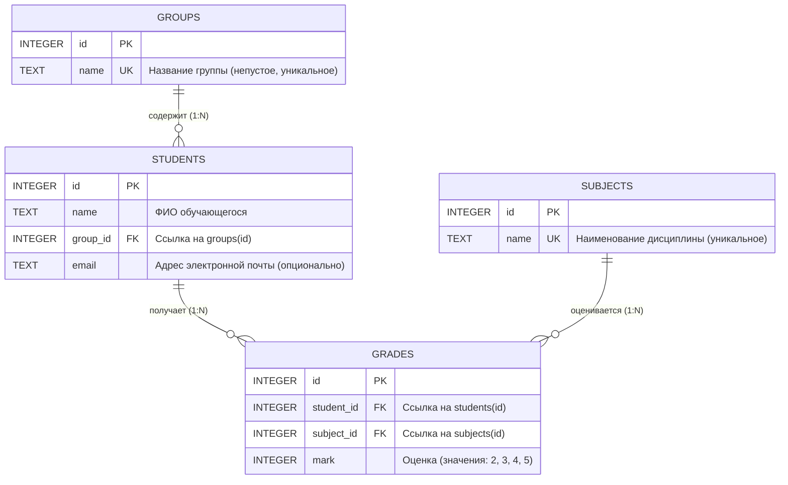
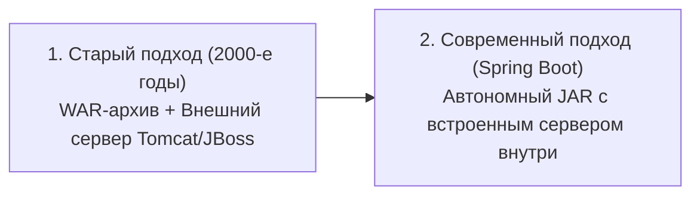
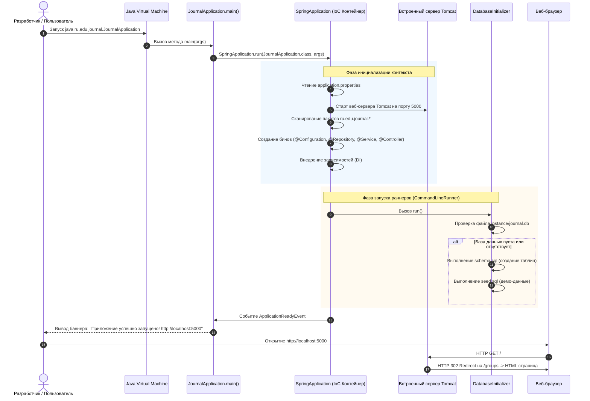
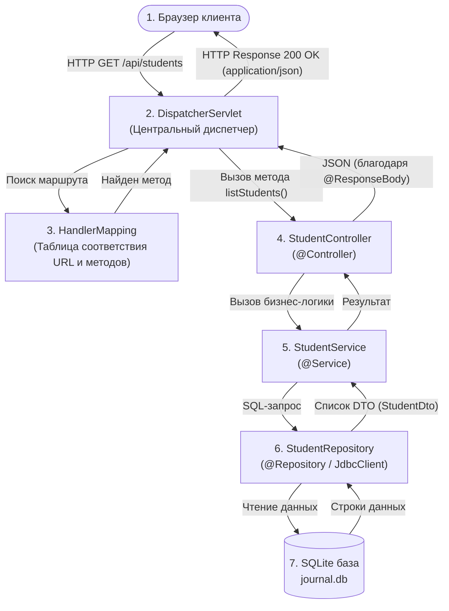
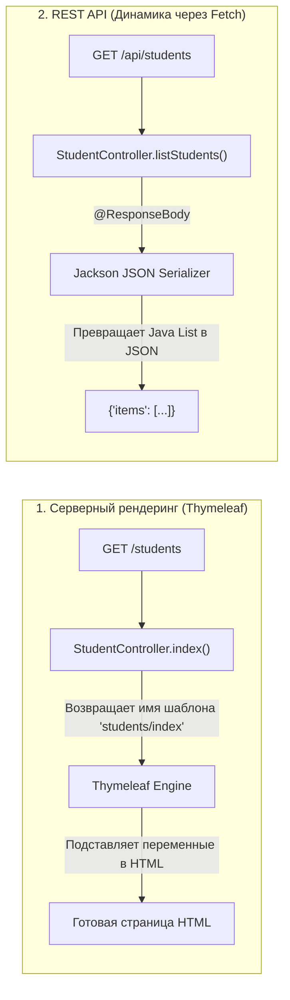
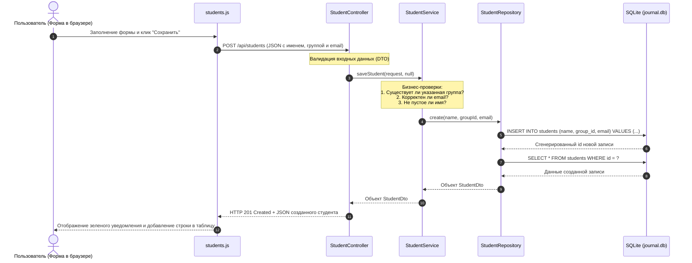

# Структура проекта
.
├── docs
│   ├── 01-how-it-works-and-architecture.md
│   └── README.md
├── scripts
│   └── setup-local-domain.sh
├── src
│   ├── main
│   │   ├── java
│   │   │   └── ru
│   │   │       └── edu
│   │   │           └── journal
│   │   │               ├── common
│   │   │               │   ├── exception
│   │   │               │   │   ├── NotFoundException.java
│   │   │               │   │   └── ValidationException.java
│   │   │               │   ├── DatabaseInitializer.java
│   │   │               │   └── GlobalExceptionHandler.java
│   │   │               ├── config
│   │   │               │   ├── DatabaseConfig.java
│   │   │               │   └── WebMvcConfig.java
│   │   │               ├── features
│   │   │               │   ├── groups
│   │   │               │   │   ├── dto
│   │   │               │   │   │   ├── GroupDto.java
│   │   │               │   │   │   └── GroupSaveRequest.java
│   │   │               │   │   ├── GroupController.java
│   │   │               │   │   ├── GroupRepository.java
│   │   │               │   │   └── GroupService.java
│   │   │               │   ├── journal
│   │   │               │   │   ├── dto
│   │   │               │   │   │   ├── BulkGradeRequest.java
│   │   │               │   │   │   ├── GradeDto.java
│   │   │               │   │   │   ├── GradeSaveRequest.java
│   │   │               │   │   │   └── JournalResponse.java
│   │   │               │   │   ├── JournalController.java
│   │   │               │   │   ├── JournalExportService.java
│   │   │               │   │   ├── JournalRepository.java
│   │   │               │   │   └── JournalService.java
│   │   │               │   ├── reports
│   │   │               │   │   ├── ReportController.java
│   │   │               │   │   ├── ReportRepository.java
│   │   │               │   │   └── ReportService.java
│   │   │               │   ├── students
│   │   │               │   │   ├── dto
│   │   │               │   │   │   ├── StudentDto.java
│   │   │               │   │   │   └── StudentSaveRequest.java
│   │   │               │   │   ├── StudentController.java
│   │   │               │   │   ├── StudentRepository.java
│   │   │               │   │   └── StudentService.java
│   │   │               │   └── subjects
│   │   │               │       ├── dto
│   │   │               │       │   ├── SubjectDto.java
│   │   │               │       │   └── SubjectSaveRequest.java
│   │   │               │       ├── SubjectController.java
│   │   │               │       ├── SubjectRepository.java
│   │   │               │       └── SubjectService.java
│   │   │               └── JournalApplication.java
│   │   └── resources
│   │       ├── db
│   │       │   ├── schema.sql
│   │       │   └── seed.sql
│   │       ├── static
│   │       │   ├── css
│   │       │   │   └── styles.css
│   │       │   └── js
│   │       │       ├── vendor
│   │       │       │   └── chart.umd.min.js
│   │       │       ├── api.js
│   │       │       ├── chart-helper.js
│   │       │       ├── groups.js
│   │       │       ├── journal.js
│   │       │       ├── reports.js
│   │       │       ├── students.js
│   │       │       ├── subjects.js
│   │       │       ├── theme.js
│   │       │       └── ui.js
│   │       ├── templates
│   │       │   ├── groups
│   │       │   │   └── index.html
│   │       │   ├── journal
│   │       │   │   └── index.html
│   │       │   ├── partials
│   │       │   │   ├── footer.html
│   │       │   │   └── header.html
│   │       │   ├── reports
│   │       │   │   └── index.html
│   │       │   ├── students
│   │       │   │   └── index.html
│   │       │   ├── subjects
│   │       │   │   └── index.html
│   │       │   └── error.html
│   │       └── application.properties
│   └── test
│       └── java
│           └── ru
│               └── edu
│                   └── journal
│                       ├── DatabaseBaselineTest.java
│                       ├── JournalIntegrationTest.java
│                       └── RollbackTest.java
├── mvnw
├── mvnw.cmd
├── pom.xml
├── project_context.md
└── README.md

40 directories, 66 files

# Файлы проекта

## pom.xml
```xml
<?xml version="1.0" encoding="UTF-8"?>
<project xmlns="http://maven.apache.org/POM/4.0.0"
         xmlns:xsi="http://www.w3.org/2001/XMLSchema-instance"
         xsi:schemaLocation="http://maven.apache.org/POM/4.0.0 https://maven.apache.org/xsd/maven-4.0.0.xsd">
    <modelVersion>4.0.0</modelVersion>

    <parent>
        <groupId>org.springframework.boot</groupId>
        <artifactId>spring-boot-starter-parent</artifactId>
        <version>3.3.5</version>
        <relativePath/>
    </parent>

    <groupId>ru.edu</groupId>
    <artifactId>journal</artifactId>
    <version>1.0.0</version>
    <name>journal</name>
    <description>Электронный журнал студентов на Java и Spring Boot</description>

    <properties>
        <java.version>21</java.version>
        <sqlite-jdbc.version>3.47.1.0</sqlite-jdbc.version>
    </properties>

    <dependencies>
        <!-- Spring Boot Web & Thymeleaf -->
        <dependency>
            <groupId>org.springframework.boot</groupId>
            <artifactId>spring-boot-starter-web</artifactId>
        </dependency>
        <dependency>
            <groupId>org.springframework.boot</groupId>
            <artifactId>spring-boot-starter-thymeleaf</artifactId>
        </dependency>

        <!-- Spring JDBC -->
        <dependency>
            <groupId>org.springframework.boot</groupId>
            <artifactId>spring-boot-starter-jdbc</artifactId>
        </dependency>

        <!-- SQLite JDBC Driver -->
        <dependency>
            <groupId>org.xerial</groupId>
            <artifactId>sqlite-jdbc</artifactId>
            <version>${sqlite-jdbc.version}</version>
        </dependency>

        <!-- Validation -->
        <dependency>
            <groupId>org.springframework.boot</groupId>
            <artifactId>spring-boot-starter-validation</artifactId>
        </dependency>

        <!-- Apache POI for Excel export (.xlsx) -->
        <dependency>
            <groupId>org.apache.poi</groupId>
            <artifactId>poi-ooxml</artifactId>
            <version>5.3.0</version>
        </dependency>

        <!-- Testing -->
        <dependency>
            <groupId>org.springframework.boot</groupId>
            <artifactId>spring-boot-starter-test</artifactId>
            <scope>test</scope>
        </dependency>
    </dependencies>

    <build>
        <plugins>
            <plugin>
                <groupId>org.springframework.boot</groupId>
                <artifactId>spring-boot-maven-plugin</artifactId>
            </plugin>
        </plugins>
    </build>
</project>
```

## README.md
```md
# Электронный журнал успеваемости студентов

Информационная система учёта успеваемости, академической успеваемости и аналитики учебного процесса высшего учебного заведения. Проект разработан на стеке **Java 21 (LTS)** и **Spring Boot 3** с архитектурой вертикальных функциональных срезов, чистым SQL без тяжелых ORM-абстракций, интерактивным пользовательским интерфейсом и подсистемой формирования аналитической отчетности.

---

## Оглавление

1. [Ключевые функциональные возможности](#ключевые-функциональные-возможности)
2. [Технологический стек](#технологический-стек)
3. [Архитектура приложения](#архитектура-приложения)
4. [Модель данных](#модель-данных)
5. [Спецификация REST API](#спецификация-rest-api)
6. [Инструкция по развертыванию и запуску](#инструкция-по-развертыванию-и-запуску)
   - [Запуск автономного JAR-пакета](#1-запуск-автономного-jar-пакета)
   - [Запуск через Maven Wrapper](#2-запуск-через-maven-wrapper)
   - [Открытие и запуск в IntelliJ IDEA](#3-открытие-и-запуск-в-intellij-idea)
7. [Консольные утилиты и обслуживание БД](#консольные-утилиты-и-обслуживание-бд)
8. [Тестирование и верификация](#тестирование-и-верификация)
9. [Руководство по интерфейсу и горячие клавиши](#руководство-по-интерфейсу-и-горячие-клавиши)

---

## Ключевые функциональные возможности

### 1. Управление контингентом и справочниками
- **Учебные группы:** просмотр перечня групп с автоматическим подсчетом численности контингента, создание новых групп, переименование, каскадная защита от удаления групп, содержащих активных студентов.
- **Дисциплины (предметы):** ведение реестра академических дисциплин с контролем уникальности наименований; строгая блокировка удаления дисциплин, по которым в системе зафиксированы выставленные оценки.
- **Студенты:** учет личных данных обучающихся (ФИО, email, академическая группа); регистрация новых студентов; процедура межкафедрального перевода между группами с безусловным сохранением всех накопленных ранее оценок; транзакционное удаление записи студента и всех связанных с ним оценок в рамках единой атомарной транзакции SQLite.

### 2. Поиск, фильтрация и многофакторная сортировка
- Полнотекстовый поиск обучающихся в реальном времени по подстроке ФИО, адресу электронной почты или названию группы.
- Динамический фильтр контингента по выбранной учебной группе.
- Многофакторная сортировка реестра:
  - по алфавиту ФИО (А → Я, Я → А);
  - по учебным группам (А → Я, Я → А);
  - по академическому среднему баллу (по возрастанию / убыванию);
  - по общему количеству полученных оценок.
- Интерактивная сортировка в один клик по кликабельным заголовкам столбцов таблицы с визуальной индикацией текущего направления.
- Отображение точного среднего балла студента с цветовой градацией академического уровня.

### 3. Академический журнал успеваемости и быстрый ввод (Excel-режим)
- Матричное представление успеваемости: студенты группы расположены построчно, дисциплины — по столбцам.
- Пустые ячейки наглядно маркируются прочерком при отсутствии записи в базе данных.
- Визуальная подсветка академических задолженностей (двойки выделяются контрастным фоном).
- Модальное окно для выставления, изменения и удаления оценки с валидацией значений (строго 2, 3, 4, 5).
- **Режим быстрого клавиатурного редактирования (Excel-style):**
  - Навигация по таблице клавишами стрелок (вверх, вниз, влево, вправо) и Enter.
  - Мгновенное выставление оценки нажатием клавиш 2, 3, 4, 5 (основной ряд или Numpad) с немедленным фоновым сохранением через REST API и автоматическим шагом фокуса на строку вниз.
  - Моментальное удаление оценки клавишами Delete или Backspace.
  - Однократный клик мыши переносит фокус; двойной клик открывает полное диалоговое окно.

### 4. Экспорт данных и печатные формы
- **Экспорт в Microsoft Excel (.xlsx):**
  - Генерация валидного XLSX-файла средствами Apache POI 5.3.0.
  - Фирменная стилизация заголовка ведомости, даты формирования и колонок таблицы.
  - Автоматический расчет ширины столбцов по длине содержимого.
  - Подсветка неудовлетворительных результатов и автоматическое определение академического статуса каждого обучающегося (*«Отличник»*, *«Хорошист»*, *«Успевает»*, *«Академическая задолженность»*, *«Нет оценок»*).
- **Экспорт в CSV (.csv):**
  - Формат данных с разделителем точка с запятой (`;`).
  - Префикс UTF-8 BOM для безупречного открытия во всех версиях Microsoft Excel и LibreOffice без искажения кодировки.
- **Печатная версия ведомости (Print / PDF):**
  - Специализированная таблица стилей `@media print` с альбомной ориентацией страницы А4.
  - Автоматическое скрытие служебных интерфейсных элементов (меню, фильтров, кнопок управления).
  - Формирование официальной академической шапки ведомости и блоков для подписей преподавателя и сотрудников деканата.

### 5. Аналитический модуль и интерактивные графики
- Локальная автономная интеграция библиотеки Chart.js (полное функционирование в изолированных сетях без доступа в интернет).
- Сводные KPI-карточки (число групп, студентов, зафиксированных оценок, общий средний балл).
- Сравнительные столбчатые диаграммы успеваемости групп и распределения контингента.
- Круговые диаграммы структуры оценок и доли академических задолженностей.
- Аналитический блок в журнале конкретной группы с расчетом абсолютной успеваемости (процент без двоек) и качественной успеваемости (процент четверок и пятерок).

### 6. Эргономика интерфейса и тёмная тема
- Тёмная графическая тема установлена по умолчанию.
- Полное предотвращение эффекта мигания белого экрана при переходах между страницами (Zero Flash of Unstyled Content, FOUC) за счет предварительной инициализации цветовых токенов в секции `<head>`.
- Быстрое переключение между тёмной и светлой темами с сохранением выбора в `localStorage`.
- Зебра-расцветка строк (`zebra striping`) с плавным выделением при наведении курсора для комфортной работы с большими табличными массивами данных.

---

## Технологический стек

| Компонент | Технология | Назначение |
|---|---|---|
| Язык программирования | Java 21 (LTS, OpenJDK) | Базовая программная платформа |
| Фреймворк | Spring Boot 3.3.5 | Инверсия управления, MVC, REST, сборка |
| СУБД | SQLite 3 (`org.xerial:sqlite-jdbc`) | Локальное реляционное хранилище данных |
| Доступ к данным | Spring JDBC (`NamedParameterJdbcTemplate`) | Чистый параметризованный SQL |
| Шаблонизатор | Thymeleaf 3 | Серверная визуализация HTML-страниц |
| Экспорт в электронные таблицы | Apache POI 5.3.0 (`poi-ooxml`) | Формирование документов формата Microsoft Excel |
| Графическая аналитика | Chart.js 4.4.1 (автономный бандл) | Клиентская визуализация диаграмм |
| Клиентский слой | Стандартный ES6+ JavaScript, CSS3 | Реактивный интерфейс без сторонних тяжелых фреймворков |
| Сборщик проектов | Apache Maven 3.9+ | Управление зависимостями и сборка артефактов |

---

## Архитектура приложения

Проект построен по принципу вертикального разделения на функциональные домены (`Feature-Driven Architecture`). Каждый функциональный срез полностью инкапсулирует контроллер, сервис, репозиторий с прямым SQL и DTO-модели.

```
src/main/java/ru/edu/journal/
├── JournalApplication.java                  # Главный класс приложения и обработчик CLI-команд
├── config/
│   ├── DatabaseConfig.java                  # Конфигурация SQLite DataSource (PRAGMA foreign_keys = ON)
│   └── WebMvcConfig.java                    # Конфигурация статических ресурсов и кэширования
├── common/
│   ├── DatabaseInitializer.java             # Первичная инициализация схемы и демонстрационных данных
│   ├── GlobalExceptionHandler.java          # Централизованная обработка ошибок и трансляция в JSON
│   └── exception/                           # Пользовательские исключения (ValidationException, NotFoundException)
└── features/
    ├── groups/                              # Модуль «Учебные группы»
    │   ├── GroupController.java             # Маршруты /groups и /api/groups
    │   ├── GroupService.java                # Бизнес-правила валидации и уникальности групп
    │   ├── GroupRepository.java             # SQL-запросы к таблице groups
    │   └── dto/                             # GroupDto, GroupSaveRequest
    ├── subjects/                            # Модуль «Дисциплины»
    │   ├── SubjectController.java           # Маршруты /subjects и /api/subjects
    │   ├── SubjectService.java              # Защита от удаления предметов с выставленными оценками
    │   ├── SubjectRepository.java           # SQL-запросы к таблице subjects
    │   └── dto/                             # SubjectDto, SubjectSaveRequest
    ├── students/                            # Модуль «Студенты»
    │   ├── StudentController.java           # Маршруты /students и /api/students
    │   ├── StudentService.java              # Транзакционный перевод, каскадное удаление
    │   ├── StudentRepository.java           # Фильтрация, поиск, расчет средних баллов
    │   └── dto/                             # StudentDto, StudentSaveRequest
    ├── journal/                             # Модуль «Журнал успеваемости»
    │   ├── JournalController.java           # Страница /journal, эндпоинты оценок и экспорта
    │   ├── JournalService.java              # Логика выставления и обновления оценок (upsert)
    │   ├── JournalRepository.java           # Построение матрицы оценок группы
    │   ├── JournalExportService.java        # Потоковая генерация XLSX и CSV с BOM
    │   └── dto/                             # JournalResponse, GradeDto, GradeSaveRequest
    └── reports/                             # Модуль «Отчёты и аналитика»
        ├── ReportController.java            # Страница /reports и REST /api/reports
        ├── ReportService.java               # Диспетчеризация аналитических срезов
        └── ReportRepository.java            # Аналитические SQL-агрегации (GROUP BY, HAVING)
```

---

## Модель данных

Реляционная схема хранится в файле `src/main/resources/db/schema.sql` и разворачивается в SQLite с обязательным контролем внешних ключей.



### Ограничения целостности и индексы
- Таблица `groups`: ограничение `CHECK(length(trim(name)) > 0)`, индекс `idx_groups_name`.
- Таблица `subjects`: ограничение `CHECK(length(trim(name)) > 0)`, индекс `idx_subjects_name`.
- Таблица `students`: внешняя ссылка `REFERENCES groups(id) ON DELETE RESTRICT`, индекс `idx_students_group`.
- Таблица `grades`: внешние ссылки `REFERENCES students(id) ON DELETE CASCADE` и `REFERENCES subjects(id) ON DELETE RESTRICT`, ограничение `CHECK(mark BETWEEN 2 AND 5)`, уникальный композитный индекс `idx_grades_student_subject UNIQUE(student_id, subject_id)`.

---

## Спецификация REST API

### 1. Учебные группы
- `GET /api/groups` — получение списка всех групп с количеством студентов.
- `POST /api/groups` — создание новой группы (`{"name": "БЭИ2301"}`).
- `POST /api/groups/{id}` — переименование группы.
- `DELETE /api/groups/{id}` — удаление пустой группы (возвращает 400 при наличии студентов).

### 2. Дисциплины
- `GET /api/subjects` — получение списка дисциплин.
- `POST /api/subjects` — добавление дисциплины (`{"name": "Базы данных"}`).
- `POST /api/subjects/{id}` — переименование дисциплины.
- `DELETE /api/subjects/{id}` — удаление дисциплины (возвращает 400 при наличии связанных оценок).

### 3. Студенты
- `GET /api/students` — перечень студентов с поддержкой параметров `?q=...` (поиск по строке) и `?group_id=...` (фильтр по группе). Возвращает средний балл каждого обучающегося.
- `GET /api/students/{id}` — получение подробных данных студента.
- `POST /api/students` — регистрация студента (`{"name": "...", "group_id": 1, "email": "..."}`).
- `POST /api/students/{id}` — изменение данных или перевод в другую группу.
- `DELETE /api/students/{id}` — транзакционное каскадное удаление студента и всех его оценок.

### 4. Журнал успеваемости и экспорт
- `GET /api/journal?group_id={id}` — получение матрицы журнала выбранной группы (группа, список предметов, список студентов, массив оценок).
- `POST /api/journal/grades` — выставление или обновление оценки (`{"student_id": 1, "subject_id": 2, "mark": 5}`).
- `DELETE /api/journal/grades/{studentId}/{subjectId}` — удаление оценки по предмету.
- `GET /api/journal/export/excel?group_id={id}` — выгрузка ведомости группы в бинарный файл Microsoft Excel (.xlsx).
- `GET /api/journal/export/csv?group_id={id}` — выгрузка ведомости группы в текстовый файл CSV (разделитель `;`, кодировка UTF-8 BOM).

### 5. Аналитические отчёты
- `GET /api/reports?kind=groups` — сводные статистические показатели по группам (контингент, сумма оценок, средний балл).
- `GET /api/reports?kind=no_grades` — список обучающихся без единой выставленной оценки.
- `GET /api/reports?kind=failing` — список неуспевающих обучающихся (имеющих хотя бы одну оценку «2»).

---

## Инструкция по развертыванию и запуску

Для работы приложения требуется установленная виртуальная машина **Java 21** или выше.

### 1. Запуск автономного JAR-пакета

В дистрибутив входит предварительно скомпилированный Fat-JAR архив, содержащий внутри сервер приложений и все библиотеки:

```bash
# Запуск веб-сервера из директории проекта
java -jar target/journal-1.0.0.jar
```

После старта веб-интерфейс доступен в браузере по адресу:
```
http://127.0.0.1:5000/
```

При первом запуске приложение автоматически создаст локальную базу данных `instance/journal.db` и наполнит её демонстрационным набором данных (3 учебные группы, 60 студентов, 3 дисциплины, 162 оценки).

### 2. Запуск через Maven Wrapper

Сборка и запуск из исходного кода с помощью входящего в проект скрипта Maven Wrapper (не требует предварительно установленного Maven):

```bash
# Запуск веб-сервера
./mvnw spring-boot:run

# Сборка нового JAR-пакета после внесения изменений
./mvnw clean package
```

Собранный исполняемый файл будет помещен по пути: `target/journal-1.0.0.jar`.

### 3. Открытие и запуск в IntelliJ IDEA

1. Запустите IntelliJ IDEA.
2. Выберите пункт меню **File → Open...** и укажите корневой каталог проекта: `/home/milk13/IdeaProjects/jrnl`.
3. Среда разработки автоматически распознает файл `pom.xml`, выполнит импорт зависимостей и настроит структуру модулей.
4. Убедитесь, что в **Project Structure → Project SDK** выбран Java 21 (или 22/27).
5. Перейдите к файлу `src/main/java/ru/edu/journal/JournalApplication.java`.
6. Нажмите кнопку **Run** рядом с объявлением метода `main`.

---

## Консольные утилиты и обслуживание БД

Приложение поддерживает запуск со специальными аргументами командной строки для административного обслуживания и валидации базы данных без запуска постоянного веб-сервера:

### Восстановление исходного состояния базы данных
Пересоздает таблицы из `src/main/resources/db/schema.sql` и заполняет их исходными данными из `src/main/resources/db/seed.sql` в рамках единой транзакции:

```bash
# Через JAR
java -jar target/journal-1.0.0.jar --prepare

# Через Maven Wrapper
./mvnw spring-boot:run -Dspring-boot.run.arguments="--prepare"
```

### Проверка контрольных показателей базы данных
Выполняет сверку связности, включения внешних ключей и контрольных сумм записей:

```bash
java -jar target/journal-1.0.0.jar --check-baseline
```
Ожидаемый результат:
```
foreign_keys: 1
foreign_key_check: 0
groups: 3
students: 60
subjects: 3
grades: 162
students_without_grades: 6
PASS: база прошла проверку
```

### Проверка отката транзакций при сбое
Имитирует непредвиденную ошибку в середине транзакции удаления студента и проверяет сохранность данных после аварийного отката:

```bash
java -jar target/journal-1.0.0.jar --check-rollback
```
Ожидаемый результат:
```
Учебный сбой: Учебная ошибка после удаления оценок.
PASS: студент и все оценки сохранены после отката
PASS: обычное удаление убрало студента и его оценки
```

---

## Тестирование и верификация

В проект включен комплекс автоматических интеграционных и модульных тестов на платформе JUnit 5 и Spring Test:

```bash
./mvnw test
```

### Состав тестового набора:
1. `DatabaseBaselineTest` — проверка соответствия реляционной схемы и корректности начального наполнения БД.
2. `RollbackTest` — проверка механизма транзакционного отката Spring JDBC при искусственных аппаратных или программных сбоях.
3. `JournalIntegrationTest` — сквозное тестирование всех разделов REST API:
   - валидация операций с группами и защита от удаления непустых групп;
   - создание предметов и блокировка удаления дисциплин с оценками;
   - создание, поиск, фильтрация студентов и межкафедральный перевод с сохранением оценок;
   - матричный журнал, выставление оценок 2..5, защита от некорректных значений;
   - генерация бинарных выгрузок Excel (.xlsx) и CSV с проверкой заголовков;
   - аналитические выборки модуля отчетов.

---

## Руководство по интерфейсу и горячие клавиши

### Раздел «Журнал» — режим быстрого ввода
Для активации быстрого ввода установите флажок **«Режим быстрого ввода (клавиатура)»** в верхней части страницы журнала.

| Клавиша / Сочетание | Выполняемое действие |
|---|---|
| Стрелка вверх (`ArrowUp`) | Перемещение фокуса на строку выше (предыдущий студент) |
| Стрелка вниз (`ArrowDown`) / `Enter` | Перемещение фокуса на строку ниже (следующий студент) |
| Стрелка влево (`ArrowLeft`) | Перемещение фокуса на столбец левее (предыдущий предмет) |
| Стрелка вправо (`ArrowRight`) | Перемещение фокуса на столбец правее (следующий предмет) |
| Цифры `2`, `3`, `4`, `5` | Немедленная фиксация оценки в БД и переход к следующему студенту |
| `Delete` / `Backspace` | Мгновенное удаление оценки из БД в активной ячейке |
| Одиночный клик мыши | Фокусировка выбранной ячейки таблицы |
| Двойной клик мыши | Открытие детального модального окна управления оценкой |

### Раздел «Студенты»
- Ввод любого текста в поле **«Поиск по студентам»** мгновенно фильтрует таблицу без перезагрузки страницы.
- Нажатие на заголовки столбцов **«ФИО»**, **«Группа»**, **«Оценок»**, **«Средний балл»** упорядочивает список по возрастанию или убыванию.
- Кнопка **«Добавить студента»** открывает форму привязки к группе с валидацией имени.
- Кнопка **«Изменить»** в строке студента позволяет перевести его в другую академическую группу с сохранением истории оценок.
```

## docs/01-how-it-works-and-architecture.md
```md
# Руководство 01: Как работает проект, веб-сервер и Spring Boot

Добро пожаловать в первое руководство по архитектуре проекта **«Электронный журнал успеваемости студентов» (jrnl)**!

Этот документ создан для того, чтобы простыми словами, на понятных примерах и наглядных схемах объяснить фундаментальные вещи:
1. Как вообще программа на Java становится работающим веб-сайтом.
2. Что такое веб-сервер, откуда он берется и как запускается.
3. Какую работу за нас выполняет фреймворк **Spring Boot**.
4. Как данные проходят путь от браузера пользователя до файла базы данных SQLite и обратно.

---

## 1. Ментальная модель: что представляет собой проект?

Если говорить простыми словами, этот проект — **автономное сетевое приложение**.

Вам не нужно отдельно скачивать или настраивать серверы баз данных (как PostgreSQL или MySQL) и внешние веб-серверы (как Apache или Nginx). Всё необходимое упаковано прямо внутрь приложения:

```
+------------------------------------------------------------------------+
|                          Java-процесс (JVM)                            |
|                                                                        |
|  +--------------------+   +-------------------+   +-----------------+  |
|  | Встроенный веб-    |   | Фреймворк         |   | Локальная БД    |  |
|  | сервер Tomcat      |-->| Spring Boot       |-->| SQLite          |  |
|  | (порт 5000)        |   | (бизнес-логика)   |   | (файл на диске) |  |
|  +--------------------+   +-------------------+   +-----------------+  |
|           ^                                                 |          |
+-----------|-------------------------------------------------|----------+
            | HTTP-запросы                                    | journal.db
            v                                                 v
      [ Браузер ]                                     [ Диск компьютера ]
```

Когда проект запускается:
1. В памяти компьютера стартует виртуальная машина Java (**JVM**).
2. Поднимается встроенный веб-сервер (**Apache Tomcat**), который открывает сетевой порт **5000** и начинает слушать входящие подключения.
3. Проверяется и подключается файл базы данных [instance/journal.db](file:///home/milk13/IdeaProjects/jrnl/instance/journal.db).
4. Вы открываете браузер по адресу `http://localhost:5000` и начинаете работать с журналом.

---

## 2. Как в Java создаются сайты и веб-приложения?

### Что такое веб-сайт с точки зрения компьютера?
Любой веб-сайт — это диалог по протоколу **HTTP** (HyperText Transfer Protocol) между двумя программами:
* **Клиент (браузер)** отправляет текстовый запрос: *«Привет, дай мне страницу `/students`»*.
* **Сервер** отправляет текстовый ответ: заголовок `200 OK` и содержимое (HTML-разметку, стили CSS, картинки или JSON-данные).

### Как это устроено в Java: эволюция от сервлетов до Spring Boot



#### Исторический экскурс: как было раньше
Раньше, чтобы запустить Java-сайт, программисту требовалось:
1. Установить на операционную систему тяжелый сервер приложений (например, Apache Tomcat или GlassFish).
2. Написать Java-классы, наследующие `HttpServlet`, и вручную в XML-файлах расписывать, какой URL какому классу соответствует.
3. Собрать проект в `.war` (Web Application Archive) и вручную скопировать в папку сервера.

#### Современный стандарт: Fat JAR и Embedded Tomcat
В Spring Boot всё перевернули: **не приложение загружается в сервер, а сервер встроен прямо внутрь приложения!**
В файле сборщика [pom.xml](file:///home/milk13/IdeaProjects/jrnl/pom.xml) подключен один стартовый модуль:

```xml
<dependency>
    <groupId>org.springframework.boot</groupId>
    <artifactId>spring-boot-starter-web</artifactId>
</dependency>
```

Этот модуль автоматически подтягивает библиотеки **Apache Tomcat**. При компиляции проект упаковывается в один исполняемый файл `.jar`. Чтобы запустить сайт, достаточно выполнить команду в консоли:
```bash
java -jar target/journal-1.0.0.jar
```
Или запустить метод `main()` в вашей IDE.

---

## 3. Что делает Spring Boot в этом проекте?

Фреймворк Spring — это «дирижер оркестра». Без него программисту пришлось бы вручную писать тысячи строк инфраструктурного кода: открывать сокеты, разбирать HTTP-заголовки, создавать объекты, передавать их друг другу и следить за памятью.

Spring Boot берет на себя 4 ключевые задачи:

### 1. Инверсия управления (IoC) и внедрение зависимостей (DI)
В обычном Java-коде, если одному классу нужен другой, мы пишем:
```java
StudentService service = new StudentService(new StudentRepository(...));
```
Если классов десятки, связывать их вручную становится кошмаром.

Spring использует подход **Inversion of Control (IoC)**:
* Он сам создает объекты нужных классов при старте приложения. Такие управляемые объекты называются **Бинами (Beans)**.
* Контейнер, где они живут, называется **ApplicationContext**.
* Через **Dependency Injection (DI)** Spring сам передает (внедряет) нужные зависимости через конструктор.

Посмотрим на реальный пример из проекта — [StudentController.java](file:///home/milk13/IdeaProjects/jrnl/src/main/java/ru/edu/journal/features/students/StudentController.java#L13-L20):
```java
@Controller
public class StudentController {

    private final StudentService studentService;

    // Spring сам находит созданный ранее бин StudentService и передает его сюда!
    public StudentController(StudentService studentService) {
        this.studentService = studentService;
    }
    ...
}
```

### 2. Главные аннотации и их роли

| Аннотация | Что означает для Spring | Пример в проекте |
|---|---|---|
| `@SpringBootApplication` | Главная точка входа. Включает сканирование компонентов и автоконфигурацию. | [`JournalApplication`](file:///home/milk13/IdeaProjects/jrnl/src/main/java/ru/edu/journal/JournalApplication.java#L23) |
| `@Controller` | Класс отвечает за обработку входящих HTTP-запросов (веб-страницы и API). | [`StudentController`](file:///home/milk13/IdeaProjects/jrnl/src/main/java/ru/edu/journal/features/students/StudentController.java#L13) |
| `@Service` | Класс содержит чистую бизнес-логику и бизнес-правила системы. | [`StudentService`](file:///home/milk13/IdeaProjects/jrnl/src/main/java/ru/edu/journal/features/students/StudentService.java) |
| `@Repository` | Класс отвечает за работу с базой данных (выполнение SQL-запросов). | [`StudentRepository`](file:///home/milk13/IdeaProjects/jrnl/src/main/java/ru/edu/journal/features/students/StudentRepository.java#L12) |
| `@Configuration` | Класс объявляет глобальные настройки приложения и создает системные бины. | [`DatabaseConfig`](file:///home/milk13/IdeaProjects/jrnl/src/main/java/ru/edu/journal/config/DatabaseConfig.java#L12) |
| `@Bean` | Метод, возвращающий объект, который Spring должен взять под управление. | Метод `dataSource()` в [`DatabaseConfig`](file:///home/milk13/IdeaProjects/jrnl/src/main/java/ru/edu/journal/config/DatabaseConfig.java#L19) |

### 3. Автоконфигурация (Autoconfiguration)
Spring Boot анализирует файлы в вашем `classpath` (зависимости из [pom.xml](file:///home/milk13/IdeaProjects/jrnl/pom.xml)):
* Нашел `spring-boot-starter-web`? Автоматически сконфигурирует Tomcat и диспетчер запросов `DispatcherServlet`.
* Нашел `spring-boot-starter-thymeleaf`? Автоматически настроит шаблонизатор для рендеринга HTML-страниц из папки `src/main/resources/templates`.
* Нашел `application.properties`? Считает настройки (порт, путь к БД) и применит их.

### 4. Внешняя конфигурация ([application.properties](file:///home/milk13/IdeaProjects/jrnl/src/main/resources/application.properties))
Вместо того чтобы зашивать настройки в код, они вынесены в понятный конфигурационный файл:
```properties
server.port=5000                       # На каком сетевом порту запускать веб-сервер
spring.application.name=journal        # Имя приложения
app.db.path=instance/journal.db        # Где лежит файл базы данных SQLite
app.db.auto-init=true                  # Нужно ли автоматически создать таблицы при старте
spring.thymeleaf.cache=false           # Отключение кэша шаблонов для мгновенного обновления верстки
```

---

## 4. Как запускается веб-приложение: пошаговый жизненный цикл

Ниже показана полная последовательность событий от клика «Run» до готовности сервера принимать клиентов:



### Разбор ключевых фаз:

1. **Точка входа**: Метод `main` в файле [`JournalApplication.java`](file:///home/milk13/IdeaProjects/jrnl/src/main/java/ru/edu/journal/JournalApplication.java#L40-L42):
   ```java
   public static void main(String[] args) {
       SpringApplication.run(JournalApplication.class, args);
   }
   ```
2. **Создание сетевого слушателя**: Внутри `SpringApplication.run()` создается `ServletWebServerApplicationContext`. Он запускает веб-сервер Tomcat, связывает его с сокетом `0.0.0.0:5000` и запускает фоновый пул потоков (Worker Threads), готовых параллельно обрабатывать запросы пользователей.
3. **Инициализация базы данных**: Класс [`DatabaseInitializer`](file:///home/milk13/IdeaProjects/jrnl/src/main/java/ru/edu/journal/common/DatabaseInitializer.java) реализует интерфейс `CommandLineRunner`. Это значит, что метод `run()` вызовется автоматически сразу после поднятия контекста, но до того, как сервер начнет принимать реальных пользователей. Он проверяет, есть ли таблицы в SQLite, и если база пустая — накатывает схему [schema.sql](file:///home/milk13/IdeaProjects/jrnl/src/main/resources/db/schema.sql) и начальные данные [seed.sql](file:///home/milk13/IdeaProjects/jrnl/src/main/resources/db/seed.sql).
4. **Готовность к работе**: Слушатель [`onApplicationReady`](file:///home/milk13/IdeaProjects/jrnl/src/main/java/ru/edu/journal/JournalApplication.java#L44-L68) перехватывает событие готовности и печатает в консоль красивое сообщение с ссылкой для перехода в браузер.

---

## 5. Как обрабатываются HTTP-запросы (Архитектура Spring MVC)

Когда пользователь нажимает ссылку или кнопку в браузере, в приложение прилетает HTTP-запрос. Кто его встречает и как он добирается до нужного метода?

За это отвечает **Spring MVC** и его центральный компонент — **`DispatcherServlet`** (паттерн *Front Controller*):



### Два типа ответов в нашем проекте: HTML vs JSON

Наш проект использует современную гибридную архитектуру:



1. **Серверные страницы (SSR — Server-Side Rendering)**:
   * Вы переходите на страницу `http://localhost:5000/students`.
   * Контроллер [`StudentController`](file:///home/milk13/IdeaProjects/jrnl/src/main/java/ru/edu/journal/features/students/StudentController.java#L22-L26) возвращает строку `"students/index"`.
   * Шаблонизатор **Thymeleaf** берет файл [src/main/resources/templates/students/index.html](file:///home/milk13/IdeaProjects/jrnl/src/main/resources/templates/students/index.html), собирает его вместе с шапкой ([header.html](file:///home/milk13/IdeaProjects/jrnl/src/main/resources/templates/partials/header.html)) и подвалом ([footer.html](file:///home/milk13/IdeaProjects/jrnl/src/main/resources/templates/partials/footer.html)) и отдает браузеру готовый HTML-каркас.
2. **REST API для динамики**:
   * Страница в браузере загрузилась, и клиентский JavaScript ([students.js](file:///home/milk13/IdeaProjects/jrnl/src/main/resources/static/js/students.js)) делает фоновый запрос `fetch('/api/students')`.
   * Метод [`listStudents`](file:///home/milk13/IdeaProjects/jrnl/src/main/java/ru/edu/journal/features/students/StudentController.java#L28-L33) помечен аннотацией `@ResponseBody`. Это говорит Spring: *«Не ищи HTML-шаблон, а преврати возвращаемые Java-объекты прямо в формат JSON!»*.
   * Браузер получает чистые данные и мгновенно перерисовывает таблицу без перезагрузки всей страницы.

---

## 6. Архитектурный стиль проекта: Вертикальные срезы (Vertical Slices)

Большинство традиционных руководств предлагают раскладывать код «горизонтально»: все контроллеры в один общий пакет `controllers`, все сервисы в `services`, а все репозитории в `repositories`. Когда проект разрастается, в такой структуре становится сложно ориентироваться.

В нашем проекте применен более продвинутый подход — **Vertical Slice Architecture (Архитектура вертикальных срезов)**:

```
src/main/java/ru/edu/journal/
├── JournalApplication.java          # Главная точка входа
├── config/                          # Глобальные конфигурации
│   ├── DatabaseConfig.java          # Настройка подключения к SQLite
│   └── WebMvcConfig.java            # Маршрутизация, перенаправления, статика
├── common/                          # Общие утилиты и обработчики
│   ├── DatabaseInitializer.java     # Инициализация БД при старте
│   └── GlobalExceptionHandler.java  # Перехват и форматирование ошибок
└── features/                        # ВЕРТИКАЛЬНЫЕ СРЕЗЫ (Функциональные модули):
    ├── students/                    # Всё, что касается студентов
    │   ├── dto/                     # Объекты передачи данных (StudentDto, StudentSaveRequest)
    │   ├── StudentController.java   # HTTP эндпоинты
    │   ├── StudentService.java      # Бизнес-правила
    │   └── StudentRepository.java   # SQL-запросы к таблице students
    ├── groups/                      # Всё, что касается учебных групп
    ├── subjects/                    # Всё, что касается предметов
    ├── journal/                     # Матрица оценок и Excel-режим
    └── reports/                     # Аналитика, графики и отчеты
```

### Преимущества такой структуры:
* **Высокая связность (High Cohesion):** если вам нужно доработать логику студентов, вы открываете папку `features/students` — контроллер, сервис, репозиторий и DTO находятся в одном месте.
* **Изолированность:** изменения в модуле `reports` никак случайно не сломают модуль `students`.

---

## 7. Внутреннее устройство одного среза: от контроллера до базы данных

Давайте разберем пошагово, как устроен срез на примере сохранения нового студента:



### За что отвечает каждый класс в этой цепочке:

1. **[`StudentSaveRequest`](file:///home/milk13/IdeaProjects/jrnl/src/main/java/ru/edu/journal/features/students/dto/StudentSaveRequest.java)** — DTO (Data Transfer Object). Простой Java-класс (или Record), описывающий контракт входящих данных: какие поля мы ждем от клиента.
2. **[`StudentController`](file:///home/milk13/IdeaProjects/jrnl/src/main/java/ru/edu/journal/features/students/StudentController.java)** — принимает HTTP-запрос, переводит JSON в Java-объект, вызывает сервис и возвращает соответствующий HTTP-статус (`201 CREATED` при успехе или `400 BAD REQUEST` при ошибке).
3. **[`StudentService`](file:///home/milk13/IdeaProjects/jrnl/src/main/java/ru/edu/journal/features/students/StudentService.java)** — «мозг» приложения. Проверяет бизнес-правила (например, что группа действительно существует), управляет транзакциями и координирует действия.
4. **[`StudentRepository`](file:///home/milk13/IdeaProjects/jrnl/src/main/java/ru/edu/journal/features/students/StudentRepository.java)** — общается с SQLite через современный Spring API `JdbcClient`. Здесь пишутся прямые, быстрые и понятные SQL-запросы без лишней магии.
5. **[`StudentDto`](file:///home/milk13/IdeaProjects/jrnl/src/main/java/ru/edu/journal/features/students/dto/StudentDto.java)** — объект, в который упаковываются данные из базы для отправки клиенту (включая вычисленный средний балл и количество оценок).

---

## 8. Итоговая шпаргалка терминов

| Термин | Что это простыми словами |
|---|---|
| **JVM** | Виртуальная машина Java — среда, которая непосредственно выполняет скомпилированный байткод Java. |
| **Веб-сервер (Tomcat)** | Сетевая программа, которая слушает порт (в нашем случае 5000), принимает подключения по TCP/IP и общается по протоколу HTTP. |
| **Spring Boot** | Фреймворк, который автоматически настраивает компоненты приложения, внедряет зависимости и запускает встроенный Tomcat. |
| **IoC / Bean** | Контейнер Spring сам создает объекты классов (бины) и связывает их между собой. |
| **Controller** | Класс-приемная для веб-запросов. Связывает URL адрес страницы или API с кодом на Java. |
| **Thymeleaf** | Шаблонизатор, который генерирует HTML на сервере перед отправкой в браузер. |
| **REST API** | Набор эндпоинтов, возвращающих "сырые" данные в формате JSON (для асинхронных скриптов фронтенда). |
| **JdbcClient** | Легковесный и удобный инструмент Spring для выполнения SQL-запросов в базу данных. |
| **SQLite** | Встраиваемая база данных, хранящаяся в одном файле на диске, не требующая установки отдельного сервера СУБД. |

---

## Что изучать дальше?

В следующем руководстве [02-database-and-sqlite.md] мы детально разберем:
* Как устроен файл [schema.sql](file:///home/milk13/IdeaProjects/jrnl/src/main/resources/db/schema.sql) и реляционная структура таблиц (`groups`, `students`, `subjects`, `grades`).
* Почему мы выбрали чистый SQL и `JdbcClient` вместо Hibernate/JPA.
* Как обеспечивается целостность данных, внешние ключи (Foreign Keys) и транзакции при переводе и удалении студентов.
```

## scripts/setup-local-domain.sh
```bash
#!/usr/bin/env bash
# Скрипт привязки локального домена http://journal.edu.local к порту 5000 на Arch Linux
set -euo pipefail

DOMAIN="journal.edu.local"
APP_PORT=5000

echo "=== Настройка локального домена http://${DOMAIN} ==="

if [ "$EUID" -ne 0 ]; then
    echo "Запуск от имени суперпользователя (sudo)..."
    exec sudo bash "$0" "$@"
fi

# 1. Добавление записи в /etc/hosts
if grep -qE "\s+${DOMAIN}(\s|$)" /etc/hosts; then
    echo "✓ Домен ${DOMAIN} уже присутствует в /etc/hosts"
else
    echo "127.0.0.1 ${DOMAIN}" >> /etc/hosts
    echo "✓ Добавлена запись '127.0.0.1 ${DOMAIN}' в /etc/hosts"
fi

# 2. Настройка перенаправления входящего трафика с 80 на 5000 через iptables
if command -v iptables >/dev/null 2>&1; then
    # Перенаправление для локальных запросов (OUTPUT)
    if ! iptables -t nat -C OUTPUT -p tcp -d 127.0.0.1 --dport 80 -j REDIRECT --to-port ${APP_PORT} 2>/dev/null; then
        iptables -t nat -I OUTPUT -p tcp -d 127.0.0.1 --dport 80 -j REDIRECT --to-port ${APP_PORT}
        echo "✓ Настроено локальное перенаправление: 127.0.0.1:80 -> 127.0.0.1:${APP_PORT} (iptables OUTPUT)"
    else
        echo "✓ Правило iptables OUTPUT (порт 80 -> ${APP_PORT}) уже активно"
    fi

    # Перенаправление для внешних запросов (PREROUTING)
    if ! iptables -t nat -C PREROUTING -p tcp --dport 80 -j REDIRECT --to-port ${APP_PORT} 2>/dev/null; then
        iptables -t nat -I PREROUTING -p tcp --dport 80 -j REDIRECT --to-port ${APP_PORT}
        echo "✓ Настроено внешнее перенаправление: :80 -> :${APP_PORT} (iptables PREROUTING)"
    else
        echo "✓ Правило iptables PREROUTING (порт 80 -> ${APP_PORT}) уже активно"
    fi
else
    echo "⚠️ iptables не найден, перенаправление с порта 80 не настроено."
fi

echo ""
echo "=========================================================="
echo "ГОТОВО! Домен http://${DOMAIN} успешно привязан."
echo "Запустите приложение и открывайте в браузере:"
echo "👉 http://${DOMAIN}"
echo "(или http://${DOMAIN}:${APP_PORT})"
echo "=========================================================="
```

## src/main/resources/application.properties
```properties
server.port=5000
server.forward-headers-strategy=native
spring.application.name=journal

# Публичный адрес для отображения в консоли
app.public-url=http://journal.edu.local

# SQLite Database
app.db.path=instance/journal.db
app.db.auto-init=true

# Thymeleaf & Static Resources
spring.thymeleaf.prefix=classpath:/templates/
spring.thymeleaf.suffix=.html
spring.thymeleaf.cache=false
spring.web.resources.static-locations=classpath:/static/
spring.web.resources.cache.period=0
spring.web.resources.chain.cache=false
```

## src/main/resources/db/schema.sql
```sql
-- Удаление идёт от дочерних таблиц к родительским.
DROP TABLE IF EXISTS grades;
DROP TABLE IF EXISTS students;
DROP TABLE IF EXISTS subjects;
DROP TABLE IF EXISTS groups;

CREATE TABLE groups (
    id INTEGER PRIMARY KEY,
    name TEXT NOT NULL UNIQUE CHECK(length(trim(name)) BETWEEN 1 AND 50)
);

CREATE TABLE subjects (
    id INTEGER PRIMARY KEY,
    name TEXT NOT NULL UNIQUE CHECK(length(trim(name)) > 0)
);

CREATE TABLE students (
    id INTEGER PRIMARY KEY,
    name TEXT NOT NULL CHECK(length(trim(name)) BETWEEN 1 AND 50),
    group_id INTEGER NOT NULL REFERENCES groups(id),
    email TEXT
);

CREATE TABLE grades (
    id INTEGER PRIMARY KEY,
    student_id INTEGER NOT NULL REFERENCES students(id),
    subject_id INTEGER NOT NULL REFERENCES subjects(id),
    mark INTEGER NOT NULL CHECK(mark IN (2, 3, 4, 5)),
    UNIQUE(student_id, subject_id)
);

-- Индексы для ускорения JOIN, фильтрации и сортировки
CREATE INDEX idx_groups_name ON groups(name);
CREATE INDEX idx_subjects_name ON subjects(name);
CREATE INDEX idx_students_group ON students(group_id);
CREATE INDEX idx_students_name ON students(name);
CREATE INDEX idx_grades_student ON grades(student_id);
CREATE INDEX idx_grades_subject ON grades(subject_id);
```

## src/main/resources/db/seed.sql
```sql
-- Учебные данные: 3 группы, 60 студентов, 3 предмета, 162 оценки.
INSERT INTO groups (id, name) VALUES (1, 'БЭИ2301');
INSERT INTO groups (id, name) VALUES (2, 'БЭИ2302');
INSERT INTO groups (id, name) VALUES (3, 'БЭИ2303');
INSERT INTO subjects (id, name) VALUES (1, 'Python');
INSERT INTO subjects (id, name) VALUES (2, 'Базы данных');
INSERT INTO subjects (id, name) VALUES (3, 'Веб-разработка');
INSERT INTO students (id, name, group_id, email) VALUES (1, 'Иванов Алексей', 1, 'student01@example.edu');
INSERT INTO students (id, name, group_id, email) VALUES (2, 'Петрова Мария', 1, 'student02@example.edu');
INSERT INTO students (id, name, group_id, email) VALUES (3, 'Сидоров Илья', 1, 'student03@example.edu');
INSERT INTO students (id, name, group_id, email) VALUES (4, 'Смирнова Анна', 1, 'student04@example.edu');
INSERT INTO students (id, name, group_id, email) VALUES (5, 'Кузнецов Максим', 1, NULL);
INSERT INTO students (id, name, group_id, email) VALUES (6, 'Попова Дарья', 1, 'student06@example.edu');
INSERT INTO students (id, name, group_id, email) VALUES (7, 'Васильев Никита', 1, '');
INSERT INTO students (id, name, group_id, email) VALUES (8, 'Соколова Елена', 1, 'student08@example.edu');
INSERT INTO students (id, name, group_id, email) VALUES (9, 'Михайлов Артём', 1, 'student09@example.edu');
INSERT INTO students (id, name, group_id, email) VALUES (10, 'Новикова Софья', 1, NULL);
INSERT INTO students (id, name, group_id, email) VALUES (11, 'Фёдоров Павел', 1, 'student11@example.edu');
INSERT INTO students (id, name, group_id, email) VALUES (12, 'Морозова Полина', 1, 'student12@example.edu');
INSERT INTO students (id, name, group_id, email) VALUES (13, 'Волков Дмитрий', 1, 'student13@example.edu');
INSERT INTO students (id, name, group_id, email) VALUES (14, 'Алексеева Алиса', 1, '');
INSERT INTO students (id, name, group_id, email) VALUES (15, 'Лебедев Кирилл', 1, NULL);
INSERT INTO students (id, name, group_id, email) VALUES (16, 'Семёнова Виктория', 1, 'student16@example.edu');
INSERT INTO students (id, name, group_id, email) VALUES (17, 'Егоров Роман', 1, 'student17@example.edu');
INSERT INTO students (id, name, group_id, email) VALUES (18, 'Павлова Ксения', 1, 'student18@example.edu');
INSERT INTO students (id, name, group_id, email) VALUES (19, 'Козлов Андрей', 1, 'student19@example.edu');
INSERT INTO students (id, name, group_id, email) VALUES (20, 'Степанова Анастасия', 1, NULL);
INSERT INTO students (id, name, group_id, email) VALUES (21, 'Иванов Алексей', 2, 'student21@example.edu');
INSERT INTO students (id, name, group_id, email) VALUES (22, 'Петрова Мария', 2, 'student22@example.edu');
INSERT INTO students (id, name, group_id, email) VALUES (23, 'Сидоров Илья', 2, 'student23@example.edu');
INSERT INTO students (id, name, group_id, email) VALUES (24, 'Смирнова Анна', 2, 'student24@example.edu');
INSERT INTO students (id, name, group_id, email) VALUES (25, 'Кузнецов Максим', 2, NULL);
INSERT INTO students (id, name, group_id, email) VALUES (26, 'Попова Дарья', 2, 'student26@example.edu');
INSERT INTO students (id, name, group_id, email) VALUES (27, 'Васильев Никита', 2, '');
INSERT INTO students (id, name, group_id, email) VALUES (28, 'Соколова Елена', 2, 'student28@example.edu');
INSERT INTO students (id, name, group_id, email) VALUES (29, 'Михайлов Артём', 2, 'student29@example.edu');
INSERT INTO students (id, name, group_id, email) VALUES (30, 'Новикова Софья', 2, NULL);
INSERT INTO students (id, name, group_id, email) VALUES (31, 'Фёдоров Павел', 2, 'student31@example.edu');
INSERT INTO students (id, name, group_id, email) VALUES (32, 'Морозова Полина', 2, 'student32@example.edu');
INSERT INTO students (id, name, group_id, email) VALUES (33, 'Волков Дмитрий', 2, 'student33@example.edu');
INSERT INTO students (id, name, group_id, email) VALUES (34, 'Алексеева Алиса', 2, '');
INSERT INTO students (id, name, group_id, email) VALUES (35, 'Лебедев Кирилл', 2, NULL);
INSERT INTO students (id, name, group_id, email) VALUES (36, 'Семёнова Виктория', 2, 'student36@example.edu');
INSERT INTO students (id, name, group_id, email) VALUES (37, 'Егоров Роман', 2, 'student37@example.edu');
INSERT INTO students (id, name, group_id, email) VALUES (38, 'Павлова Ксения', 2, 'student38@example.edu');
INSERT INTO students (id, name, group_id, email) VALUES (39, 'Козлов Андрей', 2, 'student39@example.edu');
INSERT INTO students (id, name, group_id, email) VALUES (40, 'Степанова Анастасия', 2, NULL);
INSERT INTO students (id, name, group_id, email) VALUES (41, 'Иванов Алексей', 3, 'student41@example.edu');
INSERT INTO students (id, name, group_id, email) VALUES (42, 'Петрова Мария', 3, 'student42@example.edu');
INSERT INTO students (id, name, group_id, email) VALUES (43, 'Сидоров Илья', 3, 'student43@example.edu');
INSERT INTO students (id, name, group_id, email) VALUES (44, 'Смирнова Анна', 3, 'student44@example.edu');
INSERT INTO students (id, name, group_id, email) VALUES (45, 'Кузнецов Максим', 3, NULL);
INSERT INTO students (id, name, group_id, email) VALUES (46, 'Попова Дарья', 3, 'student46@example.edu');
INSERT INTO students (id, name, group_id, email) VALUES (47, 'Васильев Никита', 3, '');
INSERT INTO students (id, name, group_id, email) VALUES (48, 'Соколова Елена', 3, 'student48@example.edu');
INSERT INTO students (id, name, group_id, email) VALUES (49, 'Михайлов Артём', 3, 'student49@example.edu');
INSERT INTO students (id, name, group_id, email) VALUES (50, 'Новикова Софья', 3, NULL);
INSERT INTO students (id, name, group_id, email) VALUES (51, 'Фёдоров Павел', 3, 'student51@example.edu');
INSERT INTO students (id, name, group_id, email) VALUES (52, 'Морозова Полина', 3, 'student52@example.edu');
INSERT INTO students (id, name, group_id, email) VALUES (53, 'Волков Дмитрий', 3, 'student53@example.edu');
INSERT INTO students (id, name, group_id, email) VALUES (54, 'Алексеева Алиса', 3, '');
INSERT INTO students (id, name, group_id, email) VALUES (55, 'Лебедев Кирилл', 3, NULL);
INSERT INTO students (id, name, group_id, email) VALUES (56, 'Семёнова Виктория', 3, 'student56@example.edu');
INSERT INTO students (id, name, group_id, email) VALUES (57, 'Егоров Роман', 3, 'student57@example.edu');
INSERT INTO students (id, name, group_id, email) VALUES (58, 'Павлова Ксения', 3, 'student58@example.edu');
INSERT INTO students (id, name, group_id, email) VALUES (59, 'Козлов Андрей', 3, 'student59@example.edu');
INSERT INTO students (id, name, group_id, email) VALUES (60, 'Степанова Анастасия', 3, NULL);
INSERT INTO grades (id, student_id, subject_id, mark) VALUES (1, 1, 1, 5);
INSERT INTO grades (id, student_id, subject_id, mark) VALUES (2, 1, 2, 4);
INSERT INTO grades (id, student_id, subject_id, mark) VALUES (3, 1, 3, 3);
INSERT INTO grades (id, student_id, subject_id, mark) VALUES (4, 2, 1, 2);
INSERT INTO grades (id, student_id, subject_id, mark) VALUES (5, 2, 2, 3);
INSERT INTO grades (id, student_id, subject_id, mark) VALUES (6, 2, 3, 4);
INSERT INTO grades (id, student_id, subject_id, mark) VALUES (7, 3, 1, 4);
INSERT INTO grades (id, student_id, subject_id, mark) VALUES (8, 3, 2, 5);
INSERT INTO grades (id, student_id, subject_id, mark) VALUES (9, 3, 3, 5);
INSERT INTO grades (id, student_id, subject_id, mark) VALUES (10, 4, 1, 3);
INSERT INTO grades (id, student_id, subject_id, mark) VALUES (11, 4, 2, 4);
INSERT INTO grades (id, student_id, subject_id, mark) VALUES (12, 4, 3, 5);
INSERT INTO grades (id, student_id, subject_id, mark) VALUES (13, 5, 1, 4);
INSERT INTO grades (id, student_id, subject_id, mark) VALUES (14, 5, 2, 5);
INSERT INTO grades (id, student_id, subject_id, mark) VALUES (15, 5, 3, 2);
INSERT INTO grades (id, student_id, subject_id, mark) VALUES (16, 6, 1, 5);
INSERT INTO grades (id, student_id, subject_id, mark) VALUES (17, 6, 2, 2);
INSERT INTO grades (id, student_id, subject_id, mark) VALUES (18, 6, 3, 3);
INSERT INTO grades (id, student_id, subject_id, mark) VALUES (19, 7, 1, 2);
INSERT INTO grades (id, student_id, subject_id, mark) VALUES (20, 7, 2, 3);
INSERT INTO grades (id, student_id, subject_id, mark) VALUES (21, 7, 3, 4);
INSERT INTO grades (id, student_id, subject_id, mark) VALUES (22, 8, 1, 3);
INSERT INTO grades (id, student_id, subject_id, mark) VALUES (23, 8, 2, 4);
INSERT INTO grades (id, student_id, subject_id, mark) VALUES (24, 8, 3, 5);
INSERT INTO grades (id, student_id, subject_id, mark) VALUES (25, 9, 1, 4);
INSERT INTO grades (id, student_id, subject_id, mark) VALUES (26, 9, 2, 5);
INSERT INTO grades (id, student_id, subject_id, mark) VALUES (27, 9, 3, 2);
INSERT INTO grades (id, student_id, subject_id, mark) VALUES (28, 11, 1, 2);
INSERT INTO grades (id, student_id, subject_id, mark) VALUES (29, 11, 2, 3);
INSERT INTO grades (id, student_id, subject_id, mark) VALUES (30, 11, 3, 4);
INSERT INTO grades (id, student_id, subject_id, mark) VALUES (31, 12, 1, 3);
INSERT INTO grades (id, student_id, subject_id, mark) VALUES (32, 12, 2, 4);
INSERT INTO grades (id, student_id, subject_id, mark) VALUES (33, 12, 3, 5);
INSERT INTO grades (id, student_id, subject_id, mark) VALUES (34, 13, 1, 4);
INSERT INTO grades (id, student_id, subject_id, mark) VALUES (35, 13, 2, 5);
INSERT INTO grades (id, student_id, subject_id, mark) VALUES (36, 13, 3, 2);
INSERT INTO grades (id, student_id, subject_id, mark) VALUES (37, 14, 1, 5);
INSERT INTO grades (id, student_id, subject_id, mark) VALUES (38, 14, 2, 2);
INSERT INTO grades (id, student_id, subject_id, mark) VALUES (39, 14, 3, 3);
INSERT INTO grades (id, student_id, subject_id, mark) VALUES (40, 15, 1, 2);
INSERT INTO grades (id, student_id, subject_id, mark) VALUES (41, 15, 2, 3);
INSERT INTO grades (id, student_id, subject_id, mark) VALUES (42, 15, 3, 4);
INSERT INTO grades (id, student_id, subject_id, mark) VALUES (43, 16, 1, 3);
INSERT INTO grades (id, student_id, subject_id, mark) VALUES (44, 16, 2, 4);
INSERT INTO grades (id, student_id, subject_id, mark) VALUES (45, 16, 3, 5);
INSERT INTO grades (id, student_id, subject_id, mark) VALUES (46, 17, 1, 4);
INSERT INTO grades (id, student_id, subject_id, mark) VALUES (47, 17, 2, 5);
INSERT INTO grades (id, student_id, subject_id, mark) VALUES (48, 17, 3, 2);
INSERT INTO grades (id, student_id, subject_id, mark) VALUES (49, 18, 1, 5);
INSERT INTO grades (id, student_id, subject_id, mark) VALUES (50, 18, 2, 2);
INSERT INTO grades (id, student_id, subject_id, mark) VALUES (51, 18, 3, 3);
INSERT INTO grades (id, student_id, subject_id, mark) VALUES (52, 19, 1, 2);
INSERT INTO grades (id, student_id, subject_id, mark) VALUES (53, 19, 2, 3);
INSERT INTO grades (id, student_id, subject_id, mark) VALUES (54, 19, 3, 4);
INSERT INTO grades (id, student_id, subject_id, mark) VALUES (55, 21, 1, 4);
INSERT INTO grades (id, student_id, subject_id, mark) VALUES (56, 21, 2, 5);
INSERT INTO grades (id, student_id, subject_id, mark) VALUES (57, 21, 3, 2);
INSERT INTO grades (id, student_id, subject_id, mark) VALUES (58, 22, 1, 5);
INSERT INTO grades (id, student_id, subject_id, mark) VALUES (59, 22, 2, 2);
INSERT INTO grades (id, student_id, subject_id, mark) VALUES (60, 22, 3, 3);
INSERT INTO grades (id, student_id, subject_id, mark) VALUES (61, 23, 1, 2);
INSERT INTO grades (id, student_id, subject_id, mark) VALUES (62, 23, 2, 3);
INSERT INTO grades (id, student_id, subject_id, mark) VALUES (63, 23, 3, 4);
INSERT INTO grades (id, student_id, subject_id, mark) VALUES (64, 24, 1, 3);
INSERT INTO grades (id, student_id, subject_id, mark) VALUES (65, 24, 2, 4);
INSERT INTO grades (id, student_id, subject_id, mark) VALUES (66, 24, 3, 5);
INSERT INTO grades (id, student_id, subject_id, mark) VALUES (67, 25, 1, 4);
INSERT INTO grades (id, student_id, subject_id, mark) VALUES (68, 25, 2, 5);
INSERT INTO grades (id, student_id, subject_id, mark) VALUES (69, 25, 3, 2);
INSERT INTO grades (id, student_id, subject_id, mark) VALUES (70, 26, 1, 5);
INSERT INTO grades (id, student_id, subject_id, mark) VALUES (71, 26, 2, 2);
INSERT INTO grades (id, student_id, subject_id, mark) VALUES (72, 26, 3, 3);
INSERT INTO grades (id, student_id, subject_id, mark) VALUES (73, 27, 1, 2);
INSERT INTO grades (id, student_id, subject_id, mark) VALUES (74, 27, 2, 3);
INSERT INTO grades (id, student_id, subject_id, mark) VALUES (75, 27, 3, 4);
INSERT INTO grades (id, student_id, subject_id, mark) VALUES (76, 28, 1, 3);
INSERT INTO grades (id, student_id, subject_id, mark) VALUES (77, 28, 2, 4);
INSERT INTO grades (id, student_id, subject_id, mark) VALUES (78, 28, 3, 5);
INSERT INTO grades (id, student_id, subject_id, mark) VALUES (79, 29, 1, 4);
INSERT INTO grades (id, student_id, subject_id, mark) VALUES (80, 29, 2, 5);
INSERT INTO grades (id, student_id, subject_id, mark) VALUES (81, 29, 3, 2);
INSERT INTO grades (id, student_id, subject_id, mark) VALUES (82, 31, 1, 2);
INSERT INTO grades (id, student_id, subject_id, mark) VALUES (83, 31, 2, 3);
INSERT INTO grades (id, student_id, subject_id, mark) VALUES (84, 31, 3, 4);
INSERT INTO grades (id, student_id, subject_id, mark) VALUES (85, 32, 1, 3);
INSERT INTO grades (id, student_id, subject_id, mark) VALUES (86, 32, 2, 4);
INSERT INTO grades (id, student_id, subject_id, mark) VALUES (87, 32, 3, 5);
INSERT INTO grades (id, student_id, subject_id, mark) VALUES (88, 33, 1, 4);
INSERT INTO grades (id, student_id, subject_id, mark) VALUES (89, 33, 2, 5);
INSERT INTO grades (id, student_id, subject_id, mark) VALUES (90, 33, 3, 2);
INSERT INTO grades (id, student_id, subject_id, mark) VALUES (91, 34, 1, 5);
INSERT INTO grades (id, student_id, subject_id, mark) VALUES (92, 34, 2, 2);
INSERT INTO grades (id, student_id, subject_id, mark) VALUES (93, 34, 3, 3);
INSERT INTO grades (id, student_id, subject_id, mark) VALUES (94, 35, 1, 2);
INSERT INTO grades (id, student_id, subject_id, mark) VALUES (95, 35, 2, 3);
INSERT INTO grades (id, student_id, subject_id, mark) VALUES (96, 35, 3, 4);
INSERT INTO grades (id, student_id, subject_id, mark) VALUES (97, 36, 1, 3);
INSERT INTO grades (id, student_id, subject_id, mark) VALUES (98, 36, 2, 4);
INSERT INTO grades (id, student_id, subject_id, mark) VALUES (99, 36, 3, 5);
INSERT INTO grades (id, student_id, subject_id, mark) VALUES (100, 37, 1, 4);
INSERT INTO grades (id, student_id, subject_id, mark) VALUES (101, 37, 2, 5);
INSERT INTO grades (id, student_id, subject_id, mark) VALUES (102, 37, 3, 2);
INSERT INTO grades (id, student_id, subject_id, mark) VALUES (103, 38, 1, 5);
INSERT INTO grades (id, student_id, subject_id, mark) VALUES (104, 38, 2, 2);
INSERT INTO grades (id, student_id, subject_id, mark) VALUES (105, 38, 3, 3);
INSERT INTO grades (id, student_id, subject_id, mark) VALUES (106, 39, 1, 2);
INSERT INTO grades (id, student_id, subject_id, mark) VALUES (107, 39, 2, 3);
INSERT INTO grades (id, student_id, subject_id, mark) VALUES (108, 39, 3, 4);
INSERT INTO grades (id, student_id, subject_id, mark) VALUES (109, 41, 1, 4);
INSERT INTO grades (id, student_id, subject_id, mark) VALUES (110, 41, 2, 5);
INSERT INTO grades (id, student_id, subject_id, mark) VALUES (111, 41, 3, 2);
INSERT INTO grades (id, student_id, subject_id, mark) VALUES (112, 42, 1, 5);
INSERT INTO grades (id, student_id, subject_id, mark) VALUES (113, 42, 2, 2);
INSERT INTO grades (id, student_id, subject_id, mark) VALUES (114, 42, 3, 3);
INSERT INTO grades (id, student_id, subject_id, mark) VALUES (115, 43, 1, 2);
INSERT INTO grades (id, student_id, subject_id, mark) VALUES (116, 43, 2, 3);
INSERT INTO grades (id, student_id, subject_id, mark) VALUES (117, 43, 3, 4);
INSERT INTO grades (id, student_id, subject_id, mark) VALUES (118, 44, 1, 3);
INSERT INTO grades (id, student_id, subject_id, mark) VALUES (119, 44, 2, 4);
INSERT INTO grades (id, student_id, subject_id, mark) VALUES (120, 44, 3, 5);
INSERT INTO grades (id, student_id, subject_id, mark) VALUES (121, 45, 1, 4);
INSERT INTO grades (id, student_id, subject_id, mark) VALUES (122, 45, 2, 5);
INSERT INTO grades (id, student_id, subject_id, mark) VALUES (123, 45, 3, 2);
INSERT INTO grades (id, student_id, subject_id, mark) VALUES (124, 46, 1, 5);
INSERT INTO grades (id, student_id, subject_id, mark) VALUES (125, 46, 2, 2);
INSERT INTO grades (id, student_id, subject_id, mark) VALUES (126, 46, 3, 3);
INSERT INTO grades (id, student_id, subject_id, mark) VALUES (127, 47, 1, 2);
INSERT INTO grades (id, student_id, subject_id, mark) VALUES (128, 47, 2, 3);
INSERT INTO grades (id, student_id, subject_id, mark) VALUES (129, 47, 3, 4);
INSERT INTO grades (id, student_id, subject_id, mark) VALUES (130, 48, 1, 3);
INSERT INTO grades (id, student_id, subject_id, mark) VALUES (131, 48, 2, 4);
INSERT INTO grades (id, student_id, subject_id, mark) VALUES (132, 48, 3, 5);
INSERT INTO grades (id, student_id, subject_id, mark) VALUES (133, 49, 1, 4);
INSERT INTO grades (id, student_id, subject_id, mark) VALUES (134, 49, 2, 5);
INSERT INTO grades (id, student_id, subject_id, mark) VALUES (135, 49, 3, 2);
INSERT INTO grades (id, student_id, subject_id, mark) VALUES (136, 51, 1, 2);
INSERT INTO grades (id, student_id, subject_id, mark) VALUES (137, 51, 2, 3);
INSERT INTO grades (id, student_id, subject_id, mark) VALUES (138, 51, 3, 4);
INSERT INTO grades (id, student_id, subject_id, mark) VALUES (139, 52, 1, 3);
INSERT INTO grades (id, student_id, subject_id, mark) VALUES (140, 52, 2, 4);
INSERT INTO grades (id, student_id, subject_id, mark) VALUES (141, 52, 3, 5);
INSERT INTO grades (id, student_id, subject_id, mark) VALUES (142, 53, 1, 4);
INSERT INTO grades (id, student_id, subject_id, mark) VALUES (143, 53, 2, 5);
INSERT INTO grades (id, student_id, subject_id, mark) VALUES (144, 53, 3, 2);
INSERT INTO grades (id, student_id, subject_id, mark) VALUES (145, 54, 1, 5);
INSERT INTO grades (id, student_id, subject_id, mark) VALUES (146, 54, 2, 2);
INSERT INTO grades (id, student_id, subject_id, mark) VALUES (147, 54, 3, 3);
INSERT INTO grades (id, student_id, subject_id, mark) VALUES (148, 55, 1, 2);
INSERT INTO grades (id, student_id, subject_id, mark) VALUES (149, 55, 2, 3);
INSERT INTO grades (id, student_id, subject_id, mark) VALUES (150, 55, 3, 4);
INSERT INTO grades (id, student_id, subject_id, mark) VALUES (151, 56, 1, 3);
INSERT INTO grades (id, student_id, subject_id, mark) VALUES (152, 56, 2, 4);
INSERT INTO grades (id, student_id, subject_id, mark) VALUES (153, 56, 3, 5);
INSERT INTO grades (id, student_id, subject_id, mark) VALUES (154, 57, 1, 4);
INSERT INTO grades (id, student_id, subject_id, mark) VALUES (155, 57, 2, 5);
INSERT INTO grades (id, student_id, subject_id, mark) VALUES (156, 57, 3, 2);
INSERT INTO grades (id, student_id, subject_id, mark) VALUES (157, 58, 1, 5);
INSERT INTO grades (id, student_id, subject_id, mark) VALUES (158, 58, 2, 2);
INSERT INTO grades (id, student_id, subject_id, mark) VALUES (159, 58, 3, 3);
INSERT INTO grades (id, student_id, subject_id, mark) VALUES (160, 59, 1, 2);
INSERT INTO grades (id, student_id, subject_id, mark) VALUES (161, 59, 2, 3);
INSERT INTO grades (id, student_id, subject_id, mark) VALUES (162, 59, 3, 4);
```

## src/main/resources/static/css/styles.css
```css
:root {
  /* ТЕМА 1: DRACULA / OBSIDIAN LAVENDER (По умолчанию) */
  color-scheme: dark;
  --bg: #0b0a10;
  --surface: rgba(20, 19, 29, 0.84);
  --surface-solid: #14131d;
  --surface-elevated: #1c1a29;
  --ink: #f4f2ff;
  --muted: #938fa8;
  --line: #29263c;
  --line-glow: rgba(189, 147, 249, 0.38);
  --soft: #1f1c30;
  --brand: #bd93f9;
  --brand-pink: #ff79c6;
  --brand-hover: #a87ffb;
  --brand-soft: rgba(189, 147, 249, 0.14);
  --brand-ink: #09080d;
  --danger: #ff5555;
  --input-bg: #0e0d15;
  --input-border: #312d47;
  --editor-bg: #151420;
  --confirm-bg: #29121a;
  --status-bg: #1a162b;
  --status-color: #e4d8ff;
  --status-err-bg: #2c121b;
  --status-err-color: #ff9e9e;
  --table-th-bg: #13111c;
  --table-row-odd: rgba(14, 13, 21, 0.78);
  --table-row-even: rgba(20, 19, 29, 0.78);
  --table-row-hover: rgba(189, 147, 249, 0.11);
  --grade-empty-border: #322e4a;
  --grade-failing-bg: rgba(255, 85, 85, 0.18);
  --grade-failing-color: #ff8080;
  --kpi-bg: rgba(20, 19, 29, 0.82);
  --kpi-border: #29263c;
  --kpi-val: #ffffff;
  --card-bg: rgba(20, 19, 29, 0.82);
  --card-border: #29263c;
  --shadow: 0 10px 30px -6px rgba(0, 0, 0, 0.55);

  /* Координаты живого градиента Aurora */
  --aurora-x1: 15%;
  --aurora-y1: 15%;
  --aurora-x2: 80%;
  --aurora-y2: 65%;
  --aurora-c1: rgba(189, 147, 249, 0.22);
  --aurora-c2: rgba(255, 121, 198, 0.14);

  /* Ширина боковой панели «Рентген логики» (изменяется перетаскиванием) */
  --xray-width: 440px;
}

[data-theme="oled"] {
  /* ТЕМА 2: TRUE OLED PITCH BLACK */
  color-scheme: dark;
  --bg: #000000;
  --surface: rgba(8, 8, 12, 0.92);
  --surface-solid: #07070b;
  --surface-elevated: #100f18;
  --ink: #ffffff;
  --muted: #8b87a1;
  --line: #1e1b2e;
  --line-glow: rgba(196, 181, 253, 0.5);
  --soft: #12101b;
  --brand: #c4b5fd;
  --brand-pink: #f472b6;
  --brand-hover: #b19bfa;
  --brand-soft: rgba(196, 181, 253, 0.16);
  --brand-ink: #000000;
  --danger: #ff6b6b;
  --input-bg: #000000;
  --input-border: #252238;
  --editor-bg: #07070b;
  --confirm-bg: #200910;
  --status-bg: #120e21;
  --status-color: #ece4ff;
  --status-err-bg: #240a12;
  --status-err-color: #ffb3b3;
  --table-th-bg: #06060a;
  --table-row-odd: #000000;
  --table-row-even: #050509;
  --table-row-hover: #141124;
  --grade-empty-border: #252238;
  --grade-failing-bg: rgba(255, 85, 85, 0.22);
  --grade-failing-color: #ff9999;
  --kpi-bg: #050509;
  --kpi-border: #1e1b2e;
  --kpi-val: #ffffff;
  --card-bg: #050509;
  --card-border: #1e1b2e;
  --shadow: 0 0 0 1px #1e1b2e;
}

[data-theme="light"] {
  /* ТЕМА 3: ALABASTER VIOLET (Бело-фиолетовая) */
  color-scheme: light;
  --bg: #f8f7fc;
  --surface: rgba(255, 255, 255, 0.88);
  --surface-solid: #ffffff;
  --surface-elevated: #ffffff;
  --ink: #171429;
  --muted: #655f7f;
  --line: #e4dff2;
  --line-glow: rgba(124, 58, 237, 0.28);
  --soft: #f2eefc;
  --brand: #7c3aed;
  --brand-pink: #db2777;
  --brand-hover: #6d28d9;
  --brand-soft: rgba(124, 58, 237, 0.1);
  --brand-ink: #ffffff;
  --danger: #dc2626;
  --input-bg: #ffffff;
  --input-border: #d5cee8;
  --editor-bg: #ffffff;
  --confirm-bg: #fff1f2;
  --status-bg: #f3effe;
  --status-color: #3b1c71;
  --status-err-bg: #fef2f2;
  --status-err-color: #991b1b;
  --table-th-bg: #f3f0fa;
  --table-row-odd: #ffffff;
  --table-row-even: #faf9fe;
  --table-row-hover: #f1ecfd;
  --grade-empty-border: #d5cee8;
  --grade-failing-bg: #fee2e2;
  --grade-failing-color: #b91c1c;
  --kpi-bg: #ffffff;
  --kpi-border: #e4dff2;
  --kpi-val: #1e1b4b;
  --card-bg: #ffffff;
  --card-border: #e4dff2;
  --shadow: 0 8px 24px -4px rgba(23, 20, 41, 0.06);
  --aurora-c1: rgba(124, 58, 237, 0.13);
  --aurora-c2: rgba(219, 39, 119, 0.08);
}

* { box-sizing: border-box; }
[hidden] { display: none !important; }

html, body {
  margin: 0;
  min-height: 100vh;
  background-color: var(--bg);
  color: var(--ink);
  font: 15px/1.5 "Inter", "JetBrains Mono", system-ui, -apple-system, sans-serif;
  transition: background-color 0.2s ease, color 0.2s ease;
}

body {
  display: flex;
  flex-direction: column;
  position: relative;
  overflow-x: hidden;
  transition: padding-right 0.25s cubic-bezier(0.22, 1, 0.36, 1);
}

body.xray-open {
  padding-right: var(--xray-width, 440px);
}

body.xray-resizing {
  transition: none !important;
  user-select: none !important;
  cursor: ew-resize !important;
}

body.xray-resizing * {
  user-select: none !important;
  cursor: ew-resize !important;
}

/* ==========================================================================
   Плавающий фоновый градиент (Aurora Mesh Backdrop)
   ========================================================================== */

.aurora-backdrop {
  position: fixed;
  inset: 0;
  pointer-events: none;
  z-index: 0;
  overflow: hidden;
}

.aurora-blob {
  position: absolute;
  border-radius: 50%;
  filter: blur(95px);
  transition: left 0.9s cubic-bezier(0.22, 1, 0.36, 1),
              top 0.9s cubic-bezier(0.22, 1, 0.36, 1),
              background 0.9s ease;
}

.aurora-blob.blob-1 {
  width: 520px;
  height: 520px;
  left: var(--aurora-x1);
  top: var(--aurora-y1);
  background: var(--aurora-c1);
  transform: translate(-50%, -50%);
}

.aurora-blob.blob-2 {
  width: 460px;
  height: 460px;
  left: var(--aurora-x2);
  top: var(--aurora-y2);
  background: var(--aurora-c2);
  transform: translate(-50%, -50%);
}

.container {
  position: relative;
  z-index: 1;
  width: min(1200px, calc(100% - 40px));
  margin: 0 auto;
}

/* ==========================================================================
   Шапка и навигация со скользящей кареткой (Sliding Glider)
   ========================================================================== */

.site-header {
  position: sticky;
  top: 0;
  z-index: 40;
  border-bottom: 1px solid var(--line);
  padding-top: 12px;
  background: color-mix(in srgb, var(--bg) 82%, transparent);
  backdrop-filter: blur(14px);
  -webkit-backdrop-filter: blur(14px);
}

.brand-row {
  display: flex;
  justify-content: space-between;
  align-items: center;
  gap: 16px;
}

.brand {
  display: inline-flex;
  align-items: center;
  gap: 10px;
  font-size: 18px;
  font-weight: 700;
  color: var(--ink);
  text-decoration: none;
}

.brand-glyph {
  display: inline-flex;
  align-items: center;
  justify-content: center;
  width: 26px;
  height: 26px;
  border-radius: 7px;
  background: linear-gradient(135deg, var(--brand), var(--brand-pink));
  color: #09080d;
  font-family: "JetBrains Mono", monospace;
  font-weight: 800;
  font-size: 15px;
  box-shadow: 0 0 14px var(--line-glow);
}

.brand-tag {
  font-family: "JetBrains Mono", monospace;
  font-size: 11px;
  font-weight: 600;
  padding: 2px 7px;
  border-radius: 99px;
  background: var(--brand-soft);
  color: var(--brand);
  border: 1px solid var(--line-glow);
}

.header-controls {
  display: flex;
  align-items: center;
  gap: 8px;
  flex-wrap: wrap;
}

.header-pill-btn,
.theme-toggle-btn {
  display: inline-flex;
  align-items: center;
  gap: 7px;
  font-size: 13px;
  font-weight: 600;
  padding: 5px 12px;
  min-height: 34px;
  border-radius: 8px;
  border: 1px solid var(--line);
  background: var(--surface);
  color: var(--ink);
  cursor: pointer;
  transition: all 0.16s ease;
}

.header-pill-btn:hover,
.theme-toggle-btn:hover {
  border-color: var(--brand);
  box-shadow: 0 0 14px var(--brand-soft);
}

.term-btn {
  font-family: "JetBrains Mono", monospace;
  color: var(--brand);
}

.theme-toggle-icon {
  display: inline-flex;
  align-items: center;
  justify-content: center;
  width: 16px;
  height: 16px;
  color: var(--brand);
}

.theme-svg-icon {
  width: 15px;
  height: 15px;
  display: block;
}

.xray-pulse {
  width: 8px;
  height: 8px;
  border-radius: 50%;
  background: var(--brand-pink);
  box-shadow: 0 0 8px var(--brand-pink);
}

.xray-badge {
  font-family: "JetBrains Mono", monospace;
  font-size: 11px;
  padding: 1px 6px;
  border-radius: 99px;
  background: var(--brand-soft);
  color: var(--brand);
  transition: transform 0.2s ease;
}

.xray-badge.bump {
  transform: scale(1.3);
}

.navigation {
  position: relative;
  display: inline-flex;
  flex-wrap: wrap;
  gap: 4px;
  margin-top: 10px;
  padding: 4px;
}

.nav-glider {
  position: absolute;
  top: 4px;
  bottom: 4px;
  left: 0;
  border-radius: 8px;
  background: linear-gradient(135deg, rgba(189, 147, 249, 0.22), rgba(255, 121, 198, 0.16));
  border: 1px solid var(--line-glow);
  box-shadow: 0 0 18px var(--brand-soft);
  pointer-events: none;
  z-index: 0;
  opacity: 0;
}

.navigation a {
  position: relative;
  z-index: 1;
  color: var(--muted);
  text-decoration: none;
  font-size: 14px;
  font-weight: 500;
  padding: 6px 16px;
  border-radius: 8px;
  transition: color 0.18s ease;
}

/* Элегантное подчёркивание при наведении курсора на вкладку */
.navigation a::after {
  content: "";
  position: absolute;
  bottom: 2px;
  left: 12px;
  right: 12px;
  height: 2px;
  border-radius: 2px;
  background: linear-gradient(90deg, var(--brand), var(--brand-pink));
  box-shadow: 0 0 10px var(--line-glow);
  opacity: 0;
  transform: scaleX(0.35);
  transition: opacity 0.2s cubic-bezier(0.22, 1, 0.36, 1), transform 0.2s cubic-bezier(0.22, 1, 0.36, 1);
  pointer-events: none;
}

.navigation a:hover {
  color: var(--ink);
}

.navigation a:hover:not([aria-current="page"])::after {
  opacity: 1;
  transform: scaleX(1);
}

.navigation a[aria-current="page"] {
  color: var(--ink);
  font-weight: 600;
}

/* ==========================================================================
   Контент, карточки, таблицы
   ========================================================================== */

.page {
  padding-top: 28px;
  padding-bottom: 48px;
  flex: 1;
}

.page-heading {
  display: flex;
  justify-content: space-between;
  align-items: center;
  gap: 16px;
  flex-wrap: wrap;
  margin-bottom: 22px;
}

h1 {
  font-size: 26px;
  font-weight: 800;
  letter-spacing: -0.02em;
  margin: 0;
  background: linear-gradient(95deg, var(--ink) 30%, var(--brand) 100%);
  -webkit-background-clip: text;
  -webkit-text-fill-color: transparent;
}

h2 { font-size: 17px; font-weight: 600; margin: 0 0 14px; color: var(--ink); }
p { margin: 0 0 14px; }
.muted { color: var(--muted); }

/* ==========================================================================
   Векторные иконки интерфейса (Monochrome SVG Icons)
   ========================================================================== */

.btn-icon {
  display: inline-block;
  width: 15px;
  height: 15px;
  flex-shrink: 0;
  vertical-align: -2px;
}

.btn-icon.brand-icon {
  color: var(--brand);
}

.btn-icon.danger-icon {
  color: var(--danger);
}

.btn-icon.no-margin {
  margin: 0;
}

.th-bulk-icon {
  width: 12px;
  height: 12px;
  display: block;
}

.term-top-icon {
  width: 13px;
  height: 13px;
  vertical-align: -2px;
  margin-right: 4px;
}

button, input, select { font: inherit; }

button, .button-secondary {
  display: inline-flex;
  align-items: center;
  justify-content: center;
  gap: 7px;
  min-height: 38px;
  padding: 7px 14px;
  border: 1px solid var(--line);
  border-radius: 8px;
  color: var(--ink);
  background: var(--surface);
  font-size: 14px;
  font-weight: 500;
  cursor: pointer;
  transition: all 0.15s ease;
}

button:hover, .button-secondary:hover {
  border-color: var(--brand);
  background: var(--surface-elevated);
  color: var(--ink);
  box-shadow: 0 0 12px var(--brand-soft);
}

button:active, .button-secondary:active {
  transform: translateY(1px);
}

.button-primary,
button.button-primary {
  display: inline-flex;
  align-items: center;
  justify-content: center;
  gap: 7px;
  color: var(--brand-ink) !important;
  background: linear-gradient(135deg, var(--brand), var(--brand-pink)) !important;
  border: 1px solid transparent !important;
  font-weight: 700;
  box-shadow: 0 4px 15px var(--brand-soft);
  cursor: pointer;
  transition: all 0.16s ease;
}

.button-primary:hover,
button.button-primary:hover {
  color: var(--brand-ink) !important;
  background: linear-gradient(135deg, var(--brand), var(--brand-pink)) !important;
  border-color: transparent !important;
  filter: brightness(1.12);
  box-shadow: 0 6px 20px var(--brand-soft);
  transform: translateY(-1px);
}

.button-primary:active,
button.button-primary:active {
  transform: translateY(0);
  filter: brightness(0.96);
}

.button-danger,
button.button-danger {
  color: var(--danger) !important;
  border: 1px solid rgba(255, 85, 85, 0.45) !important;
  background: var(--surface) !important;
  font-weight: 600;
  transition: all 0.16s ease;
}

.button-danger:hover,
button.button-danger:hover {
  color: #ffffff !important;
  background: var(--danger) !important;
  border-color: var(--danger) !important;
  box-shadow: 0 4px 16px rgba(255, 85, 85, 0.35);
  transform: translateY(-1px);
}

.button-danger:active,
button.button-danger:active {
  transform: translateY(0);
  filter: brightness(0.96);
}

.button-row, .row-actions { display: flex; flex-wrap: wrap; gap: 8px; }
.row-actions button { min-height: 32px; padding: 4px 10px; font-size: 13px; }

.toolbar, .form-fields {
  display: flex;
  align-items: end;
  flex-wrap: wrap;
  gap: 14px;
  margin-bottom: 18px;
  padding: 14px 16px;
  background: var(--surface);
  backdrop-filter: blur(10px);
  border: 1px solid var(--line);
  border-radius: 12px;
  box-shadow: var(--shadow);
}

.form-fields { padding: 0; background: transparent; border: none; box-shadow: none; }
.toolbar-actions { display: flex; gap: 8px; align-items: center; }

label {
  display: flex;
  flex-direction: column;
  gap: 5px;
  flex: 1;
  max-width: 320px;
  min-width: 150px;
  font-size: 12px;
  font-weight: 600;
  text-transform: uppercase;
  letter-spacing: 0.04em;
  color: var(--muted);
}

input, select {
  width: 100%;
  min-height: 38px;
  padding: 7px 11px;
  border: 1px solid var(--input-border);
  border-radius: 8px;
  background: var(--input-bg);
  color: var(--ink);
  font-size: 14px;
  text-transform: none;
  letter-spacing: normal;
  transition: border-color 0.15s ease, box-shadow 0.15s ease;
}

input:focus, select:focus {
  outline: none;
  border-color: var(--brand);
  box-shadow: 0 0 0 3px var(--brand-soft);
}

.results-meta { font-size: 13px; color: var(--muted); align-self: center; margin-left: auto; }

.editor {
  padding: 20px;
  margin-bottom: 20px;
  background: var(--editor-bg);
  border-radius: 12px;
  border: 1px solid var(--brand);
  box-shadow: var(--shadow);
}

.confirmation {
  padding: 16px 20px;
  background: var(--confirm-bg);
  border-radius: 12px;
  margin-bottom: 20px;
  border: 1px solid var(--danger);
}

.status {
  padding: 10px 14px;
  background: var(--status-bg);
  color: var(--status-color);
  border-radius: 8px;
  margin-bottom: 16px;
  border: 1px solid var(--brand);
}

.status.error { background: var(--status-err-bg); color: var(--status-err-color); border-color: var(--danger); }

.table-scroll {
  width: 100%;
  overflow-x: auto;
  border: 1px solid var(--line);
  border-radius: 12px;
  background: var(--surface);
  backdrop-filter: blur(10px);
  box-shadow: var(--shadow);
}

table { width: 100%; border-collapse: collapse; text-align: left; }
th, td { border-bottom: 1px solid var(--line); padding: 12px 15px; vertical-align: middle; }
th {
  background: var(--table-th-bg);
  font-size: 12px;
  text-transform: uppercase;
  letter-spacing: 0.04em;
  color: var(--muted);
  font-weight: 600;
  user-select: none;
  white-space: nowrap;
}

th.sortable { cursor: pointer; }
th.sortable:hover { color: var(--brand); }
th.sortable::after { content: " ⇅"; opacity: 0.35; font-size: 11px; }
th.sortable[aria-sort="ascending"]::after { content: " ▲"; opacity: 1; color: var(--brand); }
th.sortable[aria-sort="descending"]::after { content: " ▼"; opacity: 1; color: var(--brand); }

tbody tr:nth-child(odd) { background-color: var(--table-row-odd); }
tbody tr:nth-child(even) { background-color: var(--table-row-even); }
tbody tr:hover { background-color: var(--table-row-hover) !important; }

.number { text-align: right; font-variant-numeric: tabular-nums; }
.th-actions { text-align: right; white-space: nowrap; }
.row-actions { justify-content: flex-end; }

.mark-badge {
  display: inline-flex;
  align-items: center;
  justify-content: center;
  min-width: 44px;
  padding: 2px 8px;
  border-radius: 99px;
  font-weight: 700;
  font-size: 13px;
}

.mark-badge.excellent { background: rgba(80, 250, 123, 0.16); color: #50fa7b; border: 1px solid rgba(80, 250, 123, 0.35); }
.mark-badge.good { background: var(--brand-soft); color: var(--brand); border: 1px solid var(--line-glow); }
.mark-badge.fair { background: rgba(241, 250, 140, 0.16); color: #f1fa8c; border: 1px solid rgba(241, 250, 140, 0.35); }
.mark-badge.failing { background: rgba(255, 85, 85, 0.18); color: #ff5555; border: 1px solid rgba(255, 85, 85, 0.4); }
.mark-badge.empty { color: var(--muted); }

.grade-cell { text-align: center; }
.grade-button {
  min-width: 40px;
  min-height: 34px;
  padding: 4px 10px;
  border-radius: 7px;
  font-weight: 700;
  border: 1px solid var(--line);
  background: var(--surface-elevated);
  color: var(--ink);
  transition: all 0.15s ease;
  cursor: pointer;
}

.grade-button:hover {
  border-color: var(--brand) !important;
  background: var(--surface-elevated) !important;
  color: var(--ink) !important;
  box-shadow: 0 0 10px var(--brand-soft);
  transform: translateY(-1px);
}

.grade-button.empty {
  color: var(--muted) !important;
  border: 1px dashed var(--grade-empty-border) !important;
  background: transparent !important;
}

.grade-button.empty:hover {
  color: var(--brand) !important;
  border: 1px solid var(--brand) !important;
  background: var(--brand-soft) !important;
  box-shadow: 0 0 10px var(--brand-soft);
}

.grade-button.failing {
  color: var(--grade-failing-color) !important;
  background: var(--grade-failing-bg) !important;
  border: 1px solid var(--danger) !important;
}

.grade-button.failing:hover {
  color: var(--grade-failing-color) !important;
  background: var(--grade-failing-bg) !important;
  border-color: var(--danger) !important;
  box-shadow: 0 0 12px rgba(255, 85, 85, 0.4);
}

.grade-button:focus, .grade-button.cell-active {
  outline: 2px solid var(--brand) !important;
  box-shadow: 0 0 12px var(--line-glow);
}

.empty-row { text-align: center; padding: 28px; color: var(--muted); }
.site-footer { padding: 18px 0; border-top: 1px solid var(--line); color: var(--muted); font-size: 13px; position: relative; z-index: 1; }

/* KPI & Графики */
.analytics-section { margin-top: 14px; margin-bottom: 24px; }
.kpi-grid { display: grid; grid-template-columns: repeat(auto-fit, minmax(180px, 1fr)); gap: 14px; margin-bottom: 20px; }
.kpi-card {
  background: var(--kpi-bg);
  border: 1px solid var(--kpi-border);
  border-radius: 12px;
  padding: 14px 18px;
  box-shadow: var(--shadow);
  border-left: 3px solid var(--brand);
}
.kpi-title { font-size: 11px; font-weight: 600; color: var(--muted); text-transform: uppercase; }
.kpi-value { font-size: 25px; font-weight: 800; color: var(--kpi-val); }
.kpi-sub { font-size: 12px; color: var(--muted); }

.charts-grid { display: grid; grid-template-columns: repeat(auto-fit, minmax(320px, 1fr)); gap: 18px; margin-bottom: 22px; }
.chart-card { background: var(--card-bg); border: 1px solid var(--card-border); border-radius: 12px; padding: 18px; box-shadow: var(--shadow); }
.chart-title { font-size: 15px; font-weight: 600; margin: 0 0 12px; }
.chart-canvas-wrap { position: relative; width: 100%; height: 245px; }

.view-tabs {
  display: inline-flex;
  gap: 6px;
  padding: 4px;
  background: var(--input-bg);
  border-radius: 8px;
  border: 1px solid var(--line);
}

.view-tab-btn {
  display: inline-flex;
  align-items: center;
  justify-content: center;
  gap: 6px;
  padding: 6px 14px;
  border-radius: 6px;
  font-size: 13px;
  border: 1px solid transparent;
  background: transparent;
  color: var(--muted);
  min-height: 30px;
  cursor: pointer;
  font-weight: 500;
  transition: all 0.15s ease;
}

.view-tab-btn:hover {
  color: var(--ink) !important;
  background: var(--surface-elevated) !important;
  border-color: var(--line) !important;
}

.view-tab-btn.active,
button.view-tab-btn.active {
  background: linear-gradient(135deg, var(--brand), var(--brand-pink)) !important;
  color: var(--brand-ink) !important;
  border-color: transparent !important;
  font-weight: 700;
  box-shadow: 0 2px 10px var(--brand-soft);
}

.view-tab-btn.active:hover,
button.view-tab-btn.active:hover {
  background: linear-gradient(135deg, var(--brand), var(--brand-pink)) !important;
  color: var(--brand-ink) !important;
  border-color: transparent !important;
  filter: brightness(1.12);
  box-shadow: 0 4px 14px var(--brand-soft);
}

.heading-actions { display: flex; flex-wrap: wrap; gap: 8px; align-items: center; }
.toggle-mode-label { display: flex; flex-direction: row; align-items: center; gap: 8px; cursor: pointer; font-size: 13px; color: var(--ink); min-width: auto; max-width: none; }
.toggle-mode-label input[type="checkbox"] { width: 17px; height: 17px; min-height: 17px; accent-color: var(--brand); }
.quick-edit-hint {
  display: flex; align-items: center; gap: 8px; flex-wrap: wrap;
  padding: 10px 14px; background: var(--brand-soft); border: 1px solid var(--line-glow);
  border-radius: 8px; font-size: 13px; margin-bottom: 18px;
}
.hint-badge { font-weight: 700; color: var(--brand); text-transform: uppercase; font-size: 11px; }
kbd {
  display: inline-block; padding: 1px 6px; font-size: 11px;
  font-family: "JetBrains Mono", monospace; font-weight: 600;
  color: var(--ink); background: var(--surface-solid); border: 1px solid var(--line); border-radius: 4px;
}

/* ==========================================================================
   Разделители групп в журнале, массовое оценивание и создание группы
   ========================================================================== */

.th-bulk-btn {
  display: inline-flex;
  align-items: center;
  justify-content: center;
  padding: 2px 6px;
  min-height: 22px;
  font-size: 11px;
  border-radius: 6px;
  border: 1px solid var(--line);
  background: var(--surface-elevated);
  color: var(--brand);
  cursor: pointer;
  vertical-align: middle;
  transition: all 0.14s ease;
}

.th-bulk-btn:hover {
  background: var(--brand);
  color: var(--brand-ink);
  border-color: var(--brand);
  transform: scale(1.05);
}

.group-divider-row td {
  background: var(--surface-elevated) !important;
  border-top: 2px solid var(--brand) !important;
  border-bottom: 1px solid var(--line) !important;
  padding: 8px 14px !important;
  position: sticky;
  left: 0;
  z-index: 8;
}

.group-divider-content {
  display: flex;
  align-items: center;
  justify-content: space-between;
  gap: 12px;
  flex-wrap: wrap;
}

.group-divider-info {
  display: flex;
  align-items: center;
  gap: 10px;
  flex-wrap: wrap;
}

.group-divider-icon {
  display: inline-flex;
  align-items: center;
  justify-content: center;
  width: 18px;
  height: 18px;
  color: var(--brand);
}

.group-divider-name {
  font-size: 14px;
  font-weight: 700;
  color: var(--ink);
  letter-spacing: 0.02em;
}

.group-divider-pill {
  display: inline-flex;
  align-items: center;
  padding: 2px 8px;
  font-size: 12px;
  font-weight: 600;
  border-radius: 6px;
  background: var(--surface);
  border: 1px solid var(--line);
  color: var(--muted);
}

.group-divider-pill.avg {
  color: var(--brand);
  border-color: var(--line-glow);
  background: var(--brand-soft);
}

.button-small {
  padding: 4px 10px;
  min-height: 28px;
  font-size: 12px;
}

.input-with-action {
  display: flex;
  gap: 6px;
  align-items: center;
  width: 100%;
}

.input-with-action select {
  flex: 1;
}

.quick-add-btn {
  flex-shrink: 0;
  min-height: 38px;
  padding: 0 12px;
  font-size: 15px;
  font-weight: 700;
  border-radius: 8px;
  display: inline-flex;
  align-items: center;
  justify-content: center;
  cursor: pointer;
}

.quick-group-box {
  margin-top: 10px;
  padding: 12px 14px;
  background: var(--surface-elevated);
  border: 1px solid var(--brand);
  border-radius: 8px;
  box-shadow: var(--shadow);
}

.quick-group-header {
  display: flex;
  align-items: center;
  justify-content: space-between;
  margin-bottom: 8px;
  font-size: 13px;
  font-weight: 600;
  color: var(--brand);
}

.close-icon-btn {
  background: none !important;
  border: none !important;
  color: var(--muted) !important;
  font-size: 18px;
  cursor: pointer;
  padding: 0 4px;
  line-height: 1;
  min-height: auto;
  box-shadow: none !important;
  transition: color 0.15s ease, transform 0.15s ease;
}

.close-icon-btn:hover {
  background: none !important;
  border: none !important;
  color: var(--ink) !important;
  box-shadow: none !important;
  transform: scale(1.15);
}

.quick-group-inputs {
  display: flex;
  gap: 8px;
  align-items: center;
  flex-wrap: wrap;
}

.quick-group-inputs input {
  flex: 1;
  min-width: 140px;
  min-height: 34px;
}

.quick-group-error {
  margin-top: 6px;
  font-size: 12px;
  color: var(--danger);
  font-weight: 500;
}

.bulk-hint-box {
  margin-top: 12px;
  padding: 8px 12px;
  background: var(--surface-elevated);
  border-left: 3px solid var(--brand);
  border-radius: 8px;
  font-size: 13px;
  color: var(--muted);
}

/* ==========================================================================
   Шторка «Рентген логики» (X-Ray Backend Inspector Drawer)
   ========================================================================== */

.xray-drawer {
  position: fixed;
  top: 0;
  right: 0;
  bottom: 0;
  width: var(--xray-width, 440px);
  min-width: 280px;
  max-width: 85vw;
  z-index: 80;
  background: color-mix(in srgb, var(--surface-solid) 96%, transparent);
  backdrop-filter: blur(18px);
  -webkit-backdrop-filter: blur(18px);
  border-left: 1px solid var(--line);
  box-shadow: -10px 0 35px rgba(0, 0, 0, 0.55);
  display: flex;
  flex-direction: column;
  transform: translateX(100%);
  transition: transform 0.25s cubic-bezier(0.22, 1, 0.36, 1);
  visibility: hidden;
  pointer-events: none;
}

body.xray-open .xray-drawer {
  transform: translateX(0);
  visibility: visible;
  pointer-events: auto;
}

body.xray-resizing .xray-drawer {
  transition: none !important;
}

/* Ресайзер панели «Рентген логики» (потяните левую грань) */
.xray-resizer {
  position: absolute;
  top: 0;
  bottom: 0;
  left: -5px;
  width: 10px;
  cursor: ew-resize;
  z-index: 90;
  background: transparent;
  user-select: none;
}

.xray-resizer::after {
  content: "";
  position: absolute;
  top: 50%;
  left: 4px;
  transform: translateY(-50%);
  width: 3px;
  height: 42px;
  border-radius: 3px;
  background: var(--line);
  transition: all 0.15s ease;
}

.xray-resizer:hover::after,
body.xray-resizing .xray-resizer::after {
  background: var(--brand);
  height: 64px;
  box-shadow: 0 0 12px var(--brand);
}

.xray-resizer:hover,
body.xray-resizing .xray-resizer {
  background: rgba(189, 147, 249, 0.12);
}

@media (max-width: 768px) {
  body.xray-open {
    padding-right: 0 !important;
  }
  .xray-drawer {
    width: 100% !important;
    max-width: 100vw !important;
  }
  .xray-resizer {
    display: none !important;
  }
}

.xray-header {
  display: flex;
  justify-content: space-between;
  align-items: center;
  padding: 16px 18px;
  border-bottom: 1px solid var(--line);
}

.xray-title { font-weight: 700; font-size: 15px; color: var(--brand); }
.xray-subtitle { font-size: 12px; color: var(--muted); }
.xray-header-actions { display: flex; gap: 6px; }
.xray-mini-btn { min-height: 28px; padding: 3px 9px; font-size: 12px; }

.xray-feed {
  flex: 1;
  overflow-y: auto;
  padding: 14px;
  display: flex;
  flex-direction: column;
  gap: 12px;
}

.xray-empty {
  text-align: center;
  padding: 36px 16px;
  color: var(--muted);
  font-size: 13px;
}

.xray-card {
  background: var(--input-bg);
  border: 1px solid var(--line);
  border-left: 3px solid var(--brand);
  border-radius: 10px;
  padding: 12px;
  font-size: 12px;
  animation: fade-in 0.2s ease;
}

@keyframes fade-in {
  from { opacity: 0; transform: translateY(-6px); }
  to { opacity: 1; transform: translateY(0); }
}

.xray-card-top {
  display: flex;
  align-items: center;
  gap: 8px;
  margin-bottom: 8px;
  font-family: "JetBrains Mono", monospace;
}

.xray-method {
  padding: 2px 6px;
  border-radius: 4px;
  font-weight: 700;
  font-size: 11px;
}
.xray-method.m-get { background: rgba(139, 233, 253, 0.16); color: #8be9fd; }
.xray-method.m-post { background: rgba(80, 250, 123, 0.16); color: #50fa7b; }
.xray-method.m-delete { background: rgba(255, 85, 85, 0.18); color: #ff5555; }

.xray-url { font-weight: 600; color: var(--ink); word-break: break-all; }
.xray-meta { margin-left: auto; color: var(--muted); font-size: 11px; white-space: nowrap; }

.xray-payload {
  margin-bottom: 8px;
  padding: 5px 8px;
  background: var(--surface-solid);
  border-radius: 6px;
  font-family: "JetBrains Mono", monospace;
  color: var(--brand-pink);
}

.xray-pipeline {
  display: flex;
  flex-direction: column;
  gap: 4px;
  margin-bottom: 8px;
  padding: 6px 8px;
  background: var(--surface-solid);
  border-radius: 6px;
}

.xray-step { display: flex; align-items: center; gap: 6px; flex-wrap: wrap; }
.step-tag {
  font-size: 10px;
  text-transform: uppercase;
  padding: 1px 5px;
  border-radius: 4px;
  background: var(--brand-soft);
  color: var(--brand);
  font-weight: 700;
  min-width: 68px;
  text-align: center;
}

.tx-badge {
  font-size: 10px;
  padding: 1px 5px;
  border-radius: 4px;
  background: rgba(255, 121, 198, 0.16);
  color: var(--brand-pink);
  font-family: "JetBrains Mono", monospace;
}

.xray-sql-box {
  background: #07060c;
  border: 1px solid #262338;
  border-radius: 6px;
  padding: 8px 10px;
}

.xray-sql-label { font-size: 10px; color: #8be9fd; text-transform: uppercase; margin-bottom: 4px; font-weight: 700; }
.xray-sql-code {
  margin: 0;
  font-family: "JetBrains Mono", monospace;
  font-size: 11.5px;
  color: #f1fa8c;
  white-space: pre-wrap;
  word-break: break-word;
}

/* ==========================================================================
   Встроенный Linux-терминал (Ghostty + Fish + Ranger)
   ========================================================================== */

.term-overlay {
  position: fixed;
  inset: 0;
  z-index: 100;
  background: rgba(4, 4, 8, 0.72);
  backdrop-filter: blur(6px);
  display: flex;
  align-items: center;
  justify-content: center;
  padding: 20px;
}

.term-window {
  width: min(940px, 96vw);
  height: min(600px, 86vh);
  background: #0c0b11;
  color: #f8f8f2;
  border: 2px solid #bd93f9;
  border-radius: 10px;
  box-shadow: 0 24px 60px rgba(0, 0, 0, 0.85), 0 0 25px rgba(189, 147, 249, 0.25);
  display: flex;
  flex-direction: column;
  font-family: "JetBrains Mono", ui-monospace, monospace;
  overflow: hidden;
}

.term-titlebar {
  display: flex;
  justify-content: space-between;
  align-items: center;
  padding: 8px 14px;
  background: #14121d;
  border-bottom: 1px solid #282639;
  font-size: 12.5px;
}

.term-title-left { display: flex; align-items: center; gap: 8px; color: #bd93f9; font-weight: 600; }
.term-arch-icon { color: #8be9fd; font-weight: 800; }
.term-title-actions { display: flex; gap: 6px; }
.term-top-btn {
  min-height: 26px;
  padding: 2px 9px;
  font-size: 12px;
  background: #1e1b2e;
  color: #f8f8f2;
  border: 1px solid #34304b;
  border-radius: 5px;
}
.term-top-btn.close:hover { background: #ff5555; color: #000; }

.term-body {
  flex: 1;
  overflow-y: auto;
  padding: 14px 16px;
  font-size: 13px;
  line-height: 1.5;
}

.term-entry { margin-top: 10px; }
.fish-prompt-top { display: flex; align-items: center; gap: 10px; font-size: 12.5px; }
.fp-arch { color: #8be9fd; font-weight: 800; }
.fp-cwd { color: #bd93f9; font-weight: 700; }
.fp-ms { color: #6272a4; }
.fp-heart { color: #ff79c6; }
.fish-prompt-cmd { display: flex; align-items: center; gap: 8px; }
.term-time { color: #8be9fd; font-size: 12.5px; }
.term-chevron { color: #ff79c6; font-weight: 700; }
.fp-typed { color: #50fa7b; font-weight: 600; }

.term-output { margin: 4px 0 10px; color: #e2e0ec; }
.term-pre { margin: 0; font-family: inherit; white-space: pre-wrap; }
.term-code-box {
  margin: 4px 0;
  padding: 10px;
  background: #14131f;
  border-left: 3px solid #bd93f9;
  border-radius: 4px;
  color: #f1fa8c;
  overflow-x: auto;
}

.hl-dir { color: #bd93f9; font-weight: 700; }
.hl-file { color: #f8f8f2; }
.hl-cmd { color: #ff79c6; font-weight: 600; }
.term-err { color: #ff5555; }

.ff-grid { display: flex; gap: 24px; align-items: flex-start; flex-wrap: wrap; }
.ff-ascii { margin: 0; color: #ff79c6; font-size: 11.5px; line-height: 1.2; }
.ff-info { font-size: 12.5px; line-height: 1.55; }
.ff-key { color: #bd93f9; font-weight: 700; }
.ff-host { color: #ff79c6; font-weight: 700; }
.ff-sep { color: #44475a; }

.term-input-row {
  display: flex;
  align-items: center;
  gap: 8px;
  padding: 10px 16px;
  background: #12101b;
  border-top: 1px solid #282639;
}

.term-input {
  flex: 1;
  border: none !important;
  background: transparent !important;
  color: #f8f8f2 !important;
  font-family: "JetBrains Mono", monospace !important;
  font-size: 13.5px !important;
  min-height: 28px !important;
  padding: 0 !important;
  box-shadow: none !important;
}

/* 3-колоночный файловый менеджер Ranger внутри терминала */
.term-ranger {
  flex: 1;
  display: flex;
  flex-direction: column;
  background: #0c0b11;
  font-size: 12.5px;
  overflow: hidden;
}

.ranger-header {
  padding: 6px 12px;
  background: #161422;
  color: #50fa7b;
  font-weight: 700;
  border-bottom: 1px solid #282639;
}

.ranger-columns {
  flex: 1;
  display: grid;
  grid-template-columns: 1fr 1.3fr 2.2fr;
  overflow: hidden;
}

.ranger-col {
  border-right: 1px solid #282639;
  padding: 6px;
  overflow-y: auto;
}

.ranger-item, .r-item {
  padding: 3px 8px;
  border-radius: 4px;
  cursor: pointer;
  white-space: nowrap;
  overflow: hidden;
  text-overflow: ellipsis;
}

.r-item.selected {
  background: #bd93f9;
  color: #09080d;
  font-weight: 700;
}

.r-code {
  margin: 0;
  font-family: "JetBrains Mono", monospace;
  font-size: 11.5px;
  color: #f1fa8c;
  white-space: pre-wrap;
}

.ranger-footer {
  padding: 5px 12px;
  background: #161422;
  color: #8be9fd;
  font-size: 11.5px;
  border-top: 1px solid #282639;
}

/* Печать */
.print-sheet-header, .print-sheet-footer { display: none; }
@media print {
  .site-header, .site-footer, .page-heading, .toolbar, .quick-edit-hint,
  .analytics-section, .status, .editor, .confirmation, #status, .xray-drawer, .term-overlay, .aurora-backdrop {
    display: none !important;
  }
  body { background: #fff !important; color: #000 !important; }
  .print-sheet-header, .print-sheet-footer { display: block !important; }
}
```

## src/main/resources/static/js/api.js
```javascript
/** Сопоставление REST-маршрутов с архитектурой классов и SQL-запросами проекта */
function buildArchitectureTrace(url, method, reqData, status, serverMs, controllerHeader) {
  const cleanUrl = url.split("?")[0];
  const params = new URLSearchParams(url.split("?")[1] || "");

  let controller = controllerHeader || "DispatcherServlet";
  let service = "";
  let repo = "";
  let tx = false;
  let sql = "";

  // 1. Учебные группы
  if (cleanUrl === "/api/groups" && method === "GET") {
    controller = controllerHeader || "GroupController.listGroups()";
    service = "GroupService.listGroups()";
    repo = "GroupRepository.findAllWithStudentCount()";
    sql = `SELECT g.id, g.name, COUNT(s.id) AS student_count\nFROM groups AS g\nLEFT JOIN students AS s ON s.group_id = g.id\nGROUP BY g.id, g.name\nORDER BY g.name, g.id;`;
  } else if (cleanUrl === "/api/groups" && method === "POST") {
    const name = reqData?.name || "";
    controller = controllerHeader || "GroupController.createGroup()";
    service = "GroupService.saveGroup(name, null)";
    repo = "GroupRepository.insert(name)";
    tx = true;
    sql = `INSERT INTO groups (name) VALUES ('${name}');\nSELECT id, name FROM groups WHERE id = last_insert_rowid();`;
  } else if (cleanUrl.startsWith("/api/groups/") && method === "POST") {
    const id = cleanUrl.split("/").pop();
    const name = reqData?.name || "";
    controller = controllerHeader || "GroupController.updateGroup()";
    service = `GroupService.saveGroup('${name}', ${id})`;
    repo = "GroupRepository.update(id, name)";
    tx = true;
    sql = `UPDATE groups SET name = '${name}' WHERE id = ${id};`;
  } else if (cleanUrl.startsWith("/api/groups/") && method === "DELETE") {
    const id = cleanUrl.split("/").pop();
    controller = controllerHeader || "GroupController.deleteGroup()";
    service = `GroupService.deleteGroup(${id})`;
    repo = "GroupRepository.countStudents() → delete()";
    tx = true;
    sql = `SELECT COUNT(*) FROM students WHERE group_id = ${id};\nDELETE FROM groups WHERE id = ${id};`;
  }

  // 2. Предметы
  else if (cleanUrl === "/api/subjects" && method === "GET") {
    controller = controllerHeader || "SubjectController.listSubjects()";
    service = "SubjectService.listSubjects()";
    repo = "SubjectRepository.findAll()";
    sql = `SELECT id, name FROM subjects ORDER BY name, id;`;
  } else if (cleanUrl.startsWith("/api/subjects") && method === "POST") {
    const id = cleanUrl.split("/")[3] || null;
    const name = reqData?.name || "";
    controller = controllerHeader || (id ? "SubjectController.updateSubject()" : "SubjectController.createSubject()");
    service = `SubjectService.saveSubject('${name}', ${id})`;
    repo = id ? "SubjectRepository.update()" : "SubjectRepository.insert()";
    tx = true;
    sql = id
      ? `UPDATE subjects SET name = '${name}' WHERE id = ${id};`
      : `INSERT INTO subjects (name) VALUES ('${name}');`;
  } else if (cleanUrl.startsWith("/api/subjects/") && method === "DELETE") {
    const id = cleanUrl.split("/").pop();
    controller = controllerHeader || "SubjectController.deleteSubject()";
    service = `SubjectService.deleteSubject(${id})`;
    repo = "SubjectRepository.countGrades() → delete()";
    tx = true;
    sql = `SELECT COUNT(*) FROM grades WHERE subject_id = ${id};\nDELETE FROM subjects WHERE id = ${id};`;
  }

  // 3. Студенты
  else if (cleanUrl === "/api/students" && method === "GET") {
    const gId = params.get("group_id") || "NULL";
    const q = params.get("q") ? `'${params.get("q")}'` : "NULL";
    controller = controllerHeader || "StudentController.listStudents()";
    service = "StudentService.listStudents(groupId, query)";
    repo = "StudentRepository.findAll()";
    sql = `SELECT s.id, s.name, s.group_id, g.name AS group_name, s.email,\n       COUNT(gr.id) AS grade_count, ROUND(AVG(gr.mark), 2) AS average_mark\nFROM students AS s\nJOIN groups AS g ON g.id = s.group_id\nLEFT JOIN grades AS gr ON gr.student_id = s.id\nWHERE (${gId} IS NULL OR s.group_id = ${gId})\n  AND (${q} IS NULL OR LOWER(s.name) LIKE '%' || LOWER(${q}) || '%')\nGROUP BY s.id, s.name, s.group_id, g.name, s.email\nORDER BY s.name, s.id;`;
  } else if (cleanUrl.startsWith("/api/students") && method === "POST") {
    const id = cleanUrl.split("/")[3] || null;
    const n = reqData?.name || "";
    const g = reqData?.group_id || "NULL";
    const em = reqData?.email ? `'${reqData.email}'` : "NULL";
    controller = controllerHeader || (id ? "StudentController.updateStudent()" : "StudentController.createStudent()");
    service = `StudentService.saveStudent(req, ${id})`;
    repo = id ? "StudentRepository.update()" : "StudentRepository.insert()";
    tx = true;
    sql = id
      ? `UPDATE students SET name = '${n}', group_id = ${g}, email = ${em} WHERE id = ${id};`
      : `INSERT INTO students (name, group_id, email) VALUES ('${n}', ${g}, ${em});`;
  } else if (cleanUrl.startsWith("/api/students/") && method === "DELETE") {
    const id = cleanUrl.split("/").pop();
    controller = controllerHeader || "StudentController.deleteStudent()";
    service = `StudentService.deleteStudent(${id}, false)`;
    repo = "StudentRepository.deleteGrades() → delete()";
    tx = true;
    sql = `BEGIN TRANSACTION;\nDELETE FROM grades WHERE student_id = ${id};\nDELETE FROM students WHERE id = ${id};\nCOMMIT;`;
  }

  // 4. Журнал и оценки
  else if (cleanUrl === "/api/journal" && method === "GET") {
    const gId = params.get("group_id") || 1;
    controller = controllerHeader || "JournalController.getJournal()";
    service = `JournalService.getJournal(${gId})`;
    repo = "GroupRepository + JournalRepository + SubjectRepository";
    if (gId === "all") {
      sql = `SELECT * FROM groups ORDER BY name;\nSELECT s.*, ROUND(AVG(gr.mark), 2) FROM students s LEFT JOIN grades gr ON gr.student_id = s.id GROUP BY s.id;\nSELECT gr.id, gr.student_id, gr.subject_id, gr.mark FROM grades gr;`;
    } else {
      sql = `SELECT id, name FROM groups WHERE id = ${gId};\nSELECT s.*, COUNT(gr.id), ROUND(AVG(gr.mark), 2) FROM students s LEFT JOIN grades gr ON gr.student_id = s.id WHERE s.group_id = ${gId} GROUP BY s.id;\nSELECT gr.id, gr.student_id, gr.subject_id, gr.mark FROM grades gr JOIN students s ON s.id = gr.student_id WHERE s.group_id = ${gId};`;
    }
  } else if (cleanUrl === "/api/journal/grades" && method === "POST") {
    const sId = reqData?.student_id;
    const subId = reqData?.subject_id;
    const m = reqData?.mark;
    controller = controllerHeader || "JournalController.saveGrade()";
    service = `JournalService.saveGrade(student=${sId}, subject=${subId}, mark=${m})`;
    repo = "JournalRepository.findGrade() → insertGrade() / updateGrade()";
    tx = true;
    sql = `SELECT id FROM grades WHERE student_id = ${sId} AND subject_id = ${subId};\n-- Upsert (INSERT или UPDATE в рамках @Transactional):\nINSERT INTO grades (student_id, subject_id, mark) VALUES (${sId}, ${subId}, ${m})\n  ON CONFLICT(student_id, subject_id) DO UPDATE SET mark = ${m};`;
  } else if (cleanUrl === "/api/journal/grades/bulk" && method === "POST") {
    const gId = reqData?.group_id;
    const subId = reqData?.subject_id;
    const m = reqData?.mark;
    controller = controllerHeader || "JournalController.saveBulkGrades()";
    service = `JournalService.saveBulkGrades(group=${gId || 'ALL'}, subject=${subId || 'ALL'}, mark=${m})`;
    repo = "JournalRepository.bulkInsert()";
    tx = true;
    sql = `-- Массовое выставление оценок (ON CONFLICT DO UPDATE):\nINSERT INTO grades (student_id, subject_id, mark)\nSELECT s.id, sub.id, ${m}\nFROM students s, subjects sub\nWHERE (${gId ? `s.group_id = ${gId}` : '1=1'}) AND (${subId ? `sub.id = ${subId}` : '1=1'})\nON CONFLICT(student_id, subject_id) DO UPDATE SET mark = excluded.mark;`;
  } else if (cleanUrl.startsWith("/api/journal/grades/") && method === "DELETE") {
    const parts = cleanUrl.split("/");
    const subId = parts.pop();
    const sId = parts.pop();
    controller = controllerHeader || "JournalController.deleteGrade()";
    service = `JournalService.deleteGrade(${sId}, ${subId})`;
    repo = "JournalRepository.deleteGrade()";
    tx = true;
    sql = `DELETE FROM grades WHERE student_id = ${sId} AND subject_id = ${subId};`;
  }

  // 5. Отчёты
  else if (cleanUrl === "/api/reports" && method === "GET") {
    const kind = params.get("kind") || "groups";
    controller = controllerHeader || "ReportController.getReport()";
    service = `ReportService.getReport('${kind}')`;
    repo = `ReportRepository.${kind === "groups" ? "groupReport" : kind === "no_grades" ? "noGradesReport" : "failingReport"}()`;
    if (kind === "groups") {
      sql = `SELECT g.id, g.name, COUNT(DISTINCT s.id) AS student_count,\n       COUNT(gr.id) AS grade_count, ROUND(AVG(gr.mark), 2) AS average_mark\nFROM groups g LEFT JOIN students s ON s.group_id = g.id\nLEFT JOIN grades gr ON gr.student_id = s.id\nGROUP BY g.id, g.name ORDER BY g.name;`;
    } else if (kind === "no_grades") {
      sql = `SELECT s.id, s.name, g.name AS group_name\nFROM students s JOIN groups g ON g.id = s.group_id\nLEFT JOIN grades gr ON gr.student_id = s.id\nGROUP BY s.id HAVING COUNT(gr.id) = 0;`;
    } else {
      sql = `SELECT s.id, s.name, g.name AS group_name\nFROM students s JOIN groups g ON g.id = s.group_id\nJOIN grades gr ON gr.student_id = s.id\nGROUP BY s.id HAVING MIN(gr.mark) = 2;`;
    }
  }

  return {
    id: Date.now() + Math.random(),
    time: new Date().toLocaleTimeString("ru-RU", { hour12: false }),
    method,
    url,
    status,
    durationMs: serverMs,
    controller,
    service,
    repo,
    tx,
    sql,
    payload: reqData
  };
}

/** Выполняет JSON-запрос, отдельно обрабатывая сеть, HTTP, 204 и телеметрию для шторки. */
export async function requestJSON(url, method = "GET", data = null) {
  const options = { method, headers: {} };
  if (data !== null) {
    options.headers["Content-Type"] = "application/json";
    options.body = JSON.stringify(data);
  }
  const t0 = performance.now();
  let response;
  try {
    response = await fetch(url, options);
  } catch (error) {
    throw new Error("Нет связи с сервером. Проверьте его запуск.");
  }

  const clientMs = (performance.now() - t0).toFixed(1);
  const serverMs = response.headers.get("X-Exec-Time-Ms") || clientMs;
  const controllerHeader = response.headers.get("X-Java-Controller");

  // Отправляем событие в шторку «Рентген логики»
  try {
    const trace = buildArchitectureTrace(url, method, data, response.status, serverMs, controllerHeader);
    window.dispatchEvent(new CustomEvent("journal:apicall", { detail: trace }));
  } catch ( ignored ) {}

  if (response.status === 204) return null;
  let payload;
  try {
    payload = await response.json();
  } catch (error) {
    throw new Error("Сервер вернул ответ не в формате JSON.");
  }
  if (!response.ok) throw new Error(payload.error || "Ошибка HTTP " + response.status);
  return payload;
}
```

## src/main/resources/static/js/chart-helper.js
```javascript
// chart-helper.js - Унифицированный хелпер для интерактивных графиков и диаграмм с поддержкой тем
const activeCharts = new Map();

/**
 * Получает цветовую схему для графиков в зависимости от активной темы оформления.
 */
export function getChartThemeColors() {
  const theme = document.documentElement.getAttribute("data-theme") || "dark";
  const isDark = theme !== "light";
  const isOled = isDark && document.documentElement.getAttribute("data-oled") === "true";
  return {
    isDark,
    isOled,
    textColor: isDark ? (isOled ? "#8a889e" : "#a3a0b8") : "#5b5675",
    headingColor: isDark ? "#f3f2f7" : "#161426",
    gridColor: isOled ? "rgba(255, 255, 255, 0.06)" : (isDark ? "rgba(255, 255, 255, 0.08)" : "rgba(22, 20, 38, 0.06)"),
    tooltipBg: isOled ? "#0a0a0f" : (isDark ? "#21212e" : "#161426"),
    tooltipTitle: "#ffffff",
    tooltipBody: "#e4dcff",
    borderColor: isDark ? (isOled ? "#1b1b29" : "#2e2e42") : "#e4e0f2",
    palette: [
      "#8b5cf6", // фиолетовый
      "#c084fc", // лавандовый
      "#10b981", // изумрудный
      "#f59e0b", // янтарный
      "#ec4899", // розовый
      "#6366f1", // индиго
      "#06b6d4", // бирюзовый
      "#ef4444"  // красный
    ],
    marks: {
      5: "#22c55e",
      4: "#a78bfa",
      3: "#f59e0b",
      2: "#ef4444"
    }
  };
}

/**
 * Уничтожает существующий график на указанном элементе canvas.
 */
export function destroyChart(canvasOrId) {
  const canvas = typeof canvasOrId === "string" ? document.getElementById(canvasOrId) : canvasOrId;
  if (!canvas) return;
  const existing = activeCharts.get(canvas);
  if (existing) {
    existing.destroy();
    activeCharts.delete(canvas);
  }
}

/**
 * Очищает все зарегистрированные графики.
 */
export function destroyAllCharts() {
  for (const chart of activeCharts.values()) {
    chart.destroy();
  }
  activeCharts.clear();
}

/**
 * Создает столбчатую диаграмму (Bar Chart).
 */
export function createBarChart(canvasOrId, { labels, datasets, yAxisTitle = "", isHorizontal = false, yMax = null, stepSize = null }) {
  if (typeof window.Chart === "undefined") {
    console.warn("Chart.js не загружен");
    return null;
  }

  const canvas = typeof canvasOrId === "string" ? document.getElementById(canvasOrId) : canvasOrId;
  if (!canvas) return null;
  destroyChart(canvas);

  const colors = getChartThemeColors();
  const indexAxis = isHorizontal ? "y" : "x";

  const chart = new window.Chart(canvas, {
    type: "bar",
    data: {
      labels,
      datasets: datasets.map((ds, idx) => ({
        label: ds.label,
        data: ds.data,
        backgroundColor: ds.backgroundColor || colors.palette[idx % colors.palette.length],
        borderColor: ds.borderColor || (colors.isDark ? "#1e293b" : "#ffffff"),
        borderWidth: ds.borderWidth !== undefined ? ds.borderWidth : 1,
        borderRadius: 5,
        maxBarThickness: 45
      }))
    },
    options: {
      indexAxis,
      responsive: true,
      maintainAspectRatio: false,
      plugins: {
        legend: {
          display: datasets.length > 1,
          position: "top",
          labels: {
            color: colors.textColor,
            font: { family: "system-ui, sans-serif", size: 12 }
          }
        },
        tooltip: {
          backgroundColor: colors.tooltipBg,
          titleColor: colors.tooltipTitle,
          bodyColor: colors.tooltipBody,
          borderColor: colors.borderColor,
          borderWidth: 1,
          padding: 10,
          boxPadding: 4,
          cornerRadius: 6
        }
      },
      scales: {
        x: {
          grid: { color: colors.gridColor },
          ticks: { color: colors.textColor, font: { size: 12 } }
        },
        y: {
          grid: { color: colors.gridColor },
          ticks: {
            color: colors.textColor,
            font: { size: 12 },
            stepSize: stepSize || undefined
          },
          title: yAxisTitle ? {
            display: true,
            text: yAxisTitle,
            color: colors.textColor,
            font: { size: 12, weight: 600 }
          } : { display: false },
          beginAtZero: true,
          max: yMax !== null ? yMax : undefined
        }
      }
    }
  });

  activeCharts.set(canvas, chart);
  return chart;
}

/**
 * Создает круговую / пончиковую диаграмму (Doughnut Chart).
 */
export function createDoughnutChart(canvasOrId, { labels, data, backgroundColors, title = "" }) {
  if (typeof window.Chart === "undefined") {
    console.warn("Chart.js не загружен");
    return null;
  }

  const canvas = typeof canvasOrId === "string" ? document.getElementById(canvasOrId) : canvasOrId;
  if (!canvas) return null;
  destroyChart(canvas);

  const colors = getChartThemeColors();
  const bgColors = backgroundColors || labels.map((_, i) => colors.palette[i % colors.palette.length]);

  const chart = new window.Chart(canvas, {
    type: "doughnut",
    data: {
      labels,
      datasets: [{
        data,
        backgroundColor: bgColors,
        borderColor: colors.isDark ? "#1e293b" : "#ffffff",
        borderWidth: 2,
        hoverOffset: 6
      }]
    },
    options: {
      responsive: true,
      maintainAspectRatio: false,
      plugins: {
        legend: {
          position: "bottom",
          labels: {
            color: colors.textColor,
            font: { family: "system-ui, sans-serif", size: 12 },
            padding: 12
          }
        },
        tooltip: {
          backgroundColor: colors.tooltipBg,
          titleColor: colors.tooltipTitle,
          bodyColor: colors.tooltipBody,
          borderColor: colors.borderColor,
          borderWidth: 1,
          padding: 10,
          boxPadding: 4,
          cornerRadius: 6,
          callbacks: {
            label: function(context) {
              const label = context.label || "";
              const value = context.parsed || 0;
              const total = context.dataset.data.reduce((a, b) => a + b, 0);
              const percentage = total > 0 ? Math.round((value / total) * 100) : 0;
              return ` ${label}: ${value} (${percentage}%)`;
            }
          }
        }
      },
      cutout: "60%"
    }
  });

  activeCharts.set(canvas, chart);
  return chart;
}

/**
 * Слушатель переключения темы для динамического обновления всех активных графиков.
 */
window.addEventListener("themechange", () => {
  const colors = getChartThemeColors();
  for (const chart of activeCharts.values()) {
    // Обновляем шкалы
    if (chart.options.scales) {
      if (chart.options.scales.x) {
        chart.options.scales.x.grid.color = colors.gridColor;
        chart.options.scales.x.ticks.color = colors.textColor;
      }
      if (chart.options.scales.y) {
        chart.options.scales.y.grid.color = colors.gridColor;
        chart.options.scales.y.ticks.color = colors.textColor;
        if (chart.options.scales.y.title) {
          chart.options.scales.y.title.color = colors.textColor;
        }
      }
    }
    // Обновляем легенду
    if (chart.options.plugins && chart.options.plugins.legend) {
      chart.options.plugins.legend.labels.color = colors.textColor;
    }
    // Обновляем тултипы
    if (chart.options.plugins && chart.options.plugins.tooltip) {
      chart.options.plugins.tooltip.backgroundColor = colors.tooltipBg;
      chart.options.plugins.tooltip.titleColor = colors.tooltipTitle;
      chart.options.plugins.tooltip.bodyColor = colors.tooltipBody;
      chart.options.plugins.tooltip.borderColor = colors.borderColor;
    }
    // Обновляем обводку датасетов
    for (const ds of chart.data.datasets) {
      ds.borderColor = colors.isDark ? "#1e293b" : "#ffffff";
    }
    chart.update();
  }
});
```

## src/main/resources/static/js/journal.js
```javascript
import {requestJSON} from "/js/api.js";
import {message, busy, fillGroups} from "/js/ui.js";
import {createBarChart, createDoughnutChart, destroyChart} from "/js/chart-helper.js";

const GROUPS_API = "/api/groups";
const JOURNAL_API = "/api/journal";
const GRADES_API = "/api/journal/grades";
const BULK_GRADES_API = "/api/journal/grades/bulk";

const groupSelect = document.querySelector("#group-select");
const studentFilterInput = document.querySelector("#journal-student-filter");
const statusFilterSelect = document.querySelector("#journal-status-filter");
const tableHead = document.querySelector("#table-head");
const tableBody = document.querySelector("#table-body");
const editor = document.querySelector("#editor");
const editorTitle = document.querySelector("#editor-title");
const form = document.querySelector("#edit-form");
const studentIdInput = document.querySelector("#record-student-id");
const subjectIdInput = document.querySelector("#record-subject-id");
const markSelect = document.querySelector("#record-mark");
const deleteButton = document.querySelector("#delete-grade");
const cancelButton = document.querySelector("#cancel-edit");

const bulkEditor = document.querySelector("#bulk-editor");
const bulkForm = document.querySelector("#bulk-form");
const bulkGroupSelect = document.querySelector("#bulk-group-select");
const bulkSubjectSelect = document.querySelector("#bulk-subject-select");
const bulkMarkSelect = document.querySelector("#bulk-mark-select");
const bulkOverwriteCheckbox = document.querySelector("#bulk-overwrite-checkbox");
const cancelBulkEditBtn = document.querySelector("#cancel-bulk-edit");
const btnBulkGrade = document.querySelector("#btn-bulk-grade");
const bulkActionHint = document.querySelector("#bulk-action-hint");

const toggleAnalyticsBtn = document.querySelector("#toggle-analytics");
const analyticsSection = document.querySelector("#journal-analytics");
const kpiContainer = document.querySelector("#journal-kpi");

const btnExportExcel = document.querySelector("#btn-export-excel");
const btnExportCsv = document.querySelector("#btn-export-csv");
const btnPrint = document.querySelector("#btn-print");
const quickEditCheckbox = document.querySelector("#quick-edit-mode");
const quickEditHint = document.querySelector("#quick-edit-hint");

const printGroupName = document.querySelector("#print-group-name");
const printDate = document.querySelector("#print-date");

let journalData = null, groups = [];
let gridMatrix = [];
let activeRow = -1, activeCol = -1;

const CHART_ICON_SVG = `<svg class="btn-icon" viewBox="0 0 24 24" fill="none" stroke="currentColor" stroke-width="2" stroke-linecap="round" stroke-linejoin="round" aria-hidden="true"><line x1="18" y1="20" x2="18" y2="10"></line><line x1="12" y1="20" x2="12" y2="4"></line><line x1="6" y1="20" x2="6" y2="14"></line></svg>`;

if (toggleAnalyticsBtn && analyticsSection) {
  toggleAnalyticsBtn.addEventListener("click", () => {
    const isHidden = analyticsSection.hidden;
    analyticsSection.hidden = !isHidden;
    toggleAnalyticsBtn.setAttribute("aria-expanded", String(isHidden));
    toggleAnalyticsBtn.innerHTML = `${CHART_ICON_SVG}<span class="btn-text">${isHidden ? "Скрыть аналитику" : "Показать аналитику"}</span>`;
  });
}

if (quickEditCheckbox && quickEditHint) {
  quickEditCheckbox.addEventListener("change", () => {
    quickEditHint.hidden = !quickEditCheckbox.checked;
  });
}

if (btnExportExcel) {
  btnExportExcel.addEventListener("click", () => {
    const q = groupSelect.value ? `?group_id=${groupSelect.value}` : "";
    window.location.href = `/api/journal/export/excel${q}`;
  });
}

if (btnExportCsv) {
  btnExportCsv.addEventListener("click", () => {
    const q = groupSelect.value ? `?group_id=${groupSelect.value}` : "";
    window.location.href = `/api/journal/export/csv${q}`;
  });
}

if (btnPrint) {
  btnPrint.addEventListener("click", () => {
    if (journalData && journalData.group) {
      if (printGroupName) printGroupName.textContent = journalData.group.name;
      if (printDate) printDate.textContent = new Date().toLocaleDateString("ru-RU");
    }
    window.print();
  });
}

function updateBulkHint() {
  if (!bulkActionHint) return;
  const gVal = bulkGroupSelect ? bulkGroupSelect.value : "";
  const sVal = bulkSubjectSelect ? bulkSubjectSelect.value : "";
  const mark = bulkMarkSelect ? Number(bulkMarkSelect.value) : 5;
  const overwrite = bulkOverwriteCheckbox ? bulkOverwriteCheckbox.checked : true;

  let groupName = "ВСЕМ студентам ВСЕХ групп";
  if (gVal) {
    const grp = groups.find(g => String(g.id) === String(gVal));
    groupName = grp ? `студентам группы «${grp.name}»` : `группе ID ${gVal}`;
  }

  let subjectName = "по ВСЕМ предметам";
  if (sVal && journalData && journalData.subjects) {
    const sub = journalData.subjects.find(s => String(s.id) === String(sVal));
    subjectName = sub ? `по предмету «${sub.name}»` : `предмету ID ${sVal}`;
  }

  if (mark === 0) {
    bulkActionHint.innerHTML = `<svg class="btn-icon danger-icon" viewBox="0 0 24 24" fill="none" stroke="currentColor" stroke-width="2.2" stroke-linecap="round" stroke-linejoin="round" aria-hidden="true"><circle cx="12" cy="12" r="10"></circle><line x1="12" y1="8" x2="12" y2="12"></line><line x1="12" y1="16" x2="12.01" y2="16"></line></svg> Будут <strong>удалены все оценки</strong>: ${groupName} ${subjectName}.`;
  } else {
    const overwriteText = overwrite ? "с перезаписью существующих" : "только в незаполненные ячейки (без перезаписи)";
    bulkActionHint.innerHTML = `<svg class="btn-icon brand-icon" viewBox="0 0 24 24" fill="none" stroke="currentColor" stroke-width="2.2" stroke-linecap="round" stroke-linejoin="round" aria-hidden="true"><polygon points="13 2 3 14 12 14 11 22 21 10 12 10 13 2"></polygon></svg> Будет выставлена оценка <strong>${mark}</strong>: ${groupName} ${subjectName} (${overwriteText}).`;
  }
}

if (bulkGroupSelect) bulkGroupSelect.addEventListener("change", updateBulkHint);
if (bulkSubjectSelect) bulkSubjectSelect.addEventListener("change", updateBulkHint);
if (bulkMarkSelect) bulkMarkSelect.addEventListener("change", updateBulkHint);
if (bulkOverwriteCheckbox) bulkOverwriteCheckbox.addEventListener("change", updateBulkHint);

if (btnBulkGrade) {
  btnBulkGrade.addEventListener("click", () => {
    openBulkEditor();
  });
}

if (cancelBulkEditBtn) {
  cancelBulkEditBtn.addEventListener("click", () => {
    if (bulkEditor) bulkEditor.hidden = true;
    message();
  });
}

if (bulkForm) {
  bulkForm.addEventListener("submit", async (e) => {
    e.preventDefault();
    busy(true);
    try {
      const gId = bulkGroupSelect && bulkGroupSelect.value ? Number(bulkGroupSelect.value) : null;
      const sId = bulkSubjectSelect && bulkSubjectSelect.value ? Number(bulkSubjectSelect.value) : null;
      const mark = Number(bulkMarkSelect.value);
      const overwrite = bulkOverwriteCheckbox.checked;

      const res = await requestJSON(BULK_GRADES_API, "POST", {
        group_id: gId,
        subject_id: sId,
        mark: mark,
        overwrite_existing: overwrite
      });
      if (bulkEditor) bulkEditor.hidden = true;
      const count = res.count !== undefined ? res.count : 0;
      await loadJournal(groupSelect.value, `Массовое действие выполнено: обновлено записей — ${count}.`);
    } catch (err) {
      message("Ошибка массового оценивания: " + err.message, true);
    } finally {
      busy(false);
    }
  });
}

function openBulkEditor(preselectedSubjectId = null, preselectedGroupId = null) {
  if (editor) editor.hidden = true;

  // Заполняем список групп
  if (bulkGroupSelect) {
    bulkGroupSelect.replaceChildren();
    const optAllG = document.createElement("option");
    optAllG.value = "";
    optAllG.textContent = "Все группы";
    bulkGroupSelect.append(optAllG);

    for (const g of groups) {
      const opt = document.createElement("option");
      opt.value = String(g.id);
      opt.textContent = g.name;
      bulkGroupSelect.append(opt);
    }

    if (preselectedGroupId !== null && preselectedGroupId !== undefined) {
      bulkGroupSelect.value = String(preselectedGroupId);
    } else if (groupSelect && groupSelect.value) {
      bulkGroupSelect.value = groupSelect.value;
    } else {
      bulkGroupSelect.value = "";
    }
  }

  // Заполняем список предметов
  if (bulkSubjectSelect) {
    bulkSubjectSelect.replaceChildren();
    const optAllS = document.createElement("option");
    optAllS.value = "";
    optAllS.textContent = "Все предметы";
    bulkSubjectSelect.append(optAllS);

    if (journalData && journalData.subjects) {
      for (const s of journalData.subjects) {
        const opt = document.createElement("option");
        opt.value = String(s.id);
        opt.textContent = s.name;
        bulkSubjectSelect.append(opt);
      }
    }

    if (preselectedSubjectId !== null && preselectedSubjectId !== undefined) {
      bulkSubjectSelect.value = String(preselectedSubjectId);
    } else {
      bulkSubjectSelect.value = "";
    }
  }

  updateBulkHint();
  bulkEditor.hidden = false;
  bulkEditor.scrollIntoView({ behavior: "smooth", block: "nearest" });
  bulkMarkSelect.focus();
}

if (studentFilterInput) studentFilterInput.addEventListener("input", render);
if (statusFilterSelect) statusFilterSelect.addEventListener("change", render);

function createKpiCard(title, value, subtitle = "") {
  const card = document.createElement("div");
  card.className = "kpi-card";
  const t = document.createElement("div");
  t.className = "kpi-title";
  t.textContent = title;
  const v = document.createElement("div");
  v.className = "kpi-value";
  v.textContent = value;
  card.append(t, v);
  if (subtitle) {
    const s = document.createElement("div");
    s.className = "kpi-sub";
    s.textContent = subtitle;
    card.append(s);
  }
  return card;
}

async function init() {
  busy(true);
  try {
    const groupsResp = await requestJSON(GROUPS_API);
    groups = groupsResp.items;
    fillGroups(groupSelect, groups, true);
    if (groups.length) {
      groupSelect.value = String(groups[0].id);
      await loadJournal(groups[0].id);
    } else {
      groupSelect.value = "";
      await loadJournal("");
    }
  } catch (error) {
    message("Ошибка загрузки групп: " + error.message, true);
  } finally {
    busy(false);
  }
}

async function loadJournal(groupId = "", successText = "") {
  busy(true);
  message("Загрузка журнала...");
  try {
    const url = groupId ? (JOURNAL_API + "?group_id=" + groupId) : JOURNAL_API;
    journalData = await requestJSON(url);
    render();
    renderAnalytics();
    if (printGroupName && journalData.group) printGroupName.textContent = journalData.group.name;
    if (printDate) printDate.textContent = new Date().toLocaleDateString("ru-RU");
    message(successText);
  } catch (error) {
    message((successText ? successText + " " : "") + error.message, true);
    renderEmpty("Данные журнала не загружены");
    renderAnalyticsEmpty();
  } finally {
    busy(false);
  }
}

function renderEmpty(text) {
  tableHead.replaceChildren();
  tableBody.replaceChildren();
  gridMatrix = [];
  const tr = document.createElement("tr");
  const td = document.createElement("td");
  td.colSpan = 6;
  td.className = "empty-row";
  td.textContent = text;
  tr.append(td);
  tableBody.append(tr);
}

function renderAnalyticsEmpty() {
  kpiContainer.replaceChildren();
  destroyChart("journal-canvas-marks");
  destroyChart("journal-canvas-subjects");
}

function renderAnalytics() {
  kpiContainer.replaceChildren();
  destroyChart("journal-canvas-marks");
  destroyChart("journal-canvas-subjects");

  if (!journalData) return;
  const { students, subjects, grades } = journalData;

  const totalStudents = students.length;
  const totalGrades = grades.length;

  let sumMarks = 0;
  const markCounts = { 5: 0, 4: 0, 3: 0, 2: 0 };

  for (const g of grades) {
    sumMarks += g.mark;
    if (markCounts[g.mark] !== undefined) markCounts[g.mark]++;
  }

  const avgMark = totalGrades > 0 ? (sumMarks / totalGrades).toFixed(2) : "—";
  const quality = totalGrades > 0 ? Math.round(((markCounts[5] + markCounts[4]) / totalGrades) * 100) + "%" : "—";
  const passRate = totalGrades > 0 ? Math.round(((totalGrades - markCounts[2]) / totalGrades) * 100) + "%" : "—";

  kpiContainer.append(
    createKpiCard("Студентов", totalStudents, "В составе группы"),
    createKpiCard("Оценок", totalGrades, "Всего в журнале"),
    createKpiCard("Средний балл", avgMark, "Успеваемость группы"),
    createKpiCard("Качество знаний", quality, "Доля оценок 4 и 5"),
    createKpiCard("Успеваемость", passRate, "Доля без двоек")
  );

  if (totalGrades === 0) return;

  createDoughnutChart("journal-canvas-marks", {
    labels: ["Отлично (5)", "Хорошо (4)", "Удовл. (3)", "Неуд. (2)"],
    data: [markCounts[5], markCounts[4], markCounts[3], markCounts[2]],
    backgroundColors: ["#22c55e", "#a78bfa", "#f59e0b", "#ef4444"]
  });

  const subjLabels = [];
  const subjAverages = [];
  const subjBarColors = [];

  for (const sub of subjects) {
    subjLabels.push(sub.name);
    const subGrades = grades.filter(g => g.subject_id === sub.id);
    if (subGrades.length > 0) {
      const avg = Number((subGrades.reduce((sum, g) => sum + g.mark, 0) / subGrades.length).toFixed(2));
      subjAverages.push(avg);
      if (avg >= 4.5) subjBarColors.push("#22c55e");
      else if (avg >= 3.8) subjBarColors.push("#a78bfa");
      else if (avg >= 3.0) subjBarColors.push("#f59e0b");
      else subjBarColors.push("#ef4444");
    } else {
      subjAverages.push(0);
      subjBarColors.push("#64748b");
    }
  }

  createBarChart("journal-canvas-subjects", {
    labels: subjLabels,
    datasets: [{ label: "Средний балл", data: subjAverages, backgroundColor: subjBarColors }],
    yAxisTitle: "Балл (от 2 до 5)",
    yMax: 5,
    stepSize: 1
  });
}

/** Обновляет бейдж среднего балла в строке студента на лету */
function updateStudentRowAverage(studentId) {
  const badge = tableBody.querySelector(`span[data-avg-for="${studentId}"]`);
  if (!badge || !journalData) return;
  const studentGrades = journalData.grades.filter(g => g.student_id === studentId);
  badge.className = "mark-badge";
  if (!studentGrades.length) {
    badge.classList.add("empty");
    badge.textContent = "—";
    return;
  }
  const avg = studentGrades.reduce((s, g) => s + g.mark, 0) / studentGrades.length;
  badge.textContent = avg.toFixed(2);
  if (avg >= 4.5) badge.classList.add("excellent");
  else if (avg >= 3.8) badge.classList.add("good");
  else if (avg >= 3.0) badge.classList.add("fair");
  else badge.classList.add("failing");
}

function setActiveCell(r, c) {
  if (!gridMatrix.length) return;
  if (activeRow >= 0 && activeCol >= 0 && gridMatrix[activeRow] && gridMatrix[activeRow][activeCol]) {
    gridMatrix[activeRow][activeCol].classList.remove("cell-active");
  }
  const maxR = gridMatrix.length - 1;
  const maxC = gridMatrix[0] ? gridMatrix[0].length - 1 : 0;
  activeRow = Math.max(0, Math.min(r, maxR));
  activeCol = Math.max(0, Math.min(c, maxC));

  const targetBtn = gridMatrix[activeRow][activeCol];
  if (targetBtn) {
    targetBtn.classList.add("cell-active");
    targetBtn.focus();
  }
}

async function quickSaveGrade(btn, r, c, mark) {
  const studentId = Number(btn.dataset.studentId);
  const subjectId = Number(btn.dataset.subjectId);

  btn.textContent = String(mark);
  btn.dataset.hasGrade = "true";
  btn.dataset.mark = String(mark);
  btn.classList.remove("empty");
  btn.classList.toggle("failing", mark === 2);
  btn.classList.add("cell-saving");

  try {
    const res = await requestJSON(GRADES_API, "POST", {
      student_id: studentId,
      subject_id: subjectId,
      mark: mark
    });

    if (journalData && journalData.grades) {
      const existingIdx = journalData.grades.findIndex(
        g => g.student_id === studentId && g.subject_id === subjectId
      );
      const gradeObj = res.item || { id: Date.now(), student_id: studentId, subject_id: subjectId, mark: mark };
      if (existingIdx >= 0) journalData.grades[existingIdx] = gradeObj;
      else journalData.grades.push(gradeObj);
    }

    updateStudentRowAverage(studentId);
    renderAnalytics();
  } catch (error) {
    message("Ошибка сохранения оценки: " + error.message, true);
  } finally {
    btn.classList.remove("cell-saving");
  }
}

async function quickDeleteGrade(btn) {
  const studentId = Number(btn.dataset.studentId);
  const subjectId = Number(btn.dataset.subjectId);
  if (btn.dataset.hasGrade !== "true") return;

  btn.textContent = "—";
  btn.dataset.hasGrade = "false";
  delete btn.dataset.mark;
  btn.classList.add("empty");
  btn.classList.remove("failing");
  btn.classList.add("cell-saving");

  try {
    await requestJSON(GRADES_API + "/" + studentId + "/" + subjectId, "DELETE");
    if (journalData && journalData.grades) {
      journalData.grades = journalData.grades.filter(
        g => !(g.student_id === studentId && g.subject_id === subjectId)
      );
    }
    updateStudentRowAverage(studentId);
    renderAnalytics();
  } catch (error) {
    message("Ошибка удаления оценки: " + error.message, true);
  } finally {
    btn.classList.remove("cell-saving");
  }
}

function render() {
  tableHead.replaceChildren();
  tableBody.replaceChildren();
  gridMatrix = [];
  activeRow = -1;
  activeCol = -1;

  if (!journalData) return;
  const { students, subjects, grades } = journalData;

  const headRow = document.createElement("tr");
  const thStudent = document.createElement("th");
  thStudent.textContent = "Студент";
  headRow.append(thStudent);

  for (const subject of subjects) {
    const th = document.createElement("th");
    th.style.textAlign = "center";

    const wrap = document.createElement("div");
    wrap.className = "th-subject-header";

    const span = document.createElement("span");
    span.textContent = subject.name;

    const bulkBtn = document.createElement("button");
    bulkBtn.type = "button";
    bulkBtn.className = "th-bulk-btn";
    bulkBtn.innerHTML = `<svg class="th-bulk-icon" viewBox="0 0 24 24" fill="none" stroke="currentColor" stroke-width="2.5" stroke-linecap="round" stroke-linejoin="round" aria-hidden="true"><polygon points="13 2 3 14 12 14 11 22 21 10 12 10 13 2"></polygon></svg>`;
    bulkBtn.title = `Заполнить предмет «${subject.name}» для всей группы`;
    bulkBtn.addEventListener("click", (e) => {
      e.stopPropagation();
      openBulkEditor(subject.id, groupSelect.value ? Number(groupSelect.value) : null);
    });

    wrap.append(span, bulkBtn);
    th.append(wrap);
    headRow.append(th);
  }

  const thAvg = document.createElement("th");
  thAvg.textContent = "Ср. балл";
  thAvg.className = "number";
  headRow.append(thAvg);
  tableHead.append(headRow);

  if (!students.length) {
    renderEmpty("В группе пока нет студентов");
    return;
  }

  const gradesMap = new Map();
  for (const g of grades) {
    gradesMap.set(g.student_id + ":" + g.subject_id, g);
  }

  const q = studentFilterInput ? studentFilterInput.value.trim().toLowerCase() : "";
  const statusFilter = statusFilterSelect ? statusFilterSelect.value : "all";

  const filteredStudents = students.filter(st => {
    if (q && !st.name.toLowerCase().includes(q)) return false;
    if (statusFilter === "all") return true;
    const stGrades = grades.filter(g => g.student_id === st.id);
    if (statusFilter === "no_grades") return stGrades.length === 0;
    if (statusFilter === "failing") return stGrades.some(g => g.mark === 2);
    if (statusFilter === "excellent") return stGrades.length > 0 && stGrades.every(g => g.mark === 5);
    return true;
  });

  if (!filteredStudents.length) {
    renderEmpty("Нет студентов по выбранному фильтру");
    return;
  }

  const isMultiGroup = !journalData.group || journalData.group.id === 0;
  let currentGroupId = null;

  filteredStudents.forEach((student, rIdx) => {
    if (isMultiGroup && student.group_id !== currentGroupId) {
      currentGroupId = student.group_id;
      const groupName = student.group_name || `Группа ${currentGroupId}`;
      const groupStudents = students.filter(st => st.group_id === currentGroupId);
      const groupGrades = grades.filter(g => groupStudents.some(st => st.id === g.student_id));
      const groupAvg = groupGrades.length > 0
        ? (groupGrades.reduce((sum, g) => sum + g.mark, 0) / groupGrades.length).toFixed(2)
        : "—";

      const dividerRow = document.createElement("tr");
      dividerRow.className = "group-divider-row";
      dividerRow.dataset.groupId = String(currentGroupId);

      const tdDivider = document.createElement("td");
      tdDivider.colSpan = subjects.length + 2;

      const dividerWrap = document.createElement("div");
      dividerWrap.className = "group-divider-content";

      const infoBox = document.createElement("div");
      infoBox.className = "group-divider-info";

      const iconSpan = document.createElement("span");
      iconSpan.className = "group-divider-icon";
      iconSpan.innerHTML = `<svg class="btn-icon brand-icon no-margin" viewBox="0 0 24 24" fill="none" stroke="currentColor" stroke-width="2" stroke-linecap="round" stroke-linejoin="round" aria-hidden="true"><path d="M17 21v-2a4 4 0 0 0-4-4H5a4 4 0 0 0-4 4v2"></path><circle cx="9" cy="7" r="4"></circle><path d="M23 21v-2a4 4 0 0 0-3-3.87"></path><path d="M16 3.13a4 4 0 0 1 0 7.75"></path></svg>`;

      const nameSpan = document.createElement("span");
      nameSpan.className = "group-divider-name";
      nameSpan.textContent = `Группа: ${groupName}`;

      const countPill = document.createElement("span");
      countPill.className = "group-divider-pill";
      countPill.textContent = `${groupStudents.length} студ.`;

      const avgPill = document.createElement("span");
      avgPill.className = "group-divider-pill avg";
      avgPill.textContent = `Ср. балл: ${groupAvg}`;

      infoBox.append(iconSpan, nameSpan, countPill, avgPill);

      const groupActionBtn = document.createElement("button");
      groupActionBtn.type = "button";
      groupActionBtn.className = "button-secondary button-small";
      groupActionBtn.innerHTML = `<svg class="btn-icon" viewBox="0 0 24 24" fill="none" stroke="currentColor" stroke-width="2.2" stroke-linecap="round" stroke-linejoin="round" aria-hidden="true"><polygon points="13 2 3 14 12 14 11 22 21 10 12 10 13 2"></polygon></svg><span>Оценить группу</span>`;
      groupActionBtn.title = `Массовое оценивание для группы «${groupName}»`;
      groupActionBtn.addEventListener("click", () => {
        openBulkEditor(null, currentGroupId);
      });

      dividerWrap.append(infoBox, groupActionBtn);
      tdDivider.append(dividerWrap);
      dividerRow.append(tdDivider);
      tableBody.append(dividerRow);
    }

    const row = document.createElement("tr");
    const tdName = document.createElement("td");
    tdName.textContent = student.name;
    row.append(tdName);

    const rowButtons = [];

    subjects.forEach((subject, cIdx) => {
      const td = document.createElement("td");
      td.className = "grade-cell";

      const grade = gradesMap.get(student.id + ":" + subject.id);
      const btn = document.createElement("button");
      btn.type = "button";
      btn.className = "grade-button";
      btn.dataset.studentId = String(student.id);
      btn.dataset.subjectId = String(subject.id);
      btn.dataset.studentName = student.name;
      btn.dataset.subjectName = subject.name;
      btn.dataset.row = String(rIdx);
      btn.dataset.col = String(cIdx);

      if (grade) {
        btn.textContent = String(grade.mark);
        btn.dataset.hasGrade = "true";
        btn.dataset.mark = String(grade.mark);
        if (grade.mark === 2) btn.classList.add("failing");
      } else {
        btn.textContent = "—";
        btn.dataset.hasGrade = "false";
        btn.classList.add("empty");
      }

      rowButtons.push(btn);
      td.append(btn);
      row.append(td);
    });

    const tdAvg = document.createElement("td");
    tdAvg.className = "number";
    const avgBadge = document.createElement("span");
    avgBadge.dataset.avgFor = String(student.id);
    tdAvg.append(avgBadge);
    row.append(tdAvg);

    gridMatrix.push(rowButtons);
    tableBody.append(row);
    updateStudentRowAverage(student.id);
  });
}

function openGradeEditor(btn) {
  const hasGrade = btn.dataset.hasGrade === "true";
  if (bulkEditor) bulkEditor.hidden = true;
  form.reset();
  studentIdInput.value = btn.dataset.studentId;
  subjectIdInput.value = btn.dataset.subjectId;
  markSelect.value = hasGrade ? btn.dataset.mark : "5";
  deleteButton.hidden = !hasGrade;

  editorTitle.textContent = "Оценка: " + btn.dataset.studentName + " — " + btn.dataset.subjectName;
  editor.hidden = false;
  message();
  markSelect.focus();
}

groupSelect.addEventListener("change", function() {
  if (editor) editor.hidden = true;
  if (bulkEditor) bulkEditor.hidden = true;
  loadJournal(groupSelect.value);
});

tableBody.addEventListener("click", function(event) {
  const btn = event.target.closest("button.grade-button");
  if (!btn) return;
  const isQuick = quickEditCheckbox ? quickEditCheckbox.checked : false;
  if (isQuick) setActiveCell(Number(btn.dataset.row), Number(btn.dataset.col));
  else openGradeEditor(btn);
});

tableBody.addEventListener("dblclick", function(event) {
  const btn = event.target.closest("button.grade-button");
  if (!btn) return;
  openGradeEditor(btn);
});

// Обработка клавиатурной навигации по матрице (Стрелки + Vim HJKL + Цифры 2..5)
tableBody.addEventListener("keydown", function(event) {
  const isQuick = quickEditCheckbox ? quickEditCheckbox.checked : true;
  if (!isQuick) return;

  const btn = event.target.closest("button.grade-button");
  if (!btn) return;

  const r = Number(btn.dataset.row);
  const c = Number(btn.dataset.col);

  switch (event.key) {
    case "ArrowDown":
    case "j":
    case "J":
    case "Enter":
      event.preventDefault();
      setActiveCell(r + 1, c);
      break;
    case "ArrowUp":
    case "k":
    case "K":
      event.preventDefault();
      setActiveCell(r - 1, c);
      break;
    case "ArrowRight":
    case "l":
    case "L":
      event.preventDefault();
      setActiveCell(r, c + 1);
      break;
    case "ArrowLeft":
    case "h":
    case "H":
      event.preventDefault();
      setActiveCell(r, c - 1);
      break;
    case " ":
    case "e":
    case "E":
      event.preventDefault();
      openGradeEditor(btn);
      break;
    case "2":
    case "3":
    case "4":
    case "5":
      event.preventDefault();
      quickSaveGrade(btn, r, c, Number(event.key));
      setActiveCell(r + 1, c);
      break;
    case "Delete":
    case "Backspace":
    case "x":
    case "X":
      event.preventDefault();
      quickDeleteGrade(btn);
      break;
  }
});

cancelButton.addEventListener("click", function() { editor.hidden = true; message(); });

form.addEventListener("submit", async function(event) {
  event.preventDefault();
  busy(true);
  try {
    await requestJSON(GRADES_API, "POST", {
      student_id: Number(studentIdInput.value),
      subject_id: Number(subjectIdInput.value),
      mark: Number(markSelect.value)
    });
    editor.hidden = true;
    await loadJournal(groupSelect.value, "Оценка сохранена.");
  } catch (error) {
    message(error.message, true);
  } finally {
    busy(false);
  }
});

deleteButton.addEventListener("click", async function() {
  busy(true);
  try {
    await requestJSON(GRADES_API + "/" + Number(studentIdInput.value) + "/" + Number(subjectIdInput.value), "DELETE");
    editor.hidden = true;
    await loadJournal(groupSelect.value, "Оценка удалена.");
  } catch (error) {
    message(error.message, true);
  } finally {
    busy(false);
  }
});

init();
```

## src/main/resources/static/js/groups.js
```javascript
import {requestJSON} from "/js/api.js";
import {cell, message, busy, actions, emptyRow} from "/js/ui.js";

const API = "/api/groups";
const body = document.querySelector("#table-body");
const editor = document.querySelector("#editor");
const form = document.querySelector("#edit-form");
const idInput = document.querySelector("#record-id");
const nameInput = document.querySelector("#record-name");
const confirmation = document.querySelector("#confirmation");
let items = [], pendingId = null, loaded = false;
nameInput.maxLength = 50;

/** Отправляет добавление или переименование записи. */
async function saveRecord(recordId, payload) {
  const url = recordId ? API + "/" + recordId : API;
  return requestJSON(url, "POST", payload);
}

/** Отправляет удаление записи. */
async function deleteRecord(recordId) {
  return requestJSON(API + "/" + recordId, "DELETE");
}

/** Строит таблицу по массиву из API. */
function render() {
  body.replaceChildren();
  if (!items.length) { emptyRow(body, 3); return; }
  for (const item of items) {
    const row = document.createElement("tr");
    row.append(cell(item.name));
    row.append(cell(item.student_count, "number"));
    const td = document.createElement("td");
    td.append(actions(item.id));
    row.append(td);
    body.append(row);
  }
}

/** Обновляет данные, сохраняя старую таблицу при неудачном запросе. */
async function load(successText = "") {
  busy(true); message("Загрузка...");
  try {
    items = (await requestJSON(API)).items;
    loaded = true;
    render();
    message(successText);
  } catch (error) {
    message((successText ? successText + " Обновление списка не удалось. " : "") + error.message, true);
    if (!loaded) emptyRow(body, 3, "Данные не загружены");
  } finally {
    busy(false);
  }
}

/** Открывает одну форму для создания и изменения. */
function openEditor(item = null) {
  form.reset();
  idInput.value = item ? String(item.id) : "";
  nameInput.value = item ? item.name : "";
  document.querySelector("#editor-title").textContent = item ? "Изменение записи" : "Добавление записи";
  editor.hidden = false;
  confirmation.hidden = true;
  message();
  nameInput.focus();
}

document.querySelector("#add-record").addEventListener("click", function() { openEditor(); });
document.querySelector("#cancel-edit").addEventListener("click", function() { editor.hidden = true; message(); });

form.addEventListener("submit", async function(event) {
  event.preventDefault();
  const name = nameInput.value.trim();
  if (!name) { message("Введите название.", true); nameInput.focus(); return; }
  busy(true);
  try {
    await saveRecord(idInput.value ? Number(idInput.value) : null, {name: name});
    editor.hidden = true;
    form.reset();
    await load("Изменения сохранены.");
  } catch (error) {
    message(error.message, true);
  } finally {
    busy(false);
  }
});

body.addEventListener("click", function(event) {
  const button = event.target.closest("button[data-action]");
  if (!button) return;
  const item = items.find(function(record) { return record.id === Number(button.dataset.id); });
  if (!item) return;
  if (button.dataset.action === "edit") { openEditor(item); return; }
  pendingId = item.id;
  editor.hidden = true;
  confirmation.hidden = false;
  document.querySelector("#confirmation-text").textContent = "Удалить «" + item.name + "»?";
  message();
});

document.querySelector("#cancel-delete").addEventListener("click", function() {
  pendingId = null;
  confirmation.hidden = true;
});

document.querySelector("#confirm-delete").addEventListener("click", async function() {
  if (pendingId === null) return;
  busy(true);
  try {
    await deleteRecord(pendingId);
    confirmation.hidden = true;
    pendingId = null;
    await load("Запись удалена.");
  } catch (error) {
    message(error.message, true);
  } finally {
    busy(false);
  }
});

load();
```

## src/main/resources/static/js/students.js
```javascript
import {requestJSON} from "/js/api.js";
import {cell, message, busy, actions, emptyRow, fillGroups} from "/js/ui.js";

const API = "/api/students";
const GROUPS_API = "/api/groups";
const body = document.querySelector("#table-body");
const searchInput = document.querySelector("#search-input");
const filterGroup = document.querySelector("#filter-group");
const sortSelect = document.querySelector("#sort-select");
const applyBtn = document.querySelector("#apply-filter");
const resetBtn = document.querySelector("#reset-filter");
const resultsCount = document.querySelector("#results-count");
const editor = document.querySelector("#editor");
const form = document.querySelector("#edit-form");
const idInput = document.querySelector("#record-id");
const nameInput = document.querySelector("#record-name");
const groupInput = document.querySelector("#record-group");
const emailInput = document.querySelector("#record-email");
const confirmation = document.querySelector("#confirmation");
const confirmationText = document.querySelector("#confirmation-text");

const btnQuickCreateGroup = document.querySelector("#btn-quick-create-group");
const quickGroupModal = document.querySelector("#quick-group-modal");
const quickGroupName = document.querySelector("#quick-group-name");
const submitQuickGroup = document.querySelector("#submit-quick-group");
const cancelQuickGroup = document.querySelector("#cancel-quick-group");
const closeQuickGroup = document.querySelector("#close-quick-group");
const quickGroupError = document.querySelector("#quick-group-error");

let items = [], groups = [], pendingItem = null, loaded = false;
let currentSort = "name_asc";
let lastSelectedGroupId = "";
nameInput.maxLength = 50;

/** Отправляет сохранение студента. */
async function saveRecord(recordId, payload) {
  const url = recordId ? API + "/" + recordId : API;
  return requestJSON(url, "POST", payload);
}

/** Отправляет удаление студента. */
async function deleteRecord(recordId) {
  return requestJSON(API + "/" + recordId, "DELETE");
}

/** Фильтрует студентов по строке поиска и выбранной группе. */
function getFilteredItems() {
  const q = searchInput.value.trim().toLowerCase();
  const selectedGroupId = filterGroup.value;

  return items.filter(function(item) {
    const matchesQ = !q ||
      (item.name && item.name.toLowerCase().includes(q)) ||
      (item.email && item.email.toLowerCase().includes(q)) ||
      (item.group_name && item.group_name.toLowerCase().includes(q));
    const matchesGroup = !selectedGroupId || String(item.group_id) === String(selectedGroupId);
    return matchesQ && matchesGroup;
  });
}

/** Сортирует массив студентов согласно выбранному правилу. */
function sortItems(list) {
  const sorted = [...list];
  sorted.sort((a, b) => {
    switch (currentSort) {
      case "name_asc":
        return (a.name || "").localeCompare(b.name || "", "ru", { sensitivity: "base" });
      case "name_desc":
        return (b.name || "").localeCompare(a.name || "", "ru", { sensitivity: "base" });
      case "group_asc": {
        const cmp = (a.group_name || "").localeCompare(b.group_name || "", "ru", { sensitivity: "base" });
        return cmp !== 0 ? cmp : (a.name || "").localeCompare(b.name || "", "ru", { sensitivity: "base" });
      }
      case "group_desc": {
        const cmp = (b.group_name || "").localeCompare(a.group_name || "", "ru", { sensitivity: "base" });
        return cmp !== 0 ? cmp : (a.name || "").localeCompare(b.name || "", "ru", { sensitivity: "base" });
      }
      case "avg_desc": {
        const valA = (a.average_mark !== null && a.average_mark !== undefined) ? Number(a.average_mark) : -1;
        const valB = (b.average_mark !== null && b.average_mark !== undefined) ? Number(b.average_mark) : -1;
        if (valB !== valA) return valB - valA;
        return (a.name || "").localeCompare(b.name || "", "ru", { sensitivity: "base" });
      }
      case "avg_asc": {
        const valA = (a.average_mark !== null && a.average_mark !== undefined) ? Number(a.average_mark) : 999;
        const valB = (b.average_mark !== null && b.average_mark !== undefined) ? Number(b.average_mark) : 999;
        if (valA !== valB) return valA - valB;
        return (a.name || "").localeCompare(b.name || "", "ru", { sensitivity: "base" });
      }
      case "grades_desc": {
        const valA = Number(a.grade_count) || 0;
        const valB = Number(b.grade_count) || 0;
        if (valB !== valA) return valB - valA;
        return (a.name || "").localeCompare(b.name || "", "ru", { sensitivity: "base" });
      }
      default:
        return (a.name || "").localeCompare(b.name || "", "ru", { sensitivity: "base" });
    }
  });
  return sorted;
}

/** Создает стилизованную ячейку среднего балла. */
function createAverageMarkCell(avg) {
  const td = document.createElement("td");
  td.className = "number";
  if (avg === null || avg === undefined || isNaN(Number(avg))) {
    const span = document.createElement("span");
    span.className = "mark-badge empty";
    span.textContent = "—";
    td.append(span);
  } else {
    const span = document.createElement("span");
    span.className = "mark-badge";
    const num = Number(avg);
    span.textContent = num.toFixed(2);
    if (num >= 4.5) span.classList.add("excellent");
    else if (num >= 3.8) span.classList.add("good");
    else if (num >= 3.0) span.classList.add("fair");
    else span.classList.add("failing");
    td.append(span);
  }
  return td;
}

/** Обновляет индикаторы сортировки в шапке таблицы. */
function updateSortHeaders() {
  const headers = document.querySelectorAll("th.sortable");
  headers.forEach(th => th.removeAttribute("aria-sort"));

  let targetId = null;
  let direction = "ascending";

  if (currentSort === "name_asc") { targetId = "#th-name"; direction = "ascending"; }
  else if (currentSort === "name_desc") { targetId = "#th-name"; direction = "descending"; }
  else if (currentSort === "group_asc") { targetId = "#th-group"; direction = "ascending"; }
  else if (currentSort === "group_desc") { targetId = "#th-group"; direction = "descending"; }
  else if (currentSort === "avg_desc") { targetId = "#th-avg"; direction = "descending"; }
  else if (currentSort === "avg_asc") { targetId = "#th-avg"; direction = "ascending"; }
  else if (currentSort === "grades_desc") { targetId = "#th-grades"; direction = "descending"; }

  if (targetId) {
    const activeTh = document.querySelector(targetId);
    if (activeTh) activeTh.setAttribute("aria-sort", direction);
  }
}

/** Строит таблицу по отфильтрованному и отсортированному массиву (ровно 6 колонок). */
function render() {
  body.replaceChildren();
  const filtered = getFilteredItems();
  const sorted = sortItems(filtered);

  if (resultsCount) {
    if (filtered.length === items.length) {
      resultsCount.textContent = `Всего студентов: ${items.length}`;
    } else {
      resultsCount.textContent = `Найдено: ${filtered.length} из ${items.length}`;
    }
  }

  updateSortHeaders();

  if (!sorted.length) {
    emptyRow(body, 6, "Студенты не найдены");
    return;
  }

  for (const item of sorted) {
    const row = document.createElement("tr");
    // Колонка 1: ФИО
    row.append(cell(item.name));
    // Колонка 2: Группа
    row.append(cell(item.group_name));
    // Колонка 3: Email
    row.append(cell(item.email));
    // Колонка 4: Оценок
    row.append(cell(item.grade_count, "number"));
    // Колонка 5: Средний балл
    row.append(createAverageMarkCell(item.average_mark));
    // Колонка 6: Действия
    const tdActions = document.createElement("td");
    tdActions.className = "th-actions";
    tdActions.append(actions(item.id));
    row.append(tdActions);

    body.append(row);
  }
}

/** Загружает список студентов и групп. */
async function load(successText = "") {
  busy(true); message("Загрузка...");
  try {
    const [studentsResp, groupsResp] = await Promise.all([
      requestJSON(API),
      requestJSON(GROUPS_API)
    ]);
    items = studentsResp.items;
    groups = groupsResp.items;
    fillGroups(filterGroup, groups, true);
    loaded = true;
    render();
    message(successText);
  } catch (error) {
    message((successText ? successText + " Обновление списка не удалось. " : "") + error.message, true);
    if (!loaded) emptyRow(body, 6, "Данные не загружены");
  } finally {
    busy(false);
  }
}

function renderGroupInputOptions(selectedId = null) {
  groupInput.replaceChildren();
  for (const g of groups) {
    const opt = document.createElement("option");
    opt.value = String(g.id);
    opt.textContent = g.name;
    groupInput.append(opt);
  }
  const optCreate = document.createElement("option");
  optCreate.value = "__create_new__";
  optCreate.textContent = "+ Создать новую группу...";
  groupInput.append(optCreate);

  if (selectedId) {
    groupInput.value = String(selectedId);
    lastSelectedGroupId = String(selectedId);
  } else if (groups.length) {
    groupInput.value = String(groups[0].id);
    lastSelectedGroupId = String(groups[0].id);
  }
}

function showQuickGroupCreator() {
  if (!quickGroupModal) return;
  quickGroupModal.hidden = false;
  quickGroupName.value = "";
  if (quickGroupError) quickGroupError.hidden = true;
  quickGroupName.focus();
}

function hideQuickGroupCreator() {
  if (!quickGroupModal) return;
  quickGroupModal.hidden = true;
  quickGroupName.value = "";
  if (quickGroupError) quickGroupError.hidden = true;
  if (groupInput.value === "__create_new__") {
    groupInput.value = lastSelectedGroupId || (groups.length ? String(groups[0].id) : "");
  }
}

async function createQuickGroup() {
  const name = quickGroupName.value.trim();
  if (!name) {
    if (quickGroupError) {
      quickGroupError.textContent = "Введите название группы.";
      quickGroupError.hidden = false;
    }
    quickGroupName.focus();
    return;
  }
  busy(true);
  try {
    const resp = await requestJSON(GROUPS_API, "POST", { name: name });
    const newGroup = resp.item || resp;
    groups.push(newGroup);

    // Обновляем фильтр по группам в тулбаре
    fillGroups(filterGroup, groups, true);
    // Обновляем выпадающий список в форме и выбираем новую группу
    renderGroupInputOptions(newGroup.id);

    hideQuickGroupCreator();
    message(`Группа «${newGroup.name}» успешно создана и выбрана.`);
    if (emailInput && !emailInput.value) emailInput.focus();
    else nameInput.focus();
  } catch (err) {
    if (quickGroupError) {
      quickGroupError.textContent = err.message || "Ошибка при создании группы.";
      quickGroupError.hidden = false;
    }
  } finally {
    busy(false);
  }
}

/** Открывает форму для создания или редактирования. */
function openEditor(item = null) {
  form.reset();
  hideQuickGroupCreator();
  idInput.value = item ? String(item.id) : "";
  nameInput.value = item ? item.name : "";

  let targetGroupId = null;
  if (item) {
    targetGroupId = item.group_id;
  } else if (filterGroup.value) {
    targetGroupId = filterGroup.value;
  } else if (groups.length) {
    targetGroupId = groups[0].id;
  }
  renderGroupInputOptions(targetGroupId);

  emailInput.value = item && item.email ? item.email : "";
  document.querySelector("#editor-title").textContent = item ? "Изменение записи" : "Добавление студента";
  editor.hidden = false;
  confirmation.hidden = true;
  message();
  nameInput.focus();
}

if (btnQuickCreateGroup) btnQuickCreateGroup.addEventListener("click", showQuickGroupCreator);
if (closeQuickGroup) closeQuickGroup.addEventListener("click", hideQuickGroupCreator);
if (cancelQuickGroup) cancelQuickGroup.addEventListener("click", hideQuickGroupCreator);
if (submitQuickGroup) submitQuickGroup.addEventListener("click", createQuickGroup);

if (quickGroupName) {
  quickGroupName.addEventListener("keydown", (e) => {
    if (e.key === "Enter") {
      e.preventDefault();
      createQuickGroup();
    } else if (e.key === "Escape") {
      e.preventDefault();
      hideQuickGroupCreator();
    }
  });
}

groupInput.addEventListener("change", function() {
  if (groupInput.value === "__create_new__") {
    showQuickGroupCreator();
  } else {
    lastSelectedGroupId = groupInput.value;
  }
});

document.querySelector("#add-record").addEventListener("click", function() { openEditor(); });
document.querySelector("#cancel-edit").addEventListener("click", function() { editor.hidden = true; message(); });

// Живой поиск и фильтрация
searchInput.addEventListener("input", render);
filterGroup.addEventListener("change", render);

// Обработка кнопки «Применить»
if (applyBtn) {
  applyBtn.addEventListener("click", function() {
    if (sortSelect) currentSort = sortSelect.value;
    render();
  });
}

// Нажатие клавиши Enter в поле поиска применяет фильтрацию
searchInput.addEventListener("keydown", function(event) {
  if (event.key === "Enter") {
    event.preventDefault();
    if (sortSelect) currentSort = sortSelect.value;
    render();
  }
});

// Обработка кнопки «Сбросить»
if (resetBtn) {
  resetBtn.addEventListener("click", function() {
    searchInput.value = "";
    filterGroup.value = "";
    currentSort = "name_asc";
    if (sortSelect) sortSelect.value = "name_asc";
    render();
  });
}

// Сортировка через выпадающий список
if (sortSelect) {
  sortSelect.addEventListener("change", function() {
    currentSort = sortSelect.value;
    render();
  });
}

// Кликабельные заголовки таблицы для быстрой сортировки
const sortableHeaders = document.querySelectorAll("th.sortable");
sortableHeaders.forEach(th => {
  th.addEventListener("click", () => {
    const sortField = th.dataset.sort;
    if (sortField === "name") {
      currentSort = currentSort === "name_asc" ? "name_desc" : "name_asc";
    } else if (sortField === "group") {
      currentSort = currentSort === "group_asc" ? "group_desc" : "group_asc";
    } else if (sortField === "avg") {
      currentSort = currentSort === "avg_desc" ? "avg_asc" : "avg_desc";
    } else if (sortField === "grades") {
      currentSort = currentSort === "grades_desc" ? "name_asc" : "grades_desc";
    }
    if (sortSelect) {
      sortSelect.value = currentSort;
    }
    render();
  });
});

form.addEventListener("submit", async function(event) {
  event.preventDefault();
  const name = nameInput.value.trim();
  if (!name) { message("Введите имя.", true); nameInput.focus(); return; }
  const groupId = Number(groupInput.value);
  if (!groupId || isNaN(groupId) || groupInput.value === "__create_new__") {
    message("Выберите или создайте группу.", true);
    groupInput.focus();
    return;
  }
  const email = emailInput.value.trim() || null;
  busy(true);
  try {
    await saveRecord(idInput.value ? Number(idInput.value) : null, {
      name: name,
      group_id: groupId,
      email: email
    });
    editor.hidden = true;
    form.reset();
    await load("Изменения сохранены.");
  } catch (error) {
    message(error.message, true);
  } finally {
    busy(false);
  }
});

body.addEventListener("click", function(event) {
  const button = event.target.closest("button[data-action]");
  if (!button) return;
  const item = items.find(function(record) { return record.id === Number(button.dataset.id); });
  if (!item) return;
  if (button.dataset.action === "edit") { openEditor(item); return; }
  pendingItem = item;
  editor.hidden = true;
  confirmation.hidden = false;
  confirmationText.textContent = "Удалить студента «" + item.name + "» и его оценок: " + item.grade_count + "?";
  message();
});

document.querySelector("#cancel-delete").addEventListener("click", function() {
  pendingItem = null;
  confirmation.hidden = true;
});

document.querySelector("#confirm-delete").addEventListener("click", async function() {
  if (!pendingItem) return;
  busy(true);
  try {
    await deleteRecord(pendingItem.id);
    confirmation.hidden = true;
    pendingItem = null;
    await load("Студент удален.");
  } catch (error) {
    message(error.message, true);
  } finally {
    busy(false);
  }
});

load();
```

## src/main/resources/static/js/subjects.js
```javascript
import {requestJSON} from "/js/api.js";
import {cell, message, busy, actions, emptyRow} from "/js/ui.js";

const API = "/api/subjects";
const body = document.querySelector("#table-body");
const editor = document.querySelector("#editor");
const form = document.querySelector("#edit-form");
const idInput = document.querySelector("#record-id");
const nameInput = document.querySelector("#record-name");
const confirmation = document.querySelector("#confirmation");
let items = [], pendingId = null, loaded = false;

/** Отправляет добавление или переименование записи. */
async function saveRecord(recordId, payload) {
  const url = recordId ? API + "/" + recordId : API;
  return requestJSON(url, "POST", payload);
}

/** Отправляет удаление записи. */
async function deleteRecord(recordId) {
  return requestJSON(API + "/" + recordId, "DELETE");
}

/** Строит таблицу по массиву из API. */
function render() {
  body.replaceChildren();
  if (!items.length) { emptyRow(body, 2); return; }
  for (const item of items) {
    const row = document.createElement("tr");
    row.append(cell(item.name));
    const td = document.createElement("td");
    td.append(actions(item.id));
    row.append(td);
    body.append(row);
  }
}

/** Обновляет данные, сохраняя старую таблицу при неудачном запросе. */
async function load(successText = "") {
  busy(true); message("Загрузка...");
  try {
    items = (await requestJSON(API)).items;
    loaded = true;
    render();
    message(successText);
  } catch (error) {
    message((successText ? successText + " Обновление списка не удалось. " : "") + error.message, true);
    if (!loaded) emptyRow(body, 2, "Данные не загружены");
  } finally {
    busy(false);
  }
}

/** Открывает одну форму для создания и изменения. */
function openEditor(item = null) {
  form.reset();
  idInput.value = item ? String(item.id) : "";
  nameInput.value = item ? item.name : "";
  document.querySelector("#editor-title").textContent = item ? "Изменение предмета" : "Добавление предмета";
  editor.hidden = false;
  confirmation.hidden = true;
  message();
  nameInput.focus();
}

document.querySelector("#add-record").addEventListener("click", function() { openEditor(); });
document.querySelector("#cancel-edit").addEventListener("click", function() { editor.hidden = true; message(); });

form.addEventListener("submit", async function(event) {
  event.preventDefault();
  const name = nameInput.value.trim();
  if (!name) { message("Введите название.", true); nameInput.focus(); return; }
  busy(true);
  try {
    await saveRecord(idInput.value ? Number(idInput.value) : null, {name: name});
    editor.hidden = true;
    form.reset();
    await load("Изменения сохранены.");
  } catch (error) {
    message(error.message, true);
  } finally {
    busy(false);
  }
});

body.addEventListener("click", function(event) {
  const button = event.target.closest("button[data-action]");
  if (!button) return;
  const item = items.find(function(record) { return record.id === Number(button.dataset.id); });
  if (!item) return;
  if (button.dataset.action === "edit") { openEditor(item); return; }
  pendingId = item.id;
  editor.hidden = true;
  confirmation.hidden = false;
  document.querySelector("#confirmation-text").textContent = "Удалить «" + item.name + "»?";
  message();
});

document.querySelector("#cancel-delete").addEventListener("click", function() {
  pendingId = null;
  confirmation.hidden = true;
});

document.querySelector("#confirm-delete").addEventListener("click", async function() {
  if (pendingId === null) return;
  busy(true);
  try {
    await deleteRecord(pendingId);
    confirmation.hidden = true;
    pendingId = null;
    await load("Запись удалена.");
  } catch (error) {
    message(error.message, true);
  } finally {
    busy(false);
  }
});

load();
```

## src/main/resources/static/js/theme.js
```javascript
import { requestJSON } from "/js/api.js";

const THEME_STORAGE_KEY = "journal_theme";
const THEMES = ["dark", "oled", "light"];

const SVG_ICONS = {
  moon: `<svg class="theme-svg-icon" viewBox="0 0 24 24" fill="none" stroke="currentColor" stroke-width="2" stroke-linecap="round" stroke-linejoin="round" aria-hidden="true"><path d="M21 12.79A9 9 0 1 1 11.21 3 7 7 0 0 0 21 12.79z"></path></svg>`,
  contrast: `<svg class="theme-svg-icon" viewBox="0 0 24 24" fill="none" stroke="currentColor" stroke-width="2" stroke-linecap="round" stroke-linejoin="round" aria-hidden="true"><circle cx="12" cy="12" r="10"></circle><path d="M12 2a10 10 0 0 1 0 20z" fill="currentColor"></path></svg>`,
  sun: `<svg class="theme-svg-icon" viewBox="0 0 24 24" fill="none" stroke="currentColor" stroke-width="2" stroke-linecap="round" stroke-linejoin="round" aria-hidden="true"><circle cx="12" cy="12" r="5"></circle><line x1="12" y1="1" x2="12" y2="3"></line><line x1="12" y1="21" x2="12" y2="23"></line><line x1="4.22" y1="4.22" x2="5.64" y2="5.64"></line><line x1="18.36" y1="18.36" x2="19.78" y2="19.78"></line><line x1="1" y1="12" x2="3" y2="12"></line><line x1="21" y1="12" x2="23" y2="12"></line><line x1="4.22" y1="19.78" x2="5.64" y2="18.36"></line><line x1="18.36" y1="5.64" x2="19.78" y2="4.22"></line></svg>`
};

const THEME_META = {
  dark:  { icon: SVG_ICONS.moon,     label: "Dracula Dark", nextLabel: "Включить режим OLED" },
  oled:  { icon: SVG_ICONS.contrast, label: "OLED Pitch",   nextLabel: "Включить светлую тему" },
  light: { icon: SVG_ICONS.sun,      label: "Alabaster",    nextLabel: "Включить тему Dracula" }
};

/** Координаты смещения градиента для каждой вкладки страницы */
const AURORA_STATES = {
  groups:   { x1: "12%", y1: "18%", x2: "78%", y2: "65%", c1: "rgba(189, 147, 249, 0.22)", c2: "rgba(255, 121, 198, 0.14)" },
  subjects: { x1: "32%", y1: "12%", x2: "62%", y2: "75%", c1: "rgba(167, 139, 250, 0.24)", c2: "rgba(139, 233, 253, 0.12)" },
  students: { x1: "52%", y1: "22%", x2: "20%", y2: "70%", c1: "rgba(192, 132, 252, 0.22)", c2: "rgba(244, 114, 182, 0.15)" },
  journal:  { x1: "72%", y1: "16%", x2: "28%", y2: "60%", c1: "rgba(139, 92, 246, 0.25)",  c2: "rgba(236, 72, 153, 0.16)" },
  reports:  { x1: "88%", y1: "28%", x2: "15%", y2: "50%", c1: "rgba(217, 70, 239, 0.22)",  c2: "rgba(129, 140, 248, 0.16)" }
};

export function getCurrentTheme() {
  const attr = document.documentElement.getAttribute("data-theme");
  if (THEMES.includes(attr)) return attr;
  try {
    const saved = localStorage.getItem(THEME_STORAGE_KEY);
    if (THEMES.includes(saved)) return saved;
  } catch (e) {}
  return "dark";
}

export function setTheme(theme) {
  const chosen = THEMES.includes(theme) ? theme : "dark";
  document.documentElement.setAttribute("data-theme", chosen);
  try { localStorage.setItem(THEME_STORAGE_KEY, chosen); } catch (e) {}
  updateThemeButton(chosen);
  window.dispatchEvent(new CustomEvent("themechange", { detail: { theme: chosen } }));
  return chosen;
}

export function toggleTheme() {
  const current = getCurrentTheme();
  return setTheme(THEMES[(THEMES.indexOf(current) + 1) % THEMES.length]);
}

function updateThemeButton(theme) {
  const btn = document.querySelector("#theme-toggle");
  if (!btn) return;
  const meta = THEME_META[theme] || THEME_META.dark;
  const icon = btn.querySelector(".theme-toggle-icon");
  const text = btn.querySelector(".theme-toggle-text");
  if (icon) icon.innerHTML = meta.icon;
  if (text) text.textContent = meta.label;
  btn.setAttribute("title", `${meta.nextLabel} (Alt+T)`);
}

/* ==========================================================================
   1. ПЛАВНОЕ СМЕЩЕНИЕ ГРАДИЕНТА И КАРЕТКИ ВКЛАДОК (SLIDING GLIDER)
   ========================================================================== */

function applyAuroraForKey(key) {
  const state = AURORA_STATES[key] || AURORA_STATES.groups;
  const root = document.documentElement;
  root.style.setProperty("--aurora-x1", state.x1);
  root.style.setProperty("--aurora-y1", state.y1);
  root.style.setProperty("--aurora-x2", state.x2);
  root.style.setProperty("--aurora-y2", state.y2);
  root.style.setProperty("--aurora-c1", state.c1);
  root.style.setProperty("--aurora-c2", state.c2);
}

function initSlidingNavigation() {
  const nav = document.querySelector("#main-nav");
  const glider = document.querySelector("#nav-glider");
  if (!nav || !glider) return;

  const activeLink = nav.querySelector('a[aria-current="page"]') || nav.querySelector("a");
  if (!activeLink) return;

  const currentKey = activeLink.dataset.nav || "groups";
  const prevKey = sessionStorage.getItem("journal_prev_nav_key");
  const prevRectRaw = sessionStorage.getItem("journal_prev_nav_rect");

  // Ставим градиент активного раздела
  applyAuroraForKey(currentKey);

  const targetRect = activeLink.getBoundingClientRect();
  const navRect = nav.getBoundingClientRect();
  const targetLeft = targetRect.left - navRect.left;

  // Если был сохранён предыдущий прямоугольник, плавно перемещаем каретку от него к текущей вкладке
  if (prevRectRaw) {
    try {
      const prev = JSON.parse(prevRectRaw);
      glider.style.transition = "none";
      glider.style.width = `${prev.width}px`;
      glider.style.transform = `translateX(${prev.left}px)`;
      glider.style.opacity = "1";
    } catch (e) {}
  }

  requestAnimationFrame(() => {
    requestAnimationFrame(() => {
      glider.style.transition = "transform 0.4s cubic-bezier(0.22, 1, 0.36, 1), width 0.4s cubic-bezier(0.22, 1, 0.36, 1)";
      glider.style.width = `${targetRect.width}px`;
      glider.style.transform = `translateX(${targetLeft}px)`;
      glider.style.opacity = "1";
    });
  });

  // Рамка смещается ТОЛЬКО при нажатии на вкладку!
  // При наведении на вкладку срабатывает отдельное подчёркивание в CSS (.navigation a:hover::after)
  nav.querySelectorAll("a").forEach(link => {
    link.addEventListener("click", () => {
      const r = link.getBoundingClientRect();
      const nr = nav.getBoundingClientRect();
      const nextLeft = r.left - nr.left;
      glider.style.transition = "transform 0.35s cubic-bezier(0.22, 1, 0.36, 1), width 0.35s cubic-bezier(0.22, 1, 0.36, 1)";
      glider.style.width = `${r.width}px`;
      glider.style.transform = `translateX(${nextLeft}px)`;
      if (link.dataset.nav) applyAuroraForKey(link.dataset.nav);
      sessionStorage.setItem("journal_prev_nav_rect", JSON.stringify({ left: nextLeft, width: r.width }));
      sessionStorage.setItem("journal_prev_nav_key", link.dataset.nav || "groups");
    });
  });

  // При изменении размера окна синхронизируем ширину и положение каретки с активной вкладкой
  window.addEventListener("resize", () => {
    const r = activeLink.getBoundingClientRect();
    const nr = nav.getBoundingClientRect();
    glider.style.transition = "none";
    glider.style.width = `${r.width}px`;
    glider.style.transform = `translateX(${r.left - nr.left}px)`;
  });

  // Смещение градиента при переключении внутренних табов (например, в Отчётах)
  document.querySelectorAll(".view-tab-btn").forEach((btn, idx) => {
    btn.addEventListener("click", () => {
      const keys = ["reports", "journal", "students"];
      applyAuroraForKey(keys[idx % keys.length]);
    });
  });
}

/* ==========================================================================
   2. ШТОРКА «РЕНТГЕН ЛОГИКИ» (X-RAY BACKEND LOGIC DRAWER)
   ========================================================================== */

const apiTraces = [];
const XRAY_WIDTH_STORAGE_KEY = "journal_xray_width";

function applyXRayWidth(widthPx) {
  const minW = 280;
  const maxW = Math.max(300, Math.round(window.innerWidth * 0.82));
  const clamped = Math.max(minW, Math.min(widthPx, maxW));
  document.documentElement.style.setProperty("--xray-width", `${clamped}px`);
  try {
    localStorage.setItem(XRAY_WIDTH_STORAGE_KEY, String(clamped));
  } catch (e) {}
  return clamped;
}

function initXRayInspector() {
  if (document.querySelector("#xray-drawer")) return;

  const savedWidth = parseInt(localStorage.getItem(XRAY_WIDTH_STORAGE_KEY), 10) || 440;
  applyXRayWidth(savedWidth);

  const drawer = document.createElement("aside");
  drawer.id = "xray-drawer";
  drawer.className = "xray-drawer";
  drawer.setAttribute("aria-label", "Инспектор логики и SQL-запросов");
  drawer.setAttribute("aria-hidden", "true");

  drawer.innerHTML = `
    <!-- Ручка изменения размера панели -->
    <div class="xray-resizer" id="xray-resizer" title="Потяните для изменения ширины панели"></div>
    <div class="xray-header">
      <div>
        <div class="xray-title"><svg class="btn-icon brand-icon" viewBox="0 0 24 24" fill="none" stroke="currentColor" stroke-width="2.2" stroke-linecap="round" stroke-linejoin="round" aria-hidden="true"><polygon points="13 2 3 14 12 14 11 22 21 10 12 10 13 2"></polygon></svg> Рентген внутренней логики</div>
        <div class="xray-subtitle">Цепочка: HTTP Ручка → Spring Service → SQLite</div>
      </div>
      <div class="xray-header-actions">
        <button id="xray-clear" class="xray-mini-btn" type="button" title="Очистить лог">Очистить</button>
        <button id="xray-close" class="xray-mini-btn" type="button" title="Закрыть панель (Alt+L)">✕</button>
      </div>
    </div>
    <div id="xray-feed" class="xray-feed">
      <div class="xray-empty">Выполните любое действие на странице (добавьте запись, выставьте оценку или отфильтруйте список), чтобы увидеть выполняемый код и SQL.</div>
    </div>
  `;
  document.body.append(drawer);

  const toggleBtn = document.querySelector("#xray-toggle-btn");
  const closeBtn = drawer.querySelector("#xray-close");
  const clearBtn = drawer.querySelector("#xray-clear");
  const feed = drawer.querySelector("#xray-feed");
  const counter = document.querySelector("#xray-counter");
  const resizer = drawer.querySelector("#xray-resizer");

  function isDrawerOpen() {
    return document.body.classList.contains("xray-open");
  }

  function setDrawerOpen(open) {
    document.body.classList.toggle("xray-open", open);
    drawer.setAttribute("aria-hidden", String(!open));
    sessionStorage.setItem("journal_xray_open", String(open));
    if (toggleBtn) toggleBtn.classList.toggle("active", open);
    if (open) {
      const curW = parseInt(localStorage.getItem(XRAY_WIDTH_STORAGE_KEY), 10) || 440;
      applyXRayWidth(curW);
    }
  }

  function toggleDrawer() {
    setDrawerOpen(!isDrawerOpen());
  }

  if (toggleBtn) toggleBtn.addEventListener("click", toggleDrawer);
  if (closeBtn) closeBtn.addEventListener("click", () => setDrawerOpen(false));
  if (clearBtn) {
    clearBtn.addEventListener("click", () => {
      apiTraces.length = 0;
      if (counter) counter.textContent = "0";
      feed.innerHTML = `<div class="xray-empty">Журнал вызовов очищен. Ожидание действий...</div>`;
    });
  }

  // Интерактивное изменение ширины панели (drag-to-resize)
  let isDragging = false;
  let startX = 0;
  let startW = 440;

  resizer.addEventListener("pointerdown", (e) => {
    e.preventDefault();
    isDragging = true;
    startX = e.clientX;
    startW = drawer.getBoundingClientRect().width;
    document.body.classList.add("xray-resizing");
    resizer.setPointerCapture(e.pointerId);
  });

  resizer.addEventListener("pointermove", (e) => {
    if (!isDragging) return;
    const deltaX = startX - e.clientX; // сдвиг влево увеличивает ширину
    applyXRayWidth(startW + deltaX);
  });

  function stopDragging(e) {
    if (!isDragging) return;
    isDragging = false;
    document.body.classList.remove("xray-resizing");
    try {
      resizer.releasePointerCapture(e.pointerId);
    } catch (err) {}
  }

  resizer.addEventListener("pointerup", stopDragging);
  resizer.addEventListener("pointercancel", stopDragging);

  window.addEventListener("resize", () => {
    const curW = parseInt(localStorage.getItem(XRAY_WIDTH_STORAGE_KEY), 10) || 440;
    applyXRayWidth(curW);
  });

  // Сохранение состояния открытости шторки между переходами по страницам
  if (sessionStorage.getItem("journal_xray_open") === "true") {
    setDrawerOpen(true);
  } else {
    setDrawerOpen(false);
  }

  function renderTraceCard(t) {
    const empty = feed.querySelector(".xray-empty");
    if (empty) empty.remove();

    const card = document.createElement("div");
    card.className = "xray-card";
    const methodClass = `m-${t.method.toLowerCase()}`;
    const payloadHtml = t.payload
      ? `<div class="xray-payload"><span>Тело JSON:</span> <code>${JSON.stringify(t.payload)}</code></div>`
      : "";

    card.innerHTML = `
      <div class="xray-card-top">
        <span class="xray-method ${methodClass}">${t.method}</span>
        <span class="xray-url">${t.url}</span>
        <span class="xray-meta">${t.status} • ${t.durationMs} ms</span>
      </div>
      ${payloadHtml}
      <div class="xray-pipeline">
        <div class="xray-step">
          <span class="step-tag">Controller</span>
          <code>${t.controller}</code>
        </div>
        <div class="xray-step">
          <span class="step-tag">Service</span>
          <code>${t.service}</code>
          ${t.tx ? '<span class="tx-badge">@Transactional</span>' : ""}
        </div>
        <div class="xray-step">
          <span class="step-tag">Repository</span>
          <code>${t.repo}</code>
        </div>
      </div>
      <div class="xray-sql-box">
        <div class="xray-sql-label">SQLite (JdbcClient):</div>
        <pre class="xray-sql-code">${t.sql}</pre>
      </div>
    `;
    feed.prepend(card);
  }

  window.addEventListener("journal:apicall", (e) => {
    const trace = e.detail;
    apiTraces.unshift(trace);
    if (counter) {
      counter.textContent = String(apiTraces.length);
      counter.classList.remove("bump");
      void counter.offsetWidth;
      counter.classList.add("bump");
    }
    renderTraceCard(trace);
  });
}

/* ==========================================================================
   3. ВСТРОЕННЫЙ LINUX-ТЕРМИНАЛ (GHOSTTY + FISH + RANGER VFS)
   ========================================================================== */

const VFS = {
  "/home/milk13": {
    type: "dir",
    children: ["bspwm-dotfiles", "claude-mem", "IdeaProjects"]
  },
  "/home/milk13/bspwm-dotfiles": {
    type: "dir",
    children: ["bspwmrc", "sxhkdrc", "polybar.ini"]
  },
  "/home/milk13/bspwm-dotfiles/bspwmrc": {
    type: "file",
    content: `#! /bin/sh\nbspc monitor -d 1 2 3 4 5 6 7 8 9\nbspc config border_width         2\nbspc config window_gap           8\nbspc config focused_border_color "#bd93f9"\nbspc config normal_border_color  "#282a36"`
  },
  "/home/milk13/bspwm-dotfiles/sxhkdrc": {
    type: "file",
    content: `super + Return\n\tghostty\nsuper + d\n\trofi -show drun`
  },
  "/home/milk13/bspwm-dotfiles/polybar.ini": {
    type: "file",
    content: `[bar/main]\nfont-0 = "JetBrainsMono Nerd Font:size=11;2"\nbackground = #0b0a10\nforeground = #f8f8f2`
  },
  "/home/milk13/claude-mem": {
    type: "dir",
    children: ["notes.md"]
  },
  "/home/milk13/claude-mem/notes.md": {
    type: "file",
    content: `# Архив контекста\n- Сеть: Split DNS + AmneziaWG\n- Проект: Электронный журнал (Java 21 + Spring Boot 3.3.5 + SQLite WAL)`
  },
  "/home/milk13/IdeaProjects": {
    type: "dir",
    children: ["jrnl"]
  },
  "/home/milk13/IdeaProjects/jrnl": {
    type: "dir",
    children: ["pom.xml", "README.md", "src", "instance"]
  },
  "/home/milk13/IdeaProjects/jrnl/pom.xml": {
    type: "file",
    content: `<project>\n  <groupId>ru.edu</groupId>\n  <artifactId>journal</artifactId>\n  <version>1.0.0</version>\n  <properties>\n    <java.version>21</java.version>\n    <spring-boot.version>3.3.5</spring-boot.version>\n    <sqlite-jdbc.version>3.47.1.0</sqlite-jdbc.version>\n  </properties>\n</project>`
  },
  "/home/milk13/IdeaProjects/jrnl/README.md": {
    type: "file",
    content: `# Электронный журнал успеваемости\nСтек: Java 21, Spring Boot 3.3.5, SQLite (WAL), Thymeleaf, Apache POI 5.3.0.\nКоманды: --prepare, --check-baseline, --check-rollback.`
  },
  "/home/milk13/IdeaProjects/jrnl/instance": {
    type: "dir",
    children: ["journal.db", "journal.db-wal"]
  },
  "/home/milk13/IdeaProjects/jrnl/instance/journal.db": {
    type: "file",
    content: `[SQLite format 3 binary database: tables = groups, students, subjects, grades]\nПодсказка: введите 'sql groups' или 'sql students' для живого запроса к БД!`
  },
  "/home/milk13/IdeaProjects/jrnl/src": {
    type: "dir",
    children: ["main", "test"]
  },
  "/home/milk13/IdeaProjects/jrnl/src/main": {
    type: "dir",
    children: ["java", "resources"]
  },
  "/home/milk13/IdeaProjects/jrnl/src/main/resources": {
    type: "dir",
    children: ["application.properties", "schema.sql"]
  },
  "/home/milk13/IdeaProjects/jrnl/src/main/resources/application.properties": {
    type: "file",
    content: `server.port=5000\nspring.application.name=journal\napp.db.path=instance/journal.db\napp.db.auto-init=true`
  },
  "/home/milk13/IdeaProjects/jrnl/src/main/resources/schema.sql": {
    type: "file",
    content: `CREATE TABLE groups (id INTEGER PRIMARY KEY, name TEXT NOT NULL UNIQUE);\nCREATE TABLE subjects (id INTEGER PRIMARY KEY, name TEXT NOT NULL UNIQUE);\nCREATE TABLE students (id INTEGER PRIMARY KEY, name TEXT NOT NULL, group_id INTEGER REFERENCES groups(id), email TEXT);\nCREATE TABLE grades (id INTEGER PRIMARY KEY, student_id INTEGER REFERENCES students(id), subject_id INTEGER REFERENCES subjects(id), mark INTEGER CHECK(mark IN (2,3,4,5)));`
  },
  "/home/milk13/IdeaProjects/jrnl/src/main/java": {
    type: "dir",
    children: ["JournalApplication.java", "DatabaseConfig.java", "GroupController.java", "JournalService.java", "StudentService.java"]
  },
  "/home/milk13/IdeaProjects/jrnl/src/main/java/JournalApplication.java": {
    type: "file",
    content: `@SpringBootApplication\npublic class JournalApplication implements CommandLineRunner {\n    public static void main(String[] args) {\n        SpringApplication.run(JournalApplication.class, args);\n    }\n}`
  },
  "/home/milk13/IdeaProjects/jrnl/src/main/java/DatabaseConfig.java": {
    type: "file",
    content: `@Configuration\npublic class DatabaseConfig {\n    @Bean\n    public DataSource dataSource() {\n        SQLiteConfig config = new SQLiteConfig();\n        config.enforceForeignKeys(true);\n        config.setJournalMode(SQLiteConfig.JournalMode.WAL);\n        return new SQLiteDataSource(config);\n    }\n}`
  },
  "/home/milk13/IdeaProjects/jrnl/src/main/java/GroupController.java": {
    type: "file",
    content: `@Controller\npublic class GroupController {\n    @GetMapping("/api/groups") @ResponseBody\n    public Map<String, Object> listGroups() { return Map.of("items", groupService.listGroups()); }\n}`
  },
  "/home/milk13/IdeaProjects/jrnl/src/main/java/JournalService.java": {
    type: "file",
    content: `@Service\npublic class JournalService {\n    @Transactional\n    public GradeDto saveGrade(GradeSaveRequest req) { /* Upsert 2..5 */ }\n}`
  },
  "/home/milk13/IdeaProjects/jrnl/src/main/java/StudentService.java": {
    type: "file",
    content: `@Service\npublic class StudentService {\n    @Transactional\n    public void deleteStudent(Long id, boolean simulateError) {\n        studentRepository.deleteGrades(id);\n        studentRepository.delete(id);\n    }\n}`
  },
  "/home/milk13/IdeaProjects/jrnl/src/test": {
    type: "dir",
    children: ["DatabaseBaselineTest.java", "RollbackTest.java", "JournalIntegrationTest.java"]
  },
  "/home/milk13/IdeaProjects/jrnl/src/test/RollbackTest.java": {
    type: "file",
    content: `@SpringBootTest\nclass RollbackTest {\n    // Проверяет откат @Transactional при сбое посередине удаления студента\n}`
  }
};

function initLinuxTerminal() {
  if (document.querySelector("#linux-term-overlay")) return;

  let cwd = "/home/milk13/IdeaProjects/jrnl";
  let rangerActive = false;
  let rangerIdx = 0;
  const history = [];
  let histIdx = -1;

  const overlay = document.createElement("div");
  overlay.id = "linux-term-overlay";
  overlay.className = "term-overlay";
  overlay.hidden = true;

  overlay.innerHTML = `
    <div class="term-window" role="dialog" aria-modal="true" aria-label="Linux Terminal milk13@archarnel">
      <div class="term-titlebar">
        <div class="term-title-left">
          <span class="term-arch-icon">A</span>
          <span>ghostty — fish — milk13@archarnel: <span id="term-title-cwd">~/IdeaProjects/jrnl</span></span>
        </div>
        <div class="term-title-actions">
          <button id="term-btn-ranger" class="term-top-btn" type="button"><svg class="term-top-icon" viewBox="0 0 24 24" fill="none" stroke="currentColor" stroke-width="2" stroke-linecap="round" stroke-linejoin="round" aria-hidden="true"><path d="M22 19a2 2 0 0 1-2 2H4a2 2 0 0 1-2-2V5a2 2 0 0 1 2-2h5l2 3h9a2 2 0 0 1 2 2z"></path></svg> ranger</button>
          <button id="term-btn-ff" class="term-top-btn" type="button"><svg class="term-top-icon" viewBox="0 0 24 24" fill="none" stroke="currentColor" stroke-width="2" stroke-linecap="round" stroke-linejoin="round" aria-hidden="true"><circle cx="11" cy="11" r="8"></circle><line x1="21" y1="21" x2="16.65" y2="16.65"></line></svg> ff</button>
          <button id="term-btn-close" class="term-top-btn close" type="button">✕</button>
        </div>
      </div>
      <div id="term-body" class="term-body"></div>
      <div id="term-ranger" class="term-ranger" hidden>
        <div class="ranger-header" id="ranger-path-bar">milk13@archarnel /home/milk13/IdeaProjects/jrnl</div>
        <div class="ranger-columns">
          <div class="ranger-col" id="ranger-parent"></div>
          <div class="ranger-col active" id="ranger-current"></div>
          <div class="ranger-col preview" id="ranger-preview"></div>
        </div>
        <div class="ranger-footer">drwxr-xr-x milk13 milk13 • Навигация: [↑/↓] Выбор  [←] Назад  [→/Enter] Открыть  [q/Esc] Выход в шелл</div>
      </div>
      <form id="term-form" class="term-input-row">
        <span id="term-prompt-time" class="term-time">01:44:00</span>
        <span class="term-chevron">❯</span>
        <input id="term-input" class="term-input" type="text" autocomplete="off" spellcheck="false" placeholder="Введите help, ls, cd, cat, ranger, ff, sql groups, group add ...">
      </form>
    </div>
  `;
  document.body.append(overlay);

  const body = overlay.querySelector("#term-body");
  const rangerBox = overlay.querySelector("#term-ranger");
  const form = overlay.querySelector("#term-form");
  const input = overlay.querySelector("#term-input");
  const titleCwd = overlay.querySelector("#term-title-cwd");
  const promptTime = overlay.querySelector("#term-prompt-time");

  function shortPath(p) {
    return p.replace("/home/milk13", "~");
  }

  function resolvePath(target) {
    if (!target || target === "~") return "/home/milk13";
    if (target.startsWith("~/")) return "/home/milk13/" + target.slice(2);
    if (target.startsWith("/")) return target.replace(/\/+$/, "") || "/";
    const parts = cwd.split("/").filter(Boolean);
    for (const seg of target.split("/")) {
      if (seg === "." || !seg) continue;
      if (seg === "..") parts.pop();
      else parts.push(seg);
    }
    return "/" + parts.join("/");
  }

  function printPromptEcho(cmdText, elapsedMs = "0ms") {
    const now = new Date().toLocaleTimeString("ru-RU", { hour12: false });
    const block = document.createElement("div");
    block.className = "term-entry";
    block.innerHTML = `
      <div class="fish-prompt-top">
        <span class="fp-arch">A</span>
        <span class="fp-cwd">${shortPath(cwd)}</span>
        <span class="fp-ms">${elapsedMs}</span>
        <span class="fp-heart">♡</span>
      </div>
      <div class="fish-prompt-cmd">
        <span class="term-time">${now}</span>
        <span class="term-chevron">❯</span>
        <span class="fp-typed">${cmdText.replace(/</g, "&lt;")}</span>
      </div>
    `;
    body.append(block);
  }

  function printOutput(html) {
    const out = document.createElement("div");
    out.className = "term-output";
    out.innerHTML = html;
    body.append(out);
    body.scrollTop = body.scrollHeight;
  }

  function printFastfetch() {
    printOutput(`
<div class="ff-grid">
<pre class="ff-ascii">
       .o+
      \`ooo/
     \`+oooo:
    \`+oooooo:
    -+oooooo+:
  \`/:-:++oooo+:
 \`/++++/+++++++:
\`/++++++++++++++:
\`/+++ooooooooooooo/\`
./ooosssso++osssssso+\`
.oossssso-  \`/ossssss+\`
-osssssso.    :ssssssso.
:osssssss/    osssso+++.
/ossssssss/   +ssssooo/-
\`/ossssso+/:- -:/+osssso+-
\`+sso+:-\`       \`.-/+oso:
\`++:.              \`-/+/
.\`                   \`/
</pre>
<div class="ff-info">
  <div><span class="ff-key">A milk13</span>@<span class="ff-host">archarnel</span></div>
  <div class="ff-sep">──────────────────────────</div>
  <div><span class="ff-key">ОС</span>         Arch Linux x86_64</div>
  <div><span class="ff-key">Ядро</span>       Linux 7.2.11-arch1-1</div>
  <div><span class="ff-key">Оболочка</span>   fish 4.9.3 (web-vfs)</div>
  <div><span class="ff-key">WM</span>         bspwm (Dracula-pink-accent)</div>
  <div><span class="ff-key">Шрифт</span>      JetBrainsMono Nerd Font (13pt)</div>
  <div><span class="ff-key">Терминал</span>   ghostty 1.3.1-arch2</div>
  <div><span class="ff-key">Бэкенд</span>     Java 21 + Spring Boot 3.3.5 + SQLite WAL</div>
  <div class="ff-dots">
    <span style="color:#ff5555">●</span> <span style="color:#50fa7b">●</span> <span style="color:#f1fa8c">●</span> <span style="color:#bd93f9">●</span> <span style="color:#ff79c6">●</span> <span style="color:#8be9fd">●</span>
  </div>
</div>
</div>`);
  }

  /* Интерактивный 3-колоночный режим ranger (как на скриншоте) */
  function openRanger() {
    if (!VFS[cwd] || VFS[cwd].type !== "dir") cwd = "/home/milk13/IdeaProjects/jrnl";
    rangerActive = true;
    rangerIdx = 0;
    body.hidden = true;
    form.hidden = true;
    rangerBox.hidden = false;
    renderRanger();
  }

  function closeRanger() {
    rangerActive = false;
    rangerBox.hidden = true;
    body.hidden = false;
    form.hidden = false;
    input.focus();
  }

  function renderRanger() {
    const node = VFS[cwd];
    const children = node?.children || [];
    rangerIdx = Math.max(0, Math.min(rangerIdx, Math.max(0, children.length - 1)));

    overlay.querySelector("#ranger-path-bar").textContent = `milk13@archarnel ${cwd}`;

    // Левая колонка (родительская папка)
    const parentPath = resolvePath("..");
    const parentNode = VFS[parentPath];
    const parentEl = overlay.querySelector("#ranger-parent");
    parentEl.innerHTML = (parentNode?.children || []).map(name => {
      const full = (parentPath === "/" ? "" : parentPath) + "/" + name;
      const isCurrent = full === cwd;
      return `<div class="r-item ${isCurrent ? "selected" : ""}">📁 ${name}</div>`;
    }).join("");

    // Центральная колонка (текущая папка)
    const currEl = overlay.querySelector("#ranger-current");
    currEl.innerHTML = children.map((name, i) => {
      const full = cwd + "/" + name;
      const isDir = VFS[full]?.type === "dir";
      return `<div class="r-item ${i === rangerIdx ? "selected" : ""}" data-idx="${i}">${isDir ? "📁" : "📄"} ${name}</div>`;
    }).join("");

    currEl.querySelectorAll(".r-item").forEach(el => {
      el.addEventListener("click", () => {
        rangerIdx = Number(el.dataset.idx);
        renderRanger();
      });
      el.addEventListener("dblclick", () => {
        stepRangerRight();
      });
    });

    // Правая колонка (превью содержимого файла или подпапки)
    const prevEl = overlay.querySelector("#ranger-preview");
    const activeName = children[rangerIdx];
    const activeFull = activeName ? cwd + "/" + activeName : null;
    const activeTarget = activeFull ? VFS[activeFull] : null;

    if (!activeTarget) {
      prevEl.innerHTML = `<span class="muted">Пусто</span>`;
    } else if (activeTarget.type === "dir") {
      prevEl.innerHTML = activeTarget.children.map(c => `<div class="r-item">• ${c}</div>`).join("");
    } else {
      prevEl.innerHTML = `<pre class="r-code">${activeTarget.content.replace(/</g, "&lt;")}</pre>`;
    }
  }

  function stepRangerRight() {
    const children = VFS[cwd]?.children || [];
    const activeName = children[rangerIdx];
    if (!activeName) return;
    const targetPath = cwd + "/" + activeName;
    if (VFS[targetPath]?.type === "dir") {
      cwd = targetPath;
      rangerIdx = 0;
      titleCwd.textContent = shortPath(cwd);
      renderRanger();
    }
  }

  function stepRangerLeft() {
    const parent = resolvePath("..");
    if (VFS[parent]?.type === "dir" && parent !== cwd) {
      cwd = parent;
      rangerIdx = 0;
      titleCwd.textContent = shortPath(cwd);
      renderRanger();
    }
  }

  async function executeCommand(raw) {
    const cmdLine = raw.trim();
    if (!cmdLine) return;
    history.unshift(cmdLine);
    histIdx = -1;

    const t0 = performance.now();
    const parts = cmdLine.split(/\s+/);
    const cmd = parts[0].toLowerCase();
    const arg1 = parts[1];
    const rest = parts.slice(1).join(" ");

    if (cmd === "clear" || cmd === "cls") {
      body.replaceChildren();
      return;
    }

    if (cmd === "ranger" || cmd === "lf") {
      printPromptEcho(cmdLine, "1ms");
      openRanger();
      return;
    }

    if (cmd === "help" || cmd === "?") {
      printPromptEcho(cmdLine, "0ms");
      printOutput(`
<div class="term-help">
  <div><span class="hl-cmd">ls, ll, tree</span>          — список файлов и дерево директорий проекта</div>
  <div><span class="hl-cmd">cd &lt;dir&gt;</span>              — переход по директориям (Tab — автодополнение)</div>
  <div><span class="hl-cmd">cat / micro &lt;file&gt;</span>    — просмотр исходного кода файлов проекта</div>
  <div><span class="hl-cmd">ranger / lf</span>           — интерактивный 3-колоночный файловый менеджер</div>
  <div><span class="hl-cmd">ff / fastfetch</span>        — системная сводка milk13@archarnel</div>
  <div><span class="hl-cmd">sql &lt;groups|students|subjects&gt;</span> — живая выборка из SQLite через REST API</div>
  <div><span class="hl-cmd">group add &lt;название&gt;</span>  — создать учебную группу в БД прямо из консоли</div>
  <div><span class="hl-cmd">grade &lt;stId&gt; &lt;subId&gt; &lt;2..5&gt;</span> — выставить оценку студенту через API</div>
  <div><span class="hl-cmd">mvn test</span>              — запуск тестов DatabaseBaselineTest и RollbackTest</div>
  <div><span class="hl-cmd">theme &lt;dark|oled|light&gt;</span> — сменить тему оформления</div>
  <div><span class="hl-cmd">xray</span>                  — открыть/закрыть шторку «Рентген логики»</div>
</div>`);
      return;
    }

    if (cmd === "ff" || cmd === "fastfetch" || cmd === "neofetch") {
      printPromptEcho(cmdLine, "2ms");
      printFastfetch();
      return;
    }

    if (cmd === "pwd") {
      printPromptEcho(cmdLine, "0ms");
      printOutput(cwd);
      return;
    }

    if (cmd === "ls" || cmd === "ll" || cmd === "la") {
      const target = arg1 ? resolvePath(arg1) : cwd;
      const node = VFS[target];
      printPromptEcho(cmdLine, "1ms");
      if (!node || node.type !== "dir") {
        printOutput(`<span class="term-err">ls: не удаётся получить доступ к '${arg1 || target}': Нет такого каталога</span>`);
        return;
      }
      if (cmd === "ll" || cmd === "la") {
        const lines = node.children.map(name => {
          const full = target + "/" + name;
          const isDir = VFS[full]?.type === "dir";
          return `${isDir ? "drwxr-xr-x" : "-rw-r--r--"} 1 milk13 milk13  4096 ноя 10 01:44 <span class="${isDir ? "hl-dir" : "hl-file"}">${name}${isDir ? "/" : ""}</span>`;
        });
        printOutput(`<pre class="term-pre">${lines.join("\n")}</pre>`);
      } else {
        const items = node.children.map(name => {
          const isDir = VFS[target + "/" + name]?.type === "dir";
          return `<span class="${isDir ? "hl-dir" : "hl-file"}">${isDir ? "📁 " + name + "/" : "📄 " + name}</span>`;
        });
        printOutput(`<div class="term-ls-row">${items.join("   ")}</div>`);
      }
      return;
    }

    if (cmd === "tree") {
      printPromptEcho(cmdLine, "2ms");
      const lines = [shortPath(cwd)];
      function walk(path, prefix) {
        const n = VFS[path];
        if (!n || n.type !== "dir") return;
        n.children.forEach((ch, idx) => {
          const last = idx === n.children.length - 1;
          const full = path + "/" + ch;
          const isDir = VFS[full]?.type === "dir";
          lines.push(`${prefix}${last ? "└── " : "├── "}<span class="${isDir ? "hl-dir" : "hl-file"}">${ch}</span>`);
          if (isDir) walk(full, prefix + (last ? "    " : "│   "));
        });
      }
      walk(cwd, "");
      printOutput(`<pre class="term-pre">${lines.join("\n")}</pre>`);
      return;
    }

    if (cmd === "cd") {
      const next = resolvePath(arg1 || "~");
      printPromptEcho(cmdLine, "0ms");
      if (VFS[next] && VFS[next].type === "dir") {
        cwd = next;
        titleCwd.textContent = shortPath(cwd);
      } else {
        printOutput(`<span class="term-err">cd: каталог '${arg1}' не найден</span>`);
      }
      return;
    }

    if (cmd === "cat" || cmd === "bat" || cmd === "micro") {
      printPromptEcho(cmdLine, "1ms");
      if (!arg1) {
        printOutput(`<span class="term-err">${cmd}: укажите имя файла</span>`);
        return;
      }
      const target = resolvePath(arg1);
      const node = VFS[target];
      if (!node) {
        printOutput(`<span class="term-err">${cmd}: ${arg1}: Нет такого файла</span>`);
      } else if (node.type === "dir") {
        printOutput(`<span class="term-err">${cmd}: ${arg1}: Это каталог</span>`);
      } else {
        printOutput(`<pre class="term-code-box">${node.content.replace(/</g, "&lt;")}</pre>`);
      }
      return;
    }

    if (cmd === "theme") {
      printPromptEcho(cmdLine, "1ms");
      if (THEMES.includes(arg1)) {
        setTheme(arg1);
        printOutput(`Тема оформления переключена на <span class="hl-cmd">${arg1}</span>.`);
      } else {
        printOutput(`Доступные темы: <span class="hl-cmd">theme dark</span> | <span class="hl-cmd">theme oled</span> | <span class="hl-cmd">theme light</span>`);
      }
      return;
    }

    if (cmd === "xray") {
      printPromptEcho(cmdLine, "1ms");
      document.querySelector("#xray-toggle-btn")?.click();
      printOutput("Шторка «Рентген логики» переключена.");
      return;
    }

    if (cmd === "mvn" && arg1 === "test") {
      printPromptEcho(cmdLine, "42ms");
      printOutput(`<pre class="term-pre">[INFO] Scanning for projects...
[INFO] -----------------------&lt; ru.edu:journal &gt;-----------------------
[INFO] Building journal 1.0.0 (Java 21)
[INFO] Running ru.edu.journal.DatabaseBaselineTest
[INFO] <span style="color:#50fa7b">Tests run: 1, Failures: 0, Errors: 0 — PASS (foreign_keys=1, students=60, grades=162)</span>
[INFO] Running ru.edu.journal.RollbackTest
[INFO] <span style="color:#50fa7b">Tests run: 1, Failures: 0, Errors: 0 — PASS (откат @Transactional сохранил целостность)</span>
[INFO] Running ru.edu.journal.JournalIntegrationTest
[INFO] <span style="color:#50fa7b">Tests run: 6, Failures: 0, Errors: 0 — PASS</span>
[INFO] ------------------------------------------------------------------------
[INFO] <span style="color:#50fa7b;font-weight:700">BUILD SUCCESS</span></pre>`);
      return;
    }

    // Живые SQL/API запросы к реальному Spring Boot бэкенду
    if (cmd === "sql" || cmd === "db") {
      try {
        if (arg1 === "groups") {
          const res = await requestJSON("/api/groups");
          const ms = Math.round(performance.now() - t0) + "ms";
          printPromptEcho(cmdLine, ms);
          const rows = res.items.map(g => `| ${String(g.id).padEnd(3)} | ${g.name.padEnd(18)} | ${String(g.student_count).padStart(9)} |`).join("\n");
          printOutput(`<pre class="term-pre">+-----+--------------------+-----------+\n| ID  | Группа             | Студентов |\n+-----+--------------------+-----------+\n${rows}\n+-----+--------------------+-----------+</pre>`);
        } else if (arg1 === "subjects") {
          const res = await requestJSON("/api/subjects");
          const ms = Math.round(performance.now() - t0) + "ms";
          printPromptEcho(cmdLine, ms);
          const rows = res.items.map(s => `| ${String(s.id).padEnd(3)} | ${s.name.padEnd(26)} |`).join("\n");
          printOutput(`<pre class="term-pre">+-----+----------------------------+\n| ID  | Дисциплина                 |\n+-----+----------------------------+\n${rows}\n+-----+----------------------------+</pre>`);
        } else if (arg1 === "students") {
          const res = await requestJSON("/api/students");
          const ms = Math.round(performance.now() - t0) + "ms";
          printPromptEcho(cmdLine, ms);
          const top = res.items.slice(0, 12).map(s => `| ${String(s.id).padEnd(3)} | ${s.name.padEnd(22)} | ${s.group_name.padEnd(10)} | ${String(s.average_mark ?? "—").padStart(6)} |`).join("\n");
          printOutput(`<pre class="term-pre">+-----+------------------------+------------+--------+\n| ID  | ФИО (первые 12)        | Группа     | Ср.бал |\n+-----+------------------------+------------+--------+\n${top}\n+-----+------------------------+------------+--------+\nВсего в выборке: ${res.items.length} студентов</pre>`);
        } else {
          printPromptEcho(cmdLine, "1ms");
          printOutput(`Использование: <span class="hl-cmd">sql groups</span> | <span class="hl-cmd">sql students</span> | <span class="hl-cmd">sql subjects</span>`);
        }
      } catch (err) {
        printPromptEcho(cmdLine, "err");
        printOutput(`<span class="term-err">Ошибка API: ${err.message}</span>`);
      }
      return;
    }

    if (cmd === "group" && arg1 === "add") {
      const name = parts.slice(2).join(" ").trim();
      if (!name) {
        printPromptEcho(cmdLine, "0ms");
        printOutput(`<span class="term-err">Укажите название: group add БЭИ2304</span>`);
        return;
      }
      try {
        const res = await requestJSON("/api/groups", "POST", { name });
        const ms = Math.round(performance.now() - t0) + "ms";
        printPromptEcho(cmdLine, ms);
        printOutput(`<span style="color:#50fa7b">✔ Группа '${res.item.name}' (id=${res.item.id}) создана в SQLite! Проверьте шторку «⚡ Логика».</span>`);
      } catch (err) {
        printPromptEcho(cmdLine, "err");
        printOutput(`<span class="term-err">Ошибка: ${err.message}</span>`);
      }
      return;
    }

    if (cmd === "grade") {
      const stId = Number(parts[1]);
      const subId = Number(parts[2]);
      const mark = Number(parts[3]);
      if (!stId || !subId || !mark) {
        printPromptEcho(cmdLine, "0ms");
        printOutput(`<span class="term-err">Формат: grade &lt;student_id&gt; &lt;subject_id&gt; &lt;2..5&gt; (например: grade 1 1 5)</span>`);
        return;
      }
      try {
        await requestJSON("/api/journal/grades", "POST", { student_id: stId, subject_id: subId, mark });
        const ms = Math.round(performance.now() - t0) + "ms";
        printPromptEcho(cmdLine, ms);
        printOutput(`<span style="color:#50fa7b">✔ Оценка ${mark} выставлена (student_id=${stId}, subject_id=${subId}).</span>`);
      } catch (err) {
        printPromptEcho(cmdLine, "err");
        printOutput(`<span class="term-err">Ошибка: ${err.message}</span>`);
      }
      return;
    }

    printPromptEcho(cmdLine, "0ms");
    printOutput(`<span class="term-err">fish: неизвестная команда: ${cmd}. Введите <span class="hl-cmd">help</span> для списка команд.</span>`);
  }

  function toggleTerminal() {
    overlay.hidden = !overlay.hidden;
    if (!overlay.hidden) {
      promptTime.textContent = new Date().toLocaleTimeString("ru-RU", { hour12: false });
      if (!body.children.length) {
        printFastfetch();
        printOutput(`Добро пожаловать в интерактивную консоль <span class="hl-cmd">milk13@archarnel</span>. Введите <span class="hl-cmd">help</span>, <span class="hl-cmd">ls</span>, <span class="hl-cmd">ranger</span> или <span class="hl-cmd">sql groups</span>.`);
      }
      input.focus();
    }
  }

  document.querySelector("#term-toggle-btn")?.addEventListener("click", toggleTerminal);
  overlay.querySelector("#term-btn-close")?.addEventListener("click", toggleTerminal);
  overlay.querySelector("#term-btn-ff")?.addEventListener("click", () => {
    if (rangerActive) closeRanger();
    printPromptEcho("ff", "1ms");
    printFastfetch();
  });
  overlay.querySelector("#term-btn-ranger")?.addEventListener("click", () => {
    rangerActive ? closeRanger() : openRanger();
  });

  overlay.addEventListener("click", (e) => {
    if (e.target === overlay) toggleTerminal();
  });

  form.addEventListener("submit", (e) => {
    e.preventDefault();
    const v = input.value;
    input.value = "";
    executeCommand(v);
  });

  // Автодополнение по Tab и история команд стрелками
  input.addEventListener("keydown", (e) => {
    if (e.key === "Tab") {
      e.preventDefault();
      const parts = input.value.split(/\s+/);
      const last = parts[parts.length - 1] || "";
      const children = VFS[cwd]?.children || [];
      const match = children.find(c => c.toLowerCase().startsWith(last.toLowerCase()));
      if (match) {
        parts[parts.length - 1] = match;
        input.value = parts.join(" ");
      }
    } else if (e.key === "ArrowUp") {
      e.preventDefault();
      if (histIdx + 1 < history.length) {
        histIdx++;
        input.value = history[histIdx];
      }
    } else if (e.key === "ArrowDown") {
      e.preventDefault();
      if (histIdx > 0) {
        histIdx--;
        input.value = history[histIdx];
      } else {
        histIdx = -1;
        input.value = "";
      }
    }
  });

  // Глобальные горячие клавиши и навигация в ranger
  window.addEventListener("keydown", (e) => {
    if (e.altKey && e.key.toLowerCase() === "c") {
      e.preventDefault();
      toggleTerminal();
    } else if (e.ctrlKey && (e.key === "`" || e.key === "~" || e.key === "ё")) {
      e.preventDefault();
      toggleTerminal();
    } else if (e.altKey && e.key.toLowerCase() === "l") {
      e.preventDefault();
      document.querySelector("#xray-toggle-btn")?.click();
    } else if (e.altKey && e.key.toLowerCase() === "t") {
      e.preventDefault();
      toggleTheme();
    } else if (!overlay.hidden && rangerActive) {
      if (e.key === "Escape" || e.key.toLowerCase() === "q") {
        e.preventDefault();
        closeRanger();
      } else if (e.key === "ArrowDown" || e.key === "j") {
        e.preventDefault();
        rangerIdx++;
        renderRanger();
      } else if (e.key === "ArrowUp" || e.key === "k") {
        e.preventDefault();
        rangerIdx--;
        renderRanger();
      } else if (e.key === "ArrowRight" || e.key === "l" || e.key === "Enter") {
        e.preventDefault();
        stepRangerRight();
      } else if (e.key === "ArrowLeft" || e.key === "h") {
        e.preventDefault();
        stepRangerLeft();
      }
    } else if (!overlay.hidden && e.key === "Escape") {
      toggleTerminal();
    }
  });
}

export function initTheme() {
  const active = getCurrentTheme();
  document.documentElement.setAttribute("data-theme", active);
  updateThemeButton(active);

  const btn = document.querySelector("#theme-toggle");
  if (btn && !btn.dataset.initialized) {
    btn.dataset.initialized = "true";
    btn.addEventListener("click", () => toggleTheme());
  }

  initSlidingNavigation();
  initXRayInspector();
  initLinuxTerminal();
}

if (document.readyState === "loading") {
  document.addEventListener("DOMContentLoaded", initTheme);
} else {
  initTheme();
}
```

## src/main/resources/static/js/reports.js
```javascript
import {requestJSON} from "/js/api.js";
import {cell, message, busy, emptyRow} from "/js/ui.js";
import {createBarChart, createDoughnutChart, destroyChart, getChartThemeColors} from "/js/chart-helper.js";

const REPORTS_API = "/api/reports";
const kindSelect = document.querySelector("#kind-select");
const tableHead = document.querySelector("#table-head");
const tableBody = document.querySelector("#table-body");
const kpiContainer = document.querySelector("#kpi-container");
const chartsContainer = document.querySelector("#charts-container");
const analyticsSection = document.querySelector("#analytics-section");
const tableContainer = document.querySelector("#table-container");
const chartCard1 = document.querySelector("#chart-card-1");
const chartCard2 = document.querySelector("#chart-card-2");
const chartTitle1 = document.querySelector("#chart-title-1");
const chartTitle2 = document.querySelector("#chart-title-2");

const btnBoth = document.querySelector("#view-both");
const btnCharts = document.querySelector("#view-charts");
const btnTable = document.querySelector("#view-table");

let currentView = "both"; // "both", "charts", "table"

/** Управляет переключением режима отображения: таблица, графики или всё вместе. */
function setViewMode(mode) {
  currentView = mode;
  [btnBoth, btnCharts, btnTable].forEach(btn => btn.classList.remove("active"));

  if (mode === "both") {
    btnBoth.classList.add("active");
    analyticsSection.hidden = false;
    tableContainer.hidden = false;
  } else if (mode === "charts") {
    btnCharts.classList.add("active");
    analyticsSection.hidden = false;
    tableContainer.hidden = true;
  } else if (mode === "table") {
    btnTable.classList.add("active");
    analyticsSection.hidden = true;
    tableContainer.hidden = false;
  }
}

btnBoth.addEventListener("click", () => setViewMode("both"));
btnCharts.addEventListener("click", () => setViewMode("charts"));
btnTable.addEventListener("click", () => setViewMode("table"));

/** Создает карточку KPI показателя. */
function createKpiCard(title, value, subtitle = "") {
  const card = document.createElement("div");
  card.className = "kpi-card";
  const t = document.createElement("div");
  t.className = "kpi-title";
  t.textContent = title;
  const v = document.createElement("div");
  v.className = "kpi-value";
  v.textContent = value;
  card.append(t, v);
  if (subtitle) {
    const s = document.createElement("div");
    s.className = "kpi-sub";
    s.textContent = subtitle;
    card.append(s);
  }
  return card;
}

/** Загружает выбранный отчёт. */
async function loadReport(kind) {
  busy(true);
  message("Загрузка отчёта...");
  try {
    const data = await requestJSON(REPORTS_API + "?kind=" + encodeURIComponent(kind));
    renderReport(data.kind, data.items);
    renderAnalytics(data.kind, data.items);
    message();
  } catch (error) {
    message("Ошибка загрузки отчёта: " + error.message, true);
    tableHead.replaceChildren();
    tableBody.replaceChildren();
    kpiContainer.replaceChildren();
    destroyChart("report-canvas-1");
    destroyChart("report-canvas-2");
    emptyRow(tableBody, 4, "Данные не загружены");
  } finally {
    busy(false);
  }
}

/** Рендерит шапку и строки отчёта. */
function renderReport(kind, items) {
  tableHead.replaceChildren();
  tableBody.replaceChildren();

  const headRow = document.createElement("tr");

  if (kind === "groups") {
    for (const title of ["Группа", "Студентов", "Оценок", "Средний балл"]) {
      const th = document.createElement("th");
      th.textContent = title;
      if (title === "Студентов" || title === "Оценок" || title === "Средний балл") {
        th.className = "number";
      }
      headRow.append(th);
    }
    tableHead.append(headRow);

    if (!items.length) {
      emptyRow(tableBody, 4);
      return;
    }

    for (const item of items) {
      const row = document.createElement("tr");
      row.append(cell(item.name));
      row.append(cell(item.student_count, "number"));
      row.append(cell(item.grade_count, "number"));
      const avg = item.average_mark !== null && item.average_mark !== undefined
        ? Number(item.average_mark).toFixed(2)
        : null;
      row.append(cell(avg, "number"));
      tableBody.append(row);
    }
  } else {
    // no_grades или failing
    for (const title of ["Студент", "Группа"]) {
      const th = document.createElement("th");
      th.textContent = title;
      headRow.append(th);
    }
    tableHead.append(headRow);

    if (!items.length) {
      emptyRow(tableBody, 2);
      return;
    }

    for (const item of items) {
      const row = document.createElement("tr");
      row.append(cell(item.name));
      row.append(cell(item.group_name));
      tableBody.append(row);
    }
  }
}

/** Рендерит графики и сводные показатели KPI. */
function renderAnalytics(kind, items) {
  kpiContainer.replaceChildren();
  destroyChart("report-canvas-1");
  destroyChart("report-canvas-2");

  if (!items || !items.length) {
    chartCard1.hidden = true;
    chartCard2.hidden = true;
    kpiContainer.append(createKpiCard("Статус", "Нет данных", "В выборке пусто"));
    return;
  }

  chartCard1.hidden = false;

  if (kind === "groups") {
    chartCard2.hidden = false;

    // Подсчет KPI
    const totalGroups = items.length;
    const totalStudents = items.reduce((sum, g) => sum + (Number(g.student_count) || 0), 0);
    const totalGrades = items.reduce((sum, g) => sum + (Number(g.grade_count) || 0), 0);

    let sumWeightedAvg = 0, countGradesForAvg = 0;
    for (const g of items) {
      if (g.average_mark !== null && g.average_mark !== undefined && g.grade_count > 0) {
        sumWeightedAvg += Number(g.average_mark) * Number(g.grade_count);
        countGradesForAvg += Number(g.grade_count);
      }
    }
    const overallAvg = countGradesForAvg > 0 ? (sumWeightedAvg / countGradesForAvg).toFixed(2) : "—";

    kpiContainer.append(
      createKpiCard("Учебных групп", totalGroups, "Активные группы"),
      createKpiCard("Всего студентов", totalStudents, "Числится в базе"),
      createKpiCard("Всего оценок", totalGrades, "Внесено в журнал"),
      createKpiCard("Средний балл вуза", overallAvg, "Общая успеваемость")
    );

    // График 1: Средний академический балл по группам
    chartTitle1.textContent = "Средний балл по учебным группам";
    const groupLabels = items.map(g => g.name);
    const avgMarks = items.map(g => g.average_mark !== null ? Number(g.average_mark) : 0);

    const colors = getChartThemeColors();
    const barColors = avgMarks.map(m => {
      if (m >= 4.5) return "#10b981"; // Отлично
      if (m >= 3.8) return "#3b82f6"; // Хорошо
      if (m >= 3.0) return "#f59e0b"; // Удовлетворительно
      if (m > 0) return "#ef4444";    // Низкий балл
      return colors.isDark ? "#334155" : "#cbd5e1"; // Нет оценок
    });

    createBarChart("report-canvas-1", {
      labels: groupLabels,
      datasets: [{
        label: "Средний балл",
        data: avgMarks,
        backgroundColor: barColors
      }],
      yAxisTitle: "Балл (от 2 до 5)",
      yMax: 5,
      stepSize: 1
    });

    // График 2: Количество студентов и оценок
    chartTitle2.textContent = "Студенты и оценки по группам";
    createBarChart("report-canvas-2", {
      labels: groupLabels,
      datasets: [
        {
          label: "Студентов",
          data: items.map(g => Number(g.student_count) || 0),
          backgroundColor: "#3b82f6"
        },
        {
          label: "Оценок",
          data: items.map(g => Number(g.grade_count) || 0),
          backgroundColor: "#10b981"
        }
      ],
      yAxisTitle: "Количество"
    });

  } else if (kind === "no_grades") {
    chartCard2.hidden = true;

    // Группировка должников по учебным группам
    const groupMap = new Map();
    for (const item of items) {
      const gName = item.group_name || "Неизвестная";
      groupMap.set(gName, (groupMap.get(gName) || 0) + 1);
    }

    kpiContainer.append(
      createKpiCard("Без единой оценки", items.length, "Студентов в списке"),
      createKpiCard("Затронуто групп", groupMap.size, "Группы с долгами"),
      createKpiCard("Статус аттестации", "Требуется контроль", "Оценки отсутствуют")
    );

    chartTitle1.textContent = "Распределение студентов без оценок по группам";
    const labels = Array.from(groupMap.keys());
    const data = Array.from(groupMap.values());

    createDoughnutChart("report-canvas-1", {
      labels,
      data
    });

  } else if (kind === "failing") {
    chartCard2.hidden = true;

    // Группировка неуспевающих по учебным группам
    const groupMap = new Map();
    for (const item of items) {
      const gName = item.group_name || "Неизвестная";
      groupMap.set(gName, (groupMap.get(gName) || 0) + 1);
    }

    kpiContainer.append(
      createKpiCard("Студентов с двойками", items.length, "Имеют оценку 2"),
      createKpiCard("Групп с задолженностями", groupMap.size, "Академические долги"),
      createKpiCard("Рекомендация", "На пересдачу", "Требуется исправление")
    );

    chartTitle1.textContent = "Распределение студентов с двойками по группам";
    const labels = Array.from(groupMap.keys());
    const data = Array.from(groupMap.values());

    const alertColors = ["#ef4444", "#f97316", "#f59e0b", "#e11d48", "#b91c1c"];
    createDoughnutChart("report-canvas-1", {
      labels,
      data,
      backgroundColors: labels.map((_, i) => alertColors[i % alertColors.length])
    });
  }
}

kindSelect.addEventListener("change", function() {
  loadReport(kindSelect.value);
});

loadReport(kindSelect.value);
```

## src/main/resources/static/js/ui.js
```javascript
export function cell(value, className = "") {
  const td = document.createElement("td");
  td.textContent = value === null || value === undefined ? "—" : String(value);
  td.className = className;
  return td;
}

function getToastStack() {
  let stack = document.querySelector(".toast-Stack");
  if (!stack) {
    stack = document.createElement("div");
    stack.className = "toast-Stack";
    document.body.append(stack);
  }
  return stack;
}

/** Показывает сообщение в статус-блоке и выводит плавающий Toast. */
export function message(text = "", error = false) {
  const box = document.querySelector("#status");
  if (box) {
    box.textContent = text;
    box.hidden = !text;
    box.classList.toggle("error", error);
    box.setAttribute("role", error ? "alert" : "status");
  }

  if (text && !text.startsWith("Загрузка")) {
    const stack = getToastStack();
    const toast = document.createElement("div");
    toast.className = "toast-item" + (error ? " error" : "");
    toast.textContent = text;
    stack.append(toast);
    setTimeout(() => toast.remove(), 3200);
  }
}

export function busy(value) {
  document.querySelector("main").setAttribute("aria-busy", String(value));
  document.querySelectorAll("main button, main input, main select").forEach(function(control) {
    control.disabled = value;
  });
}

export function actions(id) {
  const box = document.createElement("div");
  box.className = "row-actions";
  for (const action of ["edit", "delete"]) {
    const button = document.createElement("button");
    button.type = "button";
    button.dataset.action = action;
    button.dataset.id = String(id);
    button.textContent = action === "edit" ? "Изменить" : "Удалить";
    if (action === "delete") button.className = "button-danger";
    box.append(button);
  }
  return box;
}

export function emptyRow(body, columns, text = "Записей нет") {
  body.replaceChildren();
  const row = document.createElement("tr");
  const td = cell(text, "empty-row");
  td.colSpan = columns;
  row.append(td);
  body.append(row);
}

export function fillGroups(select, groups, includeAll = false) {
  const previous = select.value;
  select.replaceChildren();
  if (includeAll) {
    const option = document.createElement("option");
    option.value = "";
    option.textContent = "Все группы";
    select.append(option);
  }
  for (const group of groups) {
    const option = document.createElement("option");
    option.value = String(group.id);
    option.textContent = group.name;
    select.append(option);
  }
  if (Array.from(select.options).some(option => option.value === previous)) {
    select.value = previous;
  } else if (includeAll) {
    select.value = "";
  }
}
```

## src/main/resources/templates/students/index.html
```html
<!doctype html>
<html lang="ru" xmlns:th="http://www.thymeleaf.org">
<head>
  <meta charset="utf-8">
  <meta name="viewport" content="width=device-width, initial-scale=1">
  <script>
    (function() {
      try {
        var t = localStorage.getItem('journal_theme');
        document.documentElement.setAttribute('data-theme', (t === 'oled' || t === 'light') ? t : 'dark');
      } catch (e) {}
    })();
  </script>
  <title>Студенты — Электронный журнал</title>
  <link rel="stylesheet" href="/css/styles.css?v=3.0">
</head>
<body>
  <header th:replace="~{partials/header :: header}"></header>
  <main id="main-content" class="container page" aria-busy="false">
    <div class="page-heading">
      <h1>Студенты</h1>
      <button id="add-record" class="button-primary" type="button">
        <svg class="btn-icon" viewBox="0 0 24 24" fill="none" stroke="currentColor" stroke-width="2.5" stroke-linecap="round" stroke-linejoin="round" aria-hidden="true"><line x1="12" y1="5" x2="12" y2="19"></line><line x1="5" y1="12" x2="19" y2="12"></line></svg>
        <span>Добавить студента</span>
      </button>
    </div>
    <div class="toolbar student-toolbar">
      <label>Поиск по студентам
        <input id="search-input" type="search" placeholder="Поиск по ФИО, группе, email...">
      </label>
      <label>Группа
        <select id="filter-group">
          <option value="">Все группы</option>
        </select>
      </label>
      <label>Сортировка
        <select id="sort-select">
          <option value="name_asc">По алфавиту (А → Я)</option>
          <option value="name_desc">По алфавиту (Я → А)</option>
          <option value="group_asc">По группам (А → Я)</option>
          <option value="group_desc">По группам (Я → А)</option>
          <option value="avg_desc">По среднему баллу (сначала высокий)</option>
          <option value="avg_asc">По среднему баллу (сначала низкий)</option>
          <option value="grades_desc">По количеству оценок (убывание)</option>
        </select>
      </label>
      <div class="toolbar-actions">
        <button id="apply-filter" class="button-primary" type="button">Применить</button>
        <button id="reset-filter" class="button-secondary" type="button">Сбросить</button>
      </div>
      <div id="results-count" class="results-meta"></div>
    </div>
    <p id="status" class="status" role="status" aria-live="polite" hidden></p>
    <section id="editor" class="editor" aria-labelledby="editor-title" hidden>
      <h2 id="editor-title">Студент</h2>
      <form id="edit-form">
        <input id="record-id" type="hidden">
        <div class="form-fields">
          <label>ФИО
            <input id="record-name" type="text" required maxlength="50">
          </label>
          <label>Группа
            <div class="input-with-action">
              <select id="record-group" required></select>
              <button id="btn-quick-create-group" type="button" class="button-secondary quick-add-btn" title="Создать новую группу">
                <svg class="btn-icon no-margin" viewBox="0 0 24 24" fill="none" stroke="currentColor" stroke-width="2.5" stroke-linecap="round" stroke-linejoin="round" aria-hidden="true"><line x1="12" y1="5" x2="12" y2="19"></line><line x1="5" y1="12" x2="19" y2="12"></line></svg>
              </button>
            </div>
          </label>
          <label>Email
            <input id="record-email" type="email" placeholder="student@example.edu">
          </label>
        </div>
        <div id="quick-group-modal" class="quick-group-box" hidden>
          <div class="quick-group-header">
            <span>
              <svg class="btn-icon brand-icon" viewBox="0 0 24 24" fill="none" stroke="currentColor" stroke-width="2.5" stroke-linecap="round" stroke-linejoin="round" aria-hidden="true"><line x1="12" y1="5" x2="12" y2="19"></line><line x1="5" y1="12" x2="19" y2="12"></line></svg>
              Создание новой учебной группы
            </span>
            <button id="close-quick-group" type="button" class="close-icon-btn" title="Закрыть">✕</button>
          </div>
          <div class="quick-group-inputs">
            <input id="quick-group-name" type="text" placeholder="Название группы (например: ПИ-25)" maxlength="20">
            <button id="submit-quick-group" type="button" class="button-primary button-small">Создать</button>
            <button id="cancel-quick-group" type="button" class="button-secondary button-small">Отмена</button>
          </div>
          <div id="quick-group-error" class="quick-group-error" hidden></div>
        </div>
        <div class="button-row">
          <button class="button-primary" type="submit">Сохранить</button>
          <button id="cancel-edit" type="button">Отмена</button>
        </div>
      </form>
    </section>
    <section id="confirmation" class="confirmation" aria-label="Подтверждение удаления" hidden>
      <p id="confirmation-text"></p>
      <div class="button-row">
        <button id="confirm-delete" class="button-danger" type="button">Удалить</button>
        <button id="cancel-delete" type="button">Отмена</button>
      </div>
    </section>
    <div class="table-scroll">
      <table class="students-table">
        <thead>
          <tr>
            <th id="th-name" class="sortable" data-sort="name">ФИО</th>
            <th id="th-group" class="sortable" data-sort="group">Группа</th>
            <th>Email</th>
            <th id="th-grades" class="number sortable" data-sort="grades">Оценок</th>
            <th id="th-avg" class="number sortable" data-sort="avg">Средний балл</th>
            <th class="th-actions">Действия</th>
          </tr>
        </thead>
        <tbody id="table-body"></tbody>
      </table>
    </div>
  </main>
  <footer th:replace="~{partials/footer :: footer}"></footer>
  <script type="module" src="/js/students.js?v=2.2"></script>
</body>
</html>
```

## src/main/resources/templates/error.html
```html
<!doctype html>
<html lang="ru" xmlns:th="http://www.thymeleaf.org">
<head>
  <meta charset="utf-8">
  <meta name="viewport" content="width=device-width, initial-scale=1">
  <script>
    (function() {
      try {
        var t = localStorage.getItem('journal_theme');
        document.documentElement.setAttribute('data-theme', (t === 'oled' || t === 'light') ? t : 'dark');
      } catch (e) {}
    })();
  </script>
  <title>Страница не найдена — Электронный журнал</title>
  <link rel="stylesheet" href="/css/styles.css?v=3.0">
</head>
<body>
  <header th:replace="~{partials/header :: header}"></header>
  <main id="main-content" class="container page" aria-busy="false">
    <h1>Страница не найдена</h1>
    <p>Выберите раздел в меню.</p>
  </main>
  <footer th:replace="~{partials/footer :: footer}"></footer>
</body>
</html>
```

## src/main/resources/templates/subjects/index.html
```html
<!doctype html>
<html lang="ru" xmlns:th="http://www.thymeleaf.org">
<head>
  <meta charset="utf-8">
  <meta name="viewport" content="width=device-width, initial-scale=1">
  <script>
    (function() {
      try {
        var t = localStorage.getItem('journal_theme');
        document.documentElement.setAttribute('data-theme', (t === 'oled' || t === 'light') ? t : 'dark');
      } catch (e) {}
    })();
  </script>
  <title>Предметы — Электронный журнал</title>
  <link rel="stylesheet" href="/css/styles.css?v=3.0">
</head>
<body>
  <header th:replace="~{partials/header :: header}"></header>
  <main id="main-content" class="container page" aria-busy="false">
    <div class="page-heading">
      <h1>Предметы</h1>
      <button id="add-record" class="button-primary" type="button">
        <svg class="btn-icon" viewBox="0 0 24 24" fill="none" stroke="currentColor" stroke-width="2.5" stroke-linecap="round" stroke-linejoin="round" aria-hidden="true"><line x1="12" y1="5" x2="12" y2="19"></line><line x1="5" y1="12" x2="19" y2="12"></line></svg>
        <span>Добавить предмет</span>
      </button>
    </div>
    <p id="status" class="status" role="status" aria-live="polite" hidden></p>
    <section id="editor" class="editor" aria-labelledby="editor-title" hidden>
      <h2 id="editor-title">Предмет</h2>
      <form id="edit-form">
        <input id="record-id" type="hidden">
        <div class="form-fields">
          <label>Название
            <input id="record-name" type="text" required>
          </label>
        </div>
        <div class="button-row">
          <button class="button-primary" type="submit">Сохранить</button>
          <button id="cancel-edit" type="button">Отмена</button>
        </div>
      </form>
    </section>
    <section id="confirmation" class="confirmation" aria-label="Подтверждение удаления" hidden>
      <p id="confirmation-text"></p>
      <div class="button-row">
        <button id="confirm-delete" class="button-danger" type="button">Удалить</button>
        <button id="cancel-delete" type="button">Отмена</button>
      </div>
    </section>
    <div class="table-scroll">
      <table>
        <thead>
          <tr>
            <th>Название</th>
            <th class="th-actions">Действия</th>
          </tr>
        </thead>
        <tbody id="table-body"></tbody>
      </table>
    </div>
  </main>
  <footer th:replace="~{partials/footer :: footer}"></footer>
  <script type="module" src="/js/subjects.js?v=2.2"></script>
</body>
</html>
```

## src/main/resources/templates/reports/index.html
```html
<!doctype html>
<html lang="ru" xmlns:th="http://www.thymeleaf.org">
<head>
  <meta charset="utf-8">
  <meta name="viewport" content="width=device-width, initial-scale=1">
  <script>
    (function() {
      try {
        var t = localStorage.getItem('journal_theme');
        document.documentElement.setAttribute('data-theme', (t === 'oled' || t === 'light') ? t : 'dark');
      } catch (e) {}
    })();
  </script>
  <title>Отчёты и аналитика — Электронный журнал</title>
  <link rel="stylesheet" href="/css/styles.css?v=3.0">
  <script src="/js/vendor/chart.umd.min.js?v=3.0"></script>
</head>
<body>
  <header th:replace="~{partials/header :: header}"></header>
  <main id="main-content" class="container page" aria-busy="false">
    <div class="page-heading">
      <h1>Отчёты и аналитика</h1>
    </div>
    <div class="toolbar">
      <label>Вид отчёта
        <select id="kind-select">
          <option value="groups">Показатели групп</option>
          <option value="no_grades">Студенты без оценок</option>
          <option value="failing">Студенты с двойками</option>
        </select>
      </label>
      <div class="view-tabs" role="tablist" aria-label="Режим отображения">
        <button id="view-both" class="view-tab-btn active" type="button">
          <svg class="btn-icon" viewBox="0 0 24 24" fill="none" stroke="currentColor" stroke-width="2" stroke-linecap="round" stroke-linejoin="round" aria-hidden="true"><rect x="3" y="3" width="7" height="7"></rect><rect x="14" y="3" width="7" height="7"></rect><rect x="14" y="14" width="7" height="7"></rect><rect x="3" y="14" width="7" height="7"></rect></svg>
          <span>Всё вместе</span>
        </button>
        <button id="view-charts" class="view-tab-btn" type="button">
          <svg class="btn-icon" viewBox="0 0 24 24" fill="none" stroke="currentColor" stroke-width="2" stroke-linecap="round" stroke-linejoin="round" aria-hidden="true"><line x1="18" y1="20" x2="18" y2="10"></line><line x1="12" y1="20" x2="12" y2="4"></line><line x1="6" y1="20" x2="6" y2="14"></line></svg>
          <span>Графика</span>
        </button>
        <button id="view-table" class="view-tab-btn" type="button">
          <svg class="btn-icon" viewBox="0 0 24 24" fill="none" stroke="currentColor" stroke-width="2" stroke-linecap="round" stroke-linejoin="round" aria-hidden="true"><path d="M9 3H5a2 2 0 0 0-2 2v14a2 2 0 0 0 2 2h14a2 2 0 0 0 2-2V5a2 2 0 0 0-2-2h-4"></path><line x1="9" y1="3" x2="9" y2="21"></line><line x1="3" y1="9" x2="21" y2="9"></line></svg>
          <span>Таблица</span>
        </button>
      </div>
    </div>
    <p id="status" class="status" role="status" aria-live="polite" hidden></p>

    <!-- Сводная аналитика и графики -->
    <section id="analytics-section" class="analytics-section" aria-label="Аналитические графики и показатели">
      <div id="kpi-container" class="kpi-grid"></div>
      <div id="charts-container" class="charts-grid">
        <div id="chart-card-1" class="chart-card">
          <div class="chart-card-header">
            <h2 id="chart-title-1" class="chart-title">Диаграмма</h2>
          </div>
          <div class="chart-canvas-wrap">
            <canvas id="report-canvas-1"></canvas>
          </div>
        </div>
        <div id="chart-card-2" class="chart-card">
          <div class="chart-card-header">
            <h2 id="chart-title-2" class="chart-title">Диаграмма</h2>
          </div>
          <div class="chart-canvas-wrap">
            <canvas id="report-canvas-2"></canvas>
          </div>
        </div>
      </div>
    </section>

    <!-- Таблица данных -->
    <div id="table-container" class="table-scroll">
      <table>
        <thead id="table-head"></thead>
        <tbody id="table-body"></tbody>
      </table>
    </div>
  </main>
  <footer th:replace="~{partials/footer :: footer}"></footer>
  <script type="module" src="/js/reports.js?v=2.2"></script>
</body>
</html>
```

## src/main/resources/templates/groups/index.html
```html
<!doctype html>
<html lang="ru" xmlns:th="http://www.thymeleaf.org">
<head>
  <meta charset="utf-8">
  <meta name="viewport" content="width=device-width, initial-scale=1">
  <script>
    (function() {
      try {
        var t = localStorage.getItem('journal_theme');
        document.documentElement.setAttribute('data-theme', (t === 'oled' || t === 'light') ? t : 'dark');
      } catch (e) {}
    })();
  </script>
  <title>Группы — Электронный журнал</title>
  <link rel="stylesheet" href="/css/styles.css?v=3.0">
</head>
<body>
  <header th:replace="~{partials/header :: header}"></header>
  <main id="main-content" class="container page" aria-busy="false">
    <div class="page-heading">
      <h1>Группы</h1>
      <button id="add-record" class="button-primary" type="button">
        <svg class="btn-icon" viewBox="0 0 24 24" fill="none" stroke="currentColor" stroke-width="2.5" stroke-linecap="round" stroke-linejoin="round" aria-hidden="true"><line x1="12" y1="5" x2="12" y2="19"></line><line x1="5" y1="12" x2="19" y2="12"></line></svg>
        <span>Добавить группу</span>
      </button>
    </div>
    <p id="status" class="status" role="status" aria-live="polite" hidden></p>
    <section id="editor" class="editor" aria-labelledby="editor-title" hidden>
      <h2 id="editor-title">Группа</h2>
      <form id="edit-form">
        <input id="record-id" type="hidden">
        <div class="form-fields">
          <label>Название
            <input id="record-name" type="text" required maxlength="50">
          </label>
        </div>
        <div class="button-row">
          <button class="button-primary" type="submit">Сохранить</button>
          <button id="cancel-edit" type="button">Отмена</button>
        </div>
      </form>
    </section>
    <section id="confirmation" class="confirmation" aria-label="Подтверждение удаления" hidden>
      <p id="confirmation-text"></p>
      <div class="button-row">
        <button id="confirm-delete" class="button-danger" type="button">Удалить</button>
        <button id="cancel-delete" type="button">Отмена</button>
      </div>
    </section>
    <div class="table-scroll">
      <table>
        <thead>
          <tr>
            <th>Название</th>
            <th class="number">Студентов</th>
            <th class="th-actions">Действия</th>
          </tr>
        </thead>
        <tbody id="table-body"></tbody>
      </table>
    </div>
  </main>
  <footer th:replace="~{partials/footer :: footer}"></footer>
  <script type="module" src="/js/groups.js?v=2.2"></script>
</body>
</html>
```

## src/main/resources/templates/journal/index.html
```html
<!doctype html>
<html lang="ru" xmlns:th="http://www.thymeleaf.org">
<head>
  <meta charset="utf-8">
  <meta name="viewport" content="width=device-width, initial-scale=1">
  <script>
    (function() {
      try {
        var t = localStorage.getItem('journal_theme');
        document.documentElement.setAttribute('data-theme', (t === 'oled' || t === 'light') ? t : 'dark');
      } catch (e) {}
    })();
  </script>
  <title>Журнал оценок — Электронный журнал</title>
  <link rel="stylesheet" href="/css/styles.css?v=3.0">
  <script src="/js/vendor/chart.umd.min.js?v=3.0"></script>
</head>
<body>
  <header th:replace="~{partials/header :: header}"></header>
  <main id="main-content" class="container page" aria-busy="false">
    <div class="page-heading">
      <h1>Журнал оценок</h1>
      <div class="heading-actions">
        <button id="toggle-analytics" class="button-secondary" type="button" aria-expanded="true">
          <svg class="btn-icon" viewBox="0 0 24 24" fill="none" stroke="currentColor" stroke-width="2" stroke-linecap="round" stroke-linejoin="round" aria-hidden="true"><line x1="18" y1="20" x2="18" y2="10"></line><line x1="12" y1="20" x2="12" y2="4"></line><line x1="6" y1="20" x2="6" y2="14"></line></svg>
          <span class="btn-text">Скрыть аналитику</span>
        </button>
        <button id="btn-bulk-grade" class="button-secondary" type="button" title="Выставить или очистить оценки группе или всем группам">
          <svg class="btn-icon" viewBox="0 0 24 24" fill="none" stroke="currentColor" stroke-width="2.2" stroke-linecap="round" stroke-linejoin="round" aria-hidden="true"><polygon points="13 2 3 14 12 14 11 22 21 10 12 10 13 2"></polygon></svg>
          <span class="btn-text">Массовые оценки</span>
        </button>
        <button id="btn-export-excel" class="button-secondary" type="button" title="Скачать в формате Microsoft Excel (.xlsx)">
          <svg class="btn-icon" viewBox="0 0 24 24" fill="none" stroke="currentColor" stroke-width="2" stroke-linecap="round" stroke-linejoin="round" aria-hidden="true"><path d="M21 15v4a2 2 0 0 1-2 2H5a2 2 0 0 1-2-2v-4"></path><polyline points="7 10 12 15 17 10"></polyline><line x1="12" y1="15" x2="12" y2="3"></line></svg>
          <span class="btn-text">Excel (.xlsx)</span>
        </button>
        <button id="btn-export-csv" class="button-secondary" type="button" title="Скачать в текстовом формате CSV">
          <svg class="btn-icon" viewBox="0 0 24 24" fill="none" stroke="currentColor" stroke-width="2" stroke-linecap="round" stroke-linejoin="round" aria-hidden="true"><path d="M14 2H6a2 2 0 0 0-2 2v16a2 2 0 0 0 2 2h12a2 2 0 0 0 2-2V8z"></path><polyline points="14 2 14 8 20 8"></polyline><line x1="16" y1="13" x2="8" y2="13"></line><line x1="16" y1="17" x2="8" y2="17"></line></svg>
          <span class="btn-text">CSV</span>
        </button>
        <button id="btn-print" class="button-primary" type="button" title="Распечатать официальную экзаменационную ведомость">
          <svg class="btn-icon" viewBox="0 0 24 24" fill="none" stroke="currentColor" stroke-width="2" stroke-linecap="round" stroke-linejoin="round" aria-hidden="true"><polyline points="6 9 6 2 18 2 18 9"></polyline><path d="M6 18H4a2 2 0 0 1-2-2v-5a2 2 0 0 1 2-2h16a2 2 0 0 1 2 2v5a2 2 0 0 1-2 2h-2"></path><rect x="6" y="14" width="12" height="8"></rect></svg>
          <span class="btn-text">Печать ведомости</span>
        </button>
      </div>
    </div>

    <div class="toolbar journal-toolbar">
      <label>Учебная группа
        <select id="group-select"></select>
      </label>
      <label>Быстрый фильтр по ФИО
        <input id="journal-student-filter" type="search" placeholder="Начните вводить фамилию...">
      </label>
      <label>Срез успеваемости
        <select id="journal-status-filter">
          <option value="all">Все студенты группы</option>
          <option value="failing">Имеют задолженность (2)</option>
          <option value="no_grades">Без единой оценки</option>
          <option value="excellent">Только отличники (все 5)</option>
        </select>
      </label>
      <label class="toggle-mode-label">
        <input id="quick-edit-mode" type="checkbox" checked>
        <svg class="btn-icon" viewBox="0 0 24 24" fill="none" stroke="currentColor" stroke-width="2" stroke-linecap="round" stroke-linejoin="round" aria-hidden="true"><rect x="2" y="4" width="20" height="16" rx="2" ry="2"></rect><line x1="6" y1="8" x2="6" y2="8"></line><line x1="10" y1="8" x2="10" y2="8"></line><line x1="14" y1="8" x2="14" y2="8"></line><line x1="18" y1="8" x2="18" y2="8"></line><line x1="6" y1="12" x2="6" y2="12"></line><line x1="10" y1="12" x2="10" y2="12"></line><line x1="14" y1="12" x2="14" y2="12"></line><line x1="18" y1="12" x2="18" y2="12"></line><line x1="7" y1="16" x2="17" y2="16"></line></svg>
        <span>Быстрый ввод (Excel)</span>
      </label>
    </div>

    <div id="quick-edit-hint" class="quick-edit-hint">
      <span class="hint-badge">Excel-режим:</span>
      Кликните по ячейке и нажимайте <kbd>2</kbd> <kbd>3</kbd> <kbd>4</kbd> <kbd>5</kbd> для мгновенной записи. Навигация: <kbd>←</kbd> <kbd>→</kbd> <kbd>↑</kbd> <kbd>↓</kbd> и <kbd>Enter</kbd>. Очистка: <kbd>Backspace</kbd> / <kbd>Del</kbd>. Тема: <kbd>Alt+T</kbd>.
    </div>

    <p id="status" class="status" role="status" aria-live="polite" hidden></p>

    <section id="journal-analytics" class="analytics-section" aria-label="Аналитика группы">
      <div id="journal-kpi" class="kpi-grid"></div>
      <div id="journal-charts" class="charts-grid">
        <div class="chart-card">
          <div class="chart-card-header">
            <h2 class="chart-title">Распределение оценок группы</h2>
          </div>
          <div class="chart-canvas-wrap">
            <canvas id="journal-canvas-marks"></canvas>
          </div>
        </div>
        <div class="chart-card">
          <div class="chart-card-header">
            <h2 class="chart-title">Средний балл по предметам</h2>
          </div>
          <div class="chart-canvas-wrap">
            <canvas id="journal-canvas-subjects"></canvas>
          </div>
        </div>
      </div>
    </section>

    <section id="bulk-editor" class="editor" aria-labelledby="bulk-editor-title" hidden>
      <h2 id="bulk-editor-title"><svg class="btn-icon brand-icon" viewBox="0 0 24 24" fill="none" stroke="currentColor" stroke-width="2.2" stroke-linecap="round" stroke-linejoin="round" aria-hidden="true"><polygon points="13 2 3 14 12 14 11 22 21 10 12 10 13 2"></polygon></svg> Массовое выставление оценок</h2>
      <p class="muted">Вы можете в один клик выставить оценку выбранной группе (или всем группам) по выбранному предмету (или по всем предметам), либо очистить оценки.</p>
      <form id="bulk-form">
        <div class="form-fields">
          <label>Группа
            <select id="bulk-group-select">
              <option value="">Все группы</option>
            </select>
          </label>
          <label>Предмет
            <select id="bulk-subject-select">
              <option value="">Все предметы</option>
            </select>
          </label>
          <label>Оценка
            <select id="bulk-mark-select" required>
              <option value="5">5 (Отлично)</option>
              <option value="4">4 (Хорошо)</option>
              <option value="3">3 (Удовлетворительно)</option>
              <option value="2">2 (Неудовлетворительно)</option>
              <option value="0">✕ Очистить оценки (удалить)</option>
            </select>
          </label>
          <label class="toggle-mode-label" style="align-self: center; padding-top: 18px;">
            <input id="bulk-overwrite-checkbox" type="checkbox" checked>
            <span>Перезаписать существующие оценки</span>
          </label>
        </div>
        <div id="bulk-action-hint" class="bulk-hint-box"></div>
        <div class="button-row">
          <button class="button-primary" type="submit">Применить оценки</button>
          <button id="cancel-bulk-edit" class="button-secondary" type="button">Отмена</button>
        </div>
      </form>
    </section>

    <section id="editor" class="editor" aria-labelledby="editor-title" hidden>
      <h2 id="editor-title">Оценка</h2>
      <form id="edit-form">
        <input id="record-student-id" type="hidden">
        <input id="record-subject-id" type="hidden">
        <div class="form-fields">
          <label>Оценка
            <select id="record-mark" required>
              <option value="5">5 (Отлично)</option>
              <option value="4">4 (Хорошо)</option>
              <option value="3">3 (Удовлетворительно)</option>
              <option value="2">2 (Неудовлетворительно)</option>
            </select>
          </label>
        </div>
        <div class="button-row">
          <button class="button-primary" type="submit">Сохранить</button>
          <button id="delete-grade" class="button-danger" type="button" hidden>Удалить оценку</button>
          <button id="cancel-edit" type="button">Отмена</button>
        </div>
      </form>
    </section>

    <div class="print-sheet-header">
      <div class="print-org-name">МИНИСТЕРСТВО НАУКИ И ВЫСШЕГО ОБРАЗОВАНИЯ РОССИЙСКОЙ ФЕДЕРАЦИИ</div>
      <h2 class="print-sheet-title">ЭКЗАМЕНАЦИОННО-ЗАЧЁТНАЯ ВЕДОМОСТЬ</h2>
      <div class="print-meta-grid">
        <div><strong>Учебная группа:</strong> <span id="print-group-name">—</span></div>
        <div><strong>Дата формирования:</strong> <span id="print-date">—</span></div>
        <div><strong>Семестр:</strong> Осенний семестр 2026/2027 уч. год</div>
        <div><strong>Форма контроля:</strong> Итоговая аттестация</div>
      </div>
    </div>

    <div class="table-scroll">
      <table class="journal-table">
        <thead id="table-head"></thead>
        <tbody id="table-body"></tbody>
      </table>
    </div>

    <div class="print-sheet-footer">
      <div class="print-signatures-grid">
        <div class="print-sig-col">
          <div>Преподаватель: ____________________ / ____________________ /</div>
          <div class="sig-note">(подпись, расшифровка)</div>
        </div>
        <div class="print-sig-col">
          <div>Декан факультета: ____________________ / ____________________ /</div>
          <div class="sig-note">(подпись, расшифровка)</div>
        </div>
      </div>
    </div>
  </main>
  <footer th:replace="~{partials/footer :: footer}"></footer>
  <script type="module" src="/js/journal.js?v=3.0"></script>
</body>
</html>
```

## src/main/resources/templates/partials/header.html
```html
<header class="site-header" th:fragment="header" xmlns:th="http://www.thymeleaf.org">
  <!-- Динамическое фоновое свечение Aurora, смещающееся при переключении вкладок -->
  <div id="aurora-backdrop" class="aurora-backdrop" aria-hidden="true">
    <div class="aurora-blob blob-1"></div>
    <div class="aurora-blob blob-2"></div>
  </div>

  <div class="container">
    <div class="brand-row">
      <a class="brand" href="/groups">
        <span class="brand-glyph" aria-hidden="true">λ</span>
        <span>Электронный журнал</span>
        <span class="brand-tag">arch::ed</span>
      </a>
      <div class="header-controls">
        <button id="xray-toggle-btn" class="header-pill-btn xray-btn" type="button" title="Открыть шторку выполнения логики и SQL (Alt+L)">
          <span class="xray-pulse"></span>
          <svg class="btn-icon brand-icon" viewBox="0 0 24 24" fill="none" stroke="currentColor" stroke-width="2.2" stroke-linecap="round" stroke-linejoin="round" aria-hidden="true"><polygon points="13 2 3 14 12 14 11 22 21 10 12 10 13 2"></polygon></svg>
          <span>Логика</span>
          <span id="xray-counter" class="xray-badge">0</span>
        </button>
        <button id="term-toggle-btn" class="header-pill-btn term-btn" type="button" title="Открыть Linux-терминал проекта (Alt+C или Ctrl+~)">
          <svg class="btn-icon" viewBox="0 0 24 24" fill="none" stroke="currentColor" stroke-width="2.2" stroke-linecap="round" stroke-linejoin="round" aria-hidden="true"><polyline points="4 17 10 11 4 5"></polyline><line x1="12" y1="19" x2="20" y2="19"></line></svg>
          <span>milk13</span>
          <kbd>Alt+C</kbd>
        </button>
        <button id="theme-toggle" class="theme-toggle-btn" type="button" aria-label="Переключить тему оформления" title="Переключить тему (Alt+T)">
          <span class="theme-toggle-icon" aria-hidden="true">
            <svg class="theme-svg-icon" viewBox="0 0 24 24" fill="none" stroke="currentColor" stroke-width="2" stroke-linecap="round" stroke-linejoin="round" aria-hidden="true"><path d="M21 12.79A9 9 0 1 1 11.21 3 7 7 0 0 0 21 12.79z"></path></svg>
          </span>
          <span class="theme-toggle-text">Dracula Dark</span>
        </button>
      </div>
    </div>
    <nav id="main-nav" class="navigation" aria-label="Разделы приложения">
      <span id="nav-glider" class="nav-glider" aria-hidden="true"></span>
      <a href="/groups" data-nav="groups" th:attr="aria-current=${activePage == 'groups'} ? 'page' : null">Группы</a>
      <a href="/subjects" data-nav="subjects" th:attr="aria-current=${activePage == 'subjects'} ? 'page' : null">Предметы</a>
      <a href="/students" data-nav="students" th:attr="aria-current=${activePage == 'students'} ? 'page' : null">Студенты</a>
      <a href="/journal" data-nav="journal" th:attr="aria-current=${activePage == 'journal'} ? 'page' : null">Журнал</a>
      <a href="/reports" data-nav="reports" th:attr="aria-current=${activePage == 'reports'} ? 'page' : null">Отчёты</a>
    </nav>
  </div>
  <script type="module" src="/js/theme.js?v=4.0"></script>
</header>
```

## src/main/resources/templates/partials/footer.html
```html
<footer class="site-footer" th:fragment="footer" xmlns:th="http://www.thymeleaf.org">
  <div class="container">
    <p class="muted">Учебный проект — Электронный журнал успеваемости студентов</p>
  </div>
</footer>
```

## src/main/java/ru/edu/journal/features/students/dto/StudentDto.java
```java
package ru.edu.journal.features.students.dto;

public record StudentDto(
        Long id,
        String name,
        Long group_id,
        String group_name,
        String email,
        Long grade_count,
        Double average_mark
) {
    public StudentDto(Long id, String name, Long group_id, String group_name, String email, Long grade_count) {
        this(id, name, group_id, group_name, email, grade_count, null);
    }
}
```

## src/main/java/ru/edu/journal/features/students/dto/StudentSaveRequest.java
```java
package ru.edu.journal.features.students.dto;

import jakarta.validation.constraints.NotBlank;
import jakarta.validation.constraints.NotNull;
import jakarta.validation.constraints.Size;

public record StudentSaveRequest(
        @NotBlank(message = "Введите имя.")
        @Size(max = 50, message = "Допускается не более 50 символов.")
        String name,

        @NotNull(message = "Выберите существующую группу.")
        Long group_id,

        @Size(max = 100, message = "Email не должен превышать 100 символов.")
        String email
) {
}
```

## src/main/java/ru/edu/journal/features/students/StudentController.java
```java
package ru.edu.journal.features.students;

import jakarta.validation.Valid;
import org.springframework.http.HttpStatus;
import org.springframework.http.ResponseEntity;
import org.springframework.stereotype.Controller;
import org.springframework.ui.Model;
import org.springframework.web.bind.annotation.*;
import ru.edu.journal.features.students.dto.StudentDto;
import ru.edu.journal.features.students.dto.StudentSaveRequest;

import java.util.Map;

@Controller
public class StudentController {

    private final StudentService studentService;

    public StudentController(StudentService studentService) {
        this.studentService = studentService;
    }

    @GetMapping("/students")
    public String index(Model model) {
        model.addAttribute("activePage", "students");
        return "students/index";
    }

    @GetMapping("/api/students")
    @ResponseBody
    public Map<String, Object> listStudents(@RequestParam(name = "group_id", required = false) Long groupId,
                                            @RequestParam(name = "q", required = false) String query) {
        return Map.of("items", studentService.listStudents(groupId, query));
    }

    @PostMapping("/api/students")
    @ResponseBody
    public ResponseEntity<Map<String, Object>> createStudent(@Valid @RequestBody StudentSaveRequest request) {
        StudentDto item = studentService.saveStudent(request, null);
        return ResponseEntity.status(HttpStatus.CREATED).body(Map.of("item", item));
    }

    @PostMapping("/api/students/{id}")
    @ResponseBody
    public ResponseEntity<Map<String, Object>> updateStudent(@PathVariable Long id,
                                                             @Valid @RequestBody StudentSaveRequest request) {
        StudentDto item = studentService.saveStudent(request, id);
        return ResponseEntity.ok(Map.of("item", item));
    }

    @DeleteMapping("/api/students/{id}")
    @ResponseBody
    @ResponseStatus(HttpStatus.NO_CONTENT)
    public void deleteStudent(@PathVariable Long id) {
        studentService.deleteStudent(id, false);
    }
}
```

## src/main/java/ru/edu/journal/features/students/StudentRepository.java
```java
package ru.edu.journal.features.students;

import org.springframework.jdbc.core.simple.JdbcClient;
import org.springframework.jdbc.support.GeneratedKeyHolder;
import org.springframework.jdbc.support.KeyHolder;
import org.springframework.stereotype.Repository;
import ru.edu.journal.features.students.dto.StudentDto;

import java.util.List;
import java.util.Optional;

@Repository
public class StudentRepository {

    private final JdbcClient jdbcClient;

    public StudentRepository(JdbcClient jdbcClient) {
        this.jdbcClient = jdbcClient;
    }

    public List<StudentDto> findAll(Long groupId, String query) {
        String baseSql = """
                SELECT s.id, s.name, s.group_id, g.name AS group_name, s.email,
                       COUNT(gr.id) AS grade_count,
                       ROUND(AVG(gr.mark), 2) AS average_mark
                FROM students AS s
                JOIN groups AS g ON g.id = s.group_id
                LEFT JOIN grades AS gr ON gr.student_id = s.id
                WHERE (:groupId IS NULL OR s.group_id = :groupId)
                  AND (:query IS NULL OR LOWER(s.name) LIKE '%' || LOWER(:query) || '%')
                GROUP BY s.id, s.name, s.group_id, g.name, s.email
                ORDER BY s.name, s.id
                """;

        return jdbcClient.sql(baseSql)
                .param("groupId", groupId)
                .param("query", (query != null && !query.isBlank()) ? query.trim() : null)
                .query((rs, rowNum) -> {
                    Object avg = rs.getObject("average_mark");
                    return new StudentDto(
                            rs.getLong("id"),
                            rs.getString("name"),
                            rs.getLong("group_id"),
                            rs.getString("group_name"),
                            rs.getString("email"),
                            rs.getLong("grade_count"),
                            avg != null ? rs.getDouble("average_mark") : null
                    );
                })
                .list();
    }

    public Optional<StudentDto> findById(Long id) {
        String sql = """
                SELECT s.id, s.name, s.group_id, g.name AS group_name, s.email,
                       COUNT(gr.id) AS grade_count,
                       ROUND(AVG(gr.mark), 2) AS average_mark
                FROM students AS s
                JOIN groups AS g ON g.id = s.group_id
                LEFT JOIN grades AS gr ON gr.student_id = s.id
                WHERE s.id = ?
                GROUP BY s.id, s.name, s.group_id, g.name, s.email
                """;

        return jdbcClient.sql(sql)
                .param(id)
                .query((rs, rowNum) -> {
                    Object avg = rs.getObject("average_mark");
                    return new StudentDto(
                            rs.getLong("id"),
                            rs.getString("name"),
                            rs.getLong("group_id"),
                            rs.getString("group_name"),
                            rs.getString("email"),
                            rs.getLong("grade_count"),
                            avg != null ? rs.getDouble("average_mark") : null
                    );
                })
                .optional();
    }

    public Long insert(String name, Long groupId, String email) {
        KeyHolder keyHolder = new GeneratedKeyHolder();
        jdbcClient.sql("INSERT INTO students (name, group_id, email) VALUES (?, ?, ?)")
                .param(name)
                .param(groupId)
                .param(email)
                .update(keyHolder, "id");
        Number key = keyHolder.getKey();
        return key != null ? key.longValue() : null;
    }

    public void update(Long id, String name, Long groupId, String email) {
        jdbcClient.sql("UPDATE students SET name = ?, group_id = ?, email = ? WHERE id = ?")
                .param(name)
                .param(groupId)
                .param(email)
                .param(id)
                .update();
    }

    public void deleteGrades(Long studentId) {
        jdbcClient.sql("DELETE FROM grades WHERE student_id = ?")
                .param(studentId)
                .update();
    }

    public void delete(Long studentId) {
        jdbcClient.sql("DELETE FROM students WHERE id = ?")
                .param(studentId)
                .update();
    }
}
```

## src/main/java/ru/edu/journal/features/students/StudentService.java
```java
package ru.edu.journal.features.students;

import org.springframework.stereotype.Service;
import org.springframework.transaction.annotation.Transactional;
import ru.edu.journal.common.exception.NotFoundException;
import ru.edu.journal.common.exception.ValidationException;
import ru.edu.journal.features.groups.GroupRepository;
import ru.edu.journal.features.students.dto.StudentDto;
import ru.edu.journal.features.students.dto.StudentSaveRequest;

import java.util.List;

@Service
public class StudentService {

    private final StudentRepository studentRepository;
    private final GroupRepository groupRepository;

    public StudentService(StudentRepository studentRepository, GroupRepository groupRepository) {
        this.studentRepository = studentRepository;
        this.groupRepository = groupRepository;
    }

    public List<StudentDto> listStudents(Long groupId, String query) {
        return studentRepository.findAll(groupId, query);
    }

    @Transactional
    public StudentDto saveStudent(StudentSaveRequest request, Long id) {
        if (request == null) {
            throw new ValidationException("Ожидается JSON-объект.");
        }

        String name = request.name();
        if (name == null || name.strip().isEmpty()) {
            throw new ValidationException("Введите имя.");
        }
        name = name.strip();
        if (name.length() > 50) {
            throw new ValidationException("Допускается не более 50 символов.");
        }

        Long groupId = request.group_id();
        if (groupId == null || groupRepository.findById(groupId).isEmpty()) {
            throw new ValidationException("Выберите существующую группу.");
        }

        String email = request.email();
        if (email != null) {
            email = email.strip();
            if (email.isEmpty()) {
                email = null;
            }
        }

        if (id != null && studentRepository.findById(id).isEmpty()) {
            throw new NotFoundException("Студент не найден.");
        }

        if (id == null) {
            id = studentRepository.insert(name, groupId, email);
        } else {
            studentRepository.update(id, name, groupId, email);
        }

        return studentRepository.findById(id)
                .orElseThrow(() -> new NotFoundException("Студент не найден."));
    }

    @Transactional
    public void deleteStudent(Long id, boolean simulateError) {
        if (studentRepository.findById(id).isEmpty()) {
            throw new NotFoundException("Студент не найден.");
        }

        studentRepository.deleteGrades(id);

        if (simulateError) {
            throw new RuntimeException("Учебная ошибка после удаления оценок.");
        }

        studentRepository.delete(id);
    }
}
```

## src/main/java/ru/edu/journal/features/subjects/dto/SubjectSaveRequest.java
```java
package ru.edu.journal.features.subjects.dto;

import jakarta.validation.constraints.NotBlank;
import jakarta.validation.constraints.Size;

public record SubjectSaveRequest(
        @NotBlank(message = "Введите название.")
        @Size(max = 100, message = "Допускается не более 100 символов.")
        String name
) {
}
```

## src/main/java/ru/edu/journal/features/subjects/dto/SubjectDto.java
```java
package ru.edu.journal.features.subjects.dto;

public record SubjectDto(Long id, String name) {
}
```

## src/main/java/ru/edu/journal/features/subjects/SubjectService.java
```java
package ru.edu.journal.features.subjects;

import org.springframework.dao.DataAccessException;
import org.springframework.stereotype.Service;
import org.springframework.transaction.annotation.Transactional;
import ru.edu.journal.common.exception.NotFoundException;
import ru.edu.journal.common.exception.ValidationException;
import ru.edu.journal.features.subjects.dto.SubjectDto;

import java.util.List;

@Service
public class SubjectService {

    private final SubjectRepository subjectRepository;

    public SubjectService(SubjectRepository subjectRepository) {
        this.subjectRepository = subjectRepository;
    }

    public List<SubjectDto> listSubjects() {
        return subjectRepository.findAll();
    }

    @Transactional
    public SubjectDto saveSubject(String name, Long id) {
        if (name == null || name.strip().isEmpty()) {
            throw new ValidationException("Введите название.");
        }
        name = name.strip();

        if (id != null && subjectRepository.findById(id).isEmpty()) {
            throw new NotFoundException("Предмет не найден.");
        }

        try {
            if (id == null) {
                id = subjectRepository.insert(name);
            } else {
                subjectRepository.update(id, name);
            }
            return subjectRepository.findById(id)
                    .orElseThrow(() -> new NotFoundException("Предмет не найден."));
        } catch (DataAccessException ex) {
            throw new ValidationException("Такое название уже существует.");
        }
    }

    @Transactional
    public void deleteSubject(Long id) {
        if (subjectRepository.findById(id).isEmpty()) {
            throw new NotFoundException("Предмет не найден.");
        }
        if (subjectRepository.countGrades(id) > 0) {
            throw new ValidationException("По предмету выставлены оценки. Сначала удалите их.");
        }
        try {
            subjectRepository.delete(id);
        } catch (DataAccessException ex) {
            throw new ValidationException("По предмету выставлены оценки. Сначала удалите их.");
        }
    }
}
```

## src/main/java/ru/edu/journal/features/subjects/SubjectRepository.java
```java
package ru.edu.journal.features.subjects;

import org.springframework.jdbc.core.simple.JdbcClient;
import org.springframework.jdbc.support.GeneratedKeyHolder;
import org.springframework.jdbc.support.KeyHolder;
import org.springframework.stereotype.Repository;
import ru.edu.journal.features.subjects.dto.SubjectDto;

import java.util.List;
import java.util.Optional;

@Repository
public class SubjectRepository {

    private final JdbcClient jdbcClient;

    public SubjectRepository(JdbcClient jdbcClient) {
        this.jdbcClient = jdbcClient;
    }

    public List<SubjectDto> findAll() {
        return jdbcClient.sql("SELECT id, name FROM subjects ORDER BY name, id")
                .query((rs, rowNum) -> new SubjectDto(
                        rs.getLong("id"),
                        rs.getString("name")
                ))
                .list();
    }

    public Optional<SubjectDto> findById(Long id) {
        return jdbcClient.sql("SELECT id, name FROM subjects WHERE id = ?")
                .param(id)
                .query((rs, rowNum) -> new SubjectDto(
                        rs.getLong("id"),
                        rs.getString("name")
                ))
                .optional();
    }

    public Long insert(String name) {
        KeyHolder keyHolder = new GeneratedKeyHolder();
        jdbcClient.sql("INSERT INTO subjects (name) VALUES (?)")
                .param(name)
                .update(keyHolder, "id");
        Number key = keyHolder.getKey();
        return key != null ? key.longValue() : null;
    }

    public void update(Long id, String name) {
        jdbcClient.sql("UPDATE subjects SET name = ? WHERE id = ?")
                .param(name)
                .param(id)
                .update();
    }

    public void delete(Long id) {
        jdbcClient.sql("DELETE FROM subjects WHERE id = ?")
                .param(id)
                .update();
    }

    public long countGrades(Long subjectId) {
        return jdbcClient.sql("SELECT COUNT(*) FROM grades WHERE subject_id = ?")
                .param(subjectId)
                .query(Long.class)
                .single();
    }
}
```

## src/main/java/ru/edu/journal/features/subjects/SubjectController.java
```java
package ru.edu.journal.features.subjects;

import jakarta.validation.Valid;
import org.springframework.http.HttpStatus;
import org.springframework.http.ResponseEntity;
import org.springframework.stereotype.Controller;
import org.springframework.ui.Model;
import org.springframework.web.bind.annotation.*;
import ru.edu.journal.features.subjects.dto.SubjectDto;
import ru.edu.journal.features.subjects.dto.SubjectSaveRequest;

import java.util.Map;

@Controller
public class SubjectController {

    private final SubjectService subjectService;

    public SubjectController(SubjectService subjectService) {
        this.subjectService = subjectService;
    }

    @GetMapping("/subjects")
    public String index(Model model) {
        model.addAttribute("activePage", "subjects");
        return "subjects/index";
    }

    @GetMapping("/api/subjects")
    @ResponseBody
    public Map<String, Object> listSubjects() {
        return Map.of("items", subjectService.listSubjects());
    }

    @PostMapping("/api/subjects")
    @ResponseBody
    public ResponseEntity<Map<String, Object>> createSubject(@Valid @RequestBody SubjectSaveRequest request) {
        String name = request != null ? request.name() : null;
        SubjectDto item = subjectService.saveSubject(name, null);
        return ResponseEntity.status(HttpStatus.CREATED).body(Map.of("item", item));
    }

    @PostMapping("/api/subjects/{id}")
    @ResponseBody
    public ResponseEntity<Map<String, Object>> updateSubject(@PathVariable Long id,
                                                             @Valid @RequestBody SubjectSaveRequest request) {
        String name = request != null ? request.name() : null;
        SubjectDto item = subjectService.saveSubject(name, id);
        return ResponseEntity.ok(Map.of("item", item));
    }

    @DeleteMapping("/api/subjects/{id}")
    @ResponseBody
    @ResponseStatus(HttpStatus.NO_CONTENT)
    public void deleteSubject(@PathVariable Long id) {
        subjectService.deleteSubject(id);
    }
}
```

## src/main/java/ru/edu/journal/features/reports/ReportService.java
```java
package ru.edu.journal.features.reports;

import org.springframework.stereotype.Service;
import ru.edu.journal.common.exception.ValidationException;

import java.util.List;
import java.util.Map;

@Service
public class ReportService {

    private final ReportRepository reportRepository;

    public ReportService(ReportRepository reportRepository) {
        this.reportRepository = reportRepository;
    }

    public Map<String, Object> getReport(String kind) {
        if (kind == null) {
            throw new ValidationException("Не указан вид отчёта.");
        }

        List<Map<String, Object>> items;
        switch (kind) {
            case "groups" -> items = reportRepository.groupReport();
            case "no_grades" -> items = reportRepository.noGradesReport();
            case "failing" -> items = reportRepository.failingReport();
            default -> throw new ValidationException("Неизвестный вид отчёта: " + kind);
        }

        return Map.of("kind", kind, "items", items);
    }
}
```

## src/main/java/ru/edu/journal/features/reports/ReportController.java
```java
package ru.edu.journal.features.reports;

import org.springframework.stereotype.Controller;
import org.springframework.ui.Model;
import org.springframework.web.bind.annotation.GetMapping;
import org.springframework.web.bind.annotation.RequestParam;
import org.springframework.web.bind.annotation.ResponseBody;

import java.util.Map;

@Controller
public class ReportController {

    private final ReportService reportService;

    public ReportController(ReportService reportService) {
        this.reportService = reportService;
    }

    @GetMapping("/reports")
    public String index(Model model) {
        model.addAttribute("activePage", "reports");
        return "reports/index";
    }

    @GetMapping("/api/reports")
    @ResponseBody
    public Map<String, Object> getReport(@RequestParam("kind") String kind) {
        return reportService.getReport(kind);
    }
}
```

## src/main/java/ru/edu/journal/features/reports/ReportRepository.java
```java
package ru.edu.journal.features.reports;

import org.springframework.jdbc.core.simple.JdbcClient;
import org.springframework.stereotype.Repository;

import java.util.HashMap;
import java.util.List;
import java.util.Map;

@Repository
public class ReportRepository {

    private final JdbcClient jdbcClient;

    public ReportRepository(JdbcClient jdbcClient) {
        this.jdbcClient = jdbcClient;
    }

    public List<Map<String, Object>> groupReport() {
        String sql = """
                SELECT
                    g.id,
                    g.name,
                    COUNT(DISTINCT s.id) AS student_count,
                    COUNT(gr.id) AS grade_count,
                    ROUND(AVG(gr.mark), 2) AS average_mark
                FROM groups AS g
                LEFT JOIN students AS s ON s.group_id = g.id
                LEFT JOIN grades AS gr ON gr.student_id = s.id
                GROUP BY g.id, g.name
                ORDER BY g.name, g.id
                """;

        return jdbcClient.sql(sql)
                .query((rs, rowNum) -> {
                    Map<String, Object> map = new HashMap<>();
                    map.put("id", rs.getLong("id"));
                    map.put("name", rs.getString("name"));
                    map.put("student_count", rs.getLong("student_count"));
                    map.put("grade_count", rs.getLong("grade_count"));
                    Object avg = rs.getObject("average_mark");
                    map.put("average_mark", avg != null ? rs.getDouble("average_mark") : null);
                    return map;
                })
                .list();
    }

    public List<Map<String, Object>> noGradesReport() {
        String sql = """
                SELECT
                    s.id,
                    s.name,
                    g.name AS group_name
                FROM students AS s
                JOIN groups AS g ON g.id = s.group_id
                LEFT JOIN grades AS gr ON gr.student_id = s.id
                GROUP BY s.id, s.name, g.name
                HAVING COUNT(gr.id) = 0
                ORDER BY s.name, s.id
                """;

        return jdbcClient.sql(sql)
                .query((rs, rowNum) -> {
                    Map<String, Object> map = new HashMap<>();
                    map.put("id", rs.getLong("id"));
                    map.put("name", rs.getString("name"));
                    map.put("group_name", rs.getString("group_name"));
                    return map;
                })
                .list();
    }

    public List<Map<String, Object>> failingReport() {
        String sql = """
                SELECT
                    s.id,
                    s.name,
                    g.name AS group_name
                FROM students AS s
                JOIN groups AS g ON g.id = s.group_id
                JOIN grades AS gr ON gr.student_id = s.id
                GROUP BY s.id, s.name, g.name
                HAVING MIN(gr.mark) = 2
                ORDER BY s.name, s.id
                """;

        return jdbcClient.sql(sql)
                .query((rs, rowNum) -> {
                    Map<String, Object> map = new HashMap<>();
                    map.put("id", rs.getLong("id"));
                    map.put("name", rs.getString("name"));
                    map.put("group_name", rs.getString("group_name"));
                    return map;
                })
                .list();
    }
}
```

## src/main/java/ru/edu/journal/features/groups/dto/GroupSaveRequest.java
```java
package ru.edu.journal.features.groups.dto;

import jakarta.validation.constraints.NotBlank;
import jakarta.validation.constraints.Size;

public record GroupSaveRequest(
        @NotBlank(message = "Введите название.")
        @Size(max = 50, message = "Допускается не более 50 символов.")
        String name
) {
}
```

## src/main/java/ru/edu/journal/features/groups/dto/GroupDto.java
```java
package ru.edu.journal.features.groups.dto;

public record GroupDto(Long id, String name, Long student_count) {
}
```

## src/main/java/ru/edu/journal/features/groups/GroupService.java
```java
package ru.edu.journal.features.groups;

import org.springframework.dao.DataAccessException;
import org.springframework.stereotype.Service;
import org.springframework.transaction.annotation.Transactional;
import ru.edu.journal.common.exception.NotFoundException;
import ru.edu.journal.common.exception.ValidationException;
import ru.edu.journal.features.groups.dto.GroupDto;

import java.util.List;

@Service
public class GroupService {

    private final GroupRepository groupRepository;

    public GroupService(GroupRepository groupRepository) {
        this.groupRepository = groupRepository;
    }

    public List<GroupDto> listGroups() {
        return groupRepository.findAllWithStudentCount();
    }

    @Transactional
    public GroupDto saveGroup(String name, Long id) {
        if (name == null || name.strip().isEmpty()) {
            throw new ValidationException("Введите название.");
        }
        name = name.strip();
        if (name.length() > 50) {
            throw new ValidationException("Допускается не более 50 символов.");
        }

        if (id != null && groupRepository.findById(id).isEmpty()) {
            throw new NotFoundException("Группа не найдена.");
        }

        try {
            if (id == null) {
                id = groupRepository.insert(name);
            } else {
                groupRepository.update(id, name);
            }
            return groupRepository.findById(id)
                    .orElseThrow(() -> new NotFoundException("Группа не найдена."));
        } catch (DataAccessException ex) {
            throw new ValidationException("Такое название уже существует.");
        }
    }

    @Transactional
    public void deleteGroup(Long id) {
        if (groupRepository.findById(id).isEmpty()) {
            throw new NotFoundException("Группа не найдена.");
        }
        if (groupRepository.countStudents(id) > 0) {
            throw new ValidationException("В группе есть студенты. Сначала переведите или удалите их.");
        }
        try {
            groupRepository.delete(id);
        } catch (DataAccessException ex) {
            throw new ValidationException("В группе есть студенты. Сначала переведите или удалите их.");
        }
    }
}
```

## src/main/java/ru/edu/journal/features/groups/GroupController.java
```java
package ru.edu.journal.features.groups;

import jakarta.validation.Valid;
import org.springframework.http.HttpStatus;
import org.springframework.http.ResponseEntity;
import org.springframework.stereotype.Controller;
import org.springframework.ui.Model;
import org.springframework.web.bind.annotation.*;
import ru.edu.journal.features.groups.dto.GroupDto;
import ru.edu.journal.features.groups.dto.GroupSaveRequest;

import java.util.Map;

@Controller
public class GroupController {

    private final GroupService groupService;

    public GroupController(GroupService groupService) {
        this.groupService = groupService;
    }

    @GetMapping("/groups")
    public String index(Model model) {
        model.addAttribute("activePage", "groups");
        return "groups/index";
    }

    @GetMapping("/api/groups")
    @ResponseBody
    public Map<String, Object> listGroups() {
        return Map.of("items", groupService.listGroups());
    }

    @PostMapping("/api/groups")
    @ResponseBody
    public ResponseEntity<Map<String, Object>> createGroup(@Valid @RequestBody GroupSaveRequest request) {
        String name = request != null ? request.name() : null;
        GroupDto item = groupService.saveGroup(name, null);
        return ResponseEntity.status(HttpStatus.CREATED).body(Map.of("item", item));
    }

    @PostMapping("/api/groups/{id}")
    @ResponseBody
    public ResponseEntity<Map<String, Object>> updateGroup(@PathVariable Long id,
                                                           @Valid @RequestBody GroupSaveRequest request) {
        String name = request != null ? request.name() : null;
        GroupDto item = groupService.saveGroup(name, id);
        return ResponseEntity.ok(Map.of("item", item));
    }

    @DeleteMapping("/api/groups/{id}")
    @ResponseBody
    @ResponseStatus(HttpStatus.NO_CONTENT)
    public void deleteGroup(@PathVariable Long id) {
        groupService.deleteGroup(id);
    }
}
```

## src/main/java/ru/edu/journal/features/groups/GroupRepository.java
```java
package ru.edu.journal.features.groups;

import org.springframework.jdbc.core.simple.JdbcClient;
import org.springframework.jdbc.support.GeneratedKeyHolder;
import org.springframework.jdbc.support.KeyHolder;
import org.springframework.stereotype.Repository;
import ru.edu.journal.features.groups.dto.GroupDto;

import java.util.List;
import java.util.Optional;

@Repository
public class GroupRepository {

    private final JdbcClient jdbcClient;

    public GroupRepository(JdbcClient jdbcClient) {
        this.jdbcClient = jdbcClient;
    }

    public List<GroupDto> findAllWithStudentCount() {
        return jdbcClient.sql("""
                SELECT g.id, g.name, COUNT(s.id) AS student_count
                FROM groups AS g
                LEFT JOIN students AS s ON s.group_id = g.id
                GROUP BY g.id, g.name
                ORDER BY g.name, g.id
                """)
                .query((rs, rowNum) -> new GroupDto(
                        rs.getLong("id"),
                        rs.getString("name"),
                        rs.getLong("student_count")
                ))
                .list();
    }

    public Optional<GroupDto> findById(Long id) {
        return jdbcClient.sql("SELECT id, name FROM groups WHERE id = ?")
                .param(id)
                .query((rs, rowNum) -> new GroupDto(
                        rs.getLong("id"),
                        rs.getString("name"),
                        null
                ))
                .optional();
    }

    public Long insert(String name) {
        KeyHolder keyHolder = new GeneratedKeyHolder();
        jdbcClient.sql("INSERT INTO groups (name) VALUES (?)")
                .param(name)
                .update(keyHolder, "id");
        Number key = keyHolder.getKey();
        return key != null ? key.longValue() : null;
    }

    public void update(Long id, String name) {
        jdbcClient.sql("UPDATE groups SET name = ? WHERE id = ?")
                .param(name)
                .param(id)
                .update();
    }

    public void delete(Long id) {
        jdbcClient.sql("DELETE FROM groups WHERE id = ?")
                .param(id)
                .update();
    }

    public long countStudents(Long groupId) {
        return jdbcClient.sql("SELECT COUNT(*) FROM students WHERE group_id = ?")
                .param(groupId)
                .query(Long.class)
                .single();
    }
}
```

## src/main/java/ru/edu/journal/features/journal/dto/BulkGradeRequest.java
```java
package ru.edu.journal.features.journal.dto;

import jakarta.validation.constraints.Max;
import jakarta.validation.constraints.Min;
import jakarta.validation.constraints.NotNull;

public record BulkGradeRequest(
        Long group_id,

        Long subject_id,

        @NotNull(message = "Оценка должна быть от 2 до 5 (или 0 для удаления).")
        @Min(value = 0, message = "Оценка должна быть от 2 до 5 (или 0 для удаления).")
        @Max(value = 5, message = "Оценка должна быть от 2 до 5 (или 0 для удаления).")
        Integer mark,

        Boolean overwrite_existing
) {
}
```

## src/main/java/ru/edu/journal/features/journal/dto/JournalResponse.java
```java
package ru.edu.journal.features.journal.dto;

import ru.edu.journal.features.groups.dto.GroupDto;
import ru.edu.journal.features.students.dto.StudentDto;
import ru.edu.journal.features.subjects.dto.SubjectDto;

import java.util.List;

public record JournalResponse(
        GroupDto group,
        List<StudentDto> students,
        List<SubjectDto> subjects,
        List<GradeDto> grades
) {
}
```

## src/main/java/ru/edu/journal/features/journal/dto/GradeDto.java
```java
package ru.edu.journal.features.journal.dto;

public record GradeDto(Long id, Long student_id, Long subject_id, Integer mark) {
}
```

## src/main/java/ru/edu/journal/features/journal/dto/GradeSaveRequest.java
```java
package ru.edu.journal.features.journal.dto;

import jakarta.validation.constraints.Max;
import jakarta.validation.constraints.Min;
import jakarta.validation.constraints.NotNull;

public record GradeSaveRequest(
        @NotNull(message = "Некорректный идентификатор студента.")
        @Min(value = 1, message = "Некорректный идентификатор студента.")
        Long student_id,

        @NotNull(message = "Некорректный идентификатор предмета.")
        @Min(value = 1, message = "Некорректный идентификатор предмета.")
        Long subject_id,

        @NotNull(message = "Оценка должна быть от 2 до 5.")
        @Min(value = 2, message = "Оценка должна быть от 2 до 5.")
        @Max(value = 5, message = "Оценка должна быть от 2 до 5.")
        Integer mark
) {
}
```

## src/main/java/ru/edu/journal/features/journal/JournalRepository.java
```java
package ru.edu.journal.features.journal;

import org.springframework.jdbc.core.simple.JdbcClient;
import org.springframework.jdbc.support.GeneratedKeyHolder;
import org.springframework.jdbc.support.KeyHolder;
import org.springframework.stereotype.Repository;
import ru.edu.journal.features.journal.dto.GradeDto;
import ru.edu.journal.features.students.dto.StudentDto;

import java.util.ArrayList;
import java.util.List;
import java.util.Optional;

@Repository
public class JournalRepository {

    private final JdbcClient jdbcClient;

    public JournalRepository(JdbcClient jdbcClient) {
        this.jdbcClient = jdbcClient;
    }

    public List<StudentDto> findAllStudents() {
        return jdbcClient.sql("""
                SELECT s.id, s.name, s.group_id, g.name AS group_name, s.email,
                       COUNT(gr.id) AS grade_count,
                       ROUND(AVG(gr.mark), 2) AS average_mark
                FROM students AS s
                JOIN groups AS g ON g.id = s.group_id
                LEFT JOIN grades AS gr ON gr.student_id = s.id
                GROUP BY s.id, s.name, s.group_id, g.name, s.email
                ORDER BY g.name, s.name, s.id
                """)
                .query((rs, rowNum) -> {
                    Object avg = rs.getObject("average_mark");
                    return new StudentDto(
                            rs.getLong("id"),
                            rs.getString("name"),
                            rs.getLong("group_id"),
                            rs.getString("group_name"),
                            rs.getString("email"),
                            rs.getLong("grade_count"),
                            avg != null ? rs.getDouble("average_mark") : null
                    );
                })
                .list();
    }

    public List<GradeDto> findAllGrades() {
        return jdbcClient.sql("""
                SELECT gr.id, gr.student_id, gr.subject_id, gr.mark
                FROM grades AS gr
                ORDER BY gr.id
                """)
                .query((rs, rowNum) -> new GradeDto(
                        rs.getLong("id"),
                        rs.getLong("student_id"),
                        rs.getLong("subject_id"),
                        rs.getInt("mark")
                ))
                .list();
    }

    public List<StudentDto> findStudentsByGroupId(Long groupId) {
        return jdbcClient.sql("""
                SELECT s.id, s.name, s.group_id, g.name AS group_name, s.email,
                       COUNT(gr.id) AS grade_count,
                       ROUND(AVG(gr.mark), 2) AS average_mark
                FROM students AS s
                JOIN groups AS g ON g.id = s.group_id
                LEFT JOIN grades AS gr ON gr.student_id = s.id
                WHERE s.group_id = ?
                GROUP BY s.id, s.name, s.group_id, g.name, s.email
                ORDER BY s.name, s.id
                """)
                .param(groupId)
                .query((rs, rowNum) -> {
                    Object avg = rs.getObject("average_mark");
                    return new StudentDto(
                            rs.getLong("id"),
                            rs.getString("name"),
                            rs.getLong("group_id"),
                            rs.getString("group_name"),
                            rs.getString("email"),
                            rs.getLong("grade_count"),
                            avg != null ? rs.getDouble("average_mark") : null
                    );
                })
                .list();
    }

    public List<GradeDto> findGradesByGroupId(Long groupId) {
        return jdbcClient.sql("""
                SELECT gr.id, gr.student_id, gr.subject_id, gr.mark
                FROM grades AS gr
                JOIN students AS s ON s.id = gr.student_id
                WHERE s.group_id = ?
                ORDER BY gr.id
                """)
                .param(groupId)
                .query((rs, rowNum) -> new GradeDto(
                        rs.getLong("id"),
                        rs.getLong("student_id"),
                        rs.getLong("subject_id"),
                        rs.getInt("mark")
                ))
                .list();
    }

    public Optional<GradeDto> findGrade(Long studentId, Long subjectId) {
        return jdbcClient.sql("""
                SELECT id, student_id, subject_id, mark
                FROM grades
                WHERE student_id = ? AND subject_id = ?
                """)
                .param(studentId)
                .param(subjectId)
                .query((rs, rowNum) -> new GradeDto(
                        rs.getLong("id"),
                        rs.getLong("student_id"),
                        rs.getLong("subject_id"),
                        rs.getInt("mark")
                ))
                .optional();
    }

    public Long insertGrade(Long studentId, Long subjectId, int mark) {
        KeyHolder keyHolder = new GeneratedKeyHolder();
        jdbcClient.sql("INSERT INTO grades (student_id, subject_id, mark) VALUES (?, ?, ?)")
                .param(studentId)
                .param(subjectId)
                .param(mark)
                .update(keyHolder, "id");
        Number key = keyHolder.getKey();
        return key != null ? key.longValue() : null;
    }

    public void updateGrade(Long id, int mark) {
        jdbcClient.sql("UPDATE grades SET mark = ? WHERE id = ?")
                .param(mark)
                .param(id)
                .update();
    }

    public void deleteGrade(Long studentId, Long subjectId) {
        jdbcClient.sql("DELETE FROM grades WHERE student_id = ? AND subject_id = ?")
                .param(studentId)
                .param(subjectId)
                .update();
    }

    public int bulkAssignGrades(Long groupId, Long subjectId, int mark, boolean overwrite) {
        StringBuilder sql = new StringBuilder("INSERT INTO grades (student_id, subject_id, mark) ");
        List<Object> params = new ArrayList<>();

        if (subjectId != null && subjectId > 0) {
            sql.append("SELECT s.id, ?, ? FROM students s WHERE 1=1 ");
            params.add(subjectId);
            params.add(mark);
            if (groupId != null && groupId > 0) {
                sql.append("AND s.group_id = ? ");
                params.add(groupId);
            }
        } else {
            sql.append("SELECT s.id, sub.id, ? FROM students s, subjects sub WHERE 1=1 ");
            params.add(mark);
            if (groupId != null && groupId > 0) {
                sql.append("AND s.group_id = ? ");
                params.add(groupId);
            }
        }

        if (overwrite) {
            sql.append("ON CONFLICT(student_id, subject_id) DO UPDATE SET mark = excluded.mark");
        } else {
            sql.append("ON CONFLICT(student_id, subject_id) DO NOTHING");
        }

        var client = jdbcClient.sql(sql.toString());
        for (Object p : params) {
            client.param(p);
        }
        return client.update();
    }

    public int bulkDeleteGrades(Long groupId, Long subjectId) {
        StringBuilder sql = new StringBuilder("DELETE FROM grades WHERE 1=1 ");
        List<Object> params = new ArrayList<>();

        if (subjectId != null && subjectId > 0) {
            sql.append("AND subject_id = ? ");
            params.add(subjectId);
        }
        if (groupId != null && groupId > 0) {
            sql.append("AND student_id IN (SELECT id FROM students WHERE group_id = ?) ");
            params.add(groupId);
        }

        var client = jdbcClient.sql(sql.toString());
        for (Object p : params) {
            client.param(p);
        }
        return client.update();
    }
}
```

## src/main/java/ru/edu/journal/features/journal/JournalExportService.java
```java
package ru.edu.journal.features.journal;

import org.apache.poi.ss.usermodel.*;
import org.apache.poi.ss.util.CellRangeAddress;
import org.apache.poi.xssf.usermodel.XSSFWorkbook;
import org.springframework.stereotype.Service;
import ru.edu.journal.features.journal.dto.GradeDto;
import ru.edu.journal.features.journal.dto.JournalResponse;
import ru.edu.journal.features.students.dto.StudentDto;
import ru.edu.journal.features.subjects.dto.SubjectDto;

import java.io.ByteArrayOutputStream;
import java.io.IOException;
import java.nio.charset.StandardCharsets;
import java.time.LocalDate;
import java.time.format.DateTimeFormatter;
import java.util.*;

@Service
public class JournalExportService {

    /**
     * Генерирует стилизованный файл Excel (.xlsx) с ведомостью оценок группы.
     */
    public byte[] exportToExcel(JournalResponse data) throws IOException {
        try (Workbook workbook = new XSSFWorkbook(); ByteArrayOutputStream out = new ByteArrayOutputStream()) {
            Sheet sheet = workbook.createSheet("Ведомость " + data.group().name());
            sheet.setDisplayGridlines(true);

            // Шрифты и стили
            Font titleFont = workbook.createFont();
            titleFont.setFontName("Arial");
            titleFont.setFontHeightInPoints((short) 14);
            titleFont.setBold(true);

            CellStyle titleStyle = workbook.createCellStyle();
            titleStyle.setFont(titleFont);

            Font subFont = workbook.createFont();
            subFont.setFontName("Arial");
            subFont.setFontHeightInPoints((short) 10);
            subFont.setItalic(true);

            CellStyle subStyle = workbook.createCellStyle();
            subStyle.setFont(subFont);

            Font headerFont = workbook.createFont();
            headerFont.setFontName("Arial");
            headerFont.setFontHeightInPoints((short) 11);
            headerFont.setBold(true);
            headerFont.setColor(IndexedColors.WHITE.getIndex());

            CellStyle headerStyle = workbook.createCellStyle();
            headerStyle.setFont(headerFont);
            headerStyle.setFillForegroundColor(IndexedColors.ROYAL_BLUE.getIndex());
            headerStyle.setFillPattern(FillPatternType.SOLID_FOREGROUND);
            headerStyle.setAlignment(HorizontalAlignment.CENTER);
            headerStyle.setVerticalAlignment(VerticalAlignment.CENTER);
            headerStyle.setBorderTop(BorderStyle.THIN);
            headerStyle.setBorderBottom(BorderStyle.THIN);
            headerStyle.setBorderLeft(BorderStyle.THIN);
            headerStyle.setBorderRight(BorderStyle.THIN);

            CellStyle textStyle = workbook.createCellStyle();
            textStyle.setBorderTop(BorderStyle.THIN);
            textStyle.setBorderBottom(BorderStyle.THIN);
            textStyle.setBorderLeft(BorderStyle.THIN);
            textStyle.setBorderRight(BorderStyle.THIN);

            CellStyle centerStyle = workbook.createCellStyle();
            centerStyle.cloneStyleFrom(textStyle);
            centerStyle.setAlignment(HorizontalAlignment.CENTER);

            CellStyle numberStyle = workbook.createCellStyle();
            numberStyle.cloneStyleFrom(textStyle);
            numberStyle.setAlignment(HorizontalAlignment.RIGHT);

            CellStyle failingStyle = workbook.createCellStyle();
            failingStyle.cloneStyleFrom(centerStyle);
            failingStyle.setFillForegroundColor(IndexedColors.ROSE.getIndex());
            failingStyle.setFillPattern(FillPatternType.SOLID_FOREGROUND);
            Font failingFont = workbook.createFont();
            failingFont.setColor(IndexedColors.DARK_RED.getIndex());
            failingFont.setBold(true);
            failingStyle.setFont(failingFont);

            // 1. Заголовок
            Row titleRow = sheet.createRow(0);
            Cell titleCell = titleRow.createCell(0);
            titleCell.setCellValue("ЭЛЕКТРОННЫЙ ЖУРНАЛ УСПЕВАЕМОСТИ");
            titleCell.setCellStyle(titleStyle);

            Row infoRow = sheet.createRow(1);
            Cell infoCell = infoRow.createCell(0);
            String dateStr = LocalDate.now().format(DateTimeFormatter.ofPattern("dd.MM.yyyy"));
            infoCell.setCellValue("Учебная группа: " + data.group().name() + " | Дата выгрузки: " + dateStr);
            infoCell.setCellStyle(subStyle);

            // 2. Шапка таблицы (Row 3)
            int headerRowNum = 3;
            Row headerRow = sheet.createRow(headerRowNum);
            headerRow.setHeightInPoints(26);

            boolean isAllGroups = data.group() == null || data.group().id() == 0L;

            int colIdx = 0;
            Cell c = headerRow.createCell(colIdx++);
            c.setCellValue("№");
            c.setCellStyle(headerStyle);

            c = headerRow.createCell(colIdx++);
            c.setCellValue("ФИО Студента");
            c.setCellStyle(headerStyle);

            if (isAllGroups) {
                c = headerRow.createCell(colIdx++);
                c.setCellValue("Группа");
                c.setCellStyle(headerStyle);
            }

            c = headerRow.createCell(colIdx++);
            c.setCellValue("Email");
            c.setCellStyle(headerStyle);

            for (SubjectDto subject : data.subjects()) {
                c = headerRow.createCell(colIdx++);
                c.setCellValue(subject.name());
                c.setCellStyle(headerStyle);
            }

            c = headerRow.createCell(colIdx++);
            c.setCellValue("Оценок");
            c.setCellStyle(headerStyle);

            c = headerRow.createCell(colIdx++);
            c.setCellValue("Средний балл");
            c.setCellStyle(headerStyle);

            c = headerRow.createCell(colIdx++);
            c.setCellValue("Академический статус");
            c.setCellStyle(headerStyle);

            // 3. Данные студентов
            Map<String, GradeDto> gradeMap = new HashMap<>();
            for (GradeDto g : data.grades()) {
                gradeMap.put(g.student_id() + ":" + g.subject_id(), g);
            }

            int rowNum = 4;
            int studentNum = 1;

            for (StudentDto student : data.students()) {
                Row row = sheet.createRow(rowNum++);
                colIdx = 0;

                // №
                c = row.createCell(colIdx++);
                c.setCellValue(studentNum++);
                c.setCellStyle(centerStyle);

                // ФИО
                c = row.createCell(colIdx++);
                c.setCellValue(student.name());
                c.setCellStyle(textStyle);

                if (isAllGroups) {
                    c = row.createCell(colIdx++);
                    c.setCellValue(student.group_name() != null ? student.group_name() : "—");
                    c.setCellStyle(centerStyle);
                }

                // Email
                c = row.createCell(colIdx++);
                c.setCellValue(student.email() != null ? student.email() : "—");
                c.setCellStyle(textStyle);

                // Оценки по предметам
                int marksCount = 0;
                int sumMarks = 0;
                boolean hasTwo = false;
                boolean allFive = true;
                boolean onlyFourOrFive = true;

                for (SubjectDto subject : data.subjects()) {
                    c = row.createCell(colIdx++);
                    GradeDto grade = gradeMap.get(student.id() + ":" + subject.id());
                    if (grade != null) {
                        int m = grade.mark();
                        c.setCellValue(m);
                        if (m == 2) {
                            c.setCellStyle(failingStyle);
                            hasTwo = true;
                        } else {
                            c.setCellStyle(centerStyle);
                        }
                        marksCount++;
                        sumMarks += m;
                        if (m < 5) allFive = false;
                        if (m < 4) onlyFourOrFive = false;
                    } else {
                        c.setCellValue("—");
                        c.setCellStyle(centerStyle);
                        allFive = false;
                        onlyFourOrFive = false;
                    }
                }

                // Количество оценок
                c = row.createCell(colIdx++);
                c.setCellValue(marksCount);
                c.setCellStyle(numberStyle);

                // Средний балл
                c = row.createCell(colIdx++);
                if (marksCount > 0) {
                    double avg = Math.round((double) sumMarks / marksCount * 100.0) / 100.0;
                    c.setCellValue(avg);
                } else {
                    c.setCellValue("—");
                }
                c.setCellStyle(numberStyle);

                // Статус
                c = row.createCell(colIdx++);
                String status;
                if (marksCount == 0) {
                    status = "Нет оценок";
                } else if (hasTwo) {
                    status = "Академическая задолженность";
                } else if (allFive && marksCount == data.subjects().size()) {
                    status = "Отличник";
                } else if (onlyFourOrFive && marksCount == data.subjects().size()) {
                    status = "Хорошист";
                } else {
                    status = "Успевает";
                }
                c.setCellValue(status);
                c.setCellStyle(textStyle);
            }

            // Авторазмер колонок
            int totalCols = colIdx;
            for (int i = 0; i < totalCols; i++) {
                sheet.autoSizeColumn(i);
                // Минимальная ширина для эстетичности
                if (sheet.getColumnWidth(i) < 3000) {
                    sheet.setColumnWidth(i, 3500);
                }
            }

            workbook.write(out);
            return out.toByteArray();
        }
    }

    /**
     * Генерирует CSV с BOM (UTF-8) для совместимости с Excel.
     */
    public byte[] exportToCsv(JournalResponse data) {
        StringBuilder sb = new StringBuilder();
        // UTF-8 BOM
        sb.append('\uFEFF');

        // Шапка
        sb.append("№;ФИО;Email;Группа");
        for (SubjectDto sub : data.subjects()) {
            sb.append(';').append(sub.name());
        }
        sb.append(";Оценок;Средний балл;Статус\n");

        Map<String, GradeDto> gradeMap = new HashMap<>();
        for (GradeDto g : data.grades()) {
            gradeMap.put(g.student_id() + ":" + g.subject_id(), g);
        }

        int idx = 1;
        for (StudentDto s : data.students()) {
            sb.append(idx++).append(';')
              .append('"').append(s.name().replace("\"", "\"\"")).append('"').append(';')
              .append(s.email() != null ? s.email() : "").append(';')
              .append(s.group_name() != null ? s.group_name() : data.group().name());

            int marksCount = 0;
            int sumMarks = 0;
            boolean hasTwo = false;
            boolean allFive = true;
            boolean onlyFourOrFive = true;

            for (SubjectDto sub : data.subjects()) {
                sb.append(';');
                GradeDto g = gradeMap.get(s.id() + ":" + sub.id());
                if (g != null) {
                    sb.append(g.mark());
                    marksCount++;
                    sumMarks += g.mark();
                    if (g.mark() == 2) hasTwo = true;
                    if (g.mark() < 5) allFive = false;
                    if (g.mark() < 4) onlyFourOrFive = false;
                } else {
                    sb.append("—");
                    allFive = false;
                    onlyFourOrFive = false;
                }
            }

            sb.append(';').append(marksCount).append(';');
            if (marksCount > 0) {
                double avg = Math.round((double) sumMarks / marksCount * 100.0) / 100.0;
                sb.append(String.format(Locale.US, "%.2f", avg));
            } else {
                sb.append("—");
            }
            sb.append(';');

            if (marksCount == 0) sb.append("Нет оценок");
            else if (hasTwo) sb.append("Академическая задолженность");
            else if (allFive && marksCount == data.subjects().size()) sb.append("Отличник");
            else if (onlyFourOrFive && marksCount == data.subjects().size()) sb.append("Хорошист");
            else sb.append("Успевает");

            sb.append('\n');
        }

        return sb.toString().getBytes(StandardCharsets.UTF_8);
    }
}
```

## src/main/java/ru/edu/journal/features/journal/JournalController.java
```java
package ru.edu.journal.features.journal;

import jakarta.validation.Valid;
import org.springframework.http.HttpHeaders;
import org.springframework.http.HttpStatus;
import org.springframework.http.MediaType;
import org.springframework.http.ResponseEntity;
import org.springframework.stereotype.Controller;
import org.springframework.ui.Model;
import org.springframework.web.bind.annotation.*;
import org.springframework.web.util.UriUtils;
import ru.edu.journal.features.journal.dto.GradeDto;
import ru.edu.journal.features.journal.dto.GradeSaveRequest;
import ru.edu.journal.features.journal.dto.JournalResponse;

import java.io.IOException;
import java.nio.charset.StandardCharsets;
import java.util.Map;

@Controller
public class JournalController {

    private final JournalService journalService;
    private final JournalExportService exportService;

    public JournalController(JournalService journalService, JournalExportService exportService) {
        this.journalService = journalService;
        this.exportService = exportService;
    }

    @GetMapping("/journal")
    public String index(Model model) {
        model.addAttribute("activePage", "journal");
        return "journal/index";
    }

    @GetMapping("/api/journal")
    @ResponseBody
    public JournalResponse getJournal(@RequestParam(value = "group_id", required = false) Long groupId) {
        return journalService.getJournal(groupId);
    }

    @GetMapping("/api/journal/export/excel")
    public ResponseEntity<byte[]> exportExcel(@RequestParam(value = "group_id", required = false) Long groupId) throws IOException {
        JournalResponse journal = journalService.getJournal(groupId);
        byte[] bytes = exportService.exportToExcel(journal);
        String groupName = journal.group() != null ? journal.group().name().replace(' ', '_') : "Все_группы";
        String filename = "journal_" + groupName + ".xlsx";

        return ResponseEntity.ok()
                .header(HttpHeaders.CONTENT_DISPOSITION, "attachment; filename=\"" + filename + "\"; filename*=UTF-8''" + UriUtils.encode(filename, StandardCharsets.UTF_8))
                .contentType(MediaType.parseMediaType("application/vnd.openxmlformats-officedocument.spreadsheetml.sheet"))
                .body(bytes);
    }

    @GetMapping("/api/journal/export/csv")
    public ResponseEntity<byte[]> exportCsv(@RequestParam(value = "group_id", required = false) Long groupId) {
        JournalResponse journal = journalService.getJournal(groupId);
        byte[] bytes = exportService.exportToCsv(journal);
        String groupName = journal.group() != null ? journal.group().name().replace(' ', '_') : "Все_группы";
        String filename = "journal_" + groupName + ".csv";

        return ResponseEntity.ok()
                .header(HttpHeaders.CONTENT_DISPOSITION, "attachment; filename=\"" + filename + "\"; filename*=UTF-8''" + UriUtils.encode(filename, StandardCharsets.UTF_8))
                .contentType(MediaType.parseMediaType("text/csv; charset=UTF-8"))
                .body(bytes);
    }

    @PostMapping("/api/journal/grades")
    @ResponseBody
    public ResponseEntity<Map<String, Object>> saveGrade(@Valid @RequestBody GradeSaveRequest request) {
        GradeDto item = journalService.saveGrade(request);
        return ResponseEntity.ok(Map.of("item", item));
    }

    @PostMapping("/api/journal/grades/bulk")
    @ResponseBody
    public ResponseEntity<Map<String, Object>> saveBulkGrades(@Valid @RequestBody ru.edu.journal.features.journal.dto.BulkGradeRequest request) {
        int count = journalService.saveBulkGrades(request);
        return ResponseEntity.ok(Map.of("success", true, "count", count));
    }

    @DeleteMapping("/api/journal/grades/{studentId}/{subjectId}")
    @ResponseBody
    @ResponseStatus(HttpStatus.NO_CONTENT)
    public void deleteGrade(@PathVariable Long studentId, @PathVariable Long subjectId) {
        journalService.deleteGrade(studentId, subjectId);
    }
}
```

## src/main/java/ru/edu/journal/features/journal/JournalService.java
```java
package ru.edu.journal.features.journal;

import org.springframework.stereotype.Service;
import org.springframework.transaction.annotation.Transactional;
import ru.edu.journal.common.exception.NotFoundException;
import ru.edu.journal.common.exception.ValidationException;
import ru.edu.journal.features.groups.GroupRepository;
import ru.edu.journal.features.groups.dto.GroupDto;
import ru.edu.journal.features.journal.dto.BulkGradeRequest;
import ru.edu.journal.features.journal.dto.GradeDto;
import ru.edu.journal.features.journal.dto.GradeSaveRequest;
import ru.edu.journal.features.journal.dto.JournalResponse;
import ru.edu.journal.features.students.StudentRepository;
import ru.edu.journal.features.students.dto.StudentDto;
import ru.edu.journal.features.subjects.SubjectRepository;
import ru.edu.journal.features.subjects.dto.SubjectDto;

import java.util.List;
import java.util.Optional;

@Service
public class JournalService {

    private final JournalRepository journalRepository;
    private final GroupRepository groupRepository;
    private final StudentRepository studentRepository;
    private final SubjectRepository subjectRepository;

    public JournalService(JournalRepository journalRepository,
                          GroupRepository groupRepository,
                          StudentRepository studentRepository,
                          SubjectRepository subjectRepository) {
        this.journalRepository = journalRepository;
        this.groupRepository = groupRepository;
        this.studentRepository = studentRepository;
        this.subjectRepository = subjectRepository;
    }

    public JournalResponse getJournal(Long groupId) {
        if (groupId == null || groupId <= 0) {
            List<StudentDto> students = journalRepository.findAllStudents();
            List<SubjectDto> subjects = subjectRepository.findAll();
            List<GradeDto> grades = journalRepository.findAllGrades();
            GroupDto allGroup = new GroupDto(0L, "Все группы", (long) students.size());
            return new JournalResponse(allGroup, students, subjects, grades);
        }

        GroupDto group = groupRepository.findById(groupId)
                .orElseThrow(() -> new NotFoundException("Группа не найдена."));

        List<StudentDto> students = journalRepository.findStudentsByGroupId(groupId);
        List<SubjectDto> subjects = subjectRepository.findAll();
        List<GradeDto> grades = journalRepository.findGradesByGroupId(groupId);

        return new JournalResponse(group, students, subjects, grades);
    }

    @Transactional
    public GradeDto saveGrade(GradeSaveRequest request) {
        if (request == null) {
            throw new ValidationException("Ожидается JSON-объект.");
        }

        Long studentId = request.student_id();
        Long subjectId = request.subject_id();
        Integer mark = request.mark();

        if (studentId == null || studentId <= 0) {
            throw new ValidationException("Некорректный идентификатор студента.");
        }
        if (subjectId == null || subjectId <= 0) {
            throw new ValidationException("Некорректный идентификатор предмета.");
        }
        if (mark == null || mark < 2 || mark > 5) {
            throw new ValidationException("Оценка должна быть от 2 до 5.");
        }

        if (studentRepository.findById(studentId).isEmpty()) {
            throw new NotFoundException("Студент не найден.");
        }
        if (subjectRepository.findById(subjectId).isEmpty()) {
            throw new NotFoundException("Предмет не найден.");
        }

        Optional<GradeDto> existing = journalRepository.findGrade(studentId, subjectId);
        if (existing.isPresent()) {
            journalRepository.updateGrade(existing.get().id(), mark);
        } else {
            journalRepository.insertGrade(studentId, subjectId, mark);
        }

        return journalRepository.findGrade(studentId, subjectId)
                .orElseThrow(() -> new NotFoundException("Оценка не найдена после сохранения."));
    }

    @Transactional
    public void deleteGrade(Long studentId, Long subjectId) {
        if (studentId == null || studentId <= 0 || subjectId == null || subjectId <= 0) {
            throw new ValidationException("Некорректные параметры запроса.");
        }

        if (studentRepository.findById(studentId).isEmpty()) {
            throw new NotFoundException("Студент не найден.");
        }
        if (subjectRepository.findById(subjectId).isEmpty()) {
            throw new NotFoundException("Предмет не найден.");
        }

        journalRepository.deleteGrade(studentId, subjectId);
    }

    @Transactional
    public int saveBulkGrades(BulkGradeRequest request) {
        if (request == null) {
            throw new ValidationException("Ожидается JSON-объект.");
        }

        Long groupId = request.group_id();
        Long subjectId = request.subject_id();
        Integer mark = request.mark();
        boolean overwrite = Boolean.TRUE.equals(request.overwrite_existing());

        if (mark == null || mark < 0 || mark > 5) {
            throw new ValidationException("Оценка должна быть от 2 до 5 (или 0 для удаления).");
        }

        if (groupId != null && groupId > 0 && groupRepository.findById(groupId).isEmpty()) {
            throw new NotFoundException("Группа не найдена.");
        }
        if (subjectId != null && subjectId > 0 && subjectRepository.findById(subjectId).isEmpty()) {
            throw new NotFoundException("Предмет не найден.");
        }

        if (mark == 0) {
            return journalRepository.bulkDeleteGrades(groupId, subjectId);
        } else {
            return journalRepository.bulkAssignGrades(groupId, subjectId, mark, overwrite);
        }
    }
}
```

## src/main/java/ru/edu/journal/common/GlobalExceptionHandler.java
```java
package ru.edu.journal.common;

import org.slf4j.Logger;
import org.slf4j.LoggerFactory;
import org.springframework.dao.DataAccessException;
import org.springframework.dao.DataIntegrityViolationException;
import org.springframework.http.HttpStatus;
import org.springframework.http.ResponseEntity;
import org.springframework.http.converter.HttpMessageNotReadableException;
import org.springframework.jdbc.UncategorizedSQLException;
import org.springframework.validation.FieldError;
import org.springframework.web.bind.MethodArgumentNotValidException;
import org.springframework.web.bind.annotation.ExceptionHandler;
import org.springframework.web.bind.annotation.RestControllerAdvice;
import org.springframework.web.servlet.NoHandlerFoundException;
import org.springframework.web.servlet.resource.NoResourceFoundException;
import ru.edu.journal.common.exception.NotFoundException;
import ru.edu.journal.common.exception.ValidationException;

import java.sql.SQLException;
import java.util.Map;
import java.util.Objects;

@RestControllerAdvice
public class GlobalExceptionHandler {

    private static final Logger log = LoggerFactory.getLogger(GlobalExceptionHandler.class);

    @ExceptionHandler(ValidationException.class)
    public ResponseEntity<Map<String, String>> handleValidation(ValidationException ex) {
        return ResponseEntity.status(HttpStatus.BAD_REQUEST).body(Map.of("error", ex.getMessage()));
    }

    @ExceptionHandler(MethodArgumentNotValidException.class)
    public ResponseEntity<Map<String, String>> handleMethodArgumentNotValid(MethodArgumentNotValidException ex) {
        String message = ex.getBindingResult().getFieldErrors().stream()
                .map(FieldError::getDefaultMessage)
                .filter(Objects::nonNull)
                .findFirst()
                .orElse("Ошибка валидации данных.");
        return ResponseEntity.status(HttpStatus.BAD_REQUEST).body(Map.of("error", message));
    }

    @ExceptionHandler(HttpMessageNotReadableException.class)
    public ResponseEntity<Map<String, String>> handleMessageNotReadable(HttpMessageNotReadableException ex) {
        return ResponseEntity.status(HttpStatus.BAD_REQUEST).body(Map.of("error", "Ожидается корректный JSON-объект."));
    }

    @ExceptionHandler(NotFoundException.class)
    public ResponseEntity<Map<String, String>> handleNotFound(NotFoundException ex) {
        return ResponseEntity.status(HttpStatus.NOT_FOUND).body(Map.of("error", ex.getMessage()));
    }

    @ExceptionHandler({DataIntegrityViolationException.class, UncategorizedSQLException.class, DataAccessException.class})
    public ResponseEntity<Map<String, String>> handleDataIntegrity(Exception ex) {
        log.warn("Data integrity/access error: {}", ex.getMessage());
        String msg = ex.getMessage();
        if (msg != null && (msg.contains("UNIQUE constraint failed") || msg.contains("SQLITE_CONSTRAINT_UNIQUE"))) {
            return ResponseEntity.status(HttpStatus.BAD_REQUEST).body(Map.of("error", "Такое название уже существует."));
        }
        if (msg != null && (msg.contains("FOREIGN KEY constraint failed") || msg.contains("SQLITE_CONSTRAINT_FOREIGNKEY"))) {
            return ResponseEntity.status(HttpStatus.BAD_REQUEST).body(Map.of("error", "Нарушено ограничение внешнего ключа."));
        }
        return ResponseEntity.status(HttpStatus.BAD_REQUEST).body(Map.of("error", "Ошибка целостности данных."));
    }

    @ExceptionHandler(SQLException.class)
    public ResponseEntity<Map<String, String>> handleSql(SQLException ex) {
        log.error("Database SQL error", ex);
        return ResponseEntity.status(HttpStatus.INTERNAL_SERVER_ERROR)
                .body(Map.of("error", "Ошибка базы данных. Подробности в терминале сервера."));
    }

    @ExceptionHandler({NoResourceFoundException.class, NoHandlerFoundException.class})
    public ResponseEntity<Map<String, String>> handleNoRoute(Exception ex) {
        return ResponseEntity.status(HttpStatus.NOT_FOUND).body(Map.of("error", "Адрес API не найден."));
    }

    @ExceptionHandler(Exception.class)
    public ResponseEntity<Map<String, String>> handleGeneric(Exception ex) {
        log.error("Unexpected error", ex);
        return ResponseEntity.status(HttpStatus.INTERNAL_SERVER_ERROR)
                .body(Map.of("error", ex.getMessage() != null ? ex.getMessage() : "Внутренняя ошибка сервера."));
    }
}
```

## src/main/java/ru/edu/journal/common/DatabaseInitializer.java
```java
package ru.edu.journal.common;

import org.slf4j.Logger;
import org.slf4j.LoggerFactory;
import org.springframework.beans.factory.annotation.Value;
import org.springframework.boot.CommandLineRunner;
import org.springframework.core.io.ClassPathResource;
import org.springframework.jdbc.datasource.init.ScriptUtils;
import org.springframework.stereotype.Component;

import javax.sql.DataSource;
import java.sql.Connection;
import java.sql.ResultSet;
import java.sql.Statement;
import java.util.HashMap;
import java.util.Map;

@Component
public class DatabaseInitializer implements CommandLineRunner {

    private static final Logger log = LoggerFactory.getLogger(DatabaseInitializer.class);

    private final DataSource dataSource;

    @Value("${app.db.auto-init:true}")
    private boolean autoInit;

    public DatabaseInitializer(DataSource dataSource) {
        this.dataSource = dataSource;
    }

    @Override
    public void run(String... args) throws Exception {
        if (!autoInit) {
            return;
        }

        try (Connection con = dataSource.getConnection()) {
            boolean needsInit = false;
            try (Statement stmt = con.createStatement()) {
                ResultSet rs = stmt.executeQuery(
                        "SELECT COUNT(*) FROM sqlite_master WHERE type='table' AND name='groups'"
                );
                if (!rs.next() || rs.getInt(1) == 0) {
                    needsInit = true;
                } else {
                    ResultSet countRs = stmt.executeQuery("SELECT COUNT(*) FROM groups");
                    if (countRs.next() && countRs.getInt(1) == 0) {
                        needsInit = true;
                    }
                }
            }

            if (needsInit) {
                log.info("Database is empty or missing. Initializing database schema and seed data...");
                initializeDatabase();
            }
        }
    }

    public Map<String, Integer> initializeDatabase() {
        try (Connection con = dataSource.getConnection()) {
            con.setAutoCommit(false);
            try (Statement stmt = con.createStatement()) {
                stmt.execute("PRAGMA foreign_keys = ON");

                ScriptUtils.executeSqlScript(con, new ClassPathResource("db/schema.sql"));
                ScriptUtils.executeSqlScript(con, new ClassPathResource("db/seed.sql"));

                Map<String, Integer> counts = new HashMap<>();
                for (String table : new String[]{"groups", "students", "subjects", "grades"}) {
                    try (ResultSet rs = stmt.executeQuery("SELECT COUNT(*) FROM " + table)) {
                        if (rs.next()) {
                            counts.put(table, rs.getInt(1));
                        }
                    }
                }

                // Verify baseline counts
                if (!Integer.valueOf(3).equals(counts.get("groups")) ||
                    !Integer.valueOf(60).equals(counts.get("students")) ||
                    !Integer.valueOf(3).equals(counts.get("subjects")) ||
                    !Integer.valueOf(162).equals(counts.get("grades"))) {
                    throw new IllegalStateException("Нарушено исходное количество записей: " + counts);
                }

                try (ResultSet fkRs = stmt.executeQuery("PRAGMA foreign_key_check")) {
                    if (fkRs.next()) {
                        throw new IllegalStateException("Обнаружены нарушенные внешние ключи.");
                    }
                }

                con.commit();
                log.info("Database initialized successfully: {}", counts);
                return counts;
            } catch (Exception e) {
                con.rollback();
                throw e;
            }
        } catch (Exception e) {
            throw new RuntimeException("Failed to initialize database: " + e.getMessage(), e);
        }
    }
}
```

## src/main/java/ru/edu/journal/common/exception/NotFoundException.java
```java
package ru.edu.journal.common.exception;

public class NotFoundException extends RuntimeException {
    public NotFoundException(String message) {
        super(message);
    }
}
```

## src/main/java/ru/edu/journal/common/exception/ValidationException.java
```java
package ru.edu.journal.common.exception;

public class ValidationException extends RuntimeException {
    public ValidationException(String message) {
        super(message);
    }
}
```

## src/main/java/ru/edu/journal/config/DatabaseConfig.java
```java
package ru.edu.journal.config;

import org.sqlite.SQLiteConfig;
import org.sqlite.SQLiteDataSource;
import org.springframework.beans.factory.annotation.Value;
import org.springframework.context.annotation.Bean;
import org.springframework.context.annotation.Configuration;

import javax.sql.DataSource;
import java.io.File;

@Configuration
public class DatabaseConfig {

    @Value("${app.db.path:instance/journal.db}")
    private String dbPath;

    @Bean
    public DataSource dataSource() {
        File dbFile = new File(dbPath);
        File parentDir = dbFile.getParentFile();
        if (parentDir != null && !parentDir.exists()) {
            parentDir.mkdirs();
        }

        SQLiteConfig config = new SQLiteConfig();
        config.enforceForeignKeys(true);
        config.setBusyTimeout(5000);
        config.setJournalMode(SQLiteConfig.JournalMode.WAL);
        config.setSynchronous(SQLiteConfig.SynchronousMode.NORMAL);
        config.setTempStore(SQLiteConfig.TempStore.MEMORY);

        SQLiteDataSource dataSource = new SQLiteDataSource(config);
        dataSource.setUrl("jdbc:sqlite:" + dbPath);
        return dataSource;
    }
}
```

## src/main/java/ru/edu/journal/config/WebMvcConfig.java
```java
package ru.edu.journal.config;

import jakarta.servlet.http.HttpServletRequest;
import jakarta.servlet.http.HttpServletResponse;
import org.springframework.context.annotation.Configuration;
import org.springframework.web.method.HandlerMethod;
import org.springframework.web.servlet.HandlerInterceptor;
import org.springframework.web.servlet.config.annotation.InterceptorRegistry;
import org.springframework.web.servlet.config.annotation.ResourceHandlerRegistry;
import org.springframework.web.servlet.config.annotation.ViewControllerRegistry;
import org.springframework.web.servlet.config.annotation.WebMvcConfigurer;

@Configuration
public class WebMvcConfig implements WebMvcConfigurer {

    @Override
    public void addViewControllers(ViewControllerRegistry registry) {
        registry.addRedirectViewController("/", "/groups");
    }

    @Override
    public void addInterceptors(InterceptorRegistry registry) {
        registry.addInterceptor(new HandlerInterceptor() {
            @Override
            public boolean preHandle(HttpServletRequest request, HttpServletResponse response, Object handler) {
                request.setAttribute("_startNano", System.nanoTime());
                if (handler instanceof HandlerMethod hm) {
                    String controllerName = hm.getBeanType().getSimpleName();
                    String methodName = hm.getMethod().getName();
                    response.setHeader("X-Java-Controller", controllerName + "." + methodName + "()");
                }
                return true;
            }

            @Override
            public void afterCompletion(HttpServletRequest request, HttpServletResponse response, Object handler, Exception ex) {
                Object start = request.getAttribute("_startNano");
                if (start instanceof Long startNano) {
                    double ms = (System.nanoTime() - startNano) / 1_000_000.0;
                    response.setHeader("X-Exec-Time-Ms", String.format(java.util.Locale.US, "%.2f", ms));
                }
            }
        }).addPathPatterns("/api/**");
    }

    @Override
    public void addResourceHandlers(ResourceHandlerRegistry registry) {
        registry.addResourceHandler("/static/**")
                .addResourceLocations("classpath:/static/")
                .setCachePeriod(0);
        registry.addResourceHandler("/**")
                .addResourceLocations("classpath:/static/")
                .setCachePeriod(0);
    }
}
```

## src/main/java/ru/edu/journal/JournalApplication.java
```java
package ru.edu.journal;

import org.slf4j.Logger;
import org.slf4j.LoggerFactory;
import org.springframework.boot.CommandLineRunner;
import org.springframework.boot.SpringApplication;
import org.springframework.boot.autoconfigure.SpringBootApplication;
import org.springframework.boot.context.event.ApplicationReadyEvent;
import org.springframework.boot.web.servlet.context.ServletWebServerApplicationContext;
import org.springframework.context.ApplicationContext;
import org.springframework.context.event.EventListener;
import ru.edu.journal.common.DatabaseInitializer;
import ru.edu.journal.features.students.StudentService;

import javax.sql.DataSource;
import java.net.InetAddress;
import java.net.UnknownHostException;
import java.sql.Connection;
import java.sql.ResultSet;
import java.sql.Statement;
import java.util.*;

@SpringBootApplication
public class JournalApplication implements CommandLineRunner {

    private static final Logger log = LoggerFactory.getLogger(JournalApplication.class);

    private final ApplicationContext context;
    private final DatabaseInitializer databaseInitializer;
    private final DataSource dataSource;

    @org.springframework.beans.factory.annotation.Value("${app.public-url:http://journal.edu.local}")
    private String publicUrl;

    public JournalApplication(ApplicationContext context,
                              DatabaseInitializer databaseInitializer,
                              DataSource dataSource) {
        this.context = context;
        this.databaseInitializer = databaseInitializer;
        this.dataSource = dataSource;
    }

    public static void main(String[] args) {
        SpringApplication.run(JournalApplication.class, args);
    }

    @EventListener(ApplicationReadyEvent.class)
    public void onApplicationReady(ApplicationReadyEvent event) {
        if (event.getApplicationContext() instanceof ServletWebServerApplicationContext webContext) {
            int port = webContext.getWebServer().getPort();
            String contextPath = webContext.getServletContext().getContextPath();
            String path = (contextPath == null || contextPath.isBlank()) ? "/" : (contextPath.endsWith("/") ? contextPath : contextPath + "/");

            log.info("""
                
                ==========================================================
                  ЭЛЕКТРОННЫЙ ЖУРНАЛ УСПЕВАЕМОСТИ ГОТОВ К РАБОТЕ
                  Домен:       {}
                  Локальный:   http://127.0.0.1:{}{}
                  Режим БД:    SQLite WAL (Foreign Keys = ON)
                ==========================================================""",
                publicUrl, port, path
            );
        }
    }

    @Override
    public void run(String... args) throws Exception {
        Set<String> argSet = new HashSet<>(Arrays.asList(args));

        if (argSet.contains("--prepare")) {
            System.out.println("Восстановление базы данных...");
            Map<String, Integer> counts = databaseInitializer.initializeDatabase();
            System.out.println("База восстановлена: instance/journal.db");
            for (Map.Entry<String, Integer> entry : counts.entrySet()) {
                System.out.println(entry.getKey() + ": " + entry.getValue());
            }
            System.exit(0);
        }

        if (argSet.contains("--check-baseline") || argSet.contains("--check")) {
            boolean requireBaseline = argSet.contains("--check-baseline");
            checkDatabase(requireBaseline);
            System.exit(0);
        }

        if (argSet.contains("--check-rollback")) {
            checkRollback();
            System.exit(0);
        }
    }

    private void checkDatabase(boolean requireBaseline) throws Exception {
        try (Connection con = dataSource.getConnection();
             Statement stmt = con.createStatement()) {
            int enabled = 0;
            try (ResultSet rs = stmt.executeQuery("PRAGMA foreign_keys")) {
                if (rs.next()) enabled = rs.getInt(1);
            }
            int violations = 0;
            try (ResultSet rs = stmt.executeQuery("PRAGMA foreign_key_check")) {
                while (rs.next()) violations++;
            }

            System.out.println("foreign_keys: " + enabled);
            System.out.println("foreign_key_check: " + violations);

            Map<String, Integer> counts = new HashMap<>();
            for (String table : new String[]{"groups", "students", "subjects", "grades"}) {
                try (ResultSet rs = stmt.executeQuery("SELECT COUNT(*) FROM " + table)) {
                    if (rs.next()) {
                        int c = rs.getInt(1);
                        counts.put(table, c);
                        System.out.println(table + ": " + c);
                    }
                }
            }

            int noGrades = 0;
            try (ResultSet rs = stmt.executeQuery("""
                    SELECT COUNT(*)
                    FROM students AS s
                    LEFT JOIN grades AS gr ON gr.student_id = s.id
                    WHERE gr.id IS NULL
                    """)) {
                if (rs.next()) noGrades = rs.getInt(1);
            }
            System.out.println("students_without_grades: " + noGrades);

            if (enabled != 1) {
                System.err.println("FAIL: Проверка внешних ключей выключена");
                System.exit(1);
            }
            if (violations != 0) {
                System.err.println("FAIL: Нарушены внешние ключи");
                System.exit(1);
            }
            if (requireBaseline) {
                if (!Integer.valueOf(3).equals(counts.get("groups")) ||
                    !Integer.valueOf(60).equals(counts.get("students")) ||
                    !Integer.valueOf(3).equals(counts.get("subjects")) ||
                    !Integer.valueOf(162).equals(counts.get("grades"))) {
                    System.err.println("FAIL: Сначала восстановите исходные данные");
                    System.exit(1);
                }
                if (noGrades != 6) {
                    System.err.println("FAIL: Ожидалось шесть студентов без оценок");
                    System.exit(1);
                }
            }
            System.out.println("PASS: база прошла проверку");
        }
    }

    private void checkRollback() throws Exception {
        StudentService studentService = context.getBean(StudentService.class);
        Long studentId;
        try (Connection con = dataSource.getConnection();
             Statement stmt = con.createStatement();
             ResultSet rs = stmt.executeQuery("SELECT student_id FROM grades ORDER BY id LIMIT 1")) {
            if (!rs.next()) {
                System.err.println("Для проверки нужен студент с оценками");
                System.exit(1);
                return;
            }
            studentId = rs.getLong(1);
        }

        Map<String, List<List<Object>>> before = snapshot();

        boolean caught = false;
        try {
            studentService.deleteStudent(studentId, true);
        } catch (RuntimeException ex) {
            caught = true;
            System.out.println("Учебный сбой: " + ex.getMessage());
        }

        if (!caught) {
            System.err.println("FAIL: Сервис не вызвал учебную ошибку");
            System.exit(1);
        }

        Map<String, List<List<Object>>> afterRollback = snapshot();
        if (!before.equals(afterRollback)) {
            System.err.println("FAIL: Откат неполный: данные изменились");
            System.exit(1);
        }
        System.out.println("PASS: студент и все оценки сохранены после отката");

        studentService.deleteStudent(studentId, false);
        Map<String, List<List<Object>>> after = snapshot();
        boolean studentExists = after.get("students").stream().anyMatch(row -> row.get(0).equals(studentId));
        boolean gradesExist = after.get("grades").stream().anyMatch(row -> row.get(1).equals(studentId));

        if (studentExists || gradesExist) {
            System.err.println("FAIL: Удаление не убрало студента или его оценки");
            System.exit(1);
        }

        System.out.println("PASS: обычное удаление убрало студента и его оценки");
    }

    private Map<String, List<List<Object>>> snapshot() throws Exception {
        Map<String, List<List<Object>>> result = new HashMap<>();
        try (Connection con = dataSource.getConnection();
             Statement stmt = con.createStatement()) {
            for (String table : new String[]{"groups", "students", "subjects", "grades"}) {
                List<List<Object>> rows = new ArrayList<>();
                try (ResultSet rs = stmt.executeQuery("SELECT * FROM " + table + " ORDER BY id")) {
                    int colCount = rs.getMetaData().getColumnCount();
                    while (rs.next()) {
                        List<Object> row = new ArrayList<>();
                        for (int i = 1; i <= colCount; i++) {
                            row.add(rs.getObject(i));
                        }
                        rows.add(row);
                    }
                }
                result.put(table, rows);
            }
        }
        return result;
    }
}
```

## src/test/java/ru/edu/journal/DatabaseBaselineTest.java
```java
package ru.edu.journal;

import org.junit.jupiter.api.BeforeEach;
import org.junit.jupiter.api.Test;
import org.springframework.beans.factory.annotation.Autowired;
import org.springframework.boot.test.context.SpringBootTest;
import ru.edu.journal.common.DatabaseInitializer;

import javax.sql.DataSource;
import java.sql.Connection;
import java.sql.ResultSet;
import java.sql.Statement;
import java.util.HashMap;
import java.util.Map;

import static org.junit.jupiter.api.Assertions.assertEquals;
import static org.junit.jupiter.api.Assertions.assertTrue;

@SpringBootTest
class DatabaseBaselineTest {

    @Autowired
    private DataSource dataSource;

    @Autowired
    private DatabaseInitializer databaseInitializer;

    @BeforeEach
    void setUp() {
        databaseInitializer.initializeDatabase();
    }

    @Test
    void testBaselineDatabase() throws Exception {
        try (Connection con = dataSource.getConnection();
             Statement stmt = con.createStatement()) {

            // foreign_keys enabled
            try (ResultSet rs = stmt.executeQuery("PRAGMA foreign_keys")) {
                assertTrue(rs.next());
                assertEquals(1, rs.getInt(1), "Проверка внешних ключей выключена");
            }

            // foreign_key_check is empty
            try (ResultSet rs = stmt.executeQuery("PRAGMA foreign_key_check")) {
                boolean hasViolations = rs.next();
                assertTrue(!hasViolations, "Нарушены внешние ключи");
            }

            // table counts
            Map<String, Integer> counts = new HashMap<>();
            for (String table : new String[]{"groups", "students", "subjects", "grades"}) {
                try (ResultSet rs = stmt.executeQuery("SELECT COUNT(*) FROM " + table)) {
                    assertTrue(rs.next());
                    counts.put(table, rs.getInt(1));
                }
            }

            assertEquals(3, counts.get("groups"), "Ожидалось 3 группы");
            assertEquals(60, counts.get("students"), "Ожидалось 60 студентов");
            assertEquals(3, counts.get("subjects"), "Ожидалось 3 предмета");
            assertEquals(162, counts.get("grades"), "Ожидалось 162 оценки");

            // students without grades
            try (ResultSet rs = stmt.executeQuery("""
                    SELECT COUNT(*)
                    FROM students AS s
                    LEFT JOIN grades AS gr ON gr.student_id = s.id
                    WHERE gr.id IS NULL
                    """)) {
                assertTrue(rs.next());
                assertEquals(6, rs.getInt(1), "Ожидалось шесть студентов без оценок");
            }
        }
    }
}
```

## src/test/java/ru/edu/journal/JournalIntegrationTest.java
```java
package ru.edu.journal;

import com.fasterxml.jackson.databind.ObjectMapper;
import org.junit.jupiter.api.BeforeEach;
import org.junit.jupiter.api.Test;
import org.springframework.beans.factory.annotation.Autowired;
import org.springframework.boot.test.autoconfigure.web.servlet.AutoConfigureMockMvc;
import org.springframework.boot.test.context.SpringBootTest;
import org.springframework.http.MediaType;
import org.springframework.test.web.servlet.MockMvc;
import ru.edu.journal.common.DatabaseInitializer;

import java.util.Map;

import static org.hamcrest.Matchers.*;
import static org.springframework.test.web.servlet.request.MockMvcRequestBuilders.*;
import static org.springframework.test.web.servlet.result.MockMvcResultMatchers.*;

@SpringBootTest
@AutoConfigureMockMvc
class JournalIntegrationTest {

    @Autowired
    private MockMvc mockMvc;

    @Autowired
    private ObjectMapper objectMapper;

    @Autowired
    private DatabaseInitializer databaseInitializer;

    @BeforeEach
    void setUp() {
        databaseInitializer.initializeDatabase();
    }

    // --- ЛАБ 1: ГРУППЫ ---
    @Test
    void testGroupsApi() throws Exception {
        // Список
        mockMvc.perform(get("/api/groups"))
                .andExpect(status().isOk())
                .andExpect(jsonPath("$.items", hasSize(3)))
                .andExpect(jsonPath("$.items[0].name", is("БЭИ2301")))
                .andExpect(jsonPath("$.items[0].student_count", is(20)));

        // Создание группы
        mockMvc.perform(post("/api/groups")
                        .contentType(MediaType.APPLICATION_JSON)
                        .content(objectMapper.writeValueAsString(Map.of("name", "Учебная группа"))))
                .andExpect(status().isCreated())
                .andExpect(jsonPath("$.item.name", is("Учебная группа")));

        // Ошибка дубликата
        mockMvc.perform(post("/api/groups")
                        .contentType(MediaType.APPLICATION_JSON)
                        .content(objectMapper.writeValueAsString(Map.of("name", "Учебная группа"))))
                .andExpect(status().isBadRequest())
                .andExpect(jsonPath("$.error", containsString("уже существует")));

        // Запрет удаления непустой группы
        mockMvc.perform(delete("/api/groups/1"))
                .andExpect(status().isBadRequest())
                .andExpect(jsonPath("$.error", containsString("есть студенты")));
    }

    // --- ЛАБ 2: ПРЕДМЕТЫ ---
    @Test
    void testSubjectsApi() throws Exception {
        // Список
        mockMvc.perform(get("/api/subjects"))
                .andExpect(status().isOk())
                .andExpect(jsonPath("$.items", hasSize(3)));

        // Создание
        mockMvc.perform(post("/api/subjects")
                        .contentType(MediaType.APPLICATION_JSON)
                        .content(objectMapper.writeValueAsString(Map.of("name", "Алгоритмы"))))
                .andExpect(status().isCreated())
                .andExpect(jsonPath("$.item.name", is("Алгоритмы")));

        // Запрет удаления предмета с оценками
        mockMvc.perform(delete("/api/subjects/1"))
                .andExpect(status().isBadRequest())
                .andExpect(jsonPath("$.error", containsString("выставлены оценки")));
    }

    // --- ЛАБ 3: СТУДЕНТЫ И ПЕРЕВОД ---
    @Test
    void testStudentsApiAndTransfer() throws Exception {
        // Список
        mockMvc.perform(get("/api/students"))
                .andExpect(status().isOk())
                .andExpect(jsonPath("$.items", hasSize(60)));

        // Создание студента
        mockMvc.perform(post("/api/students")
                        .contentType(MediaType.APPLICATION_JSON)
                        .content(objectMapper.writeValueAsString(Map.of(
                                "name", "Тестовый Студент",
                                "group_id", 1,
                                "email", "test@edu.ru"
                        ))))
                .andExpect(status().isCreated())
                .andExpect(jsonPath("$.item.name", is("Тестовый Студент")))
                .andExpect(jsonPath("$.item.group_name", is("БЭИ2301")));

        // Перевод студента ID 1 в группу 2 (сохраняет оценки и меняет группу)
        mockMvc.perform(post("/api/students/1")
                        .contentType(MediaType.APPLICATION_JSON)
                        .content(objectMapper.writeValueAsString(Map.of(
                                "name", "Иванов Алексей",
                                "group_id", 2,
                                "email", "student01@example.edu"
                        ))))
                .andExpect(status().isOk())
                .andExpect(jsonPath("$.item.group_id", is(2)))
                .andExpect(jsonPath("$.item.group_name", is("БЭИ2302")))
                .andExpect(jsonPath("$.item.grade_count", greaterThan(0)));
    }

    @Test
    void testStudentsSearchAndAverageMark() throws Exception {
        // Поиск по подстроке имени
        mockMvc.perform(get("/api/students?q=Иванов"))
                .andExpect(status().isOk())
                .andExpect(jsonPath("$.items", not(empty())))
                .andExpect(jsonPath("$.items[0].name", containsString("Иванов")));

        // Проверка наличия поля average_mark у студентов
        mockMvc.perform(get("/api/students"))
                .andExpect(status().isOk())
                .andExpect(jsonPath("$.items[0].average_mark", notNullValue()));
    }

    // --- ЛАБ 4: ЖУРНАЛ ОЦЕНОК ---
    @Test
    void testJournalApi() throws Exception {
        // Чтение журнала всех групп (без group_id)
        mockMvc.perform(get("/api/journal"))
                .andExpect(status().isOk())
                .andExpect(jsonPath("$.group.name", is("Все группы")))
                .andExpect(jsonPath("$.students", hasSize(60)))
                .andExpect(jsonPath("$.subjects", hasSize(3)))
                .andExpect(jsonPath("$.grades", hasSize(162)));

        // Чтение журнала группы 1
        mockMvc.perform(get("/api/journal?group_id=1"))
                .andExpect(status().isOk())
                .andExpect(jsonPath("$.group.name", is("БЭИ2301")))
                .andExpect(jsonPath("$.students", hasSize(20)))
                .andExpect(jsonPath("$.subjects", hasSize(3)))
                .andExpect(jsonPath("$.grades", hasSize(54)));

        // У студента 10 изначально нет оценок
        // Ставим оценку 4 по предмету 1
        mockMvc.perform(post("/api/journal/grades")
                        .contentType(MediaType.APPLICATION_JSON)
                        .content(objectMapper.writeValueAsString(Map.of(
                                "student_id", 10,
                                "subject_id", 1,
                                "mark", 4
                        ))))
                .andExpect(status().isOk())
                .andExpect(jsonPath("$.item.mark", is(4)));

        // Обновляем оценку на 5
        mockMvc.perform(post("/api/journal/grades")
                        .contentType(MediaType.APPLICATION_JSON)
                        .content(objectMapper.writeValueAsString(Map.of(
                                "student_id", 10,
                                "subject_id", 1,
                                "mark", 5
                        ))))
                .andExpect(status().isOk())
                .andExpect(jsonPath("$.item.mark", is(5)));

        // Удаляем оценку
        mockMvc.perform(delete("/api/journal/grades/10/1"))
                .andExpect(status().isNoContent());

        // Невалидная оценка (например, 6)
        mockMvc.perform(post("/api/journal/grades")
                        .contentType(MediaType.APPLICATION_JSON)
                        .content(objectMapper.writeValueAsString(Map.of(
                                "student_id", 10,
                                "subject_id", 1,
                                "mark", 6
                        ))))
                .andExpect(status().isBadRequest())
                .andExpect(jsonPath("$.error", containsString("от 2 до 5")));
    }

    // --- МАССОВОЕ ВЫСТАВЛЕНИЕ ОЦЕНОК (BULK GRADING) ---
    @Test
    void testBulkGradesApi() throws Exception {
        // Выставляем 5 всей группе 1 по предмету 1 с перезаписью
        mockMvc.perform(post("/api/journal/grades/bulk")
                        .contentType(MediaType.APPLICATION_JSON)
                        .content(objectMapper.writeValueAsString(Map.of(
                                "group_id", 1,
                                "subject_id", 1,
                                "mark", 5,
                                "overwrite_existing", true
                        ))))
                .andExpect(status().isOk())
                .andExpect(jsonPath("$.success", is(true)))
                .andExpect(jsonPath("$.count", is(20)));

        // Очищаем оценки всей группе 1 по предмету 1 (mark = 0)
        mockMvc.perform(post("/api/journal/grades/bulk")
                        .contentType(MediaType.APPLICATION_JSON)
                        .content(objectMapper.writeValueAsString(Map.of(
                                "group_id", 1,
                                "subject_id", 1,
                                "mark", 0
                        ))))
                .andExpect(status().isOk())
                .andExpect(jsonPath("$.count", is(20)));

        // Выставляем 4 ВСЕМ студентам ВСЕХ групп по ВСЕМ предметам (60 студентов * 3 предмета = 180 записей)
        mockMvc.perform(post("/api/journal/grades/bulk")
                        .contentType(MediaType.APPLICATION_JSON)
                        .content(objectMapper.writeValueAsString(Map.of(
                                "mark", 4,
                                "overwrite_existing", true
                        ))))
                .andExpect(status().isOk())
                .andExpect(jsonPath("$.success", is(true)))
                .andExpect(jsonPath("$.count", is(180)));

        // Невалидный запрос (mark = 9)
        mockMvc.perform(post("/api/journal/grades/bulk")
                        .contentType(MediaType.APPLICATION_JSON)
                        .content(objectMapper.writeValueAsString(Map.of(
                                "group_id", 1,
                                "subject_id", 1,
                                "mark", 9
                        ))))
                .andExpect(status().isBadRequest())
                .andExpect(jsonPath("$.error", containsString("от 2 до 5")));
    }

    // --- ЭКСПОРТ ЖУРНАЛА (EXCEL & CSV) ---
    @Test
    void testJournalExportExcelAndCsv() throws Exception {
        // Экспорт в Excel (.xlsx)
        byte[] excelBytes = mockMvc.perform(get("/api/journal/export/excel?group_id=1"))
                .andExpect(status().isOk())
                .andExpect(header().string("Content-Type", containsString("application/vnd.openxmlformats-officedocument.spreadsheetml.sheet")))
                .andExpect(header().string("Content-Disposition", containsString("journal_БЭИ2301.xlsx")))
                .andReturn()
                .getResponse()
                .getContentAsByteArray();

        org.junit.jupiter.api.Assertions.assertTrue(excelBytes.length > 1000, "Excel file should not be empty");

        // Экспорт в CSV (.csv)
        String csvContent = mockMvc.perform(get("/api/journal/export/csv?group_id=1"))
                .andExpect(status().isOk())
                .andExpect(header().string("Content-Type", containsString("text/csv")))
                .andExpect(header().string("Content-Disposition", containsString("journal_БЭИ2301.csv")))
                .andReturn()
                .getResponse()
                .getContentAsString(java.nio.charset.StandardCharsets.UTF_8);

        org.junit.jupiter.api.Assertions.assertTrue(csvContent.contains("ФИО;Email;Группа"), "CSV must contain header");
        org.junit.jupiter.api.Assertions.assertTrue(csvContent.contains("БЭИ2301"), "CSV must contain group name");

        // Экспорт всех групп в Excel (.xlsx) без group_id
        mockMvc.perform(get("/api/journal/export/excel"))
                .andExpect(status().isOk())
                .andExpect(header().string("Content-Disposition", containsString("journal_Все_группы.xlsx")));

        // Экспорт всех групп в CSV (.csv) без group_id
        mockMvc.perform(get("/api/journal/export/csv"))
                .andExpect(status().isOk())
                .andExpect(header().string("Content-Disposition", containsString("journal_Все_группы.csv")));

        // Журнал без group_id (сводная ведомость всех групп)
        mockMvc.perform(get("/api/journal"))
                .andExpect(status().isOk())
                .andExpect(jsonPath("$.group.name", is("Все группы")))
                .andExpect(jsonPath("$.students", hasSize(60)));
    }

    // --- ЛАБ 5: ОТЧЕТЫ ---
    @Test
    void testReportsApi() throws Exception {
        // 1. Отчет групп
        mockMvc.perform(get("/api/reports?kind=groups"))
                .andExpect(status().isOk())
                .andExpect(jsonPath("$.kind", is("groups")))
                .andExpect(jsonPath("$.items", hasSize(3)))
                .andExpect(jsonPath("$.items[0].student_count", is(20)))
                .andExpect(jsonPath("$.items[0].grade_count", is(54)))
                .andExpect(jsonPath("$.items[0].average_mark", notNullValue()));

        // 2. Отчет студентов без оценок (ровно 6 человек в исходных данных)
        mockMvc.perform(get("/api/reports?kind=no_grades"))
                .andExpect(status().isOk())
                .andExpect(jsonPath("$.kind", is("no_grades")))
                .andExpect(jsonPath("$.items", hasSize(6)));

        // 3. Отчет студентов с хотя бы одной двойкой
        mockMvc.perform(get("/api/reports?kind=failing"))
                .andExpect(status().isOk())
                .andExpect(jsonPath("$.kind", is("failing")))
                .andExpect(jsonPath("$.items", not(empty())));
    }
}
```

## src/test/java/ru/edu/journal/RollbackTest.java
```java
package ru.edu.journal;

import org.junit.jupiter.api.BeforeEach;
import org.junit.jupiter.api.Test;
import org.springframework.beans.factory.annotation.Autowired;
import org.springframework.boot.test.context.SpringBootTest;
import ru.edu.journal.common.DatabaseInitializer;
import ru.edu.journal.features.students.StudentService;

import javax.sql.DataSource;
import java.sql.Connection;
import java.sql.ResultSet;
import java.sql.Statement;
import java.util.*;

import static org.junit.jupiter.api.Assertions.*;

@SpringBootTest
class RollbackTest {

    @Autowired
    private DataSource dataSource;

    @Autowired
    private DatabaseInitializer databaseInitializer;

    @Autowired
    private StudentService studentService;

    @BeforeEach
    void setUp() {
        databaseInitializer.initializeDatabase();
    }

    private Map<String, List<List<Object>>> snapshot() throws Exception {
        Map<String, List<List<Object>>> result = new HashMap<>();
        try (Connection con = dataSource.getConnection();
             Statement stmt = con.createStatement()) {
            for (String table : new String[]{"groups", "students", "subjects", "grades"}) {
                List<List<Object>> rows = new ArrayList<>();
                try (ResultSet rs = stmt.executeQuery("SELECT * FROM " + table + " ORDER BY id")) {
                    int colCount = rs.getMetaData().getColumnCount();
                    while (rs.next()) {
                        List<Object> row = new ArrayList<>();
                        for (int i = 1; i <= colCount; i++) {
                            row.add(rs.getObject(i));
                        }
                        rows.add(row);
                    }
                }
                result.put(table, rows);
            }
        }
        return result;
    }

    @Test
    void testRollbackOnSimulatedError() throws Exception {
        Long studentId;
        try (Connection con = dataSource.getConnection();
             Statement stmt = con.createStatement();
             ResultSet rs = stmt.executeQuery("SELECT student_id FROM grades ORDER BY id LIMIT 1")) {
            assertTrue(rs.next(), "Для проверки нужен студент с оценками");
            studentId = rs.getLong(1);
        }

        Map<String, List<List<Object>>> before = snapshot();

        // 1. Попытка удаления с искусственным сбоем (simulateError = true)
        boolean caught = false;
        try {
            studentService.deleteStudent(studentId, true);
        } catch (RuntimeException ex) {
            caught = true;
            System.out.println("Учебный сбой: " + ex.getMessage());
        }

        assertTrue(caught, "Сервис должен был выбросить учебную ошибку");
        Map<String, List<List<Object>>> afterRollback = snapshot();
        assertEquals(before, afterRollback, "Откат неполный: данные изменились после исключения");
        System.out.println("PASS: студент и все оценки сохранены после отката");

        // 2. Успешное удаление без сбоя (simulateError = false)
        studentService.deleteStudent(studentId, false);
        Map<String, List<List<Object>>> afterDelete = snapshot();

        assertNotEquals(before.get("students"), afterDelete.get("students"));
        assertNotEquals(before.get("grades"), afterDelete.get("grades"));
        assertEquals(before.get("groups"), afterDelete.get("groups"));
        assertEquals(before.get("subjects"), afterDelete.get("subjects"));

        // Убеждаемся, что удален именно этот студент и его оценки
        boolean studentExists = afterDelete.get("students").stream().anyMatch(row -> row.get(0).equals(studentId));
        boolean gradesExist = afterDelete.get("grades").stream().anyMatch(row -> row.get(1).equals(studentId));
        assertFalse(studentExists, "Студент должен быть удален");
        assertFalse(gradesExist, "Оценки студента должны быть удалены");

        System.out.println("PASS: обычное удаление убрало студента и его оценки");
    }
}
```
