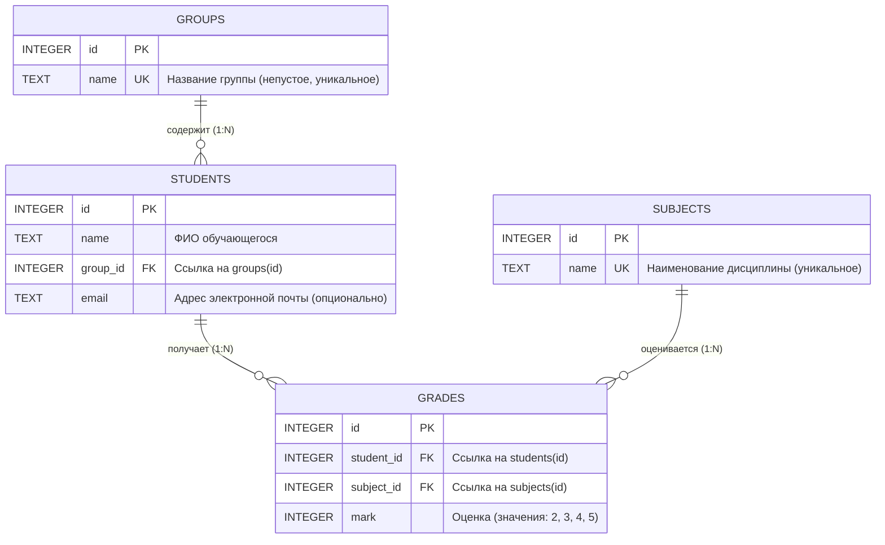

# Структура проекта
.
├── mvnw
├── mvnw.cmd
├── pom.xml
├── project_context.md
├── README.md
└── src
    ├── main
    │   ├── java
    │   │   └── ru
    │   │       └── edu
    │   │           └── journal
    │   │               ├── common
    │   │               │   ├── DatabaseInitializer.java
    │   │               │   ├── exception
    │   │               │   │   ├── NotFoundException.java
    │   │               │   │   └── ValidationException.java
    │   │               │   └── GlobalExceptionHandler.java
    │   │               ├── config
    │   │               │   ├── DatabaseConfig.java
    │   │               │   └── WebMvcConfig.java
    │   │               ├── features
    │   │               │   ├── groups
    │   │               │   │   ├── dto
    │   │               │   │   │   ├── GroupDto.java
    │   │               │   │   │   └── GroupSaveRequest.java
    │   │               │   │   ├── GroupController.java
    │   │               │   │   ├── GroupRepository.java
    │   │               │   │   └── GroupService.java
    │   │               │   ├── journal
    │   │               │   │   ├── dto
    │   │               │   │   │   ├── GradeDto.java
    │   │               │   │   │   ├── GradeSaveRequest.java
    │   │               │   │   │   └── JournalResponse.java
    │   │               │   │   ├── JournalController.java
    │   │               │   │   ├── JournalExportService.java
    │   │               │   │   ├── JournalRepository.java
    │   │               │   │   └── JournalService.java
    │   │               │   ├── reports
    │   │               │   │   ├── ReportController.java
    │   │               │   │   ├── ReportRepository.java
    │   │               │   │   └── ReportService.java
    │   │               │   ├── students
    │   │               │   │   ├── dto
    │   │               │   │   │   ├── StudentDto.java
    │   │               │   │   │   └── StudentSaveRequest.java
    │   │               │   │   ├── StudentController.java
    │   │               │   │   ├── StudentRepository.java
    │   │               │   │   └── StudentService.java
    │   │               │   └── subjects
    │   │               │       ├── dto
    │   │               │       │   ├── SubjectDto.java
    │   │               │       │   └── SubjectSaveRequest.java
    │   │               │       ├── SubjectController.java
    │   │               │       ├── SubjectRepository.java
    │   │               │       └── SubjectService.java
    │   │               └── JournalApplication.java
    │   └── resources
    │       ├── application.properties
    │       ├── db
    │       │   ├── schema.sql
    │       │   └── seed.sql
    │       ├── static
    │       │   ├── css
    │       │   │   └── styles.css
    │       │   └── js
    │       │       ├── api.js
    │       │       ├── chart-helper.js
    │       │       ├── groups.js
    │       │       ├── journal.js
    │       │       ├── reports.js
    │       │       ├── students.js
    │       │       ├── subjects.js
    │       │       ├── theme.js
    │       │       ├── ui.js
    │       │       └── vendor
    │       │           └── chart.umd.min.js
    │       └── templates
    │           ├── error.html
    │           ├── groups
    │           │   └── index.html
    │           ├── journal
    │           │   └── index.html
    │           ├── partials
    │           │   ├── footer.html
    │           │   └── header.html
    │           ├── reports
    │           │   └── index.html
    │           ├── students
    │           │   └── index.html
    │           └── subjects
    │               └── index.html
    └── test
        └── java
            └── ru
                └── edu
                    └── journal
                        ├── DatabaseBaselineTest.java
                        ├── JournalIntegrationTest.java
                        └── RollbackTest.java

38 directories, 62 files

# Файлы проекта

## pom.xml
```xml
<?xml version="1.0" encoding="UTF-8"?>
<project xmlns="http://maven.apache.org/POM/4.0.0"
         xmlns:xsi="http://www.w3.org/2001/XMLSchema-instance"
         xsi:schemaLocation="http://maven.apache.org/POM/4.0.0 https://maven.apache.org/xsd/maven-4.0.0.xsd">
    <modelVersion>4.0.0</modelVersion>

    <parent>
        <groupId>org.springframework.boot</groupId>
        <artifactId>spring-boot-starter-parent</artifactId>
        <version>3.3.5</version>
        <relativePath/>
    </parent>

    <groupId>ru.edu</groupId>
    <artifactId>journal</artifactId>
    <version>1.0.0</version>
    <name>journal</name>
    <description>Электронный журнал студентов на Java и Spring Boot</description>

    <properties>
        <java.version>21</java.version>
        <sqlite-jdbc.version>3.47.1.0</sqlite-jdbc.version>
    </properties>

    <dependencies>
        <!-- Spring Boot Web & Thymeleaf -->
        <dependency>
            <groupId>org.springframework.boot</groupId>
            <artifactId>spring-boot-starter-web</artifactId>
        </dependency>
        <dependency>
            <groupId>org.springframework.boot</groupId>
            <artifactId>spring-boot-starter-thymeleaf</artifactId>
        </dependency>

        <!-- Spring JDBC -->
        <dependency>
            <groupId>org.springframework.boot</groupId>
            <artifactId>spring-boot-starter-jdbc</artifactId>
        </dependency>

        <!-- SQLite JDBC Driver -->
        <dependency>
            <groupId>org.xerial</groupId>
            <artifactId>sqlite-jdbc</artifactId>
            <version>${sqlite-jdbc.version}</version>
        </dependency>

        <!-- Validation -->
        <dependency>
            <groupId>org.springframework.boot</groupId>
            <artifactId>spring-boot-starter-validation</artifactId>
        </dependency>

        <!-- Apache POI for Excel export (.xlsx) -->
        <dependency>
            <groupId>org.apache.poi</groupId>
            <artifactId>poi-ooxml</artifactId>
            <version>5.3.0</version>
        </dependency>

        <!-- Testing -->
        <dependency>
            <groupId>org.springframework.boot</groupId>
            <artifactId>spring-boot-starter-test</artifactId>
            <scope>test</scope>
        </dependency>
    </dependencies>

    <build>
        <plugins>
            <plugin>
                <groupId>org.springframework.boot</groupId>
                <artifactId>spring-boot-maven-plugin</artifactId>
            </plugin>
        </plugins>
    </build>
</project>

```

## README.md
```md
# Электронный журнал успеваемости студентов

Информационная система учёта успеваемости, академической успеваемости и аналитики учебного процесса высшего учебного заведения. Проект разработан на стеке **Java 21 (LTS)** и **Spring Boot 3** с архитектурой вертикальных функциональных срезов, чистым SQL без тяжелых ORM-абстракций, интерактивным пользовательским интерфейсом и подсистемой формирования аналитической отчетности.

---

## Оглавление

1. [Ключевые функциональные возможности](#ключевые-функциональные-возможности)
2. [Технологический стек](#технологический-стек)
3. [Архитектура приложения](#архитектура-приложения)
4. [Модель данных](#модель-данных)
5. [Спецификация REST API](#спецификация-rest-api)
6. [Инструкция по развертыванию и запуску](#инструкция-по-развертыванию-и-запуску)
   - [Запуск автономного JAR-пакета](#1-запуск-автономного-jar-пакета)
   - [Запуск через Maven Wrapper](#2-запуск-через-maven-wrapper)
   - [Открытие и запуск в IntelliJ IDEA](#3-открытие-и-запуск-в-intellij-idea)
7. [Консольные утилиты и обслуживание БД](#консольные-утилиты-и-обслуживание-бд)
8. [Тестирование и верификация](#тестирование-и-верификация)
9. [Руководство по интерфейсу и горячие клавиши](#руководство-по-интерфейсу-и-горячие-клавиши)

---

## Ключевые функциональные возможности

### 1. Управление контингентом и справочниками
- **Учебные группы:** просмотр перечня групп с автоматическим подсчетом численности контингента, создание новых групп, переименование, каскадная защита от удаления групп, содержащих активных студентов.
- **Дисциплины (предметы):** ведение реестра академических дисциплин с контролем уникальности наименований; строгая блокировка удаления дисциплин, по которым в системе зафиксированы выставленные оценки.
- **Студенты:** учет личных данных обучающихся (ФИО, email, академическая группа); регистрация новых студентов; процедура межкафедрального перевода между группами с безусловным сохранением всех накопленных ранее оценок; транзакционное удаление записи студента и всех связанных с ним оценок в рамках единой атомарной транзакции SQLite.

### 2. Поиск, фильтрация и многофакторная сортировка
- Полнотекстовый поиск обучающихся в реальном времени по подстроке ФИО, адресу электронной почты или названию группы.
- Динамический фильтр контингента по выбранной учебной группе.
- Многофакторная сортировка реестра:
  - по алфавиту ФИО (А → Я, Я → А);
  - по учебным группам (А → Я, Я → А);
  - по академическому среднему баллу (по возрастанию / убыванию);
  - по общему количеству полученных оценок.
- Интерактивная сортировка в один клик по кликабельным заголовкам столбцов таблицы с визуальной индикацией текущего направления.
- Отображение точного среднего балла студента с цветовой градацией академического уровня.

### 3. Академический журнал успеваемости и быстрый ввод (Excel-режим)
- Матричное представление успеваемости: студенты группы расположены построчно, дисциплины — по столбцам.
- Пустые ячейки наглядно маркируются прочерком при отсутствии записи в базе данных.
- Визуальная подсветка академических задолженностей (двойки выделяются контрастным фоном).
- Модальное окно для выставления, изменения и удаления оценки с валидацией значений (строго 2, 3, 4, 5).
- **Режим быстрого клавиатурного редактирования (Excel-style):**
  - Навигация по таблице клавишами стрелок (вверх, вниз, влево, вправо) и Enter.
  - Мгновенное выставление оценки нажатием клавиш 2, 3, 4, 5 (основной ряд или Numpad) с немедленным фоновым сохранением через REST API и автоматическим шагом фокуса на строку вниз.
  - Моментальное удаление оценки клавишами Delete или Backspace.
  - Однократный клик мыши переносит фокус; двойной клик открывает полное диалоговое окно.

### 4. Экспорт данных и печатные формы
- **Экспорт в Microsoft Excel (.xlsx):**
  - Генерация валидного XLSX-файла средствами Apache POI 5.3.0.
  - Фирменная стилизация заголовка ведомости, даты формирования и колонок таблицы.
  - Автоматический расчет ширины столбцов по длине содержимого.
  - Подсветка неудовлетворительных результатов и автоматическое определение академического статуса каждого обучающегося (*«Отличник»*, *«Хорошист»*, *«Успевает»*, *«Академическая задолженность»*, *«Нет оценок»*).
- **Экспорт в CSV (.csv):**
  - Формат данных с разделителем точка с запятой (`;`).
  - Префикс UTF-8 BOM для безупречного открытия во всех версиях Microsoft Excel и LibreOffice без искажения кодировки.
- **Печатная версия ведомости (Print / PDF):**
  - Специализированная таблица стилей `@media print` с альбомной ориентацией страницы А4.
  - Автоматическое скрытие служебных интерфейсных элементов (меню, фильтров, кнопок управления).
  - Формирование официальной академической шапки ведомости и блоков для подписей преподавателя и сотрудников деканата.

### 5. Аналитический модуль и интерактивные графики
- Локальная автономная интеграция библиотеки Chart.js (полное функционирование в изолированных сетях без доступа в интернет).
- Сводные KPI-карточки (число групп, студентов, зафиксированных оценок, общий средний балл).
- Сравнительные столбчатые диаграммы успеваемости групп и распределения контингента.
- Круговые диаграммы структуры оценок и доли академических задолженностей.
- Аналитический блок в журнале конкретной группы с расчетом абсолютной успеваемости (процент без двоек) и качественной успеваемости (процент четверок и пятерок).

### 6. Эргономика интерфейса и тёмная тема
- Тёмная графическая тема установлена по умолчанию.
- Полное предотвращение эффекта мигания белого экрана при переходах между страницами (Zero Flash of Unstyled Content, FOUC) за счет предварительной инициализации цветовых токенов в секции `<head>`.
- Быстрое переключение между тёмной и светлой темами с сохранением выбора в `localStorage`.
- Зебра-расцветка строк (`zebra striping`) с плавным выделением при наведении курсора для комфортной работы с большими табличными массивами данных.

---

## Технологический стек

| Компонент | Технология | Назначение |
|---|---|---|
| Язык программирования | Java 21 (LTS, OpenJDK) | Базовая программная платформа |
| Фреймворк | Spring Boot 3.3.5 | Инверсия управления, MVC, REST, сборка |
| СУБД | SQLite 3 (`org.xerial:sqlite-jdbc`) | Локальное реляционное хранилище данных |
| Доступ к данным | Spring JDBC (`NamedParameterJdbcTemplate`) | Чистый параметризованный SQL |
| Шаблонизатор | Thymeleaf 3 | Серверная визуализация HTML-страниц |
| Экспорт в электронные таблицы | Apache POI 5.3.0 (`poi-ooxml`) | Формирование документов формата Microsoft Excel |
| Графическая аналитика | Chart.js 4.4.1 (автономный бандл) | Клиентская визуализация диаграмм |
| Клиентский слой | Стандартный ES6+ JavaScript, CSS3 | Реактивный интерфейс без сторонних тяжелых фреймворков |
| Сборщик проектов | Apache Maven 3.9+ | Управление зависимостями и сборка артефактов |

---

## Архитектура приложения

Проект построен по принципу вертикального разделения на функциональные домены (`Feature-Driven Architecture`). Каждый функциональный срез полностью инкапсулирует контроллер, сервис, репозиторий с прямым SQL и DTO-модели.

```
src/main/java/ru/edu/journal/
├── JournalApplication.java                  # Главный класс приложения и обработчик CLI-команд
├── config/
│   ├── DatabaseConfig.java                  # Конфигурация SQLite DataSource (PRAGMA foreign_keys = ON)
│   └── WebMvcConfig.java                    # Конфигурация статических ресурсов и кэширования
├── common/
│   ├── DatabaseInitializer.java             # Первичная инициализация схемы и демонстрационных данных
│   ├── GlobalExceptionHandler.java          # Централизованная обработка ошибок и трансляция в JSON
│   └── exception/                           # Пользовательские исключения (ValidationException, NotFoundException)
└── features/
    ├── groups/                              # Модуль «Учебные группы»
    │   ├── GroupController.java             # Маршруты /groups и /api/groups
    │   ├── GroupService.java                # Бизнес-правила валидации и уникальности групп
    │   ├── GroupRepository.java             # SQL-запросы к таблице groups
    │   └── dto/                             # GroupDto, GroupSaveRequest
    ├── subjects/                            # Модуль «Дисциплины»
    │   ├── SubjectController.java           # Маршруты /subjects и /api/subjects
    │   ├── SubjectService.java              # Защита от удаления предметов с выставленными оценками
    │   ├── SubjectRepository.java           # SQL-запросы к таблице subjects
    │   └── dto/                             # SubjectDto, SubjectSaveRequest
    ├── students/                            # Модуль «Студенты»
    │   ├── StudentController.java           # Маршруты /students и /api/students
    │   ├── StudentService.java              # Транзакционный перевод, каскадное удаление
    │   ├── StudentRepository.java           # Фильтрация, поиск, расчет средних баллов
    │   └── dto/                             # StudentDto, StudentSaveRequest
    ├── journal/                             # Модуль «Журнал успеваемости»
    │   ├── JournalController.java           # Страница /journal, эндпоинты оценок и экспорта
    │   ├── JournalService.java              # Логика выставления и обновления оценок (upsert)
    │   ├── JournalRepository.java           # Построение матрицы оценок группы
    │   ├── JournalExportService.java        # Потоковая генерация XLSX и CSV с BOM
    │   └── dto/                             # JournalResponse, GradeDto, GradeSaveRequest
    └── reports/                             # Модуль «Отчёты и аналитика»
        ├── ReportController.java            # Страница /reports и REST /api/reports
        ├── ReportService.java               # Диспетчеризация аналитических срезов
        └── ReportRepository.java            # Аналитические SQL-агрегации (GROUP BY, HAVING)
```

---

## Модель данных

Реляционная схема хранится в файле `src/main/resources/db/schema.sql` и разворачивается в SQLite с обязательным контролем внешних ключей.



### Ограничения целостности и индексы
- Таблица `groups`: ограничение `CHECK(length(trim(name)) > 0)`, индекс `idx_groups_name`.
- Таблица `subjects`: ограничение `CHECK(length(trim(name)) > 0)`, индекс `idx_subjects_name`.
- Таблица `students`: внешняя ссылка `REFERENCES groups(id) ON DELETE RESTRICT`, индекс `idx_students_group`.
- Таблица `grades`: внешние ссылки `REFERENCES students(id) ON DELETE CASCADE` и `REFERENCES subjects(id) ON DELETE RESTRICT`, ограничение `CHECK(mark BETWEEN 2 AND 5)`, уникальный композитный индекс `idx_grades_student_subject UNIQUE(student_id, subject_id)`.

---

## Спецификация REST API

### 1. Учебные группы
- `GET /api/groups` — получение списка всех групп с количеством студентов.
- `POST /api/groups` — создание новой группы (`{"name": "БЭИ2301"}`).
- `POST /api/groups/{id}` — переименование группы.
- `DELETE /api/groups/{id}` — удаление пустой группы (возвращает 400 при наличии студентов).

### 2. Дисциплины
- `GET /api/subjects` — получение списка дисциплин.
- `POST /api/subjects` — добавление дисциплины (`{"name": "Базы данных"}`).
- `POST /api/subjects/{id}` — переименование дисциплины.
- `DELETE /api/subjects/{id}` — удаление дисциплины (возвращает 400 при наличии связанных оценок).

### 3. Студенты
- `GET /api/students` — перечень студентов с поддержкой параметров `?q=...` (поиск по строке) и `?group_id=...` (фильтр по группе). Возвращает средний балл каждого обучающегося.
- `GET /api/students/{id}` — получение подробных данных студента.
- `POST /api/students` — регистрация студента (`{"name": "...", "group_id": 1, "email": "..."}`).
- `POST /api/students/{id}` — изменение данных или перевод в другую группу.
- `DELETE /api/students/{id}` — транзакционное каскадное удаление студента и всех его оценок.

### 4. Журнал успеваемости и экспорт
- `GET /api/journal?group_id={id}` — получение матрицы журнала выбранной группы (группа, список предметов, список студентов, массив оценок).
- `POST /api/journal/grades` — выставление или обновление оценки (`{"student_id": 1, "subject_id": 2, "mark": 5}`).
- `DELETE /api/journal/grades/{studentId}/{subjectId}` — удаление оценки по предмету.
- `GET /api/journal/export/excel?group_id={id}` — выгрузка ведомости группы в бинарный файл Microsoft Excel (.xlsx).
- `GET /api/journal/export/csv?group_id={id}` — выгрузка ведомости группы в текстовый файл CSV (разделитель `;`, кодировка UTF-8 BOM).

### 5. Аналитические отчёты
- `GET /api/reports?kind=groups` — сводные статистические показатели по группам (контингент, сумма оценок, средний балл).
- `GET /api/reports?kind=no_grades` — список обучающихся без единой выставленной оценки.
- `GET /api/reports?kind=failing` — список неуспевающих обучающихся (имеющих хотя бы одну оценку «2»).

---

## Инструкция по развертыванию и запуску

Для работы приложения требуется установленная виртуальная машина **Java 21** или выше.

### 1. Запуск автономного JAR-пакета

В дистрибутив входит предварительно скомпилированный Fat-JAR архив, содержащий внутри сервер приложений и все библиотеки:

```bash
# Запуск веб-сервера из директории проекта
java -jar target/journal-1.0.0.jar
```

После старта веб-интерфейс доступен в браузере по адресу:
```
http://127.0.0.1:5000/
```

При первом запуске приложение автоматически создаст локальную базу данных `instance/journal.db` и наполнит её демонстрационным набором данных (3 учебные группы, 60 студентов, 3 дисциплины, 162 оценки).

### 2. Запуск через Maven Wrapper

Сборка и запуск из исходного кода с помощью входящего в проект скрипта Maven Wrapper (не требует предварительно установленного Maven):

```bash
# Запуск веб-сервера
./mvnw spring-boot:run

# Сборка нового JAR-пакета после внесения изменений
./mvnw clean package
```

Собранный исполняемый файл будет помещен по пути: `target/journal-1.0.0.jar`.

### 3. Открытие и запуск в IntelliJ IDEA

1. Запустите IntelliJ IDEA.
2. Выберите пункт меню **File → Open...** и укажите корневой каталог проекта: `/home/milk13/IdeaProjects/jrnl`.
3. Среда разработки автоматически распознает файл `pom.xml`, выполнит импорт зависимостей и настроит структуру модулей.
4. Убедитесь, что в **Project Structure → Project SDK** выбран Java 21 (или 22/27).
5. Перейдите к файлу `src/main/java/ru/edu/journal/JournalApplication.java`.
6. Нажмите кнопку **Run** рядом с объявлением метода `main`.

---

## Консольные утилиты и обслуживание БД

Приложение поддерживает запуск со специальными аргументами командной строки для административного обслуживания и валидации базы данных без запуска постоянного веб-сервера:

### Восстановление исходного состояния базы данных
Пересоздает таблицы из `src/main/resources/db/schema.sql` и заполняет их исходными данными из `src/main/resources/db/seed.sql` в рамках единой транзакции:

```bash
# Через JAR
java -jar target/journal-1.0.0.jar --prepare

# Через Maven Wrapper
./mvnw spring-boot:run -Dspring-boot.run.arguments="--prepare"
```

### Проверка контрольных показателей базы данных
Выполняет сверку связности, включения внешних ключей и контрольных сумм записей:

```bash
java -jar target/journal-1.0.0.jar --check-baseline
```
Ожидаемый результат:
```
foreign_keys: 1
foreign_key_check: 0
groups: 3
students: 60
subjects: 3
grades: 162
students_without_grades: 6
PASS: база прошла проверку
```

### Проверка отката транзакций при сбое
Имитирует непредвиденную ошибку в середине транзакции удаления студента и проверяет сохранность данных после аварийного отката:

```bash
java -jar target/journal-1.0.0.jar --check-rollback
```
Ожидаемый результат:
```
Учебный сбой: Учебная ошибка после удаления оценок.
PASS: студент и все оценки сохранены после отката
PASS: обычное удаление убрало студента и его оценки
```

---

## Тестирование и верификация

В проект включен комплекс автоматических интеграционных и модульных тестов на платформе JUnit 5 и Spring Test:

```bash
./mvnw test
```

### Состав тестового набора:
1. `DatabaseBaselineTest` — проверка соответствия реляционной схемы и корректности начального наполнения БД.
2. `RollbackTest` — проверка механизма транзакционного отката Spring JDBC при искусственных аппаратных или программных сбоях.
3. `JournalIntegrationTest` — сквозное тестирование всех разделов REST API:
   - валидация операций с группами и защита от удаления непустых групп;
   - создание предметов и блокировка удаления дисциплин с оценками;
   - создание, поиск, фильтрация студентов и межкафедральный перевод с сохранением оценок;
   - матричный журнал, выставление оценок 2..5, защита от некорректных значений;
   - генерация бинарных выгрузок Excel (.xlsx) и CSV с проверкой заголовков;
   - аналитические выборки модуля отчетов.

---

## Руководство по интерфейсу и горячие клавиши

### Раздел «Журнал» — режим быстрого ввода
Для активации быстрого ввода установите флажок **«Режим быстрого ввода (клавиатура)»** в верхней части страницы журнала.

| Клавиша / Сочетание | Выполняемое действие |
|---|---|
| Стрелка вверх (`ArrowUp`) | Перемещение фокуса на строку выше (предыдущий студент) |
| Стрелка вниз (`ArrowDown`) / `Enter` | Перемещение фокуса на строку ниже (следующий студент) |
| Стрелка влево (`ArrowLeft`) | Перемещение фокуса на столбец левее (предыдущий предмет) |
| Стрелка вправо (`ArrowRight`) | Перемещение фокуса на столбец правее (следующий предмет) |
| Цифры `2`, `3`, `4`, `5` | Немедленная фиксация оценки в БД и переход к следующему студенту |
| `Delete` / `Backspace` | Мгновенное удаление оценки из БД в активной ячейке |
| Одиночный клик мыши | Фокусировка выбранной ячейки таблицы |
| Двойной клик мыши | Открытие детального модального окна управления оценкой |

### Раздел «Студенты»
- Ввод любого текста в поле **«Поиск по студентам»** мгновенно фильтрует таблицу без перезагрузки страницы.
- Нажатие на заголовки столбцов **«ФИО»**, **«Группа»**, **«Оценок»**, **«Средний балл»** упорядочивает список по возрастанию или убыванию.
- Кнопка **«Добавить студента»** открывает форму привязки к группе с валидацией имени.
- Кнопка **«Изменить»** в строке студента позволяет перевести его в другую академическую группу с сохранением истории оценок.

```

## src/main/resources/application.properties
```properties
server.port=5000
spring.application.name=journal

# SQLite Database
app.db.path=instance/journal.db
app.db.auto-init=true

# Thymeleaf & Static Resources
spring.thymeleaf.prefix=classpath:/templates/
spring.thymeleaf.suffix=.html
spring.thymeleaf.cache=false
spring.web.resources.static-locations=classpath:/static/
spring.web.resources.cache.period=0
spring.web.resources.chain.cache=false

```

## src/main/resources/db/schema.sql
```sql
-- Удаление идёт от дочерних таблиц к родительским.
DROP TABLE IF EXISTS grades;
DROP TABLE IF EXISTS students;
DROP TABLE IF EXISTS subjects;
DROP TABLE IF EXISTS groups;

CREATE TABLE groups (
    id INTEGER PRIMARY KEY,
    name TEXT NOT NULL UNIQUE CHECK(length(trim(name)) BETWEEN 1 AND 50)
);
CREATE TABLE subjects (
    id INTEGER PRIMARY KEY,
    name TEXT NOT NULL UNIQUE CHECK(length(trim(name)) > 0)
);
CREATE TABLE students (
    id INTEGER PRIMARY KEY,
    name TEXT NOT NULL CHECK(length(trim(name)) BETWEEN 1 AND 50),
    group_id INTEGER NOT NULL REFERENCES groups(id),
    email TEXT
);
CREATE TABLE grades (
    id INTEGER PRIMARY KEY,
    student_id INTEGER NOT NULL REFERENCES students(id),
    subject_id INTEGER NOT NULL REFERENCES subjects(id),
    mark INTEGER NOT NULL CHECK(mark IN (2, 3, 4, 5)),
    UNIQUE(student_id, subject_id)
);

```

## src/main/resources/db/seed.sql
```sql
-- Учебные данные: 3 группы, 60 студентов, 3 предмета, 162 оценки.
INSERT INTO groups (id, name) VALUES (1, 'БЭИ2301');
INSERT INTO groups (id, name) VALUES (2, 'БЭИ2302');
INSERT INTO groups (id, name) VALUES (3, 'БЭИ2303');
INSERT INTO subjects (id, name) VALUES (1, 'Python');
INSERT INTO subjects (id, name) VALUES (2, 'Базы данных');
INSERT INTO subjects (id, name) VALUES (3, 'Веб-разработка');
INSERT INTO students (id, name, group_id, email) VALUES (1, 'Иванов Алексей', 1, 'student01@example.edu');
INSERT INTO students (id, name, group_id, email) VALUES (2, 'Петрова Мария', 1, 'student02@example.edu');
INSERT INTO students (id, name, group_id, email) VALUES (3, 'Сидоров Илья', 1, 'student03@example.edu');
INSERT INTO students (id, name, group_id, email) VALUES (4, 'Смирнова Анна', 1, 'student04@example.edu');
INSERT INTO students (id, name, group_id, email) VALUES (5, 'Кузнецов Максим', 1, NULL);
INSERT INTO students (id, name, group_id, email) VALUES (6, 'Попова Дарья', 1, 'student06@example.edu');
INSERT INTO students (id, name, group_id, email) VALUES (7, 'Васильев Никита', 1, '');
INSERT INTO students (id, name, group_id, email) VALUES (8, 'Соколова Елена', 1, 'student08@example.edu');
INSERT INTO students (id, name, group_id, email) VALUES (9, 'Михайлов Артём', 1, 'student09@example.edu');
INSERT INTO students (id, name, group_id, email) VALUES (10, 'Новикова Софья', 1, NULL);
INSERT INTO students (id, name, group_id, email) VALUES (11, 'Фёдоров Павел', 1, 'student11@example.edu');
INSERT INTO students (id, name, group_id, email) VALUES (12, 'Морозова Полина', 1, 'student12@example.edu');
INSERT INTO students (id, name, group_id, email) VALUES (13, 'Волков Дмитрий', 1, 'student13@example.edu');
INSERT INTO students (id, name, group_id, email) VALUES (14, 'Алексеева Алиса', 1, '');
INSERT INTO students (id, name, group_id, email) VALUES (15, 'Лебедев Кирилл', 1, NULL);
INSERT INTO students (id, name, group_id, email) VALUES (16, 'Семёнова Виктория', 1, 'student16@example.edu');
INSERT INTO students (id, name, group_id, email) VALUES (17, 'Егоров Роман', 1, 'student17@example.edu');
INSERT INTO students (id, name, group_id, email) VALUES (18, 'Павлова Ксения', 1, 'student18@example.edu');
INSERT INTO students (id, name, group_id, email) VALUES (19, 'Козлов Андрей', 1, 'student19@example.edu');
INSERT INTO students (id, name, group_id, email) VALUES (20, 'Степанова Анастасия', 1, NULL);
INSERT INTO students (id, name, group_id, email) VALUES (21, 'Иванов Алексей', 2, 'student21@example.edu');
INSERT INTO students (id, name, group_id, email) VALUES (22, 'Петрова Мария', 2, 'student22@example.edu');
INSERT INTO students (id, name, group_id, email) VALUES (23, 'Сидоров Илья', 2, 'student23@example.edu');
INSERT INTO students (id, name, group_id, email) VALUES (24, 'Смирнова Анна', 2, 'student24@example.edu');
INSERT INTO students (id, name, group_id, email) VALUES (25, 'Кузнецов Максим', 2, NULL);
INSERT INTO students (id, name, group_id, email) VALUES (26, 'Попова Дарья', 2, 'student26@example.edu');
INSERT INTO students (id, name, group_id, email) VALUES (27, 'Васильев Никита', 2, '');
INSERT INTO students (id, name, group_id, email) VALUES (28, 'Соколова Елена', 2, 'student28@example.edu');
INSERT INTO students (id, name, group_id, email) VALUES (29, 'Михайлов Артём', 2, 'student29@example.edu');
INSERT INTO students (id, name, group_id, email) VALUES (30, 'Новикова Софья', 2, NULL);
INSERT INTO students (id, name, group_id, email) VALUES (31, 'Фёдоров Павел', 2, 'student31@example.edu');
INSERT INTO students (id, name, group_id, email) VALUES (32, 'Морозова Полина', 2, 'student32@example.edu');
INSERT INTO students (id, name, group_id, email) VALUES (33, 'Волков Дмитрий', 2, 'student33@example.edu');
INSERT INTO students (id, name, group_id, email) VALUES (34, 'Алексеева Алиса', 2, '');
INSERT INTO students (id, name, group_id, email) VALUES (35, 'Лебедев Кирилл', 2, NULL);
INSERT INTO students (id, name, group_id, email) VALUES (36, 'Семёнова Виктория', 2, 'student36@example.edu');
INSERT INTO students (id, name, group_id, email) VALUES (37, 'Егоров Роман', 2, 'student37@example.edu');
INSERT INTO students (id, name, group_id, email) VALUES (38, 'Павлова Ксения', 2, 'student38@example.edu');
INSERT INTO students (id, name, group_id, email) VALUES (39, 'Козлов Андрей', 2, 'student39@example.edu');
INSERT INTO students (id, name, group_id, email) VALUES (40, 'Степанова Анастасия', 2, NULL);
INSERT INTO students (id, name, group_id, email) VALUES (41, 'Иванов Алексей', 3, 'student41@example.edu');
INSERT INTO students (id, name, group_id, email) VALUES (42, 'Петрова Мария', 3, 'student42@example.edu');
INSERT INTO students (id, name, group_id, email) VALUES (43, 'Сидоров Илья', 3, 'student43@example.edu');
INSERT INTO students (id, name, group_id, email) VALUES (44, 'Смирнова Анна', 3, 'student44@example.edu');
INSERT INTO students (id, name, group_id, email) VALUES (45, 'Кузнецов Максим', 3, NULL);
INSERT INTO students (id, name, group_id, email) VALUES (46, 'Попова Дарья', 3, 'student46@example.edu');
INSERT INTO students (id, name, group_id, email) VALUES (47, 'Васильев Никита', 3, '');
INSERT INTO students (id, name, group_id, email) VALUES (48, 'Соколова Елена', 3, 'student48@example.edu');
INSERT INTO students (id, name, group_id, email) VALUES (49, 'Михайлов Артём', 3, 'student49@example.edu');
INSERT INTO students (id, name, group_id, email) VALUES (50, 'Новикова Софья', 3, NULL);
INSERT INTO students (id, name, group_id, email) VALUES (51, 'Фёдоров Павел', 3, 'student51@example.edu');
INSERT INTO students (id, name, group_id, email) VALUES (52, 'Морозова Полина', 3, 'student52@example.edu');
INSERT INTO students (id, name, group_id, email) VALUES (53, 'Волков Дмитрий', 3, 'student53@example.edu');
INSERT INTO students (id, name, group_id, email) VALUES (54, 'Алексеева Алиса', 3, '');
INSERT INTO students (id, name, group_id, email) VALUES (55, 'Лебедев Кирилл', 3, NULL);
INSERT INTO students (id, name, group_id, email) VALUES (56, 'Семёнова Виктория', 3, 'student56@example.edu');
INSERT INTO students (id, name, group_id, email) VALUES (57, 'Егоров Роман', 3, 'student57@example.edu');
INSERT INTO students (id, name, group_id, email) VALUES (58, 'Павлова Ксения', 3, 'student58@example.edu');
INSERT INTO students (id, name, group_id, email) VALUES (59, 'Козлов Андрей', 3, 'student59@example.edu');
INSERT INTO students (id, name, group_id, email) VALUES (60, 'Степанова Анастасия', 3, NULL);
INSERT INTO grades (id, student_id, subject_id, mark) VALUES (1, 1, 1, 5);
INSERT INTO grades (id, student_id, subject_id, mark) VALUES (2, 1, 2, 4);
INSERT INTO grades (id, student_id, subject_id, mark) VALUES (3, 1, 3, 3);
INSERT INTO grades (id, student_id, subject_id, mark) VALUES (4, 2, 1, 2);
INSERT INTO grades (id, student_id, subject_id, mark) VALUES (5, 2, 2, 3);
INSERT INTO grades (id, student_id, subject_id, mark) VALUES (6, 2, 3, 4);
INSERT INTO grades (id, student_id, subject_id, mark) VALUES (7, 3, 1, 4);
INSERT INTO grades (id, student_id, subject_id, mark) VALUES (8, 3, 2, 5);
INSERT INTO grades (id, student_id, subject_id, mark) VALUES (9, 3, 3, 5);
INSERT INTO grades (id, student_id, subject_id, mark) VALUES (10, 4, 1, 3);
INSERT INTO grades (id, student_id, subject_id, mark) VALUES (11, 4, 2, 4);
INSERT INTO grades (id, student_id, subject_id, mark) VALUES (12, 4, 3, 5);
INSERT INTO grades (id, student_id, subject_id, mark) VALUES (13, 5, 1, 4);
INSERT INTO grades (id, student_id, subject_id, mark) VALUES (14, 5, 2, 5);
INSERT INTO grades (id, student_id, subject_id, mark) VALUES (15, 5, 3, 2);
INSERT INTO grades (id, student_id, subject_id, mark) VALUES (16, 6, 1, 5);
INSERT INTO grades (id, student_id, subject_id, mark) VALUES (17, 6, 2, 2);
INSERT INTO grades (id, student_id, subject_id, mark) VALUES (18, 6, 3, 3);
INSERT INTO grades (id, student_id, subject_id, mark) VALUES (19, 7, 1, 2);
INSERT INTO grades (id, student_id, subject_id, mark) VALUES (20, 7, 2, 3);
INSERT INTO grades (id, student_id, subject_id, mark) VALUES (21, 7, 3, 4);
INSERT INTO grades (id, student_id, subject_id, mark) VALUES (22, 8, 1, 3);
INSERT INTO grades (id, student_id, subject_id, mark) VALUES (23, 8, 2, 4);
INSERT INTO grades (id, student_id, subject_id, mark) VALUES (24, 8, 3, 5);
INSERT INTO grades (id, student_id, subject_id, mark) VALUES (25, 9, 1, 4);
INSERT INTO grades (id, student_id, subject_id, mark) VALUES (26, 9, 2, 5);
INSERT INTO grades (id, student_id, subject_id, mark) VALUES (27, 9, 3, 2);
INSERT INTO grades (id, student_id, subject_id, mark) VALUES (28, 11, 1, 2);
INSERT INTO grades (id, student_id, subject_id, mark) VALUES (29, 11, 2, 3);
INSERT INTO grades (id, student_id, subject_id, mark) VALUES (30, 11, 3, 4);
INSERT INTO grades (id, student_id, subject_id, mark) VALUES (31, 12, 1, 3);
INSERT INTO grades (id, student_id, subject_id, mark) VALUES (32, 12, 2, 4);
INSERT INTO grades (id, student_id, subject_id, mark) VALUES (33, 12, 3, 5);
INSERT INTO grades (id, student_id, subject_id, mark) VALUES (34, 13, 1, 4);
INSERT INTO grades (id, student_id, subject_id, mark) VALUES (35, 13, 2, 5);
INSERT INTO grades (id, student_id, subject_id, mark) VALUES (36, 13, 3, 2);
INSERT INTO grades (id, student_id, subject_id, mark) VALUES (37, 14, 1, 5);
INSERT INTO grades (id, student_id, subject_id, mark) VALUES (38, 14, 2, 2);
INSERT INTO grades (id, student_id, subject_id, mark) VALUES (39, 14, 3, 3);
INSERT INTO grades (id, student_id, subject_id, mark) VALUES (40, 15, 1, 2);
INSERT INTO grades (id, student_id, subject_id, mark) VALUES (41, 15, 2, 3);
INSERT INTO grades (id, student_id, subject_id, mark) VALUES (42, 15, 3, 4);
INSERT INTO grades (id, student_id, subject_id, mark) VALUES (43, 16, 1, 3);
INSERT INTO grades (id, student_id, subject_id, mark) VALUES (44, 16, 2, 4);
INSERT INTO grades (id, student_id, subject_id, mark) VALUES (45, 16, 3, 5);
INSERT INTO grades (id, student_id, subject_id, mark) VALUES (46, 17, 1, 4);
INSERT INTO grades (id, student_id, subject_id, mark) VALUES (47, 17, 2, 5);
INSERT INTO grades (id, student_id, subject_id, mark) VALUES (48, 17, 3, 2);
INSERT INTO grades (id, student_id, subject_id, mark) VALUES (49, 18, 1, 5);
INSERT INTO grades (id, student_id, subject_id, mark) VALUES (50, 18, 2, 2);
INSERT INTO grades (id, student_id, subject_id, mark) VALUES (51, 18, 3, 3);
INSERT INTO grades (id, student_id, subject_id, mark) VALUES (52, 19, 1, 2);
INSERT INTO grades (id, student_id, subject_id, mark) VALUES (53, 19, 2, 3);
INSERT INTO grades (id, student_id, subject_id, mark) VALUES (54, 19, 3, 4);
INSERT INTO grades (id, student_id, subject_id, mark) VALUES (55, 21, 1, 4);
INSERT INTO grades (id, student_id, subject_id, mark) VALUES (56, 21, 2, 5);
INSERT INTO grades (id, student_id, subject_id, mark) VALUES (57, 21, 3, 2);
INSERT INTO grades (id, student_id, subject_id, mark) VALUES (58, 22, 1, 5);
INSERT INTO grades (id, student_id, subject_id, mark) VALUES (59, 22, 2, 2);
INSERT INTO grades (id, student_id, subject_id, mark) VALUES (60, 22, 3, 3);
INSERT INTO grades (id, student_id, subject_id, mark) VALUES (61, 23, 1, 2);
INSERT INTO grades (id, student_id, subject_id, mark) VALUES (62, 23, 2, 3);
INSERT INTO grades (id, student_id, subject_id, mark) VALUES (63, 23, 3, 4);
INSERT INTO grades (id, student_id, subject_id, mark) VALUES (64, 24, 1, 3);
INSERT INTO grades (id, student_id, subject_id, mark) VALUES (65, 24, 2, 4);
INSERT INTO grades (id, student_id, subject_id, mark) VALUES (66, 24, 3, 5);
INSERT INTO grades (id, student_id, subject_id, mark) VALUES (67, 25, 1, 4);
INSERT INTO grades (id, student_id, subject_id, mark) VALUES (68, 25, 2, 5);
INSERT INTO grades (id, student_id, subject_id, mark) VALUES (69, 25, 3, 2);
INSERT INTO grades (id, student_id, subject_id, mark) VALUES (70, 26, 1, 5);
INSERT INTO grades (id, student_id, subject_id, mark) VALUES (71, 26, 2, 2);
INSERT INTO grades (id, student_id, subject_id, mark) VALUES (72, 26, 3, 3);
INSERT INTO grades (id, student_id, subject_id, mark) VALUES (73, 27, 1, 2);
INSERT INTO grades (id, student_id, subject_id, mark) VALUES (74, 27, 2, 3);
INSERT INTO grades (id, student_id, subject_id, mark) VALUES (75, 27, 3, 4);
INSERT INTO grades (id, student_id, subject_id, mark) VALUES (76, 28, 1, 3);
INSERT INTO grades (id, student_id, subject_id, mark) VALUES (77, 28, 2, 4);
INSERT INTO grades (id, student_id, subject_id, mark) VALUES (78, 28, 3, 5);
INSERT INTO grades (id, student_id, subject_id, mark) VALUES (79, 29, 1, 4);
INSERT INTO grades (id, student_id, subject_id, mark) VALUES (80, 29, 2, 5);
INSERT INTO grades (id, student_id, subject_id, mark) VALUES (81, 29, 3, 2);
INSERT INTO grades (id, student_id, subject_id, mark) VALUES (82, 31, 1, 2);
INSERT INTO grades (id, student_id, subject_id, mark) VALUES (83, 31, 2, 3);
INSERT INTO grades (id, student_id, subject_id, mark) VALUES (84, 31, 3, 4);
INSERT INTO grades (id, student_id, subject_id, mark) VALUES (85, 32, 1, 3);
INSERT INTO grades (id, student_id, subject_id, mark) VALUES (86, 32, 2, 4);
INSERT INTO grades (id, student_id, subject_id, mark) VALUES (87, 32, 3, 5);
INSERT INTO grades (id, student_id, subject_id, mark) VALUES (88, 33, 1, 4);
INSERT INTO grades (id, student_id, subject_id, mark) VALUES (89, 33, 2, 5);
INSERT INTO grades (id, student_id, subject_id, mark) VALUES (90, 33, 3, 2);
INSERT INTO grades (id, student_id, subject_id, mark) VALUES (91, 34, 1, 5);
INSERT INTO grades (id, student_id, subject_id, mark) VALUES (92, 34, 2, 2);
INSERT INTO grades (id, student_id, subject_id, mark) VALUES (93, 34, 3, 3);
INSERT INTO grades (id, student_id, subject_id, mark) VALUES (94, 35, 1, 2);
INSERT INTO grades (id, student_id, subject_id, mark) VALUES (95, 35, 2, 3);
INSERT INTO grades (id, student_id, subject_id, mark) VALUES (96, 35, 3, 4);
INSERT INTO grades (id, student_id, subject_id, mark) VALUES (97, 36, 1, 3);
INSERT INTO grades (id, student_id, subject_id, mark) VALUES (98, 36, 2, 4);
INSERT INTO grades (id, student_id, subject_id, mark) VALUES (99, 36, 3, 5);
INSERT INTO grades (id, student_id, subject_id, mark) VALUES (100, 37, 1, 4);
INSERT INTO grades (id, student_id, subject_id, mark) VALUES (101, 37, 2, 5);
INSERT INTO grades (id, student_id, subject_id, mark) VALUES (102, 37, 3, 2);
INSERT INTO grades (id, student_id, subject_id, mark) VALUES (103, 38, 1, 5);
INSERT INTO grades (id, student_id, subject_id, mark) VALUES (104, 38, 2, 2);
INSERT INTO grades (id, student_id, subject_id, mark) VALUES (105, 38, 3, 3);
INSERT INTO grades (id, student_id, subject_id, mark) VALUES (106, 39, 1, 2);
INSERT INTO grades (id, student_id, subject_id, mark) VALUES (107, 39, 2, 3);
INSERT INTO grades (id, student_id, subject_id, mark) VALUES (108, 39, 3, 4);
INSERT INTO grades (id, student_id, subject_id, mark) VALUES (109, 41, 1, 4);
INSERT INTO grades (id, student_id, subject_id, mark) VALUES (110, 41, 2, 5);
INSERT INTO grades (id, student_id, subject_id, mark) VALUES (111, 41, 3, 2);
INSERT INTO grades (id, student_id, subject_id, mark) VALUES (112, 42, 1, 5);
INSERT INTO grades (id, student_id, subject_id, mark) VALUES (113, 42, 2, 2);
INSERT INTO grades (id, student_id, subject_id, mark) VALUES (114, 42, 3, 3);
INSERT INTO grades (id, student_id, subject_id, mark) VALUES (115, 43, 1, 2);
INSERT INTO grades (id, student_id, subject_id, mark) VALUES (116, 43, 2, 3);
INSERT INTO grades (id, student_id, subject_id, mark) VALUES (117, 43, 3, 4);
INSERT INTO grades (id, student_id, subject_id, mark) VALUES (118, 44, 1, 3);
INSERT INTO grades (id, student_id, subject_id, mark) VALUES (119, 44, 2, 4);
INSERT INTO grades (id, student_id, subject_id, mark) VALUES (120, 44, 3, 5);
INSERT INTO grades (id, student_id, subject_id, mark) VALUES (121, 45, 1, 4);
INSERT INTO grades (id, student_id, subject_id, mark) VALUES (122, 45, 2, 5);
INSERT INTO grades (id, student_id, subject_id, mark) VALUES (123, 45, 3, 2);
INSERT INTO grades (id, student_id, subject_id, mark) VALUES (124, 46, 1, 5);
INSERT INTO grades (id, student_id, subject_id, mark) VALUES (125, 46, 2, 2);
INSERT INTO grades (id, student_id, subject_id, mark) VALUES (126, 46, 3, 3);
INSERT INTO grades (id, student_id, subject_id, mark) VALUES (127, 47, 1, 2);
INSERT INTO grades (id, student_id, subject_id, mark) VALUES (128, 47, 2, 3);
INSERT INTO grades (id, student_id, subject_id, mark) VALUES (129, 47, 3, 4);
INSERT INTO grades (id, student_id, subject_id, mark) VALUES (130, 48, 1, 3);
INSERT INTO grades (id, student_id, subject_id, mark) VALUES (131, 48, 2, 4);
INSERT INTO grades (id, student_id, subject_id, mark) VALUES (132, 48, 3, 5);
INSERT INTO grades (id, student_id, subject_id, mark) VALUES (133, 49, 1, 4);
INSERT INTO grades (id, student_id, subject_id, mark) VALUES (134, 49, 2, 5);
INSERT INTO grades (id, student_id, subject_id, mark) VALUES (135, 49, 3, 2);
INSERT INTO grades (id, student_id, subject_id, mark) VALUES (136, 51, 1, 2);
INSERT INTO grades (id, student_id, subject_id, mark) VALUES (137, 51, 2, 3);
INSERT INTO grades (id, student_id, subject_id, mark) VALUES (138, 51, 3, 4);
INSERT INTO grades (id, student_id, subject_id, mark) VALUES (139, 52, 1, 3);
INSERT INTO grades (id, student_id, subject_id, mark) VALUES (140, 52, 2, 4);
INSERT INTO grades (id, student_id, subject_id, mark) VALUES (141, 52, 3, 5);
INSERT INTO grades (id, student_id, subject_id, mark) VALUES (142, 53, 1, 4);
INSERT INTO grades (id, student_id, subject_id, mark) VALUES (143, 53, 2, 5);
INSERT INTO grades (id, student_id, subject_id, mark) VALUES (144, 53, 3, 2);
INSERT INTO grades (id, student_id, subject_id, mark) VALUES (145, 54, 1, 5);
INSERT INTO grades (id, student_id, subject_id, mark) VALUES (146, 54, 2, 2);
INSERT INTO grades (id, student_id, subject_id, mark) VALUES (147, 54, 3, 3);
INSERT INTO grades (id, student_id, subject_id, mark) VALUES (148, 55, 1, 2);
INSERT INTO grades (id, student_id, subject_id, mark) VALUES (149, 55, 2, 3);
INSERT INTO grades (id, student_id, subject_id, mark) VALUES (150, 55, 3, 4);
INSERT INTO grades (id, student_id, subject_id, mark) VALUES (151, 56, 1, 3);
INSERT INTO grades (id, student_id, subject_id, mark) VALUES (152, 56, 2, 4);
INSERT INTO grades (id, student_id, subject_id, mark) VALUES (153, 56, 3, 5);
INSERT INTO grades (id, student_id, subject_id, mark) VALUES (154, 57, 1, 4);
INSERT INTO grades (id, student_id, subject_id, mark) VALUES (155, 57, 2, 5);
INSERT INTO grades (id, student_id, subject_id, mark) VALUES (156, 57, 3, 2);
INSERT INTO grades (id, student_id, subject_id, mark) VALUES (157, 58, 1, 5);
INSERT INTO grades (id, student_id, subject_id, mark) VALUES (158, 58, 2, 2);
INSERT INTO grades (id, student_id, subject_id, mark) VALUES (159, 58, 3, 3);
INSERT INTO grades (id, student_id, subject_id, mark) VALUES (160, 59, 1, 2);
INSERT INTO grades (id, student_id, subject_id, mark) VALUES (161, 59, 2, 3);
INSERT INTO grades (id, student_id, subject_id, mark) VALUES (162, 59, 3, 4);

```

## src/main/resources/static/js/api.js
```js
/** Выполняет JSON-запрос, отдельно обрабатывая сеть, HTTP и ответ 204. */
export async function requestJSON(url, method = "GET", data = null) {
  const options = {method: method, headers: {}};
  if (data !== null) {
    options.headers["Content-Type"] = "application/json";
    options.body = JSON.stringify(data);
  }
  let response;
  try { response = await fetch(url, options); }
  catch (error) { throw new Error("Нет связи с сервером. Проверьте его запуск."); }
  if (response.status === 204) return null;
  let payload;
  try { payload = await response.json(); }
  catch (error) { throw new Error("Сервер вернул ответ не в формате JSON."); }
  if (!response.ok) throw new Error(payload.error || "Ошибка HTTP " + response.status);
  return payload;
}

```

## src/main/resources/static/js/chart-helper.js
```js
// chart-helper.js - Унифицированный хелпер для интерактивных графиков и диаграмм с поддержкой тем
const activeCharts = new Map();

/**
 * Получает цветовую схему для графиков в зависимости от активной темы оформления.
 */
export function getChartThemeColors() {
  const isDark = document.documentElement.getAttribute("data-theme") !== "light";
  return {
    isDark,
    textColor: isDark ? "#cbd5e1" : "#475569",
    headingColor: isDark ? "#f1f5f9" : "#1e293b",
    gridColor: isDark ? "rgba(255, 255, 255, 0.08)" : "rgba(0, 0, 0, 0.06)",
    tooltipBg: isDark ? "#1e293b" : "#0f172a",
    tooltipTitle: isDark ? "#f8fafc" : "#ffffff",
    tooltipBody: isDark ? "#e2e8f0" : "#f1f5f9",
    borderColor: isDark ? "#334155" : "#e2e8f0",
    // Стандартные палитры
    palette: [
      "#3b82f6", // синий
      "#10b981", // изумрудный
      "#f59e0b", // янтарный
      "#ef4444", // красный
      "#8b5cf6", // фиолетовый
      "#06b6d4", // бирюзовый
      "#ec4899", // розовый
      "#64748b"  // сланцевый
    ],
    // Палитра для оценок (5, 4, 3, 2)
    marks: {
      5: "#22c55e", // зеленый (отлично)
      4: "#3b82f6", // синий (хорошо)
      3: "#f59e0b", // желтый (удовл)
      2: "#ef4444"  // красный (двойка)
    }
  };
}

/**
 * Уничтожает существующий график на указанном элементе canvas.
 */
export function destroyChart(canvasOrId) {
  const canvas = typeof canvasOrId === "string" ? document.getElementById(canvasOrId) : canvasOrId;
  if (!canvas) return;
  const existing = activeCharts.get(canvas);
  if (existing) {
    existing.destroy();
    activeCharts.delete(canvas);
  }
}

/**
 * Очищает все зарегистрированные графики.
 */
export function destroyAllCharts() {
  for (const chart of activeCharts.values()) {
    chart.destroy();
  }
  activeCharts.clear();
}

/**
 * Создает столбчатую диаграмму (Bar Chart).
 */
export function createBarChart(canvasOrId, { labels, datasets, yAxisTitle = "", isHorizontal = false, yMax = null, stepSize = null }) {
  if (typeof window.Chart === "undefined") {
    console.warn("Chart.js не загружен");
    return null;
  }

  const canvas = typeof canvasOrId === "string" ? document.getElementById(canvasOrId) : canvasOrId;
  if (!canvas) return null;
  destroyChart(canvas);

  const colors = getChartThemeColors();
  const indexAxis = isHorizontal ? "y" : "x";

  const chart = new window.Chart(canvas, {
    type: "bar",
    data: {
      labels,
      datasets: datasets.map((ds, idx) => ({
        label: ds.label,
        data: ds.data,
        backgroundColor: ds.backgroundColor || colors.palette[idx % colors.palette.length],
        borderColor: ds.borderColor || (colors.isDark ? "#1e293b" : "#ffffff"),
        borderWidth: ds.borderWidth !== undefined ? ds.borderWidth : 1,
        borderRadius: 5,
        maxBarThickness: 45
      }))
    },
    options: {
      indexAxis,
      responsive: true,
      maintainAspectRatio: false,
      plugins: {
        legend: {
          display: datasets.length > 1,
          position: "top",
          labels: {
            color: colors.textColor,
            font: { family: "system-ui, sans-serif", size: 12 }
          }
        },
        tooltip: {
          backgroundColor: colors.tooltipBg,
          titleColor: colors.tooltipTitle,
          bodyColor: colors.tooltipBody,
          borderColor: colors.borderColor,
          borderWidth: 1,
          padding: 10,
          boxPadding: 4,
          cornerRadius: 6
        }
      },
      scales: {
        x: {
          grid: { color: colors.gridColor },
          ticks: { color: colors.textColor, font: { size: 12 } }
        },
        y: {
          grid: { color: colors.gridColor },
          ticks: {
            color: colors.textColor,
            font: { size: 12 },
            stepSize: stepSize || undefined
          },
          title: yAxisTitle ? {
            display: true,
            text: yAxisTitle,
            color: colors.textColor,
            font: { size: 12, weight: 600 }
          } : { display: false },
          beginAtZero: true,
          max: yMax !== null ? yMax : undefined
        }
      }
    }
  });

  activeCharts.set(canvas, chart);
  return chart;
}

/**
 * Создает круговую / пончиковую диаграмму (Doughnut Chart).
 */
export function createDoughnutChart(canvasOrId, { labels, data, backgroundColors, title = "" }) {
  if (typeof window.Chart === "undefined") {
    console.warn("Chart.js не загружен");
    return null;
  }

  const canvas = typeof canvasOrId === "string" ? document.getElementById(canvasOrId) : canvasOrId;
  if (!canvas) return null;
  destroyChart(canvas);

  const colors = getChartThemeColors();
  const bgColors = backgroundColors || labels.map((_, i) => colors.palette[i % colors.palette.length]);

  const chart = new window.Chart(canvas, {
    type: "doughnut",
    data: {
      labels,
      datasets: [{
        data,
        backgroundColor: bgColors,
        borderColor: colors.isDark ? "#1e293b" : "#ffffff",
        borderWidth: 2,
        hoverOffset: 6
      }]
    },
    options: {
      responsive: true,
      maintainAspectRatio: false,
      plugins: {
        legend: {
          position: "bottom",
          labels: {
            color: colors.textColor,
            font: { family: "system-ui, sans-serif", size: 12 },
            padding: 12
          }
        },
        tooltip: {
          backgroundColor: colors.tooltipBg,
          titleColor: colors.tooltipTitle,
          bodyColor: colors.tooltipBody,
          borderColor: colors.borderColor,
          borderWidth: 1,
          padding: 10,
          boxPadding: 4,
          cornerRadius: 6,
          callbacks: {
            label: function(context) {
              const label = context.label || "";
              const value = context.parsed || 0;
              const total = context.dataset.data.reduce((a, b) => a + b, 0);
              const percentage = total > 0 ? Math.round((value / total) * 100) : 0;
              return ` ${label}: ${value} (${percentage}%)`;
            }
          }
        }
      },
      cutout: "60%"
    }
  });

  activeCharts.set(canvas, chart);
  return chart;
}

/**
 * Слушатель переключения темы для динамического обновления всех активных графиков.
 */
window.addEventListener("themechange", () => {
  const colors = getChartThemeColors();
  for (const chart of activeCharts.values()) {
    // Обновляем шкалы
    if (chart.options.scales) {
      if (chart.options.scales.x) {
        chart.options.scales.x.grid.color = colors.gridColor;
        chart.options.scales.x.ticks.color = colors.textColor;
      }
      if (chart.options.scales.y) {
        chart.options.scales.y.grid.color = colors.gridColor;
        chart.options.scales.y.ticks.color = colors.textColor;
        if (chart.options.scales.y.title) {
          chart.options.scales.y.title.color = colors.textColor;
        }
      }
    }
    // Обновляем легенду
    if (chart.options.plugins && chart.options.plugins.legend) {
      chart.options.plugins.legend.labels.color = colors.textColor;
    }
    // Обновляем тултипы
    if (chart.options.plugins && chart.options.plugins.tooltip) {
      chart.options.plugins.tooltip.backgroundColor = colors.tooltipBg;
      chart.options.plugins.tooltip.titleColor = colors.tooltipTitle;
      chart.options.plugins.tooltip.bodyColor = colors.tooltipBody;
      chart.options.plugins.tooltip.borderColor = colors.borderColor;
    }
    // Обновляем обводку датасетов
    for (const ds of chart.data.datasets) {
      ds.borderColor = colors.isDark ? "#1e293b" : "#ffffff";
    }
    chart.update();
  }
});

```

## src/main/resources/static/js/journal.js
```js
import {requestJSON} from "/js/api.js";
import {message, busy, fillGroups} from "/js/ui.js";
import {createBarChart, createDoughnutChart, destroyChart} from "/js/chart-helper.js";

const GROUPS_API = "/api/groups";
const JOURNAL_API = "/api/journal";
const GRADES_API = "/api/journal/grades";

const groupSelect = document.querySelector("#group-select");
const tableHead = document.querySelector("#table-head");
const tableBody = document.querySelector("#table-body");
const editor = document.querySelector("#editor");
const editorTitle = document.querySelector("#editor-title");
const form = document.querySelector("#edit-form");
const studentIdInput = document.querySelector("#record-student-id");
const subjectIdInput = document.querySelector("#record-subject-id");
const markSelect = document.querySelector("#record-mark");
const deleteButton = document.querySelector("#delete-grade");
const cancelButton = document.querySelector("#cancel-edit");

const toggleAnalyticsBtn = document.querySelector("#toggle-analytics");
const analyticsSection = document.querySelector("#journal-analytics");
const kpiContainer = document.querySelector("#journal-kpi");

const btnExportExcel = document.querySelector("#btn-export-excel");
const btnExportCsv = document.querySelector("#btn-export-csv");
const btnPrint = document.querySelector("#btn-print");
const quickEditCheckbox = document.querySelector("#quick-edit-mode");
const quickEditHint = document.querySelector("#quick-edit-hint");

const printGroupName = document.querySelector("#print-group-name");
const printDate = document.querySelector("#print-date");

let journalData = null, groups = [];
let gridMatrix = []; // [row][col] -> HTMLButtonElement
let activeRow = -1, activeCol = -1;

/** Переключение видимости блока аналитики */
if (toggleAnalyticsBtn && analyticsSection) {
  toggleAnalyticsBtn.addEventListener("click", () => {
    const isHidden = analyticsSection.hidden;
    analyticsSection.hidden = !isHidden;
    toggleAnalyticsBtn.setAttribute("aria-expanded", String(isHidden));
    toggleAnalyticsBtn.textContent = isHidden ? "📊 Скрыть аналитику" : "📊 Показать аналитику";
  });
}

/** Переключение подсказки быстрого ввода */
if (quickEditCheckbox && quickEditHint) {
  quickEditCheckbox.addEventListener("change", () => {
    quickEditHint.hidden = !quickEditCheckbox.checked;
  });
}

/** Экспорт в Excel (.xlsx) */
if (btnExportExcel) {
  btnExportExcel.addEventListener("click", () => {
    if (!groupSelect.value) return;
    window.location.href = `/api/journal/export/excel?group_id=${groupSelect.value}`;
  });
}

/** Экспорт в CSV (.csv) */
if (btnExportCsv) {
  btnExportCsv.addEventListener("click", () => {
    if (!groupSelect.value) return;
    window.location.href = `/api/journal/export/csv?group_id=${groupSelect.value}`;
  });
}

/** Печать ведомости */
if (btnPrint) {
  btnPrint.addEventListener("click", () => {
    if (journalData && journalData.group) {
      if (printGroupName) printGroupName.textContent = journalData.group.name;
      if (printDate) printDate.textContent = new Date().toLocaleDateString("ru-RU");
    }
    window.print();
  });
}

/** Создает карточку KPI показателя. */
function createKpiCard(title, value, subtitle = "") {
  const card = document.createElement("div");
  card.className = "kpi-card";
  const t = document.createElement("div");
  t.className = "kpi-title";
  t.textContent = title;
  const v = document.createElement("div");
  v.className = "kpi-value";
  v.textContent = value;
  card.append(t, v);
  if (subtitle) {
    const s = document.createElement("div");
    s.className = "kpi-sub";
    s.textContent = subtitle;
    card.append(s);
  }
  return card;
}

/** Загружает список групп и инициализирует выбор. */
async function init() {
  busy(true);
  try {
    const groupsResp = await requestJSON(GROUPS_API);
    groups = groupsResp.items;
    fillGroups(groupSelect, groups, false);
    if (groups.length) {
      await loadJournal(groups[0].id);
    } else {
      renderEmpty("Нет доступных групп");
      renderAnalyticsEmpty();
    }
  } catch (error) {
    message("Ошибка загрузки групп: " + error.message, true);
  } finally {
    busy(false);
  }
}

/** Загружает данные журнала для выбранной группы. */
async function loadJournal(groupId, successText = "") {
  busy(true); message("Загрузка журнала...");
  try {
    journalData = await requestJSON(JOURNAL_API + "?group_id=" + groupId);
    render();
    renderAnalytics();
    if (printGroupName && journalData.group) {
      printGroupName.textContent = journalData.group.name;
    }
    if (printDate) {
      printDate.textContent = new Date().toLocaleDateString("ru-RU");
    }
    message(successText);
  } catch (error) {
    message((successText ? successText + " " : "") + error.message, true);
    renderEmpty("Данные журнала не загружены");
    renderAnalyticsEmpty();
  } finally {
    busy(false);
  }
}

/** Отображает пустое состояние журнала. */
function renderEmpty(text) {
  tableHead.replaceChildren();
  tableBody.replaceChildren();
  gridMatrix = [];
  const tr = document.createElement("tr");
  const td = document.createElement("td");
  td.colSpan = 5;
  td.className = "empty-row";
  td.textContent = text;
  tr.append(td);
  tableBody.append(tr);
}

function renderAnalyticsEmpty() {
  kpiContainer.replaceChildren();
  destroyChart("journal-canvas-marks");
  destroyChart("journal-canvas-subjects");
}

/** Рендерит аналитику и графики группы. */
function renderAnalytics() {
  kpiContainer.replaceChildren();
  destroyChart("journal-canvas-marks");
  destroyChart("journal-canvas-subjects");

  if (!journalData) return;
  const { students, subjects, grades } = journalData;

  const totalStudents = students.length;
  const totalGrades = grades.length;

  let sumMarks = 0;
  const markCounts = { 5: 0, 4: 0, 3: 0, 2: 0 };

  for (const g of grades) {
    sumMarks += g.mark;
    if (markCounts[g.mark] !== undefined) {
      markCounts[g.mark]++;
    }
  }

  const avgMark = totalGrades > 0 ? (sumMarks / totalGrades).toFixed(2) : "—";
  const quality = totalGrades > 0 ? Math.round(((markCounts[5] + markCounts[4]) / totalGrades) * 100) + "%" : "—";
  const passRate = totalGrades > 0 ? Math.round(((totalGrades - markCounts[2]) / totalGrades) * 100) + "%" : "—";

  kpiContainer.append(
    createKpiCard("Студентов", totalStudents, "В составе группы"),
    createKpiCard("Оценок", totalGrades, "Всего в журнале"),
    createKpiCard("Средний балл", avgMark, "Успеваемость группы"),
    createKpiCard("Качество знаний", quality, "Доля оценок 4 и 5"),
    createKpiCard("Успеваемость", passRate, "Доля без двоек")
  );

  if (totalGrades === 0) {
    return;
  }

  // 1. Диаграмма распределения оценок
  const markLabels = ["Отлично (5)", "Хорошо (4)", "Удовл. (3)", "Неуд. (2)"];
  const markData = [markCounts[5], markCounts[4], markCounts[3], markCounts[2]];
  const markColors = ["#22c55e", "#3b82f6", "#f59e0b", "#ef4444"];

  createDoughnutChart("journal-canvas-marks", {
    labels: markLabels,
    data: markData,
    backgroundColors: markColors
  });

  // 2. Диаграмма среднего балла по предметам
  const subjLabels = [];
  const subjAverages = [];
  const subjBarColors = [];

  for (const sub of subjects) {
    subjLabels.push(sub.name);
    const subGrades = grades.filter(g => g.subject_id === sub.id);
    if (subGrades.length > 0) {
      const avg = Number((subGrades.reduce((sum, g) => sum + g.mark, 0) / subGrades.length).toFixed(2));
      subjAverages.push(avg);
      if (avg >= 4.5) subjBarColors.push("#10b981");
      else if (avg >= 3.8) subjBarColors.push("#3b82f6");
      else if (avg >= 3.0) subjBarColors.push("#f59e0b");
      else subjBarColors.push("#ef4444");
    } else {
      subjAverages.push(0);
      subjBarColors.push("#94a3b8");
    }
  }

  createBarChart("journal-canvas-subjects", {
    labels: subjLabels,
    datasets: [{
      label: "Средний балл",
      data: subjAverages,
      backgroundColor: subjBarColors
    }],
    yAxisTitle: "Балл (от 2 до 5)",
    yMax: 5,
    stepSize: 1
  });
}

/** Устанавливает активную ячейку в матрице по координатам (row, col). */
function setActiveCell(r, c) {
  if (!gridMatrix.length) return;
  // Снимаем активность с предыдущей
  if (activeRow >= 0 && activeCol >= 0 && gridMatrix[activeRow] && gridMatrix[activeRow][activeCol]) {
    gridMatrix[activeRow][activeCol].classList.remove("cell-active");
  }

  // Ограничиваем границы
  const maxR = gridMatrix.length - 1;
  const maxC = gridMatrix[0] ? gridMatrix[0].length - 1 : 0;
  activeRow = Math.max(0, Math.min(r, maxR));
  activeCol = Math.max(0, Math.min(c, maxC));

  const targetBtn = gridMatrix[activeRow][activeCol];
  if (targetBtn) {
    targetBtn.classList.add("cell-active");
    targetBtn.focus();
  }
}

/** Моментальное сохранение оценки с клавиатуры (Excel mode). */
async function quickSaveGrade(btn, r, c, mark) {
  const studentId = Number(btn.dataset.studentId);
  const subjectId = Number(btn.dataset.subjectId);

  // Мгновенная визуальная реакция
  btn.textContent = String(mark);
  btn.dataset.hasGrade = "true";
  btn.dataset.mark = String(mark);
  btn.classList.remove("empty");
  if (mark === 2) {
    btn.classList.add("failing");
  } else {
    btn.classList.remove("failing");
  }
  btn.classList.add("cell-saving");

  try {
    const res = await requestJSON(GRADES_API, "POST", {
      student_id: studentId,
      subject_id: subjectId,
      mark: mark
    });

    // Обновляем локальные данные в памяти
    if (journalData && journalData.grades) {
      const existingIdx = journalData.grades.findIndex(
        g => g.student_id === studentId && g.subject_id === subjectId
      );
      const gradeObj = res.item || { id: Date.now(), student_id: studentId, subject_id: subjectId, mark: mark };
      if (existingIdx >= 0) {
        journalData.grades[existingIdx] = gradeObj;
      } else {
        journalData.grades.push(gradeObj);
      }
    }

    renderAnalytics();
  } catch (error) {
    message("Ошибка сохранения оценки: " + error.message, true);
  } finally {
    btn.classList.remove("cell-saving");
  }
}

/** Быстрое удаление оценки с клавиатуры (Del/Backspace). */
async function quickDeleteGrade(btn, r, c) {
  const studentId = Number(btn.dataset.studentId);
  const subjectId = Number(btn.dataset.subjectId);
  if (btn.dataset.hasGrade !== "true") return;

  btn.textContent = "—";
  btn.dataset.hasGrade = "false";
  delete btn.dataset.mark;
  btn.classList.add("empty");
  btn.classList.remove("failing");
  btn.classList.add("cell-saving");

  try {
    await requestJSON(GRADES_API + "/" + studentId + "/" + subjectId, "DELETE");

    if (journalData && journalData.grades) {
      journalData.grades = journalData.grades.filter(
        g => !(g.student_id === studentId && g.subject_id === subjectId)
      );
    }
    renderAnalytics();
  } catch (error) {
    message("Ошибка удаления оценки: " + error.message, true);
  } finally {
    btn.classList.remove("cell-saving");
  }
}

/** Рендерит матрицу оценок. */
function render() {
  tableHead.replaceChildren();
  tableBody.replaceChildren();
  gridMatrix = [];
  activeRow = -1;
  activeCol = -1;

  if (!journalData) return;
  const { students, subjects, grades } = journalData;

  // Шапка таблицы
  const headRow = document.createElement("tr");
  const thStudent = document.createElement("th");
  thStudent.textContent = "Студент";
  headRow.append(thStudent);

  for (const subject of subjects) {
    const th = document.createElement("th");
    th.textContent = subject.name;
    headRow.append(th);
  }
  tableHead.append(headRow);

  if (!students.length) {
    renderEmpty("В группе пока нет студентов");
    return;
  }

  // Создаем быстрый поиск оценок по ключу "studentId:subjectId"
  const gradesMap = new Map();
  for (const g of grades) {
    gradesMap.set(g.student_id + ":" + g.subject_id, g);
  }

  // Тело таблицы
  students.forEach((student, rIdx) => {
    const row = document.createElement("tr");
    const tdName = document.createElement("td");
    tdName.textContent = student.name;
    row.append(tdName);

    const rowButtons = [];

    subjects.forEach((subject, cIdx) => {
      const td = document.createElement("td");
      td.className = "grade-cell";

      const key = student.id + ":" + subject.id;
      const grade = gradesMap.get(key);

      const btn = document.createElement("button");
      btn.type = "button";
      btn.className = "grade-button";
      btn.dataset.studentId = String(student.id);
      btn.dataset.subjectId = String(subject.id);
      btn.dataset.studentName = student.name;
      btn.dataset.subjectName = subject.name;
      btn.dataset.row = String(rIdx);
      btn.dataset.col = String(cIdx);

      if (grade) {
        btn.textContent = String(grade.mark);
        btn.dataset.hasGrade = "true";
        btn.dataset.mark = String(grade.mark);
        if (grade.mark === 2) {
          btn.classList.add("failing");
        }
      } else {
        btn.textContent = "—";
        btn.dataset.hasGrade = "false";
        btn.classList.add("empty");
      }

      rowButtons.push(btn);
      td.append(btn);
      row.append(td);
    });

    gridMatrix.push(rowButtons);
    tableBody.append(row);
  });
}

/** Открывает форму выставления/изменения оценки. */
function openGradeEditor(btn) {
  const studentId = btn.dataset.studentId;
  const subjectId = btn.dataset.subjectId;
  const studentName = btn.dataset.studentName;
  const subjectName = btn.dataset.subjectName;
  const hasGrade = btn.dataset.hasGrade === "true";
  const currentMark = btn.dataset.mark;

  form.reset();
  studentIdInput.value = studentId;
  subjectIdInput.value = subjectId;
  markSelect.value = hasGrade ? currentMark : "5";
  deleteButton.hidden = !hasGrade;

  editorTitle.textContent = "Оценка: " + studentName + " — " + subjectName;
  editor.hidden = false;
  message();
  markSelect.focus();
}

groupSelect.addEventListener("change", function() {
  editor.hidden = true;
  if (groupSelect.value) {
    loadJournal(Number(groupSelect.value));
  }
});

// Клик по ячейке
tableBody.addEventListener("click", function(event) {
  const btn = event.target.closest("button.grade-button");
  if (!btn) return;
  const isQuick = quickEditCheckbox ? quickEditCheckbox.checked : false;

  const r = Number(btn.dataset.row);
  const c = Number(btn.dataset.col);

  if (isQuick) {
    setActiveCell(r, c);
  } else {
    openGradeEditor(btn);
  }
});

// Двойной клик всегда открывает подробную форму
tableBody.addEventListener("dblclick", function(event) {
  const btn = event.target.closest("button.grade-button");
  if (!btn) return;
  openGradeEditor(btn);
});

// Обработка клавиатурной навигации и быстрого ввода (Excel-режим)
tableBody.addEventListener("keydown", function(event) {
  const isQuick = quickEditCheckbox ? quickEditCheckbox.checked : false;
  if (!isQuick) return;

  const btn = event.target.closest("button.grade-button");
  if (!btn) return;

  const r = Number(btn.dataset.row);
  const c = Number(btn.dataset.col);

  switch (event.key) {
    case "ArrowDown":
      event.preventDefault();
      setActiveCell(r + 1, c);
      break;
    case "ArrowUp":
      event.preventDefault();
      setActiveCell(r - 1, c);
      break;
    case "ArrowRight":
      event.preventDefault();
      setActiveCell(r, c + 1);
      break;
    case "ArrowLeft":
      event.preventDefault();
      setActiveCell(r, c - 1);
      break;
    case "Enter":
      event.preventDefault();
      // Enter смещает вниз
      setActiveCell(r + 1, c);
      break;
    case "2":
    case "3":
    case "4":
    case "5":
      event.preventDefault();
      quickSaveGrade(btn, r, c, Number(event.key));
      // Автопереход вниз как в Excel
      setActiveCell(r + 1, c);
      break;
    case "Delete":
    case "Backspace":
      event.preventDefault();
      quickDeleteGrade(btn, r, c);
      break;
  }
});

cancelButton.addEventListener("click", function() {
  editor.hidden = true;
  message();
});

form.addEventListener("submit", async function(event) {
  event.preventDefault();
  const studentId = Number(studentIdInput.value);
  const subjectId = Number(subjectIdInput.value);
  const mark = Number(markSelect.value);

  busy(true);
  try {
    await requestJSON(GRADES_API, "POST", {
      student_id: studentId,
      subject_id: subjectId,
      mark: mark
    });
    editor.hidden = true;
    await loadJournal(Number(groupSelect.value), "Оценка сохранена.");
  } catch (error) {
    message(error.message, true);
  } finally {
    busy(false);
  }
});

deleteButton.addEventListener("click", async function() {
  const studentId = Number(studentIdInput.value);
  const subjectId = Number(subjectIdInput.value);

  busy(true);
  try {
    await requestJSON(GRADES_API + "/" + studentId + "/" + subjectId, "DELETE");
    editor.hidden = true;
    await loadJournal(Number(groupSelect.value), "Оценка удалена.");
  } catch (error) {
    message(error.message, true);
  } finally {
    busy(false);
  }
});

init();

```

## src/main/resources/static/js/groups.js
```js
import {requestJSON} from "/js/api.js";
import {cell, message, busy, actions, emptyRow} from "/js/ui.js";

const API = "/api/groups";
const body = document.querySelector("#table-body");
const editor = document.querySelector("#editor");
const form = document.querySelector("#edit-form");
const idInput = document.querySelector("#record-id");
const nameInput = document.querySelector("#record-name");
const confirmation = document.querySelector("#confirmation");
let items = [], pendingId = null, loaded = false;
nameInput.maxLength = 50;

/** Отправляет добавление или переименование записи. */
async function saveRecord(recordId, payload) {
  const url = recordId ? API + "/" + recordId : API;
  return requestJSON(url, "POST", payload);
}

/** Отправляет удаление записи. */
async function deleteRecord(recordId) {
  return requestJSON(API + "/" + recordId, "DELETE");
}

/** Строит таблицу по массиву из API. */
function render() {
  body.replaceChildren();
  if (!items.length) { emptyRow(body, 3); return; }
  for (const item of items) {
    const row = document.createElement("tr");
    row.append(cell(item.name));
    row.append(cell(item.student_count, "number"));
    const td = document.createElement("td");
    td.append(actions(item.id));
    row.append(td);
    body.append(row);
  }
}

/** Обновляет данные, сохраняя старую таблицу при неудачном запросе. */
async function load(successText = "") {
  busy(true); message("Загрузка...");
  try {
    items = (await requestJSON(API)).items;
    loaded = true;
    render();
    message(successText);
  } catch (error) {
    message((successText ? successText + " Обновление списка не удалось. " : "") + error.message, true);
    if (!loaded) emptyRow(body, 3, "Данные не загружены");
  } finally {
    busy(false);
  }
}

/** Открывает одну форму для создания и изменения. */
function openEditor(item = null) {
  form.reset();
  idInput.value = item ? String(item.id) : "";
  nameInput.value = item ? item.name : "";
  document.querySelector("#editor-title").textContent = item ? "Изменение записи" : "Добавление записи";
  editor.hidden = false;
  confirmation.hidden = true;
  message();
  nameInput.focus();
}

document.querySelector("#add-record").addEventListener("click", function() { openEditor(); });
document.querySelector("#cancel-edit").addEventListener("click", function() { editor.hidden = true; message(); });

form.addEventListener("submit", async function(event) {
  event.preventDefault();
  const name = nameInput.value.trim();
  if (!name) { message("Введите название.", true); nameInput.focus(); return; }
  busy(true);
  try {
    await saveRecord(idInput.value ? Number(idInput.value) : null, {name: name});
    editor.hidden = true;
    form.reset();
    await load("Изменения сохранены.");
  } catch (error) {
    message(error.message, true);
  } finally {
    busy(false);
  }
});

body.addEventListener("click", function(event) {
  const button = event.target.closest("button[data-action]");
  if (!button) return;
  const item = items.find(function(record) { return record.id === Number(button.dataset.id); });
  if (!item) return;
  if (button.dataset.action === "edit") { openEditor(item); return; }
  pendingId = item.id;
  editor.hidden = true;
  confirmation.hidden = false;
  document.querySelector("#confirmation-text").textContent = "Удалить «" + item.name + "»?";
  message();
});

document.querySelector("#cancel-delete").addEventListener("click", function() {
  pendingId = null;
  confirmation.hidden = true;
});

document.querySelector("#confirm-delete").addEventListener("click", async function() {
  if (pendingId === null) return;
  busy(true);
  try {
    await deleteRecord(pendingId);
    confirmation.hidden = true;
    pendingId = null;
    await load("Запись удалена.");
  } catch (error) {
    message(error.message, true);
  } finally {
    busy(false);
  }
});

load();

```

## src/main/resources/static/js/students.js
```js
import {requestJSON} from "/js/api.js";
import {cell, message, busy, actions, emptyRow, fillGroups} from "/js/ui.js";

const API = "/api/students";
const GROUPS_API = "/api/groups";
const body = document.querySelector("#table-body");
const searchInput = document.querySelector("#search-input");
const filterGroup = document.querySelector("#filter-group");
const sortSelect = document.querySelector("#sort-select");
const applyBtn = document.querySelector("#apply-filter");
const resetBtn = document.querySelector("#reset-filter");
const resultsCount = document.querySelector("#results-count");
const editor = document.querySelector("#editor");
const form = document.querySelector("#edit-form");
const idInput = document.querySelector("#record-id");
const nameInput = document.querySelector("#record-name");
const groupInput = document.querySelector("#record-group");
const emailInput = document.querySelector("#record-email");
const confirmation = document.querySelector("#confirmation");
const confirmationText = document.querySelector("#confirmation-text");

let items = [], groups = [], pendingItem = null, loaded = false;
let currentSort = "name_asc";
nameInput.maxLength = 50;

/** Отправляет сохранение студента. */
async function saveRecord(recordId, payload) {
  const url = recordId ? API + "/" + recordId : API;
  return requestJSON(url, "POST", payload);
}

/** Отправляет удаление студента. */
async function deleteRecord(recordId) {
  return requestJSON(API + "/" + recordId, "DELETE");
}

/** Фильтрует студентов по строке поиска и выбранной группе. */
function getFilteredItems() {
  const q = searchInput.value.trim().toLowerCase();
  const selectedGroupId = filterGroup.value;

  return items.filter(function(item) {
    const matchesQ = !q ||
      (item.name && item.name.toLowerCase().includes(q)) ||
      (item.email && item.email.toLowerCase().includes(q)) ||
      (item.group_name && item.group_name.toLowerCase().includes(q));
    const matchesGroup = !selectedGroupId || String(item.group_id) === String(selectedGroupId);
    return matchesQ && matchesGroup;
  });
}

/** Сортирует массив студентов согласно выбранному правилу. */
function sortItems(list) {
  const sorted = [...list];
  sorted.sort((a, b) => {
    switch (currentSort) {
      case "name_asc":
        return (a.name || "").localeCompare(b.name || "", "ru", { sensitivity: "base" });
      case "name_desc":
        return (b.name || "").localeCompare(a.name || "", "ru", { sensitivity: "base" });
      case "group_asc": {
        const cmp = (a.group_name || "").localeCompare(b.group_name || "", "ru", { sensitivity: "base" });
        return cmp !== 0 ? cmp : (a.name || "").localeCompare(b.name || "", "ru", { sensitivity: "base" });
      }
      case "group_desc": {
        const cmp = (b.group_name || "").localeCompare(a.group_name || "", "ru", { sensitivity: "base" });
        return cmp !== 0 ? cmp : (a.name || "").localeCompare(b.name || "", "ru", { sensitivity: "base" });
      }
      case "avg_desc": {
        const valA = (a.average_mark !== null && a.average_mark !== undefined) ? Number(a.average_mark) : -1;
        const valB = (b.average_mark !== null && b.average_mark !== undefined) ? Number(b.average_mark) : -1;
        if (valB !== valA) return valB - valA;
        return (a.name || "").localeCompare(b.name || "", "ru", { sensitivity: "base" });
      }
      case "avg_asc": {
        const valA = (a.average_mark !== null && a.average_mark !== undefined) ? Number(a.average_mark) : 999;
        const valB = (b.average_mark !== null && b.average_mark !== undefined) ? Number(b.average_mark) : 999;
        if (valA !== valB) return valA - valB;
        return (a.name || "").localeCompare(b.name || "", "ru", { sensitivity: "base" });
      }
      case "grades_desc": {
        const valA = Number(a.grade_count) || 0;
        const valB = Number(b.grade_count) || 0;
        if (valB !== valA) return valB - valA;
        return (a.name || "").localeCompare(b.name || "", "ru", { sensitivity: "base" });
      }
      default:
        return (a.name || "").localeCompare(b.name || "", "ru", { sensitivity: "base" });
    }
  });
  return sorted;
}

/** Создает стилизованную ячейку среднего балла. */
function createAverageMarkCell(avg) {
  const td = document.createElement("td");
  td.className = "number";
  if (avg === null || avg === undefined || isNaN(Number(avg))) {
    const span = document.createElement("span");
    span.className = "mark-badge empty";
    span.textContent = "—";
    td.append(span);
  } else {
    const span = document.createElement("span");
    span.className = "mark-badge";
    const num = Number(avg);
    span.textContent = num.toFixed(2);
    if (num >= 4.5) span.classList.add("excellent");
    else if (num >= 3.8) span.classList.add("good");
    else if (num >= 3.0) span.classList.add("fair");
    else span.classList.add("failing");
    td.append(span);
  }
  return td;
}

/** Обновляет индикаторы сортировки в шапке таблицы. */
function updateSortHeaders() {
  const headers = document.querySelectorAll("th.sortable");
  headers.forEach(th => th.removeAttribute("aria-sort"));

  let targetId = null;
  let direction = "ascending";

  if (currentSort === "name_asc") { targetId = "#th-name"; direction = "ascending"; }
  else if (currentSort === "name_desc") { targetId = "#th-name"; direction = "descending"; }
  else if (currentSort === "group_asc") { targetId = "#th-group"; direction = "ascending"; }
  else if (currentSort === "group_desc") { targetId = "#th-group"; direction = "descending"; }
  else if (currentSort === "avg_desc") { targetId = "#th-avg"; direction = "descending"; }
  else if (currentSort === "avg_asc") { targetId = "#th-avg"; direction = "ascending"; }
  else if (currentSort === "grades_desc") { targetId = "#th-grades"; direction = "descending"; }

  if (targetId) {
    const activeTh = document.querySelector(targetId);
    if (activeTh) activeTh.setAttribute("aria-sort", direction);
  }
}

/** Строит таблицу по отфильтрованному и отсортированному массиву (ровно 6 колонок). */
function render() {
  body.replaceChildren();
  const filtered = getFilteredItems();
  const sorted = sortItems(filtered);

  if (resultsCount) {
    if (filtered.length === items.length) {
      resultsCount.textContent = `Всего студентов: ${items.length}`;
    } else {
      resultsCount.textContent = `Найдено: ${filtered.length} из ${items.length}`;
    }
  }

  updateSortHeaders();

  if (!sorted.length) {
    emptyRow(body, 6, "Студенты не найдены");
    return;
  }

  for (const item of sorted) {
    const row = document.createElement("tr");
    // Колонка 1: ФИО
    row.append(cell(item.name));
    // Колонка 2: Группа
    row.append(cell(item.group_name));
    // Колонка 3: Email
    row.append(cell(item.email));
    // Колонка 4: Оценок
    row.append(cell(item.grade_count, "number"));
    // Колонка 5: Средний балл
    row.append(createAverageMarkCell(item.average_mark));
    // Колонка 6: Действия
    const tdActions = document.createElement("td");
    tdActions.className = "th-actions";
    tdActions.append(actions(item.id));
    row.append(tdActions);

    body.append(row);
  }
}

/** Загружает список студентов и групп. */
async function load(successText = "") {
  busy(true); message("Загрузка...");
  try {
    const [studentsResp, groupsResp] = await Promise.all([
      requestJSON(API),
      requestJSON(GROUPS_API)
    ]);
    items = studentsResp.items;
    groups = groupsResp.items;
    fillGroups(filterGroup, groups, true);
    loaded = true;
    render();
    message(successText);
  } catch (error) {
    message((successText ? successText + " Обновление списка не удалось. " : "") + error.message, true);
    if (!loaded) emptyRow(body, 6, "Данные не загружены");
  } finally {
    busy(false);
  }
}

/** Открывает форму для создания или редактирования. */
function openEditor(item = null) {
  form.reset();
  idInput.value = item ? String(item.id) : "";
  nameInput.value = item ? item.name : "";
  fillGroups(groupInput, groups, false);
  if (item) {
    groupInput.value = String(item.group_id);
  } else if (filterGroup.value) {
    groupInput.value = filterGroup.value;
  } else if (groups.length) {
    groupInput.value = String(groups[0].id);
  }
  emailInput.value = item && item.email ? item.email : "";
  document.querySelector("#editor-title").textContent = item ? "Изменение записи" : "Добавление студента";
  editor.hidden = false;
  confirmation.hidden = true;
  message();
  nameInput.focus();
}

document.querySelector("#add-record").addEventListener("click", function() { openEditor(); });
document.querySelector("#cancel-edit").addEventListener("click", function() { editor.hidden = true; message(); });

// Живой поиск и фильтрация
searchInput.addEventListener("input", render);
filterGroup.addEventListener("change", render);

// Обработка кнопки «Применить»
if (applyBtn) {
  applyBtn.addEventListener("click", function() {
    if (sortSelect) currentSort = sortSelect.value;
    render();
  });
}

// Нажатие клавиши Enter в поле поиска применяет фильтрацию
searchInput.addEventListener("keydown", function(event) {
  if (event.key === "Enter") {
    event.preventDefault();
    if (sortSelect) currentSort = sortSelect.value;
    render();
  }
});

// Обработка кнопки «Сбросить»
if (resetBtn) {
  resetBtn.addEventListener("click", function() {
    searchInput.value = "";
    filterGroup.value = "";
    currentSort = "name_asc";
    if (sortSelect) sortSelect.value = "name_asc";
    render();
  });
}

// Сортировка через выпадающий список
if (sortSelect) {
  sortSelect.addEventListener("change", function() {
    currentSort = sortSelect.value;
    render();
  });
}

// Кликабельные заголовки таблицы для быстрой сортировки
const sortableHeaders = document.querySelectorAll("th.sortable");
sortableHeaders.forEach(th => {
  th.addEventListener("click", () => {
    const sortField = th.dataset.sort;
    if (sortField === "name") {
      currentSort = currentSort === "name_asc" ? "name_desc" : "name_asc";
    } else if (sortField === "group") {
      currentSort = currentSort === "group_asc" ? "group_desc" : "group_asc";
    } else if (sortField === "avg") {
      currentSort = currentSort === "avg_desc" ? "avg_asc" : "avg_desc";
    } else if (sortField === "grades") {
      currentSort = currentSort === "grades_desc" ? "name_asc" : "grades_desc";
    }
    if (sortSelect) {
      sortSelect.value = currentSort;
    }
    render();
  });
});

form.addEventListener("submit", async function(event) {
  event.preventDefault();
  const name = nameInput.value.trim();
  if (!name) { message("Введите имя.", true); nameInput.focus(); return; }
  const groupId = Number(groupInput.value);
  if (!groupId) { message("Выберите группу.", true); return; }
  const email = emailInput.value.trim() || null;
  busy(true);
  try {
    await saveRecord(idInput.value ? Number(idInput.value) : null, {
      name: name,
      group_id: groupId,
      email: email
    });
    editor.hidden = true;
    form.reset();
    await load("Изменения сохранены.");
  } catch (error) {
    message(error.message, true);
  } finally {
    busy(false);
  }
});

body.addEventListener("click", function(event) {
  const button = event.target.closest("button[data-action]");
  if (!button) return;
  const item = items.find(function(record) { return record.id === Number(button.dataset.id); });
  if (!item) return;
  if (button.dataset.action === "edit") { openEditor(item); return; }
  pendingItem = item;
  editor.hidden = true;
  confirmation.hidden = false;
  confirmationText.textContent = "Удалить студента «" + item.name + "» и его оценок: " + item.grade_count + "?";
  message();
});

document.querySelector("#cancel-delete").addEventListener("click", function() {
  pendingItem = null;
  confirmation.hidden = true;
});

document.querySelector("#confirm-delete").addEventListener("click", async function() {
  if (!pendingItem) return;
  busy(true);
  try {
    await deleteRecord(pendingItem.id);
    confirmation.hidden = true;
    pendingItem = null;
    await load("Студент удален.");
  } catch (error) {
    message(error.message, true);
  } finally {
    busy(false);
  }
});

load();

```

## src/main/resources/static/js/subjects.js
```js
import {requestJSON} from "/js/api.js";
import {cell, message, busy, actions, emptyRow} from "/js/ui.js";

const API = "/api/subjects";
const body = document.querySelector("#table-body");
const editor = document.querySelector("#editor");
const form = document.querySelector("#edit-form");
const idInput = document.querySelector("#record-id");
const nameInput = document.querySelector("#record-name");
const confirmation = document.querySelector("#confirmation");
let items = [], pendingId = null, loaded = false;

/** Отправляет добавление или переименование записи. */
async function saveRecord(recordId, payload) {
  const url = recordId ? API + "/" + recordId : API;
  return requestJSON(url, "POST", payload);
}

/** Отправляет удаление записи. */
async function deleteRecord(recordId) {
  return requestJSON(API + "/" + recordId, "DELETE");
}

/** Строит таблицу по массиву из API. */
function render() {
  body.replaceChildren();
  if (!items.length) { emptyRow(body, 2); return; }
  for (const item of items) {
    const row = document.createElement("tr");
    row.append(cell(item.name));
    const td = document.createElement("td");
    td.append(actions(item.id));
    row.append(td);
    body.append(row);
  }
}

/** Обновляет данные, сохраняя старую таблицу при неудачном запросе. */
async function load(successText = "") {
  busy(true); message("Загрузка...");
  try {
    items = (await requestJSON(API)).items;
    loaded = true;
    render();
    message(successText);
  } catch (error) {
    message((successText ? successText + " Обновление списка не удалось. " : "") + error.message, true);
    if (!loaded) emptyRow(body, 2, "Данные не загружены");
  } finally {
    busy(false);
  }
}

/** Открывает одну форму для создания и изменения. */
function openEditor(item = null) {
  form.reset();
  idInput.value = item ? String(item.id) : "";
  nameInput.value = item ? item.name : "";
  document.querySelector("#editor-title").textContent = item ? "Изменение предмета" : "Добавление предмета";
  editor.hidden = false;
  confirmation.hidden = true;
  message();
  nameInput.focus();
}

document.querySelector("#add-record").addEventListener("click", function() { openEditor(); });
document.querySelector("#cancel-edit").addEventListener("click", function() { editor.hidden = true; message(); });

form.addEventListener("submit", async function(event) {
  event.preventDefault();
  const name = nameInput.value.trim();
  if (!name) { message("Введите название.", true); nameInput.focus(); return; }
  busy(true);
  try {
    await saveRecord(idInput.value ? Number(idInput.value) : null, {name: name});
    editor.hidden = true;
    form.reset();
    await load("Изменения сохранены.");
  } catch (error) {
    message(error.message, true);
  } finally {
    busy(false);
  }
});

body.addEventListener("click", function(event) {
  const button = event.target.closest("button[data-action]");
  if (!button) return;
  const item = items.find(function(record) { return record.id === Number(button.dataset.id); });
  if (!item) return;
  if (button.dataset.action === "edit") { openEditor(item); return; }
  pendingId = item.id;
  editor.hidden = true;
  confirmation.hidden = false;
  document.querySelector("#confirmation-text").textContent = "Удалить «" + item.name + "»?";
  message();
});

document.querySelector("#cancel-delete").addEventListener("click", function() {
  pendingId = null;
  confirmation.hidden = true;
});

document.querySelector("#confirm-delete").addEventListener("click", async function() {
  if (pendingId === null) return;
  busy(true);
  try {
    await deleteRecord(pendingId);
    confirmation.hidden = true;
    pendingId = null;
    await load("Запись удалена.");
  } catch (error) {
    message(error.message, true);
  } finally {
    busy(false);
  }
});

load();

```

## src/main/resources/static/js/theme.js
```js
// theme.js - Управление светлой и тёмной темой оформления
const THEME_STORAGE_KEY = "journal_theme";

/**
 * Возвращает текущую активную тему: 'dark' (по умолчанию) или 'light'.
 */
export function getCurrentTheme() {
  const currentAttr = document.documentElement.getAttribute("data-theme");
  if (currentAttr === "dark" || currentAttr === "light") {
    return currentAttr;
  }
  const saved = localStorage.getItem(THEME_STORAGE_KEY);
  if (saved === "light" || saved === "dark") {
    return saved;
  }
  return "dark"; // Тёмная тема по умолчанию
}

/**
 * Устанавливает и сохраняет тему.
 */
export function setTheme(theme) {
  const chosen = theme === "light" ? "light" : "dark";
  document.documentElement.setAttribute("data-theme", chosen);
  try {
    localStorage.setItem(THEME_STORAGE_KEY, chosen);
  } catch (e) {
    // В случае ограничений localStorage
  }
  updateThemeButton(chosen);
  window.dispatchEvent(new CustomEvent("themechange", { detail: { theme: chosen } }));
  return chosen;
}

/**
 * Переключает тему между 'dark' и 'light'.
 */
export function toggleTheme() {
  const current = getCurrentTheme();
  const next = current === "light" ? "dark" : "light";
  return setTheme(next);
}

/**
 * Обновляет внешний вид кнопки переключения темы в шапке.
 */
function updateThemeButton(theme) {
  const btn = document.querySelector("#theme-toggle");
  if (!btn) return;
  const isLight = theme === "light";
  const icon = btn.querySelector(".theme-toggle-icon");
  const text = btn.querySelector(".theme-toggle-text");
  if (icon) icon.textContent = isLight ? "🌙" : "☀️";
  if (text) text.textContent = isLight ? "Тёмная тема" : "Светлая тема";
  btn.setAttribute("title", isLight ? "Переключить на тёмную тему" : "Переключить на светлую тему");
  btn.setAttribute("aria-label", isLight ? "Переключить на тёмную тему" : "Переключить на светлую тему");
}

/**
 * Инициализирует тему при загрузке страницы.
 */
export function initTheme() {
  const active = getCurrentTheme();
  document.documentElement.setAttribute("data-theme", active);
  updateThemeButton(active);

  const btn = document.querySelector("#theme-toggle");
  if (btn && !btn.dataset.initialized) {
    btn.dataset.initialized = "true";
    btn.addEventListener("click", () => {
      toggleTheme();
    });
  }
}

// Запуск при готовности DOM
if (document.readyState === "loading") {
  document.addEventListener("DOMContentLoaded", initTheme);
} else {
  initTheme();
}

```

## src/main/resources/static/js/reports.js
```js
import {requestJSON} from "/js/api.js";
import {cell, message, busy, emptyRow} from "/js/ui.js";
import {createBarChart, createDoughnutChart, destroyChart, getChartThemeColors} from "/js/chart-helper.js";

const REPORTS_API = "/api/reports";
const kindSelect = document.querySelector("#kind-select");
const tableHead = document.querySelector("#table-head");
const tableBody = document.querySelector("#table-body");
const kpiContainer = document.querySelector("#kpi-container");
const chartsContainer = document.querySelector("#charts-container");
const analyticsSection = document.querySelector("#analytics-section");
const tableContainer = document.querySelector("#table-container");
const chartCard1 = document.querySelector("#chart-card-1");
const chartCard2 = document.querySelector("#chart-card-2");
const chartTitle1 = document.querySelector("#chart-title-1");
const chartTitle2 = document.querySelector("#chart-title-2");

const btnBoth = document.querySelector("#view-both");
const btnCharts = document.querySelector("#view-charts");
const btnTable = document.querySelector("#view-table");

let currentView = "both"; // "both", "charts", "table"

/** Управляет переключением режима отображения: таблица, графики или всё вместе. */
function setViewMode(mode) {
  currentView = mode;
  [btnBoth, btnCharts, btnTable].forEach(btn => btn.classList.remove("active"));

  if (mode === "both") {
    btnBoth.classList.add("active");
    analyticsSection.hidden = false;
    tableContainer.hidden = false;
  } else if (mode === "charts") {
    btnCharts.classList.add("active");
    analyticsSection.hidden = false;
    tableContainer.hidden = true;
  } else if (mode === "table") {
    btnTable.classList.add("active");
    analyticsSection.hidden = true;
    tableContainer.hidden = false;
  }
}

btnBoth.addEventListener("click", () => setViewMode("both"));
btnCharts.addEventListener("click", () => setViewMode("charts"));
btnTable.addEventListener("click", () => setViewMode("table"));

/** Создает карточку KPI показателя. */
function createKpiCard(title, value, subtitle = "") {
  const card = document.createElement("div");
  card.className = "kpi-card";
  const t = document.createElement("div");
  t.className = "kpi-title";
  t.textContent = title;
  const v = document.createElement("div");
  v.className = "kpi-value";
  v.textContent = value;
  card.append(t, v);
  if (subtitle) {
    const s = document.createElement("div");
    s.className = "kpi-sub";
    s.textContent = subtitle;
    card.append(s);
  }
  return card;
}

/** Загружает выбранный отчёт. */
async function loadReport(kind) {
  busy(true);
  message("Загрузка отчёта...");
  try {
    const data = await requestJSON(REPORTS_API + "?kind=" + encodeURIComponent(kind));
    renderReport(data.kind, data.items);
    renderAnalytics(data.kind, data.items);
    message();
  } catch (error) {
    message("Ошибка загрузки отчёта: " + error.message, true);
    tableHead.replaceChildren();
    tableBody.replaceChildren();
    kpiContainer.replaceChildren();
    destroyChart("report-canvas-1");
    destroyChart("report-canvas-2");
    emptyRow(tableBody, 4, "Данные не загружены");
  } finally {
    busy(false);
  }
}

/** Рендерит шапку и строки отчёта. */
function renderReport(kind, items) {
  tableHead.replaceChildren();
  tableBody.replaceChildren();

  const headRow = document.createElement("tr");

  if (kind === "groups") {
    for (const title of ["Группа", "Студентов", "Оценок", "Средний балл"]) {
      const th = document.createElement("th");
      th.textContent = title;
      if (title === "Студентов" || title === "Оценок" || title === "Средний балл") {
        th.className = "number";
      }
      headRow.append(th);
    }
    tableHead.append(headRow);

    if (!items.length) {
      emptyRow(tableBody, 4);
      return;
    }

    for (const item of items) {
      const row = document.createElement("tr");
      row.append(cell(item.name));
      row.append(cell(item.student_count, "number"));
      row.append(cell(item.grade_count, "number"));
      const avg = item.average_mark !== null && item.average_mark !== undefined
        ? Number(item.average_mark).toFixed(2)
        : null;
      row.append(cell(avg, "number"));
      tableBody.append(row);
    }
  } else {
    // no_grades или failing
    for (const title of ["Студент", "Группа"]) {
      const th = document.createElement("th");
      th.textContent = title;
      headRow.append(th);
    }
    tableHead.append(headRow);

    if (!items.length) {
      emptyRow(tableBody, 2);
      return;
    }

    for (const item of items) {
      const row = document.createElement("tr");
      row.append(cell(item.name));
      row.append(cell(item.group_name));
      tableBody.append(row);
    }
  }
}

/** Рендерит графики и сводные показатели KPI. */
function renderAnalytics(kind, items) {
  kpiContainer.replaceChildren();
  destroyChart("report-canvas-1");
  destroyChart("report-canvas-2");

  if (!items || !items.length) {
    chartCard1.hidden = true;
    chartCard2.hidden = true;
    kpiContainer.append(createKpiCard("Статус", "Нет данных", "В выборке пусто"));
    return;
  }

  chartCard1.hidden = false;

  if (kind === "groups") {
    chartCard2.hidden = false;

    // Подсчет KPI
    const totalGroups = items.length;
    const totalStudents = items.reduce((sum, g) => sum + (Number(g.student_count) || 0), 0);
    const totalGrades = items.reduce((sum, g) => sum + (Number(g.grade_count) || 0), 0);

    let sumWeightedAvg = 0, countGradesForAvg = 0;
    for (const g of items) {
      if (g.average_mark !== null && g.average_mark !== undefined && g.grade_count > 0) {
        sumWeightedAvg += Number(g.average_mark) * Number(g.grade_count);
        countGradesForAvg += Number(g.grade_count);
      }
    }
    const overallAvg = countGradesForAvg > 0 ? (sumWeightedAvg / countGradesForAvg).toFixed(2) : "—";

    kpiContainer.append(
      createKpiCard("Учебных групп", totalGroups, "Активные группы"),
      createKpiCard("Всего студентов", totalStudents, "Числится в базе"),
      createKpiCard("Всего оценок", totalGrades, "Внесено в журнал"),
      createKpiCard("Средний балл вуза", overallAvg, "Общая успеваемость")
    );

    // График 1: Средний академический балл по группам
    chartTitle1.textContent = "Средний балл по учебным группам";
    const groupLabels = items.map(g => g.name);
    const avgMarks = items.map(g => g.average_mark !== null ? Number(g.average_mark) : 0);

    const colors = getChartThemeColors();
    const barColors = avgMarks.map(m => {
      if (m >= 4.5) return "#10b981"; // Отлично
      if (m >= 3.8) return "#3b82f6"; // Хорошо
      if (m >= 3.0) return "#f59e0b"; // Удовлетворительно
      if (m > 0) return "#ef4444";    // Низкий балл
      return colors.isDark ? "#334155" : "#cbd5e1"; // Нет оценок
    });

    createBarChart("report-canvas-1", {
      labels: groupLabels,
      datasets: [{
        label: "Средний балл",
        data: avgMarks,
        backgroundColor: barColors
      }],
      yAxisTitle: "Балл (от 2 до 5)",
      yMax: 5,
      stepSize: 1
    });

    // График 2: Количество студентов и оценок
    chartTitle2.textContent = "Студенты и оценки по группам";
    createBarChart("report-canvas-2", {
      labels: groupLabels,
      datasets: [
        {
          label: "Студентов",
          data: items.map(g => Number(g.student_count) || 0),
          backgroundColor: "#3b82f6"
        },
        {
          label: "Оценок",
          data: items.map(g => Number(g.grade_count) || 0),
          backgroundColor: "#10b981"
        }
      ],
      yAxisTitle: "Количество"
    });

  } else if (kind === "no_grades") {
    chartCard2.hidden = true;

    // Группировка должников по учебным группам
    const groupMap = new Map();
    for (const item of items) {
      const gName = item.group_name || "Неизвестная";
      groupMap.set(gName, (groupMap.get(gName) || 0) + 1);
    }

    kpiContainer.append(
      createKpiCard("Без единой оценки", items.length, "Студентов в списке"),
      createKpiCard("Затронуто групп", groupMap.size, "Группы с долгами"),
      createKpiCard("Статус аттестации", "Требуется контроль", "Оценки отсутствуют")
    );

    chartTitle1.textContent = "Распределение студентов без оценок по группам";
    const labels = Array.from(groupMap.keys());
    const data = Array.from(groupMap.values());

    createDoughnutChart("report-canvas-1", {
      labels,
      data
    });

  } else if (kind === "failing") {
    chartCard2.hidden = true;

    // Группировка неуспевающих по учебным группам
    const groupMap = new Map();
    for (const item of items) {
      const gName = item.group_name || "Неизвестная";
      groupMap.set(gName, (groupMap.get(gName) || 0) + 1);
    }

    kpiContainer.append(
      createKpiCard("Студентов с двойками", items.length, "Имеют оценку 2"),
      createKpiCard("Групп с задолженностями", groupMap.size, "Академические долги"),
      createKpiCard("Рекомендация", "На пересдачу", "Требуется исправление")
    );

    chartTitle1.textContent = "Распределение студентов с двойками по группам";
    const labels = Array.from(groupMap.keys());
    const data = Array.from(groupMap.values());

    const alertColors = ["#ef4444", "#f97316", "#f59e0b", "#e11d48", "#b91c1c"];
    createDoughnutChart("report-canvas-1", {
      labels,
      data,
      backgroundColors: labels.map((_, i) => alertColors[i % alertColors.length])
    });
  }
}

kindSelect.addEventListener("change", function() {
  loadReport(kindSelect.value);
});

loadReport(kindSelect.value);

```

## src/main/resources/static/js/ui.js
```js
/** Создаёт ячейку, выводя значения через textContent. */
export function cell(value, className = "") {
  const td = document.createElement("td");
  td.textContent = value === null || value === undefined ? "—" : String(value);
  td.className = className;
  return td;
}

/** Показывает сообщение о результате запроса. */
export function message(text = "", error = false) {
  const box = document.querySelector("#status");
  box.textContent = text; box.hidden = !text;
  box.classList.toggle("error", error);
  box.setAttribute("role", error ? "alert" : "status");
}

/** Блокирует повторные действия на время запроса. */
export function busy(value) {
  document.querySelector("main").setAttribute("aria-busy", String(value));
  document.querySelectorAll("main button, main input, main select").forEach(function(control) { control.disabled = value; });
}

/** Создаёт кнопки строки для делегирования событий. */
export function actions(id) {
  const box = document.createElement("div"); box.className = "row-actions";
  for (const action of ["edit", "delete"]) {
    const button = document.createElement("button"); button.type = "button";
    button.dataset.action = action; button.dataset.id = String(id);
    button.textContent = action === "edit" ? "Изменить" : "Удалить";
    if (action === "delete") button.className = "button-danger";
    box.append(button);
  }
  return box;
}

/** Выводит строку пустого состояния таблицы. */
export function emptyRow(body, columns, text = "Записей нет") {
  body.replaceChildren(); const row = document.createElement("tr");
  const td = cell(text, "empty-row"); td.colSpan = columns;
  row.append(td); body.append(row);
}

/** Заполняет выбор группы, сохраняя доступный прежний вариант. */
export function fillGroups(select, groups, includeAll = false) {
  const previous = select.value; select.replaceChildren();
  if (includeAll) { const option = document.createElement("option"); option.value = ""; option.textContent = "Все группы"; select.append(option); }
  for (const group of groups) {
    const option = document.createElement("option"); option.value = String(group.id); option.textContent = group.name; select.append(option);
  }
  if (Array.from(select.options).some(function(option) { return option.value === previous; })) select.value = previous;
  else if (includeAll) select.value = "";
}

```

## src/main/resources/static/css/styles.css
```css
:root {
  /* ТЁМНАЯ ТЕМА ПО УМОЛЧАНИЮ */
  color-scheme: dark;
  --bg: #0f172a;
  --surface: #1e293b;
  --ink: #f1f5f9;
  --muted: #94a3b8;
  --line: #334155;
  --soft: #1e293b;
  --brand: #6366f1;
  --brand-hover: #4f46e5;
  --danger: #f87171;
  --input-bg: #0f172a;
  --input-border: #475569;
  --editor-bg: #1e293b;
  --confirm-bg: #3c1a22;
  --status-bg: #1e2d4a;
  --status-color: #bfdbfe;
  --status-err-bg: #3c1a22;
  --status-err-color: #fca5a5;
  --table-th-bg: #1e293b;
  --table-row-odd: #182438;  /* Более светлая строка в тёмной теме */
  --table-row-even: #0f172a; /* Более тёмная строка в тёмной теме */
  --table-row-hover: #273750;
  --grade-empty-border: #475569;
  --grade-failing-bg: #4c1d24;
  --grade-failing-color: #fca5a5;
  --kpi-bg: #1e293b;
  --kpi-border: #334155;
  --kpi-val: #f8fafc;
  --card-bg: #1e293b;
  --card-border: #334155;
  --shadow: 0 4px 6px -1px rgba(0, 0, 0, 0.3);
}

[data-theme="light"] {
  color-scheme: light;
  --bg: #ffffff;
  --surface: #ffffff;
  --ink: #202a3c;
  --muted: #52637b;
  --line: #dce3ed;
  --soft: #f4f7fc;
  --brand: #3658bb;
  --brand-hover: #2948a3;
  --danger: #a42c39;
  --input-bg: #ffffff;
  --input-border: #b7c4d5;
  --editor-bg: #f4f7fc;
  --confirm-bg: #fff2f3;
  --status-bg: #edf5ff;
  --status-color: #202a3c;
  --status-err-bg: #fff0f2;
  --status-err-color: #a42c39;
  --table-th-bg: #f1f5f9;
  --table-row-odd: #f8fafc;  /* Чередование строк в светлой теме */
  --table-row-even: #ffffff;
  --table-row-hover: #edf4fe;
  --grade-empty-border: #b7c4d5;
  --grade-failing-bg: #fff0f2;
  --grade-failing-color: #a42c39;
  --kpi-bg: #f8fafc;
  --kpi-border: #e2e8f0;
  --kpi-val: #1e293b;
  --card-bg: #ffffff;
  --card-border: #e2e8f0;
  --shadow: 0 1px 3px rgba(0, 0, 0, 0.05);
}

* { box-sizing: border-box; }
[hidden] { display: none !important; }

html {
  background-color: var(--bg);
  color: var(--ink);
}

body {
  margin: 0;
  min-height: 100vh;
  display: flex;
  flex-direction: column;
  background: var(--bg);
  color: var(--ink);
  font: 16px/1.5 system-ui, -apple-system, BlinkMacSystemFont, "Segoe UI", Roboto, sans-serif;
  transition: background-color 0.15s ease, color 0.15s ease;
}

.container {
  width: min(1120px, calc(100% - 40px));
  margin: 0 auto;
}

.site-header {
  border-bottom: 1px solid var(--line);
  padding-top: 16px;
  background: var(--bg);
  transition: background-color 0.15s ease, border-color 0.15s ease;
}

.brand-row {
  display: flex;
  justify-content: space-between;
  align-items: center;
  gap: 16px;
}

.brand {
  font-size: 22px;
  font-weight: 600;
  color: var(--ink);
  text-decoration: none;
}

.theme-toggle-btn {
  display: inline-flex;
  align-items: center;
  gap: 8px;
  font-size: 14px;
  padding: 6px 14px;
  min-height: 36px;
  border-radius: 20px;
  border: 1px solid var(--line);
  background: var(--surface);
  color: var(--ink);
  cursor: pointer;
  transition: all 0.15s ease;
}

.theme-toggle-btn:hover {
  background: var(--soft);
  border-color: var(--brand);
}

.theme-toggle-icon {
  font-size: 16px;
  line-height: 1;
}

.navigation {
  display: flex;
  flex-wrap: wrap;
  gap: 4px 24px;
  margin-top: 14px;
}

.navigation a {
  color: var(--muted);
  text-decoration: none;
  padding: 10px 0 12px;
  border-bottom: 3px solid transparent;
  transition: color 0.15s ease;
}

.navigation a:hover {
  color: var(--ink);
}

.navigation a[aria-current="page"] {
  color: var(--brand);
  border-bottom-color: var(--brand);
  font-weight: 600;
}

.page {
  padding-top: 28px;
  padding-bottom: 40px;
  flex: 1;
}

.page-heading {
  display: flex;
  justify-content: space-between;
  align-items: center;
  gap: 16px;
  flex-wrap: wrap;
  margin-bottom: 22px;
}

h1 { font-size: 30px; line-height: 1.3; margin: 0 0 6px; color: var(--ink); }
h2 { font-size: 19px; margin: 0 0 16px; color: var(--ink); }
p { margin: 0 0 14px; }
.page-heading p { margin-bottom: 0; }
.muted { color: var(--muted); }

button, input, select { font: inherit; }

button {
  min-height: 40px;
  padding: 8px 14px;
  border: 1px solid var(--line);
  border-radius: 7px;
  color: var(--ink);
  background: var(--surface);
  cursor: pointer;
  transition: background-color 0.15s ease, border-color 0.15s ease;
}

button:hover { background: var(--soft); }
button:disabled { opacity: .6; cursor: wait; }

.button-primary {
  color: #fff;
  background: var(--brand);
  border-color: var(--brand);
}

.button-primary:hover {
  background: var(--brand-hover);
  border-color: var(--brand-hover);
}

.button-secondary {
  background: var(--surface);
  color: var(--ink);
  border: 1px solid var(--line);
}

.button-secondary:hover {
  background: var(--soft);
}

.button-danger {
  color: var(--danger);
  border-color: var(--danger);
}

.button-danger:hover {
  background: var(--confirm-bg);
}

.button-row, .row-actions {
  display: flex;
  flex-wrap: wrap;
  gap: 8px;
}

.row-actions button {
  min-height: 34px;
  padding: 5px 10px;
  font-size: 14px;
}

.toolbar, .form-fields {
  display: flex;
  align-items: end;
  flex-wrap: wrap;
  gap: 16px;
  margin-bottom: 18px;
}

.toolbar-actions {
  display: flex;
  gap: 8px;
  align-items: center;
}

label {
  display: flex;
  flex-direction: column;
  gap: 6px;
  flex: 1;
  max-width: 340px;
  min-width: 160px;
  font-size: 14px;
  font-weight: 600;
  color: var(--ink);
}

input, select {
  width: 100%;
  min-height: 42px;
  padding: 8px 10px;
  border: 1px solid var(--input-border);
  border-radius: 6px;
  background: var(--input-bg);
  color: var(--ink);
  font-weight: 400;
  transition: border-color 0.15s ease, background-color 0.15s ease;
}

input:focus, select:focus {
  outline: none;
  border-color: var(--brand);
}

.results-meta {
  font-size: 13px;
  color: var(--muted);
  align-self: center;
  padding-bottom: 8px;
}

.editor {
  padding: 20px;
  margin-bottom: 22px;
  background: var(--editor-bg);
  border-radius: 9px;
  border: 1px solid var(--line);
}

.confirmation {
  padding: 18px;
  background: var(--confirm-bg);
  border-radius: 8px;
  margin-bottom: 22px;
  border: 1px solid var(--danger);
}

.status {
  padding: 12px 15px;
  background: var(--status-bg);
  color: var(--status-color);
  border-radius: 7px;
  margin-bottom: 20px;
  border: 1px solid var(--line);
}

.status.error {
  background: var(--status-err-bg);
  color: var(--status-err-color);
  border-color: var(--danger);
}

.table-scroll {
  width: 100%;
  overflow-x: auto;
  border: 1px solid var(--line);
  border-radius: 8px;
}

table {
  width: 100%;
  border-collapse: collapse;
  text-align: left;
}

th, td {
  border-bottom: 1px solid var(--line);
  padding: 13px 16px;
  vertical-align: middle;
}

th {
  background: var(--table-th-bg);
  font-size: 14px;
  color: var(--muted);
  font-weight: 600;
  user-select: none;
  white-space: nowrap;
}

th.sortable {
  cursor: pointer;
  transition: color 0.15s ease, background-color 0.15s ease;
}

th.sortable:hover {
  color: var(--ink);
  background: var(--table-row-hover);
}

th.sortable::after {
  content: " ⇅";
  opacity: 0.35;
  font-size: 11px;
}

th.sortable[aria-sort="ascending"]::after {
  content: " ▲";
  opacity: 1;
  color: var(--brand);
}

th.sortable[aria-sort="descending"]::after {
  content: " ▼";
  opacity: 1;
  color: var(--brand);
}

/* Чередование строк для максимальной читаемости таблицы (Zebra Striping) */
tbody tr:nth-child(odd) {
  background-color: var(--table-row-odd);
}

tbody tr:nth-child(even) {
  background-color: var(--table-row-even);
}

tbody tr:hover {
  background-color: var(--table-row-hover) !important;
}

.number {
  text-align: right;
  font-variant-numeric: tabular-nums;
}

.th-actions {
  text-align: right;
  white-space: nowrap;
}

.row-actions {
  display: flex;
  justify-content: flex-end;
  gap: 8px;
}

.mark-badge {
  display: inline-flex;
  align-items: center;
  justify-content: center;
  min-width: 44px;
  padding: 3px 8px;
  border-radius: 6px;
  font-weight: 700;
  font-size: 14px;
  font-variant-numeric: tabular-nums;
}

.mark-badge.excellent { background: rgba(34, 197, 94, 0.2); color: #4ade80; border: 1px solid rgba(34, 197, 94, 0.35); }
.mark-badge.good { background: rgba(59, 130, 246, 0.2); color: #60a5fa; border: 1px solid rgba(59, 130, 246, 0.35); }
.mark-badge.fair { background: rgba(245, 158, 11, 0.2); color: #fbbf24; border: 1px solid rgba(245, 158, 11, 0.35); }
.mark-badge.failing { background: rgba(239, 68, 68, 0.2); color: #f87171; border: 1px solid rgba(239, 68, 68, 0.35); }
.mark-badge.empty { color: var(--muted); font-weight: 500; }

[data-theme="light"] .mark-badge.excellent { background: #dcfce7; color: #15803d; border-color: #bbf7d0; }
[data-theme="light"] .mark-badge.good { background: #dbeafe; color: #1d4ed8; border-color: #bfdbfe; }
[data-theme="light"] .mark-badge.fair { background: #fef3c7; color: #b45309; border-color: #fde68a; }
[data-theme="light"] .mark-badge.failing { background: #fee2e2; color: #b91c1c; border-color: #fecaca; }

.grade-cell {
  text-align: center;
}

.grade-button {
  min-width: 40px;
  min-height: 36px;
  padding: 4px 10px;
  border-color: transparent;
  font-weight: 600;
  background: var(--surface);
  color: var(--ink);
}

.grade-button.empty {
  color: var(--muted);
  border: 1px dashed var(--grade-empty-border);
  background: transparent;
}

.grade-button.failing {
  color: var(--grade-failing-color);
  background: var(--grade-failing-bg);
  border: 1px solid var(--danger);
}

.empty-row {
  text-align: center;
  padding: 28px;
  color: var(--muted);
}

.site-footer {
  padding: 18px 0;
  border-top: 1px solid var(--line);
  color: var(--muted);
  font-size: 14px;
  background: var(--bg);
  transition: background-color 0.15s ease, border-color 0.15s ease;
}

/* ==========================================================================
   Аналитика, карточки KPI и графики
   ========================================================================== */

.analytics-section {
  margin-top: 16px;
  margin-bottom: 28px;
}

.kpi-grid {
  display: grid;
  grid-template-columns: repeat(auto-fit, minmax(180px, 1fr));
  gap: 14px;
  margin-bottom: 22px;
}

.kpi-card {
  background: var(--kpi-bg);
  border: 1px solid var(--kpi-border);
  border-radius: 8px;
  padding: 14px 18px;
  box-shadow: var(--shadow);
  display: flex;
  flex-direction: column;
  gap: 4px;
  transition: transform 0.15s ease, box-shadow 0.15s ease;
}

.kpi-title {
  font-size: 12px;
  font-weight: 600;
  color: var(--muted);
  text-transform: uppercase;
  letter-spacing: 0.5px;
}

.kpi-value {
  font-size: 26px;
  font-weight: 700;
  color: var(--kpi-val);
  font-variant-numeric: tabular-nums;
  line-height: 1.2;
}

.kpi-sub {
  font-size: 12px;
  color: var(--muted);
}

.charts-grid {
  display: grid;
  grid-template-columns: repeat(auto-fit, minmax(320px, 1fr));
  gap: 18px;
  margin-bottom: 24px;
}

.chart-card {
  background: var(--card-bg);
  border: 1px solid var(--card-border);
  border-radius: 9px;
  padding: 18px 20px;
  box-shadow: var(--shadow);
  display: flex;
  flex-direction: column;
}

.chart-card-header {
  display: flex;
  justify-content: space-between;
  align-items: center;
  margin-bottom: 14px;
}

.chart-title {
  font-size: 15px;
  font-weight: 600;
  color: var(--ink);
  margin: 0;
}

.chart-canvas-wrap {
  position: relative;
  width: 100%;
  height: 250px;
}

.view-tabs {
  display: inline-flex;
  gap: 6px;
  padding: 4px;
  background: var(--soft);
  border-radius: 8px;
  margin-bottom: 18px;
  border: 1px solid var(--line);
}

.view-tab-btn {
  padding: 6px 14px;
  border-radius: 6px;
  font-size: 13px;
  border: none;
  background: transparent;
  color: var(--muted);
  font-weight: 500;
  min-height: 32px;
}

.view-tab-btn:hover {
  background: var(--surface);
  color: var(--ink);
}

.view-tab-btn.active {
  background: var(--brand);
  color: #fff;
  font-weight: 600;
}

/* ==========================================================================
   Быстрый ввод оценок с клавиатуры (Excel Navigation)
   ========================================================================== */

.heading-actions {
  display: flex;
  flex-wrap: wrap;
  gap: 8px;
  align-items: center;
}

.toggle-mode-label {
  display: flex;
  flex-direction: row;
  align-items: center;
  gap: 8px;
  cursor: pointer;
  font-size: 14px;
  color: var(--ink);
  user-select: none;
  min-width: auto;
  max-width: none;
}

.toggle-mode-label input[type="checkbox"] {
  width: 18px;
  height: 18px;
  min-height: 18px;
  accent-color: var(--brand);
  cursor: pointer;
}

.quick-edit-hint {
  display: flex;
  align-items: center;
  gap: 10px;
  flex-wrap: wrap;
  padding: 10px 14px;
  background: var(--soft);
  border: 1px solid var(--line);
  border-radius: 8px;
  font-size: 13px;
  color: var(--muted);
  margin-bottom: 18px;
}

.hint-badge {
  font-weight: 700;
  color: var(--brand);
  text-transform: uppercase;
  font-size: 11px;
  letter-spacing: 0.5px;
}

kbd {
  display: inline-block;
  padding: 2px 6px;
  font-size: 12px;
  font-family: inherit;
  font-weight: 700;
  color: var(--ink);
  background: var(--surface);
  border: 1px solid var(--line);
  border-radius: 4px;
  box-shadow: 0 1px 1px rgba(0,0,0,0.2);
}

/* Активная ячейка сетки */
.grade-button:focus,
.grade-button.cell-active {
  outline: 2px solid var(--brand) !important;
  outline-offset: -1px;
  box-shadow: 0 0 0 3px rgba(99, 102, 241, 0.35);
  background: var(--surface) !important;
  z-index: 2;
}

.grade-button.cell-saving {
  animation: pulse-saving 0.6s infinite alternate;
}

@keyframes pulse-saving {
  from { opacity: 0.6; transform: scale(0.96); }
  to { opacity: 1; transform: scale(1.04); }
}

/* ==========================================================================
   Стили для печати официальной ведомости (Print Styles)
   ========================================================================== */

.print-sheet-header,
.print-sheet-footer {
  display: none;
}

@media print {
  @page {
    size: A4 landscape;
    margin: 12mm 10mm;
  }

  body {
    background: #ffffff !important;
    color: #000000 !important;
    font-size: 12pt;
  }

  .site-header,
  .site-footer,
  .page-heading,
  .toolbar,
  .quick-edit-hint,
  .analytics-section,
  .status,
  .editor,
  .confirmation,
  #status {
    display: none !important;
  }

  .page {
    padding: 0 !important;
  }

  .container {
    width: 100% !important;
    max-width: none !important;
    margin: 0 !important;
  }

  .print-sheet-header {
    display: block !important;
    margin-bottom: 16px;
    text-align: center;
  }

  .print-org-name {
    font-size: 11pt;
    font-weight: 700;
    text-transform: uppercase;
    margin-bottom: 4px;
  }

  .print-sheet-title {
    font-size: 15pt;
    font-weight: 800;
    margin: 6px 0 12px;
    letter-spacing: 0.5px;
  }

  .print-meta-grid {
    display: grid;
    grid-template-columns: repeat(2, 1fr);
    gap: 6px 20px;
    text-align: left;
    font-size: 10pt;
    border-bottom: 2px solid #000;
    padding-bottom: 10px;
    margin-bottom: 14px;
  }

  .table-scroll {
    overflow: visible !important;
    border: none !important;
  }

  table {
    border-collapse: collapse !important;
    width: 100% !important;
    color: #000 !important;
  }

  th, td {
    border: 1px solid #000 !important;
    padding: 6px 8px !important;
    font-size: 10pt !important;
    background: transparent !important;
    color: #000 !important;
  }

  th {
    font-weight: 700 !important;
    background: #f0f0f0 !important;
  }

  .grade-button {
    background: transparent !important;
    color: #000 !important;
    border: none !important;
    min-width: 0 !important;
    min-height: 0 !important;
    padding: 0 !important;
    font-size: 10pt !important;
    font-weight: 700 !important;
  }

  .grade-button.empty {
    border: none !important;
    color: #999 !important;
  }

  .print-sheet-footer {
    display: block !important;
    margin-top: 24px;
    page-break-inside: avoid;
  }

  .print-signatures-grid {
    display: grid;
    grid-template-columns: 1fr 1fr;
    gap: 40px;
    font-size: 10pt;
  }

  .sig-note {
    font-size: 8pt;
    color: #666;
    margin-top: 2px;
  }
}

/* ==========================================================================
   Медиа-запросы адаптивности
   ========================================================================== */

@media (max-width: 650px) {
  .container { width: calc(100% - 28px); }
  .navigation { gap: 4px 16px; }
  .navigation a { font-size: 14px; }
  .toolbar, .form-fields { display: grid; grid-template-columns: 1fr; }
  label { min-width: 0; max-width: none; }
  .students-table { min-width: 640px; }
  .journal-table { min-width: 540px; }
  th, td { padding: 10px; }
  h1 { font-size: 26px; }
  .brand-row { flex-wrap: wrap; }
  .charts-grid { grid-template-columns: 1fr; }
  .kpi-grid { grid-template-columns: 1fr 1fr; }
}

@media (pointer: coarse) {
  button, .row-actions button, .grade-button { min-height: 44px; }
  .grade-button { min-width: 44px; }
  .theme-toggle-btn { min-height: 40px; }
}

```

## src/main/resources/templates/students/index.html
```html
<!doctype html>
<html lang="ru" xmlns:th="http://www.thymeleaf.org">
<head>
  <meta charset="utf-8">
  <meta name="viewport" content="width=device-width, initial-scale=1">
  <script>
    (function() {
      try {
        var saved = localStorage.getItem('journal_theme');
        var theme = saved === 'light' ? 'light' : 'dark';
        document.documentElement.setAttribute('data-theme', theme);
      } catch (e) {}
    })();
  </script>
  <title>Студенты — Электронный журнал</title>
  <link rel="stylesheet" href="/css/styles.css?v=2.2">
</head>
<body>
  <header th:replace="~{partials/header :: header}"></header>
  <main id="main-content" class="container page" aria-busy="false">
    <div class="page-heading">
      <h1>Студенты</h1>
      <button id="add-record" class="button-primary" type="button">Добавить студента</button>
    </div>
    <div class="toolbar student-toolbar">
      <label>Поиск по студентам
        <input id="search-input" type="search" placeholder="Поиск по ФИО, группе, email...">
      </label>
      <label>Группа
        <select id="filter-group">
          <option value="">Все группы</option>
        </select>
      </label>
      <label>Сортировка
        <select id="sort-select">
          <option value="name_asc">По алфавиту (А → Я)</option>
          <option value="name_desc">По алфавиту (Я → А)</option>
          <option value="group_asc">По группам (А → Я)</option>
          <option value="group_desc">По группам (Я → А)</option>
          <option value="avg_desc">По среднему баллу (сначала высокий)</option>
          <option value="avg_asc">По среднему баллу (сначала низкий)</option>
          <option value="grades_desc">По количеству оценок (убывание)</option>
        </select>
      </label>
      <div class="toolbar-actions">
        <button id="apply-filter" class="button-primary" type="button">Применить</button>
        <button id="reset-filter" class="button-secondary" type="button">Сбросить</button>
      </div>
      <div id="results-count" class="results-meta"></div>
    </div>
    <p id="status" class="status" role="status" aria-live="polite" hidden></p>
    <section id="editor" class="editor" aria-labelledby="editor-title" hidden>
      <h2 id="editor-title">Студент</h2>
      <form id="edit-form">
        <input id="record-id" type="hidden">
        <div class="form-fields">
          <label>ФИО
            <input id="record-name" type="text" required maxlength="50">
          </label>
          <label>Группа
            <select id="record-group" required></select>
          </label>
          <label>Email
            <input id="record-email" type="email" placeholder="student@example.edu">
          </label>
        </div>
        <div class="button-row">
          <button class="button-primary" type="submit">Сохранить</button>
          <button id="cancel-edit" type="button">Отмена</button>
        </div>
      </form>
    </section>
    <section id="confirmation" class="confirmation" aria-label="Подтверждение удаления" hidden>
      <p id="confirmation-text"></p>
      <div class="button-row">
        <button id="confirm-delete" class="button-danger" type="button">Удалить</button>
        <button id="cancel-delete" type="button">Отмена</button>
      </div>
    </section>
    <div class="table-scroll">
      <table class="students-table">
        <thead>
          <tr>
            <th id="th-name" class="sortable" data-sort="name">ФИО</th>
            <th id="th-group" class="sortable" data-sort="group">Группа</th>
            <th>Email</th>
            <th id="th-grades" class="number sortable" data-sort="grades">Оценок</th>
            <th id="th-avg" class="number sortable" data-sort="avg">Средний балл</th>
            <th class="th-actions">Действия</th>
          </tr>
        </thead>
        <tbody id="table-body"></tbody>
      </table>
    </div>
  </main>
  <footer th:replace="~{partials/footer :: footer}"></footer>
  <script type="module" src="/js/students.js?v=2.2"></script>
</body>
</html>

```

## src/main/resources/templates/error.html
```html
<!doctype html>
<html lang="ru" xmlns:th="http://www.thymeleaf.org">
<head>
  <meta charset="utf-8">
  <meta name="viewport" content="width=device-width, initial-scale=1">
  <script>
    (function() {
      try {
        var saved = localStorage.getItem('journal_theme');
        var theme = saved === 'light' ? 'light' : 'dark';
        document.documentElement.setAttribute('data-theme', theme);
      } catch (e) {}
    })();
  </script>
  <title>Страница не найдена — Электронный журнал</title>
  <link rel="stylesheet" href="/css/styles.css">
</head>
<body>
  <header th:replace="~{partials/header :: header}"></header>
  <main id="main-content" class="container page" aria-busy="false">
    <h1>Страница не найдена</h1>
    <p>Выберите раздел в меню.</p>
  </main>
  <footer th:replace="~{partials/footer :: footer}"></footer>
</body>
</html>

```

## src/main/resources/templates/subjects/index.html
```html
<!doctype html>
<html lang="ru" xmlns:th="http://www.thymeleaf.org">
<head>
  <meta charset="utf-8">
  <meta name="viewport" content="width=device-width, initial-scale=1">
  <script>
    (function() {
      try {
        var saved = localStorage.getItem('journal_theme');
        var theme = saved === 'light' ? 'light' : 'dark';
        document.documentElement.setAttribute('data-theme', theme);
      } catch (e) {}
    })();
  </script>
  <title>Предметы — Электронный журнал</title>
  <link rel="stylesheet" href="/css/styles.css?v=2.2">
</head>
<body>
  <header th:replace="~{partials/header :: header}"></header>
  <main id="main-content" class="container page" aria-busy="false">
    <div class="page-heading">
      <h1>Предметы</h1>
      <button id="add-record" class="button-primary" type="button">Добавить предмет</button>
    </div>
    <p id="status" class="status" role="status" aria-live="polite" hidden></p>
    <section id="editor" class="editor" aria-labelledby="editor-title" hidden>
      <h2 id="editor-title">Предмет</h2>
      <form id="edit-form">
        <input id="record-id" type="hidden">
        <div class="form-fields">
          <label>Название
            <input id="record-name" type="text" required>
          </label>
        </div>
        <div class="button-row">
          <button class="button-primary" type="submit">Сохранить</button>
          <button id="cancel-edit" type="button">Отмена</button>
        </div>
      </form>
    </section>
    <section id="confirmation" class="confirmation" aria-label="Подтверждение удаления" hidden>
      <p id="confirmation-text"></p>
      <div class="button-row">
        <button id="confirm-delete" class="button-danger" type="button">Удалить</button>
        <button id="cancel-delete" type="button">Отмена</button>
      </div>
    </section>
    <div class="table-scroll">
      <table>
        <thead>
          <tr>
            <th>Название</th>
            <th class="th-actions">Действия</th>
          </tr>
        </thead>
        <tbody id="table-body"></tbody>
      </table>
    </div>
  </main>
  <footer th:replace="~{partials/footer :: footer}"></footer>
  <script type="module" src="/js/subjects.js?v=2.2"></script>
</body>
</html>

```

## src/main/resources/templates/reports/index.html
```html
<!doctype html>
<html lang="ru" xmlns:th="http://www.thymeleaf.org">
<head>
  <meta charset="utf-8">
  <meta name="viewport" content="width=device-width, initial-scale=1">
  <script>
    (function() {
      try {
        var saved = localStorage.getItem('journal_theme');
        var theme = saved === 'light' ? 'light' : 'dark';
        document.documentElement.setAttribute('data-theme', theme);
      } catch (e) {}
    })();
  </script>
  <title>Отчёты и аналитика — Электронный журнал</title>
  <link rel="stylesheet" href="/css/styles.css?v=2.2">
  <script src="/js/vendor/chart.umd.min.js?v=2.2"></script>
</head>
<body>
  <header th:replace="~{partials/header :: header}"></header>
  <main id="main-content" class="container page" aria-busy="false">
    <div class="page-heading">
      <h1>Отчёты и аналитика</h1>
    </div>
    <div class="toolbar">
      <label>Вид отчёта
        <select id="kind-select">
          <option value="groups">Показатели групп</option>
          <option value="no_grades">Студенты без оценок</option>
          <option value="failing">Студенты с двойками</option>
        </select>
      </label>
      <div class="view-tabs" role="tablist" aria-label="Режим отображения">
        <button id="view-both" class="view-tab-btn active" type="button">Всё вместе</button>
        <button id="view-charts" class="view-tab-btn" type="button">Графика</button>
        <button id="view-table" class="view-tab-btn" type="button">Таблица</button>
      </div>
    </div>
    <p id="status" class="status" role="status" aria-live="polite" hidden></p>

    <!-- Сводная аналитика и графики -->
    <section id="analytics-section" class="analytics-section" aria-label="Аналитические графики и показатели">
      <div id="kpi-container" class="kpi-grid"></div>
      <div id="charts-container" class="charts-grid">
        <div id="chart-card-1" class="chart-card">
          <div class="chart-card-header">
            <h2 id="chart-title-1" class="chart-title">Диаграмма</h2>
          </div>
          <div class="chart-canvas-wrap">
            <canvas id="report-canvas-1"></canvas>
          </div>
        </div>
        <div id="chart-card-2" class="chart-card">
          <div class="chart-card-header">
            <h2 id="chart-title-2" class="chart-title">Диаграмма</h2>
          </div>
          <div class="chart-canvas-wrap">
            <canvas id="report-canvas-2"></canvas>
          </div>
        </div>
      </div>
    </section>

    <!-- Таблица данных -->
    <div id="table-container" class="table-scroll">
      <table>
        <thead id="table-head"></thead>
        <tbody id="table-body"></tbody>
      </table>
    </div>
  </main>
  <footer th:replace="~{partials/footer :: footer}"></footer>
  <script type="module" src="/js/reports.js?v=2.2"></script>
</body>
</html>

```

## src/main/resources/templates/groups/index.html
```html
<!doctype html>
<html lang="ru" xmlns:th="http://www.thymeleaf.org">
<head>
  <meta charset="utf-8">
  <meta name="viewport" content="width=device-width, initial-scale=1">
  <script>
    (function() {
      try {
        var saved = localStorage.getItem('journal_theme');
        var theme = saved === 'light' ? 'light' : 'dark';
        document.documentElement.setAttribute('data-theme', theme);
      } catch (e) {}
    })();
  </script>
  <title>Группы — Электронный журнал</title>
  <link rel="stylesheet" href="/css/styles.css?v=2.2">
</head>
<body>
  <header th:replace="~{partials/header :: header}"></header>
  <main id="main-content" class="container page" aria-busy="false">
    <div class="page-heading">
      <h1>Группы</h1>
      <button id="add-record" class="button-primary" type="button">Добавить группу</button>
    </div>
    <p id="status" class="status" role="status" aria-live="polite" hidden></p>
    <section id="editor" class="editor" aria-labelledby="editor-title" hidden>
      <h2 id="editor-title">Группа</h2>
      <form id="edit-form">
        <input id="record-id" type="hidden">
        <div class="form-fields">
          <label>Название
            <input id="record-name" type="text" required maxlength="50">
          </label>
        </div>
        <div class="button-row">
          <button class="button-primary" type="submit">Сохранить</button>
          <button id="cancel-edit" type="button">Отмена</button>
        </div>
      </form>
    </section>
    <section id="confirmation" class="confirmation" aria-label="Подтверждение удаления" hidden>
      <p id="confirmation-text"></p>
      <div class="button-row">
        <button id="confirm-delete" class="button-danger" type="button">Удалить</button>
        <button id="cancel-delete" type="button">Отмена</button>
      </div>
    </section>
    <div class="table-scroll">
      <table>
        <thead>
          <tr>
            <th>Название</th>
            <th class="number">Студентов</th>
            <th class="th-actions">Действия</th>
          </tr>
        </thead>
        <tbody id="table-body"></tbody>
      </table>
    </div>
  </main>
  <footer th:replace="~{partials/footer :: footer}"></footer>
  <script type="module" src="/js/groups.js?v=2.2"></script>
</body>
</html>

```

## src/main/resources/templates/journal/index.html
```html
<!doctype html>
<html lang="ru" xmlns:th="http://www.thymeleaf.org">
<head>
  <meta charset="utf-8">
  <meta name="viewport" content="width=device-width, initial-scale=1">
  <script>
    (function() {
      try {
        var saved = localStorage.getItem('journal_theme');
        var theme = saved === 'light' ? 'light' : 'dark';
        document.documentElement.setAttribute('data-theme', theme);
      } catch (e) {}
    })();
  </script>
  <title>Журнал оценок — Электронный журнал</title>
  <link rel="stylesheet" href="/css/styles.css?v=2.3">
  <script src="/js/vendor/chart.umd.min.js?v=2.3"></script>
</head>
<body>
  <header th:replace="~{partials/header :: header}"></header>
  <main id="main-content" class="container page" aria-busy="false">
    <div class="page-heading">
      <h1>Журнал оценок</h1>
      <div class="heading-actions">
        <button id="toggle-analytics" class="button-secondary" type="button" aria-expanded="true">📊 Аналитика группы</button>
        <button id="btn-export-excel" class="button-secondary" type="button" title="Скачать в формате Microsoft Excel (.xlsx)">📥 Excel (.xlsx)</button>
        <button id="btn-export-csv" class="button-secondary" type="button" title="Скачать в текстовом формате CSV">📥 CSV</button>
        <button id="btn-print" class="button-primary" type="button" title="Распечатать официальную экзаменационную ведомость">🖨️ Печать ведомости</button>
      </div>
    </div>
    <div class="toolbar journal-toolbar">
      <label>Группа
        <select id="group-select"></select>
      </label>
      <label class="toggle-mode-label">
        <input id="quick-edit-mode" type="checkbox" checked>
        <span>⌨️ Быстрый ввод (Excel)</span>
      </label>
    </div>

    <!-- Интерактивная подсказка для быстрого ввода -->
    <div id="quick-edit-hint" class="quick-edit-hint">
      <span class="hint-badge">Быстрый ввод:</span>
      Кликните по ячейке и нажимайте <kbd>2</kbd>, <kbd>3</kbd>, <kbd>4</kbd>, <kbd>5</kbd> для моментального сохранения. Навигация стрелками <kbd>←</kbd> <kbd>→</kbd> <kbd>↑</kbd> <kbd>↓</kbd> или <kbd>Enter</kbd>. Удаление — <kbd>Del</kbd> или <kbd>Backspace</kbd>. Двойной клик открывает форму.
    </div>

    <p id="status" class="status" role="status" aria-live="polite" hidden></p>

    <!-- Секция аналитики успеваемости группы -->
    <section id="journal-analytics" class="analytics-section" aria-label="Аналитика группы">
      <div id="journal-kpi" class="kpi-grid"></div>
      <div id="journal-charts" class="charts-grid">
        <div class="chart-card">
          <div class="chart-card-header">
            <h2 class="chart-title">Распределение оценок группы</h2>
          </div>
          <div class="chart-canvas-wrap">
            <canvas id="journal-canvas-marks"></canvas>
          </div>
        </div>
        <div class="chart-card">
          <div class="chart-card-header">
            <h2 class="chart-title">Средний балл по предметам</h2>
          </div>
          <div class="chart-canvas-wrap">
            <canvas id="journal-canvas-subjects"></canvas>
          </div>
        </div>
      </div>
    </section>

    <!-- Модальный редактор оценки -->
    <section id="editor" class="editor" aria-labelledby="editor-title" hidden>
      <h2 id="editor-title">Оценка</h2>
      <form id="edit-form">
        <input id="record-student-id" type="hidden">
        <input id="record-subject-id" type="hidden">
        <div class="form-fields">
          <label>Оценка
            <select id="record-mark" required>
              <option value="5">5</option>
              <option value="4">4</option>
              <option value="3">3</option>
              <option value="2">2</option>
            </select>
          </label>
        </div>
        <div class="button-row">
          <button class="button-primary" type="submit">Сохранить</button>
          <button id="delete-grade" class="button-danger" type="button" hidden>Удалить оценку</button>
          <button id="cancel-edit" type="button">Отмена</button>
        </div>
      </form>
    </section>

    <!-- Академический бланк ведомости для печати -->
    <div class="print-sheet-header">
      <div class="print-org-name">МИНИСТЕРСТВО НАУКИ И ВЫСШЕГО ОБРАЗОВАНИЯ РОССИЙСКОЙ ФЕДЕРАЦИИ</div>
      <h2 class="print-sheet-title">ЭКЗАМЕНАЦИОННО-ЗАЧЁТНАЯ ВЕДОМОСТЬ</h2>
      <div class="print-meta-grid">
        <div><strong>Учебная группа:</strong> <span id="print-group-name">—</span></div>
        <div><strong>Дата формирования:</strong> <span id="print-date">—</span></div>
        <div><strong>Семестр:</strong> Осенний семестр 2026/2027 уч. год</div>
        <div><strong>Форма контроля:</strong> Итоговая аттестация</div>
      </div>
    </div>

    <!-- Таблица журнала оценок -->
    <div class="table-scroll">
      <table class="journal-table">
        <thead id="table-head"></thead>
        <tbody id="table-body"></tbody>
      </table>
    </div>

    <!-- Подписи для печати -->
    <div class="print-sheet-footer">
      <div class="print-signatures-grid">
        <div class="print-sig-col">
          <div>Преподаватель: ____________________ / ____________________ /</div>
          <div class="sig-note">(подпись, расшифровка)</div>
        </div>
        <div class="print-sig-col">
          <div>Декан факультета: ____________________ / ____________________ /</div>
          <div class="sig-note">(подпись, расшифровка)</div>
        </div>
      </div>
    </div>
  </main>
  <footer th:replace="~{partials/footer :: footer}"></footer>
  <script type="module" src="/js/journal.js?v=2.3"></script>
</body>
</html>

```

## src/main/resources/templates/partials/header.html
```html
<header class="site-header" th:fragment="header" xmlns:th="http://www.thymeleaf.org">
  <div class="container">
    <div class="brand-row">
      <a class="brand" href="/groups">Электронный журнал</a>
      <button id="theme-toggle" class="theme-toggle-btn" type="button" aria-label="Переключить тему оформления" title="Переключить тему оформления">
        <span class="theme-toggle-icon" aria-hidden="true">☀️</span>
        <span class="theme-toggle-text">Светлая тема</span>
      </button>
    </div>
    <nav class="navigation" aria-label="Разделы приложения">
      <a href="/groups" th:attr="aria-current=${activePage == 'groups'} ? 'page' : null">Группы</a>
      <a href="/subjects" th:attr="aria-current=${activePage == 'subjects'} ? 'page' : null">Предметы</a>
      <a href="/students" th:attr="aria-current=${activePage == 'students'} ? 'page' : null">Студенты</a>
      <a href="/journal" th:attr="aria-current=${activePage == 'journal'} ? 'page' : null">Журнал</a>
      <a href="/reports" th:attr="aria-current=${activePage == 'reports'} ? 'page' : null">Отчёты</a>
    </nav>
  </div>
  <script type="module" src="/js/theme.js?v=2.2"></script>
</header>

```

## src/main/resources/templates/partials/footer.html
```html
<footer class="site-footer" th:fragment="footer" xmlns:th="http://www.thymeleaf.org">
  <div class="container">
    <p class="muted">Учебный проект — Электронный журнал студентов</p>
  </div>
</footer>

```

## src/main/java/ru/edu/journal/features/students/dto/StudentDto.java
```java
package ru.edu.journal.features.students.dto;

public record StudentDto(
        Long id,
        String name,
        Long group_id,
        String group_name,
        String email,
        Long grade_count,
        Double average_mark
) {
    public StudentDto(Long id, String name, Long group_id, String group_name, String email, Long grade_count) {
        this(id, name, group_id, group_name, email, grade_count, null);
    }
}

```

## src/main/java/ru/edu/journal/features/students/dto/StudentSaveRequest.java
```java
package ru.edu.journal.features.students.dto;

public record StudentSaveRequest(String name, Long group_id, String email) {
}

```

## src/main/java/ru/edu/journal/features/students/StudentController.java
```java
package ru.edu.journal.features.students;

import org.springframework.http.HttpStatus;
import org.springframework.http.ResponseEntity;
import org.springframework.stereotype.Controller;
import org.springframework.ui.Model;
import org.springframework.web.bind.annotation.*;
import ru.edu.journal.features.students.dto.StudentDto;
import ru.edu.journal.features.students.dto.StudentSaveRequest;

import java.util.Map;

@Controller
public class StudentController {

    private final StudentService studentService;

    public StudentController(StudentService studentService) {
        this.studentService = studentService;
    }

    @GetMapping("/students")
    public String index(Model model) {
        model.addAttribute("activePage", "students");
        return "students/index";
    }

    @GetMapping("/api/students")
    @ResponseBody
    public Map<String, Object> listStudents(@RequestParam(name = "group_id", required = false) Long groupId,
                                            @RequestParam(name = "q", required = false) String query) {
        return Map.of("items", studentService.listStudents(groupId, query));
    }

    @PostMapping("/api/students")
    @ResponseBody
    public ResponseEntity<Map<String, Object>> createStudent(@RequestBody(required = false) StudentSaveRequest request) {
        StudentDto item = studentService.saveStudent(request, null);
        return ResponseEntity.status(HttpStatus.CREATED).body(Map.of("item", item));
    }

    @PostMapping("/api/students/{id}")
    @ResponseBody
    public ResponseEntity<Map<String, Object>> updateStudent(@PathVariable Long id,
                                                             @RequestBody(required = false) StudentSaveRequest request) {
        StudentDto item = studentService.saveStudent(request, id);
        return ResponseEntity.ok(Map.of("item", item));
    }

    @DeleteMapping("/api/students/{id}")
    @ResponseBody
    @ResponseStatus(HttpStatus.NO_CONTENT)
    public void deleteStudent(@PathVariable Long id) {
        studentService.deleteStudent(id, false);
    }
}

```

## src/main/java/ru/edu/journal/features/students/StudentRepository.java
```java
package ru.edu.journal.features.students;

import org.springframework.jdbc.core.simple.JdbcClient;
import org.springframework.jdbc.support.GeneratedKeyHolder;
import org.springframework.jdbc.support.KeyHolder;
import org.springframework.stereotype.Repository;
import ru.edu.journal.features.students.dto.StudentDto;

import java.util.List;
import java.util.Optional;

@Repository
public class StudentRepository {

    private final JdbcClient jdbcClient;

    public StudentRepository(JdbcClient jdbcClient) {
        this.jdbcClient = jdbcClient;
    }

    public List<StudentDto> findAll(Long groupId, String query) {
        String baseSql = """
                SELECT s.id, s.name, s.group_id, g.name AS group_name, s.email,
                       COUNT(gr.id) AS grade_count,
                       ROUND(AVG(gr.mark), 2) AS average_mark
                FROM students AS s
                JOIN groups AS g ON g.id = s.group_id
                LEFT JOIN grades AS gr ON gr.student_id = s.id
                WHERE (:groupId IS NULL OR s.group_id = :groupId)
                  AND (:query IS NULL OR LOWER(s.name) LIKE '%' || LOWER(:query) || '%')
                GROUP BY s.id, s.name, s.group_id, g.name, s.email
                ORDER BY s.name, s.id
                """;

        return jdbcClient.sql(baseSql)
                .param("groupId", groupId)
                .param("query", (query != null && !query.isBlank()) ? query.trim() : null)
                .query((rs, rowNum) -> {
                    Object avg = rs.getObject("average_mark");
                    return new StudentDto(
                            rs.getLong("id"),
                            rs.getString("name"),
                            rs.getLong("group_id"),
                            rs.getString("group_name"),
                            rs.getString("email"),
                            rs.getLong("grade_count"),
                            avg != null ? rs.getDouble("average_mark") : null
                    );
                })
                .list();
    }

    public Optional<StudentDto> findById(Long id) {
        String sql = """
                SELECT s.id, s.name, s.group_id, g.name AS group_name, s.email,
                       COUNT(gr.id) AS grade_count,
                       ROUND(AVG(gr.mark), 2) AS average_mark
                FROM students AS s
                JOIN groups AS g ON g.id = s.group_id
                LEFT JOIN grades AS gr ON gr.student_id = s.id
                WHERE s.id = ?
                GROUP BY s.id, s.name, s.group_id, g.name, s.email
                """;

        return jdbcClient.sql(sql)
                .param(id)
                .query((rs, rowNum) -> {
                    Object avg = rs.getObject("average_mark");
                    return new StudentDto(
                            rs.getLong("id"),
                            rs.getString("name"),
                            rs.getLong("group_id"),
                            rs.getString("group_name"),
                            rs.getString("email"),
                            rs.getLong("grade_count"),
                            avg != null ? rs.getDouble("average_mark") : null
                    );
                })
                .optional();
    }

    public Long insert(String name, Long groupId, String email) {
        KeyHolder keyHolder = new GeneratedKeyHolder();
        jdbcClient.sql("INSERT INTO students (name, group_id, email) VALUES (?, ?, ?)")
                .param(name)
                .param(groupId)
                .param(email)
                .update(keyHolder, "id");
        Number key = keyHolder.getKey();
        return key != null ? key.longValue() : null;
    }

    public void update(Long id, String name, Long groupId, String email) {
        jdbcClient.sql("UPDATE students SET name = ?, group_id = ?, email = ? WHERE id = ?")
                .param(name)
                .param(groupId)
                .param(email)
                .param(id)
                .update();
    }

    public void deleteGrades(Long studentId) {
        jdbcClient.sql("DELETE FROM grades WHERE student_id = ?")
                .param(studentId)
                .update();
    }

    public void delete(Long studentId) {
        jdbcClient.sql("DELETE FROM students WHERE id = ?")
                .param(studentId)
                .update();
    }
}

```

## src/main/java/ru/edu/journal/features/students/StudentService.java
```java
package ru.edu.journal.features.students;

import org.springframework.stereotype.Service;
import org.springframework.transaction.annotation.Transactional;
import ru.edu.journal.common.exception.NotFoundException;
import ru.edu.journal.common.exception.ValidationException;
import ru.edu.journal.features.groups.GroupRepository;
import ru.edu.journal.features.students.dto.StudentDto;
import ru.edu.journal.features.students.dto.StudentSaveRequest;

import java.util.List;

@Service
public class StudentService {

    private final StudentRepository studentRepository;
    private final GroupRepository groupRepository;

    public StudentService(StudentRepository studentRepository, GroupRepository groupRepository) {
        this.studentRepository = studentRepository;
        this.groupRepository = groupRepository;
    }

    public List<StudentDto> listStudents(Long groupId, String query) {
        return studentRepository.findAll(groupId, query);
    }

    @Transactional
    public StudentDto saveStudent(StudentSaveRequest request, Long id) {
        if (request == null) {
            throw new ValidationException("Ожидается JSON-объект.");
        }

        String name = request.name();
        if (name == null || name.strip().isEmpty()) {
            throw new ValidationException("Введите имя.");
        }
        name = name.strip();
        if (name.length() > 50) {
            throw new ValidationException("Допускается не более 50 символов.");
        }

        Long groupId = request.group_id();
        if (groupId == null || groupRepository.findById(groupId).isEmpty()) {
            throw new ValidationException("Выберите существующую группу.");
        }

        String email = request.email();
        if (email != null) {
            email = email.strip();
            if (email.isEmpty()) {
                email = null;
            }
        }

        if (id != null && studentRepository.findById(id).isEmpty()) {
            throw new NotFoundException("Студент не найден.");
        }

        if (id == null) {
            id = studentRepository.insert(name, groupId, email);
        } else {
            studentRepository.update(id, name, groupId, email);
        }

        return studentRepository.findById(id)
                .orElseThrow(() -> new NotFoundException("Студент не найден."));
    }

    @Transactional
    public void deleteStudent(Long id, boolean simulateError) {
        if (studentRepository.findById(id).isEmpty()) {
            throw new NotFoundException("Студент не найден.");
        }

        studentRepository.deleteGrades(id);

        if (simulateError) {
            throw new RuntimeException("Учебная ошибка после удаления оценок.");
        }

        studentRepository.delete(id);
    }
}

```

## src/main/java/ru/edu/journal/features/subjects/dto/SubjectSaveRequest.java
```java
package ru.edu.journal.features.subjects.dto;

public record SubjectSaveRequest(String name) {
}

```

## src/main/java/ru/edu/journal/features/subjects/dto/SubjectDto.java
```java
package ru.edu.journal.features.subjects.dto;

public record SubjectDto(Long id, String name) {
}

```

## src/main/java/ru/edu/journal/features/subjects/SubjectService.java
```java
package ru.edu.journal.features.subjects;

import org.springframework.dao.DataAccessException;
import org.springframework.stereotype.Service;
import org.springframework.transaction.annotation.Transactional;
import ru.edu.journal.common.exception.NotFoundException;
import ru.edu.journal.common.exception.ValidationException;
import ru.edu.journal.features.subjects.dto.SubjectDto;

import java.util.List;

@Service
public class SubjectService {

    private final SubjectRepository subjectRepository;

    public SubjectService(SubjectRepository subjectRepository) {
        this.subjectRepository = subjectRepository;
    }

    public List<SubjectDto> listSubjects() {
        return subjectRepository.findAll();
    }

    @Transactional
    public SubjectDto saveSubject(String name, Long id) {
        if (name == null || name.strip().isEmpty()) {
            throw new ValidationException("Введите название.");
        }
        name = name.strip();

        if (id != null && subjectRepository.findById(id).isEmpty()) {
            throw new NotFoundException("Предмет не найден.");
        }

        try {
            if (id == null) {
                id = subjectRepository.insert(name);
            } else {
                subjectRepository.update(id, name);
            }
            return subjectRepository.findById(id)
                    .orElseThrow(() -> new NotFoundException("Предмет не найден."));
        } catch (DataAccessException ex) {
            throw new ValidationException("Такое название уже существует.");
        }
    }

    @Transactional
    public void deleteSubject(Long id) {
        if (subjectRepository.findById(id).isEmpty()) {
            throw new NotFoundException("Предмет не найден.");
        }
        if (subjectRepository.countGrades(id) > 0) {
            throw new ValidationException("По предмету выставлены оценки. Сначала удалите их.");
        }
        try {
            subjectRepository.delete(id);
        } catch (DataAccessException ex) {
            throw new ValidationException("По предмету выставлены оценки. Сначала удалите их.");
        }
    }
}

```

## src/main/java/ru/edu/journal/features/subjects/SubjectRepository.java
```java
package ru.edu.journal.features.subjects;

import org.springframework.jdbc.core.simple.JdbcClient;
import org.springframework.jdbc.support.GeneratedKeyHolder;
import org.springframework.jdbc.support.KeyHolder;
import org.springframework.stereotype.Repository;
import ru.edu.journal.features.subjects.dto.SubjectDto;

import java.util.List;
import java.util.Optional;

@Repository
public class SubjectRepository {

    private final JdbcClient jdbcClient;

    public SubjectRepository(JdbcClient jdbcClient) {
        this.jdbcClient = jdbcClient;
    }

    public List<SubjectDto> findAll() {
        return jdbcClient.sql("SELECT id, name FROM subjects ORDER BY name, id")
                .query((rs, rowNum) -> new SubjectDto(
                        rs.getLong("id"),
                        rs.getString("name")
                ))
                .list();
    }

    public Optional<SubjectDto> findById(Long id) {
        return jdbcClient.sql("SELECT id, name FROM subjects WHERE id = ?")
                .param(id)
                .query((rs, rowNum) -> new SubjectDto(
                        rs.getLong("id"),
                        rs.getString("name")
                ))
                .optional();
    }

    public Long insert(String name) {
        KeyHolder keyHolder = new GeneratedKeyHolder();
        jdbcClient.sql("INSERT INTO subjects (name) VALUES (?)")
                .param(name)
                .update(keyHolder, "id");
        Number key = keyHolder.getKey();
        return key != null ? key.longValue() : null;
    }

    public void update(Long id, String name) {
        jdbcClient.sql("UPDATE subjects SET name = ? WHERE id = ?")
                .param(name)
                .param(id)
                .update();
    }

    public void delete(Long id) {
        jdbcClient.sql("DELETE FROM subjects WHERE id = ?")
                .param(id)
                .update();
    }

    public long countGrades(Long subjectId) {
        return jdbcClient.sql("SELECT COUNT(*) FROM grades WHERE subject_id = ?")
                .param(subjectId)
                .query(Long.class)
                .single();
    }
}

```

## src/main/java/ru/edu/journal/features/subjects/SubjectController.java
```java
package ru.edu.journal.features.subjects;

import org.springframework.http.HttpStatus;
import org.springframework.http.ResponseEntity;
import org.springframework.stereotype.Controller;
import org.springframework.ui.Model;
import org.springframework.web.bind.annotation.*;
import ru.edu.journal.features.subjects.dto.SubjectDto;
import ru.edu.journal.features.subjects.dto.SubjectSaveRequest;

import java.util.Map;

@Controller
public class SubjectController {

    private final SubjectService subjectService;

    public SubjectController(SubjectService subjectService) {
        this.subjectService = subjectService;
    }

    @GetMapping("/subjects")
    public String index(Model model) {
        model.addAttribute("activePage", "subjects");
        return "subjects/index";
    }

    @GetMapping("/api/subjects")
    @ResponseBody
    public Map<String, Object> listSubjects() {
        return Map.of("items", subjectService.listSubjects());
    }

    @PostMapping("/api/subjects")
    @ResponseBody
    public ResponseEntity<Map<String, Object>> createSubject(@RequestBody(required = false) SubjectSaveRequest request) {
        String name = request != null ? request.name() : null;
        SubjectDto item = subjectService.saveSubject(name, null);
        return ResponseEntity.status(HttpStatus.CREATED).body(Map.of("item", item));
    }

    @PostMapping("/api/subjects/{id}")
    @ResponseBody
    public ResponseEntity<Map<String, Object>> updateSubject(@PathVariable Long id,
                                                             @RequestBody(required = false) SubjectSaveRequest request) {
        String name = request != null ? request.name() : null;
        SubjectDto item = subjectService.saveSubject(name, id);
        return ResponseEntity.ok(Map.of("item", item));
    }

    @DeleteMapping("/api/subjects/{id}")
    @ResponseBody
    @ResponseStatus(HttpStatus.NO_CONTENT)
    public void deleteSubject(@PathVariable Long id) {
        subjectService.deleteSubject(id);
    }
}

```

## src/main/java/ru/edu/journal/features/reports/ReportService.java
```java
package ru.edu.journal.features.reports;

import org.springframework.stereotype.Service;
import ru.edu.journal.common.exception.ValidationException;

import java.util.List;
import java.util.Map;

@Service
public class ReportService {

    private final ReportRepository reportRepository;

    public ReportService(ReportRepository reportRepository) {
        this.reportRepository = reportRepository;
    }

    public Map<String, Object> getReport(String kind) {
        if (kind == null) {
            throw new ValidationException("Не указан вид отчёта.");
        }

        List<Map<String, Object>> items;
        switch (kind) {
            case "groups" -> items = reportRepository.groupReport();
            case "no_grades" -> items = reportRepository.noGradesReport();
            case "failing" -> items = reportRepository.failingReport();
            default -> throw new ValidationException("Неизвестный вид отчёта: " + kind);
        }

        return Map.of("kind", kind, "items", items);
    }
}

```

## src/main/java/ru/edu/journal/features/reports/ReportController.java
```java
package ru.edu.journal.features.reports;

import org.springframework.stereotype.Controller;
import org.springframework.ui.Model;
import org.springframework.web.bind.annotation.GetMapping;
import org.springframework.web.bind.annotation.RequestParam;
import org.springframework.web.bind.annotation.ResponseBody;

import java.util.Map;

@Controller
public class ReportController {

    private final ReportService reportService;

    public ReportController(ReportService reportService) {
        this.reportService = reportService;
    }

    @GetMapping("/reports")
    public String index(Model model) {
        model.addAttribute("activePage", "reports");
        return "reports/index";
    }

    @GetMapping("/api/reports")
    @ResponseBody
    public Map<String, Object> getReport(@RequestParam("kind") String kind) {
        return reportService.getReport(kind);
    }
}

```

## src/main/java/ru/edu/journal/features/reports/ReportRepository.java
```java
package ru.edu.journal.features.reports;

import org.springframework.jdbc.core.simple.JdbcClient;
import org.springframework.stereotype.Repository;

import java.util.HashMap;
import java.util.List;
import java.util.Map;

@Repository
public class ReportRepository {

    private final JdbcClient jdbcClient;

    public ReportRepository(JdbcClient jdbcClient) {
        this.jdbcClient = jdbcClient;
    }

    public List<Map<String, Object>> groupReport() {
        String sql = """
                SELECT
                    g.id,
                    g.name,
                    COUNT(DISTINCT s.id) AS student_count,
                    COUNT(gr.id) AS grade_count,
                    ROUND(AVG(gr.mark), 2) AS average_mark
                FROM groups AS g
                LEFT JOIN students AS s ON s.group_id = g.id
                LEFT JOIN grades AS gr ON gr.student_id = s.id
                GROUP BY g.id, g.name
                ORDER BY g.name, g.id
                """;

        return jdbcClient.sql(sql)
                .query((rs, rowNum) -> {
                    Map<String, Object> map = new HashMap<>();
                    map.put("id", rs.getLong("id"));
                    map.put("name", rs.getString("name"));
                    map.put("student_count", rs.getLong("student_count"));
                    map.put("grade_count", rs.getLong("grade_count"));
                    Object avg = rs.getObject("average_mark");
                    map.put("average_mark", avg != null ? rs.getDouble("average_mark") : null);
                    return map;
                })
                .list();
    }

    public List<Map<String, Object>> noGradesReport() {
        String sql = """
                SELECT
                    s.id,
                    s.name,
                    g.name AS group_name
                FROM students AS s
                JOIN groups AS g ON g.id = s.group_id
                LEFT JOIN grades AS gr ON gr.student_id = s.id
                GROUP BY s.id, s.name, g.name
                HAVING COUNT(gr.id) = 0
                ORDER BY s.name, s.id
                """;

        return jdbcClient.sql(sql)
                .query((rs, rowNum) -> {
                    Map<String, Object> map = new HashMap<>();
                    map.put("id", rs.getLong("id"));
                    map.put("name", rs.getString("name"));
                    map.put("group_name", rs.getString("group_name"));
                    return map;
                })
                .list();
    }

    public List<Map<String, Object>> failingReport() {
        String sql = """
                SELECT
                    s.id,
                    s.name,
                    g.name AS group_name
                FROM students AS s
                JOIN groups AS g ON g.id = s.group_id
                JOIN grades AS gr ON gr.student_id = s.id
                GROUP BY s.id, s.name, g.name
                HAVING MIN(gr.mark) = 2
                ORDER BY s.name, s.id
                """;

        return jdbcClient.sql(sql)
                .query((rs, rowNum) -> {
                    Map<String, Object> map = new HashMap<>();
                    map.put("id", rs.getLong("id"));
                    map.put("name", rs.getString("name"));
                    map.put("group_name", rs.getString("group_name"));
                    return map;
                })
                .list();
    }
}

```

## src/main/java/ru/edu/journal/features/groups/dto/GroupSaveRequest.java
```java
package ru.edu.journal.features.groups.dto;

public record GroupSaveRequest(String name) {
}

```

## src/main/java/ru/edu/journal/features/groups/dto/GroupDto.java
```java
package ru.edu.journal.features.groups.dto;

public record GroupDto(Long id, String name, Long student_count) {
}

```

## src/main/java/ru/edu/journal/features/groups/GroupService.java
```java
package ru.edu.journal.features.groups;

import org.springframework.dao.DataAccessException;
import org.springframework.stereotype.Service;
import org.springframework.transaction.annotation.Transactional;
import ru.edu.journal.common.exception.NotFoundException;
import ru.edu.journal.common.exception.ValidationException;
import ru.edu.journal.features.groups.dto.GroupDto;

import java.util.List;

@Service
public class GroupService {

    private final GroupRepository groupRepository;

    public GroupService(GroupRepository groupRepository) {
        this.groupRepository = groupRepository;
    }

    public List<GroupDto> listGroups() {
        return groupRepository.findAllWithStudentCount();
    }

    @Transactional
    public GroupDto saveGroup(String name, Long id) {
        if (name == null || name.strip().isEmpty()) {
            throw new ValidationException("Введите название.");
        }
        name = name.strip();
        if (name.length() > 50) {
            throw new ValidationException("Допускается не более 50 символов.");
        }

        if (id != null && groupRepository.findById(id).isEmpty()) {
            throw new NotFoundException("Группа не найдена.");
        }

        try {
            if (id == null) {
                id = groupRepository.insert(name);
            } else {
                groupRepository.update(id, name);
            }
            return groupRepository.findById(id)
                    .orElseThrow(() -> new NotFoundException("Группа не найдена."));
        } catch (DataAccessException ex) {
            throw new ValidationException("Такое название уже существует.");
        }
    }

    @Transactional
    public void deleteGroup(Long id) {
        if (groupRepository.findById(id).isEmpty()) {
            throw new NotFoundException("Группа не найдена.");
        }
        if (groupRepository.countStudents(id) > 0) {
            throw new ValidationException("В группе есть студенты. Сначала переведите или удалите их.");
        }
        try {
            groupRepository.delete(id);
        } catch (DataAccessException ex) {
            throw new ValidationException("В группе есть студенты. Сначала переведите или удалите их.");
        }
    }
}

```

## src/main/java/ru/edu/journal/features/groups/GroupController.java
```java
package ru.edu.journal.features.groups;

import org.springframework.http.HttpStatus;
import org.springframework.http.ResponseEntity;
import org.springframework.stereotype.Controller;
import org.springframework.ui.Model;
import org.springframework.web.bind.annotation.*;
import ru.edu.journal.features.groups.dto.GroupDto;
import ru.edu.journal.features.groups.dto.GroupSaveRequest;

import java.util.Map;

@Controller
public class GroupController {

    private final GroupService groupService;

    public GroupController(GroupService groupService) {
        this.groupService = groupService;
    }

    @GetMapping("/groups")
    public String index(Model model) {
        model.addAttribute("activePage", "groups");
        return "groups/index";
    }

    @GetMapping("/api/groups")
    @ResponseBody
    public Map<String, Object> listGroups() {
        return Map.of("items", groupService.listGroups());
    }

    @PostMapping("/api/groups")
    @ResponseBody
    public ResponseEntity<Map<String, Object>> createGroup(@RequestBody(required = false) GroupSaveRequest request) {
        String name = request != null ? request.name() : null;
        GroupDto item = groupService.saveGroup(name, null);
        return ResponseEntity.status(HttpStatus.CREATED).body(Map.of("item", item));
    }

    @PostMapping("/api/groups/{id}")
    @ResponseBody
    public ResponseEntity<Map<String, Object>> updateGroup(@PathVariable Long id,
                                                           @RequestBody(required = false) GroupSaveRequest request) {
        String name = request != null ? request.name() : null;
        GroupDto item = groupService.saveGroup(name, id);
        return ResponseEntity.ok(Map.of("item", item));
    }

    @DeleteMapping("/api/groups/{id}")
    @ResponseBody
    @ResponseStatus(HttpStatus.NO_CONTENT)
    public void deleteGroup(@PathVariable Long id) {
        groupService.deleteGroup(id);
    }
}

```

## src/main/java/ru/edu/journal/features/groups/GroupRepository.java
```java
package ru.edu.journal.features.groups;

import org.springframework.jdbc.core.simple.JdbcClient;
import org.springframework.jdbc.support.GeneratedKeyHolder;
import org.springframework.jdbc.support.KeyHolder;
import org.springframework.stereotype.Repository;
import ru.edu.journal.features.groups.dto.GroupDto;

import java.util.List;
import java.util.Optional;

@Repository
public class GroupRepository {

    private final JdbcClient jdbcClient;

    public GroupRepository(JdbcClient jdbcClient) {
        this.jdbcClient = jdbcClient;
    }

    public List<GroupDto> findAllWithStudentCount() {
        return jdbcClient.sql("""
                SELECT g.id, g.name, COUNT(s.id) AS student_count
                FROM groups AS g
                LEFT JOIN students AS s ON s.group_id = g.id
                GROUP BY g.id, g.name
                ORDER BY g.name, g.id
                """)
                .query((rs, rowNum) -> new GroupDto(
                        rs.getLong("id"),
                        rs.getString("name"),
                        rs.getLong("student_count")
                ))
                .list();
    }

    public Optional<GroupDto> findById(Long id) {
        return jdbcClient.sql("SELECT id, name FROM groups WHERE id = ?")
                .param(id)
                .query((rs, rowNum) -> new GroupDto(
                        rs.getLong("id"),
                        rs.getString("name"),
                        null
                ))
                .optional();
    }

    public Long insert(String name) {
        KeyHolder keyHolder = new GeneratedKeyHolder();
        jdbcClient.sql("INSERT INTO groups (name) VALUES (?)")
                .param(name)
                .update(keyHolder, "id");
        Number key = keyHolder.getKey();
        return key != null ? key.longValue() : null;
    }

    public void update(Long id, String name) {
        jdbcClient.sql("UPDATE groups SET name = ? WHERE id = ?")
                .param(name)
                .param(id)
                .update();
    }

    public void delete(Long id) {
        jdbcClient.sql("DELETE FROM groups WHERE id = ?")
                .param(id)
                .update();
    }

    public long countStudents(Long groupId) {
        return jdbcClient.sql("SELECT COUNT(*) FROM students WHERE group_id = ?")
                .param(groupId)
                .query(Long.class)
                .single();
    }
}

```

## src/main/java/ru/edu/journal/features/journal/dto/JournalResponse.java
```java
package ru.edu.journal.features.journal.dto;

import ru.edu.journal.features.groups.dto.GroupDto;
import ru.edu.journal.features.students.dto.StudentDto;
import ru.edu.journal.features.subjects.dto.SubjectDto;

import java.util.List;

public record JournalResponse(
        GroupDto group,
        List<StudentDto> students,
        List<SubjectDto> subjects,
        List<GradeDto> grades
) {
}

```

## src/main/java/ru/edu/journal/features/journal/dto/GradeDto.java
```java
package ru.edu.journal.features.journal.dto;

public record GradeDto(Long id, Long student_id, Long subject_id, Integer mark) {
}

```

## src/main/java/ru/edu/journal/features/journal/dto/GradeSaveRequest.java
```java
package ru.edu.journal.features.journal.dto;

public record GradeSaveRequest(Long student_id, Long subject_id, Integer mark) {
}

```

## src/main/java/ru/edu/journal/features/journal/JournalRepository.java
```java
package ru.edu.journal.features.journal;

import org.springframework.jdbc.core.simple.JdbcClient;
import org.springframework.jdbc.support.GeneratedKeyHolder;
import org.springframework.jdbc.support.KeyHolder;
import org.springframework.stereotype.Repository;
import ru.edu.journal.features.journal.dto.GradeDto;
import ru.edu.journal.features.students.dto.StudentDto;

import java.util.List;
import java.util.Optional;

@Repository
public class JournalRepository {

    private final JdbcClient jdbcClient;

    public JournalRepository(JdbcClient jdbcClient) {
        this.jdbcClient = jdbcClient;
    }

    public List<StudentDto> findStudentsByGroupId(Long groupId) {
        return jdbcClient.sql("""
                SELECT s.id, s.name, s.group_id, g.name AS group_name, s.email,
                       COUNT(gr.id) AS grade_count,
                       ROUND(AVG(gr.mark), 2) AS average_mark
                FROM students AS s
                JOIN groups AS g ON g.id = s.group_id
                LEFT JOIN grades AS gr ON gr.student_id = s.id
                WHERE s.group_id = ?
                GROUP BY s.id, s.name, s.group_id, g.name, s.email
                ORDER BY s.name, s.id
                """)
                .param(groupId)
                .query((rs, rowNum) -> {
                    Object avg = rs.getObject("average_mark");
                    return new StudentDto(
                            rs.getLong("id"),
                            rs.getString("name"),
                            rs.getLong("group_id"),
                            rs.getString("group_name"),
                            rs.getString("email"),
                            rs.getLong("grade_count"),
                            avg != null ? rs.getDouble("average_mark") : null
                    );
                })
                .list();
    }

    public List<GradeDto> findGradesByGroupId(Long groupId) {
        return jdbcClient.sql("""
                SELECT gr.id, gr.student_id, gr.subject_id, gr.mark
                FROM grades AS gr
                JOIN students AS s ON s.id = gr.student_id
                WHERE s.group_id = ?
                ORDER BY gr.id
                """)
                .param(groupId)
                .query((rs, rowNum) -> new GradeDto(
                        rs.getLong("id"),
                        rs.getLong("student_id"),
                        rs.getLong("subject_id"),
                        rs.getInt("mark")
                ))
                .list();
    }

    public Optional<GradeDto> findGrade(Long studentId, Long subjectId) {
        return jdbcClient.sql("""
                SELECT id, student_id, subject_id, mark
                FROM grades
                WHERE student_id = ? AND subject_id = ?
                """)
                .param(studentId)
                .param(subjectId)
                .query((rs, rowNum) -> new GradeDto(
                        rs.getLong("id"),
                        rs.getLong("student_id"),
                        rs.getLong("subject_id"),
                        rs.getInt("mark")
                ))
                .optional();
    }

    public Long insertGrade(Long studentId, Long subjectId, int mark) {
        KeyHolder keyHolder = new GeneratedKeyHolder();
        jdbcClient.sql("INSERT INTO grades (student_id, subject_id, mark) VALUES (?, ?, ?)")
                .param(studentId)
                .param(subjectId)
                .param(mark)
                .update(keyHolder, "id");
        Number key = keyHolder.getKey();
        return key != null ? key.longValue() : null;
    }

    public void updateGrade(Long id, int mark) {
        jdbcClient.sql("UPDATE grades SET mark = ? WHERE id = ?")
                .param(mark)
                .param(id)
                .update();
    }

    public void deleteGrade(Long studentId, Long subjectId) {
        jdbcClient.sql("DELETE FROM grades WHERE student_id = ? AND subject_id = ?")
                .param(studentId)
                .param(subjectId)
                .update();
    }
}

```

## src/main/java/ru/edu/journal/features/journal/JournalExportService.java
```java
package ru.edu.journal.features.journal;

import org.apache.poi.ss.usermodel.*;
import org.apache.poi.ss.util.CellRangeAddress;
import org.apache.poi.xssf.usermodel.XSSFWorkbook;
import org.springframework.stereotype.Service;
import ru.edu.journal.features.journal.dto.GradeDto;
import ru.edu.journal.features.journal.dto.JournalResponse;
import ru.edu.journal.features.students.dto.StudentDto;
import ru.edu.journal.features.subjects.dto.SubjectDto;

import java.io.ByteArrayOutputStream;
import java.io.IOException;
import java.nio.charset.StandardCharsets;
import java.time.LocalDate;
import java.time.format.DateTimeFormatter;
import java.util.*;

@Service
public class JournalExportService {

    /**
     * Генерирует стилизованный файл Excel (.xlsx) с ведомостью оценок группы.
     */
    public byte[] exportToExcel(JournalResponse data) throws IOException {
        try (Workbook workbook = new XSSFWorkbook(); ByteArrayOutputStream out = new ByteArrayOutputStream()) {
            Sheet sheet = workbook.createSheet("Ведомость " + data.group().name());
            sheet.setDisplayGridlines(true);

            // Шрифты и стили
            Font titleFont = workbook.createFont();
            titleFont.setFontName("Arial");
            titleFont.setFontHeightInPoints((short) 14);
            titleFont.setBold(true);

            CellStyle titleStyle = workbook.createCellStyle();
            titleStyle.setFont(titleFont);

            Font subFont = workbook.createFont();
            subFont.setFontName("Arial");
            subFont.setFontHeightInPoints((short) 10);
            subFont.setItalic(true);

            CellStyle subStyle = workbook.createCellStyle();
            subStyle.setFont(subFont);

            Font headerFont = workbook.createFont();
            headerFont.setFontName("Arial");
            headerFont.setFontHeightInPoints((short) 11);
            headerFont.setBold(true);
            headerFont.setColor(IndexedColors.WHITE.getIndex());

            CellStyle headerStyle = workbook.createCellStyle();
            headerStyle.setFont(headerFont);
            headerStyle.setFillForegroundColor(IndexedColors.ROYAL_BLUE.getIndex());
            headerStyle.setFillPattern(FillPatternType.SOLID_FOREGROUND);
            headerStyle.setAlignment(HorizontalAlignment.CENTER);
            headerStyle.setVerticalAlignment(VerticalAlignment.CENTER);
            headerStyle.setBorderTop(BorderStyle.THIN);
            headerStyle.setBorderBottom(BorderStyle.THIN);
            headerStyle.setBorderLeft(BorderStyle.THIN);
            headerStyle.setBorderRight(BorderStyle.THIN);

            CellStyle textStyle = workbook.createCellStyle();
            textStyle.setBorderTop(BorderStyle.THIN);
            textStyle.setBorderBottom(BorderStyle.THIN);
            textStyle.setBorderLeft(BorderStyle.THIN);
            textStyle.setBorderRight(BorderStyle.THIN);

            CellStyle centerStyle = workbook.createCellStyle();
            centerStyle.cloneStyleFrom(textStyle);
            centerStyle.setAlignment(HorizontalAlignment.CENTER);

            CellStyle numberStyle = workbook.createCellStyle();
            numberStyle.cloneStyleFrom(textStyle);
            numberStyle.setAlignment(HorizontalAlignment.RIGHT);

            CellStyle failingStyle = workbook.createCellStyle();
            failingStyle.cloneStyleFrom(centerStyle);
            failingStyle.setFillForegroundColor(IndexedColors.ROSE.getIndex());
            failingStyle.setFillPattern(FillPatternType.SOLID_FOREGROUND);
            Font failingFont = workbook.createFont();
            failingFont.setColor(IndexedColors.DARK_RED.getIndex());
            failingFont.setBold(true);
            failingStyle.setFont(failingFont);

            // 1. Заголовок
            Row titleRow = sheet.createRow(0);
            Cell titleCell = titleRow.createCell(0);
            titleCell.setCellValue("ЭЛЕКТРОННЫЙ ЖУРНАЛ УСПЕВАЕМОСТИ");
            titleCell.setCellStyle(titleStyle);

            Row infoRow = sheet.createRow(1);
            Cell infoCell = infoRow.createCell(0);
            String dateStr = LocalDate.now().format(DateTimeFormatter.ofPattern("dd.MM.yyyy"));
            infoCell.setCellValue("Учебная группа: " + data.group().name() + " | Дата выгрузки: " + dateStr);
            infoCell.setCellStyle(subStyle);

            // 2. Шапка таблицы (Row 3)
            int headerRowNum = 3;
            Row headerRow = sheet.createRow(headerRowNum);
            headerRow.setHeightInPoints(26);

            int colIdx = 0;
            Cell c = headerRow.createCell(colIdx++);
            c.setCellValue("№");
            c.setCellStyle(headerStyle);

            c = headerRow.createCell(colIdx++);
            c.setCellValue("ФИО Студента");
            c.setCellStyle(headerStyle);

            c = headerRow.createCell(colIdx++);
            c.setCellValue("Email");
            c.setCellStyle(headerStyle);

            for (SubjectDto subject : data.subjects()) {
                c = headerRow.createCell(colIdx++);
                c.setCellValue(subject.name());
                c.setCellStyle(headerStyle);
            }

            c = headerRow.createCell(colIdx++);
            c.setCellValue("Оценок");
            c.setCellStyle(headerStyle);

            c = headerRow.createCell(colIdx++);
            c.setCellValue("Средний балл");
            c.setCellStyle(headerStyle);

            c = headerRow.createCell(colIdx++);
            c.setCellValue("Академический статус");
            c.setCellStyle(headerStyle);

            // 3. Данные студентов
            Map<String, GradeDto> gradeMap = new HashMap<>();
            for (GradeDto g : data.grades()) {
                gradeMap.put(g.student_id() + ":" + g.subject_id(), g);
            }

            int rowNum = 4;
            int studentNum = 1;

            for (StudentDto student : data.students()) {
                Row row = sheet.createRow(rowNum++);
                colIdx = 0;

                // №
                c = row.createCell(colIdx++);
                c.setCellValue(studentNum++);
                c.setCellStyle(centerStyle);

                // ФИО
                c = row.createCell(colIdx++);
                c.setCellValue(student.name());
                c.setCellStyle(textStyle);

                // Email
                c = row.createCell(colIdx++);
                c.setCellValue(student.email() != null ? student.email() : "—");
                c.setCellStyle(textStyle);

                // Оценки по предметам
                int marksCount = 0;
                int sumMarks = 0;
                boolean hasTwo = false;
                boolean allFive = true;
                boolean onlyFourOrFive = true;

                for (SubjectDto subject : data.subjects()) {
                    c = row.createCell(colIdx++);
                    GradeDto grade = gradeMap.get(student.id() + ":" + subject.id());
                    if (grade != null) {
                        int m = grade.mark();
                        c.setCellValue(m);
                        if (m == 2) {
                            c.setCellStyle(failingStyle);
                            hasTwo = true;
                        } else {
                            c.setCellStyle(centerStyle);
                        }
                        marksCount++;
                        sumMarks += m;
                        if (m < 5) allFive = false;
                        if (m < 4) onlyFourOrFive = false;
                    } else {
                        c.setCellValue("—");
                        c.setCellStyle(centerStyle);
                        allFive = false;
                        onlyFourOrFive = false;
                    }
                }

                // Количество оценок
                c = row.createCell(colIdx++);
                c.setCellValue(marksCount);
                c.setCellStyle(numberStyle);

                // Средний балл
                c = row.createCell(colIdx++);
                if (marksCount > 0) {
                    double avg = Math.round((double) sumMarks / marksCount * 100.0) / 100.0;
                    c.setCellValue(avg);
                } else {
                    c.setCellValue("—");
                }
                c.setCellStyle(numberStyle);

                // Статус
                c = row.createCell(colIdx++);
                String status;
                if (marksCount == 0) {
                    status = "Нет оценок";
                } else if (hasTwo) {
                    status = "Академическая задолженность";
                } else if (allFive && marksCount == data.subjects().size()) {
                    status = "Отличник";
                } else if (onlyFourOrFive && marksCount == data.subjects().size()) {
                    status = "Хорошист";
                } else {
                    status = "Успевает";
                }
                c.setCellValue(status);
                c.setCellStyle(textStyle);
            }

            // Авторазмер колонок
            int totalCols = colIdx;
            for (int i = 0; i < totalCols; i++) {
                sheet.autoSizeColumn(i);
                // Минимальная ширина для эстетичности
                if (sheet.getColumnWidth(i) < 3000) {
                    sheet.setColumnWidth(i, 3500);
                }
            }

            workbook.write(out);
            return out.toByteArray();
        }
    }

    /**
     * Генерирует CSV с BOM (UTF-8) для совместимости с Excel.
     */
    public byte[] exportToCsv(JournalResponse data) {
        StringBuilder sb = new StringBuilder();
        // UTF-8 BOM
        sb.append('\uFEFF');

        // Шапка
        sb.append("№;ФИО;Email;Группа");
        for (SubjectDto sub : data.subjects()) {
            sb.append(';').append(sub.name());
        }
        sb.append(";Оценок;Средний балл;Статус\n");

        Map<String, GradeDto> gradeMap = new HashMap<>();
        for (GradeDto g : data.grades()) {
            gradeMap.put(g.student_id() + ":" + g.subject_id(), g);
        }

        int idx = 1;
        for (StudentDto s : data.students()) {
            sb.append(idx++).append(';')
              .append('"').append(s.name().replace("\"", "\"\"")).append('"').append(';')
              .append(s.email() != null ? s.email() : "").append(';')
              .append(s.group_name() != null ? s.group_name() : data.group().name());

            int marksCount = 0;
            int sumMarks = 0;
            boolean hasTwo = false;
            boolean allFive = true;
            boolean onlyFourOrFive = true;

            for (SubjectDto sub : data.subjects()) {
                sb.append(';');
                GradeDto g = gradeMap.get(s.id() + ":" + sub.id());
                if (g != null) {
                    sb.append(g.mark());
                    marksCount++;
                    sumMarks += g.mark();
                    if (g.mark() == 2) hasTwo = true;
                    if (g.mark() < 5) allFive = false;
                    if (g.mark() < 4) onlyFourOrFive = false;
                } else {
                    sb.append("—");
                    allFive = false;
                    onlyFourOrFive = false;
                }
            }

            sb.append(';').append(marksCount).append(';');
            if (marksCount > 0) {
                double avg = Math.round((double) sumMarks / marksCount * 100.0) / 100.0;
                sb.append(String.format(Locale.US, "%.2f", avg));
            } else {
                sb.append("—");
            }
            sb.append(';');

            if (marksCount == 0) sb.append("Нет оценок");
            else if (hasTwo) sb.append("Академическая задолженность");
            else if (allFive && marksCount == data.subjects().size()) sb.append("Отличник");
            else if (onlyFourOrFive && marksCount == data.subjects().size()) sb.append("Хорошист");
            else sb.append("Успевает");

            sb.append('\n');
        }

        return sb.toString().getBytes(StandardCharsets.UTF_8);
    }
}

```

## src/main/java/ru/edu/journal/features/journal/JournalController.java
```java
package ru.edu.journal.features.journal;

import org.springframework.http.HttpHeaders;
import org.springframework.http.HttpStatus;
import org.springframework.http.MediaType;
import org.springframework.http.ResponseEntity;
import org.springframework.stereotype.Controller;
import org.springframework.ui.Model;
import org.springframework.web.bind.annotation.*;
import org.springframework.web.util.UriUtils;
import ru.edu.journal.features.journal.dto.GradeDto;
import ru.edu.journal.features.journal.dto.GradeSaveRequest;
import ru.edu.journal.features.journal.dto.JournalResponse;

import java.io.IOException;
import java.nio.charset.StandardCharsets;
import java.util.Map;

@Controller
public class JournalController {

    private final JournalService journalService;
    private final JournalExportService exportService;

    public JournalController(JournalService journalService, JournalExportService exportService) {
        this.journalService = journalService;
        this.exportService = exportService;
    }

    @GetMapping("/journal")
    public String index(Model model) {
        model.addAttribute("activePage", "journal");
        return "journal/index";
    }

    @GetMapping("/api/journal")
    @ResponseBody
    public JournalResponse getJournal(@RequestParam("group_id") Long groupId) {
        return journalService.getJournal(groupId);
    }

    @GetMapping("/api/journal/export/excel")
    public ResponseEntity<byte[]> exportExcel(@RequestParam("group_id") Long groupId) throws IOException {
        JournalResponse journal = journalService.getJournal(groupId);
        byte[] bytes = exportService.exportToExcel(journal);
        String filename = "journal_" + journal.group().name() + ".xlsx";

        return ResponseEntity.ok()
                .header(HttpHeaders.CONTENT_DISPOSITION, "attachment; filename=\"" + filename + "\"; filename*=UTF-8''" + UriUtils.encode(filename, StandardCharsets.UTF_8))
                .contentType(MediaType.parseMediaType("application/vnd.openxmlformats-officedocument.spreadsheetml.sheet"))
                .body(bytes);
    }

    @GetMapping("/api/journal/export/csv")
    public ResponseEntity<byte[]> exportCsv(@RequestParam("group_id") Long groupId) {
        JournalResponse journal = journalService.getJournal(groupId);
        byte[] bytes = exportService.exportToCsv(journal);
        String filename = "journal_" + journal.group().name() + ".csv";

        return ResponseEntity.ok()
                .header(HttpHeaders.CONTENT_DISPOSITION, "attachment; filename=\"" + filename + "\"; filename*=UTF-8''" + UriUtils.encode(filename, StandardCharsets.UTF_8))
                .contentType(MediaType.parseMediaType("text/csv; charset=UTF-8"))
                .body(bytes);
    }

    @PostMapping("/api/journal/grades")
    @ResponseBody
    public ResponseEntity<Map<String, Object>> saveGrade(@RequestBody(required = false) GradeSaveRequest request) {
        GradeDto item = journalService.saveGrade(request);
        return ResponseEntity.ok(Map.of("item", item));
    }

    @DeleteMapping("/api/journal/grades/{studentId}/{subjectId}")
    @ResponseBody
    @ResponseStatus(HttpStatus.NO_CONTENT)
    public void deleteGrade(@PathVariable Long studentId, @PathVariable Long subjectId) {
        journalService.deleteGrade(studentId, subjectId);
    }
}

```

## src/main/java/ru/edu/journal/features/journal/JournalService.java
```java
package ru.edu.journal.features.journal;

import org.springframework.stereotype.Service;
import org.springframework.transaction.annotation.Transactional;
import ru.edu.journal.common.exception.NotFoundException;
import ru.edu.journal.common.exception.ValidationException;
import ru.edu.journal.features.groups.GroupRepository;
import ru.edu.journal.features.groups.dto.GroupDto;
import ru.edu.journal.features.journal.dto.GradeDto;
import ru.edu.journal.features.journal.dto.GradeSaveRequest;
import ru.edu.journal.features.journal.dto.JournalResponse;
import ru.edu.journal.features.students.StudentRepository;
import ru.edu.journal.features.students.dto.StudentDto;
import ru.edu.journal.features.subjects.SubjectRepository;
import ru.edu.journal.features.subjects.dto.SubjectDto;

import java.util.List;
import java.util.Optional;

@Service
public class JournalService {

    private final JournalRepository journalRepository;
    private final GroupRepository groupRepository;
    private final StudentRepository studentRepository;
    private final SubjectRepository subjectRepository;

    public JournalService(JournalRepository journalRepository,
                          GroupRepository groupRepository,
                          StudentRepository studentRepository,
                          SubjectRepository subjectRepository) {
        this.journalRepository = journalRepository;
        this.groupRepository = groupRepository;
        this.studentRepository = studentRepository;
        this.subjectRepository = subjectRepository;
    }

    public JournalResponse getJournal(Long groupId) {
        if (groupId == null || groupId <= 0) {
            throw new ValidationException("Некорректный идентификатор группы.");
        }

        GroupDto group = groupRepository.findById(groupId)
                .orElseThrow(() -> new NotFoundException("Группа не найдена."));

        List<StudentDto> students = journalRepository.findStudentsByGroupId(groupId);
        List<SubjectDto> subjects = subjectRepository.findAll();
        List<GradeDto> grades = journalRepository.findGradesByGroupId(groupId);

        return new JournalResponse(group, students, subjects, grades);
    }

    @Transactional
    public GradeDto saveGrade(GradeSaveRequest request) {
        if (request == null) {
            throw new ValidationException("Ожидается JSON-объект.");
        }

        Long studentId = request.student_id();
        Long subjectId = request.subject_id();
        Integer mark = request.mark();

        if (studentId == null || studentId <= 0) {
            throw new ValidationException("Некорректный идентификатор студента.");
        }
        if (subjectId == null || subjectId <= 0) {
            throw new ValidationException("Некорректный идентификатор предмета.");
        }
        if (mark == null || mark < 2 || mark > 5) {
            throw new ValidationException("Оценка должна быть от 2 до 5.");
        }

        if (studentRepository.findById(studentId).isEmpty()) {
            throw new NotFoundException("Студент не найден.");
        }
        if (subjectRepository.findById(subjectId).isEmpty()) {
            throw new NotFoundException("Предмет не найден.");
        }

        Optional<GradeDto> existing = journalRepository.findGrade(studentId, subjectId);
        if (existing.isPresent()) {
            journalRepository.updateGrade(existing.get().id(), mark);
        } else {
            journalRepository.insertGrade(studentId, subjectId, mark);
        }

        return journalRepository.findGrade(studentId, subjectId)
                .orElseThrow(() -> new NotFoundException("Оценка не найдена после сохранения."));
    }

    @Transactional
    public void deleteGrade(Long studentId, Long subjectId) {
        if (studentId == null || studentId <= 0 || subjectId == null || subjectId <= 0) {
            throw new ValidationException("Некорректные параметры запроса.");
        }

        if (studentRepository.findById(studentId).isEmpty()) {
            throw new NotFoundException("Студент не найден.");
        }
        if (subjectRepository.findById(subjectId).isEmpty()) {
            throw new NotFoundException("Предмет не найден.");
        }

        journalRepository.deleteGrade(studentId, subjectId);
    }
}

```

## src/main/java/ru/edu/journal/common/GlobalExceptionHandler.java
```java
package ru.edu.journal.common;

import org.slf4j.Logger;
import org.slf4j.LoggerFactory;
import org.springframework.dao.DataAccessException;
import org.springframework.dao.DataIntegrityViolationException;
import org.springframework.http.HttpStatus;
import org.springframework.http.ResponseEntity;
import org.springframework.jdbc.UncategorizedSQLException;
import org.springframework.web.bind.annotation.ExceptionHandler;
import org.springframework.web.bind.annotation.RestControllerAdvice;
import org.springframework.web.servlet.NoHandlerFoundException;
import org.springframework.web.servlet.resource.NoResourceFoundException;
import ru.edu.journal.common.exception.NotFoundException;
import ru.edu.journal.common.exception.ValidationException;

import java.sql.SQLException;
import java.util.Map;

@RestControllerAdvice
public class GlobalExceptionHandler {

    private static final Logger log = LoggerFactory.getLogger(GlobalExceptionHandler.class);

    @ExceptionHandler(ValidationException.class)
    public ResponseEntity<Map<String, String>> handleValidation(ValidationException ex) {
        return ResponseEntity.status(HttpStatus.BAD_REQUEST).body(Map.of("error", ex.getMessage()));
    }

    @ExceptionHandler(NotFoundException.class)
    public ResponseEntity<Map<String, String>> handleNotFound(NotFoundException ex) {
        return ResponseEntity.status(HttpStatus.NOT_FOUND).body(Map.of("error", ex.getMessage()));
    }

    @ExceptionHandler({DataIntegrityViolationException.class, UncategorizedSQLException.class, DataAccessException.class})
    public ResponseEntity<Map<String, String>> handleDataIntegrity(Exception ex) {
        String msg = ex.getMessage();
        if (msg != null && (msg.contains("UNIQUE constraint failed") || msg.contains("SQLITE_CONSTRAINT_UNIQUE"))) {
            return ResponseEntity.status(HttpStatus.BAD_REQUEST).body(Map.of("error", "Такое название уже существует."));
        }
        if (msg != null && (msg.contains("FOREIGN KEY constraint failed") || msg.contains("SQLITE_CONSTRAINT_FOREIGNKEY"))) {
            return ResponseEntity.status(HttpStatus.BAD_REQUEST).body(Map.of("error", "Нарушено ограничение внешнего ключа."));
        }
        return ResponseEntity.status(HttpStatus.BAD_REQUEST).body(Map.of("error", "Ошибка целостности данных."));
    }

    @ExceptionHandler(SQLException.class)
    public ResponseEntity<Map<String, String>> handleSql(SQLException ex) {
        log.error("Database SQL error", ex);
        return ResponseEntity.status(HttpStatus.INTERNAL_SERVER_ERROR)
                .body(Map.of("error", "Ошибка базы данных. Подробности в терминале сервера."));
    }

    @ExceptionHandler({NoResourceFoundException.class, NoHandlerFoundException.class})
    public ResponseEntity<Map<String, String>> handleNoRoute(Exception ex) {
        return ResponseEntity.status(HttpStatus.NOT_FOUND).body(Map.of("error", "Адрес API не найден."));
    }

    @ExceptionHandler(Exception.class)
    public ResponseEntity<Map<String, String>> handleGeneric(Exception ex) {
        log.error("Unexpected error", ex);
        return ResponseEntity.status(HttpStatus.INTERNAL_SERVER_ERROR)
                .body(Map.of("error", ex.getMessage() != null ? ex.getMessage() : "Внутренняя ошибка сервера."));
    }
}

```

## src/main/java/ru/edu/journal/common/DatabaseInitializer.java
```java
package ru.edu.journal.common;

import org.slf4j.Logger;
import org.slf4j.LoggerFactory;
import org.springframework.beans.factory.annotation.Value;
import org.springframework.boot.CommandLineRunner;
import org.springframework.core.io.ClassPathResource;
import org.springframework.jdbc.datasource.init.ScriptUtils;
import org.springframework.stereotype.Component;

import javax.sql.DataSource;
import java.sql.Connection;
import java.sql.ResultSet;
import java.sql.Statement;
import java.util.HashMap;
import java.util.Map;

@Component
public class DatabaseInitializer implements CommandLineRunner {

    private static final Logger log = LoggerFactory.getLogger(DatabaseInitializer.class);

    private final DataSource dataSource;

    @Value("${app.db.auto-init:true}")
    private boolean autoInit;

    public DatabaseInitializer(DataSource dataSource) {
        this.dataSource = dataSource;
    }

    @Override
    public void run(String... args) throws Exception {
        if (!autoInit) {
            return;
        }

        try (Connection con = dataSource.getConnection()) {
            boolean needsInit = false;
            try (Statement stmt = con.createStatement()) {
                ResultSet rs = stmt.executeQuery(
                        "SELECT COUNT(*) FROM sqlite_master WHERE type='table' AND name='groups'"
                );
                if (!rs.next() || rs.getInt(1) == 0) {
                    needsInit = true;
                } else {
                    ResultSet countRs = stmt.executeQuery("SELECT COUNT(*) FROM groups");
                    if (countRs.next() && countRs.getInt(1) == 0) {
                        needsInit = true;
                    }
                }
            }

            if (needsInit) {
                log.info("Database is empty or missing. Initializing database schema and seed data...");
                initializeDatabase();
            }
        }
    }

    public Map<String, Integer> initializeDatabase() {
        try (Connection con = dataSource.getConnection()) {
            con.setAutoCommit(false);
            try (Statement stmt = con.createStatement()) {
                stmt.execute("PRAGMA foreign_keys = ON");

                ScriptUtils.executeSqlScript(con, new ClassPathResource("db/schema.sql"));
                ScriptUtils.executeSqlScript(con, new ClassPathResource("db/seed.sql"));

                Map<String, Integer> counts = new HashMap<>();
                for (String table : new String[]{"groups", "students", "subjects", "grades"}) {
                    try (ResultSet rs = stmt.executeQuery("SELECT COUNT(*) FROM " + table)) {
                        if (rs.next()) {
                            counts.put(table, rs.getInt(1));
                        }
                    }
                }

                // Verify baseline counts
                if (!Integer.valueOf(3).equals(counts.get("groups")) ||
                    !Integer.valueOf(60).equals(counts.get("students")) ||
                    !Integer.valueOf(3).equals(counts.get("subjects")) ||
                    !Integer.valueOf(162).equals(counts.get("grades"))) {
                    throw new IllegalStateException("Нарушено исходное количество записей: " + counts);
                }

                try (ResultSet fkRs = stmt.executeQuery("PRAGMA foreign_key_check")) {
                    if (fkRs.next()) {
                        throw new IllegalStateException("Обнаружены нарушенные внешние ключи.");
                    }
                }

                con.commit();
                log.info("Database initialized successfully: {}", counts);
                return counts;
            } catch (Exception e) {
                con.rollback();
                throw e;
            }
        } catch (Exception e) {
            throw new RuntimeException("Failed to initialize database: " + e.getMessage(), e);
        }
    }
}

```

## src/main/java/ru/edu/journal/common/exception/NotFoundException.java
```java
package ru.edu.journal.common.exception;

public class NotFoundException extends RuntimeException {
    public NotFoundException(String message) {
        super(message);
    }
}

```

## src/main/java/ru/edu/journal/common/exception/ValidationException.java
```java
package ru.edu.journal.common.exception;

public class ValidationException extends RuntimeException {
    public ValidationException(String message) {
        super(message);
    }
}

```

## src/main/java/ru/edu/journal/config/DatabaseConfig.java
```java
package ru.edu.journal.config;

import org.sqlite.SQLiteConfig;
import org.sqlite.SQLiteDataSource;
import org.springframework.beans.factory.annotation.Value;
import org.springframework.context.annotation.Bean;
import org.springframework.context.annotation.Configuration;

import javax.sql.DataSource;
import java.io.File;

@Configuration
public class DatabaseConfig {

    @Value("${app.db.path:instance/journal.db}")
    private String dbPath;

    @Bean
    public DataSource dataSource() {
        File dbFile = new File(dbPath);
        File parentDir = dbFile.getParentFile();
        if (parentDir != null && !parentDir.exists()) {
            parentDir.mkdirs();
        }

        SQLiteConfig config = new SQLiteConfig();
        config.enforceForeignKeys(true);
        config.setBusyTimeout(5000);

        SQLiteDataSource dataSource = new SQLiteDataSource(config);
        dataSource.setUrl("jdbc:sqlite:" + dbPath);
        return dataSource;
    }
}

```

## src/main/java/ru/edu/journal/config/WebMvcConfig.java
```java
package ru.edu.journal.config;

import org.springframework.context.annotation.Configuration;
import org.springframework.web.servlet.config.annotation.ResourceHandlerRegistry;
import org.springframework.web.servlet.config.annotation.ViewControllerRegistry;
import org.springframework.web.servlet.config.annotation.WebMvcConfigurer;

@Configuration
public class WebMvcConfig implements WebMvcConfigurer {

    @Override
    public void addViewControllers(ViewControllerRegistry registry) {
        registry.addRedirectViewController("/", "/groups");
    }

    @Override
    public void addResourceHandlers(ResourceHandlerRegistry registry) {
        registry.addResourceHandler("/static/**")
                .addResourceLocations("classpath:/static/")
                .setCachePeriod(0);
        registry.addResourceHandler("/**")
                .addResourceLocations("classpath:/static/")
                .setCachePeriod(0);
    }
}

```

## src/main/java/ru/edu/journal/JournalApplication.java
```java
package ru.edu.journal;

import org.slf4j.Logger;
import org.slf4j.LoggerFactory;
import org.springframework.boot.CommandLineRunner;
import org.springframework.boot.SpringApplication;
import org.springframework.boot.autoconfigure.SpringBootApplication;
import org.springframework.boot.context.event.ApplicationReadyEvent;
import org.springframework.boot.web.servlet.context.ServletWebServerApplicationContext;
import org.springframework.context.ApplicationContext;
import org.springframework.context.event.EventListener;
import ru.edu.journal.common.DatabaseInitializer;
import ru.edu.journal.features.students.StudentService;

import javax.sql.DataSource;
import java.net.InetAddress;
import java.net.UnknownHostException;
import java.sql.Connection;
import java.sql.ResultSet;
import java.sql.Statement;
import java.util.*;

@SpringBootApplication
public class JournalApplication implements CommandLineRunner {

    private static final Logger log = LoggerFactory.getLogger(JournalApplication.class);

    private final ApplicationContext context;
    private final DatabaseInitializer databaseInitializer;
    private final DataSource dataSource;

    public JournalApplication(ApplicationContext context,
                              DatabaseInitializer databaseInitializer,
                              DataSource dataSource) {
        this.context = context;
        this.databaseInitializer = databaseInitializer;
        this.dataSource = dataSource;
    }

    public static void main(String[] args) {
        SpringApplication.run(JournalApplication.class, args);
    }

    @EventListener(ApplicationReadyEvent.class)
    public void onApplicationReady(ApplicationReadyEvent event) {
        if (event.getApplicationContext() instanceof ServletWebServerApplicationContext webContext) {
            int port = webContext.getWebServer().getPort();
            String contextPath = webContext.getServletContext().getContextPath();
            String path = (contextPath == null || contextPath.isBlank()) ? "/" : (contextPath.endsWith("/") ? contextPath : contextPath + "/");

            String hostAddress = "localhost";
            try {
                hostAddress = InetAddress.getLocalHost().getHostAddress();
            } catch (UnknownHostException ignored) {
            }

            log.info("""
                
                ----------------------------------------------------------
                \tПриложение успешно запущено!
                \tЛокально: \thttp://localhost:{}{}
                \tВ сети:   \thttp://{}:{}{}
                ----------------------------------------------------------""",
                port, path,
                hostAddress, port, path
            );
        }
    }

    @Override
    public void run(String... args) throws Exception {
        Set<String> argSet = new HashSet<>(Arrays.asList(args));

        if (argSet.contains("--prepare")) {
            System.out.println("Восстановление базы данных...");
            Map<String, Integer> counts = databaseInitializer.initializeDatabase();
            System.out.println("База восстановлена: instance/journal.db");
            for (Map.Entry<String, Integer> entry : counts.entrySet()) {
                System.out.println(entry.getKey() + ": " + entry.getValue());
            }
            System.exit(0);
        }

        if (argSet.contains("--check-baseline") || argSet.contains("--check")) {
            boolean requireBaseline = argSet.contains("--check-baseline");
            checkDatabase(requireBaseline);
            System.exit(0);
        }

        if (argSet.contains("--check-rollback")) {
            checkRollback();
            System.exit(0);
        }
    }

    private void checkDatabase(boolean requireBaseline) throws Exception {
        try (Connection con = dataSource.getConnection();
             Statement stmt = con.createStatement()) {
            int enabled = 0;
            try (ResultSet rs = stmt.executeQuery("PRAGMA foreign_keys")) {
                if (rs.next()) enabled = rs.getInt(1);
            }
            int violations = 0;
            try (ResultSet rs = stmt.executeQuery("PRAGMA foreign_key_check")) {
                while (rs.next()) violations++;
            }

            System.out.println("foreign_keys: " + enabled);
            System.out.println("foreign_key_check: " + violations);

            Map<String, Integer> counts = new HashMap<>();
            for (String table : new String[]{"groups", "students", "subjects", "grades"}) {
                try (ResultSet rs = stmt.executeQuery("SELECT COUNT(*) FROM " + table)) {
                    if (rs.next()) {
                        int c = rs.getInt(1);
                        counts.put(table, c);
                        System.out.println(table + ": " + c);
                    }
                }
            }

            int noGrades = 0;
            try (ResultSet rs = stmt.executeQuery("""
                    SELECT COUNT(*)
                    FROM students AS s
                    LEFT JOIN grades AS gr ON gr.student_id = s.id
                    WHERE gr.id IS NULL
                    """)) {
                if (rs.next()) noGrades = rs.getInt(1);
            }
            System.out.println("students_without_grades: " + noGrades);

            if (enabled != 1) {
                System.err.println("FAIL: Проверка внешних ключей выключена");
                System.exit(1);
            }
            if (violations != 0) {
                System.err.println("FAIL: Нарушены внешние ключи");
                System.exit(1);
            }
            if (requireBaseline) {
                if (!Integer.valueOf(3).equals(counts.get("groups")) ||
                    !Integer.valueOf(60).equals(counts.get("students")) ||
                    !Integer.valueOf(3).equals(counts.get("subjects")) ||
                    !Integer.valueOf(162).equals(counts.get("grades"))) {
                    System.err.println("FAIL: Сначала восстановите исходные данные");
                    System.exit(1);
                }
                if (noGrades != 6) {
                    System.err.println("FAIL: Ожидалось шесть студентов без оценок");
                    System.exit(1);
                }
            }
            System.out.println("PASS: база прошла проверку");
        }
    }

    private void checkRollback() throws Exception {
        StudentService studentService = context.getBean(StudentService.class);
        Long studentId;
        try (Connection con = dataSource.getConnection();
             Statement stmt = con.createStatement();
             ResultSet rs = stmt.executeQuery("SELECT student_id FROM grades ORDER BY id LIMIT 1")) {
            if (!rs.next()) {
                System.err.println("Для проверки нужен студент с оценками");
                System.exit(1);
                return;
            }
            studentId = rs.getLong(1);
        }

        Map<String, List<List<Object>>> before = snapshot();

        boolean caught = false;
        try {
            studentService.deleteStudent(studentId, true);
        } catch (RuntimeException ex) {
            caught = true;
            System.out.println("Учебный сбой: " + ex.getMessage());
        }

        if (!caught) {
            System.err.println("FAIL: Сервис не вызвал учебную ошибку");
            System.exit(1);
        }

        Map<String, List<List<Object>>> afterRollback = snapshot();
        if (!before.equals(afterRollback)) {
            System.err.println("FAIL: Откат неполный: данные изменились");
            System.exit(1);
        }
        System.out.println("PASS: студент и все оценки сохранены после отката");

        studentService.deleteStudent(studentId, false);
        Map<String, List<List<Object>>> after = snapshot();
        boolean studentExists = after.get("students").stream().anyMatch(row -> row.get(0).equals(studentId));
        boolean gradesExist = after.get("grades").stream().anyMatch(row -> row.get(1).equals(studentId));

        if (studentExists || gradesExist) {
            System.err.println("FAIL: Удаление не убрало студента или его оценки");
            System.exit(1);
        }

        System.out.println("PASS: обычное удаление убрало студента и его оценки");
    }

    private Map<String, List<List<Object>>> snapshot() throws Exception {
        Map<String, List<List<Object>>> result = new HashMap<>();
        try (Connection con = dataSource.getConnection();
             Statement stmt = con.createStatement()) {
            for (String table : new String[]{"groups", "students", "subjects", "grades"}) {
                List<List<Object>> rows = new ArrayList<>();
                try (ResultSet rs = stmt.executeQuery("SELECT * FROM " + table + " ORDER BY id")) {
                    int colCount = rs.getMetaData().getColumnCount();
                    while (rs.next()) {
                        List<Object> row = new ArrayList<>();
                        for (int i = 1; i <= colCount; i++) {
                            row.add(rs.getObject(i));
                        }
                        rows.add(row);
                    }
                }
                result.put(table, rows);
            }
        }
        return result;
    }
}

```
