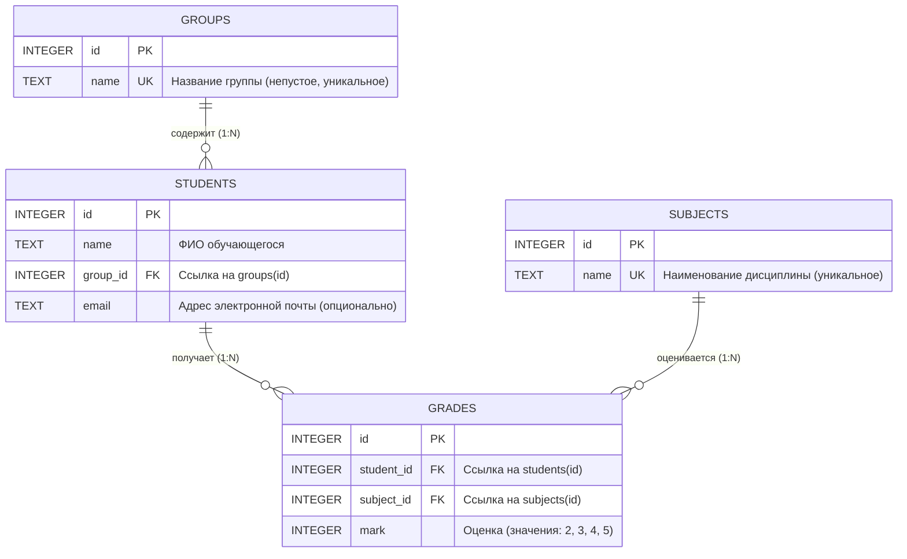

# Структура проекта
.
├── docs
│   ├── 01-how-it-works-and-architecture.md
│   └── README.md
├── journal-intro.pptx
├── journal-student-guide.docx
├── mvnw
├── mvnw.cmd
├── pom.xml
├── project_context.md
├── README.md
├── scripts
│   ├── setup-local-domain.sh
│   └── update_context.py
├── src
│   ├── main
│   │   ├── java
│   │   │   └── ru
│   │   │       └── edu
│   │   │           └── journal
│   │   │               ├── common
│   │   │               │   ├── DatabaseInitializer.java
│   │   │               │   ├── exception
│   │   │               │   │   ├── NotFoundException.java
│   │   │               │   │   └── ValidationException.java
│   │   │               │   └── GlobalExceptionHandler.java
│   │   │               ├── config
│   │   │               │   ├── DatabaseConfig.java
│   │   │               │   └── WebMvcConfig.java
│   │   │               ├── features
│   │   │               │   ├── groups
│   │   │               │   │   ├── dto
│   │   │               │   │   │   ├── GroupDto.java
│   │   │               │   │   │   └── GroupSaveRequest.java
│   │   │               │   │   ├── GroupController.java
│   │   │               │   │   ├── GroupRepository.java
│   │   │               │   │   └── GroupService.java
│   │   │               │   ├── journal
│   │   │               │   │   ├── dto
│   │   │               │   │   │   ├── BulkGradeRequest.java
│   │   │               │   │   │   ├── GradeDto.java
│   │   │               │   │   │   ├── GradeSaveRequest.java
│   │   │               │   │   │   └── JournalResponse.java
│   │   │               │   │   ├── JournalController.java
│   │   │               │   │   ├── JournalExportService.java
│   │   │               │   │   ├── JournalRepository.java
│   │   │               │   │   └── JournalService.java
│   │   │               │   ├── reports
│   │   │               │   │   ├── ReportController.java
│   │   │               │   │   ├── ReportRepository.java
│   │   │               │   │   └── ReportService.java
│   │   │               │   ├── students
│   │   │               │   │   ├── dto
│   │   │               │   │   │   ├── StudentDto.java
│   │   │               │   │   │   └── StudentSaveRequest.java
│   │   │               │   │   ├── StudentController.java
│   │   │               │   │   ├── StudentRepository.java
│   │   │               │   │   └── StudentService.java
│   │   │               │   └── subjects
│   │   │               │       ├── dto
│   │   │               │       │   ├── SubjectDto.java
│   │   │               │       │   └── SubjectSaveRequest.java
│   │   │               │       ├── SubjectController.java
│   │   │               │       ├── SubjectRepository.java
│   │   │               │       └── SubjectService.java
│   │   │               └── JournalApplication.java
│   │   └── resources
│   │       ├── application.properties
│   │       ├── db
│   │       │   ├── schema.sql
│   │       │   └── seed.sql
│   │       ├── static
│   │       │   ├── css
│   │       │   │   └── styles.css
│   │       │   └── js
│   │       │       ├── antigravity.js
│   │       │       ├── api.js
│   │       │       ├── chart-helper.js
│   │       │       ├── groups.js
│   │       │       ├── journal.js
│   │       │       ├── reports.js
│   │       │       ├── students.js
│   │       │       ├── subjects.js
│   │       │       ├── theme.js
│   │       │       ├── ui.js
│   │       │       └── vendor
│   │       │           └── chart.umd.min.js
│   │       └── templates
│   │           ├── error.html
│   │           ├── groups
│   │           │   └── index.html
│   │           ├── index.html
│   │           ├── journal
│   │           │   └── index.html
│   │           ├── partials
│   │           │   ├── footer.html
│   │           │   └── header.html
│   │           ├── reports
│   │           │   └── index.html
│   │           ├── students
│   │           │   └── index.html
│   │           └── subjects
│   │               └── index.html
│   └── test
│       └── java
│           └── ru
│               └── edu
│                   └── journal
│                       ├── DatabaseBaselineTest.java
│                       ├── JournalIntegrationTest.java
│                       └── RollbackTest.java
└── starter
    ├── app.py
    ├── check_db.py
    ├── check_rollback.py
    ├── data
    │   ├── schema.sql
    │   └── seed.sql
    ├── db.py
    ├── features
    │   ├── groups
    │   │   ├── api.py
    │   │   ├── __init__.py
    │   │   ├── pages.py
    │   │   ├── repo.py
    │   │   ├── service.py
    │   │   ├── static
    │   │   │   └── groups.js
    │   │   └── templates
    │   │       └── groups
    │   │           └── index.html
    │   └── __init__.py
    ├── prepare_db.py
    ├── README.md
    ├── requirements.txt
    ├── static
    │   ├── css
    │   │   └── styles.css
    │   └── js
    │       ├── api.js
    │       └── ui.js
    └── templates
        ├── base.html
        ├── error.html
        └── partials
            ├── footer.html
            └── header.html

52 directories, 95 files

## Содержимое ключевых файлов проекта

### `README.md`

```md
# Электронный журнал успеваемости студентов

Информационная система учёта успеваемости, академической успеваемости и аналитики учебного процесса высшего учебного заведения. Проект разработан на стеке **Java 21 (LTS)** и **Spring Boot 3** с архитектурой вертикальных функциональных срезов, чистым SQL без тяжелых ORM-абстракций, интерактивным пользовательским интерфейсом и подсистемой формирования аналитической отчетности.

---

## Оглавление

1. [Ключевые функциональные возможности](#ключевые-функциональные-возможности)
2. [Технологический стек](#технологический-стек)
3. [Архитектура приложения](#архитектура-приложения)
4. [Модель данных](#модель-данных)
5. [Спецификация REST API](#спецификация-rest-api)
6. [Инструкция по развертыванию и запуску](#инструкция-по-развертыванию-и-запуску)
   - [Запуск автономного JAR-пакета](#1-запуск-автономного-jar-пакета)
   - [Запуск через Maven Wrapper](#2-запуск-через-maven-wrapper)
   - [Открытие и запуск в IntelliJ IDEA](#3-открытие-и-запуск-в-intellij-idea)
7. [Консольные утилиты и обслуживание БД](#консольные-утилиты-и-обслуживание-бд)
8. [Тестирование и верификация](#тестирование-и-верификация)
9. [Руководство по интерфейсу и горячие клавиши](#руководство-по-интерфейсу-и-горячие-клавиши)

---

## Ключевые функциональные возможности

### 1. Управление контингентом и справочниками
- **Учебные группы:** просмотр перечня групп с автоматическим подсчетом численности контингента, создание новых групп, переименование, каскадная защита от удаления групп, содержащих активных студентов.
- **Дисциплины (предметы):** ведение реестра академических дисциплин с контролем уникальности наименований; строгая блокировка удаления дисциплин, по которым в системе зафиксированы выставленные оценки.
- **Студенты:** учет личных данных обучающихся (ФИО, email, академическая группа); регистрация новых студентов; процедура межкафедрального перевода между группами с безусловным сохранением всех накопленных ранее оценок; транзакционное удаление записи студента и всех связанных с ним оценок в рамках единой атомарной транзакции SQLite.

### 2. Поиск, фильтрация и многофакторная сортировка
- Полнотекстовый поиск обучающихся в реальном времени по подстроке ФИО, адресу электронной почты или названию группы.
- Динамический фильтр контингента по выбранной учебной группе.
- Многофакторная сортировка реестра:
  - по алфавиту ФИО (А → Я, Я → А);
  - по учебным группам (А → Я, Я → А);
  - по академическому среднему баллу (по возрастанию / убыванию);
  - по общему количеству полученных оценок.
- Интерактивная сортировка в один клик по кликабельным заголовкам столбцов таблицы с визуальной индикацией текущего направления.
- Отображение точного среднего балла студента с цветовой градацией академического уровня.

### 3. Академический журнал успеваемости и быстрый ввод (Excel-режим)
- Матричное представление успеваемости: студенты группы расположены построчно, дисциплины — по столбцам.
- Пустые ячейки наглядно маркируются прочерком при отсутствии записи в базе данных.
- Визуальная подсветка академических задолженностей (двойки выделяются контрастным фоном).
- Модальное окно для выставления, изменения и удаления оценки с валидацией значений (строго 2, 3, 4, 5).
- **Режим быстрого клавиатурного редактирования (Excel-style):**
  - Навигация по таблице клавишами стрелок (вверх, вниз, влево, вправо) и Enter.
  - Мгновенное выставление оценки нажатием клавиш 2, 3, 4, 5 (основной ряд или Numpad) с немедленным фоновым сохранением через REST API и автоматическим шагом фокуса на строку вниз.
  - Моментальное удаление оценки клавишами Delete или Backspace.
  - Однократный клик мыши переносит фокус; двойной клик открывает полное диалоговое окно.

### 4. Экспорт данных и печатные формы
- **Экспорт в Microsoft Excel (.xlsx):**
  - Генерация валидного XLSX-файла средствами Apache POI 5.3.0.
  - Фирменная стилизация заголовка ведомости, даты формирования и колонок таблицы.
  - Автоматический расчет ширины столбцов по длине содержимого.
  - Подсветка неудовлетворительных результатов и автоматическое определение академического статуса каждого обучающегося (*«Отличник»*, *«Хорошист»*, *«Успевает»*, *«Академическая задолженность»*, *«Нет оценок»*).
- **Экспорт в CSV (.csv):**
  - Формат данных с разделителем точка с запятой (`;`).
  - Префикс UTF-8 BOM для безупречного открытия во всех версиях Microsoft Excel и LibreOffice без искажения кодировки.
- **Печатная версия ведомости (Print / PDF):**
  - Специализированная таблица стилей `@media print` с альбомной ориентацией страницы А4.
  - Автоматическое скрытие служебных интерфейсных элементов (меню, фильтров, кнопок управления).
  - Формирование официальной академической шапки ведомости и блоков для подписей преподавателя и сотрудников деканата.

### 5. Аналитический модуль и интерактивные графики
- Локальная автономная интеграция библиотеки Chart.js (полное функционирование в изолированных сетях без доступа в интернет).
- Сводные KPI-карточки (число групп, студентов, зафиксированных оценок, общий средний балл).
- Сравнительные столбчатые диаграммы успеваемости групп и распределения контингента.
- Круговые диаграммы структуры оценок и доли академических задолженностей.
- Аналитический блок в журнале конкретной группы с расчетом абсолютной успеваемости (процент без двоек) и качественной успеваемости (процент четверок и пятерок).

### 6. Эргономика интерфейса и тёмная тема
- Тёмная графическая тема установлена по умолчанию.
- Полное предотвращение эффекта мигания белого экрана при переходах между страницами (Zero Flash of Unstyled Content, FOUC) за счет предварительной инициализации цветовых токенов в секции `<head>`.
- Быстрое переключение между тёмной и светлой темами с сохранением выбора в `localStorage`.
- Зебра-расцветка строк (`zebra striping`) с плавным выделением при наведении курсора для комфортной работы с большими табличными массивами данных.

---

## Технологический стек

| Компонент | Технология | Назначение |
|---|---|---|
| Язык программирования | Java 21 (LTS, OpenJDK) | Базовая программная платформа |
| Фреймворк | Spring Boot 3.3.5 | Инверсия управления, MVC, REST, сборка |
| СУБД | SQLite 3 (`org.xerial:sqlite-jdbc`) | Локальное реляционное хранилище данных |
| Доступ к данным | Spring JDBC (`NamedParameterJdbcTemplate`) | Чистый параметризованный SQL |
| Шаблонизатор | Thymeleaf 3 | Серверная визуализация HTML-страниц |
| Экспорт в электронные таблицы | Apache POI 5.3.0 (`poi-ooxml`) | Формирование документов формата Microsoft Excel |
| Графическая аналитика | Chart.js 4.4.1 (автономный бандл) | Клиентская визуализация диаграмм |
| Клиентский слой | Стандартный ES6+ JavaScript, CSS3 | Реактивный интерфейс без сторонних тяжелых фреймворков |
| Сборщик проектов | Apache Maven 3.9+ | Управление зависимостями и сборка артефактов |

---

## Архитектура приложения

Проект построен по принципу вертикального разделения на функциональные домены (`Feature-Driven Architecture`). Каждый функциональный срез полностью инкапсулирует контроллер, сервис, репозиторий с прямым SQL и DTO-модели.

```
src/main/java/ru/edu/journal/
├── JournalApplication.java                  # Главный класс приложения и обработчик CLI-команд
├── config/
│   ├── DatabaseConfig.java                  # Конфигурация SQLite DataSource (PRAGMA foreign_keys = ON)
│   └── WebMvcConfig.java                    # Конфигурация статических ресурсов и кэширования
├── common/
│   ├── DatabaseInitializer.java             # Первичная инициализация схемы и демонстрационных данных
│   ├── GlobalExceptionHandler.java          # Централизованная обработка ошибок и трансляция в JSON
│   └── exception/                           # Пользовательские исключения (ValidationException, NotFoundException)
└── features/
    ├── groups/                              # Модуль «Учебные группы»
    │   ├── GroupController.java             # Маршруты /groups и /api/groups
    │   ├── GroupService.java                # Бизнес-правила валидации и уникальности групп
    │   ├── GroupRepository.java             # SQL-запросы к таблице groups
    │   └── dto/                             # GroupDto, GroupSaveRequest
    ├── subjects/                            # Модуль «Дисциплины»
    │   ├── SubjectController.java           # Маршруты /subjects и /api/subjects
    │   ├── SubjectService.java              # Защита от удаления предметов с выставленными оценками
    │   ├── SubjectRepository.java           # SQL-запросы к таблице subjects
    │   └── dto/                             # SubjectDto, SubjectSaveRequest
    ├── students/                            # Модуль «Студенты»
    │   ├── StudentController.java           # Маршруты /students и /api/students
    │   ├── StudentService.java              # Транзакционный перевод, каскадное удаление
    │   ├── StudentRepository.java           # Фильтрация, поиск, расчет средних баллов
    │   └── dto/                             # StudentDto, StudentSaveRequest
    ├── journal/                             # Модуль «Журнал успеваемости»
    │   ├── JournalController.java           # Страница /journal, эндпоинты оценок и экспорта
    │   ├── JournalService.java              # Логика выставления и обновления оценок (upsert)
    │   ├── JournalRepository.java           # Построение матрицы оценок группы
    │   ├── JournalExportService.java        # Потоковая генерация XLSX и CSV с BOM
    │   └── dto/                             # JournalResponse, GradeDto, GradeSaveRequest
    └── reports/                             # Модуль «Отчёты и аналитика»
        ├── ReportController.java            # Страница /reports и REST /api/reports
        ├── ReportService.java               # Диспетчеризация аналитических срезов
        └── ReportRepository.java            # Аналитические SQL-агрегации (GROUP BY, HAVING)
```

---

## Модель данных

Реляционная схема хранится в файле `src/main/resources/db/schema.sql` и разворачивается в SQLite с обязательным контролем внешних ключей.



### Ограничения целостности и индексы
- Таблица `groups`: ограничение `CHECK(length(trim(name)) > 0)`, индекс `idx_groups_name`.
- Таблица `subjects`: ограничение `CHECK(length(trim(name)) > 0)`, индекс `idx_subjects_name`.
- Таблица `students`: внешняя ссылка `REFERENCES groups(id) ON DELETE RESTRICT`, индекс `idx_students_group`.
- Таблица `grades`: внешние ссылки `REFERENCES students(id) ON DELETE CASCADE` и `REFERENCES subjects(id) ON DELETE RESTRICT`, ограничение `CHECK(mark BETWEEN 2 AND 5)`, уникальный композитный индекс `idx_grades_student_subject UNIQUE(student_id, subject_id)`.

---

## Спецификация REST API

### 1. Учебные группы
- `GET /api/groups` — получение списка всех групп с количеством студентов.
- `POST /api/groups` — создание новой группы (`{"name": "БЭИ2301"}`).
- `POST /api/groups/{id}` — переименование группы.
- `DELETE /api/groups/{id}` — удаление пустой группы (возвращает 400 при наличии студентов).

### 2. Дисциплины
- `GET /api/subjects` — получение списка дисциплин.
- `POST /api/subjects` — добавление дисциплины (`{"name": "Базы данных"}`).
- `POST /api/subjects/{id}` — переименование дисциплины.
- `DELETE /api/subjects/{id}` — удаление дисциплины (возвращает 400 при наличии связанных оценок).

### 3. Студенты
- `GET /api/students` — перечень студентов с поддержкой параметров `?q=...` (поиск по строке) и `?group_id=...` (фильтр по группе). Возвращает средний балл каждого обучающегося.
- `GET /api/students/{id}` — получение подробных данных студента.
- `POST /api/students` — регистрация студента (`{"name": "...", "group_id": 1, "email": "..."}`).
- `POST /api/students/{id}` — изменение данных или перевод в другую группу.
- `DELETE /api/students/{id}` — транзакционное каскадное удаление студента и всех его оценок.

### 4. Журнал успеваемости и экспорт
- `GET /api/journal?group_id={id}` — получение матрицы журнала выбранной группы (группа, список предметов, список студентов, массив оценок).
- `POST /api/journal/grades` — выставление или обновление оценки (`{"student_id": 1, "subject_id": 2, "mark": 5}`).
- `DELETE /api/journal/grades/{studentId}/{subjectId}` — удаление оценки по предмету.
- `GET /api/journal/export/excel?group_id={id}` — выгрузка ведомости группы в бинарный файл Microsoft Excel (.xlsx).
- `GET /api/journal/export/csv?group_id={id}` — выгрузка ведомости группы в текстовый файл CSV (разделитель `;`, кодировка UTF-8 BOM).

### 5. Аналитические отчёты
- `GET /api/reports?kind=groups` — сводные статистические показатели по группам (контингент, сумма оценок, средний балл).
- `GET /api/reports?kind=no_grades` — список обучающихся без единой выставленной оценки.
- `GET /api/reports?kind=failing` — список неуспевающих обучающихся (имеющих хотя бы одну оценку «2»).

---

## Инструкция по развертыванию и запуску

Для работы приложения требуется установленная виртуальная машина **Java 21** или выше.

### 1. Запуск автономного JAR-пакета

В дистрибутив входит предварительно скомпилированный Fat-JAR архив, содержащий внутри сервер приложений и все библиотеки:

```bash
# Запуск веб-сервера из директории проекта
java -jar target/journal-1.0.0.jar
```

После старта веб-интерфейс доступен в браузере по адресу:
```
http://127.0.0.1:5000/
```

При первом запуске приложение автоматически создаст локальную базу данных `instance/journal.db` и наполнит её демонстрационным набором данных (3 учебные группы, 60 студентов, 3 дисциплины, 162 оценки).

### 2. Запуск через Maven Wrapper

Сборка и запуск из исходного кода с помощью входящего в проект скрипта Maven Wrapper (не требует предварительно установленного Maven):

```bash
# Запуск веб-сервера
./mvnw spring-boot:run

# Сборка нового JAR-пакета после внесения изменений
./mvnw clean package
```

Собранный исполняемый файл будет помещен по пути: `target/journal-1.0.0.jar`.

### 3. Открытие и запуск в IntelliJ IDEA

1. Запустите IntelliJ IDEA.
2. Выберите пункт меню **File → Open...** и укажите корневой каталог проекта: `/home/milk13/IdeaProjects/jrnl`.
3. Среда разработки автоматически распознает файл `pom.xml`, выполнит импорт зависимостей и настроит структуру модулей.
4. Убедитесь, что в **Project Structure → Project SDK** выбран Java 21 (или 22/27).
5. Перейдите к файлу `src/main/java/ru/edu/journal/JournalApplication.java`.
6. Нажмите кнопку **Run** рядом с объявлением метода `main`.

---

## Консольные утилиты и обслуживание БД

Приложение поддерживает запуск со специальными аргументами командной строки для административного обслуживания и валидации базы данных без запуска постоянного веб-сервера:

### Восстановление исходного состояния базы данных
Пересоздает таблицы из `src/main/resources/db/schema.sql` и заполняет их исходными данными из `src/main/resources/db/seed.sql` в рамках единой транзакции:

```bash
# Через JAR
java -jar target/journal-1.0.0.jar --prepare

# Через Maven Wrapper
./mvnw spring-boot:run -Dspring-boot.run.arguments="--prepare"
```

### Проверка контрольных показателей базы данных
Выполняет сверку связности, включения внешних ключей и контрольных сумм записей:

```bash
java -jar target/journal-1.0.0.jar --check-baseline
```
Ожидаемый результат:
```
foreign_keys: 1
foreign_key_check: 0
groups: 3
students: 60
subjects: 3
grades: 162
students_without_grades: 6
PASS: база прошла проверку
```

### Проверка отката транзакций при сбое
Имитирует непредвиденную ошибку в середине транзакции удаления студента и проверяет сохранность данных после аварийного отката:

```bash
java -jar target/journal-1.0.0.jar --check-rollback
```
Ожидаемый результат:
```
Учебный сбой: Учебная ошибка после удаления оценок.
PASS: студент и все оценки сохранены после отката
PASS: обычное удаление убрало студента и его оценки
```

---

## Тестирование и верификация

В проект включен комплекс автоматических интеграционных и модульных тестов на платформе JUnit 5 и Spring Test:

```bash
./mvnw test
```

### Состав тестового набора:
1. `DatabaseBaselineTest` — проверка соответствия реляционной схемы и корректности начального наполнения БД.
2. `RollbackTest` — проверка механизма транзакционного отката Spring JDBC при искусственных аппаратных или программных сбоях.
3. `JournalIntegrationTest` — сквозное тестирование всех разделов REST API:
   - валидация операций с группами и защита от удаления непустых групп;
   - создание предметов и блокировка удаления дисциплин с оценками;
   - создание, поиск, фильтрация студентов и межкафедральный перевод с сохранением оценок;
   - матричный журнал, выставление оценок 2..5, защита от некорректных значений;
   - генерация бинарных выгрузок Excel (.xlsx) и CSV с проверкой заголовков;
   - аналитические выборки модуля отчетов.

---

## Руководство по интерфейсу и горячие клавиши

### Раздел «Журнал» — режим быстрого ввода
Для активации быстрого ввода установите флажок **«Режим быстрого ввода (клавиатура)»** в верхней части страницы журнала.

| Клавиша / Сочетание | Выполняемое действие |
|---|---|
| Стрелка вверх (`ArrowUp`) | Перемещение фокуса на строку выше (предыдущий студент) |
| Стрелка вниз (`ArrowDown`) / `Enter` | Перемещение фокуса на строку ниже (следующий студент) |
| Стрелка влево (`ArrowLeft`) | Перемещение фокуса на столбец левее (предыдущий предмет) |
| Стрелка вправо (`ArrowRight`) | Перемещение фокуса на столбец правее (следующий предмет) |
| Цифры `2`, `3`, `4`, `5` | Немедленная фиксация оценки в БД и переход к следующему студенту |
| `Delete` / `Backspace` | Мгновенное удаление оценки из БД в активной ячейке |
| Одиночный клик мыши | Фокусировка выбранной ячейки таблицы |
| Двойной клик мыши | Открытие детального модального окна управления оценкой |

### Раздел «Студенты»
- Ввод любого текста в поле **«Поиск по студентам»** мгновенно фильтрует таблицу без перезагрузки страницы.
- Нажатие на заголовки столбцов **«ФИО»**, **«Группа»**, **«Оценок»**, **«Средний балл»** упорядочивает список по возрастанию или убыванию.
- Кнопка **«Добавить студента»** открывает форму привязки к группе с валидацией имени.
- Кнопка **«Изменить»** в строке студента позволяет перевести его в другую академическую группу с сохранением истории оценок.
```

### `docs/README.md`

```md
# Документация проекта "Электронный журнал" (jrnl)

В этой папке собраны подробные обучающие руководства по устройству, архитектуре и исходному коду проекта. Документы написаны простым языком с примерами, разбором Java-кода и наглядными диаграммами.

---

## Оглавление руководств

| # | Документ | Описание темы |
|---|---|---|
| **01** | [**01-how-it-works-and-architecture.md**](file:///home/milk13/IdeaProjects/jrnl/docs/01-how-it-works-and-architecture.md) | **Как устроен проект: запуск веб-сервера, роль Spring Boot, создание сайтов на Java и базовые концепции.** |
| **02** | *В разработке...* | База данных SQLite, чистый SQL и работа через `JdbcClient` без тяжелых ORM. |
| **03** | *В разработке...* | Фронтенд, шаблонизация Thymeleaf, REST API и динамический интерфейс (JavaScript). |
| **04** | *В разработке...* | Вертикальные функциональные срезы (Features): студенты, группы, журнал, аналитика. |

---

Каждый файл содержит интерактивные ссылки на исходный код проекта и наглядные схемы Mermaid.
```

### `pom.xml`

```xml
<?xml version="1.0" encoding="UTF-8"?>
<project xmlns="http://maven.apache.org/POM/4.0.0"
         xmlns:xsi="http://www.w3.org/2001/XMLSchema-instance"
         xsi:schemaLocation="http://maven.apache.org/POM/4.0.0 https://maven.apache.org/xsd/maven-4.0.0.xsd">
    <modelVersion>4.0.0</modelVersion>

    <parent>
        <groupId>org.springframework.boot</groupId>
        <artifactId>spring-boot-starter-parent</artifactId>
        <version>3.3.5</version>
        <relativePath/>
    </parent>

    <groupId>ru.edu</groupId>
    <artifactId>journal</artifactId>
    <version>1.0.0</version>
    <name>journal</name>
    <description>Электронный журнал студентов на Java и Spring Boot</description>

    <properties>
        <java.version>21</java.version>
        <sqlite-jdbc.version>3.47.1.0</sqlite-jdbc.version>
    </properties>

    <dependencies>
        <!-- Spring Boot Web & Thymeleaf -->
        <dependency>
            <groupId>org.springframework.boot</groupId>
            <artifactId>spring-boot-starter-web</artifactId>
        </dependency>
        <dependency>
            <groupId>org.springframework.boot</groupId>
            <artifactId>spring-boot-starter-thymeleaf</artifactId>
        </dependency>

        <!-- Spring JDBC -->
        <dependency>
            <groupId>org.springframework.boot</groupId>
            <artifactId>spring-boot-starter-jdbc</artifactId>
        </dependency>

        <!-- SQLite JDBC Driver -->
        <dependency>
            <groupId>org.xerial</groupId>
            <artifactId>sqlite-jdbc</artifactId>
            <version>${sqlite-jdbc.version}</version>
        </dependency>

        <!-- Validation -->
        <dependency>
            <groupId>org.springframework.boot</groupId>
            <artifactId>spring-boot-starter-validation</artifactId>
        </dependency>

        <!-- Apache POI for Excel export (.xlsx) -->
        <dependency>
            <groupId>org.apache.poi</groupId>
            <artifactId>poi-ooxml</artifactId>
            <version>5.3.0</version>
        </dependency>

        <!-- Testing -->
        <dependency>
            <groupId>org.springframework.boot</groupId>
            <artifactId>spring-boot-starter-test</artifactId>
            <scope>test</scope>
        </dependency>
    </dependencies>

    <build>
        <plugins>
            <plugin>
                <groupId>org.springframework.boot</groupId>
                <artifactId>spring-boot-maven-plugin</artifactId>
            </plugin>
        </plugins>
    </build>
</project>
```

### `src/main/java/ru/edu/journal/JournalApplication.java`

```java
package ru.edu.journal;

import org.slf4j.Logger;
import org.slf4j.LoggerFactory;
import org.springframework.boot.CommandLineRunner;
import org.springframework.boot.SpringApplication;
import org.springframework.boot.autoconfigure.SpringBootApplication;
import org.springframework.boot.context.event.ApplicationReadyEvent;
import org.springframework.boot.web.servlet.context.ServletWebServerApplicationContext;
import org.springframework.context.ApplicationContext;
import org.springframework.context.event.EventListener;
import ru.edu.journal.common.DatabaseInitializer;
import ru.edu.journal.features.students.StudentService;

import javax.sql.DataSource;
import java.net.InetAddress;
import java.net.UnknownHostException;
import java.sql.Connection;
import java.sql.ResultSet;
import java.sql.Statement;
import java.util.*;

@SpringBootApplication
public class JournalApplication implements CommandLineRunner {

    private static final Logger log = LoggerFactory.getLogger(JournalApplication.class);

    private final ApplicationContext context;
    private final DatabaseInitializer databaseInitializer;
    private final DataSource dataSource;

    @org.springframework.beans.factory.annotation.Value("${app.public-url:http://journal.edu.local}")
    private String publicUrl;

    public JournalApplication(ApplicationContext context,
                              DatabaseInitializer databaseInitializer,
                              DataSource dataSource) {
        this.context = context;
        this.databaseInitializer = databaseInitializer;
        this.dataSource = dataSource;
    }

    public static void main(String[] args) {
        SpringApplication.run(JournalApplication.class, args);
    }

    @EventListener(ApplicationReadyEvent.class)
    public void onApplicationReady(ApplicationReadyEvent event) {
        if (event.getApplicationContext() instanceof ServletWebServerApplicationContext webContext) {
            int port = webContext.getWebServer().getPort();
            String contextPath = webContext.getServletContext().getContextPath();
            String path = (contextPath == null || contextPath.isBlank()) ? "/" : (contextPath.endsWith("/") ? contextPath : contextPath + "/");

            log.info("""
                
                ==========================================================
                  ЭЛЕКТРОННЫЙ ЖУРНАЛ УСПЕВАЕМОСТИ ГОТОВ К РАБОТЕ
                  Домен:       {}
                  Локальный:   http://127.0.0.1:{}{}
                  Режим БД:    SQLite WAL (Foreign Keys = ON)
                ==========================================================""",
                publicUrl, port, path
            );
        }
    }

    @Override
    public void run(String... args) throws Exception {
        Set<String> argSet = new HashSet<>(Arrays.asList(args));

        if (argSet.contains("--prepare")) {
            System.out.println("Восстановление базы данных...");
            Map<String, Integer> counts = databaseInitializer.initializeDatabase();
            System.out.println("База восстановлена: instance/journal.db");
            for (Map.Entry<String, Integer> entry : counts.entrySet()) {
                System.out.println(entry.getKey() + ": " + entry.getValue());
            }
            System.exit(0);
        }

        if (argSet.contains("--check-baseline") || argSet.contains("--check")) {
            boolean requireBaseline = argSet.contains("--check-baseline");
            checkDatabase(requireBaseline);
            System.exit(0);
        }

        if (argSet.contains("--check-rollback")) {
            checkRollback();
            System.exit(0);
        }
    }

    private void checkDatabase(boolean requireBaseline) throws Exception {
        try (Connection con = dataSource.getConnection();
             Statement stmt = con.createStatement()) {
            int enabled = 0;
            try (ResultSet rs = stmt.executeQuery("PRAGMA foreign_keys")) {
                if (rs.next()) enabled = rs.getInt(1);
            }
            int violations = 0;
            try (ResultSet rs = stmt.executeQuery("PRAGMA foreign_key_check")) {
                while (rs.next()) violations++;
            }

            System.out.println("foreign_keys: " + enabled);
            System.out.println("foreign_key_check: " + violations);

            Map<String, Integer> counts = new HashMap<>();
            for (String table : new String[]{"groups", "students", "subjects", "grades"}) {
                try (ResultSet rs = stmt.executeQuery("SELECT COUNT(*) FROM " + table)) {
                    if (rs.next()) {
                        int c = rs.getInt(1);
                        counts.put(table, c);
                        System.out.println(table + ": " + c);
                    }
                }
            }

            int noGrades = 0;
            try (ResultSet rs = stmt.executeQuery("""
                    SELECT COUNT(*)
                    FROM students AS s
                    LEFT JOIN grades AS gr ON gr.student_id = s.id
                    WHERE gr.id IS NULL
                    """)) {
                if (rs.next()) noGrades = rs.getInt(1);
            }
            System.out.println("students_without_grades: " + noGrades);

            if (enabled != 1) {
                System.err.println("FAIL: Проверка внешних ключей выключена");
                System.exit(1);
            }
            if (violations != 0) {
                System.err.println("FAIL: Нарушены внешние ключи");
                System.exit(1);
            }
            if (requireBaseline) {
                if (!Integer.valueOf(3).equals(counts.get("groups")) ||
                    !Integer.valueOf(60).equals(counts.get("students")) ||
                    !Integer.valueOf(3).equals(counts.get("subjects")) ||
                    !Integer.valueOf(162).equals(counts.get("grades"))) {
                    System.err.println("FAIL: Сначала восстановите исходные данные");
                    System.exit(1);
                }
                if (noGrades != 6) {
                    System.err.println("FAIL: Ожидалось шесть студентов без оценок");
                    System.exit(1);
                }
            }
            System.out.println("PASS: база прошла проверку");
        }
    }

    private void checkRollback() throws Exception {
        StudentService studentService = context.getBean(StudentService.class);
        Long studentId;
        try (Connection con = dataSource.getConnection();
             Statement stmt = con.createStatement();
             ResultSet rs = stmt.executeQuery("SELECT student_id FROM grades ORDER BY id LIMIT 1")) {
            if (!rs.next()) {
                System.err.println("Для проверки нужен студент с оценками");
                System.exit(1);
                return;
            }
            studentId = rs.getLong(1);
        }

        Map<String, List<List<Object>>> before = snapshot();

        boolean caught = false;
        try {
            studentService.deleteStudent(studentId, true);
        } catch (RuntimeException ex) {
            caught = true;
            System.out.println("Учебный сбой: " + ex.getMessage());
        }

        if (!caught) {
            System.err.println("FAIL: Сервис не вызвал учебную ошибку");
            System.exit(1);
        }

        Map<String, List<List<Object>>> afterRollback = snapshot();
        if (!before.equals(afterRollback)) {
            System.err.println("FAIL: Откат неполный: данные изменились");
            System.exit(1);
        }
        System.out.println("PASS: студент и все оценки сохранены после отката");

        studentService.deleteStudent(studentId, false);
        Map<String, List<List<Object>>> after = snapshot();
        boolean studentExists = after.get("students").stream().anyMatch(row -> row.get(0).equals(studentId));
        boolean gradesExist = after.get("grades").stream().anyMatch(row -> row.get(1).equals(studentId));

        if (studentExists || gradesExist) {
            System.err.println("FAIL: Удаление не убрало студента или его оценки");
            System.exit(1);
        }

        System.out.println("PASS: обычное удаление убрало студента и его оценки");

        // Восстановление удаленного студента и его оценок из снимка before для сохранения рабочей базы
        try (Connection con = dataSource.getConnection()) {
            con.setAutoCommit(false);
            try {
                List<Object> studentRow = before.get("students").stream()
                        .filter(r -> r.get(0).equals(studentId))
                        .findFirst()
                        .orElse(null);
                if (studentRow != null) {
                    try (var ps = con.prepareStatement("INSERT INTO students (id, name, group_id, email) VALUES (?, ?, ?, ?)")) {
                        ps.setObject(1, studentRow.get(0));
                        ps.setObject(2, studentRow.get(1));
                        ps.setObject(3, studentRow.get(2));
                        ps.setObject(4, studentRow.get(3));
                        ps.executeUpdate();
                    }
                }

                List<List<Object>> studentGrades = before.get("grades").stream()
                        .filter(r -> r.get(1).equals(studentId))
                        .toList();
                for (List<Object> gRow : studentGrades) {
                    try (var ps = con.prepareStatement("INSERT INTO grades (id, student_id, subject_id, mark) VALUES (?, ?, ?, ?)")) {
                        ps.setObject(1, gRow.get(0));
                        ps.setObject(2, gRow.get(1));
                        ps.setObject(3, gRow.get(2));
                        ps.setObject(4, gRow.get(3));
                        ps.executeUpdate();
                    }
                }
                con.commit();
            } catch (Exception ex) {
                con.rollback();
                throw ex;
            } finally {
                con.setAutoCommit(true);
            }
        }

        Map<String, List<List<Object>>> finalSnapshot = snapshot();
        if (!before.equals(finalSnapshot)) {
            System.err.println("FAIL: Рабочая база не была восстановлена до исходного состояния");
            System.exit(1);
        }

        System.out.println("PASS: рабочая база не изменена проверкой");
    }

    private Map<String, List<List<Object>>> snapshot() throws Exception {
        Map<String, List<List<Object>>> result = new HashMap<>();
        try (Connection con = dataSource.getConnection();
             Statement stmt = con.createStatement()) {
            for (String table : new String[]{"groups", "students", "subjects", "grades"}) {
                List<List<Object>> rows = new ArrayList<>();
                try (ResultSet rs = stmt.executeQuery("SELECT * FROM " + table + " ORDER BY id")) {
                    int colCount = rs.getMetaData().getColumnCount();
                    while (rs.next()) {
                        List<Object> row = new ArrayList<>();
                        for (int i = 1; i <= colCount; i++) {
                            row.add(rs.getObject(i));
                        }
                        rows.add(row);
                    }
                }
                result.put(table, rows);
            }
        }
        return result;
    }
}
```

### `src/main/java/ru/edu/journal/common/DatabaseInitializer.java`

```java
package ru.edu.journal.common;

import org.slf4j.Logger;
import org.slf4j.LoggerFactory;
import org.springframework.beans.factory.annotation.Value;
import org.springframework.boot.CommandLineRunner;
import org.springframework.core.io.ClassPathResource;
import org.springframework.jdbc.datasource.init.ScriptUtils;
import org.springframework.stereotype.Component;

import javax.sql.DataSource;
import java.sql.Connection;
import java.sql.ResultSet;
import java.sql.Statement;
import java.util.HashMap;
import java.util.Map;

@Component
public class DatabaseInitializer implements CommandLineRunner {

    private static final Logger log = LoggerFactory.getLogger(DatabaseInitializer.class);

    private final DataSource dataSource;

    @Value("${app.db.auto-init:true}")
    private boolean autoInit;

    public DatabaseInitializer(DataSource dataSource) {
        this.dataSource = dataSource;
    }

    @Override
    public void run(String... args) throws Exception {
        if (!autoInit) {
            return;
        }

        try (Connection con = dataSource.getConnection()) {
            boolean needsInit = false;
            try (Statement stmt = con.createStatement()) {
                ResultSet rs = stmt.executeQuery(
                        "SELECT COUNT(*) FROM sqlite_master WHERE type='table' AND name='groups'"
                );
                if (!rs.next() || rs.getInt(1) == 0) {
                    needsInit = true;
                } else {
                    ResultSet countRs = stmt.executeQuery("SELECT COUNT(*) FROM groups");
                    if (countRs.next() && countRs.getInt(1) == 0) {
                        needsInit = true;
                    }
                }
            }

            if (needsInit) {
                log.info("Database is empty or missing. Initializing database schema and seed data...");
                initializeDatabase();
            }
        }
    }

    public Map<String, Integer> initializeDatabase() {
        try (Connection con = dataSource.getConnection()) {
            con.setAutoCommit(false);
            try (Statement stmt = con.createStatement()) {
                stmt.execute("PRAGMA foreign_keys = ON");

                ScriptUtils.executeSqlScript(con, new ClassPathResource("db/schema.sql"));
                ScriptUtils.executeSqlScript(con, new ClassPathResource("db/seed.sql"));

                Map<String, Integer> counts = new HashMap<>();
                for (String table : new String[]{"groups", "students", "subjects", "grades"}) {
                    try (ResultSet rs = stmt.executeQuery("SELECT COUNT(*) FROM " + table)) {
                        if (rs.next()) {
                            counts.put(table, rs.getInt(1));
                        }
                    }
                }

                // Verify baseline counts
                if (!Integer.valueOf(3).equals(counts.get("groups")) ||
                    !Integer.valueOf(60).equals(counts.get("students")) ||
                    !Integer.valueOf(3).equals(counts.get("subjects")) ||
                    !Integer.valueOf(162).equals(counts.get("grades"))) {
                    throw new IllegalStateException("Нарушено исходное количество записей: " + counts);
                }

                try (ResultSet fkRs = stmt.executeQuery("PRAGMA foreign_key_check")) {
                    if (fkRs.next()) {
                        throw new IllegalStateException("Обнаружены нарушенные внешние ключи.");
                    }
                }

                con.commit();
                log.info("Database initialized successfully: {}", counts);
                return counts;
            } catch (Exception e) {
                con.rollback();
                throw e;
            }
        } catch (Exception e) {
            throw new RuntimeException("Failed to initialize database: " + e.getMessage(), e);
        }
    }
}
```

### `src/main/java/ru/edu/journal/common/GlobalExceptionHandler.java`

```java
package ru.edu.journal.common;

import org.slf4j.Logger;
import org.slf4j.LoggerFactory;
import org.springframework.dao.DataAccessException;
import org.springframework.dao.DataIntegrityViolationException;
import org.springframework.http.HttpStatus;
import org.springframework.http.ResponseEntity;
import org.springframework.http.converter.HttpMessageNotReadableException;
import org.springframework.jdbc.UncategorizedSQLException;
import org.springframework.validation.FieldError;
import org.springframework.web.bind.MethodArgumentNotValidException;
import org.springframework.web.bind.annotation.ExceptionHandler;
import org.springframework.web.bind.annotation.RestControllerAdvice;
import org.springframework.web.servlet.NoHandlerFoundException;
import org.springframework.web.servlet.resource.NoResourceFoundException;
import ru.edu.journal.common.exception.NotFoundException;
import ru.edu.journal.common.exception.ValidationException;

import java.sql.SQLException;
import java.util.Map;
import java.util.Objects;

@RestControllerAdvice
public class GlobalExceptionHandler {

    private static final Logger log = LoggerFactory.getLogger(GlobalExceptionHandler.class);

    @ExceptionHandler(ValidationException.class)
    public ResponseEntity<Map<String, String>> handleValidation(ValidationException ex) {
        return ResponseEntity.status(HttpStatus.BAD_REQUEST).body(Map.of("error", ex.getMessage()));
    }

    @ExceptionHandler(MethodArgumentNotValidException.class)
    public ResponseEntity<Map<String, String>> handleMethodArgumentNotValid(MethodArgumentNotValidException ex) {
        String message = ex.getBindingResult().getFieldErrors().stream()
                .map(FieldError::getDefaultMessage)
                .filter(Objects::nonNull)
                .findFirst()
                .orElse("Ошибка валидации данных.");
        return ResponseEntity.status(HttpStatus.BAD_REQUEST).body(Map.of("error", message));
    }

    @ExceptionHandler(HttpMessageNotReadableException.class)
    public ResponseEntity<Map<String, String>> handleMessageNotReadable(HttpMessageNotReadableException ex) {
        return ResponseEntity.status(HttpStatus.BAD_REQUEST).body(Map.of("error", "Ожидается корректный JSON-объект."));
    }

    @ExceptionHandler(NotFoundException.class)
    public ResponseEntity<Map<String, String>> handleNotFound(NotFoundException ex) {
        return ResponseEntity.status(HttpStatus.NOT_FOUND).body(Map.of("error", ex.getMessage()));
    }

    @ExceptionHandler({DataIntegrityViolationException.class, UncategorizedSQLException.class, DataAccessException.class})
    public ResponseEntity<Map<String, String>> handleDataIntegrity(Exception ex) {
        log.warn("Data integrity/access error: {}", ex.getMessage());
        String msg = ex.getMessage();
        if (msg != null && (msg.contains("UNIQUE constraint failed") || msg.contains("SQLITE_CONSTRAINT_UNIQUE"))) {
            return ResponseEntity.status(HttpStatus.BAD_REQUEST).body(Map.of("error", "Такое название уже существует."));
        }
        if (msg != null && (msg.contains("FOREIGN KEY constraint failed") || msg.contains("SQLITE_CONSTRAINT_FOREIGNKEY"))) {
            return ResponseEntity.status(HttpStatus.BAD_REQUEST).body(Map.of("error", "Нарушено ограничение внешнего ключа."));
        }
        return ResponseEntity.status(HttpStatus.BAD_REQUEST).body(Map.of("error", "Ошибка целостности данных."));
    }

    @ExceptionHandler(SQLException.class)
    public ResponseEntity<Map<String, String>> handleSql(SQLException ex) {
        log.error("Database SQL error", ex);
        return ResponseEntity.status(HttpStatus.INTERNAL_SERVER_ERROR)
                .body(Map.of("error", "Ошибка базы данных. Подробности в терминале сервера."));
    }

    @ExceptionHandler({NoResourceFoundException.class, NoHandlerFoundException.class})
    public ResponseEntity<Map<String, String>> handleNoRoute(Exception ex) {
        return ResponseEntity.status(HttpStatus.NOT_FOUND).body(Map.of("error", "Адрес API не найден."));
    }

    @ExceptionHandler(Exception.class)
    public ResponseEntity<Map<String, String>> handleGeneric(Exception ex) {
        log.error("Unexpected error", ex);
        return ResponseEntity.status(HttpStatus.INTERNAL_SERVER_ERROR)
                .body(Map.of("error", ex.getMessage() != null ? ex.getMessage() : "Внутренняя ошибка сервера."));
    }
}
```

### `src/main/java/ru/edu/journal/common/exception/NotFoundException.java`

```java
package ru.edu.journal.common.exception;

public class NotFoundException extends RuntimeException {
    public NotFoundException(String message) {
        super(message);
    }
}
```

### `src/main/java/ru/edu/journal/common/exception/ValidationException.java`

```java
package ru.edu.journal.common.exception;

public class ValidationException extends RuntimeException {
    public ValidationException(String message) {
        super(message);
    }
}
```

### `src/main/java/ru/edu/journal/config/DatabaseConfig.java`

```java
package ru.edu.journal.config;

import org.sqlite.SQLiteConfig;
import org.sqlite.SQLiteDataSource;
import org.springframework.beans.factory.annotation.Value;
import org.springframework.context.annotation.Bean;
import org.springframework.context.annotation.Configuration;

import javax.sql.DataSource;
import java.io.File;

@Configuration
public class DatabaseConfig {

    @Value("${app.db.path:instance/journal.db}")
    private String dbPath;

    @Bean
    public DataSource dataSource() {
        File dbFile = new File(dbPath);
        File parentDir = dbFile.getParentFile();
        if (parentDir != null && !parentDir.exists()) {
            parentDir.mkdirs();
        }

        SQLiteConfig config = new SQLiteConfig();
        config.enforceForeignKeys(true);
        config.setBusyTimeout(5000);
        config.setJournalMode(SQLiteConfig.JournalMode.WAL);
        config.setSynchronous(SQLiteConfig.SynchronousMode.NORMAL);
        config.setTempStore(SQLiteConfig.TempStore.MEMORY);

        SQLiteDataSource dataSource = new SQLiteDataSource(config);
        dataSource.setUrl("jdbc:sqlite:" + dbPath);
        return dataSource;
    }
}
```

### `src/main/java/ru/edu/journal/config/WebMvcConfig.java`

```java
package ru.edu.journal.config;

import jakarta.servlet.http.HttpServletRequest;
import jakarta.servlet.http.HttpServletResponse;
import org.springframework.context.annotation.Configuration;
import org.springframework.web.method.HandlerMethod;
import org.springframework.web.servlet.HandlerInterceptor;
import org.springframework.web.servlet.config.annotation.InterceptorRegistry;
import org.springframework.web.servlet.config.annotation.ResourceHandlerRegistry;
import org.springframework.web.servlet.config.annotation.ViewControllerRegistry;
import org.springframework.web.servlet.config.annotation.WebMvcConfigurer;

@Configuration
public class WebMvcConfig implements WebMvcConfigurer {

    @Override
    public void addViewControllers(ViewControllerRegistry registry) {
        registry.addViewController("/").setViewName("index");
    }

    @Override
    public void addInterceptors(InterceptorRegistry registry) {
        registry.addInterceptor(new HandlerInterceptor() {
            @Override
            public boolean preHandle(HttpServletRequest request, HttpServletResponse response, Object handler) {
                request.setAttribute("_startNano", System.nanoTime());
                if (handler instanceof HandlerMethod hm) {
                    String controllerName = hm.getBeanType().getSimpleName();
                    String methodName = hm.getMethod().getName();
                    response.setHeader("X-Java-Controller", controllerName + "." + methodName + "()");
                }
                return true;
            }

            @Override
            public void afterCompletion(HttpServletRequest request, HttpServletResponse response, Object handler, Exception ex) {
                Object start = request.getAttribute("_startNano");
                if (start instanceof Long startNano) {
                    double ms = (System.nanoTime() - startNano) / 1_000_000.0;
                    response.setHeader("X-Exec-Time-Ms", String.format(java.util.Locale.US, "%.2f", ms));
                }
            }
        }).addPathPatterns("/api/**");
    }

    @Override
    public void addResourceHandlers(ResourceHandlerRegistry registry) {
        registry.addResourceHandler("/static/**")
                .addResourceLocations("classpath:/static/")
                .setCachePeriod(0);
        registry.addResourceHandler("/**")
                .addResourceLocations("classpath:/static/")
                .setCachePeriod(0);
    }
}
```

### `src/main/java/ru/edu/journal/features/groups/GroupController.java`

```java
package ru.edu.journal.features.groups;

import jakarta.validation.Valid;
import org.springframework.http.HttpStatus;
import org.springframework.http.ResponseEntity;
import org.springframework.stereotype.Controller;
import org.springframework.ui.Model;
import org.springframework.web.bind.annotation.*;
import ru.edu.journal.features.groups.dto.GroupDto;
import ru.edu.journal.features.groups.dto.GroupSaveRequest;

import java.util.Map;

@Controller
public class GroupController {

    private final GroupService groupService;

    public GroupController(GroupService groupService) {
        this.groupService = groupService;
    }

    @GetMapping("/groups")
    public String index(Model model) {
        model.addAttribute("activePage", "groups");
        return "groups/index";
    }

    @GetMapping("/api/groups")
    @ResponseBody
    public Map<String, Object> listGroups() {
        return Map.of("items", groupService.listGroups());
    }

    @PostMapping("/api/groups")
    @ResponseBody
    public ResponseEntity<Map<String, Object>> createGroup(@Valid @RequestBody GroupSaveRequest request) {
        String name = request != null ? request.name() : null;
        GroupDto item = groupService.saveGroup(name, null);
        return ResponseEntity.status(HttpStatus.CREATED).body(Map.of("item", item));
    }

    @PostMapping("/api/groups/{id}")
    @ResponseBody
    public ResponseEntity<Map<String, Object>> updateGroup(@PathVariable Long id,
                                                           @Valid @RequestBody GroupSaveRequest request) {
        String name = request != null ? request.name() : null;
        GroupDto item = groupService.saveGroup(name, id);
        return ResponseEntity.ok(Map.of("item", item));
    }

    @DeleteMapping("/api/groups/{id}")
    @ResponseBody
    @ResponseStatus(HttpStatus.NO_CONTENT)
    public void deleteGroup(@PathVariable Long id) {
        groupService.deleteGroup(id);
    }
}
```

### `src/main/java/ru/edu/journal/features/groups/GroupRepository.java`

```java
package ru.edu.journal.features.groups;

import org.springframework.jdbc.core.simple.JdbcClient;
import org.springframework.jdbc.support.GeneratedKeyHolder;
import org.springframework.jdbc.support.KeyHolder;
import org.springframework.stereotype.Repository;
import ru.edu.journal.features.groups.dto.GroupDto;

import java.util.List;
import java.util.Optional;

@Repository
public class GroupRepository {

    private final JdbcClient jdbcClient;

    public GroupRepository(JdbcClient jdbcClient) {
        this.jdbcClient = jdbcClient;
    }

    public List<GroupDto> findAllWithStudentCount() {
        return jdbcClient.sql("""
                SELECT g.id, g.name, COUNT(s.id) AS student_count
                FROM groups AS g
                LEFT JOIN students AS s ON s.group_id = g.id
                GROUP BY g.id, g.name
                ORDER BY g.name, g.id
                """)
                .query((rs, rowNum) -> new GroupDto(
                        rs.getLong("id"),
                        rs.getString("name"),
                        rs.getLong("student_count")
                ))
                .list();
    }

    public Optional<GroupDto> findById(Long id) {
        return jdbcClient.sql("SELECT id, name FROM groups WHERE id = ?")
                .param(id)
                .query((rs, rowNum) -> new GroupDto(
                        rs.getLong("id"),
                        rs.getString("name"),
                        null
                ))
                .optional();
    }

    public Long insert(String name) {
        KeyHolder keyHolder = new GeneratedKeyHolder();
        jdbcClient.sql("INSERT INTO groups (name) VALUES (?)")
                .param(name)
                .update(keyHolder, "id");
        Number key = keyHolder.getKey();
        return key != null ? key.longValue() : null;
    }

    public void update(Long id, String name) {
        jdbcClient.sql("UPDATE groups SET name = ? WHERE id = ?")
                .param(name)
                .param(id)
                .update();
    }

    public void delete(Long id) {
        jdbcClient.sql("DELETE FROM groups WHERE id = ?")
                .param(id)
                .update();
    }

    public long countStudents(Long groupId) {
        return jdbcClient.sql("SELECT COUNT(*) FROM students WHERE group_id = ?")
                .param(groupId)
                .query(Long.class)
                .single();
    }
}
```

### `src/main/java/ru/edu/journal/features/groups/GroupService.java`

```java
package ru.edu.journal.features.groups;

import org.springframework.dao.DataAccessException;
import org.springframework.stereotype.Service;
import org.springframework.transaction.annotation.Transactional;
import ru.edu.journal.common.exception.NotFoundException;
import ru.edu.journal.common.exception.ValidationException;
import ru.edu.journal.features.groups.dto.GroupDto;

import java.util.List;

@Service
public class GroupService {

    private final GroupRepository groupRepository;

    public GroupService(GroupRepository groupRepository) {
        this.groupRepository = groupRepository;
    }

    public List<GroupDto> listGroups() {
        return groupRepository.findAllWithStudentCount();
    }

    @Transactional
    public GroupDto saveGroup(String name, Long id) {
        if (name == null || name.strip().isEmpty()) {
            throw new ValidationException("Введите название.");
        }
        name = name.strip();
        if (name.length() > 50) {
            throw new ValidationException("Допускается не более 50 символов.");
        }

        if (id != null && groupRepository.findById(id).isEmpty()) {
            throw new NotFoundException("Группа не найдена.");
        }

        try {
            if (id == null) {
                id = groupRepository.insert(name);
            } else {
                groupRepository.update(id, name);
            }
            return groupRepository.findById(id)
                    .orElseThrow(() -> new NotFoundException("Группа не найдена."));
        } catch (DataAccessException ex) {
            throw new ValidationException("Такое название уже существует.");
        }
    }

    @Transactional
    public void deleteGroup(Long id) {
        if (groupRepository.findById(id).isEmpty()) {
            throw new NotFoundException("Группа не найдена.");
        }
        if (groupRepository.countStudents(id) > 0) {
            throw new ValidationException("В группе есть студенты. Сначала переведите или удалите их.");
        }
        try {
            groupRepository.delete(id);
        } catch (DataAccessException ex) {
            throw new ValidationException("В группе есть студенты. Сначала переведите или удалите их.");
        }
    }
}
```

### `src/main/java/ru/edu/journal/features/groups/dto/GroupDto.java`

```java
package ru.edu.journal.features.groups.dto;

public record GroupDto(Long id, String name, Long student_count) {
}
```

### `src/main/java/ru/edu/journal/features/groups/dto/GroupSaveRequest.java`

```java
package ru.edu.journal.features.groups.dto;

import jakarta.validation.constraints.NotBlank;
import jakarta.validation.constraints.Size;

public record GroupSaveRequest(
        @NotBlank(message = "Введите название.")
        @Size(max = 50, message = "Допускается не более 50 символов.")
        String name
) {
    public GroupSaveRequest {
        if (name != null) name = name.strip();
    }
}
```

### `src/main/java/ru/edu/journal/features/journal/JournalController.java`

```java
package ru.edu.journal.features.journal;

import jakarta.validation.Valid;
import org.springframework.http.HttpHeaders;
import org.springframework.http.HttpStatus;
import org.springframework.http.MediaType;
import org.springframework.http.ResponseEntity;
import org.springframework.stereotype.Controller;
import org.springframework.ui.Model;
import org.springframework.web.bind.annotation.*;
import org.springframework.web.util.UriUtils;
import ru.edu.journal.features.journal.dto.GradeDto;
import ru.edu.journal.features.journal.dto.GradeSaveRequest;
import ru.edu.journal.features.journal.dto.JournalResponse;

import java.io.IOException;
import java.nio.charset.StandardCharsets;
import java.util.Map;

@Controller
public class JournalController {

    private final JournalService journalService;
    private final JournalExportService exportService;

    public JournalController(JournalService journalService, JournalExportService exportService) {
        this.journalService = journalService;
        this.exportService = exportService;
    }

    @GetMapping("/journal")
    public String index(Model model) {
        model.addAttribute("activePage", "journal");
        return "journal/index";
    }

    @GetMapping("/api/journal")
    @ResponseBody
    public JournalResponse getJournal(@RequestParam(value = "group_id", required = false) Long groupId) {
        return journalService.getJournal(groupId);
    }

    @GetMapping("/api/journal/export/excel")
    public ResponseEntity<byte[]> exportExcel(@RequestParam(value = "group_id", required = false) Long groupId) throws IOException {
        JournalResponse journal = journalService.getJournal(groupId);
        byte[] bytes = exportService.exportToExcel(journal);
        String groupName = journal.group() != null ? journal.group().name().replace(' ', '_') : "Все_группы";
        String filename = "journal_" + groupName + ".xlsx";

        return ResponseEntity.ok()
                .header(HttpHeaders.CONTENT_DISPOSITION, "attachment; filename=\"" + filename + "\"; filename*=UTF-8''" + UriUtils.encode(filename, StandardCharsets.UTF_8))
                .contentType(MediaType.parseMediaType("application/vnd.openxmlformats-officedocument.spreadsheetml.sheet"))
                .body(bytes);
    }

    @GetMapping("/api/journal/export/csv")
    public ResponseEntity<byte[]> exportCsv(@RequestParam(value = "group_id", required = false) Long groupId) {
        JournalResponse journal = journalService.getJournal(groupId);
        byte[] bytes = exportService.exportToCsv(journal);
        String groupName = journal.group() != null ? journal.group().name().replace(' ', '_') : "Все_группы";
        String filename = "journal_" + groupName + ".csv";

        return ResponseEntity.ok()
                .header(HttpHeaders.CONTENT_DISPOSITION, "attachment; filename=\"" + filename + "\"; filename*=UTF-8''" + UriUtils.encode(filename, StandardCharsets.UTF_8))
                .contentType(MediaType.parseMediaType("text/csv; charset=UTF-8"))
                .body(bytes);
    }

    @PostMapping("/api/journal/grades")
    @ResponseBody
    public ResponseEntity<Map<String, Object>> saveGrade(@Valid @RequestBody GradeSaveRequest request) {
        GradeDto item = journalService.saveGrade(request);
        return ResponseEntity.ok(Map.of("item", item));
    }

    @PostMapping("/api/journal/grades/bulk")
    @ResponseBody
    public ResponseEntity<Map<String, Object>> saveBulkGrades(@Valid @RequestBody ru.edu.journal.features.journal.dto.BulkGradeRequest request) {
        int count = journalService.saveBulkGrades(request);
        return ResponseEntity.ok(Map.of("success", true, "count", count));
    }

    @DeleteMapping("/api/journal/grades/{studentId}/{subjectId}")
    @ResponseBody
    @ResponseStatus(HttpStatus.NO_CONTENT)
    public void deleteGrade(@PathVariable Long studentId, @PathVariable Long subjectId) {
        journalService.deleteGrade(studentId, subjectId);
    }
}
```

### `src/main/java/ru/edu/journal/features/journal/JournalExportService.java`

```java
package ru.edu.journal.features.journal;

import org.apache.poi.ss.usermodel.*;
import org.apache.poi.ss.util.CellRangeAddress;
import org.apache.poi.xssf.usermodel.XSSFWorkbook;
import org.springframework.stereotype.Service;
import ru.edu.journal.features.journal.dto.GradeDto;
import ru.edu.journal.features.journal.dto.JournalResponse;
import ru.edu.journal.features.students.dto.StudentDto;
import ru.edu.journal.features.subjects.dto.SubjectDto;

import java.io.ByteArrayOutputStream;
import java.io.IOException;
import java.nio.charset.StandardCharsets;
import java.time.LocalDate;
import java.time.format.DateTimeFormatter;
import java.util.*;

@Service
public class JournalExportService {

    /**
     * Генерирует стилизованный файл Excel (.xlsx) с ведомостью оценок группы.
     */
    public byte[] exportToExcel(JournalResponse data) throws IOException {
        try (Workbook workbook = new XSSFWorkbook(); ByteArrayOutputStream out = new ByteArrayOutputStream()) {
            Sheet sheet = workbook.createSheet("Ведомость " + data.group().name());
            sheet.setDisplayGridlines(true);

            // Шрифты и стили
            Font titleFont = workbook.createFont();
            titleFont.setFontName("Arial");
            titleFont.setFontHeightInPoints((short) 14);
            titleFont.setBold(true);

            CellStyle titleStyle = workbook.createCellStyle();
            titleStyle.setFont(titleFont);

            Font subFont = workbook.createFont();
            subFont.setFontName("Arial");
            subFont.setFontHeightInPoints((short) 10);
            subFont.setItalic(true);

            CellStyle subStyle = workbook.createCellStyle();
            subStyle.setFont(subFont);

            Font headerFont = workbook.createFont();
            headerFont.setFontName("Arial");
            headerFont.setFontHeightInPoints((short) 11);
            headerFont.setBold(true);
            headerFont.setColor(IndexedColors.WHITE.getIndex());

            CellStyle headerStyle = workbook.createCellStyle();
            headerStyle.setFont(headerFont);
            headerStyle.setFillForegroundColor(IndexedColors.ROYAL_BLUE.getIndex());
            headerStyle.setFillPattern(FillPatternType.SOLID_FOREGROUND);
            headerStyle.setAlignment(HorizontalAlignment.CENTER);
            headerStyle.setVerticalAlignment(VerticalAlignment.CENTER);
            headerStyle.setBorderTop(BorderStyle.THIN);
            headerStyle.setBorderBottom(BorderStyle.THIN);
            headerStyle.setBorderLeft(BorderStyle.THIN);
            headerStyle.setBorderRight(BorderStyle.THIN);

            CellStyle textStyle = workbook.createCellStyle();
            textStyle.setBorderTop(BorderStyle.THIN);
            textStyle.setBorderBottom(BorderStyle.THIN);
            textStyle.setBorderLeft(BorderStyle.THIN);
            textStyle.setBorderRight(BorderStyle.THIN);

            CellStyle centerStyle = workbook.createCellStyle();
            centerStyle.cloneStyleFrom(textStyle);
            centerStyle.setAlignment(HorizontalAlignment.CENTER);

            CellStyle numberStyle = workbook.createCellStyle();
            numberStyle.cloneStyleFrom(textStyle);
            numberStyle.setAlignment(HorizontalAlignment.RIGHT);

            CellStyle failingStyle = workbook.createCellStyle();
            failingStyle.cloneStyleFrom(centerStyle);
            failingStyle.setFillForegroundColor(IndexedColors.ROSE.getIndex());
            failingStyle.setFillPattern(FillPatternType.SOLID_FOREGROUND);
            Font failingFont = workbook.createFont();
            failingFont.setColor(IndexedColors.DARK_RED.getIndex());
            failingFont.setBold(true);
            failingStyle.setFont(failingFont);

            // 1. Заголовок
            Row titleRow = sheet.createRow(0);
            Cell titleCell = titleRow.createCell(0);
            titleCell.setCellValue("ЭЛЕКТРОННЫЙ ЖУРНАЛ УСПЕВАЕМОСТИ");
            titleCell.setCellStyle(titleStyle);

            Row infoRow = sheet.createRow(1);
            Cell infoCell = infoRow.createCell(0);
            String dateStr = LocalDate.now().format(DateTimeFormatter.ofPattern("dd.MM.yyyy"));
            infoCell.setCellValue("Учебная группа: " + data.group().name() + " | Дата выгрузки: " + dateStr);
            infoCell.setCellStyle(subStyle);

            // 2. Шапка таблицы (Row 3)
            int headerRowNum = 3;
            Row headerRow = sheet.createRow(headerRowNum);
            headerRow.setHeightInPoints(26);

            boolean isAllGroups = data.group() == null || data.group().id() == 0L;

            int colIdx = 0;
            Cell c = headerRow.createCell(colIdx++);
            c.setCellValue("№");
            c.setCellStyle(headerStyle);

            c = headerRow.createCell(colIdx++);
            c.setCellValue("ФИО Студента");
            c.setCellStyle(headerStyle);

            if (isAllGroups) {
                c = headerRow.createCell(colIdx++);
                c.setCellValue("Группа");
                c.setCellStyle(headerStyle);
            }

            c = headerRow.createCell(colIdx++);
            c.setCellValue("Email");
            c.setCellStyle(headerStyle);

            for (SubjectDto subject : data.subjects()) {
                c = headerRow.createCell(colIdx++);
                c.setCellValue(subject.name());
                c.setCellStyle(headerStyle);
            }

            c = headerRow.createCell(colIdx++);
            c.setCellValue("Оценок");
            c.setCellStyle(headerStyle);

            c = headerRow.createCell(colIdx++);
            c.setCellValue("Средний балл");
            c.setCellStyle(headerStyle);

            c = headerRow.createCell(colIdx++);
            c.setCellValue("Академический статус");
            c.setCellStyle(headerStyle);

            // 3. Данные студентов
            Map<String, GradeDto> gradeMap = new HashMap<>();
            for (GradeDto g : data.grades()) {
                gradeMap.put(g.student_id() + ":" + g.subject_id(), g);
            }

            int rowNum = 4;
            int studentNum = 1;

            for (StudentDto student : data.students()) {
                Row row = sheet.createRow(rowNum++);
                colIdx = 0;

                // №
                c = row.createCell(colIdx++);
                c.setCellValue(studentNum++);
                c.setCellStyle(centerStyle);

                // ФИО
                c = row.createCell(colIdx++);
                c.setCellValue(student.name());
                c.setCellStyle(textStyle);

                if (isAllGroups) {
                    c = row.createCell(colIdx++);
                    c.setCellValue(student.group_name() != null ? student.group_name() : "—");
                    c.setCellStyle(centerStyle);
                }

                // Email
                c = row.createCell(colIdx++);
                c.setCellValue(student.email() != null ? student.email() : "—");
                c.setCellStyle(textStyle);

                // Оценки по предметам
                int marksCount = 0;
                int sumMarks = 0;
                boolean hasTwo = false;
                boolean allFive = true;
                boolean onlyFourOrFive = true;

                for (SubjectDto subject : data.subjects()) {
                    c = row.createCell(colIdx++);
                    GradeDto grade = gradeMap.get(student.id() + ":" + subject.id());
                    if (grade != null) {
                        int m = grade.mark();
                        c.setCellValue(m);
                        if (m == 2) {
                            c.setCellStyle(failingStyle);
                            hasTwo = true;
                        } else {
                            c.setCellStyle(centerStyle);
                        }
                        marksCount++;
                        sumMarks += m;
                        if (m < 5) allFive = false;
                        if (m < 4) onlyFourOrFive = false;
                    } else {
                        c.setCellValue("—");
                        c.setCellStyle(centerStyle);
                        allFive = false;
                        onlyFourOrFive = false;
                    }
                }

                // Количество оценок
                c = row.createCell(colIdx++);
                c.setCellValue(marksCount);
                c.setCellStyle(numberStyle);

                // Средний балл
                c = row.createCell(colIdx++);
                if (marksCount > 0) {
                    double avg = Math.round((double) sumMarks / marksCount * 100.0) / 100.0;
                    c.setCellValue(avg);
                } else {
                    c.setCellValue("—");
                }
                c.setCellStyle(numberStyle);

                // Статус
                c = row.createCell(colIdx++);
                String status;
                if (marksCount == 0) {
                    status = "Нет оценок";
                } else if (hasTwo) {
                    status = "Академическая задолженность";
                } else if (allFive && marksCount == data.subjects().size()) {
                    status = "Отличник";
                } else if (onlyFourOrFive && marksCount == data.subjects().size()) {
                    status = "Хорошист";
                } else {
                    status = "Успевает";
                }
                c.setCellValue(status);
                c.setCellStyle(textStyle);
            }

            // Авторазмер колонок
            int totalCols = colIdx;
            for (int i = 0; i < totalCols; i++) {
                sheet.autoSizeColumn(i);
                // Минимальная ширина для эстетичности
                if (sheet.getColumnWidth(i) < 3000) {
                    sheet.setColumnWidth(i, 3500);
                }
            }

            workbook.write(out);
            return out.toByteArray();
        }
    }

    /**
     * Генерирует CSV с BOM (UTF-8) для совместимости с Excel.
     */
    public byte[] exportToCsv(JournalResponse data) {
        StringBuilder sb = new StringBuilder();
        // UTF-8 BOM
        sb.append('\uFEFF');

        // Шапка
        sb.append("№;ФИО;Email;Группа");
        for (SubjectDto sub : data.subjects()) {
            sb.append(';').append(sub.name());
        }
        sb.append(";Оценок;Средний балл;Статус\n");

        Map<String, GradeDto> gradeMap = new HashMap<>();
        for (GradeDto g : data.grades()) {
            gradeMap.put(g.student_id() + ":" + g.subject_id(), g);
        }

        int idx = 1;
        for (StudentDto s : data.students()) {
            sb.append(idx++).append(';')
              .append('"').append(s.name().replace("\"", "\"\"")).append('"').append(';')
              .append(s.email() != null ? s.email() : "").append(';')
              .append(s.group_name() != null ? s.group_name() : data.group().name());

            int marksCount = 0;
            int sumMarks = 0;
            boolean hasTwo = false;
            boolean allFive = true;
            boolean onlyFourOrFive = true;

            for (SubjectDto sub : data.subjects()) {
                sb.append(';');
                GradeDto g = gradeMap.get(s.id() + ":" + sub.id());
                if (g != null) {
                    sb.append(g.mark());
                    marksCount++;
                    sumMarks += g.mark();
                    if (g.mark() == 2) hasTwo = true;
                    if (g.mark() < 5) allFive = false;
                    if (g.mark() < 4) onlyFourOrFive = false;
                } else {
                    sb.append("—");
                    allFive = false;
                    onlyFourOrFive = false;
                }
            }

            sb.append(';').append(marksCount).append(';');
            if (marksCount > 0) {
                double avg = Math.round((double) sumMarks / marksCount * 100.0) / 100.0;
                sb.append(String.format(Locale.US, "%.2f", avg));
            } else {
                sb.append("—");
            }
            sb.append(';');

            if (marksCount == 0) sb.append("Нет оценок");
            else if (hasTwo) sb.append("Академическая задолженность");
            else if (allFive && marksCount == data.subjects().size()) sb.append("Отличник");
            else if (onlyFourOrFive && marksCount == data.subjects().size()) sb.append("Хорошист");
            else sb.append("Успевает");

            sb.append('\n');
        }

        return sb.toString().getBytes(StandardCharsets.UTF_8);
    }
}
```

### `src/main/java/ru/edu/journal/features/journal/JournalRepository.java`

```java
package ru.edu.journal.features.journal;

import org.springframework.jdbc.core.simple.JdbcClient;
import org.springframework.jdbc.support.GeneratedKeyHolder;
import org.springframework.jdbc.support.KeyHolder;
import org.springframework.stereotype.Repository;
import ru.edu.journal.features.journal.dto.GradeDto;
import ru.edu.journal.features.students.dto.StudentDto;

import java.util.ArrayList;
import java.util.List;
import java.util.Optional;

@Repository
public class JournalRepository {

    private final JdbcClient jdbcClient;

    public JournalRepository(JdbcClient jdbcClient) {
        this.jdbcClient = jdbcClient;
    }

    public List<StudentDto> findAllStudents() {
        return jdbcClient.sql("""
                SELECT s.id, s.name, s.group_id, g.name AS group_name, s.email,
                       COUNT(gr.id) AS grade_count,
                       ROUND(AVG(gr.mark), 2) AS average_mark
                FROM students AS s
                JOIN groups AS g ON g.id = s.group_id
                LEFT JOIN grades AS gr ON gr.student_id = s.id
                GROUP BY s.id, s.name, s.group_id, g.name, s.email
                ORDER BY g.name, s.name, s.id
                """)
                .query((rs, rowNum) -> {
                    Object avg = rs.getObject("average_mark");
                    return new StudentDto(
                            rs.getLong("id"),
                            rs.getString("name"),
                            rs.getLong("group_id"),
                            rs.getString("group_name"),
                            rs.getString("email"),
                            rs.getLong("grade_count"),
                            avg != null ? rs.getDouble("average_mark") : null
                    );
                })
                .list();
    }

    public List<GradeDto> findAllGrades() {
        return jdbcClient.sql("""
                SELECT gr.id, gr.student_id, gr.subject_id, gr.mark
                FROM grades AS gr
                ORDER BY gr.id
                """)
                .query((rs, rowNum) -> new GradeDto(
                        rs.getLong("id"),
                        rs.getLong("student_id"),
                        rs.getLong("subject_id"),
                        rs.getInt("mark")
                ))
                .list();
    }

    public List<StudentDto> findStudentsByGroupId(Long groupId) {
        return jdbcClient.sql("""
                SELECT s.id, s.name, s.group_id, g.name AS group_name, s.email,
                       COUNT(gr.id) AS grade_count,
                       ROUND(AVG(gr.mark), 2) AS average_mark
                FROM students AS s
                JOIN groups AS g ON g.id = s.group_id
                LEFT JOIN grades AS gr ON gr.student_id = s.id
                WHERE s.group_id = ?
                GROUP BY s.id, s.name, s.group_id, g.name, s.email
                ORDER BY s.name, s.id
                """)
                .param(groupId)
                .query((rs, rowNum) -> {
                    Object avg = rs.getObject("average_mark");
                    return new StudentDto(
                            rs.getLong("id"),
                            rs.getString("name"),
                            rs.getLong("group_id"),
                            rs.getString("group_name"),
                            rs.getString("email"),
                            rs.getLong("grade_count"),
                            avg != null ? rs.getDouble("average_mark") : null
                    );
                })
                .list();
    }

    public List<GradeDto> findGradesByGroupId(Long groupId) {
        return jdbcClient.sql("""
                SELECT gr.id, gr.student_id, gr.subject_id, gr.mark
                FROM grades AS gr
                JOIN students AS s ON s.id = gr.student_id
                WHERE s.group_id = ?
                ORDER BY gr.id
                """)
                .param(groupId)
                .query((rs, rowNum) -> new GradeDto(
                        rs.getLong("id"),
                        rs.getLong("student_id"),
                        rs.getLong("subject_id"),
                        rs.getInt("mark")
                ))
                .list();
    }

    public Optional<GradeDto> findGrade(Long studentId, Long subjectId) {
        return jdbcClient.sql("""
                SELECT id, student_id, subject_id, mark
                FROM grades
                WHERE student_id = ? AND subject_id = ?
                """)
                .param(studentId)
                .param(subjectId)
                .query((rs, rowNum) -> new GradeDto(
                        rs.getLong("id"),
                        rs.getLong("student_id"),
                        rs.getLong("subject_id"),
                        rs.getInt("mark")
                ))
                .optional();
    }

    public Long insertGrade(Long studentId, Long subjectId, int mark) {
        KeyHolder keyHolder = new GeneratedKeyHolder();
        jdbcClient.sql("INSERT INTO grades (student_id, subject_id, mark) VALUES (?, ?, ?)")
                .param(studentId)
                .param(subjectId)
                .param(mark)
                .update(keyHolder, "id");
        Number key = keyHolder.getKey();
        return key != null ? key.longValue() : null;
    }

    public void updateGrade(Long id, int mark) {
        jdbcClient.sql("UPDATE grades SET mark = ? WHERE id = ?")
                .param(mark)
                .param(id)
                .update();
    }

    public void deleteGrade(Long studentId, Long subjectId) {
        jdbcClient.sql("DELETE FROM grades WHERE student_id = ? AND subject_id = ?")
                .param(studentId)
                .param(subjectId)
                .update();
    }

    public int bulkAssignGrades(Long groupId, Long subjectId, int mark, boolean overwrite) {
        StringBuilder sql = new StringBuilder("INSERT INTO grades (student_id, subject_id, mark) ");
        List<Object> params = new ArrayList<>();

        if (subjectId != null && subjectId > 0) {
            sql.append("SELECT s.id, ?, ? FROM students s WHERE 1=1 ");
            params.add(subjectId);
            params.add(mark);
            if (groupId != null && groupId > 0) {
                sql.append("AND s.group_id = ? ");
                params.add(groupId);
            }
        } else {
            sql.append("SELECT s.id, sub.id, ? FROM students s, subjects sub WHERE 1=1 ");
            params.add(mark);
            if (groupId != null && groupId > 0) {
                sql.append("AND s.group_id = ? ");
                params.add(groupId);
            }
        }

        if (overwrite) {
            sql.append("ON CONFLICT(student_id, subject_id) DO UPDATE SET mark = excluded.mark");
        } else {
            sql.append("ON CONFLICT(student_id, subject_id) DO NOTHING");
        }

        var client = jdbcClient.sql(sql.toString());
        for (Object p : params) {
            client.param(p);
        }
        return client.update();
    }

    public int bulkDeleteGrades(Long groupId, Long subjectId) {
        StringBuilder sql = new StringBuilder("DELETE FROM grades WHERE 1=1 ");
        List<Object> params = new ArrayList<>();

        if (subjectId != null && subjectId > 0) {
            sql.append("AND subject_id = ? ");
            params.add(subjectId);
        }
        if (groupId != null && groupId > 0) {
            sql.append("AND student_id IN (SELECT id FROM students WHERE group_id = ?) ");
            params.add(groupId);
        }

        var client = jdbcClient.sql(sql.toString());
        for (Object p : params) {
            client.param(p);
        }
        return client.update();
    }
}
```

### `src/main/java/ru/edu/journal/features/journal/JournalService.java`

```java
package ru.edu.journal.features.journal;

import org.springframework.stereotype.Service;
import org.springframework.transaction.annotation.Transactional;
import ru.edu.journal.common.exception.NotFoundException;
import ru.edu.journal.common.exception.ValidationException;
import ru.edu.journal.features.groups.GroupRepository;
import ru.edu.journal.features.groups.dto.GroupDto;
import ru.edu.journal.features.journal.dto.BulkGradeRequest;
import ru.edu.journal.features.journal.dto.GradeDto;
import ru.edu.journal.features.journal.dto.GradeSaveRequest;
import ru.edu.journal.features.journal.dto.JournalResponse;
import ru.edu.journal.features.students.StudentRepository;
import ru.edu.journal.features.students.dto.StudentDto;
import ru.edu.journal.features.subjects.SubjectRepository;
import ru.edu.journal.features.subjects.dto.SubjectDto;

import java.util.List;
import java.util.Optional;

@Service
public class JournalService {

    private final JournalRepository journalRepository;
    private final GroupRepository groupRepository;
    private final StudentRepository studentRepository;
    private final SubjectRepository subjectRepository;

    public JournalService(JournalRepository journalRepository,
                          GroupRepository groupRepository,
                          StudentRepository studentRepository,
                          SubjectRepository subjectRepository) {
        this.journalRepository = journalRepository;
        this.groupRepository = groupRepository;
        this.studentRepository = studentRepository;
        this.subjectRepository = subjectRepository;
    }

    public JournalResponse getJournal(Long groupId) {
        if (groupId == null || groupId <= 0) {
            List<StudentDto> students = journalRepository.findAllStudents();
            List<SubjectDto> subjects = subjectRepository.findAll();
            List<GradeDto> grades = journalRepository.findAllGrades();
            GroupDto allGroup = new GroupDto(0L, "Все группы", (long) students.size());
            return new JournalResponse(allGroup, students, subjects, grades);
        }

        GroupDto group = groupRepository.findById(groupId)
                .orElseThrow(() -> new NotFoundException("Группа не найдена."));

        List<StudentDto> students = journalRepository.findStudentsByGroupId(groupId);
        List<SubjectDto> subjects = subjectRepository.findAll();
        List<GradeDto> grades = journalRepository.findGradesByGroupId(groupId);

        return new JournalResponse(group, students, subjects, grades);
    }

    @Transactional
    public GradeDto saveGrade(GradeSaveRequest request) {
        if (request == null) {
            throw new ValidationException("Ожидается JSON-объект.");
        }

        Long studentId = request.student_id();
        Long subjectId = request.subject_id();
        Integer mark = request.mark();

        if (studentId == null || studentId <= 0) {
            throw new ValidationException("Некорректный идентификатор студента.");
        }
        if (subjectId == null || subjectId <= 0) {
            throw new ValidationException("Некорректный идентификатор предмета.");
        }
        if (mark == null || mark < 2 || mark > 5) {
            throw new ValidationException("Оценка должна быть от 2 до 5.");
        }

        if (studentRepository.findById(studentId).isEmpty()) {
            throw new NotFoundException("Студент не найден.");
        }
        if (subjectRepository.findById(subjectId).isEmpty()) {
            throw new NotFoundException("Предмет не найден.");
        }

        Optional<GradeDto> existing = journalRepository.findGrade(studentId, subjectId);
        if (existing.isPresent()) {
            journalRepository.updateGrade(existing.get().id(), mark);
        } else {
            journalRepository.insertGrade(studentId, subjectId, mark);
        }

        return journalRepository.findGrade(studentId, subjectId)
                .orElseThrow(() -> new NotFoundException("Оценка не найдена после сохранения."));
    }

    @Transactional
    public void deleteGrade(Long studentId, Long subjectId) {
        if (studentId == null || studentId <= 0 || subjectId == null || subjectId <= 0) {
            throw new ValidationException("Некорректные параметры запроса.");
        }

        if (studentRepository.findById(studentId).isEmpty()) {
            throw new NotFoundException("Студент не найден.");
        }
        if (subjectRepository.findById(subjectId).isEmpty()) {
            throw new NotFoundException("Предмет не найден.");
        }

        journalRepository.deleteGrade(studentId, subjectId);
    }

    @Transactional
    public int saveBulkGrades(BulkGradeRequest request) {
        if (request == null) {
            throw new ValidationException("Ожидается JSON-объект.");
        }

        Long groupId = request.group_id();
        Long subjectId = request.subject_id();
        Integer mark = request.mark();
        boolean overwrite = Boolean.TRUE.equals(request.overwrite_existing());

        if (mark == null || mark < 0 || mark > 5) {
            throw new ValidationException("Оценка должна быть от 2 до 5 (или 0 для удаления).");
        }

        if (groupId != null && groupId > 0 && groupRepository.findById(groupId).isEmpty()) {
            throw new NotFoundException("Группа не найдена.");
        }
        if (subjectId != null && subjectId > 0 && subjectRepository.findById(subjectId).isEmpty()) {
            throw new NotFoundException("Предмет не найден.");
        }

        if (mark == 0) {
            return journalRepository.bulkDeleteGrades(groupId, subjectId);
        } else {
            return journalRepository.bulkAssignGrades(groupId, subjectId, mark, overwrite);
        }
    }
}
```

### `src/main/java/ru/edu/journal/features/journal/dto/BulkGradeRequest.java`

```java
package ru.edu.journal.features.journal.dto;

import jakarta.validation.constraints.Max;
import jakarta.validation.constraints.Min;
import jakarta.validation.constraints.NotNull;

public record BulkGradeRequest(
        Long group_id,

        Long subject_id,

        @NotNull(message = "Оценка должна быть от 2 до 5 (или 0 для удаления).")
        @Min(value = 0, message = "Оценка должна быть от 2 до 5 (или 0 для удаления).")
        @Max(value = 5, message = "Оценка должна быть от 2 до 5 (или 0 для удаления).")
        Integer mark,

        Boolean overwrite_existing
) {
}
```

### `src/main/java/ru/edu/journal/features/journal/dto/GradeDto.java`

```java
package ru.edu.journal.features.journal.dto;

public record GradeDto(Long id, Long student_id, Long subject_id, Integer mark) {
}
```

### `src/main/java/ru/edu/journal/features/journal/dto/GradeSaveRequest.java`

```java
package ru.edu.journal.features.journal.dto;

import jakarta.validation.constraints.Max;
import jakarta.validation.constraints.Min;
import jakarta.validation.constraints.NotNull;

public record GradeSaveRequest(
        @NotNull(message = "Некорректный идентификатор студента.")
        @Min(value = 1, message = "Некорректный идентификатор студента.")
        Long student_id,

        @NotNull(message = "Некорректный идентификатор предмета.")
        @Min(value = 1, message = "Некорректный идентификатор предмета.")
        Long subject_id,

        @NotNull(message = "Оценка должна быть от 2 до 5.")
        @Min(value = 2, message = "Оценка должна быть от 2 до 5.")
        @Max(value = 5, message = "Оценка должна быть от 2 до 5.")
        Integer mark
) {
}
```

### `src/main/java/ru/edu/journal/features/journal/dto/JournalResponse.java`

```java
package ru.edu.journal.features.journal.dto;

import ru.edu.journal.features.groups.dto.GroupDto;
import ru.edu.journal.features.students.dto.StudentDto;
import ru.edu.journal.features.subjects.dto.SubjectDto;

import java.util.List;

public record JournalResponse(
        GroupDto group,
        List<StudentDto> students,
        List<SubjectDto> subjects,
        List<GradeDto> grades
) {
}
```

### `src/main/java/ru/edu/journal/features/reports/ReportController.java`

```java
package ru.edu.journal.features.reports;

import org.springframework.stereotype.Controller;
import org.springframework.ui.Model;
import org.springframework.web.bind.annotation.GetMapping;
import org.springframework.web.bind.annotation.RequestParam;
import org.springframework.web.bind.annotation.ResponseBody;

import java.util.Map;

@Controller
public class ReportController {

    private final ReportService reportService;

    public ReportController(ReportService reportService) {
        this.reportService = reportService;
    }

    @GetMapping("/reports")
    public String index(Model model) {
        model.addAttribute("activePage", "reports");
        return "reports/index";
    }

    @GetMapping("/api/reports")
    @ResponseBody
    public Map<String, Object> getReport(@RequestParam("kind") String kind) {
        return reportService.getReport(kind);
    }
}
```

### `src/main/java/ru/edu/journal/features/reports/ReportRepository.java`

```java
package ru.edu.journal.features.reports;

import org.springframework.jdbc.core.simple.JdbcClient;
import org.springframework.stereotype.Repository;

import java.util.HashMap;
import java.util.List;
import java.util.Map;

@Repository
public class ReportRepository {

    private final JdbcClient jdbcClient;

    public ReportRepository(JdbcClient jdbcClient) {
        this.jdbcClient = jdbcClient;
    }

    public List<Map<String, Object>> groupReport() {
        String sql = """
                SELECT
                    g.id,
                    g.name,
                    COUNT(DISTINCT s.id) AS student_count,
                    COUNT(gr.id) AS grade_count,
                    ROUND(AVG(gr.mark), 2) AS average_mark
                FROM groups AS g
                LEFT JOIN students AS s ON s.group_id = g.id
                LEFT JOIN grades AS gr ON gr.student_id = s.id
                GROUP BY g.id, g.name
                ORDER BY g.name, g.id
                """;

        return jdbcClient.sql(sql)
                .query((rs, rowNum) -> {
                    Map<String, Object> map = new HashMap<>();
                    map.put("id", rs.getLong("id"));
                    map.put("name", rs.getString("name"));
                    map.put("student_count", rs.getLong("student_count"));
                    map.put("grade_count", rs.getLong("grade_count"));
                    Object avg = rs.getObject("average_mark");
                    map.put("average_mark", avg != null ? rs.getDouble("average_mark") : null);
                    return map;
                })
                .list();
    }

    public List<Map<String, Object>> noGradesReport() {
        String sql = """
                SELECT
                    s.id,
                    s.name,
                    g.name AS group_name
                FROM students AS s
                JOIN groups AS g ON g.id = s.group_id
                LEFT JOIN grades AS gr ON gr.student_id = s.id
                GROUP BY s.id, s.name, g.name
                HAVING COUNT(gr.id) = 0
                ORDER BY s.name, s.id
                """;

        return jdbcClient.sql(sql)
                .query((rs, rowNum) -> {
                    Map<String, Object> map = new HashMap<>();
                    map.put("id", rs.getLong("id"));
                    map.put("name", rs.getString("name"));
                    map.put("group_name", rs.getString("group_name"));
                    return map;
                })
                .list();
    }

    public List<Map<String, Object>> failingReport() {
        String sql = """
                SELECT
                    s.id,
                    s.name,
                    g.name AS group_name
                FROM students AS s
                JOIN groups AS g ON g.id = s.group_id
                JOIN grades AS gr ON gr.student_id = s.id
                GROUP BY s.id, s.name, g.name
                HAVING MIN(gr.mark) = 2
                ORDER BY s.name, s.id
                """;

        return jdbcClient.sql(sql)
                .query((rs, rowNum) -> {
                    Map<String, Object> map = new HashMap<>();
                    map.put("id", rs.getLong("id"));
                    map.put("name", rs.getString("name"));
                    map.put("group_name", rs.getString("group_name"));
                    return map;
                })
                .list();
    }
}
```

### `src/main/java/ru/edu/journal/features/reports/ReportService.java`

```java
package ru.edu.journal.features.reports;

import org.springframework.stereotype.Service;
import ru.edu.journal.common.exception.ValidationException;

import java.util.List;
import java.util.Map;

@Service
public class ReportService {

    private final ReportRepository reportRepository;

    public ReportService(ReportRepository reportRepository) {
        this.reportRepository = reportRepository;
    }

    public Map<String, Object> getReport(String kind) {
        if (kind == null) {
            throw new ValidationException("Не указан вид отчёта.");
        }

        List<Map<String, Object>> items;
        switch (kind) {
            case "groups" -> items = reportRepository.groupReport();
            case "no_grades" -> items = reportRepository.noGradesReport();
            case "failing" -> items = reportRepository.failingReport();
            default -> throw new ValidationException("Неизвестный вид отчёта: " + kind);
        }

        return Map.of("kind", kind, "items", items);
    }
}
```

### `src/main/java/ru/edu/journal/features/students/StudentController.java`

```java
package ru.edu.journal.features.students;

import jakarta.validation.Valid;
import org.springframework.http.HttpStatus;
import org.springframework.http.ResponseEntity;
import org.springframework.stereotype.Controller;
import org.springframework.ui.Model;
import org.springframework.web.bind.annotation.*;
import ru.edu.journal.features.students.dto.StudentDto;
import ru.edu.journal.features.students.dto.StudentSaveRequest;

import java.util.Map;

@Controller
public class StudentController {

    private final StudentService studentService;

    public StudentController(StudentService studentService) {
        this.studentService = studentService;
    }

    @GetMapping("/students")
    public String index(Model model) {
        model.addAttribute("activePage", "students");
        return "students/index";
    }

    @GetMapping("/api/students")
    @ResponseBody
    public Map<String, Object> listStudents(@RequestParam(name = "group_id", required = false) Long groupId,
                                            @RequestParam(name = "q", required = false) String query) {
        return Map.of("items", studentService.listStudents(groupId, query));
    }

    @PostMapping("/api/students")
    @ResponseBody
    public ResponseEntity<Map<String, Object>> createStudent(@Valid @RequestBody StudentSaveRequest request) {
        StudentDto item = studentService.saveStudent(request, null);
        return ResponseEntity.status(HttpStatus.CREATED).body(Map.of("item", item));
    }

    @PostMapping("/api/students/{id}")
    @ResponseBody
    public ResponseEntity<Map<String, Object>> updateStudent(@PathVariable Long id,
                                                             @Valid @RequestBody StudentSaveRequest request) {
        StudentDto item = studentService.saveStudent(request, id);
        return ResponseEntity.ok(Map.of("item", item));
    }

    @DeleteMapping("/api/students/{id}")
    @ResponseBody
    @ResponseStatus(HttpStatus.NO_CONTENT)
    public void deleteStudent(@PathVariable Long id) {
        studentService.deleteStudent(id, false);
    }
}
```

### `src/main/java/ru/edu/journal/features/students/StudentRepository.java`

```java
package ru.edu.journal.features.students;

import org.springframework.jdbc.core.simple.JdbcClient;
import org.springframework.jdbc.support.GeneratedKeyHolder;
import org.springframework.jdbc.support.KeyHolder;
import org.springframework.stereotype.Repository;
import ru.edu.journal.features.students.dto.StudentDto;

import java.util.List;
import java.util.Optional;

@Repository
public class StudentRepository {

    private final JdbcClient jdbcClient;

    public StudentRepository(JdbcClient jdbcClient) {
        this.jdbcClient = jdbcClient;
    }

    public List<StudentDto> findAll(Long groupId, String query) {
        String baseSql = """
                SELECT s.id, s.name, s.group_id, g.name AS group_name, s.email,
                       COUNT(gr.id) AS grade_count,
                       ROUND(AVG(gr.mark), 2) AS average_mark
                FROM students AS s
                JOIN groups AS g ON g.id = s.group_id
                LEFT JOIN grades AS gr ON gr.student_id = s.id
                WHERE (:groupId IS NULL OR s.group_id = :groupId)
                  AND (:query IS NULL OR LOWER(s.name) LIKE '%' || LOWER(:query) || '%')
                GROUP BY s.id, s.name, s.group_id, g.name, s.email
                ORDER BY s.name, s.id
                """;

        return jdbcClient.sql(baseSql)
                .param("groupId", groupId)
                .param("query", (query != null && !query.isBlank()) ? query.trim() : null)
                .query((rs, rowNum) -> {
                    Object avg = rs.getObject("average_mark");
                    return new StudentDto(
                            rs.getLong("id"),
                            rs.getString("name"),
                            rs.getLong("group_id"),
                            rs.getString("group_name"),
                            rs.getString("email"),
                            rs.getLong("grade_count"),
                            avg != null ? rs.getDouble("average_mark") : null
                    );
                })
                .list();
    }

    public Optional<StudentDto> findById(Long id) {
        String sql = """
                SELECT s.id, s.name, s.group_id, g.name AS group_name, s.email,
                       COUNT(gr.id) AS grade_count,
                       ROUND(AVG(gr.mark), 2) AS average_mark
                FROM students AS s
                JOIN groups AS g ON g.id = s.group_id
                LEFT JOIN grades AS gr ON gr.student_id = s.id
                WHERE s.id = ?
                GROUP BY s.id, s.name, s.group_id, g.name, s.email
                """;

        return jdbcClient.sql(sql)
                .param(id)
                .query((rs, rowNum) -> {
                    Object avg = rs.getObject("average_mark");
                    return new StudentDto(
                            rs.getLong("id"),
                            rs.getString("name"),
                            rs.getLong("group_id"),
                            rs.getString("group_name"),
                            rs.getString("email"),
                            rs.getLong("grade_count"),
                            avg != null ? rs.getDouble("average_mark") : null
                    );
                })
                .optional();
    }

    public Long insert(String name, Long groupId, String email) {
        KeyHolder keyHolder = new GeneratedKeyHolder();
        jdbcClient.sql("INSERT INTO students (name, group_id, email) VALUES (?, ?, ?)")
                .param(name)
                .param(groupId)
                .param(email)
                .update(keyHolder, "id");
        Number key = keyHolder.getKey();
        return key != null ? key.longValue() : null;
    }

    public void update(Long id, String name, Long groupId, String email) {
        jdbcClient.sql("UPDATE students SET name = ?, group_id = ?, email = ? WHERE id = ?")
                .param(name)
                .param(groupId)
                .param(email)
                .param(id)
                .update();
    }

    public void deleteGrades(Long studentId) {
        jdbcClient.sql("DELETE FROM grades WHERE student_id = ?")
                .param(studentId)
                .update();
    }

    public void delete(Long studentId) {
        jdbcClient.sql("DELETE FROM students WHERE id = ?")
                .param(studentId)
                .update();
    }
}
```

### `src/main/java/ru/edu/journal/features/students/StudentService.java`

```java
package ru.edu.journal.features.students;

import org.springframework.stereotype.Service;
import org.springframework.transaction.annotation.Transactional;
import ru.edu.journal.common.exception.NotFoundException;
import ru.edu.journal.common.exception.ValidationException;
import ru.edu.journal.features.groups.GroupRepository;
import ru.edu.journal.features.students.dto.StudentDto;
import ru.edu.journal.features.students.dto.StudentSaveRequest;

import java.util.List;

@Service
public class StudentService {

    private final StudentRepository studentRepository;
    private final GroupRepository groupRepository;

    public StudentService(StudentRepository studentRepository, GroupRepository groupRepository) {
        this.studentRepository = studentRepository;
        this.groupRepository = groupRepository;
    }

    public List<StudentDto> listStudents(Long groupId, String query) {
        return studentRepository.findAll(groupId, query);
    }

    @Transactional
    public StudentDto saveStudent(StudentSaveRequest request, Long id) {
        if (request == null) {
            throw new ValidationException("Ожидается JSON-объект.");
        }

        String name = request.name();
        if (name == null || name.strip().isEmpty()) {
            throw new ValidationException("Введите имя.");
        }
        name = name.strip();
        if (name.length() > 50) {
            throw new ValidationException("Допускается не более 50 символов.");
        }

        Long groupId = request.group_id();
        if (groupId == null || groupRepository.findById(groupId).isEmpty()) {
            throw new ValidationException("Выберите существующую группу.");
        }

        String email = request.email();
        if (email != null) {
            email = email.strip();
            if (email.isEmpty()) {
                email = null;
            }
        }

        if (id != null && studentRepository.findById(id).isEmpty()) {
            throw new NotFoundException("Студент не найден.");
        }

        if (id == null) {
            id = studentRepository.insert(name, groupId, email);
        } else {
            studentRepository.update(id, name, groupId, email);
        }

        return studentRepository.findById(id)
                .orElseThrow(() -> new NotFoundException("Студент не найден."));
    }

    @Transactional
    public void deleteStudent(Long id, boolean simulateError) {
        if (studentRepository.findById(id).isEmpty()) {
            throw new NotFoundException("Студент не найден.");
        }

        studentRepository.deleteGrades(id);

        if (simulateError) {
            throw new RuntimeException("Учебная ошибка после удаления оценок.");
        }

        studentRepository.delete(id);
    }
}
```

### `src/main/java/ru/edu/journal/features/students/dto/StudentDto.java`

```java
package ru.edu.journal.features.students.dto;

public record StudentDto(
        Long id,
        String name,
        Long group_id,
        String group_name,
        String email,
        Long grade_count,
        Double average_mark
) {
    public StudentDto(Long id, String name, Long group_id, String group_name, String email, Long grade_count) {
        this(id, name, group_id, group_name, email, grade_count, null);
    }
}
```

### `src/main/java/ru/edu/journal/features/students/dto/StudentSaveRequest.java`

```java
package ru.edu.journal.features.students.dto;

import jakarta.validation.constraints.NotBlank;
import jakarta.validation.constraints.NotNull;
import jakarta.validation.constraints.Size;

public record StudentSaveRequest(
        @NotBlank(message = "Введите имя.")
        @Size(max = 50, message = "Допускается не более 50 символов.")
        String name,

        @NotNull(message = "Выберите существующую группу.")
        Long group_id,

        @Size(max = 100, message = "Email не должен превышать 100 символов.")
        String email
) {
    public StudentSaveRequest {
        if (name != null) name = name.strip();
        if (email != null) {
            email = email.strip();
            if (email.isEmpty()) email = null;
        }
    }
}
```

### `src/main/java/ru/edu/journal/features/subjects/SubjectController.java`

```java
package ru.edu.journal.features.subjects;

import jakarta.validation.Valid;
import org.springframework.http.HttpStatus;
import org.springframework.http.ResponseEntity;
import org.springframework.stereotype.Controller;
import org.springframework.ui.Model;
import org.springframework.web.bind.annotation.*;
import ru.edu.journal.features.subjects.dto.SubjectDto;
import ru.edu.journal.features.subjects.dto.SubjectSaveRequest;

import java.util.Map;

@Controller
public class SubjectController {

    private final SubjectService subjectService;

    public SubjectController(SubjectService subjectService) {
        this.subjectService = subjectService;
    }

    @GetMapping("/subjects")
    public String index(Model model) {
        model.addAttribute("activePage", "subjects");
        return "subjects/index";
    }

    @GetMapping("/api/subjects")
    @ResponseBody
    public Map<String, Object> listSubjects() {
        return Map.of("items", subjectService.listSubjects());
    }

    @PostMapping("/api/subjects")
    @ResponseBody
    public ResponseEntity<Map<String, Object>> createSubject(@Valid @RequestBody SubjectSaveRequest request) {
        String name = request != null ? request.name() : null;
        SubjectDto item = subjectService.saveSubject(name, null);
        return ResponseEntity.status(HttpStatus.CREATED).body(Map.of("item", item));
    }

    @PostMapping("/api/subjects/{id}")
    @ResponseBody
    public ResponseEntity<Map<String, Object>> updateSubject(@PathVariable Long id,
                                                             @Valid @RequestBody SubjectSaveRequest request) {
        String name = request != null ? request.name() : null;
        SubjectDto item = subjectService.saveSubject(name, id);
        return ResponseEntity.ok(Map.of("item", item));
    }

    @DeleteMapping("/api/subjects/{id}")
    @ResponseBody
    @ResponseStatus(HttpStatus.NO_CONTENT)
    public void deleteSubject(@PathVariable Long id) {
        subjectService.deleteSubject(id);
    }
}
```

### `src/main/java/ru/edu/journal/features/subjects/SubjectRepository.java`

```java
package ru.edu.journal.features.subjects;

import org.springframework.jdbc.core.simple.JdbcClient;
import org.springframework.jdbc.support.GeneratedKeyHolder;
import org.springframework.jdbc.support.KeyHolder;
import org.springframework.stereotype.Repository;
import ru.edu.journal.features.subjects.dto.SubjectDto;

import java.util.List;
import java.util.Optional;

@Repository
public class SubjectRepository {

    private final JdbcClient jdbcClient;

    public SubjectRepository(JdbcClient jdbcClient) {
        this.jdbcClient = jdbcClient;
    }

    public List<SubjectDto> findAll() {
        return jdbcClient.sql("SELECT id, name FROM subjects ORDER BY name, id")
                .query((rs, rowNum) -> new SubjectDto(
                        rs.getLong("id"),
                        rs.getString("name")
                ))
                .list();
    }

    public Optional<SubjectDto> findById(Long id) {
        return jdbcClient.sql("SELECT id, name FROM subjects WHERE id = ?")
                .param(id)
                .query((rs, rowNum) -> new SubjectDto(
                        rs.getLong("id"),
                        rs.getString("name")
                ))
                .optional();
    }

    public Long insert(String name) {
        KeyHolder keyHolder = new GeneratedKeyHolder();
        jdbcClient.sql("INSERT INTO subjects (name) VALUES (?)")
                .param(name)
                .update(keyHolder, "id");
        Number key = keyHolder.getKey();
        return key != null ? key.longValue() : null;
    }

    public void update(Long id, String name) {
        jdbcClient.sql("UPDATE subjects SET name = ? WHERE id = ?")
                .param(name)
                .param(id)
                .update();
    }

    public void delete(Long id) {
        jdbcClient.sql("DELETE FROM subjects WHERE id = ?")
                .param(id)
                .update();
    }

    public long countGrades(Long subjectId) {
        return jdbcClient.sql("SELECT COUNT(*) FROM grades WHERE subject_id = ?")
                .param(subjectId)
                .query(Long.class)
                .single();
    }
}
```

### `src/main/java/ru/edu/journal/features/subjects/SubjectService.java`

```java
package ru.edu.journal.features.subjects;

import org.springframework.dao.DataAccessException;
import org.springframework.stereotype.Service;
import org.springframework.transaction.annotation.Transactional;
import ru.edu.journal.common.exception.NotFoundException;
import ru.edu.journal.common.exception.ValidationException;
import ru.edu.journal.features.subjects.dto.SubjectDto;

import java.util.List;

@Service
public class SubjectService {

    private final SubjectRepository subjectRepository;

    public SubjectService(SubjectRepository subjectRepository) {
        this.subjectRepository = subjectRepository;
    }

    public List<SubjectDto> listSubjects() {
        return subjectRepository.findAll();
    }

    @Transactional
    public SubjectDto saveSubject(String name, Long id) {
        if (name == null || name.strip().isEmpty()) {
            throw new ValidationException("Введите название.");
        }
        name = name.strip();

        if (id != null && subjectRepository.findById(id).isEmpty()) {
            throw new NotFoundException("Предмет не найден.");
        }

        try {
            if (id == null) {
                id = subjectRepository.insert(name);
            } else {
                subjectRepository.update(id, name);
            }
            return subjectRepository.findById(id)
                    .orElseThrow(() -> new NotFoundException("Предмет не найден."));
        } catch (DataAccessException ex) {
            throw new ValidationException("Такое название уже существует.");
        }
    }

    @Transactional
    public void deleteSubject(Long id) {
        if (subjectRepository.findById(id).isEmpty()) {
            throw new NotFoundException("Предмет не найден.");
        }
        if (subjectRepository.countGrades(id) > 0) {
            throw new ValidationException("По предмету выставлены оценки. Сначала удалите их.");
        }
        try {
            subjectRepository.delete(id);
        } catch (DataAccessException ex) {
            throw new ValidationException("По предмету выставлены оценки. Сначала удалите их.");
        }
    }
}
```

### `src/main/java/ru/edu/journal/features/subjects/dto/SubjectDto.java`

```java
package ru.edu.journal.features.subjects.dto;

public record SubjectDto(Long id, String name) {
}
```

### `src/main/java/ru/edu/journal/features/subjects/dto/SubjectSaveRequest.java`

```java
package ru.edu.journal.features.subjects.dto;

import jakarta.validation.constraints.NotBlank;
import jakarta.validation.constraints.Size;

public record SubjectSaveRequest(
        @NotBlank(message = "Введите название.")
        @Size(max = 100, message = "Допускается не более 100 символов.")
        String name
) {
    public SubjectSaveRequest {
        if (name != null) name = name.strip();
    }
}
```

### `src/main/resources/application.properties`

```properties
server.port=5000
server.forward-headers-strategy=native
spring.application.name=journal

# Публичный адрес для отображения в консоли
app.public-url=http://journal.edu.local

# SQLite Database
app.db.path=instance/journal.db
app.db.auto-init=true

# Thymeleaf & Static Resources
spring.thymeleaf.prefix=classpath:/templates/
spring.thymeleaf.suffix=.html
spring.thymeleaf.cache=false
spring.web.resources.static-locations=classpath:/static/
spring.web.resources.cache.period=0
spring.web.resources.chain.cache=false
```

### `src/main/resources/db/schema.sql`

```sql
-- Удаление идёт от дочерних таблиц к родительским.
DROP TABLE IF EXISTS grades;
DROP TABLE IF EXISTS students;
DROP TABLE IF EXISTS subjects;
DROP TABLE IF EXISTS groups;

CREATE TABLE groups (
    id INTEGER PRIMARY KEY,
    name TEXT NOT NULL UNIQUE CHECK(length(trim(name)) BETWEEN 1 AND 50)
);

CREATE TABLE subjects (
    id INTEGER PRIMARY KEY,
    name TEXT NOT NULL UNIQUE CHECK(length(trim(name)) > 0)
);

CREATE TABLE students (
    id INTEGER PRIMARY KEY,
    name TEXT NOT NULL CHECK(length(trim(name)) BETWEEN 1 AND 50),
    group_id INTEGER NOT NULL REFERENCES groups(id),
    email TEXT
);

CREATE TABLE grades (
    id INTEGER PRIMARY KEY,
    student_id INTEGER NOT NULL REFERENCES students(id),
    subject_id INTEGER NOT NULL REFERENCES subjects(id),
    mark INTEGER NOT NULL CHECK(mark IN (2, 3, 4, 5)),
    UNIQUE(student_id, subject_id)
);

-- Индексы для ускорения JOIN, фильтрации и сортировки
CREATE INDEX idx_groups_name ON groups(name);
CREATE INDEX idx_subjects_name ON subjects(name);
CREATE INDEX idx_students_group ON students(group_id);
CREATE INDEX idx_students_name ON students(name);
CREATE INDEX idx_grades_student ON grades(student_id);
CREATE INDEX idx_grades_subject ON grades(subject_id);
```

### `src/main/resources/db/seed.sql`

```sql
-- Учебные данные: 3 группы, 60 студентов, 3 предмета, 162 оценки.
INSERT INTO groups (id, name) VALUES (1, 'БЭИ2301');
INSERT INTO groups (id, name) VALUES (2, 'БЭИ2302');
INSERT INTO groups (id, name) VALUES (3, 'БЭИ2303');
INSERT INTO subjects (id, name) VALUES (1, 'Python');
INSERT INTO subjects (id, name) VALUES (2, 'Базы данных');
INSERT INTO subjects (id, name) VALUES (3, 'Веб-разработка');
INSERT INTO students (id, name, group_id, email) VALUES (1, 'Иванов Алексей', 1, 'student01@example.edu');
INSERT INTO students (id, name, group_id, email) VALUES (2, 'Петрова Мария', 1, 'student02@example.edu');
INSERT INTO students (id, name, group_id, email) VALUES (3, 'Сидоров Илья', 1, 'student03@example.edu');
INSERT INTO students (id, name, group_id, email) VALUES (4, 'Смирнова Анна', 1, 'student04@example.edu');
INSERT INTO students (id, name, group_id, email) VALUES (5, 'Кузнецов Максим', 1, NULL);
INSERT INTO students (id, name, group_id, email) VALUES (6, 'Попова Дарья', 1, 'student06@example.edu');
INSERT INTO students (id, name, group_id, email) VALUES (7, 'Васильев Никита', 1, '');
INSERT INTO students (id, name, group_id, email) VALUES (8, 'Соколова Елена', 1, 'student08@example.edu');
INSERT INTO students (id, name, group_id, email) VALUES (9, 'Михайлов Артём', 1, 'student09@example.edu');
INSERT INTO students (id, name, group_id, email) VALUES (10, 'Новикова Софья', 1, NULL);
INSERT INTO students (id, name, group_id, email) VALUES (11, 'Фёдоров Павел', 1, 'student11@example.edu');
INSERT INTO students (id, name, group_id, email) VALUES (12, 'Морозова Полина', 1, 'student12@example.edu');
INSERT INTO students (id, name, group_id, email) VALUES (13, 'Волков Дмитрий', 1, 'student13@example.edu');
INSERT INTO students (id, name, group_id, email) VALUES (14, 'Алексеева Алиса', 1, '');
INSERT INTO students (id, name, group_id, email) VALUES (15, 'Лебедев Кирилл', 1, NULL);
INSERT INTO students (id, name, group_id, email) VALUES (16, 'Семёнова Виктория', 1, 'student16@example.edu');
INSERT INTO students (id, name, group_id, email) VALUES (17, 'Егоров Роман', 1, 'student17@example.edu');
INSERT INTO students (id, name, group_id, email) VALUES (18, 'Павлова Ксения', 1, 'student18@example.edu');
INSERT INTO students (id, name, group_id, email) VALUES (19, 'Козлов Андрей', 1, 'student19@example.edu');
INSERT INTO students (id, name, group_id, email) VALUES (20, 'Степанова Анастасия', 1, NULL);
INSERT INTO students (id, name, group_id, email) VALUES (21, 'Иванов Алексей', 2, 'student21@example.edu');
INSERT INTO students (id, name, group_id, email) VALUES (22, 'Петрова Мария', 2, 'student22@example.edu');
INSERT INTO students (id, name, group_id, email) VALUES (23, 'Сидоров Илья', 2, 'student23@example.edu');
INSERT INTO students (id, name, group_id, email) VALUES (24, 'Смирнова Анна', 2, 'student24@example.edu');
INSERT INTO students (id, name, group_id, email) VALUES (25, 'Кузнецов Максим', 2, NULL);
INSERT INTO students (id, name, group_id, email) VALUES (26, 'Попова Дарья', 2, 'student26@example.edu');
INSERT INTO students (id, name, group_id, email) VALUES (27, 'Васильев Никита', 2, '');
INSERT INTO students (id, name, group_id, email) VALUES (28, 'Соколова Елена', 2, 'student28@example.edu');
INSERT INTO students (id, name, group_id, email) VALUES (29, 'Михайлов Артём', 2, 'student29@example.edu');
INSERT INTO students (id, name, group_id, email) VALUES (30, 'Новикова Софья', 2, NULL);
INSERT INTO students (id, name, group_id, email) VALUES (31, 'Фёдоров Павел', 2, 'student31@example.edu');
INSERT INTO students (id, name, group_id, email) VALUES (32, 'Морозова Полина', 2, 'student32@example.edu');
INSERT INTO students (id, name, group_id, email) VALUES (33, 'Волков Дмитрий', 2, 'student33@example.edu');
INSERT INTO students (id, name, group_id, email) VALUES (34, 'Алексеева Алиса', 2, '');
INSERT INTO students (id, name, group_id, email) VALUES (35, 'Лебедев Кирилл', 2, NULL);
INSERT INTO students (id, name, group_id, email) VALUES (36, 'Семёнова Виктория', 2, 'student36@example.edu');
INSERT INTO students (id, name, group_id, email) VALUES (37, 'Егоров Роман', 2, 'student37@example.edu');
INSERT INTO students (id, name, group_id, email) VALUES (38, 'Павлова Ксения', 2, 'student38@example.edu');
INSERT INTO students (id, name, group_id, email) VALUES (39, 'Козлов Андрей', 2, 'student39@example.edu');
INSERT INTO students (id, name, group_id, email) VALUES (40, 'Степанова Анастасия', 2, NULL);
INSERT INTO students (id, name, group_id, email) VALUES (41, 'Иванов Алексей', 3, 'student41@example.edu');
INSERT INTO students (id, name, group_id, email) VALUES (42, 'Петрова Мария', 3, 'student42@example.edu');
INSERT INTO students (id, name, group_id, email) VALUES (43, 'Сидоров Илья', 3, 'student43@example.edu');
INSERT INTO students (id, name, group_id, email) VALUES (44, 'Смирнова Анна', 3, 'student44@example.edu');
INSERT INTO students (id, name, group_id, email) VALUES (45, 'Кузнецов Максим', 3, NULL);
INSERT INTO students (id, name, group_id, email) VALUES (46, 'Попова Дарья', 3, 'student46@example.edu');
INSERT INTO students (id, name, group_id, email) VALUES (47, 'Васильев Никита', 3, '');
INSERT INTO students (id, name, group_id, email) VALUES (48, 'Соколова Елена', 3, 'student48@example.edu');
INSERT INTO students (id, name, group_id, email) VALUES (49, 'Михайлов Артём', 3, 'student49@example.edu');
INSERT INTO students (id, name, group_id, email) VALUES (50, 'Новикова Софья', 3, NULL);
INSERT INTO students (id, name, group_id, email) VALUES (51, 'Фёдоров Павел', 3, 'student51@example.edu');
INSERT INTO students (id, name, group_id, email) VALUES (52, 'Морозова Полина', 3, 'student52@example.edu');
INSERT INTO students (id, name, group_id, email) VALUES (53, 'Волков Дмитрий', 3, 'student53@example.edu');
INSERT INTO students (id, name, group_id, email) VALUES (54, 'Алексеева Алиса', 3, '');
INSERT INTO students (id, name, group_id, email) VALUES (55, 'Лебедев Кирилл', 3, NULL);
INSERT INTO students (id, name, group_id, email) VALUES (56, 'Семёнова Виктория', 3, 'student56@example.edu');
INSERT INTO students (id, name, group_id, email) VALUES (57, 'Егоров Роман', 3, 'student57@example.edu');
INSERT INTO students (id, name, group_id, email) VALUES (58, 'Павлова Ксения', 3, 'student58@example.edu');
INSERT INTO students (id, name, group_id, email) VALUES (59, 'Козлов Андрей', 3, 'student59@example.edu');
INSERT INTO students (id, name, group_id, email) VALUES (60, 'Степанова Анастасия', 3, NULL);
INSERT INTO grades (id, student_id, subject_id, mark) VALUES (1, 1, 1, 5);
INSERT INTO grades (id, student_id, subject_id, mark) VALUES (2, 1, 2, 4);
INSERT INTO grades (id, student_id, subject_id, mark) VALUES (3, 1, 3, 3);
INSERT INTO grades (id, student_id, subject_id, mark) VALUES (4, 2, 1, 2);
INSERT INTO grades (id, student_id, subject_id, mark) VALUES (5, 2, 2, 3);
INSERT INTO grades (id, student_id, subject_id, mark) VALUES (6, 2, 3, 4);
INSERT INTO grades (id, student_id, subject_id, mark) VALUES (7, 3, 1, 4);
INSERT INTO grades (id, student_id, subject_id, mark) VALUES (8, 3, 2, 5);
INSERT INTO grades (id, student_id, subject_id, mark) VALUES (9, 3, 3, 5);
INSERT INTO grades (id, student_id, subject_id, mark) VALUES (10, 4, 1, 3);
INSERT INTO grades (id, student_id, subject_id, mark) VALUES (11, 4, 2, 4);
INSERT INTO grades (id, student_id, subject_id, mark) VALUES (12, 4, 3, 5);
INSERT INTO grades (id, student_id, subject_id, mark) VALUES (13, 5, 1, 4);
INSERT INTO grades (id, student_id, subject_id, mark) VALUES (14, 5, 2, 5);
INSERT INTO grades (id, student_id, subject_id, mark) VALUES (15, 5, 3, 2);
INSERT INTO grades (id, student_id, subject_id, mark) VALUES (16, 6, 1, 5);
INSERT INTO grades (id, student_id, subject_id, mark) VALUES (17, 6, 2, 2);
INSERT INTO grades (id, student_id, subject_id, mark) VALUES (18, 6, 3, 3);
INSERT INTO grades (id, student_id, subject_id, mark) VALUES (19, 7, 1, 2);
INSERT INTO grades (id, student_id, subject_id, mark) VALUES (20, 7, 2, 3);
INSERT INTO grades (id, student_id, subject_id, mark) VALUES (21, 7, 3, 4);
INSERT INTO grades (id, student_id, subject_id, mark) VALUES (22, 8, 1, 3);
INSERT INTO grades (id, student_id, subject_id, mark) VALUES (23, 8, 2, 4);
INSERT INTO grades (id, student_id, subject_id, mark) VALUES (24, 8, 3, 5);
INSERT INTO grades (id, student_id, subject_id, mark) VALUES (25, 9, 1, 4);
INSERT INTO grades (id, student_id, subject_id, mark) VALUES (26, 9, 2, 5);
INSERT INTO grades (id, student_id, subject_id, mark) VALUES (27, 9, 3, 2);
INSERT INTO grades (id, student_id, subject_id, mark) VALUES (28, 11, 1, 2);
INSERT INTO grades (id, student_id, subject_id, mark) VALUES (29, 11, 2, 3);
INSERT INTO grades (id, student_id, subject_id, mark) VALUES (30, 11, 3, 4);
INSERT INTO grades (id, student_id, subject_id, mark) VALUES (31, 12, 1, 3);
INSERT INTO grades (id, student_id, subject_id, mark) VALUES (32, 12, 2, 4);
INSERT INTO grades (id, student_id, subject_id, mark) VALUES (33, 12, 3, 5);
INSERT INTO grades (id, student_id, subject_id, mark) VALUES (34, 13, 1, 4);
INSERT INTO grades (id, student_id, subject_id, mark) VALUES (35, 13, 2, 5);
INSERT INTO grades (id, student_id, subject_id, mark) VALUES (36, 13, 3, 2);
INSERT INTO grades (id, student_id, subject_id, mark) VALUES (37, 14, 1, 5);
INSERT INTO grades (id, student_id, subject_id, mark) VALUES (38, 14, 2, 2);
INSERT INTO grades (id, student_id, subject_id, mark) VALUES (39, 14, 3, 3);
INSERT INTO grades (id, student_id, subject_id, mark) VALUES (40, 15, 1, 2);
INSERT INTO grades (id, student_id, subject_id, mark) VALUES (41, 15, 2, 3);
INSERT INTO grades (id, student_id, subject_id, mark) VALUES (42, 15, 3, 4);
INSERT INTO grades (id, student_id, subject_id, mark) VALUES (43, 16, 1, 3);
INSERT INTO grades (id, student_id, subject_id, mark) VALUES (44, 16, 2, 4);
INSERT INTO grades (id, student_id, subject_id, mark) VALUES (45, 16, 3, 5);
INSERT INTO grades (id, student_id, subject_id, mark) VALUES (46, 17, 1, 4);
INSERT INTO grades (id, student_id, subject_id, mark) VALUES (47, 17, 2, 5);
INSERT INTO grades (id, student_id, subject_id, mark) VALUES (48, 17, 3, 2);
INSERT INTO grades (id, student_id, subject_id, mark) VALUES (49, 18, 1, 5);
INSERT INTO grades (id, student_id, subject_id, mark) VALUES (50, 18, 2, 2);
INSERT INTO grades (id, student_id, subject_id, mark) VALUES (51, 18, 3, 3);
INSERT INTO grades (id, student_id, subject_id, mark) VALUES (52, 19, 1, 2);
INSERT INTO grades (id, student_id, subject_id, mark) VALUES (53, 19, 2, 3);
INSERT INTO grades (id, student_id, subject_id, mark) VALUES (54, 19, 3, 4);
INSERT INTO grades (id, student_id, subject_id, mark) VALUES (55, 21, 1, 4);
INSERT INTO grades (id, student_id, subject_id, mark) VALUES (56, 21, 2, 5);
INSERT INTO grades (id, student_id, subject_id, mark) VALUES (57, 21, 3, 2);
INSERT INTO grades (id, student_id, subject_id, mark) VALUES (58, 22, 1, 5);
INSERT INTO grades (id, student_id, subject_id, mark) VALUES (59, 22, 2, 2);
INSERT INTO grades (id, student_id, subject_id, mark) VALUES (60, 22, 3, 3);
INSERT INTO grades (id, student_id, subject_id, mark) VALUES (61, 23, 1, 2);
INSERT INTO grades (id, student_id, subject_id, mark) VALUES (62, 23, 2, 3);
INSERT INTO grades (id, student_id, subject_id, mark) VALUES (63, 23, 3, 4);
INSERT INTO grades (id, student_id, subject_id, mark) VALUES (64, 24, 1, 3);
INSERT INTO grades (id, student_id, subject_id, mark) VALUES (65, 24, 2, 4);
INSERT INTO grades (id, student_id, subject_id, mark) VALUES (66, 24, 3, 5);
INSERT INTO grades (id, student_id, subject_id, mark) VALUES (67, 25, 1, 4);
INSERT INTO grades (id, student_id, subject_id, mark) VALUES (68, 25, 2, 5);
INSERT INTO grades (id, student_id, subject_id, mark) VALUES (69, 25, 3, 2);
INSERT INTO grades (id, student_id, subject_id, mark) VALUES (70, 26, 1, 5);
INSERT INTO grades (id, student_id, subject_id, mark) VALUES (71, 26, 2, 2);
INSERT INTO grades (id, student_id, subject_id, mark) VALUES (72, 26, 3, 3);
INSERT INTO grades (id, student_id, subject_id, mark) VALUES (73, 27, 1, 2);
INSERT INTO grades (id, student_id, subject_id, mark) VALUES (74, 27, 2, 3);
INSERT INTO grades (id, student_id, subject_id, mark) VALUES (75, 27, 3, 4);
INSERT INTO grades (id, student_id, subject_id, mark) VALUES (76, 28, 1, 3);
INSERT INTO grades (id, student_id, subject_id, mark) VALUES (77, 28, 2, 4);
INSERT INTO grades (id, student_id, subject_id, mark) VALUES (78, 28, 3, 5);
INSERT INTO grades (id, student_id, subject_id, mark) VALUES (79, 29, 1, 4);
INSERT INTO grades (id, student_id, subject_id, mark) VALUES (80, 29, 2, 5);
INSERT INTO grades (id, student_id, subject_id, mark) VALUES (81, 29, 3, 2);
INSERT INTO grades (id, student_id, subject_id, mark) VALUES (82, 31, 1, 2);
INSERT INTO grades (id, student_id, subject_id, mark) VALUES (83, 31, 2, 3);
INSERT INTO grades (id, student_id, subject_id, mark) VALUES (84, 31, 3, 4);
INSERT INTO grades (id, student_id, subject_id, mark) VALUES (85, 32, 1, 3);
INSERT INTO grades (id, student_id, subject_id, mark) VALUES (86, 32, 2, 4);
INSERT INTO grades (id, student_id, subject_id, mark) VALUES (87, 32, 3, 5);
INSERT INTO grades (id, student_id, subject_id, mark) VALUES (88, 33, 1, 4);
INSERT INTO grades (id, student_id, subject_id, mark) VALUES (89, 33, 2, 5);
INSERT INTO grades (id, student_id, subject_id, mark) VALUES (90, 33, 3, 2);
INSERT INTO grades (id, student_id, subject_id, mark) VALUES (91, 34, 1, 5);
INSERT INTO grades (id, student_id, subject_id, mark) VALUES (92, 34, 2, 2);
INSERT INTO grades (id, student_id, subject_id, mark) VALUES (93, 34, 3, 3);
INSERT INTO grades (id, student_id, subject_id, mark) VALUES (94, 35, 1, 2);
INSERT INTO grades (id, student_id, subject_id, mark) VALUES (95, 35, 2, 3);
INSERT INTO grades (id, student_id, subject_id, mark) VALUES (96, 35, 3, 4);
INSERT INTO grades (id, student_id, subject_id, mark) VALUES (97, 36, 1, 3);
INSERT INTO grades (id, student_id, subject_id, mark) VALUES (98, 36, 2, 4);
INSERT INTO grades (id, student_id, subject_id, mark) VALUES (99, 36, 3, 5);
INSERT INTO grades (id, student_id, subject_id, mark) VALUES (100, 37, 1, 4);
INSERT INTO grades (id, student_id, subject_id, mark) VALUES (101, 37, 2, 5);
INSERT INTO grades (id, student_id, subject_id, mark) VALUES (102, 37, 3, 2);
INSERT INTO grades (id, student_id, subject_id, mark) VALUES (103, 38, 1, 5);
INSERT INTO grades (id, student_id, subject_id, mark) VALUES (104, 38, 2, 2);
INSERT INTO grades (id, student_id, subject_id, mark) VALUES (105, 38, 3, 3);
INSERT INTO grades (id, student_id, subject_id, mark) VALUES (106, 39, 1, 2);
INSERT INTO grades (id, student_id, subject_id, mark) VALUES (107, 39, 2, 3);
INSERT INTO grades (id, student_id, subject_id, mark) VALUES (108, 39, 3, 4);
INSERT INTO grades (id, student_id, subject_id, mark) VALUES (109, 41, 1, 4);
INSERT INTO grades (id, student_id, subject_id, mark) VALUES (110, 41, 2, 5);
INSERT INTO grades (id, student_id, subject_id, mark) VALUES (111, 41, 3, 2);
INSERT INTO grades (id, student_id, subject_id, mark) VALUES (112, 42, 1, 5);
INSERT INTO grades (id, student_id, subject_id, mark) VALUES (113, 42, 2, 2);
INSERT INTO grades (id, student_id, subject_id, mark) VALUES (114, 42, 3, 3);
INSERT INTO grades (id, student_id, subject_id, mark) VALUES (115, 43, 1, 2);
INSERT INTO grades (id, student_id, subject_id, mark) VALUES (116, 43, 2, 3);
INSERT INTO grades (id, student_id, subject_id, mark) VALUES (117, 43, 3, 4);
INSERT INTO grades (id, student_id, subject_id, mark) VALUES (118, 44, 1, 3);
INSERT INTO grades (id, student_id, subject_id, mark) VALUES (119, 44, 2, 4);
INSERT INTO grades (id, student_id, subject_id, mark) VALUES (120, 44, 3, 5);
INSERT INTO grades (id, student_id, subject_id, mark) VALUES (121, 45, 1, 4);
INSERT INTO grades (id, student_id, subject_id, mark) VALUES (122, 45, 2, 5);
INSERT INTO grades (id, student_id, subject_id, mark) VALUES (123, 45, 3, 2);
INSERT INTO grades (id, student_id, subject_id, mark) VALUES (124, 46, 1, 5);
INSERT INTO grades (id, student_id, subject_id, mark) VALUES (125, 46, 2, 2);
INSERT INTO grades (id, student_id, subject_id, mark) VALUES (126, 46, 3, 3);
INSERT INTO grades (id, student_id, subject_id, mark) VALUES (127, 47, 1, 2);
INSERT INTO grades (id, student_id, subject_id, mark) VALUES (128, 47, 2, 3);
INSERT INTO grades (id, student_id, subject_id, mark) VALUES (129, 47, 3, 4);
INSERT INTO grades (id, student_id, subject_id, mark) VALUES (130, 48, 1, 3);
INSERT INTO grades (id, student_id, subject_id, mark) VALUES (131, 48, 2, 4);
INSERT INTO grades (id, student_id, subject_id, mark) VALUES (132, 48, 3, 5);
INSERT INTO grades (id, student_id, subject_id, mark) VALUES (133, 49, 1, 4);
INSERT INTO grades (id, student_id, subject_id, mark) VALUES (134, 49, 2, 5);
INSERT INTO grades (id, student_id, subject_id, mark) VALUES (135, 49, 3, 2);
INSERT INTO grades (id, student_id, subject_id, mark) VALUES (136, 51, 1, 2);
INSERT INTO grades (id, student_id, subject_id, mark) VALUES (137, 51, 2, 3);
INSERT INTO grades (id, student_id, subject_id, mark) VALUES (138, 51, 3, 4);
INSERT INTO grades (id, student_id, subject_id, mark) VALUES (139, 52, 1, 3);
INSERT INTO grades (id, student_id, subject_id, mark) VALUES (140, 52, 2, 4);
INSERT INTO grades (id, student_id, subject_id, mark) VALUES (141, 52, 3, 5);
INSERT INTO grades (id, student_id, subject_id, mark) VALUES (142, 53, 1, 4);
INSERT INTO grades (id, student_id, subject_id, mark) VALUES (143, 53, 2, 5);
INSERT INTO grades (id, student_id, subject_id, mark) VALUES (144, 53, 3, 2);
INSERT INTO grades (id, student_id, subject_id, mark) VALUES (145, 54, 1, 5);
INSERT INTO grades (id, student_id, subject_id, mark) VALUES (146, 54, 2, 2);
INSERT INTO grades (id, student_id, subject_id, mark) VALUES (147, 54, 3, 3);
INSERT INTO grades (id, student_id, subject_id, mark) VALUES (148, 55, 1, 2);
INSERT INTO grades (id, student_id, subject_id, mark) VALUES (149, 55, 2, 3);
INSERT INTO grades (id, student_id, subject_id, mark) VALUES (150, 55, 3, 4);
INSERT INTO grades (id, student_id, subject_id, mark) VALUES (151, 56, 1, 3);
INSERT INTO grades (id, student_id, subject_id, mark) VALUES (152, 56, 2, 4);
INSERT INTO grades (id, student_id, subject_id, mark) VALUES (153, 56, 3, 5);
INSERT INTO grades (id, student_id, subject_id, mark) VALUES (154, 57, 1, 4);
INSERT INTO grades (id, student_id, subject_id, mark) VALUES (155, 57, 2, 5);
INSERT INTO grades (id, student_id, subject_id, mark) VALUES (156, 57, 3, 2);
INSERT INTO grades (id, student_id, subject_id, mark) VALUES (157, 58, 1, 5);
INSERT INTO grades (id, student_id, subject_id, mark) VALUES (158, 58, 2, 2);
INSERT INTO grades (id, student_id, subject_id, mark) VALUES (159, 58, 3, 3);
INSERT INTO grades (id, student_id, subject_id, mark) VALUES (160, 59, 1, 2);
INSERT INTO grades (id, student_id, subject_id, mark) VALUES (161, 59, 2, 3);
INSERT INTO grades (id, student_id, subject_id, mark) VALUES (162, 59, 3, 4);
```

### `src/main/resources/static/css/styles.css`

```css
:root {
  /* ТЕМА 1: DRACULA / OBSIDIAN LAVENDER (По умолчанию) */
  color-scheme: dark;
  --bg: #0b0a10;
  --surface: rgba(20, 19, 29, 0.84);
  --surface-solid: #14131d;
  --surface-elevated: #1c1a29;
  --ink: #f4f2ff;
  --muted: #938fa8;
  --line: #29263c;
  --line-glow: rgba(189, 147, 249, 0.38);
  --soft: #1f1c30;
  --brand: #bd93f9;
  --brand-pink: #ff79c6;
  --brand-hover: #a87ffb;
  --brand-soft: rgba(189, 147, 249, 0.14);
  --brand-ink: #09080d;
  --danger: #ff5555;
  --input-bg: #0e0d15;
  --input-border: #312d47;
  --editor-bg: #151420;
  --confirm-bg: #29121a;
  --status-bg: #1a162b;
  --status-color: #e4d8ff;
  --status-err-bg: #2c121b;
  --status-err-color: #ff9e9e;
  --table-th-bg: #13111c;
  --table-row-odd: rgba(14, 13, 21, 0.78);
  --table-row-even: rgba(20, 19, 29, 0.78);
  --table-row-hover: rgba(189, 147, 249, 0.11);
  --grade-empty-border: #322e4a;
  --grade-failing-bg: rgba(255, 85, 85, 0.18);
  --grade-failing-color: #ff8080;
  --kpi-bg: rgba(20, 19, 29, 0.82);
  --kpi-border: #29263c;
  --kpi-val: #ffffff;
  --card-bg: rgba(20, 19, 29, 0.82);
  --card-border: #29263c;
  --shadow: 0 10px 30px -6px rgba(0, 0, 0, 0.55);

  /* Координаты живого градиента Aurora */
  --aurora-x1: 15%;
  --aurora-y1: 15%;
  --aurora-x2: 80%;
  --aurora-y2: 65%;
  --aurora-c1: rgba(189, 147, 249, 0.22);
  --aurora-c2: rgba(255, 121, 198, 0.14);

  /* Ширина боковой панели «Рентген логики» (изменяется перетаскиванием) */
  --xray-width: 440px;
}

[data-theme="oled"] {
  /* ТЕМА 2: TRUE OLED PITCH BLACK */
  color-scheme: dark;
  --bg: #000000;
  --surface: rgba(8, 8, 12, 0.92);
  --surface-solid: #07070b;
  --surface-elevated: #100f18;
  --ink: #ffffff;
  --muted: #8b87a1;
  --line: #1e1b2e;
  --line-glow: rgba(196, 181, 253, 0.5);
  --soft: #12101b;
  --brand: #c4b5fd;
  --brand-pink: #f472b6;
  --brand-hover: #b19bfa;
  --brand-soft: rgba(196, 181, 253, 0.16);
  --brand-ink: #000000;
  --danger: #ff6b6b;
  --input-bg: #000000;
  --input-border: #252238;
  --editor-bg: #07070b;
  --confirm-bg: #200910;
  --status-bg: #120e21;
  --status-color: #ece4ff;
  --status-err-bg: #240a12;
  --status-err-color: #ffb3b3;
  --table-th-bg: #06060a;
  --table-row-odd: #000000;
  --table-row-even: #050509;
  --table-row-hover: #141124;
  --grade-empty-border: #252238;
  --grade-failing-bg: rgba(255, 85, 85, 0.22);
  --grade-failing-color: #ff9999;
  --kpi-bg: #050509;
  --kpi-border: #1e1b2e;
  --kpi-val: #ffffff;
  --card-bg: #050509;
  --card-border: #1e1b2e;
  --shadow: 0 0 0 1px #1e1b2e;
}

[data-theme="light"] {
  /* ТЕМА 3: ALABASTER VIOLET (Бело-фиолетовая) */
  color-scheme: light;
  --bg: #f8f7fc;
  --surface: rgba(255, 255, 255, 0.88);
  --surface-solid: #ffffff;
  --surface-elevated: #ffffff;
  --ink: #171429;
  --muted: #655f7f;
  --line: #e4dff2;
  --line-glow: rgba(124, 58, 237, 0.28);
  --soft: #f2eefc;
  --brand: #7c3aed;
  --brand-pink: #db2777;
  --brand-hover: #6d28d9;
  --brand-soft: rgba(124, 58, 237, 0.1);
  --brand-ink: #ffffff;
  --danger: #dc2626;
  --input-bg: #ffffff;
  --input-border: #d5cee8;
  --editor-bg: #ffffff;
  --confirm-bg: #fff1f2;
  --status-bg: #f3effe;
  --status-color: #3b1c71;
  --status-err-bg: #fef2f2;
  --status-err-color: #991b1b;
  --table-th-bg: #f3f0fa;
  --table-row-odd: #ffffff;
  --table-row-even: #faf9fe;
  --table-row-hover: #f1ecfd;
  --grade-empty-border: #d5cee8;
  --grade-failing-bg: #fee2e2;
  --grade-failing-color: #b91c1c;
  --kpi-bg: #ffffff;
  --kpi-border: #e4dff2;
  --kpi-val: #1e1b4b;
  --card-bg: #ffffff;
  --card-border: #e4dff2;
  --shadow: 0 8px 24px -4px rgba(23, 20, 41, 0.06);
  --aurora-c1: rgba(124, 58, 237, 0.13);
  --aurora-c2: rgba(219, 39, 119, 0.08);
}

* { box-sizing: border-box; }
[hidden] { display: none !important; }

html, body {
  margin: 0;
  min-height: 100vh;
  background-color: var(--bg);
  color: var(--ink);
  font: 15px/1.5 "Inter", "JetBrains Mono", system-ui, -apple-system, sans-serif;
  transition: background-color 0.2s ease, color 0.2s ease;
}

body {
  display: flex;
  flex-direction: column;
  position: relative;
  overflow-x: hidden;
  transition: padding-right 0.25s cubic-bezier(0.22, 1, 0.36, 1);
}

body.xray-open {
  padding-right: var(--xray-width, 440px);
}

body.xray-resizing {
  transition: none !important;
  user-select: none !important;
  cursor: ew-resize !important;
}

body.xray-resizing * {
  user-select: none !important;
  cursor: ew-resize !important;
}

/* ==========================================================================
   Плавающий фоновый градиент (Aurora Mesh Backdrop)
   ========================================================================== */

.aurora-backdrop {
  position: fixed;
  inset: 0;
  pointer-events: none;
  z-index: 0;
  overflow: hidden;
}

.aurora-blob {
  position: absolute;
  border-radius: 50%;
  filter: blur(95px);
  transition: left 0.9s cubic-bezier(0.22, 1, 0.36, 1),
              top 0.9s cubic-bezier(0.22, 1, 0.36, 1),
              background 0.9s ease;
}

.aurora-blob.blob-1 {
  width: 520px;
  height: 520px;
  left: var(--aurora-x1);
  top: var(--aurora-y1);
  background: var(--aurora-c1);
  transform: translate(-50%, -50%);
}

.aurora-blob.blob-2 {
  width: 460px;
  height: 460px;
  left: var(--aurora-x2);
  top: var(--aurora-y2);
  background: var(--aurora-c2);
  transform: translate(-50%, -50%);
}

.container {
  position: relative;
  z-index: 1;
  width: min(1200px, calc(100% - 40px));
  margin: 0 auto;
}

/* ==========================================================================
   Шапка и навигация со скользящей кареткой (Sliding Glider)
   ========================================================================== */

.site-header {
  position: sticky;
  top: 0;
  z-index: 40;
  border-bottom: 1px solid var(--line);
  padding-top: 12px;
  background: color-mix(in srgb, var(--bg) 82%, transparent);
  backdrop-filter: blur(14px);
  -webkit-backdrop-filter: blur(14px);
}

.brand-row {
  display: flex;
  justify-content: space-between;
  align-items: center;
  gap: 16px;
}

.brand {
  display: inline-flex;
  align-items: center;
  gap: 10px;
  font-size: 18px;
  font-weight: 700;
  color: var(--ink);
  text-decoration: none;
}

.brand-glyph {
  display: inline-flex;
  align-items: center;
  justify-content: center;
  width: 26px;
  height: 26px;
  border-radius: 7px;
  background: linear-gradient(135deg, var(--brand), var(--brand-pink));
  color: #09080d;
  font-family: "JetBrains Mono", monospace;
  font-weight: 800;
  font-size: 15px;
  box-shadow: 0 0 14px var(--line-glow);
}

.brand-tag {
  font-family: "JetBrains Mono", monospace;
  font-size: 11px;
  font-weight: 600;
  padding: 2px 7px;
  border-radius: 99px;
  background: var(--brand-soft);
  color: var(--brand);
  border: 1px solid var(--line-glow);
}

.header-controls {
  display: flex;
  align-items: center;
  gap: 8px;
  flex-wrap: wrap;
}

.header-pill-btn,
.theme-toggle-btn {
  display: inline-flex;
  align-items: center;
  gap: 7px;
  font-size: 13px;
  font-weight: 600;
  padding: 5px 12px;
  min-height: 34px;
  border-radius: 8px;
  border: 1px solid var(--line);
  background: var(--surface);
  color: var(--ink);
  cursor: pointer;
  transition: all 0.16s ease;
}

.header-pill-btn:hover,
.theme-toggle-btn:hover {
  border-color: var(--brand);
  box-shadow: 0 0 14px var(--brand-soft);
}

.term-btn {
  font-family: "JetBrains Mono", monospace;
  color: var(--brand);
}

.theme-toggle-icon {
  display: inline-flex;
  align-items: center;
  justify-content: center;
  width: 16px;
  height: 16px;
  color: var(--brand);
}

.theme-svg-icon {
  width: 15px;
  height: 15px;
  display: block;
}

.xray-pulse {
  width: 8px;
  height: 8px;
  border-radius: 50%;
  background: var(--brand-pink);
  box-shadow: 0 0 8px var(--brand-pink);
}

.xray-badge {
  font-family: "JetBrains Mono", monospace;
  font-size: 11px;
  padding: 1px 6px;
  border-radius: 99px;
  background: var(--brand-soft);
  color: var(--brand);
  transition: transform 0.2s ease;
}

.xray-badge.bump {
  transform: scale(1.3);
}

.navigation {
  position: relative;
  display: inline-flex;
  flex-wrap: wrap;
  gap: 4px;
  margin-top: 10px;
  padding: 4px;
}

.nav-glider {
  position: absolute;
  top: 4px;
  bottom: 4px;
  left: 0;
  border-radius: 8px;
  background: linear-gradient(135deg, rgba(189, 147, 249, 0.22), rgba(255, 121, 198, 0.16));
  border: 1px solid var(--line-glow);
  box-shadow: 0 0 18px var(--brand-soft);
  pointer-events: none;
  z-index: 0;
  opacity: 0;
}

.navigation a {
  position: relative;
  z-index: 1;
  color: var(--muted);
  text-decoration: none;
  font-size: 14px;
  font-weight: 500;
  padding: 6px 16px;
  border-radius: 8px;
  transition: color 0.18s ease;
}

/* Элегантное подчёркивание при наведении курсора на вкладку */
.navigation a::after {
  content: "";
  position: absolute;
  bottom: 2px;
  left: 12px;
  right: 12px;
  height: 2px;
  border-radius: 2px;
  background: linear-gradient(90deg, var(--brand), var(--brand-pink));
  box-shadow: 0 0 10px var(--line-glow);
  opacity: 0;
  transform: scaleX(0.35);
  transition: opacity 0.2s cubic-bezier(0.22, 1, 0.36, 1), transform 0.2s cubic-bezier(0.22, 1, 0.36, 1);
  pointer-events: none;
}

.navigation a:hover {
  color: var(--ink);
}

.navigation a:hover:not([aria-current="page"])::after {
  opacity: 1;
  transform: scaleX(1);
}

.navigation a[aria-current="page"] {
  color: var(--ink);
  font-weight: 600;
}

/* ==========================================================================
   Контент, карточки, таблицы
   ========================================================================== */

.page {
  padding-top: 28px;
  padding-bottom: 48px;
  flex: 1;
}

.page-heading {
  display: flex;
  justify-content: space-between;
  align-items: center;
  gap: 16px;
  flex-wrap: wrap;
  margin-bottom: 22px;
}

h1 {
  font-size: 26px;
  font-weight: 800;
  letter-spacing: -0.02em;
  margin: 0;
  background: linear-gradient(95deg, var(--ink) 30%, var(--brand) 100%);
  -webkit-background-clip: text;
  -webkit-text-fill-color: transparent;
}

h2 { font-size: 17px; font-weight: 600; margin: 0 0 14px; color: var(--ink); }
p { margin: 0 0 14px; }
.muted { color: var(--muted); }

/* ==========================================================================
   Векторные иконки интерфейса (Monochrome SVG Icons)
   ========================================================================== */

.btn-icon {
  display: inline-block;
  width: 15px;
  height: 15px;
  flex-shrink: 0;
  vertical-align: -2px;
}

.btn-icon.brand-icon {
  color: var(--brand);
}

.btn-icon.danger-icon {
  color: var(--danger);
}

.btn-icon.no-margin {
  margin: 0;
}

.th-bulk-icon {
  width: 12px;
  height: 12px;
  display: block;
}

.term-top-icon {
  width: 13px;
  height: 13px;
  vertical-align: -2px;
  margin-right: 4px;
}

button, input, select { font: inherit; }

button, .button-secondary {
  display: inline-flex;
  align-items: center;
  justify-content: center;
  gap: 7px;
  min-height: 38px;
  padding: 7px 14px;
  border: 1px solid var(--line);
  border-radius: 8px;
  color: var(--ink);
  background: var(--surface);
  font-size: 14px;
  font-weight: 500;
  cursor: pointer;
  transition: all 0.15s ease;
}

button:hover, .button-secondary:hover {
  border-color: var(--brand);
  background: var(--surface-elevated);
  color: var(--ink);
  box-shadow: 0 0 12px var(--brand-soft);
}

button:active, .button-secondary:active {
  transform: translateY(1px);
}

.button-primary,
button.button-primary,
a.button-primary {
  display: inline-flex;
  align-items: center;
  justify-content: center;
  gap: 7px;
  color: var(--brand-ink) !important;
  background: linear-gradient(135deg, var(--brand), var(--brand-pink)) !important;
  border: 1px solid transparent !important;
  font-weight: 700;
  box-shadow: 0 4px 15px var(--brand-soft);
  cursor: pointer;
  transition: all 0.16s ease;
}

.button-primary:hover,
button.button-primary:hover,
a.button-primary:hover,
.button-primary:focus,
button.button-primary:focus {
  color: var(--brand-ink) !important;
  background: linear-gradient(135deg, var(--brand), var(--brand-pink)) !important;
  border-color: transparent !important;
  filter: brightness(1.12);
  box-shadow: 0 6px 20px var(--brand-soft);
  transform: translateY(-1px);
}

.button-primary svg,
button.button-primary svg,
a.button-primary svg {
  stroke: var(--brand-ink) !important;
  color: var(--brand-ink) !important;
}

.button-primary:active,
button.button-primary:active,
a.button-primary:active {
  transform: translateY(0);
  filter: brightness(0.96);
}

.button-danger,
button.button-danger {
  color: var(--danger) !important;
  border: 1px solid rgba(255, 85, 85, 0.45) !important;
  background: var(--surface) !important;
  font-weight: 600;
  transition: all 0.16s ease;
}

.button-danger:hover,
button.button-danger:hover {
  color: #ffffff !important;
  background: var(--danger) !important;
  border-color: var(--danger) !important;
  box-shadow: 0 4px 16px rgba(255, 85, 85, 0.35);
  transform: translateY(-1px);
}

.button-danger:active,
button.button-danger:active {
  transform: translateY(0);
  filter: brightness(0.96);
}

.button-row, .row-actions { display: flex; flex-wrap: wrap; gap: 8px; }
.row-actions button { min-height: 32px; padding: 4px 10px; font-size: 13px; }

.toolbar, .form-fields {
  display: flex;
  align-items: end;
  flex-wrap: wrap;
  gap: 14px;
  margin-bottom: 18px;
  padding: 14px 16px;
  background: var(--surface);
  backdrop-filter: blur(10px);
  border: 1px solid var(--line);
  border-radius: 12px;
  box-shadow: var(--shadow);
}

.form-fields { padding: 0; background: transparent; border: none; box-shadow: none; }
.toolbar-actions { display: flex; gap: 8px; align-items: center; }

label {
  display: flex;
  flex-direction: column;
  gap: 5px;
  flex: 1;
  max-width: 320px;
  min-width: 150px;
  font-size: 12px;
  font-weight: 600;
  text-transform: uppercase;
  letter-spacing: 0.04em;
  color: var(--muted);
}

input, select {
  width: 100%;
  min-height: 38px;
  padding: 7px 11px;
  border: 1px solid var(--input-border);
  border-radius: 8px;
  background: var(--input-bg);
  color: var(--ink);
  font-size: 14px;
  text-transform: none;
  letter-spacing: normal;
  transition: border-color 0.15s ease, box-shadow 0.15s ease;
}

input:focus, select:focus {
  outline: none;
  border-color: var(--brand);
  box-shadow: 0 0 0 3px var(--brand-soft);
}

.results-meta { font-size: 13px; color: var(--muted); align-self: center; margin-left: auto; }

.editor {
  padding: 20px;
  margin-bottom: 20px;
  background: var(--editor-bg);
  border-radius: 12px;
  border: 1px solid var(--brand);
  box-shadow: var(--shadow);
}

.confirmation {
  padding: 16px 20px;
  background: var(--confirm-bg);
  border-radius: 12px;
  margin-bottom: 20px;
  border: 1px solid var(--danger);
}

.status {
  padding: 10px 14px;
  background: var(--status-bg);
  color: var(--status-color);
  border-radius: 8px;
  margin-bottom: 16px;
  border: 1px solid var(--brand);
}

.status.error { background: var(--status-err-bg); color: var(--status-err-color); border-color: var(--danger); }

.table-scroll {
  width: 100%;
  overflow-x: auto;
  border: 1px solid var(--line);
  border-radius: 12px;
  background: var(--surface);
  backdrop-filter: blur(10px);
  box-shadow: var(--shadow);
}

table { width: 100%; border-collapse: collapse; text-align: left; }
th, td { border-bottom: 1px solid var(--line); padding: 12px 15px; vertical-align: middle; }
th {
  background: var(--table-th-bg);
  font-size: 12px;
  text-transform: uppercase;
  letter-spacing: 0.04em;
  color: var(--muted);
  font-weight: 600;
  user-select: none;
  white-space: nowrap;
}

th.sortable { cursor: pointer; }
th.sortable:hover { color: var(--brand); }
th.sortable::after { content: " ⇅"; opacity: 0.35; font-size: 11px; }
th.sortable[aria-sort="ascending"]::after { content: " ▲"; opacity: 1; color: var(--brand); }
th.sortable[aria-sort="descending"]::after { content: " ▼"; opacity: 1; color: var(--brand); }

tbody tr:nth-child(odd) { background-color: var(--table-row-odd); }
tbody tr:nth-child(even) { background-color: var(--table-row-even); }
tbody tr:hover { background-color: var(--table-row-hover) !important; }

.number { text-align: right; font-variant-numeric: tabular-nums; }
.th-actions { text-align: right; white-space: nowrap; }
.row-actions { justify-content: flex-end; }

.mark-badge {
  display: inline-flex;
  align-items: center;
  justify-content: center;
  min-width: 44px;
  padding: 2px 8px;
  border-radius: 99px;
  font-weight: 700;
  font-size: 13px;
}

.mark-badge.excellent { background: rgba(80, 250, 123, 0.16); color: #50fa7b; border: 1px solid rgba(80, 250, 123, 0.35); }
.mark-badge.good { background: var(--brand-soft); color: var(--brand); border: 1px solid var(--line-glow); }
.mark-badge.fair { background: rgba(241, 250, 140, 0.16); color: #f1fa8c; border: 1px solid rgba(241, 250, 140, 0.35); }
.mark-badge.failing { background: rgba(255, 85, 85, 0.18); color: #ff5555; border: 1px solid rgba(255, 85, 85, 0.4); }
.mark-badge.empty { color: var(--muted); }

.grade-cell { text-align: center; }
.grade-button {
  min-width: 40px;
  min-height: 34px;
  padding: 4px 10px;
  border-radius: 7px;
  font-weight: 700;
  border: 1px solid var(--line);
  background: var(--surface-elevated);
  color: var(--ink);
  transition: all 0.15s ease;
  cursor: pointer;
}

.grade-button:hover {
  border-color: var(--brand) !important;
  background: var(--surface-elevated) !important;
  color: var(--ink) !important;
  box-shadow: 0 0 10px var(--brand-soft);
  transform: translateY(-1px);
}

.grade-button.empty {
  color: var(--muted) !important;
  border: 1px dashed var(--grade-empty-border) !important;
  background: transparent !important;
}

.grade-button.empty:hover {
  color: var(--brand) !important;
  border: 1px solid var(--brand) !important;
  background: var(--brand-soft) !important;
  box-shadow: 0 0 10px var(--brand-soft);
}

/* Расцветка оценок по шкале успеваемости */
.grade-button[data-mark="5"] {
  color: #22c55e !important;
  background: rgba(34, 197, 94, 0.12) !important;
  border-color: rgba(34, 197, 94, 0.35) !important;
}

.grade-button[data-mark="4"] {
  color: var(--brand) !important;
  background: var(--brand-soft) !important;
  border-color: var(--line-glow) !important;
}

.grade-button[data-mark="3"] {
  color: #f59e0b !important;
  background: rgba(245, 158, 11, 0.12) !important;
  border-color: rgba(245, 158, 11, 0.35) !important;
}

.grade-button[data-mark="2"],
.grade-button.failing {
  color: var(--grade-failing-color) !important;
  background: var(--grade-failing-bg) !important;
  border: 1px solid var(--danger) !important;
}

.grade-button[data-mark="2"]:hover,
.grade-button.failing:hover {
  color: var(--grade-failing-color) !important;
  background: var(--grade-failing-bg) !important;
  border-color: var(--danger) !important;
  box-shadow: 0 0 12px rgba(255, 85, 85, 0.4);
}

.grade-button:focus, .grade-button.cell-active {
  outline: 2px solid var(--brand) !important;
  box-shadow: 0 0 14px var(--brand-pink);
}

/* Тактильные микро-анимации матрицы журнала */
.grade-button.cell-pop {
  transform: scale(1.22) !important;
  box-shadow: 0 0 16px var(--brand) !important;
  transition: transform 0.25s cubic-bezier(0.175, 0.885, 0.32, 1.275), box-shadow 0.25s ease !important;
}

tr.row-impact {
  background: var(--brand-soft) !important;
  transition: background 0.4s ease;
}

.mark-badge.badge-bump {
  transform: scale(1.25);
  box-shadow: 0 0 12px var(--brand-soft);
  transition: transform 0.25s cubic-bezier(0.175, 0.885, 0.32, 1.275);
}

/* Crosshair активной колонки предмета */
th.th-col-active {
  color: var(--brand) !important;
  background: var(--surface-elevated) !important;
  border-bottom: 2px solid var(--brand) !important;
  box-shadow: inset 0 -2px 8px var(--brand-soft);
}

.empty-row { text-align: center; padding: 28px; color: var(--muted); }
.site-footer { padding: 18px 0; border-top: 1px solid var(--line); color: var(--muted); font-size: 13px; position: relative; z-index: 1; }

/* KPI & Графики */
.analytics-section { margin-top: 14px; margin-bottom: 24px; }
.kpi-grid { display: grid; grid-template-columns: repeat(auto-fit, minmax(180px, 1fr)); gap: 14px; margin-bottom: 20px; }
.kpi-card {
  background: var(--kpi-bg);
  border: 1px solid var(--kpi-border);
  border-radius: 12px;
  padding: 14px 18px;
  box-shadow: var(--shadow);
  border-left: 3px solid var(--brand);
}
.kpi-title { font-size: 11px; font-weight: 600; color: var(--muted); text-transform: uppercase; }
.kpi-value { font-size: 25px; font-weight: 800; color: var(--kpi-val); }
.kpi-sub { font-size: 12px; color: var(--muted); }

.charts-grid { display: grid; grid-template-columns: repeat(auto-fit, minmax(320px, 1fr)); gap: 18px; margin-bottom: 22px; }
.chart-card { background: var(--card-bg); border: 1px solid var(--card-border); border-radius: 12px; padding: 18px; box-shadow: var(--shadow); }
.chart-title { font-size: 15px; font-weight: 600; margin: 0 0 12px; }
.chart-canvas-wrap { position: relative; width: 100%; height: 245px; }

.view-tabs {
  display: inline-flex;
  gap: 6px;
  padding: 4px;
  background: var(--input-bg);
  border-radius: 8px;
  border: 1px solid var(--line);
}

.view-tab-btn {
  display: inline-flex;
  align-items: center;
  justify-content: center;
  gap: 6px;
  padding: 6px 14px;
  border-radius: 6px;
  font-size: 13px;
  border: 1px solid transparent;
  background: transparent;
  color: var(--muted);
  min-height: 30px;
  cursor: pointer;
  font-weight: 500;
  transition: all 0.15s ease;
}

.view-tab-btn:hover {
  color: var(--ink) !important;
  background: var(--surface-elevated) !important;
  border-color: var(--line) !important;
}

.view-tab-btn.active,
button.view-tab-btn.active {
  background: linear-gradient(135deg, var(--brand), var(--brand-pink)) !important;
  color: var(--brand-ink) !important;
  border-color: transparent !important;
  font-weight: 700;
  box-shadow: 0 2px 10px var(--brand-soft);
}

.view-tab-btn.active:hover,
button.view-tab-btn.active:hover {
  background: linear-gradient(135deg, var(--brand), var(--brand-pink)) !important;
  color: var(--brand-ink) !important;
  border-color: transparent !important;
  filter: brightness(1.12);
  box-shadow: 0 4px 14px var(--brand-soft);
}

.heading-actions { display: flex; flex-wrap: wrap; gap: 8px; align-items: center; }
.toggle-mode-label { display: flex; flex-direction: row; align-items: center; gap: 8px; cursor: pointer; font-size: 13px; color: var(--ink); min-width: auto; max-width: none; }
.toggle-mode-label input[type="checkbox"] { width: 17px; height: 17px; min-height: 17px; accent-color: var(--brand); }
.quick-edit-hint {
  display: flex; align-items: center; gap: 8px; flex-wrap: wrap;
  padding: 10px 14px; background: var(--brand-soft); border: 1px solid var(--line-glow);
  border-radius: 8px; font-size: 13px; margin-bottom: 18px;
}
.hint-badge { font-weight: 700; color: var(--brand); text-transform: uppercase; font-size: 11px; }
kbd {
  display: inline-block; padding: 1px 6px; font-size: 11px;
  font-family: "JetBrains Mono", monospace; font-weight: 600;
  color: var(--ink); background: var(--surface-solid); border: 1px solid var(--line); border-radius: 4px;
}

/* ==========================================================================
   Разделители групп в журнале, массовое оценивание и создание группы
   ========================================================================== */

.th-bulk-btn {
  display: inline-flex;
  align-items: center;
  justify-content: center;
  padding: 2px 6px;
  min-height: 22px;
  font-size: 11px;
  border-radius: 6px;
  border: 1px solid var(--line);
  background: var(--surface-elevated);
  color: var(--brand);
  cursor: pointer;
  vertical-align: middle;
  transition: all 0.14s ease;
}

.th-bulk-btn:hover {
  background: var(--brand);
  color: var(--brand-ink);
  border-color: var(--brand);
  transform: scale(1.05);
}

.group-divider-row td {
  background: var(--surface-elevated) !important;
  border-top: 2px solid var(--brand) !important;
  border-bottom: 1px solid var(--line) !important;
  padding: 8px 14px !important;
  position: sticky;
  left: 0;
  z-index: 8;
}

.group-divider-content {
  display: flex;
  align-items: center;
  justify-content: space-between;
  gap: 12px;
  flex-wrap: wrap;
}

.group-divider-info {
  display: flex;
  align-items: center;
  gap: 10px;
  flex-wrap: wrap;
}

.group-divider-icon {
  display: inline-flex;
  align-items: center;
  justify-content: center;
  width: 18px;
  height: 18px;
  color: var(--brand);
}

.group-divider-name {
  font-size: 14px;
  font-weight: 700;
  color: var(--ink);
  letter-spacing: 0.02em;
}

.group-divider-pill {
  display: inline-flex;
  align-items: center;
  padding: 2px 8px;
  font-size: 12px;
  font-weight: 600;
  border-radius: 6px;
  background: var(--surface);
  border: 1px solid var(--line);
  color: var(--muted);
}

.group-divider-pill.avg {
  color: var(--brand);
  border-color: var(--line-glow);
  background: var(--brand-soft);
}

.button-small {
  padding: 4px 10px;
  min-height: 28px;
  font-size: 12px;
}

.input-with-action {
  display: flex;
  gap: 6px;
  align-items: center;
  width: 100%;
}

.input-with-action select {
  flex: 1;
}

.quick-add-btn {
  flex-shrink: 0;
  min-height: 38px;
  padding: 0 12px;
  font-size: 15px;
  font-weight: 700;
  border-radius: 8px;
  display: inline-flex;
  align-items: center;
  justify-content: center;
  cursor: pointer;
}

.quick-group-box {
  margin-top: 10px;
  padding: 12px 14px;
  background: var(--surface-elevated);
  border: 1px solid var(--brand);
  border-radius: 8px;
  box-shadow: var(--shadow);
}

.quick-group-header {
  display: flex;
  align-items: center;
  justify-content: space-between;
  margin-bottom: 8px;
  font-size: 13px;
  font-weight: 600;
  color: var(--brand);
}

.close-icon-btn {
  background: none !important;
  border: none !important;
  color: var(--muted) !important;
  font-size: 18px;
  cursor: pointer;
  padding: 0 4px;
  line-height: 1;
  min-height: auto;
  box-shadow: none !important;
  transition: color 0.15s ease, transform 0.15s ease;
}

.close-icon-btn:hover {
  background: none !important;
  border: none !important;
  color: var(--ink) !important;
  box-shadow: none !important;
  transform: scale(1.15);
}

.quick-group-inputs {
  display: flex;
  gap: 8px;
  align-items: center;
  flex-wrap: wrap;
}

.quick-group-inputs input {
  flex: 1;
  min-width: 140px;
  min-height: 34px;
}

.quick-group-error {
  margin-top: 6px;
  font-size: 12px;
  color: var(--danger);
  font-weight: 500;
}

.bulk-hint-box {
  margin-top: 12px;
  padding: 8px 12px;
  background: var(--surface-elevated);
  border-left: 3px solid var(--brand);
  border-radius: 8px;
  font-size: 13px;
  color: var(--muted);
}

/* ==========================================================================
   Шторка «Рентген логики» (X-Ray Backend Inspector Drawer)
   ========================================================================== */

.xray-drawer {
  position: fixed;
  top: 0;
  right: 0;
  bottom: 0;
  width: var(--xray-width, 440px);
  min-width: 280px;
  max-width: 85vw;
  z-index: 80;
  background: color-mix(in srgb, var(--surface-solid) 96%, transparent);
  backdrop-filter: blur(18px);
  -webkit-backdrop-filter: blur(18px);
  border-left: 1px solid var(--line);
  box-shadow: -10px 0 35px rgba(0, 0, 0, 0.55);
  display: flex;
  flex-direction: column;
  transform: translateX(100%);
  transition: transform 0.25s cubic-bezier(0.22, 1, 0.36, 1);
  visibility: hidden;
  pointer-events: none;
}

body.xray-open .xray-drawer {
  transform: translateX(0);
  visibility: visible;
  pointer-events: auto;
}

body.xray-resizing .xray-drawer {
  transition: none !important;
}

/* Ресайзер панели «Рентген логики» (потяните левую грань) */
.xray-resizer {
  position: absolute;
  top: 0;
  bottom: 0;
  left: -5px;
  width: 10px;
  cursor: ew-resize;
  z-index: 90;
  background: transparent;
  user-select: none;
}

.xray-resizer::after {
  content: "";
  position: absolute;
  top: 50%;
  left: 4px;
  transform: translateY(-50%);
  width: 3px;
  height: 42px;
  border-radius: 3px;
  background: var(--line);
  transition: all 0.15s ease;
}

.xray-resizer:hover::after,
body.xray-resizing .xray-resizer::after {
  background: var(--brand);
  height: 64px;
  box-shadow: 0 0 12px var(--brand);
}

.xray-resizer:hover,
body.xray-resizing .xray-resizer {
  background: rgba(189, 147, 249, 0.12);
}

@media (max-width: 768px) {
  body.xray-open {
    padding-right: 0 !important;
  }
  .xray-drawer {
    width: 100% !important;
    max-width: 100vw !important;
  }
  .xray-resizer {
    display: none !important;
  }
}

.xray-header {
  display: flex;
  justify-content: space-between;
  align-items: center;
  padding: 16px 18px;
  border-bottom: 1px solid var(--line);
}

.xray-title { font-weight: 700; font-size: 15px; color: var(--brand); }
.xray-subtitle { font-size: 12px; color: var(--muted); }
.xray-header-actions { display: flex; gap: 6px; }
.xray-mini-btn { min-height: 28px; padding: 3px 9px; font-size: 12px; }

.xray-feed {
  flex: 1;
  overflow-y: auto;
  padding: 14px;
  display: flex;
  flex-direction: column;
  gap: 12px;
}

.xray-empty {
  text-align: center;
  padding: 36px 16px;
  color: var(--muted);
  font-size: 13px;
}

.xray-card {
  background: var(--input-bg);
  border: 1px solid var(--line);
  border-left: 3px solid var(--brand);
  border-radius: 10px;
  padding: 12px;
  font-size: 12px;
  animation: fade-in 0.2s ease;
}

@keyframes fade-in {
  from { opacity: 0; transform: translateY(-6px); }
  to { opacity: 1; transform: translateY(0); }
}

.xray-card-top {
  display: flex;
  align-items: center;
  gap: 8px;
  margin-bottom: 8px;
  font-family: "JetBrains Mono", monospace;
}

.xray-method {
  padding: 2px 6px;
  border-radius: 4px;
  font-weight: 700;
  font-size: 11px;
}
.xray-method.m-get { background: rgba(139, 233, 253, 0.16); color: #8be9fd; }
.xray-method.m-post { background: rgba(80, 250, 123, 0.16); color: #50fa7b; }
.xray-method.m-delete { background: rgba(255, 85, 85, 0.18); color: #ff5555; }

.xray-url { font-weight: 600; color: var(--ink); word-break: break-all; }
.xray-meta { margin-left: auto; color: var(--muted); font-size: 11px; white-space: nowrap; }

.xray-payload {
  margin-bottom: 8px;
  padding: 5px 8px;
  background: var(--surface-solid);
  border-radius: 6px;
  font-family: "JetBrains Mono", monospace;
  color: var(--brand-pink);
}

.xray-pipeline {
  display: flex;
  flex-direction: column;
  gap: 4px;
  margin-bottom: 8px;
  padding: 6px 8px;
  background: var(--surface-solid);
  border-radius: 6px;
}

.xray-step { display: flex; align-items: center; gap: 6px; flex-wrap: wrap; }
.step-tag {
  font-size: 10px;
  text-transform: uppercase;
  padding: 1px 5px;
  border-radius: 4px;
  background: var(--brand-soft);
  color: var(--brand);
  font-weight: 700;
  min-width: 68px;
  text-align: center;
}

.tx-badge {
  font-size: 10px;
  padding: 1px 5px;
  border-radius: 4px;
  background: rgba(255, 121, 198, 0.16);
  color: var(--brand-pink);
  font-family: "JetBrains Mono", monospace;
}

.xray-sql-box {
  background: #07060c;
  border: 1px solid #262338;
  border-radius: 6px;
  padding: 8px 10px;
}

.xray-sql-label { font-size: 10px; color: #8be9fd; text-transform: uppercase; margin-bottom: 4px; font-weight: 700; }
.xray-sql-code {
  margin: 0;
  font-family: "JetBrains Mono", monospace;
  font-size: 11.5px;
  color: #f1fa8c;
  white-space: pre-wrap;
  word-break: break-word;
}

/* ==========================================================================
   Встроенный Linux-терминал (Ghostty + Fish + Ranger)
   ========================================================================== */

.term-overlay {
  position: fixed;
  inset: 0;
  z-index: 100;
  background: rgba(4, 4, 8, 0.72);
  backdrop-filter: blur(6px);
  display: flex;
  align-items: center;
  justify-content: center;
  padding: 20px;
}

.term-window {
  width: min(940px, 96vw);
  height: min(600px, 86vh);
  background: #0c0b11;
  color: #f8f8f2;
  border: 2px solid #bd93f9;
  border-radius: 10px;
  box-shadow: 0 24px 60px rgba(0, 0, 0, 0.85), 0 0 25px rgba(189, 147, 249, 0.25);
  display: flex;
  flex-direction: column;
  font-family: "JetBrains Mono", ui-monospace, monospace;
  overflow: hidden;
}

.term-titlebar {
  display: flex;
  justify-content: space-between;
  align-items: center;
  padding: 8px 14px;
  background: #14121d;
  border-bottom: 1px solid #282639;
  font-size: 12.5px;
}

.term-title-left { display: flex; align-items: center; gap: 8px; color: #bd93f9; font-weight: 600; }
.term-arch-icon { color: #8be9fd; font-weight: 800; }
.term-title-actions { display: flex; gap: 6px; }
.term-top-btn {
  min-height: 26px;
  padding: 2px 9px;
  font-size: 12px;
  background: #1e1b2e;
  color: #f8f8f2;
  border: 1px solid #34304b;
  border-radius: 5px;
}
.term-top-btn.close:hover { background: #ff5555; color: #000; }

.term-body {
  flex: 1;
  overflow-y: auto;
  padding: 14px 16px;
  font-size: 13px;
  line-height: 1.5;
}

.term-entry { margin-top: 10px; }
.fish-prompt-top { display: flex; align-items: center; gap: 10px; font-size: 12.5px; }
.fp-arch { color: #8be9fd; font-weight: 800; }
.fp-cwd { color: #bd93f9; font-weight: 700; }
.fp-ms { color: #6272a4; }
.fp-heart { color: #ff79c6; }
.fish-prompt-cmd { display: flex; align-items: center; gap: 8px; }
.term-time { color: #8be9fd; font-size: 12.5px; }
.term-chevron { color: #ff79c6; font-weight: 700; }
.fp-typed { color: #50fa7b; font-weight: 600; }

.term-output { margin: 4px 0 10px; color: #e2e0ec; }
.term-pre { margin: 0; font-family: inherit; white-space: pre-wrap; }
.term-code-box {
  margin: 4px 0;
  padding: 10px;
  background: #14131f;
  border-left: 3px solid #bd93f9;
  border-radius: 4px;
  color: #f1fa8c;
  overflow-x: auto;
}

.hl-dir { color: #bd93f9; font-weight: 700; }
.hl-file { color: #f8f8f2; }
.hl-cmd { color: #ff79c6; font-weight: 600; }
.term-err { color: #ff5555; }

.ff-grid { display: flex; gap: 24px; align-items: flex-start; flex-wrap: wrap; }
.ff-ascii { margin: 0; color: #ff79c6; font-size: 11.5px; line-height: 1.2; }
.ff-info { font-size: 12.5px; line-height: 1.55; }
.ff-key { color: #bd93f9; font-weight: 700; }
.ff-host { color: #ff79c6; font-weight: 700; }
.ff-sep { color: #44475a; }

.term-input-row {
  display: flex;
  align-items: center;
  gap: 8px;
  padding: 10px 16px;
  background: #12101b;
  border-top: 1px solid #282639;
}

.term-input {
  flex: 1;
  border: none !important;
  background: transparent !important;
  color: #f8f8f2 !important;
  font-family: "JetBrains Mono", monospace !important;
  font-size: 13.5px !important;
  min-height: 28px !important;
  padding: 0 !important;
  box-shadow: none !important;
}

/* 3-колоночный файловый менеджер Ranger внутри терминала */
.term-ranger {
  flex: 1;
  display: flex;
  flex-direction: column;
  background: #0c0b11;
  font-size: 12.5px;
  overflow: hidden;
}

.ranger-header {
  padding: 6px 12px;
  background: #161422;
  color: #50fa7b;
  font-weight: 700;
  border-bottom: 1px solid #282639;
}

.ranger-columns {
  flex: 1;
  display: grid;
  grid-template-columns: 1fr 1.3fr 2.2fr;
  overflow: hidden;
}

.ranger-col {
  border-right: 1px solid #282639;
  padding: 6px;
  overflow-y: auto;
}

.ranger-item, .r-item {
  padding: 3px 8px;
  border-radius: 4px;
  cursor: pointer;
  white-space: nowrap;
  overflow: hidden;
  text-overflow: ellipsis;
}

.r-item.selected {
  background: #bd93f9;
  color: #09080d;
  font-weight: 700;
}

.r-code {
  margin: 0;
  font-family: "JetBrains Mono", monospace;
  font-size: 11.5px;
  color: #f1fa8c;
  white-space: pre-wrap;
}

.ranger-footer {
  padding: 5px 12px;
  background: #161422;
  color: #8be9fd;
  font-size: 11.5px;
  border-top: 1px solid #282639;
}

/* Печать */
.print-sheet-header, .print-sheet-footer { display: none; }
@media print {
  .site-header, .site-footer, .page-heading, .toolbar, .quick-edit-hint,
  .analytics-section, .status, .editor, .confirmation, #status, .xray-drawer, .term-overlay, .aurora-backdrop, .cmd-palette-modal, .toast-stack {
    display: none !important;
  }
  body { background: #fff !important; color: #000 !important; }
  .print-sheet-header, .print-sheet-footer { display: block !important; }
}

/* ==========================================================================
   TOAST-УВЕДОМЛЕНИЯ (GLASSMORPHISM + TIMER PROGRESS)
   ========================================================================== */
.toast-stack,
.toast-Stack {
  position: fixed !important;
  bottom: 24px !important;
  right: 24px !important;
  left: auto !important;
  top: auto !important;
  width: auto !important;
  max-width: 380px !important;
  z-index: 999999 !important;
  display: flex !important;
  flex-direction: column-reverse !important;
  gap: 10px !important;
  pointer-events: none !important;
}

.toast-item {
  pointer-events: auto !important;
  position: relative !important;
  display: flex !important;
  flex-direction: column !important;
  width: auto !important;
  max-width: 360px !important;
  padding: 10px 16px 12px 14px !important;
  border-radius: 8px !important;
  background: var(--surface-solid) !important;
  border: 1px solid var(--line-glow) !important;
  box-shadow: 0 10px 28px rgba(0, 0, 0, 0.55) !important;
  backdrop-filter: blur(14px) !important;
  color: var(--ink) !important;
  overflow: hidden !important;
  animation: toastSlideIn 0.28s cubic-bezier(0.16, 1, 0.3, 1) both !important;
}

.toast-content {
  display: flex !important;
  align-items: center !important;
  gap: 10px !important;
  width: 100% !important;
}

.toast-icon {
  width: 18px !important;
  height: 18px !important;
  min-width: 18px !important;
  min-height: 18px !important;
  max-width: 18px !important;
  max-height: 18px !important;
  flex-shrink: 0 !important;
  stroke: currentColor !important;
  color: #50fa7b !important;
}

.toast-item.error .toast-icon {
  color: #ff5555 !important;
}

.toast-text {
  flex: 1 !important;
  font-size: 13px !important;
  font-weight: 500 !important;
  line-height: 1.35 !important;
  color: var(--ink) !important;
  word-break: break-word !important;
}

.toast-timer {
  position: absolute !important;
  bottom: 0 !important;
  left: 0 !important;
  height: 2.5px !important;
  width: 100% !important;
  background: linear-gradient(90deg, var(--brand), var(--brand-pink)) !important;
  transform-origin: left !important;
  animation: toastTimerAnim 3.2s linear forwards !important;
}

.toast-item.error .toast-timer {
  background: var(--danger) !important;
}

.toast-item.toast-leaving {
  animation: toastSlideOut 0.25s ease forwards !important;
}

@keyframes toastSlideIn {
  from { opacity: 0; transform: translateX(40px) scale(0.95); }
  to { opacity: 1; transform: translateX(0) scale(1); }
}

@keyframes toastSlideOut {
  from { opacity: 1; transform: translateX(0) scale(1); }
  to { opacity: 0; transform: translateX(40px) scale(0.92); }
}

@keyframes toastTimerAnim {
  from { transform: scaleX(1); }
  to { transform: scaleX(0); }
}

/* ==========================================================================
   LIVE PROGRESS BAR ЖУРНАЛА (ИНТЕРАКТИВНЫЙ ИНДИКАТОР ВЕДОМОСТИ)
   ========================================================================== */
.journal-progress-box {
  display: flex;
  flex-direction: column;
  justify-content: center;
  gap: 6px;
  min-width: 220px;
  height: 52px;
  padding: 8px 14px;
  margin: 0;
  border-radius: 8px;
  background: var(--surface);
  border: 1px solid var(--line);
  box-shadow: var(--shadow);
  backdrop-filter: blur(8px);
}

.progress-labels,
.progress-info {
  display: flex;
  justify-content: space-between;
  align-items: center;
  gap: 10px;
  font-size: 12.5px;
  font-weight: 600;
}

.progress-title {
  color: var(--muted);
  font-size: 12px;
  white-space: nowrap;
}

.progress-stats {
  color: var(--ink);
  font-family: "JetBrains Mono", monospace;
  font-size: 12px;
  font-weight: 700;
  white-space: nowrap;
}

.progress-track,
.progress-bar-track {
  width: 100%;
  height: 6px;
  min-height: 6px;
  border-radius: 99px;
  background: var(--input-bg);
  border: 1px solid var(--line);
  overflow: hidden;
  position: relative;
}

.progress-bar-fill {
  height: 100%;
  border-radius: 99px;
  background: linear-gradient(90deg, var(--brand), var(--brand-pink));
  transition: width 0.4s cubic-bezier(0.16, 1, 0.3, 1), background 0.4s ease;
  box-shadow: 0 0 10px var(--brand-soft);
}

.progress-bar-fill.progress-complete {
  background: linear-gradient(90deg, #10b981, #34d399);
  box-shadow: 0 0 14px rgba(16, 185, 129, 0.6);
}

/* ==========================================================================
   КОМАНДНАЯ ПАЛИТРА (CTRL+K / ALT+K)
   ========================================================================== */
#cmd-palette-btn {
  display: inline-flex;
  align-items: center;
  gap: 6px;
  padding: 5px 11px;
  font-size: 13px;
  border-radius: 8px;
  background: var(--surface);
  border: 1px solid var(--line);
  color: var(--muted);
  cursor: pointer;
  transition: all 0.15s ease;
}

#cmd-palette-btn:hover {
  border-color: var(--brand);
  color: var(--ink);
  box-shadow: 0 0 10px var(--brand-soft);
}

#cmd-palette-btn kbd {
  font-family: "JetBrains Mono", monospace;
  font-size: 11px;
  padding: 2px 6px;
  background: var(--input-bg);
  border: 1px solid var(--line);
  border-radius: 4px;
  color: var(--brand);
}

.cmd-palette-modal {
  position: fixed;
  inset: 0;
  z-index: 100000;
  background: rgba(0, 0, 0, 0.7);
  backdrop-filter: blur(8px);
  display: flex;
  justify-content: center;
  align-items: flex-start;
  padding-top: 14vh;
}

.cmd-palette-box {
  position: relative;
  width: 580px;
  max-width: 92vw;
  border-radius: 14px;
  background: var(--surface-solid);
  border: 1px solid var(--line-glow);
  box-shadow: 0 24px 60px rgba(0, 0, 0, 0.65);
  overflow: hidden;
  animation: cmdPop 0.22s cubic-bezier(0.16, 1, 0.3, 1) both;
}

@keyframes cmdPop {
  from { opacity: 0; transform: translateY(-16px) scale(0.97); }
  to { opacity: 1; transform: translateY(0) scale(1); }
}

.cmd-palette-header {
  display: flex;
  align-items: center;
  gap: 12px;
  padding: 14px 18px;
  border-bottom: 1px solid var(--line);
}

.cmd-palette-search-icon {
  width: 20px;
  height: 20px;
  color: var(--brand);
  flex-shrink: 0;
}

.cmd-palette-input {
  flex: 1;
  background: transparent;
  border: none;
  outline: none;
  font-size: 15px;
  font-family: inherit;
  color: var(--ink);
}

.cmd-esc-kbd {
  font-family: "JetBrains Mono", monospace;
  font-size: 11px;
  padding: 2px 6px;
  border-radius: 4px;
  background: var(--input-bg);
  border: 1px solid var(--line);
  color: var(--muted);
}

.cmd-palette-list {
  max-height: 350px;
  overflow-y: auto;
  padding: 6px;
}

.cmd-palette-item {
  display: flex;
  align-items: center;
  gap: 12px;
  padding: 10px 14px;
  border-radius: 8px;
  cursor: pointer;
  transition: all 0.12s ease;
}

.cmd-palette-item:hover,
.cmd-palette-item.active {
  background: var(--brand-soft);
  color: var(--ink);
  outline: 1px solid var(--line-glow);
}

.cmd-item-icon {
  font-size: 16px;
  flex-shrink: 0;
}

.cmd-item-content {
  flex: 1;
  display: flex;
  flex-direction: column;
}

.cmd-item-title {
  font-size: 14px;
  font-weight: 600;
}

.cmd-item-cat {
  font-size: 11.5px;
  color: var(--muted);
}

.cmd-item-hint {
  font-size: 12px;
  color: var(--muted);
  opacity: 0.6;
}

.cmd-palette-empty {
  padding: 24px;
  text-align: center;
  color: var(--muted);
  font-size: 13.5px;
}

.cmd-palette-footer {
  display: flex;
  justify-content: flex-end;
  gap: 16px;
  padding: 10px 18px;
  background: var(--surface-elevated);
  border-top: 1px solid var(--line);
  font-size: 11.5px;
  color: var(--muted);
}

.cmd-palette-footer kbd {
  font-family: "JetBrains Mono", monospace;
  font-size: 11px;
  padding: 1px 4px;
  border-radius: 3px;
  background: var(--input-bg);
  border: 1px solid var(--line);
  color: var(--ink);
}

/* ==========================================================================
   PAM SUDO GATE (ВХОД В ТЕРМИНАЛ)
   ========================================================================== */
.term-pam-gate {
  flex: 1;
  display: flex;
  align-items: center;
  justify-content: center;
  padding: 30px;
  background: #0b0a10;
}

.pam-auth-box {
  width: 520px;
  max-width: 95%;
  padding: 28px;
  border-radius: 12px;
  background: #14131d;
  border: 1px solid #312d47;
  box-shadow: 0 16px 40px rgba(0, 0, 0, 0.6);
  text-align: center;
}

.pam-badge {
  display: inline-block;
  padding: 3px 10px;
  border-radius: 99px;
  background: rgba(189, 147, 249, 0.15);
  border: 1px solid rgba(189, 147, 249, 0.35);
  color: #bd93f9;
  font-size: 11.5px;
  font-weight: 700;
  margin-bottom: 14px;
}

.pam-ascii-logo {
  font-family: "JetBrains Mono", monospace;
  font-size: 10px;
  color: #ff79c6;
  margin: 0 auto 16px auto;
  line-height: 1.15;
}

.pam-prompt-title {
  font-size: 15px;
  font-weight: 700;
  color: #f8f8f2;
  margin-bottom: 4px;
}

.pam-user {
  color: #50fa7b;
}

.pam-subtitle {
  font-size: 12.5px;
  color: #938fa8;
  margin-bottom: 20px;
}

.pam-input-wrap {
  display: flex;
  align-items: center;
  gap: 8px;
  padding: 6px 10px;
  border-radius: 8px;
  background: #0e0d15;
  border: 1px solid #312d47;
  margin-bottom: 12px;
}

.pam-key-icon {
  font-size: 15px;
}

.pam-input {
  flex: 1;
  background: transparent;
  border: none;
  outline: none;
  font-family: "JetBrains Mono", monospace;
  font-size: 14px;
  color: #f8f8f2;
}

.pam-submit-btn {
  padding: 6px 14px;
  font-size: 13px;
}

.pam-error-msg {
  padding: 8px 12px;
  border-radius: 6px;
  background: rgba(255, 85, 85, 0.18);
  border: 1px solid rgba(255, 85, 85, 0.4);
  color: #ff8080;
  font-size: 12.5px;
  margin-bottom: 14px;
  text-align: left;
}

.pam-footer-row {
  display: flex;
  justify-content: space-between;
  align-items: center;
  margin-top: 14px;
  font-size: 12px;
}

.pam-quick-btn {
  font-size: 12px;
  padding: 5px 10px;
}

.pam-hint {
  color: #938fa8;
  font-size: 11.5px;
}

.pam-hint code {
  color: #bd93f9;
  background: #0e0d15;
  padding: 1px 4px;
  border-radius: 3px;
}

.term-shake {
  animation: termShake 0.4s cubic-bezier(0.36, 0.07, 0.19, 0.97) both;
}

@keyframes termShake {
  10%, 90% { transform: translate3d(-2px, 0, 0); }
  20%, 80% { transform: translate3d(4px, 0, 0); }
  30%, 50%, 70% { transform: translate3d(-6px, 0, 0); }
  40%, 60% { transform: translate3d(6px, 0, 0); }
}

/* ==========================================================================
   TUI CODE EDITOR & WORKSPACE (MICRO/NVIM STYLE)
   ========================================================================== */
.term-workspace {
  flex: 1;
  display: flex;
  flex-direction: column;
  overflow: hidden;
  height: calc(100% - 38px);
}

.term-ide-pane {
  height: 52%;
  min-height: 220px;
  display: flex;
  border-bottom: 1px solid #282639;
  background: #0e0d15;
}

.ide-sidebar {
  width: 220px;
  flex-shrink: 0;
  border-right: 1px solid #282639;
  background: #12111c;
  display: flex;
  flex-direction: column;
}

.ide-sidebar-title {
  padding: 8px 12px;
  font-size: 11px;
  font-weight: 700;
  color: #938fa8;
  border-bottom: 1px solid #282639;
  letter-spacing: 0.05em;
}

.ide-file-list {
  flex: 1;
  overflow-y: auto;
  padding: 4px;
}

.ide-file-item {
  display: flex;
  align-items: center;
  gap: 8px;
  padding: 5px 8px;
  border-radius: 5px;
  font-size: 12px;
  font-family: "JetBrains Mono", monospace;
  color: #c4c1d6;
  cursor: pointer;
  transition: all 0.12s ease;
  white-space: nowrap;
  overflow: hidden;
  text-overflow: ellipsis;
}

.ide-file-item:hover {
  background: rgba(189, 147, 249, 0.12);
  color: #f8f8f2;
}

.ide-file-item.active {
  background: #bd93f9;
  color: #09080d;
  font-weight: 700;
}

.ide-file-item .f-icon {
  font-size: 13px;
  flex-shrink: 0;
}

.ide-editor-area {
  flex: 1;
  display: flex;
  flex-direction: column;
  overflow: hidden;
  background: #0b0a10;
}

.ide-editor-tabbar {
  display: flex;
  justify-content: space-between;
  align-items: center;
  height: 32px;
  background: #14131d;
  border-bottom: 1px solid #282639;
  padding: 0 8px;
}

.ide-tab {
  display: flex;
  align-items: center;
  gap: 6px;
  padding: 4px 10px;
  background: #0b0a10;
  border: 1px solid #282639;
  border-bottom: none;
  border-radius: 6px 6px 0 0;
  font-size: 12px;
  font-family: "JetBrains Mono", monospace;
  color: #f8f8f2;
}

.ide-tab-lang {
  font-size: 10px;
  padding: 1px 5px;
  border-radius: 3px;
  background: rgba(189, 147, 249, 0.2);
  color: #bd93f9;
}

.ide-mini-btn {
  display: inline-flex;
  align-items: center;
  gap: 5px;
  padding: 3px 8px;
  font-size: 11.5px;
  border-radius: 5px;
  background: #1f1c30;
  border: 1px solid #312d47;
  color: #50fa7b;
  cursor: pointer;
  font-family: "JetBrains Mono", monospace;
}

.ide-mini-btn:hover {
  background: #50fa7b;
  color: #09080d;
  border-color: #50fa7b;
}

.ide-editor-container {
  flex: 1;
  display: flex;
  overflow: hidden;
  font-family: "JetBrains Mono", monospace;
  font-size: 12.5px;
  line-height: 1.5;
}

.ide-lines {
  width: 44px;
  padding: 8px 6px 8px 4px;
  background: #0e0d15;
  color: #55516b;
  text-align: right;
  user-select: none;
  overflow: hidden;
  white-space: pre;
  border-right: 1px solid #1f1c30;
}

.ide-textarea {
  flex: 1;
  padding: 8px 12px;
  background: transparent;
  color: #f8f8f2;
  border: none;
  outline: none;
  resize: none;
  font-family: "JetBrains Mono", monospace;
  font-size: 12.5px;
  line-height: 1.5;
  tab-size: 4;
  white-space: pre;
  overflow: auto;
}

.ide-statusbar {
  display: flex;
  align-items: center;
  gap: 14px;
  height: 24px;
  background: #14131d;
  border-top: 1px solid #282639;
  padding: 0 12px;
  font-size: 11px;
  font-family: "JetBrains Mono", monospace;
  color: #938fa8;
}

.ide-statusbar .st-mode {
  background: #bd93f9;
  color: #09080d;
  font-weight: 700;
  padding: 1px 6px;
  border-radius: 3px;
}

.ide-statusbar .st-file {
  color: #f8f8f2;
}

.ide-statusbar .st-hint {
  margin-left: auto;
  color: #6272a4;
}

.term-split-divider {
  display: flex;
  justify-content: space-between;
  align-items: center;
  height: 22px;
  background: #161424;
  border-bottom: 1px solid #282639;
  padding: 0 12px;
  font-size: 10.5px;
  font-family: "JetBrains Mono", monospace;
  color: #8be9fd;
  user-select: none;
}

.term-top-btn.run-btn {
  background: rgba(80, 250, 123, 0.15);
  border-color: rgba(80, 250, 123, 0.4);
  color: #50fa7b;
}

.term-top-btn.run-btn:hover {
  background: #50fa7b;
  color: #09080d;
}

.term-top-btn.lock-btn {
  background: rgba(255, 121, 198, 0.15);
  border-color: rgba(255, 121, 198, 0.4);
  color: #ff79c6;
}

.term-top-btn.lock-btn:hover {
  background: #ff79c6;
  color: #09080d;
}

/* ==========================================================================
   CURSOR SPOTLIGHT (РАДИАЛЬНОЕ СВЕЧЕНИЕ НА КАРТОЧКАХ И ТАБЛИЦАХ)
   ========================================================================== */
.kpi-card, .chart-card, .toolbar, .editor, .term-window, .cmd-palette-box,
.table-scroll, .status-card, .home-nav-item, .journal-progress-box {
  position: relative;
}

.kpi-card::before, .chart-card::before, .toolbar::before, .editor::before, .cmd-palette-box::before,
.table-scroll::before, .status-card::before, .home-nav-item::before, .journal-progress-box::before {
  content: "";
  position: absolute;
  inset: 0;
  border-radius: inherit;
  background: radial-gradient(350px circle at var(--mx, -1000px) var(--my, -1000px), var(--brand-soft), transparent 80%);
  opacity: 0;
  transition: opacity 0.25s ease;
  pointer-events: none;
  z-index: 1;
}

.kpi-card:hover::before, .chart-card:hover::before, .toolbar:hover::before, .editor:hover::before, .cmd-palette-box:hover::before,
.table-scroll:hover::before, .status-card:hover::before, .home-nav-item:hover::before, .journal-progress-box:hover::before {
  opacity: 1;
}

/* ==========================================================================
   МИКРО-АНИМАЦИИ (ВСПЫШКА ШАПКИ, ТРЯСКА ОШИБКИ, КАСКАД СТРОК)
   ========================================================================== */
.brand-glyph.pulse-active {
  transform: scale(1.22) rotate(6deg);
  filter: drop-shadow(0 0 14px var(--brand-pink));
  transition: transform 0.35s cubic-bezier(0.175, 0.885, 0.32, 1.275), filter 0.35s ease;
}

.site-header {
  position: relative;
}

.site-header::after {
  content: "";
  position: absolute;
  bottom: 0;
  left: 0;
  height: 2px;
  width: 0%;
  background: linear-gradient(90deg, transparent, var(--brand), var(--brand-pink), transparent);
  transition: width 0.4s ease, opacity 0.4s ease;
  opacity: 0;
  pointer-events: none;
}

.site-header.laser-flash::after {
  width: 100%;
  opacity: 1;
}

.shake-error {
  animation: shakeError 0.4s cubic-bezier(0.36, 0.07, 0.19, 0.97) both;
}

@keyframes shakeError {
  10%, 90% { transform: translate3d(-1px, 0, 0); }
  20%, 80% { transform: translate3d(2px, 0, 0); }
  30%, 50%, 70% { transform: translate3d(-4px, 0, 0); }
  40%, 60% { transform: translate3d(4px, 0, 0); }
}

tbody tr {
  animation: fadeSlideUp 0.35s cubic-bezier(0.16, 1, 0.3, 1) both;
  animation-delay: calc(var(--row-i, 0) * 0.02s);
}

@keyframes fadeSlideUp {
  from { opacity: 0; transform: translateY(6px); }
  to { opacity: 1; transform: translateY(0); }
}

/* ==========================================================================
   HEADER AURORA GRADIENT REACTION & LUMINESCENCE (МЯГКИЙ СВЕТОВОЙ ОТКЛИК ШАПКИ)
   ========================================================================== */
.site-header {
  position: sticky;
  top: 0;
  z-index: 40;
  border-bottom: 1px solid var(--line);
  padding-top: 12px;
  background: color-mix(in srgb, var(--bg) 84%, transparent);
  backdrop-filter: blur(16px);
  -webkit-backdrop-filter: blur(16px);
  overflow: hidden;
}

/* Живой фоновый градиент шапки, плавно смещающийся за курсором и адаптирующий цвета под активную вкладку */
.header-glow-layer {
  position: absolute;
  inset: 0;
  pointer-events: none;
  z-index: 0;
  background: radial-gradient(460px circle at var(--hx, 50%) var(--hy, 50%), var(--hdr-c1, rgba(189, 147, 249, 0.2)), var(--hdr-c2, rgba(255, 121, 198, 0.08)), transparent 75%);
  opacity: 0.85;
  transition: opacity 0.3s ease, background 0.35s ease;
}

/* Тонкая световая нить по нижней кромке шапки, мягко бликующая вслед за курсором */
.header-glow-layer::after {
  content: "";
  position: absolute;
  bottom: 0;
  left: 0;
  right: 0;
  height: 1.5px;
  background: radial-gradient(320px circle at var(--hx, 50%) 100%, var(--brand), transparent 75%);
  pointer-events: none;
  opacity: 0.8;
  transition: opacity 0.25s ease;
}

/* ==========================================================================
   ВЕКТОРНЫЕ SVG ИКОНКИ ДЛЯ КОМАНДНОЙ ПАЛИТРЫ И TUI-ТЕРМИНАЛА
   ========================================================================== */
.cmd-icon-svg {
  width: 18px;
  height: 18px;
  min-width: 18px;
  min-height: 18px;
  stroke: currentColor;
  stroke-width: 2;
  stroke-linecap: round;
  stroke-linejoin: round;
  display: inline-block;
  vertical-align: middle;
  color: var(--brand);
  flex-shrink: 0;
}

.cmd-item:hover .cmd-icon-svg,
.cmd-item.selected .cmd-icon-svg {
  color: var(--brand-pink);
}

.f-icon-svg {
  width: 15px;
  height: 15px;
  min-width: 15px;
  min-height: 15px;
  stroke: currentColor;
  stroke-width: 1.8;
  display: inline-block;
  vertical-align: middle;
  flex-shrink: 0;
}

.pam-icon-svg {
  width: 18px;
  height: 18px;
  min-width: 18px;
  min-height: 18px;
  stroke: currentColor;
  stroke-width: 2;
  color: var(--brand);
  flex-shrink: 0;
}

/* ==========================================================================
   ДОМАШНЯЯ СТРАНИЦА (МИНИМАЛИСТИЧНЫЙ ДИЗАЙН & ANTIGRAVITY HUB)
   ========================================================================== */
.home-page-body {
  position: relative;
  overflow-x: hidden;
}

.antigravity-canvas {
  position: fixed;
  inset: 0;
  width: 100%;
  height: 100%;
  pointer-events: none;
  z-index: 0;
}

.home-container {
  position: relative;
  z-index: 2;
  max-width: 960px;
  margin: 0 auto;
  padding: 54px 20px 84px 20px;
}

.home-hero {
  text-align: center;
  max-width: 680px;
  margin: 0 auto 42px auto;
}

.home-badge {
  display: inline-flex;
  align-items: center;
  gap: 8px;
  padding: 4px 12px;
  border-radius: 99px;
  background: var(--surface);
  border: 1px solid var(--line-glow);
  font-family: "JetBrains Mono", monospace;
  font-size: 11.5px;
  font-weight: 500;
  color: var(--muted);
  box-shadow: 0 4px 12px rgba(0, 0, 0, 0.2);
  margin-bottom: 20px;
}

.home-badge-dot {
  width: 6px;
  height: 6px;
  border-radius: 50%;
  background: #50fa7b;
  box-shadow: 0 0 8px #50fa7b;
}

.home-title {
  font-size: 38px;
  line-height: 1.16;
  font-weight: 800;
  letter-spacing: -0.025em;
  margin: 0 0 14px 0;
  color: var(--ink);
}

.home-gradient-text {
  background: linear-gradient(135deg, var(--brand) 0%, var(--brand-pink) 70%, #ff79c6 100%);
  -webkit-background-clip: text;
  -webkit-text-fill-color: transparent;
  display: inline-block;
}

.home-subtitle {
  font-size: 15px;
  line-height: 1.55;
  color: var(--muted);
  max-width: 520px;
  margin: 0 auto 26px auto;
}

.home-actions-row {
  display: flex;
  justify-content: center;
  align-items: center;
  gap: 10px;
  flex-wrap: wrap;
  margin-bottom: 24px;
}

.home-main-btn {
  padding: 9px 20px;
  font-size: 13.5px;
  font-weight: 600;
  border-radius: 8px;
  box-shadow: 0 4px 18px var(--brand-soft);
  display: inline-flex;
  align-items: center;
  gap: 8px;
}

.home-btn-arrow {
  font-family: "JetBrains Mono", monospace;
  font-size: 14px;
  transition: transform 0.2s ease;
}

.home-main-btn:hover .home-btn-arrow {
  transform: translateX(3px);
}

.home-action-btn {
  padding: 8px 16px;
  font-size: 13px;
  border-radius: 8px;
}

.home-action-btn kbd {
  font-family: "JetBrains Mono", monospace;
  font-size: 11px;
  padding: 1px 5px;
  border-radius: 4px;
  background: var(--input-bg);
  border: 1px solid var(--line);
  color: var(--brand);
  margin-left: 4px;
}

.home-metrics-bar {
  display: inline-flex;
  align-items: center;
  justify-content: center;
  gap: 12px;
  padding: 6px 18px;
  border-radius: 99px;
  background: var(--surface);
  border: 1px solid var(--line);
  box-shadow: var(--shadow);
  backdrop-filter: blur(10px);
}

.metric-item {
  display: flex;
  align-items: center;
  gap: 6px;
  font-size: 12px;
}

.metric-label {
  color: var(--muted);
}

.metric-val {
  font-family: "JetBrains Mono", monospace;
  font-size: 12.5px;
  font-weight: 700;
  color: var(--ink);
}

.metric-val.val-green {
  color: #50fa7b;
}

.metric-dot {
  color: var(--line);
  font-size: 10px;
}

/* Минималистичный навигационный хаб */
.home-nav-hub {
  display: grid;
  grid-template-columns: repeat(auto-fit, minmax(170px, 1fr));
  gap: 12px;
  max-width: 960px;
  margin: 0 auto;
}

.home-nav-item {
  display: flex;
  align-items: center;
  gap: 12px;
  padding: 12px 14px;
  border-radius: 10px;
  background: var(--surface);
  border: 1px solid var(--line);
  box-shadow: var(--shadow);
  backdrop-filter: blur(10px);
  text-decoration: none;
  color: var(--ink);
  transition: all 0.2s cubic-bezier(0.16, 1, 0.3, 1);
  cursor: pointer;
}

.home-nav-item:hover {
  transform: translateY(-2px);
  border-color: var(--brand);
  box-shadow: 0 8px 22px rgba(0, 0, 0, 0.3), 0 0 14px var(--brand-soft);
}

.home-nav-icon {
  width: 32px;
  height: 32px;
  min-width: 32px;
  border-radius: 8px;
  display: flex;
  align-items: center;
  justify-content: center;
  background: var(--input-bg);
  border: 1px solid var(--line);
  transition: transform 0.2s ease;
}

.home-nav-icon svg {
  width: 17px;
  height: 17px;
}

.home-nav-item:hover .home-nav-icon {
  transform: scale(1.08);
}

.icon-purple { color: #bd93f9; border-color: rgba(189, 147, 249, 0.3); background: rgba(189, 147, 249, 0.1); }
.icon-pink   { color: #ff79c6; border-color: rgba(255, 121, 198, 0.3); background: rgba(255, 121, 198, 0.1); }
.icon-cyan   { color: #8be9fd; border-color: rgba(139, 233, 253, 0.3); background: rgba(139, 233, 253, 0.1); }
.icon-amber  { color: #f1fa8c; border-color: rgba(241, 250, 140, 0.3); background: rgba(241, 250, 140, 0.1); }
.icon-green  { color: #50fa7b; border-color: rgba(80, 250, 123, 0.3); background: rgba(80, 250, 123, 0.1); }

.home-nav-text {
  display: flex;
  flex-direction: column;
  min-width: 0;
  gap: 2px;
}

.home-nav-title {
  font-size: 13px;
  font-weight: 600;
  color: var(--ink);
  white-space: nowrap;
  overflow: hidden;
  text-overflow: ellipsis;
}

.home-nav-sub {
  font-size: 11px;
  color: var(--muted);
  white-space: nowrap;
}

.home-nav-arrow {
  margin-left: auto;
  font-family: "JetBrains Mono", monospace;
  font-size: 13px;
  color: var(--muted);
  transition: transform 0.2s ease, color 0.2s ease;
}

.home-nav-item:hover .home-nav-arrow {
  transform: translateX(3px);
  color: var(--brand);
}
```

### `src/main/resources/static/js/antigravity.js`

```js
import { requestJSON } from "/js/api.js";

/**
 * Интерактивный физический движок "Google Antigravity Experience"
 * Реализует парение частиц в невесомости, отталкивание курсором (антигравитационное поле),
 * ударные гравитационные волны при клике и созвездия силовых линий.
 */

function initAntigravityPhysics() {
  const canvas = document.querySelector("#antigravity-canvas");
  if (!canvas) return;

  const ctx = canvas.getContext("2d");
  let width = 0;
  let height = 0;
  let dpr = window.devicePixelRatio || 1;

  function resize() {
    width = window.innerWidth;
    height = window.innerHeight;
    dpr = window.devicePixelRatio || 1;
    canvas.width = Math.floor(width * dpr);
    canvas.height = Math.floor(height * dpr);
    canvas.style.width = `${width}px`;
    canvas.style.height = `${height}px`;
    ctx.scale(dpr, dpr);
  }

  window.addEventListener("resize", resize);
  resize();

  const PARTICLE_COUNT = Math.min(55, Math.max(28, Math.floor((width * height) / 28000)));
  const COLORS = [
    { r: 189, g: 147, b: 249 }, // Lavender #bd93f9
    { r: 255, g: 121, b: 198 }, // Pink #ff79c6
    { r: 139, g: 233, b: 253 }, // Cyan #8be9fd
    { r: 80,  g: 250, b: 123 }  // Green #50fa7b
  ];

  class Particle {
    constructor() {
      this.reset(true);
    }

    reset(initial = false) {
      this.x = Math.random() * width;
      this.y = initial ? Math.random() * height : (Math.random() < 0.5 ? -10 : height + 10);
      this.baseVx = (Math.random() - 0.5) * 0.35;
      this.baseVy = (Math.random() - 0.5) * 0.35;
      this.vx = this.baseVx;
      this.vy = this.baseVy;
      this.radius = 1.6 + Math.random() * 1.8;
      this.color = COLORS[Math.floor(Math.random() * COLORS.length)];
      this.alpha = 0.3 + Math.random() * 0.35;
      this.pulseSpeed = 0.015 + Math.random() * 0.025;
      this.pulseAngle = Math.random() * Math.PI * 2;
    }

    update(mouse, shockwaves) {
      // 1. Естественное парение в невесомости
      this.pulseAngle += this.pulseSpeed;
      const pulse = 1 + Math.sin(this.pulseAngle) * 0.25;

      // 2. Взаимодействие с курсором (Антигравитационное поле отталкивания)
      if (mouse.active) {
        const dx = this.x - mouse.x;
        const dy = this.y - mouse.y;
        const dist = Math.hypot(dx, dy);
        const maxDist = 180;

        if (dist < maxDist && dist > 1) {
          // Сила отталкивания: чем ближе курсор, тем мощнее разлетаются частицы
          const force = (1 - dist / maxDist) * 3.8;
          const angle = Math.atan2(dy, dx);
          this.vx += Math.cos(angle) * force;
          this.vy += Math.sin(angle) * force;
        }
      }

      // 3. Ударные гравитационные волны (от кликов)
      for (let i = shockwaves.length - 1; i >= 0; i--) {
        const sw = shockwaves[i];
        const dx = this.x - sw.x;
        const dy = this.y - sw.y;
        const dist = Math.hypot(dx, dy);
        const waveDist = Math.abs(dist - sw.radius);

        if (waveDist < 35 && dist > 1) {
          const force = (1 - waveDist / 35) * sw.strength;
          const angle = Math.atan2(dy, dx);
          this.vx += Math.cos(angle) * force;
          this.vy += Math.sin(angle) * force;
        }
      }

      // 4. Трение невесомости и возвращение к плавному дрейфу
      this.vx = this.vx * 0.94 + this.baseVx * 0.06;
      this.vy = this.vy * 0.94 + this.baseVy * 0.06;

      this.x += this.vx;
      this.y += this.vy;

      // Отражение от краев экрана
      if (this.x < 0) { this.x = 0; this.vx *= -1; }
      else if (this.x > width) { this.x = width; this.vx *= -1; }
      if (this.y < 0) { this.y = 0; this.vy *= -1; }
      else if (this.y > height) { this.y = height; this.vy *= -1; }
    }

    draw(ctx) {
      const { r, g, b } = this.color;
      ctx.save();
      ctx.beginPath();
      ctx.arc(this.x, this.y, this.radius, 0, Math.PI * 2);
      ctx.fillStyle = `rgba(${r}, ${g}, ${b}, ${this.alpha})`;
      ctx.shadowColor = `rgba(${r}, ${g}, ${b}, 0.8)`;
      ctx.shadowBlur = 8;
      ctx.fill();
      ctx.restore();
    }
  }

  const particles = Array.from({ length: PARTICLE_COUNT }, () => new Particle());
  const mouse = { x: -1000, y: -1000, active: false };
  const shockwaves = [];

  window.addEventListener("pointermove", (e) => {
    mouse.x = e.clientX;
    mouse.y = e.clientY;
    mouse.active = true;
  });

  window.addEventListener("pointerleave", () => {
    mouse.active = false;
  });

  // Клик по экрану создает мягкую гравитационную волну
  window.addEventListener("pointerdown", (e) => {
    // Не создаем волну, если кликнули по кнопкам, ссылкам или карточкам
    if (e.target.closest("button, a, input, select, textarea, .home-nav-item, .site-header")) return;
    shockwaves.push({
      x: e.clientX,
      y: e.clientY,
      radius: 8,
      maxRadius: 200,
      speed: 6,
      strength: 4.5,
      alpha: 0.65
    });
  });

  function render() {
    ctx.clearRect(0, 0, width, height);

    // Обновление и отрисовка ударных волн
    for (let i = shockwaves.length - 1; i >= 0; i--) {
      const sw = shockwaves[i];
      sw.radius += sw.speed;
      sw.alpha = Math.max(0, 1 - sw.radius / sw.maxRadius);

      ctx.save();
      ctx.beginPath();
      ctx.arc(sw.x, sw.y, sw.radius, 0, Math.PI * 2);
      ctx.strokeStyle = `rgba(189, 147, 249, ${sw.alpha * 0.45})`;
      ctx.lineWidth = 2.5;
      ctx.shadowColor = "rgba(255, 121, 198, 0.6)";
      ctx.shadowBlur = 10;
      ctx.stroke();
      ctx.restore();

      if (sw.radius >= sw.maxRadius || sw.alpha <= 0) {
        shockwaves.splice(i, 1);
      }
    }

    // Соединительные гравитационные нити (Constellation Web)
    const maxLinkDist = 125;
    for (let i = 0; i < particles.length; i++) {
      for (let j = i + 1; j < particles.length; j++) {
        const p1 = particles[i];
        const p2 = particles[j];
        const dx = p1.x - p2.x;
        const dy = p1.y - p2.y;
        const dist = Math.hypot(dx, dy);

        if (dist < maxLinkDist) {
          const lineAlpha = (1 - dist / maxLinkDist) * 0.22;
          ctx.beginPath();
          ctx.moveTo(p1.x, p1.y);
          ctx.lineTo(p2.x, p2.y);
          ctx.strokeStyle = `rgba(189, 147, 249, ${lineAlpha})`;
          ctx.lineWidth = 1;
          ctx.stroke();
        }
      }
    }

    // Обновление и отрисовка частиц
    for (const p of particles) {
      p.update(mouse, shockwaves);
      p.draw(ctx);
    }

    requestAnimationFrame(render);
  }

  requestAnimationFrame(render);
}

/**
 * Плавный счетчик чисел от 0 до целевого значения
 */
function animateValue(el, target, duration = 800) {
  if (!el || isNaN(target)) return;
  const start = 0;
  const t0 = performance.now();

  function step(now) {
    const progress = Math.min(1, (now - t0) / duration);
    // Функция плавности cubic ease-out
    const easeOut = 1 - Math.pow(1 - progress, 3);
    const current = Math.round(start + (target - start) * easeOut);
    el.textContent = String(current);
    if (progress < 1) requestAnimationFrame(step);
    else el.textContent = String(target);
  }

  requestAnimationFrame(step);
}

/**
 * Загрузка актуальных системных счетчиков через REST API
 */
async function loadLiveHomeStats() {
  const elStudents = document.querySelector("#stat-students");
  const elGroups = document.querySelector("#stat-groups");
  const elSubjects = document.querySelector("#stat-subjects");

  try {
    const [groupsData, subjectsData, studentsData] = await Promise.all([
      requestJSON("/api/groups"),
      requestJSON("/api/subjects"),
      requestJSON("/api/students")
    ]);

    if (elGroups && groupsData?.items) {
      animateValue(elGroups, groupsData.items.length);
    }
    if (elSubjects && subjectsData?.items) {
      animateValue(elSubjects, subjectsData.items.length);
    }
    if (elStudents && studentsData?.items) {
      animateValue(elStudents, studentsData.items.length);
    }
  } catch (err) {
    console.warn("Ошибка загрузки живых счетчиков домашней страницы:", err);
    if (elStudents) elStudents.textContent = "60";
    if (elGroups) elGroups.textContent = "3";
    if (elSubjects) elSubjects.textContent = "3";
  }
}

/**
 * Инициализация быстрых триггеров на домашней странице
 */
function initHomeTriggers() {
  const btnPalette = document.querySelector("#home-open-palette");
  if (btnPalette) {
    btnPalette.addEventListener("click", () => {
      document.querySelector("#cmd-palette-btn")?.click();
    });
  }
}

document.addEventListener("DOMContentLoaded", () => {
  initAntigravityPhysics();
  loadLiveHomeStats();
  initHomeTriggers();
});
```

### `src/main/resources/static/js/api.js`

```js
/** Сопоставление REST-маршрутов с архитектурой классов и SQL-запросами проекта */
function buildArchitectureTrace(url, method, reqData, status, serverMs, controllerHeader) {
  const cleanUrl = url.split("?")[0];
  const params = new URLSearchParams(url.split("?")[1] || "");

  let controller = controllerHeader || "DispatcherServlet";
  let service = "";
  let repo = "";
  let tx = false;
  let sql = "";

  // 1. Учебные группы
  if (cleanUrl === "/api/groups" && method === "GET") {
    controller = controllerHeader || "GroupController.listGroups()";
    service = "GroupService.listGroups()";
    repo = "GroupRepository.findAllWithStudentCount()";
    sql = `SELECT g.id, g.name, COUNT(s.id) AS student_count\nFROM groups AS g\nLEFT JOIN students AS s ON s.group_id = g.id\nGROUP BY g.id, g.name\nORDER BY g.name, g.id;`;
  } else if (cleanUrl === "/api/groups" && method === "POST") {
    const name = reqData?.name || "";
    controller = controllerHeader || "GroupController.createGroup()";
    service = "GroupService.saveGroup(name, null)";
    repo = "GroupRepository.insert(name)";
    tx = true;
    sql = `INSERT INTO groups (name) VALUES ('${name}');\nSELECT id, name FROM groups WHERE id = last_insert_rowid();`;
  } else if (cleanUrl.startsWith("/api/groups/") && method === "POST") {
    const id = cleanUrl.split("/").pop();
    const name = reqData?.name || "";
    controller = controllerHeader || "GroupController.updateGroup()";
    service = `GroupService.saveGroup('${name}', ${id})`;
    repo = "GroupRepository.update(id, name)";
    tx = true;
    sql = `UPDATE groups SET name = '${name}' WHERE id = ${id};`;
  } else if (cleanUrl.startsWith("/api/groups/") && method === "DELETE") {
    const id = cleanUrl.split("/").pop();
    controller = controllerHeader || "GroupController.deleteGroup()";
    service = `GroupService.deleteGroup(${id})`;
    repo = "GroupRepository.countStudents() → delete()";
    tx = true;
    sql = `SELECT COUNT(*) FROM students WHERE group_id = ${id};\nDELETE FROM groups WHERE id = ${id};`;
  }

  // 2. Предметы
  else if (cleanUrl === "/api/subjects" && method === "GET") {
    controller = controllerHeader || "SubjectController.listSubjects()";
    service = "SubjectService.listSubjects()";
    repo = "SubjectRepository.findAll()";
    sql = `SELECT id, name FROM subjects ORDER BY name, id;`;
  } else if (cleanUrl.startsWith("/api/subjects") && method === "POST") {
    const id = cleanUrl.split("/")[3] || null;
    const name = reqData?.name || "";
    controller = controllerHeader || (id ? "SubjectController.updateSubject()" : "SubjectController.createSubject()");
    service = `SubjectService.saveSubject('${name}', ${id})`;
    repo = id ? "SubjectRepository.update()" : "SubjectRepository.insert()";
    tx = true;
    sql = id
      ? `UPDATE subjects SET name = '${name}' WHERE id = ${id};`
      : `INSERT INTO subjects (name) VALUES ('${name}');`;
  } else if (cleanUrl.startsWith("/api/subjects/") && method === "DELETE") {
    const id = cleanUrl.split("/").pop();
    controller = controllerHeader || "SubjectController.deleteSubject()";
    service = `SubjectService.deleteSubject(${id})`;
    repo = "SubjectRepository.countGrades() → delete()";
    tx = true;
    sql = `SELECT COUNT(*) FROM grades WHERE subject_id = ${id};\nDELETE FROM subjects WHERE id = ${id};`;
  }

  // 3. Студенты
  else if (cleanUrl === "/api/students" && method === "GET") {
    const gId = params.get("group_id") || "NULL";
    const q = params.get("q") ? `'${params.get("q")}'` : "NULL";
    controller = controllerHeader || "StudentController.listStudents()";
    service = "StudentService.listStudents(groupId, query)";
    repo = "StudentRepository.findAll()";
    sql = `SELECT s.id, s.name, s.group_id, g.name AS group_name, s.email,\n       COUNT(gr.id) AS grade_count, ROUND(AVG(gr.mark), 2) AS average_mark\nFROM students AS s\nJOIN groups AS g ON g.id = s.group_id\nLEFT JOIN grades AS gr ON gr.student_id = s.id\nWHERE (${gId} IS NULL OR s.group_id = ${gId})\n  AND (${q} IS NULL OR LOWER(s.name) LIKE '%' || LOWER(${q}) || '%')\nGROUP BY s.id, s.name, s.group_id, g.name, s.email\nORDER BY s.name, s.id;`;
  } else if (cleanUrl.startsWith("/api/students") && method === "POST") {
    const id = cleanUrl.split("/")[3] || null;
    const n = reqData?.name || "";
    const g = reqData?.group_id || "NULL";
    const em = reqData?.email ? `'${reqData.email}'` : "NULL";
    controller = controllerHeader || (id ? "StudentController.updateStudent()" : "StudentController.createStudent()");
    service = `StudentService.saveStudent(req, ${id})`;
    repo = id ? "StudentRepository.update()" : "StudentRepository.insert()";
    tx = true;
    sql = id
      ? `UPDATE students SET name = '${n}', group_id = ${g}, email = ${em} WHERE id = ${id};`
      : `INSERT INTO students (name, group_id, email) VALUES ('${n}', ${g}, ${em});`;
  } else if (cleanUrl.startsWith("/api/students/") && method === "DELETE") {
    const id = cleanUrl.split("/").pop();
    controller = controllerHeader || "StudentController.deleteStudent()";
    service = `StudentService.deleteStudent(${id}, false)`;
    repo = "StudentRepository.deleteGrades() → delete()";
    tx = true;
    sql = `BEGIN TRANSACTION;\nDELETE FROM grades WHERE student_id = ${id};\nDELETE FROM students WHERE id = ${id};\nCOMMIT;`;
  }

  // 4. Журнал и оценки
  else if (cleanUrl === "/api/journal" && method === "GET") {
    const gId = params.get("group_id") || 1;
    controller = controllerHeader || "JournalController.getJournal()";
    service = `JournalService.getJournal(${gId})`;
    repo = "GroupRepository + JournalRepository + SubjectRepository";
    if (gId === "all") {
      sql = `SELECT * FROM groups ORDER BY name;\nSELECT s.*, ROUND(AVG(gr.mark), 2) FROM students s LEFT JOIN grades gr ON gr.student_id = s.id GROUP BY s.id;\nSELECT gr.id, gr.student_id, gr.subject_id, gr.mark FROM grades gr;`;
    } else {
      sql = `SELECT id, name FROM groups WHERE id = ${gId};\nSELECT s.*, COUNT(gr.id), ROUND(AVG(gr.mark), 2) FROM students s LEFT JOIN grades gr ON gr.student_id = s.id WHERE s.group_id = ${gId} GROUP BY s.id;\nSELECT gr.id, gr.student_id, gr.subject_id, gr.mark FROM grades gr JOIN students s ON s.id = gr.student_id WHERE s.group_id = ${gId};`;
    }
  } else if (cleanUrl === "/api/journal/grades" && method === "POST") {
    const sId = reqData?.student_id;
    const subId = reqData?.subject_id;
    const m = reqData?.mark;
    controller = controllerHeader || "JournalController.saveGrade()";
    service = `JournalService.saveGrade(student=${sId}, subject=${subId}, mark=${m})`;
    repo = "JournalRepository.findGrade() → insertGrade() / updateGrade()";
    tx = true;
    sql = `SELECT id FROM grades WHERE student_id = ${sId} AND subject_id = ${subId};\n-- Upsert (INSERT или UPDATE в рамках @Transactional):\nINSERT INTO grades (student_id, subject_id, mark) VALUES (${sId}, ${subId}, ${m})\n  ON CONFLICT(student_id, subject_id) DO UPDATE SET mark = ${m};`;
  } else if (cleanUrl === "/api/journal/grades/bulk" && method === "POST") {
    const gId = reqData?.group_id;
    const subId = reqData?.subject_id;
    const m = reqData?.mark;
    controller = controllerHeader || "JournalController.saveBulkGrades()";
    service = `JournalService.saveBulkGrades(group=${gId || 'ALL'}, subject=${subId || 'ALL'}, mark=${m})`;
    repo = "JournalRepository.bulkInsert()";
    tx = true;
    sql = `-- Массовое выставление оценок (ON CONFLICT DO UPDATE):\nINSERT INTO grades (student_id, subject_id, mark)\nSELECT s.id, sub.id, ${m}\nFROM students s, subjects sub\nWHERE (${gId ? `s.group_id = ${gId}` : '1=1'}) AND (${subId ? `sub.id = ${subId}` : '1=1'})\nON CONFLICT(student_id, subject_id) DO UPDATE SET mark = excluded.mark;`;
  } else if (cleanUrl.startsWith("/api/journal/grades/") && method === "DELETE") {
    const parts = cleanUrl.split("/");
    const subId = parts.pop();
    const sId = parts.pop();
    controller = controllerHeader || "JournalController.deleteGrade()";
    service = `JournalService.deleteGrade(${sId}, ${subId})`;
    repo = "JournalRepository.deleteGrade()";
    tx = true;
    sql = `DELETE FROM grades WHERE student_id = ${sId} AND subject_id = ${subId};`;
  }

  // 5. Отчёты
  else if (cleanUrl === "/api/reports" && method === "GET") {
    const kind = params.get("kind") || "groups";
    controller = controllerHeader || "ReportController.getReport()";
    service = `ReportService.getReport('${kind}')`;
    repo = `ReportRepository.${kind === "groups" ? "groupReport" : kind === "no_grades" ? "noGradesReport" : "failingReport"}()`;
    if (kind === "groups") {
      sql = `SELECT g.id, g.name, COUNT(DISTINCT s.id) AS student_count,\n       COUNT(gr.id) AS grade_count, ROUND(AVG(gr.mark), 2) AS average_mark\nFROM groups g LEFT JOIN students s ON s.group_id = g.id\nLEFT JOIN grades gr ON gr.student_id = s.id\nGROUP BY g.id, g.name ORDER BY g.name;`;
    } else if (kind === "no_grades") {
      sql = `SELECT s.id, s.name, g.name AS group_name\nFROM students s JOIN groups g ON g.id = s.group_id\nLEFT JOIN grades gr ON gr.student_id = s.id\nGROUP BY s.id HAVING COUNT(gr.id) = 0;`;
    } else {
      sql = `SELECT s.id, s.name, g.name AS group_name\nFROM students s JOIN groups g ON g.id = s.group_id\nJOIN grades gr ON gr.student_id = s.id\nGROUP BY s.id HAVING MIN(gr.mark) = 2;`;
    }
  }

  return {
    id: Date.now() + Math.random(),
    time: new Date().toLocaleTimeString("ru-RU", { hour12: false }),
    method,
    url,
    status,
    durationMs: serverMs,
    controller,
    service,
    repo,
    tx,
    sql,
    payload: reqData
  };
}

/** Выполняет JSON-запрос, отдельно обрабатывая сеть, HTTP, 204 и телеметрию для шторки. */
export async function requestJSON(url, method = "GET", data = null) {
  const options = { method, headers: {} };
  if (data !== null) {
    options.headers["Content-Type"] = "application/json";
    options.body = JSON.stringify(data);
  }
  const t0 = performance.now();
  let response;
  try {
    response = await fetch(url, options);
  } catch (error) {
    throw new Error("Нет связи с сервером. Проверьте его запуск.");
  }

  const clientMs = (performance.now() - t0).toFixed(1);
  const serverMs = response.headers.get("X-Exec-Time-Ms") || clientMs;
  const controllerHeader = response.headers.get("X-Java-Controller");

  // Отправляем событие в шторку «Рентген логики»
  try {
    const trace = buildArchitectureTrace(url, method, data, response.status, serverMs, controllerHeader);
    window.dispatchEvent(new CustomEvent("journal:apicall", { detail: trace }));
  } catch ( ignored ) {}

  if (response.status === 204) return null;
  let payload;
  try {
    payload = await response.json();
  } catch (error) {
    throw new Error("Сервер вернул ответ не в формате JSON.");
  }
  if (!response.ok) throw new Error(payload.error || "Ошибка HTTP " + response.status);
  return payload;
}
```

### `src/main/resources/static/js/chart-helper.js`

```js
// chart-helper.js - Унифицированный хелпер для интерактивных графиков и диаграмм с поддержкой тем
const activeCharts = new Map();

/**
 * Получает цветовую схему для графиков в зависимости от активной темы оформления.
 */
export function getChartThemeColors() {
  const theme = document.documentElement.getAttribute("data-theme") || "dark";
  const isDark = theme !== "light";
  const isOled = theme === "oled";
  return {
    isDark,
    isOled,
    textColor: isDark ? (isOled ? "#8a889e" : "#a3a0b8") : "#5b5675",
    headingColor: isDark ? "#f3f2f7" : "#161426",
    gridColor: isOled ? "rgba(255, 255, 255, 0.06)" : (isDark ? "rgba(255, 255, 255, 0.08)" : "rgba(22, 20, 38, 0.06)"),
    tooltipBg: isOled ? "#0a0a0f" : (isDark ? "#21212e" : "#161426"),
    tooltipTitle: "#ffffff",
    tooltipBody: "#e4dcff",
    borderColor: isDark ? (isOled ? "#1b1b29" : "#2e2e42") : "#e4e0f2",
    palette: [
      "#8b5cf6", // фиолетовый
      "#c084fc", // лавандовый
      "#10b981", // изумрудный
      "#f59e0b", // янтарный
      "#ec4899", // розовый
      "#6366f1", // индиго
      "#06b6d4", // бирюзовый
      "#ef4444"  // красный
    ],
    marks: {
      5: "#22c55e",
      4: "#a78bfa",
      3: "#f59e0b",
      2: "#ef4444"
    }
  };
}

/**
 * Уничтожает существующий график на указанном элементе canvas.
 */
export function destroyChart(canvasOrId) {
  const canvas = typeof canvasOrId === "string" ? document.getElementById(canvasOrId) : canvasOrId;
  if (!canvas) return;
  const existing = activeCharts.get(canvas);
  if (existing) {
    existing.destroy();
    activeCharts.delete(canvas);
  }
}

/**
 * Очищает все зарегистрированные графики.
 */
export function destroyAllCharts() {
  for (const chart of activeCharts.values()) {
    chart.destroy();
  }
  activeCharts.clear();
}

/**
 * Создает столбчатую диаграмму (Bar Chart).
 */
export function createBarChart(canvasOrId, { labels, datasets, yAxisTitle = "", isHorizontal = false, yMax = null, stepSize = null }) {
  if (typeof window.Chart === "undefined") {
    console.warn("Chart.js не загружен");
    return null;
  }

  const canvas = typeof canvasOrId === "string" ? document.getElementById(canvasOrId) : canvasOrId;
  if (!canvas) return null;
  destroyChart(canvas);

  const colors = getChartThemeColors();
  const indexAxis = isHorizontal ? "y" : "x";

  const chart = new window.Chart(canvas, {
    type: "bar",
    data: {
      labels,
      datasets: datasets.map((ds, idx) => ({
        label: ds.label,
        data: ds.data,
        backgroundColor: ds.backgroundColor || colors.palette[idx % colors.palette.length],
        borderColor: ds.borderColor || (colors.isDark ? "#1e293b" : "#ffffff"),
        borderWidth: ds.borderWidth !== undefined ? ds.borderWidth : 1,
        borderRadius: 5,
        maxBarThickness: 45
      }))
    },
    options: {
      indexAxis,
      responsive: true,
      maintainAspectRatio: false,
      plugins: {
        legend: {
          display: datasets.length > 1,
          position: "top",
          labels: {
            color: colors.textColor,
            font: { family: "system-ui, sans-serif", size: 12 }
          }
        },
        tooltip: {
          backgroundColor: colors.tooltipBg,
          titleColor: colors.tooltipTitle,
          bodyColor: colors.tooltipBody,
          borderColor: colors.borderColor,
          borderWidth: 1,
          padding: 10,
          boxPadding: 4,
          cornerRadius: 6
        }
      },
      scales: {
        x: {
          grid: { color: colors.gridColor },
          ticks: { color: colors.textColor, font: { size: 12 } }
        },
        y: {
          grid: { color: colors.gridColor },
          ticks: {
            color: colors.textColor,
            font: { size: 12 },
            stepSize: stepSize || undefined
          },
          title: yAxisTitle ? {
            display: true,
            text: yAxisTitle,
            color: colors.textColor,
            font: { size: 12, weight: 600 }
          } : { display: false },
          beginAtZero: true,
          max: yMax !== null ? yMax : undefined
        }
      }
    }
  });

  activeCharts.set(canvas, chart);
  return chart;
}

/**
 * Создает круговую / пончиковую диаграмму (Doughnut Chart).
 */
export function createDoughnutChart(canvasOrId, { labels, data, backgroundColors, title = "" }) {
  if (typeof window.Chart === "undefined") {
    console.warn("Chart.js не загружен");
    return null;
  }

  const canvas = typeof canvasOrId === "string" ? document.getElementById(canvasOrId) : canvasOrId;
  if (!canvas) return null;
  destroyChart(canvas);

  const colors = getChartThemeColors();
  const bgColors = backgroundColors || labels.map((_, i) => colors.palette[i % colors.palette.length]);

  const chart = new window.Chart(canvas, {
    type: "doughnut",
    data: {
      labels,
      datasets: [{
        data,
        backgroundColor: bgColors,
        borderColor: colors.isDark ? "#1e293b" : "#ffffff",
        borderWidth: 2,
        hoverOffset: 6
      }]
    },
    options: {
      responsive: true,
      maintainAspectRatio: false,
      plugins: {
        legend: {
          position: "bottom",
          labels: {
            color: colors.textColor,
            font: { family: "system-ui, sans-serif", size: 12 },
            padding: 12
          }
        },
        tooltip: {
          backgroundColor: colors.tooltipBg,
          titleColor: colors.tooltipTitle,
          bodyColor: colors.tooltipBody,
          borderColor: colors.borderColor,
          borderWidth: 1,
          padding: 10,
          boxPadding: 4,
          cornerRadius: 6,
          callbacks: {
            label: function(context) {
              const label = context.label || "";
              const value = context.parsed || 0;
              const total = context.dataset.data.reduce((a, b) => a + b, 0);
              const percentage = total > 0 ? Math.round((value / total) * 100) : 0;
              return ` ${label}: ${value} (${percentage}%)`;
            }
          }
        }
      },
      cutout: "60%"
    }
  });

  activeCharts.set(canvas, chart);
  return chart;
}

/**
 * Слушатель переключения темы для динамического обновления всех активных графиков.
 */
window.addEventListener("themechange", () => {
  const colors = getChartThemeColors();
  for (const chart of activeCharts.values()) {
    // Обновляем шкалы
    if (chart.options.scales) {
      if (chart.options.scales.x) {
        chart.options.scales.x.grid.color = colors.gridColor;
        chart.options.scales.x.ticks.color = colors.textColor;
      }
      if (chart.options.scales.y) {
        chart.options.scales.y.grid.color = colors.gridColor;
        chart.options.scales.y.ticks.color = colors.textColor;
        if (chart.options.scales.y.title) {
          chart.options.scales.y.title.color = colors.textColor;
        }
      }
    }
    // Обновляем легенду
    if (chart.options.plugins && chart.options.plugins.legend) {
      chart.options.plugins.legend.labels.color = colors.textColor;
    }
    // Обновляем тултипы
    if (chart.options.plugins && chart.options.plugins.tooltip) {
      chart.options.plugins.tooltip.backgroundColor = colors.tooltipBg;
      chart.options.plugins.tooltip.titleColor = colors.tooltipTitle;
      chart.options.plugins.tooltip.bodyColor = colors.tooltipBody;
      chart.options.plugins.tooltip.borderColor = colors.borderColor;
    }
    // Обновляем обводку датасетов
    for (const ds of chart.data.datasets) {
      ds.borderColor = colors.isDark ? "#1e293b" : "#ffffff";
    }
    chart.update();
  }
});
```

### `src/main/resources/static/js/groups.js`

```js
import {requestJSON} from "/js/api.js";
import {cell, message, busy, actions, emptyRow} from "/js/ui.js";

const API = "/api/groups";
const body = document.querySelector("#table-body");
const editor = document.querySelector("#editor");
const form = document.querySelector("#edit-form");
const idInput = document.querySelector("#record-id");
const nameInput = document.querySelector("#record-name");
const confirmation = document.querySelector("#confirmation");
let items = [], pendingId = null, loaded = false;
nameInput.maxLength = 50;

/** Отправляет добавление или переименование записи. */
async function saveRecord(recordId, payload) {
  const url = recordId ? API + "/" + recordId : API;
  return requestJSON(url, "POST", payload);
}

/** Отправляет удаление записи. */
async function deleteRecord(recordId) {
  return requestJSON(API + "/" + recordId, "DELETE");
}

/** Строит таблицу по массиву из API. */
function render() {
  body.replaceChildren();
  if (!items.length) { emptyRow(body, 3); return; }
  items.forEach((item, index) => {
    const row = document.createElement("tr");
    row.style.setProperty("--row-i", String(index));
    row.append(cell(item.name));
    row.append(cell(item.student_count, "number"));
    const td = document.createElement("td");
    td.append(actions(item.id));
    row.append(td);
    body.append(row);
  });
}

/** Обновляет данные, сохраняя старую таблицу при неудачном запросе. */
async function load(successText = "") {
  busy(true); message("Загрузка...");
  try {
    items = (await requestJSON(API)).items;
    loaded = true;
    render();
    message(successText);
  } catch (error) {
    message((successText ? successText + " Обновление списка не удалось. " : "") + error.message, true);
    if (!loaded) emptyRow(body, 3, "Данные не загружены");
  } finally {
    busy(false);
  }
}

/** Открывает одну форму для создания и изменения. */
function openEditor(item = null) {
  form.reset();
  idInput.value = item ? String(item.id) : "";
  nameInput.value = item ? item.name : "";
  document.querySelector("#editor-title").textContent = item ? "Изменение записи" : "Добавление записи";
  editor.hidden = false;
  confirmation.hidden = true;
  message();
  nameInput.focus();
}

document.querySelector("#add-record").addEventListener("click", function() { openEditor(); });
document.querySelector("#cancel-edit").addEventListener("click", function() { editor.hidden = true; message(); });

form.addEventListener("submit", async function(event) {
  event.preventDefault();
  const name = nameInput.value.trim();
  if (!name) { message("Введите название.", true); nameInput.focus(); return; }
  busy(true);
  try {
    await saveRecord(idInput.value ? Number(idInput.value) : null, {name: name});
    editor.hidden = true;
    form.reset();
    await load("Изменения сохранены.");
  } catch (error) {
    message(error.message, true);
  } finally {
    busy(false);
  }
});

body.addEventListener("click", function(event) {
  const button = event.target.closest("button[data-action]");
  if (!button) return;
  const item = items.find(function(record) { return record.id === Number(button.dataset.id); });
  if (!item) return;
  if (button.dataset.action === "edit") { openEditor(item); return; }
  pendingId = item.id;
  editor.hidden = true;
  confirmation.hidden = false;
  document.querySelector("#confirmation-text").textContent = "Удалить «" + item.name + "»?";
  message();
});

document.querySelector("#cancel-delete").addEventListener("click", function() {
  pendingId = null;
  confirmation.hidden = true;
});

document.querySelector("#confirm-delete").addEventListener("click", async function() {
  if (pendingId === null) return;
  busy(true);
  try {
    await deleteRecord(pendingId);
    confirmation.hidden = true;
    pendingId = null;
    await load("Запись удалена.");
  } catch (error) {
    message(error.message, true);
  } finally {
    busy(false);
  }
});

load();
```

### `src/main/resources/static/js/journal.js`

```js
import {requestJSON} from "/js/api.js";
import {message, busy, fillGroups} from "/js/ui.js";
import {createBarChart, createDoughnutChart, destroyChart} from "/js/chart-helper.js";

const GROUPS_API = "/api/groups";
const JOURNAL_API = "/api/journal";
const GRADES_API = "/api/journal/grades";
const BULK_GRADES_API = "/api/journal/grades/bulk";

const groupSelect = document.querySelector("#group-select");
const studentFilterInput = document.querySelector("#journal-student-filter");
const statusFilterSelect = document.querySelector("#journal-status-filter");
const tableHead = document.querySelector("#table-head");
const tableBody = document.querySelector("#table-body");
const editor = document.querySelector("#editor");
const editorTitle = document.querySelector("#editor-title");
const form = document.querySelector("#edit-form");
const studentIdInput = document.querySelector("#record-student-id");
const subjectIdInput = document.querySelector("#record-subject-id");
const markSelect = document.querySelector("#record-mark");
const deleteButton = document.querySelector("#delete-grade");
const cancelButton = document.querySelector("#cancel-edit");

const bulkEditor = document.querySelector("#bulk-editor");
const bulkForm = document.querySelector("#bulk-form");
const bulkGroupSelect = document.querySelector("#bulk-group-select");
const bulkSubjectSelect = document.querySelector("#bulk-subject-select");
const bulkMarkSelect = document.querySelector("#bulk-mark-select");
const bulkOverwriteCheckbox = document.querySelector("#bulk-overwrite-checkbox");
const cancelBulkEditBtn = document.querySelector("#cancel-bulk-edit");
const btnBulkGrade = document.querySelector("#btn-bulk-grade");
const bulkActionHint = document.querySelector("#bulk-action-hint");

const toggleAnalyticsBtn = document.querySelector("#toggle-analytics");
const analyticsSection = document.querySelector("#journal-analytics");
const kpiContainer = document.querySelector("#journal-kpi");

const btnExportExcel = document.querySelector("#btn-export-excel");
const btnExportCsv = document.querySelector("#btn-export-csv");
const btnPrint = document.querySelector("#btn-print");
const quickEditCheckbox = document.querySelector("#quick-edit-mode");
const quickEditHint = document.querySelector("#quick-edit-hint");
const autoAdvanceCheckbox = document.querySelector("#auto-advance-down");

const printGroupName = document.querySelector("#print-group-name");
const printDate = document.querySelector("#print-date");

const progressBox = document.querySelector("#journal-progress-box");
const progressStats = document.querySelector("#progress-stats");
const progressBarFill = document.querySelector("#progress-bar-fill");

let journalData = null, groups = [];
let gridMatrix = [];
let activeRow = -1, activeCol = -1;

const CHART_ICON_SVG = `<svg class="btn-icon" viewBox="0 0 24 24" fill="none" stroke="currentColor" stroke-width="2" stroke-linecap="round" stroke-linejoin="round" aria-hidden="true"><line x1="18" y1="20" x2="18" y2="10"></line><line x1="12" y1="20" x2="12" y2="4"></line><line x1="6" y1="20" x2="6" y2="14"></line></svg>`;

if (toggleAnalyticsBtn && analyticsSection) {
  toggleAnalyticsBtn.addEventListener("click", () => {
    const isHidden = analyticsSection.hidden;
    analyticsSection.hidden = !isHidden;
    toggleAnalyticsBtn.setAttribute("aria-expanded", String(isHidden));
    toggleAnalyticsBtn.innerHTML = `${CHART_ICON_SVG}<span class="btn-text">${isHidden ? "Скрыть аналитику" : "Показать аналитику"}</span>`;
  });
}

if (quickEditCheckbox && quickEditHint) {
  quickEditCheckbox.addEventListener("change", () => {
    quickEditHint.hidden = !quickEditCheckbox.checked;
  });
}

if (autoAdvanceCheckbox) {
  const savedAutoAdvance = localStorage.getItem("journal_auto_advance_down");
  autoAdvanceCheckbox.checked = savedAutoAdvance === "true";
  autoAdvanceCheckbox.addEventListener("change", () => {
    localStorage.setItem("journal_auto_advance_down", String(autoAdvanceCheckbox.checked));
  });
}

if (btnExportExcel) {
  btnExportExcel.addEventListener("click", () => {
    const q = groupSelect.value ? `?group_id=${groupSelect.value}` : "";
    window.location.href = `/api/journal/export/excel${q}`;
  });
}

if (btnExportCsv) {
  btnExportCsv.addEventListener("click", () => {
    const q = groupSelect.value ? `?group_id=${groupSelect.value}` : "";
    window.location.href = `/api/journal/export/csv${q}`;
  });
}

if (btnPrint) {
  btnPrint.addEventListener("click", () => {
    if (journalData && journalData.group) {
      if (printGroupName) printGroupName.textContent = journalData.group.name;
      if (printDate) printDate.textContent = new Date().toLocaleDateString("ru-RU");
    }
    window.print();
  });
}

function updateBulkHint() {
  if (!bulkActionHint) return;
  const gVal = bulkGroupSelect ? bulkGroupSelect.value : "";
  const sVal = bulkSubjectSelect ? bulkSubjectSelect.value : "";
  const mark = bulkMarkSelect ? Number(bulkMarkSelect.value) : 5;
  const overwrite = bulkOverwriteCheckbox ? bulkOverwriteCheckbox.checked : true;

  let groupName = "ВСЕМ студентам ВСЕХ групп";
  if (gVal) {
    const grp = groups.find(g => String(g.id) === String(gVal));
    groupName = grp ? `студентам группы «${grp.name}»` : `группе ID ${gVal}`;
  }

  let subjectName = "по ВСЕМ предметам";
  if (sVal && journalData && journalData.subjects) {
    const sub = journalData.subjects.find(s => String(s.id) === String(sVal));
    subjectName = sub ? `по предмету «${sub.name}»` : `предмету ID ${sVal}`;
  }

  if (mark === 0) {
    bulkActionHint.innerHTML = `<svg class="btn-icon danger-icon" viewBox="0 0 24 24" fill="none" stroke="currentColor" stroke-width="2.2" stroke-linecap="round" stroke-linejoin="round" aria-hidden="true"><circle cx="12" cy="12" r="10"></circle><line x1="12" y1="8" x2="12" y2="12"></line><line x1="12" y1="16" x2="12.01" y2="16"></line></svg> Будут <strong>удалены все оценки</strong>: ${groupName} ${subjectName}.`;
  } else {
    const overwriteText = overwrite ? "с перезаписью существующих" : "только в незаполненные ячейки (без перезаписи)";
    bulkActionHint.innerHTML = `<svg class="btn-icon brand-icon" viewBox="0 0 24 24" fill="none" stroke="currentColor" stroke-width="2.2" stroke-linecap="round" stroke-linejoin="round" aria-hidden="true"><polygon points="13 2 3 14 12 14 11 22 21 10 12 10 13 2"></polygon></svg> Будет выставлена оценка <strong>${mark}</strong>: ${groupName} ${subjectName} (${overwriteText}).`;
  }
}

if (bulkGroupSelect) bulkGroupSelect.addEventListener("change", updateBulkHint);
if (bulkSubjectSelect) bulkSubjectSelect.addEventListener("change", updateBulkHint);
if (bulkMarkSelect) bulkMarkSelect.addEventListener("change", updateBulkHint);
if (bulkOverwriteCheckbox) bulkOverwriteCheckbox.addEventListener("change", updateBulkHint);

if (btnBulkGrade) {
  btnBulkGrade.addEventListener("click", () => {
    openBulkEditor();
  });
}

if (cancelBulkEditBtn) {
  cancelBulkEditBtn.addEventListener("click", () => {
    if (bulkEditor) bulkEditor.hidden = true;
    message();
  });
}

if (bulkForm) {
  bulkForm.addEventListener("submit", async (e) => {
    e.preventDefault();
    busy(true);
    try {
      const gId = bulkGroupSelect && bulkGroupSelect.value ? Number(bulkGroupSelect.value) : null;
      const sId = bulkSubjectSelect && bulkSubjectSelect.value ? Number(bulkSubjectSelect.value) : null;
      const mark = Number(bulkMarkSelect.value);
      const overwrite = bulkOverwriteCheckbox.checked;

      const res = await requestJSON(BULK_GRADES_API, "POST", {
        group_id: gId,
        subject_id: sId,
        mark: mark,
        overwrite_existing: overwrite
      });
      if (bulkEditor) bulkEditor.hidden = true;
      const count = res.count !== undefined ? res.count : 0;
      await loadJournal(groupSelect.value, `Массовое действие выполнено: обновлено записей — ${count}.`);
    } catch (err) {
      message("Ошибка массового оценивания: " + err.message, true);
    } finally {
      busy(false);
    }
  });
}

function openBulkEditor(preselectedSubjectId = null, preselectedGroupId = null) {
  if (editor) editor.hidden = true;

  // Заполняем список групп
  if (bulkGroupSelect) {
    bulkGroupSelect.replaceChildren();
    const optAllG = document.createElement("option");
    optAllG.value = "";
    optAllG.textContent = "Все группы";
    bulkGroupSelect.append(optAllG);

    for (const g of groups) {
      const opt = document.createElement("option");
      opt.value = String(g.id);
      opt.textContent = g.name;
      bulkGroupSelect.append(opt);
    }

    if (preselectedGroupId !== null && preselectedGroupId !== undefined) {
      bulkGroupSelect.value = String(preselectedGroupId);
    } else if (groupSelect && groupSelect.value) {
      bulkGroupSelect.value = groupSelect.value;
    } else {
      bulkGroupSelect.value = "";
    }
  }

  // Заполняем список предметов
  if (bulkSubjectSelect) {
    bulkSubjectSelect.replaceChildren();
    const optAllS = document.createElement("option");
    optAllS.value = "";
    optAllS.textContent = "Все предметы";
    bulkSubjectSelect.append(optAllS);

    if (journalData && journalData.subjects) {
      for (const s of journalData.subjects) {
        const opt = document.createElement("option");
        opt.value = String(s.id);
        opt.textContent = s.name;
        bulkSubjectSelect.append(opt);
      }
    }

    if (preselectedSubjectId !== null && preselectedSubjectId !== undefined) {
      bulkSubjectSelect.value = String(preselectedSubjectId);
    } else {
      bulkSubjectSelect.value = "";
    }
  }

  updateBulkHint();
  bulkEditor.hidden = false;
  bulkEditor.scrollIntoView({ behavior: "smooth", block: "nearest" });
  bulkMarkSelect.focus();
}

if (studentFilterInput) studentFilterInput.addEventListener("input", render);
if (statusFilterSelect) statusFilterSelect.addEventListener("change", render);

function createKpiCard(title, value, subtitle = "") {
  const card = document.createElement("div");
  card.className = "kpi-card";
  const t = document.createElement("div");
  t.className = "kpi-title";
  t.textContent = title;
  const v = document.createElement("div");
  v.className = "kpi-value";
  v.textContent = value;
  card.append(t, v);
  if (subtitle) {
    const s = document.createElement("div");
    s.className = "kpi-sub";
    s.textContent = subtitle;
    card.append(s);
  }
  return card;
}

async function init() {
  busy(true);
  try {
    const groupsResp = await requestJSON(GROUPS_API);
    groups = groupsResp.items;
    fillGroups(groupSelect, groups, true);
    if (groups.length) {
      groupSelect.value = String(groups[0].id);
      await loadJournal(groups[0].id);
    } else {
      groupSelect.value = "";
      await loadJournal("");
    }
  } catch (error) {
    message("Ошибка загрузки групп: " + error.message, true);
  } finally {
    busy(false);
  }
}

async function loadJournal(groupId = "", successText = "") {
  busy(true);
  message("Загрузка журнала...");
  try {
    const url = groupId ? (JOURNAL_API + "?group_id=" + groupId) : JOURNAL_API;
    journalData = await requestJSON(url);
    render();
    renderAnalytics();
    if (printGroupName && journalData.group) printGroupName.textContent = journalData.group.name;
    if (printDate) printDate.textContent = new Date().toLocaleDateString("ru-RU");
    message(successText);
  } catch (error) {
    message((successText ? successText + " " : "") + error.message, true);
    renderEmpty("Данные журнала не загружены");
    renderAnalyticsEmpty();
  } finally {
    busy(false);
  }
}

function renderEmpty(text) {
  tableHead.replaceChildren();
  tableBody.replaceChildren();
  gridMatrix = [];
  const tr = document.createElement("tr");
  const td = document.createElement("td");
  td.colSpan = 6;
  td.className = "empty-row";
  td.textContent = text;
  tr.append(td);
  tableBody.append(tr);
}

function renderAnalyticsEmpty() {
  kpiContainer.replaceChildren();
  destroyChart("journal-canvas-marks");
  destroyChart("journal-canvas-subjects");
}

function renderAnalytics() {
  kpiContainer.replaceChildren();
  destroyChart("journal-canvas-marks");
  destroyChart("journal-canvas-subjects");

  if (!journalData) return;
  const { students, subjects, grades } = journalData;

  const totalStudents = students.length;
  const totalGrades = grades.length;

  let sumMarks = 0;
  const markCounts = { 5: 0, 4: 0, 3: 0, 2: 0 };

  for (const g of grades) {
    sumMarks += g.mark;
    if (markCounts[g.mark] !== undefined) markCounts[g.mark]++;
  }

  const avgMark = totalGrades > 0 ? (sumMarks / totalGrades).toFixed(2) : "—";
  const quality = totalGrades > 0 ? Math.round(((markCounts[5] + markCounts[4]) / totalGrades) * 100) + "%" : "—";
  const passRate = totalGrades > 0 ? Math.round(((totalGrades - markCounts[2]) / totalGrades) * 100) + "%" : "—";

  kpiContainer.append(
    createKpiCard("Студентов", totalStudents, "В составе группы"),
    createKpiCard("Оценок", totalGrades, "Всего в журнале"),
    createKpiCard("Средний балл", avgMark, "Успеваемость группы"),
    createKpiCard("Качество знаний", quality, "Доля оценок 4 и 5"),
    createKpiCard("Успеваемость", passRate, "Доля без двоек")
  );

  if (totalGrades === 0) return;

  createDoughnutChart("journal-canvas-marks", {
    labels: ["Отлично (5)", "Хорошо (4)", "Удовл. (3)", "Неуд. (2)"],
    data: [markCounts[5], markCounts[4], markCounts[3], markCounts[2]],
    backgroundColors: ["#22c55e", "#a78bfa", "#f59e0b", "#ef4444"]
  });

  const subjLabels = [];
  const subjAverages = [];
  const subjBarColors = [];

  for (const sub of subjects) {
    subjLabels.push(sub.name);
    const subGrades = grades.filter(g => g.subject_id === sub.id);
    if (subGrades.length > 0) {
      const avg = Number((subGrades.reduce((sum, g) => sum + g.mark, 0) / subGrades.length).toFixed(2));
      subjAverages.push(avg);
      if (avg >= 4.5) subjBarColors.push("#22c55e");
      else if (avg >= 3.8) subjBarColors.push("#a78bfa");
      else if (avg >= 3.0) subjBarColors.push("#f59e0b");
      else subjBarColors.push("#ef4444");
    } else {
      subjAverages.push(0);
      subjBarColors.push("#64748b");
    }
  }

  createBarChart("journal-canvas-subjects", {
    labels: subjLabels,
    datasets: [{ label: "Средний балл", data: subjAverages, backgroundColor: subjBarColors }],
    yAxisTitle: "Балл (от 2 до 5)",
    yMax: 5,
    stepSize: 1
  });
}

/** Интерактивный индикатор заполненности ведомости */
function updateProgressIndicator() {
  if (!progressBox || !progressStats || !progressBarFill || !journalData) return;
  const { students, subjects, grades } = journalData;
  if (!students || !students.length || !subjects || !subjects.length) {
    progressBox.hidden = true;
    return;
  }
  progressBox.hidden = false;
  const totalSlots = students.length * subjects.length;
  const filledSlots = (grades || []).length;
  const pct = totalSlots > 0 ? Math.min(100, Math.round((filledSlots / totalSlots) * 100)) : 0;

  progressStats.textContent = `${filledSlots} / ${totalSlots} (${pct}%)`;
  progressBarFill.style.width = `${pct}%`;
  progressBarFill.classList.toggle("progress-complete", pct === 100);
}

/** Обновляет бейдж среднего балла в строке студента на лету */
function updateStudentRowAverage(studentId) {
  const badge = tableBody.querySelector(`span[data-avg-for="${studentId}"]`);
  if (!badge || !journalData) return;
  const studentGrades = journalData.grades.filter(g => g.student_id === studentId);
  badge.className = "mark-badge";
  if (!studentGrades.length) {
    badge.classList.add("empty");
    badge.textContent = "—";
    return;
  }
  const avg = studentGrades.reduce((s, g) => s + g.mark, 0) / studentGrades.length;
  badge.textContent = avg.toFixed(2);
  if (avg >= 4.5) badge.classList.add("excellent");
  else if (avg >= 3.8) badge.classList.add("good");
  else if (avg >= 3.0) badge.classList.add("fair");
  else badge.classList.add("failing");

  // Тактильная микро-анимация обновления балла
  badge.classList.remove("badge-bump");
  void badge.offsetWidth;
  badge.classList.add("badge-bump");
}

function setActiveCell(r, c) {
  if (!gridMatrix.length) return;
  if (activeRow >= 0 && activeCol >= 0 && gridMatrix[activeRow] && gridMatrix[activeRow][activeCol]) {
    gridMatrix[activeRow][activeCol].classList.remove("cell-active");
  }
  const maxR = gridMatrix.length - 1;
  const maxC = gridMatrix[0] ? gridMatrix[0].length - 1 : 0;
  activeRow = Math.max(0, Math.min(r, maxR));
  activeCol = Math.max(0, Math.min(c, maxC));

  const targetBtn = gridMatrix[activeRow][activeCol];
  if (targetBtn) {
    targetBtn.classList.add("cell-active");
    targetBtn.focus();
    // Подсветка активной колонки в шапке
    tableHead.querySelectorAll("th[data-col]").forEach(th => {
      th.classList.toggle("th-col-active", th.dataset.col === String(activeCol));
    });
  }
}

async function quickSaveGrade(btn, r, c, mark) {
  const studentId = Number(btn.dataset.studentId);
  const subjectId = Number(btn.dataset.subjectId);

  btn.textContent = String(mark);
  btn.dataset.hasGrade = "true";
  btn.dataset.mark = String(mark);
  btn.classList.remove("empty");
  btn.classList.toggle("failing", mark === 2);
  btn.classList.add("cell-saving");

  // Тактильная анимация вспышки ячейки и строки
  btn.classList.remove("cell-pop");
  void btn.offsetWidth;
  btn.classList.add("cell-pop");

  const parentRow = btn.closest("tr");
  if (parentRow) {
    parentRow.classList.add("row-impact");
    setTimeout(() => parentRow.classList.remove("row-impact"), 400);
  }

  try {
    const res = await requestJSON(GRADES_API, "POST", {
      student_id: studentId,
      subject_id: subjectId,
      mark: mark
    });

    if (journalData && journalData.grades) {
      const existingIdx = journalData.grades.findIndex(
        g => g.student_id === studentId && g.subject_id === subjectId
      );
      const gradeObj = res.item || { id: Date.now(), student_id: studentId, subject_id: subjectId, mark: mark };
      if (existingIdx >= 0) journalData.grades[existingIdx] = gradeObj;
      else journalData.grades.push(gradeObj);
    }

    updateStudentRowAverage(studentId);
    updateProgressIndicator();
    renderAnalytics();
  } catch (error) {
    message("Ошибка сохранения оценки: " + error.message, true);
  } finally {
    btn.classList.remove("cell-saving");
  }
}

async function quickDeleteGrade(btn) {
  const studentId = Number(btn.dataset.studentId);
  const subjectId = Number(btn.dataset.subjectId);
  if (btn.dataset.hasGrade !== "true") return;

  btn.textContent = "—";
  btn.dataset.hasGrade = "false";
  delete btn.dataset.mark;
  btn.classList.add("empty");
  btn.classList.remove("failing");
  btn.classList.add("cell-saving");

  btn.classList.remove("cell-pop");
  void btn.offsetWidth;
  btn.classList.add("cell-pop");

  const parentRow = btn.closest("tr");
  if (parentRow) {
    parentRow.classList.add("row-impact");
    setTimeout(() => parentRow.classList.remove("row-impact"), 400);
  }

  try {
    await requestJSON(GRADES_API + "/" + studentId + "/" + subjectId, "DELETE");
    if (journalData && journalData.grades) {
      journalData.grades = journalData.grades.filter(
        g => !(g.student_id === studentId && g.subject_id === subjectId)
      );
    }
    updateStudentRowAverage(studentId);
    updateProgressIndicator();
    renderAnalytics();
  } catch (error) {
    message("Ошибка удаления оценки: " + error.message, true);
  } finally {
    btn.classList.remove("cell-saving");
  }
}

function render() {
  tableHead.replaceChildren();
  tableBody.replaceChildren();
  gridMatrix = [];
  activeRow = -1;
  activeCol = -1;

  if (!journalData) return;
  const { students, subjects, grades } = journalData;

  const headRow = document.createElement("tr");
  const thStudent = document.createElement("th");
  thStudent.textContent = "Студент";
  headRow.append(thStudent);

  for (let cIdx = 0; cIdx < subjects.length; cIdx++) {
    const subject = subjects[cIdx];
    const th = document.createElement("th");
    th.dataset.col = String(cIdx);
    th.style.textAlign = "center";

    const wrap = document.createElement("div");
    wrap.className = "th-subject-header";

    const span = document.createElement("span");
    span.textContent = subject.name;

    const bulkBtn = document.createElement("button");
    bulkBtn.type = "button";
    bulkBtn.className = "th-bulk-btn";
    bulkBtn.innerHTML = `<svg class="th-bulk-icon" viewBox="0 0 24 24" fill="none" stroke="currentColor" stroke-width="2.5" stroke-linecap="round" stroke-linejoin="round" aria-hidden="true"><polygon points="13 2 3 14 12 14 11 22 21 10 12 10 13 2"></polygon></svg>`;
    bulkBtn.title = `Заполнить предмет «${subject.name}» для всей группы`;
    bulkBtn.addEventListener("click", (e) => {
      e.stopPropagation();
      openBulkEditor(subject.id, groupSelect.value ? Number(groupSelect.value) : null);
    });

    wrap.append(span, bulkBtn);
    th.append(wrap);
    headRow.append(th);
  }

  const thAvg = document.createElement("th");
  thAvg.textContent = "Ср. балл";
  thAvg.className = "number";
  headRow.append(thAvg);
  tableHead.append(headRow);

  if (!students.length) {
    renderEmpty("В группе пока нет студентов");
    return;
  }

  const gradesMap = new Map();
  for (const g of grades) {
    gradesMap.set(g.student_id + ":" + g.subject_id, g);
  }

  const q = studentFilterInput ? studentFilterInput.value.trim().toLowerCase() : "";
  const statusFilter = statusFilterSelect ? statusFilterSelect.value : "all";

  const filteredStudents = students.filter(st => {
    if (q && !st.name.toLowerCase().includes(q)) return false;
    if (statusFilter === "all") return true;
    const stGrades = grades.filter(g => g.student_id === st.id);
    if (statusFilter === "no_grades") return stGrades.length === 0;
    if (statusFilter === "failing") return stGrades.some(g => g.mark === 2);
    if (statusFilter === "excellent") return stGrades.length > 0 && stGrades.every(g => g.mark === 5);
    return true;
  });

  if (!filteredStudents.length) {
    renderEmpty("Нет студентов по выбранному фильтру");
    return;
  }

  const isMultiGroup = !journalData.group || journalData.group.id === 0;
  let currentGroupId = null;

  filteredStudents.forEach((student, rIdx) => {
    if (isMultiGroup && student.group_id !== currentGroupId) {
      currentGroupId = student.group_id;
      const groupName = student.group_name || `Группа ${currentGroupId}`;
      const groupStudents = students.filter(st => st.group_id === currentGroupId);
      const groupGrades = grades.filter(g => groupStudents.some(st => st.id === g.student_id));
      const groupAvg = groupGrades.length > 0
        ? (groupGrades.reduce((sum, g) => sum + g.mark, 0) / groupGrades.length).toFixed(2)
        : "—";

      const dividerRow = document.createElement("tr");
      dividerRow.className = "group-divider-row";
      dividerRow.dataset.groupId = String(currentGroupId);

      const tdDivider = document.createElement("td");
      tdDivider.colSpan = subjects.length + 2;

      const dividerWrap = document.createElement("div");
      dividerWrap.className = "group-divider-content";

      const infoBox = document.createElement("div");
      infoBox.className = "group-divider-info";

      const iconSpan = document.createElement("span");
      iconSpan.className = "group-divider-icon";
      iconSpan.innerHTML = `<svg class="btn-icon brand-icon no-margin" viewBox="0 0 24 24" fill="none" stroke="currentColor" stroke-width="2" stroke-linecap="round" stroke-linejoin="round" aria-hidden="true"><path d="M17 21v-2a4 4 0 0 0-4-4H5a4 4 0 0 0-4 4v2"></path><circle cx="9" cy="7" r="4"></circle><path d="M23 21v-2a4 4 0 0 0-3-3.87"></path><path d="M16 3.13a4 4 0 0 1 0 7.75"></path></svg>`;

      const nameSpan = document.createElement("span");
      nameSpan.className = "group-divider-name";
      nameSpan.textContent = `Группа: ${groupName}`;

      const countPill = document.createElement("span");
      countPill.className = "group-divider-pill";
      countPill.textContent = `${groupStudents.length} студ.`;

      const avgPill = document.createElement("span");
      avgPill.className = "group-divider-pill avg";
      avgPill.textContent = `Ср. балл: ${groupAvg}`;

      infoBox.append(iconSpan, nameSpan, countPill, avgPill);

      const groupActionBtn = document.createElement("button");
      groupActionBtn.type = "button";
      groupActionBtn.className = "button-secondary button-small";
      groupActionBtn.innerHTML = `<svg class="btn-icon" viewBox="0 0 24 24" fill="none" stroke="currentColor" stroke-width="2.2" stroke-linecap="round" stroke-linejoin="round" aria-hidden="true"><polygon points="13 2 3 14 12 14 11 22 21 10 12 10 13 2"></polygon></svg><span>Оценить группу</span>`;
      groupActionBtn.title = `Массовое оценивание для группы «${groupName}»`;
      groupActionBtn.addEventListener("click", () => {
        openBulkEditor(null, currentGroupId);
      });

      dividerWrap.append(infoBox, groupActionBtn);
      tdDivider.append(dividerWrap);
      dividerRow.append(tdDivider);
      tableBody.append(dividerRow);
    }

    const row = document.createElement("tr");
    row.dataset.row = String(rIdx);
    row.style.setProperty("--row-i", String(rIdx));
    const tdName = document.createElement("td");
    tdName.textContent = student.name;
    row.append(tdName);

    const rowButtons = [];

    subjects.forEach((subject, cIdx) => {
      const td = document.createElement("td");
      td.className = "grade-cell";

      const grade = gradesMap.get(student.id + ":" + subject.id);
      const btn = document.createElement("button");
      btn.type = "button";
      btn.className = "grade-button";
      btn.dataset.studentId = String(student.id);
      btn.dataset.subjectId = String(subject.id);
      btn.dataset.studentName = student.name;
      btn.dataset.subjectName = subject.name;
      btn.dataset.row = String(rIdx);
      btn.dataset.col = String(cIdx);

      if (grade) {
        btn.textContent = String(grade.mark);
        btn.dataset.hasGrade = "true";
        btn.dataset.mark = String(grade.mark);
        if (grade.mark === 2) btn.classList.add("failing");
      } else {
        btn.textContent = "—";
        btn.dataset.hasGrade = "false";
        btn.classList.add("empty");
      }

      rowButtons.push(btn);
      td.append(btn);
      row.append(td);
    });

    const tdAvg = document.createElement("td");
    tdAvg.className = "number";
    const avgBadge = document.createElement("span");
    avgBadge.dataset.avgFor = String(student.id);
    tdAvg.append(avgBadge);
    row.append(tdAvg);

    gridMatrix.push(rowButtons);
    tableBody.append(row);
    updateStudentRowAverage(student.id);
  });

  updateProgressIndicator();
}

// Crosshair-подсветка активной колонки предмета при наведении
tableBody.addEventListener("mouseover", function(event) {
  const btn = event.target.closest("button.grade-button");
  if (!btn) return;
  const col = btn.dataset.col;
  tableHead.querySelectorAll("th[data-col]").forEach(th => {
    th.classList.toggle("th-col-active", th.dataset.col === col);
  });
});

tableBody.addEventListener("mouseout", function(event) {
  const btn = event.target.closest("button.grade-button");
  if (!btn) return;
  tableHead.querySelectorAll("th.th-col-active").forEach(th => th.classList.remove("th-col-active"));
});

function openGradeEditor(btn) {
  const hasGrade = btn.dataset.hasGrade === "true";
  if (bulkEditor) bulkEditor.hidden = true;
  form.reset();
  studentIdInput.value = btn.dataset.studentId;
  subjectIdInput.value = btn.dataset.subjectId;
  markSelect.value = hasGrade ? btn.dataset.mark : "5";
  deleteButton.hidden = !hasGrade;

  editorTitle.textContent = "Оценка: " + btn.dataset.studentName + " — " + btn.dataset.subjectName;
  editor.hidden = false;
  message();
  markSelect.focus();
}

groupSelect.addEventListener("change", function() {
  if (editor) editor.hidden = true;
  if (bulkEditor) bulkEditor.hidden = true;
  loadJournal(groupSelect.value);
});

tableBody.addEventListener("click", function(event) {
  const btn = event.target.closest("button.grade-button");
  if (!btn) return;
  const isQuick = quickEditCheckbox ? quickEditCheckbox.checked : false;
  if (isQuick) setActiveCell(Number(btn.dataset.row), Number(btn.dataset.col));
  else openGradeEditor(btn);
});

tableBody.addEventListener("dblclick", function(event) {
  const btn = event.target.closest("button.grade-button");
  if (!btn) return;
  openGradeEditor(btn);
});

// Обработка клавиатурной навигации по матрице (Стрелки + Vim HJKL + Цифры 2..5)
tableBody.addEventListener("keydown", function(event) {
  const isQuick = quickEditCheckbox ? quickEditCheckbox.checked : true;
  if (!isQuick) return;

  const btn = event.target.closest("button.grade-button");
  if (!btn) return;

  const r = Number(btn.dataset.row);
  const c = Number(btn.dataset.col);

  switch (event.key) {
    case "ArrowDown":
    case "j":
    case "J":
    case "Enter":
      event.preventDefault();
      setActiveCell(r + 1, c);
      break;
    case "ArrowUp":
    case "k":
    case "K":
      event.preventDefault();
      setActiveCell(r - 1, c);
      break;
    case "ArrowRight":
    case "l":
    case "L":
      event.preventDefault();
      setActiveCell(r, c + 1);
      break;
    case "ArrowLeft":
    case "h":
    case "H":
      event.preventDefault();
      setActiveCell(r, c - 1);
      break;
    case " ":
    case "e":
    case "E":
      event.preventDefault();
      openGradeEditor(btn);
      break;
    case "2":
    case "3":
    case "4":
    case "5":
      event.preventDefault();
      quickSaveGrade(btn, r, c, Number(event.key));
      if (autoAdvanceCheckbox && autoAdvanceCheckbox.checked) {
        setActiveCell(r + 1, c);
      } else {
        setActiveCell(r, c);
      }
      break;
    case "Delete":
    case "Backspace":
    case "x":
    case "X":
      event.preventDefault();
      quickDeleteGrade(btn);
      break;
  }
});

cancelButton.addEventListener("click", function() { editor.hidden = true; message(); });

form.addEventListener("submit", async function(event) {
  event.preventDefault();
  busy(true);
  try {
    await requestJSON(GRADES_API, "POST", {
      student_id: Number(studentIdInput.value),
      subject_id: Number(subjectIdInput.value),
      mark: Number(markSelect.value)
    });
    editor.hidden = true;
    await loadJournal(groupSelect.value, "Оценка сохранена.");
  } catch (error) {
    message(error.message, true);
  } finally {
    busy(false);
  }
});

deleteButton.addEventListener("click", async function() {
  busy(true);
  try {
    await requestJSON(GRADES_API + "/" + Number(studentIdInput.value) + "/" + Number(subjectIdInput.value), "DELETE");
    editor.hidden = true;
    await loadJournal(groupSelect.value, "Оценка удалена.");
  } catch (error) {
    message(error.message, true);
  } finally {
    busy(false);
  }
});

init();
```

### `src/main/resources/static/js/reports.js`

```js
import {requestJSON} from "/js/api.js";
import {cell, message, busy, emptyRow} from "/js/ui.js";
import {createBarChart, createDoughnutChart, destroyChart, getChartThemeColors} from "/js/chart-helper.js";

const REPORTS_API = "/api/reports";
const kindSelect = document.querySelector("#kind-select");
const tableHead = document.querySelector("#table-head");
const tableBody = document.querySelector("#table-body");
const kpiContainer = document.querySelector("#kpi-container");
const chartsContainer = document.querySelector("#charts-container");
const analyticsSection = document.querySelector("#analytics-section");
const tableContainer = document.querySelector("#table-container");
const chartCard1 = document.querySelector("#chart-card-1");
const chartCard2 = document.querySelector("#chart-card-2");
const chartTitle1 = document.querySelector("#chart-title-1");
const chartTitle2 = document.querySelector("#chart-title-2");

const btnBoth = document.querySelector("#view-both");
const btnCharts = document.querySelector("#view-charts");
const btnTable = document.querySelector("#view-table");

let currentView = "both"; // "both", "charts", "table"

/** Управляет переключением режима отображения: таблица, графики или всё вместе. */
function setViewMode(mode) {
  currentView = mode;
  [btnBoth, btnCharts, btnTable].forEach(btn => btn.classList.remove("active"));

  if (mode === "both") {
    btnBoth.classList.add("active");
    analyticsSection.hidden = false;
    tableContainer.hidden = false;
  } else if (mode === "charts") {
    btnCharts.classList.add("active");
    analyticsSection.hidden = false;
    tableContainer.hidden = true;
  } else if (mode === "table") {
    btnTable.classList.add("active");
    analyticsSection.hidden = true;
    tableContainer.hidden = false;
  }
}

btnBoth.addEventListener("click", () => setViewMode("both"));
btnCharts.addEventListener("click", () => setViewMode("charts"));
btnTable.addEventListener("click", () => setViewMode("table"));

/** Создает карточку KPI показателя. */
function createKpiCard(title, value, subtitle = "") {
  const card = document.createElement("div");
  card.className = "kpi-card";
  const t = document.createElement("div");
  t.className = "kpi-title";
  t.textContent = title;
  const v = document.createElement("div");
  v.className = "kpi-value";
  v.textContent = value;
  card.append(t, v);
  if (subtitle) {
    const s = document.createElement("div");
    s.className = "kpi-sub";
    s.textContent = subtitle;
    card.append(s);
  }
  return card;
}

/** Загружает выбранный отчёт. */
async function loadReport(kind) {
  busy(true);
  message("Загрузка отчёта...");
  try {
    const data = await requestJSON(REPORTS_API + "?kind=" + encodeURIComponent(kind));
    renderReport(data.kind, data.items);
    renderAnalytics(data.kind, data.items);
    message();
  } catch (error) {
    message("Ошибка загрузки отчёта: " + error.message, true);
    tableHead.replaceChildren();
    tableBody.replaceChildren();
    kpiContainer.replaceChildren();
    destroyChart("report-canvas-1");
    destroyChart("report-canvas-2");
    emptyRow(tableBody, 4, "Данные не загружены");
  } finally {
    busy(false);
  }
}

/** Рендерит шапку и строки отчёта. */
function renderReport(kind, items) {
  tableHead.replaceChildren();
  tableBody.replaceChildren();

  const headRow = document.createElement("tr");

  if (kind === "groups") {
    for (const title of ["Группа", "Студентов", "Оценок", "Средний балл"]) {
      const th = document.createElement("th");
      th.textContent = title;
      if (title === "Студентов" || title === "Оценок" || title === "Средний балл") {
        th.className = "number";
      }
      headRow.append(th);
    }
    tableHead.append(headRow);

    if (!items.length) {
      emptyRow(tableBody, 4);
      return;
    }

    for (const item of items) {
      const row = document.createElement("tr");
      row.append(cell(item.name));
      row.append(cell(item.student_count, "number"));
      row.append(cell(item.grade_count, "number"));
      const avg = item.average_mark !== null && item.average_mark !== undefined
        ? Number(item.average_mark).toFixed(2)
        : null;
      row.append(cell(avg, "number"));
      tableBody.append(row);
    }
  } else {
    // no_grades или failing
    for (const title of ["Студент", "Группа"]) {
      const th = document.createElement("th");
      th.textContent = title;
      headRow.append(th);
    }
    tableHead.append(headRow);

    if (!items.length) {
      emptyRow(tableBody, 2);
      return;
    }

    for (const item of items) {
      const row = document.createElement("tr");
      row.append(cell(item.name));
      row.append(cell(item.group_name));
      tableBody.append(row);
    }
  }
}

/** Рендерит графики и сводные показатели KPI. */
function renderAnalytics(kind, items) {
  kpiContainer.replaceChildren();
  destroyChart("report-canvas-1");
  destroyChart("report-canvas-2");

  if (!items || !items.length) {
    chartCard1.hidden = true;
    chartCard2.hidden = true;
    kpiContainer.append(createKpiCard("Статус", "Нет данных", "В выборке пусто"));
    return;
  }

  chartCard1.hidden = false;

  if (kind === "groups") {
    chartCard2.hidden = false;

    // Подсчет KPI
    const totalGroups = items.length;
    const totalStudents = items.reduce((sum, g) => sum + (Number(g.student_count) || 0), 0);
    const totalGrades = items.reduce((sum, g) => sum + (Number(g.grade_count) || 0), 0);

    let sumWeightedAvg = 0, countGradesForAvg = 0;
    for (const g of items) {
      if (g.average_mark !== null && g.average_mark !== undefined && g.grade_count > 0) {
        sumWeightedAvg += Number(g.average_mark) * Number(g.grade_count);
        countGradesForAvg += Number(g.grade_count);
      }
    }
    const overallAvg = countGradesForAvg > 0 ? (sumWeightedAvg / countGradesForAvg).toFixed(2) : "—";

    kpiContainer.append(
      createKpiCard("Учебных групп", totalGroups, "Активные группы"),
      createKpiCard("Всего студентов", totalStudents, "Числится в базе"),
      createKpiCard("Всего оценок", totalGrades, "Внесено в журнал"),
      createKpiCard("Средний балл вуза", overallAvg, "Общая успеваемость")
    );

    // График 1: Средний академический балл по группам
    chartTitle1.textContent = "Средний балл по учебным группам";
    const groupLabels = items.map(g => g.name);
    const avgMarks = items.map(g => g.average_mark !== null ? Number(g.average_mark) : 0);

    const colors = getChartThemeColors();
    const barColors = avgMarks.map(m => {
      if (m >= 4.5) return "#10b981"; // Отлично
      if (m >= 3.8) return "#3b82f6"; // Хорошо
      if (m >= 3.0) return "#f59e0b"; // Удовлетворительно
      if (m > 0) return "#ef4444";    // Низкий балл
      return colors.isDark ? "#334155" : "#cbd5e1"; // Нет оценок
    });

    createBarChart("report-canvas-1", {
      labels: groupLabels,
      datasets: [{
        label: "Средний балл",
        data: avgMarks,
        backgroundColor: barColors
      }],
      yAxisTitle: "Балл (от 2 до 5)",
      yMax: 5,
      stepSize: 1
    });

    // График 2: Количество студентов и оценок
    chartTitle2.textContent = "Студенты и оценки по группам";
    createBarChart("report-canvas-2", {
      labels: groupLabels,
      datasets: [
        {
          label: "Студентов",
          data: items.map(g => Number(g.student_count) || 0),
          backgroundColor: "#3b82f6"
        },
        {
          label: "Оценок",
          data: items.map(g => Number(g.grade_count) || 0),
          backgroundColor: "#10b981"
        }
      ],
      yAxisTitle: "Количество"
    });

  } else if (kind === "no_grades") {
    chartCard2.hidden = true;

    // Группировка должников по учебным группам
    const groupMap = new Map();
    for (const item of items) {
      const gName = item.group_name || "Неизвестная";
      groupMap.set(gName, (groupMap.get(gName) || 0) + 1);
    }

    kpiContainer.append(
      createKpiCard("Без единой оценки", items.length, "Студентов в списке"),
      createKpiCard("Затронуто групп", groupMap.size, "Группы с долгами"),
      createKpiCard("Статус аттестации", "Требуется контроль", "Оценки отсутствуют")
    );

    chartTitle1.textContent = "Распределение студентов без оценок по группам";
    const labels = Array.from(groupMap.keys());
    const data = Array.from(groupMap.values());

    createDoughnutChart("report-canvas-1", {
      labels,
      data
    });

  } else if (kind === "failing") {
    chartCard2.hidden = true;

    // Группировка неуспевающих по учебным группам
    const groupMap = new Map();
    for (const item of items) {
      const gName = item.group_name || "Неизвестная";
      groupMap.set(gName, (groupMap.get(gName) || 0) + 1);
    }

    kpiContainer.append(
      createKpiCard("Студентов с двойками", items.length, "Имеют оценку 2"),
      createKpiCard("Групп с задолженностями", groupMap.size, "Академические долги"),
      createKpiCard("Рекомендация", "На пересдачу", "Требуется исправление")
    );

    chartTitle1.textContent = "Распределение студентов с двойками по группам";
    const labels = Array.from(groupMap.keys());
    const data = Array.from(groupMap.values());

    const alertColors = ["#ef4444", "#f97316", "#f59e0b", "#e11d48", "#b91c1c"];
    createDoughnutChart("report-canvas-1", {
      labels,
      data,
      backgroundColors: labels.map((_, i) => alertColors[i % alertColors.length])
    });
  }
}

kindSelect.addEventListener("change", function() {
  loadReport(kindSelect.value);
});

loadReport(kindSelect.value);
```

### `src/main/resources/static/js/students.js`

```js
import {requestJSON} from "/js/api.js";
import {cell, message, busy, actions, emptyRow, fillGroups} from "/js/ui.js";

const API = "/api/students";
const GROUPS_API = "/api/groups";
const body = document.querySelector("#table-body");
const searchInput = document.querySelector("#search-input");
const filterGroup = document.querySelector("#filter-group");
const sortSelect = document.querySelector("#sort-select");
const applyBtn = document.querySelector("#apply-filter");
const resetBtn = document.querySelector("#reset-filter");
const resultsCount = document.querySelector("#results-count");
const editor = document.querySelector("#editor");
const form = document.querySelector("#edit-form");
const idInput = document.querySelector("#record-id");
const nameInput = document.querySelector("#record-name");
const groupInput = document.querySelector("#record-group");
const emailInput = document.querySelector("#record-email");
const confirmation = document.querySelector("#confirmation");
const confirmationText = document.querySelector("#confirmation-text");

const btnQuickCreateGroup = document.querySelector("#btn-quick-create-group");
const quickGroupModal = document.querySelector("#quick-group-modal");
const quickGroupName = document.querySelector("#quick-group-name");
const submitQuickGroup = document.querySelector("#submit-quick-group");
const cancelQuickGroup = document.querySelector("#cancel-quick-group");
const closeQuickGroup = document.querySelector("#close-quick-group");
const quickGroupError = document.querySelector("#quick-group-error");

let items = [], groups = [], pendingItem = null, loaded = false;
let currentSort = "name_asc";
let lastSelectedGroupId = "";
nameInput.maxLength = 50;

/** Отправляет сохранение студента. */
async function saveRecord(recordId, payload) {
  const url = recordId ? API + "/" + recordId : API;
  return requestJSON(url, "POST", payload);
}

/** Отправляет удаление студента. */
async function deleteRecord(recordId) {
  return requestJSON(API + "/" + recordId, "DELETE");
}

/** Фильтрует студентов по строке поиска и выбранной группе. */
function getFilteredItems() {
  const q = searchInput.value.trim().toLowerCase();
  const selectedGroupId = filterGroup.value;

  return items.filter(function(item) {
    const matchesQ = !q ||
      (item.name && item.name.toLowerCase().includes(q)) ||
      (item.email && item.email.toLowerCase().includes(q)) ||
      (item.group_name && item.group_name.toLowerCase().includes(q));
    const matchesGroup = !selectedGroupId || String(item.group_id) === String(selectedGroupId);
    return matchesQ && matchesGroup;
  });
}

/** Сортирует массив студентов согласно выбранному правилу. */
function sortItems(list) {
  const sorted = [...list];
  sorted.sort((a, b) => {
    switch (currentSort) {
      case "name_asc":
        return (a.name || "").localeCompare(b.name || "", "ru", { sensitivity: "base" });
      case "name_desc":
        return (b.name || "").localeCompare(a.name || "", "ru", { sensitivity: "base" });
      case "group_asc": {
        const cmp = (a.group_name || "").localeCompare(b.group_name || "", "ru", { sensitivity: "base" });
        return cmp !== 0 ? cmp : (a.name || "").localeCompare(b.name || "", "ru", { sensitivity: "base" });
      }
      case "group_desc": {
        const cmp = (b.group_name || "").localeCompare(a.group_name || "", "ru", { sensitivity: "base" });
        return cmp !== 0 ? cmp : (a.name || "").localeCompare(b.name || "", "ru", { sensitivity: "base" });
      }
      case "avg_desc": {
        const valA = (a.average_mark !== null && a.average_mark !== undefined) ? Number(a.average_mark) : -1;
        const valB = (b.average_mark !== null && b.average_mark !== undefined) ? Number(b.average_mark) : -1;
        if (valB !== valA) return valB - valA;
        return (a.name || "").localeCompare(b.name || "", "ru", { sensitivity: "base" });
      }
      case "avg_asc": {
        const valA = (a.average_mark !== null && a.average_mark !== undefined) ? Number(a.average_mark) : 999;
        const valB = (b.average_mark !== null && b.average_mark !== undefined) ? Number(b.average_mark) : 999;
        if (valA !== valB) return valA - valB;
        return (a.name || "").localeCompare(b.name || "", "ru", { sensitivity: "base" });
      }
      case "grades_desc": {
        const valA = Number(a.grade_count) || 0;
        const valB = Number(b.grade_count) || 0;
        if (valB !== valA) return valB - valA;
        return (a.name || "").localeCompare(b.name || "", "ru", { sensitivity: "base" });
      }
      default:
        return (a.name || "").localeCompare(b.name || "", "ru", { sensitivity: "base" });
    }
  });
  return sorted;
}

/** Создает стилизованную ячейку среднего балла. */
function createAverageMarkCell(avg) {
  const td = document.createElement("td");
  td.className = "number";
  if (avg === null || avg === undefined || isNaN(Number(avg))) {
    const span = document.createElement("span");
    span.className = "mark-badge empty";
    span.textContent = "—";
    td.append(span);
  } else {
    const span = document.createElement("span");
    span.className = "mark-badge";
    const num = Number(avg);
    span.textContent = num.toFixed(2);
    if (num >= 4.5) span.classList.add("excellent");
    else if (num >= 3.8) span.classList.add("good");
    else if (num >= 3.0) span.classList.add("fair");
    else span.classList.add("failing");
    td.append(span);
  }
  return td;
}

/** Обновляет индикаторы сортировки в шапке таблицы. */
function updateSortHeaders() {
  const headers = document.querySelectorAll("th.sortable");
  headers.forEach(th => th.removeAttribute("aria-sort"));

  let targetId = null;
  let direction = "ascending";

  if (currentSort === "name_asc") { targetId = "#th-name"; direction = "ascending"; }
  else if (currentSort === "name_desc") { targetId = "#th-name"; direction = "descending"; }
  else if (currentSort === "group_asc") { targetId = "#th-group"; direction = "ascending"; }
  else if (currentSort === "group_desc") { targetId = "#th-group"; direction = "descending"; }
  else if (currentSort === "avg_desc") { targetId = "#th-avg"; direction = "descending"; }
  else if (currentSort === "avg_asc") { targetId = "#th-avg"; direction = "ascending"; }
  else if (currentSort === "grades_desc") { targetId = "#th-grades"; direction = "descending"; }

  if (targetId) {
    const activeTh = document.querySelector(targetId);
    if (activeTh) activeTh.setAttribute("aria-sort", direction);
  }
}

/** Строит таблицу по отфильтрованному и отсортированному массиву (ровно 6 колонок). */
function render() {
  body.replaceChildren();
  const filtered = getFilteredItems();
  const sorted = sortItems(filtered);

  if (resultsCount) {
    if (filtered.length === items.length) {
      resultsCount.textContent = `Всего студентов: ${items.length}`;
    } else {
      resultsCount.textContent = `Найдено: ${filtered.length} из ${items.length}`;
    }
  }

  updateSortHeaders();

  if (!sorted.length) {
    emptyRow(body, 6, "Студенты не найдены");
    return;
  }

  sorted.forEach((item, index) => {
    const row = document.createElement("tr");
    row.style.setProperty("--row-i", String(index));
    // Колонка 1: ФИО
    row.append(cell(item.name));
    // Колонка 2: Группа
    row.append(cell(item.group_name));
    // Колонка 3: Email
    row.append(cell(item.email));
    // Колонка 4: Оценок
    row.append(cell(item.grade_count, "number"));
    // Колонка 5: Средний балл
    row.append(createAverageMarkCell(item.average_mark));
    // Колонка 6: Действия
    const tdActions = document.createElement("td");
    tdActions.className = "th-actions";
    tdActions.append(actions(item.id));
    row.append(tdActions);

    body.append(row);
  });
}

/** Загружает список студентов и групп. */
async function load(successText = "") {
  busy(true); message("Загрузка...");
  try {
    const [studentsResp, groupsResp] = await Promise.all([
      requestJSON(API),
      requestJSON(GROUPS_API)
    ]);
    items = studentsResp.items;
    groups = groupsResp.items;
    fillGroups(filterGroup, groups, true);
    loaded = true;
    render();
    message(successText);
  } catch (error) {
    message((successText ? successText + " Обновление списка не удалось. " : "") + error.message, true);
    if (!loaded) emptyRow(body, 6, "Данные не загружены");
  } finally {
    busy(false);
  }
}

function renderGroupInputOptions(selectedId = null) {
  groupInput.replaceChildren();
  for (const g of groups) {
    const opt = document.createElement("option");
    opt.value = String(g.id);
    opt.textContent = g.name;
    groupInput.append(opt);
  }
  const optCreate = document.createElement("option");
  optCreate.value = "__create_new__";
  optCreate.textContent = "+ Создать новую группу...";
  groupInput.append(optCreate);

  if (selectedId) {
    groupInput.value = String(selectedId);
    lastSelectedGroupId = String(selectedId);
  } else if (groups.length) {
    groupInput.value = String(groups[0].id);
    lastSelectedGroupId = String(groups[0].id);
  }
}

function showQuickGroupCreator() {
  if (!quickGroupModal) return;
  quickGroupModal.hidden = false;
  quickGroupName.value = "";
  if (quickGroupError) quickGroupError.hidden = true;
  quickGroupName.focus();
}

function hideQuickGroupCreator() {
  if (!quickGroupModal) return;
  quickGroupModal.hidden = true;
  quickGroupName.value = "";
  if (quickGroupError) quickGroupError.hidden = true;
  if (groupInput.value === "__create_new__") {
    groupInput.value = lastSelectedGroupId || (groups.length ? String(groups[0].id) : "");
  }
}

async function createQuickGroup() {
  const name = quickGroupName.value.trim();
  if (!name) {
    if (quickGroupError) {
      quickGroupError.textContent = "Введите название группы.";
      quickGroupError.hidden = false;
    }
    quickGroupName.focus();
    return;
  }
  busy(true);
  try {
    const resp = await requestJSON(GROUPS_API, "POST", { name: name });
    const newGroup = resp.item || resp;
    groups.push(newGroup);

    // Обновляем фильтр по группам в тулбаре
    fillGroups(filterGroup, groups, true);
    // Обновляем выпадающий список в форме и выбираем новую группу
    renderGroupInputOptions(newGroup.id);

    hideQuickGroupCreator();
    message(`Группа «${newGroup.name}» успешно создана и выбрана.`);
    if (emailInput && !emailInput.value) emailInput.focus();
    else nameInput.focus();
  } catch (err) {
    if (quickGroupError) {
      quickGroupError.textContent = err.message || "Ошибка при создании группы.";
      quickGroupError.hidden = false;
    }
  } finally {
    busy(false);
  }
}

/** Открывает форму для создания или редактирования. */
function openEditor(item = null) {
  form.reset();
  hideQuickGroupCreator();
  idInput.value = item ? String(item.id) : "";
  nameInput.value = item ? item.name : "";

  let targetGroupId = null;
  if (item) {
    targetGroupId = item.group_id;
  } else if (filterGroup.value) {
    targetGroupId = filterGroup.value;
  } else if (groups.length) {
    targetGroupId = groups[0].id;
  }
  renderGroupInputOptions(targetGroupId);

  emailInput.value = item && item.email ? item.email : "";
  document.querySelector("#editor-title").textContent = item ? "Изменение записи" : "Добавление студента";
  editor.hidden = false;
  confirmation.hidden = true;
  message();
  nameInput.focus();
}

if (btnQuickCreateGroup) btnQuickCreateGroup.addEventListener("click", showQuickGroupCreator);
if (closeQuickGroup) closeQuickGroup.addEventListener("click", hideQuickGroupCreator);
if (cancelQuickGroup) cancelQuickGroup.addEventListener("click", hideQuickGroupCreator);
if (submitQuickGroup) submitQuickGroup.addEventListener("click", createQuickGroup);

if (quickGroupName) {
  quickGroupName.addEventListener("keydown", (e) => {
    if (e.key === "Enter") {
      e.preventDefault();
      createQuickGroup();
    } else if (e.key === "Escape") {
      e.preventDefault();
      hideQuickGroupCreator();
    }
  });
}

groupInput.addEventListener("change", function() {
  if (groupInput.value === "__create_new__") {
    showQuickGroupCreator();
  } else {
    lastSelectedGroupId = groupInput.value;
  }
});

document.querySelector("#add-record").addEventListener("click", function() { openEditor(); });
document.querySelector("#cancel-edit").addEventListener("click", function() { editor.hidden = true; message(); });

// Живой поиск и фильтрация
searchInput.addEventListener("input", render);
filterGroup.addEventListener("change", render);

// Обработка кнопки «Применить»
if (applyBtn) {
  applyBtn.addEventListener("click", function() {
    if (sortSelect) currentSort = sortSelect.value;
    render();
  });
}

// Нажатие клавиши Enter в поле поиска применяет фильтрацию
searchInput.addEventListener("keydown", function(event) {
  if (event.key === "Enter") {
    event.preventDefault();
    if (sortSelect) currentSort = sortSelect.value;
    render();
  }
});

// Обработка кнопки «Сбросить»
if (resetBtn) {
  resetBtn.addEventListener("click", function() {
    searchInput.value = "";
    filterGroup.value = "";
    currentSort = "name_asc";
    if (sortSelect) sortSelect.value = "name_asc";
    render();
  });
}

// Сортировка через выпадающий список
if (sortSelect) {
  sortSelect.addEventListener("change", function() {
    currentSort = sortSelect.value;
    render();
  });
}

// Кликабельные заголовки таблицы для быстрой сортировки
const sortableHeaders = document.querySelectorAll("th.sortable");
sortableHeaders.forEach(th => {
  th.addEventListener("click", () => {
    const sortField = th.dataset.sort;
    if (sortField === "name") {
      currentSort = currentSort === "name_asc" ? "name_desc" : "name_asc";
    } else if (sortField === "group") {
      currentSort = currentSort === "group_asc" ? "group_desc" : "group_asc";
    } else if (sortField === "avg") {
      currentSort = currentSort === "avg_desc" ? "avg_asc" : "avg_desc";
    } else if (sortField === "grades") {
      currentSort = currentSort === "grades_desc" ? "name_asc" : "grades_desc";
    }
    if (sortSelect) {
      sortSelect.value = currentSort;
    }
    render();
  });
});

form.addEventListener("submit", async function(event) {
  event.preventDefault();
  const name = nameInput.value.trim();
  if (!name) { message("Введите имя.", true); nameInput.focus(); return; }
  const groupId = Number(groupInput.value);
  if (!groupId || isNaN(groupId) || groupInput.value === "__create_new__") {
    message("Выберите или создайте группу.", true);
    groupInput.focus();
    return;
  }
  const email = emailInput.value.trim() || null;
  busy(true);
  try {
    await saveRecord(idInput.value ? Number(idInput.value) : null, {
      name: name,
      group_id: groupId,
      email: email
    });
    editor.hidden = true;
    form.reset();
    await load("Изменения сохранены.");
  } catch (error) {
    message(error.message, true);
  } finally {
    busy(false);
  }
});

body.addEventListener("click", function(event) {
  const button = event.target.closest("button[data-action]");
  if (!button) return;
  const item = items.find(function(record) { return record.id === Number(button.dataset.id); });
  if (!item) return;
  if (button.dataset.action === "edit") { openEditor(item); return; }
  pendingItem = item;
  editor.hidden = true;
  confirmation.hidden = false;
  confirmationText.textContent = "Удалить студента «" + item.name + "» и его оценок: " + item.grade_count + "?";
  message();
});

document.querySelector("#cancel-delete").addEventListener("click", function() {
  pendingItem = null;
  confirmation.hidden = true;
});

document.querySelector("#confirm-delete").addEventListener("click", async function() {
  if (!pendingItem) return;
  busy(true);
  try {
    await deleteRecord(pendingItem.id);
    confirmation.hidden = true;
    pendingItem = null;
    await load("Студент удален.");
  } catch (error) {
    message(error.message, true);
  } finally {
    busy(false);
  }
});

load();
```

### `src/main/resources/static/js/subjects.js`

```js
import {requestJSON} from "/js/api.js";
import {cell, message, busy, actions, emptyRow} from "/js/ui.js";

const API = "/api/subjects";
const body = document.querySelector("#table-body");
const editor = document.querySelector("#editor");
const form = document.querySelector("#edit-form");
const idInput = document.querySelector("#record-id");
const nameInput = document.querySelector("#record-name");
const confirmation = document.querySelector("#confirmation");
let items = [], pendingId = null, loaded = false;

/** Отправляет добавление или переименование записи. */
async function saveRecord(recordId, payload) {
  const url = recordId ? API + "/" + recordId : API;
  return requestJSON(url, "POST", payload);
}

/** Отправляет удаление записи. */
async function deleteRecord(recordId) {
  return requestJSON(API + "/" + recordId, "DELETE");
}

/** Строит таблицу по массиву из API. */
function render() {
  body.replaceChildren();
  if (!items.length) { emptyRow(body, 2); return; }
  items.forEach((item, index) => {
    const row = document.createElement("tr");
    row.style.setProperty("--row-i", String(index));
    row.append(cell(item.name));
    const td = document.createElement("td");
    td.append(actions(item.id));
    row.append(td);
    body.append(row);
  });
}

/** Обновляет данные, сохраняя старую таблицу при неудачном запросе. */
async function load(successText = "") {
  busy(true); message("Загрузка...");
  try {
    items = (await requestJSON(API)).items;
    loaded = true;
    render();
    message(successText);
  } catch (error) {
    message((successText ? successText + " Обновление списка не удалось. " : "") + error.message, true);
    if (!loaded) emptyRow(body, 2, "Данные не загружены");
  } finally {
    busy(false);
  }
}

/** Открывает одну форму для создания и изменения. */
function openEditor(item = null) {
  form.reset();
  idInput.value = item ? String(item.id) : "";
  nameInput.value = item ? item.name : "";
  document.querySelector("#editor-title").textContent = item ? "Изменение предмета" : "Добавление предмета";
  editor.hidden = false;
  confirmation.hidden = true;
  message();
  nameInput.focus();
}

document.querySelector("#add-record").addEventListener("click", function() { openEditor(); });
document.querySelector("#cancel-edit").addEventListener("click", function() { editor.hidden = true; message(); });

form.addEventListener("submit", async function(event) {
  event.preventDefault();
  const name = nameInput.value.trim();
  if (!name) { message("Введите название.", true); nameInput.focus(); return; }
  busy(true);
  try {
    await saveRecord(idInput.value ? Number(idInput.value) : null, {name: name});
    editor.hidden = true;
    form.reset();
    await load("Изменения сохранены.");
  } catch (error) {
    message(error.message, true);
  } finally {
    busy(false);
  }
});

body.addEventListener("click", function(event) {
  const button = event.target.closest("button[data-action]");
  if (!button) return;
  const item = items.find(function(record) { return record.id === Number(button.dataset.id); });
  if (!item) return;
  if (button.dataset.action === "edit") { openEditor(item); return; }
  pendingId = item.id;
  editor.hidden = true;
  confirmation.hidden = false;
  document.querySelector("#confirmation-text").textContent = "Удалить «" + item.name + "»?";
  message();
});

document.querySelector("#cancel-delete").addEventListener("click", function() {
  pendingId = null;
  confirmation.hidden = true;
});

document.querySelector("#confirm-delete").addEventListener("click", async function() {
  if (pendingId === null) return;
  busy(true);
  try {
    await deleteRecord(pendingId);
    confirmation.hidden = true;
    pendingId = null;
    await load("Запись удалена.");
  } catch (error) {
    message(error.message, true);
  } finally {
    busy(false);
  }
});

load();
```

### `src/main/resources/static/js/theme.js`

```js
import { requestJSON } from "/js/api.js";

const THEME_STORAGE_KEY = "journal_theme";
const THEMES = ["dark", "oled", "light"];

const SVG_ICONS = {
  moon: `<svg class="theme-svg-icon" viewBox="0 0 24 24" fill="none" stroke="currentColor" stroke-width="2" stroke-linecap="round" stroke-linejoin="round" aria-hidden="true"><path d="M21 12.79A9 9 0 1 1 11.21 3 7 7 0 0 0 21 12.79z"></path></svg>`,
  contrast: `<svg class="theme-svg-icon" viewBox="0 0 24 24" fill="none" stroke="currentColor" stroke-width="2" stroke-linecap="round" stroke-linejoin="round" aria-hidden="true"><circle cx="12" cy="12" r="10"></circle><path d="M12 2a10 10 0 0 1 0 20z" fill="currentColor"></path></svg>`,
  sun: `<svg class="theme-svg-icon" viewBox="0 0 24 24" fill="none" stroke="currentColor" stroke-width="2" stroke-linecap="round" stroke-linejoin="round" aria-hidden="true"><circle cx="12" cy="12" r="5"></circle><line x1="12" y1="1" x2="12" y2="3"></line><line x1="12" y1="21" x2="12" y2="23"></line><line x1="4.22" y1="4.22" x2="5.64" y2="5.64"></line><line x1="18.36" y1="18.36" x2="19.78" y2="19.78"></line><line x1="1" y1="12" x2="3" y2="12"></line><line x1="21" y1="12" x2="23" y2="12"></line><line x1="4.22" y1="19.78" x2="5.64" y2="18.36"></line><line x1="18.36" y1="5.64" x2="19.78" y2="4.22"></line></svg>`
};

const THEME_META = {
  dark:  { icon: SVG_ICONS.moon,     label: "Dracula Dark", nextLabel: "Включить режим OLED" },
  oled:  { icon: SVG_ICONS.contrast, label: "OLED Pitch",   nextLabel: "Включить светлую тему" },
  light: { icon: SVG_ICONS.sun,      label: "Alabaster",    nextLabel: "Включить тему Dracula" }
};

/** Координаты смещения градиента для каждой вкладки страницы */
const AURORA_STATES = {
  home:     { x1: "50%", y1: "15%", x2: "50%", y2: "75%", c1: "rgba(189, 147, 249, 0.28)", c2: "rgba(255, 121, 198, 0.16)" },
  groups:   { x1: "12%", y1: "18%", x2: "78%", y2: "65%", c1: "rgba(189, 147, 249, 0.22)", c2: "rgba(255, 121, 198, 0.14)" },
  subjects: { x1: "32%", y1: "12%", x2: "62%", y2: "75%", c1: "rgba(167, 139, 250, 0.24)", c2: "rgba(139, 233, 253, 0.12)" },
  students: { x1: "52%", y1: "22%", x2: "20%", y2: "70%", c1: "rgba(192, 132, 252, 0.22)", c2: "rgba(244, 114, 182, 0.15)" },
  journal:  { x1: "72%", y1: "16%", x2: "28%", y2: "60%", c1: "rgba(139, 92, 246, 0.25)",  c2: "rgba(236, 72, 153, 0.16)" },
  reports:  { x1: "88%", y1: "28%", x2: "15%", y2: "50%", c1: "rgba(217, 70, 239, 0.22)",  c2: "rgba(129, 140, 248, 0.16)" }
};

export function getCurrentTheme() {
  const attr = document.documentElement.getAttribute("data-theme");
  if (THEMES.includes(attr)) return attr;
  try {
    const saved = localStorage.getItem(THEME_STORAGE_KEY);
    if (THEMES.includes(saved)) return saved;
  } catch (e) {}
  return "dark";
}

export function setTheme(theme) {
  const chosen = THEMES.includes(theme) ? theme : "dark";
  document.documentElement.setAttribute("data-theme", chosen);
  try { localStorage.setItem(THEME_STORAGE_KEY, chosen); } catch (e) {}
  updateThemeButton(chosen);
  window.dispatchEvent(new CustomEvent("themechange", { detail: { theme: chosen } }));
  return chosen;
}

export function toggleTheme() {
  const current = getCurrentTheme();
  return setTheme(THEMES[(THEMES.indexOf(current) + 1) % THEMES.length]);
}

function updateThemeButton(theme) {
  const btn = document.querySelector("#theme-toggle");
  if (!btn) return;
  const meta = THEME_META[theme] || THEME_META.dark;
  const icon = btn.querySelector(".theme-toggle-icon");
  const text = btn.querySelector(".theme-toggle-text");
  if (icon) icon.innerHTML = meta.icon;
  if (text) text.textContent = meta.label;
  btn.setAttribute("title", `${meta.nextLabel} (Alt+T)`);
}

/* ==========================================================================
   1. ПЛАВНОЕ СМЕЩЕНИЕ ГРАДИЕНТА И КАРЕТКИ ВКЛАДОК (SLIDING GLIDER)
   ========================================================================== */

function applyAuroraForKey(key) {
  const state = AURORA_STATES[key] || AURORA_STATES.groups;
  const root = document.documentElement;
  root.style.setProperty("--aurora-x1", state.x1);
  root.style.setProperty("--aurora-y1", state.y1);
  root.style.setProperty("--aurora-x2", state.x2);
  root.style.setProperty("--aurora-y2", state.y2);
  root.style.setProperty("--aurora-c1", state.c1);
  root.style.setProperty("--aurora-c2", state.c2);
}

function initSlidingNavigation() {
  const nav = document.querySelector("#main-nav");
  const glider = document.querySelector("#nav-glider");
  if (!nav || !glider) return;

  const activeLink = nav.querySelector('a[aria-current="page"]') || nav.querySelector("a");
  if (!activeLink) return;

  const currentKey = activeLink.dataset.nav || (window.location.pathname === "/" ? "home" : "groups");
  const prevKey = sessionStorage.getItem("journal_prev_nav_key");
  const prevRectRaw = sessionStorage.getItem("journal_prev_nav_rect");

  // Ставим градиент активного раздела
  applyAuroraForKey(currentKey);

  const targetRect = activeLink.getBoundingClientRect();
  const navRect = nav.getBoundingClientRect();
  const targetLeft = targetRect.left - navRect.left;

  // Если был сохранён предыдущий прямоугольник, плавно перемещаем каретку от него к текущей вкладке
  if (prevRectRaw) {
    try {
      const prev = JSON.parse(prevRectRaw);
      glider.style.transition = "none";
      glider.style.width = `${prev.width}px`;
      glider.style.transform = `translateX(${prev.left}px)`;
      glider.style.opacity = "1";
    } catch (e) {}
  }

  requestAnimationFrame(() => {
    requestAnimationFrame(() => {
      glider.style.transition = "transform 0.4s cubic-bezier(0.22, 1, 0.36, 1), width 0.4s cubic-bezier(0.22, 1, 0.36, 1)";
      glider.style.width = `${targetRect.width}px`;
      glider.style.transform = `translateX(${targetLeft}px)`;
      glider.style.opacity = "1";
    });
  });

  // Рамка смещается ТОЛЬКО при нажатии на вкладку!
  // При наведении на вкладку срабатывает отдельное подчёркивание в CSS (.navigation a:hover::after)
  nav.querySelectorAll("a").forEach(link => {
    link.addEventListener("click", () => {
      const r = link.getBoundingClientRect();
      const nr = nav.getBoundingClientRect();
      const nextLeft = r.left - nr.left;
      glider.style.transition = "transform 0.35s cubic-bezier(0.22, 1, 0.36, 1), width 0.35s cubic-bezier(0.22, 1, 0.36, 1)";
      glider.style.width = `${r.width}px`;
      glider.style.transform = `translateX(${nextLeft}px)`;
      if (link.dataset.nav) applyAuroraForKey(link.dataset.nav);
      sessionStorage.setItem("journal_prev_nav_rect", JSON.stringify({ left: nextLeft, width: r.width }));
      sessionStorage.setItem("journal_prev_nav_key", link.dataset.nav || "groups");
    });
  });

  // При изменении размера окна синхронизируем ширину и положение каретки с активной вкладкой
  window.addEventListener("resize", () => {
    const r = activeLink.getBoundingClientRect();
    const nr = nav.getBoundingClientRect();
    glider.style.transition = "none";
    glider.style.width = `${r.width}px`;
    glider.style.transform = `translateX(${r.left - nr.left}px)`;
  });

  // Смещение градиента при переключении внутренних табов (например, в Отчётах)
  document.querySelectorAll(".view-tab-btn").forEach((btn, idx) => {
    btn.addEventListener("click", () => {
      const keys = ["reports", "journal", "students"];
      applyAuroraForKey(keys[idx % keys.length]);
    });
  });
}

/* ==========================================================================
   2. ШТОРКА «РЕНТГЕН ЛОГИКИ» (X-RAY BACKEND LOGIC DRAWER)
   ========================================================================== */

const apiTraces = [];
const XRAY_WIDTH_STORAGE_KEY = "journal_xray_width";

function applyXRayWidth(widthPx) {
  const minW = 280;
  const maxW = Math.max(300, Math.round(window.innerWidth * 0.82));
  const clamped = Math.max(minW, Math.min(widthPx, maxW));
  document.documentElement.style.setProperty("--xray-width", `${clamped}px`);
  try {
    localStorage.setItem(XRAY_WIDTH_STORAGE_KEY, String(clamped));
  } catch (e) {}
  return clamped;
}

function initXRayInspector() {
  if (document.querySelector("#xray-drawer")) return;

  const savedWidth = parseInt(localStorage.getItem(XRAY_WIDTH_STORAGE_KEY), 10) || 440;
  applyXRayWidth(savedWidth);

  const drawer = document.createElement("aside");
  drawer.id = "xray-drawer";
  drawer.className = "xray-drawer";
  drawer.setAttribute("aria-label", "Инспектор логики и SQL-запросов");
  drawer.setAttribute("aria-hidden", "true");

  drawer.innerHTML = `
    <!-- Ручка изменения размера панели -->
    <div class="xray-resizer" id="xray-resizer" title="Потяните для изменения ширины панели"></div>
    <div class="xray-header">
      <div>
        <div class="xray-title"><svg class="btn-icon brand-icon" viewBox="0 0 24 24" fill="none" stroke="currentColor" stroke-width="2.2" stroke-linecap="round" stroke-linejoin="round" aria-hidden="true"><polygon points="13 2 3 14 12 14 11 22 21 10 12 10 13 2"></polygon></svg> Рентген внутренней логики</div>
        <div class="xray-subtitle">Цепочка: HTTP Ручка → Spring Service → SQLite</div>
      </div>
      <div class="xray-header-actions">
        <button id="xray-clear" class="xray-mini-btn" type="button" title="Очистить лог">Очистить</button>
        <button id="xray-close" class="xray-mini-btn" type="button" title="Закрыть панель (Alt+L)">✕</button>
      </div>
    </div>
    <div id="xray-feed" class="xray-feed">
      <div class="xray-empty">Выполните любое действие на странице (добавьте запись, выставьте оценку или отфильтруйте список), чтобы увидеть выполняемый код и SQL.</div>
    </div>
  `;
  document.body.append(drawer);

  const toggleBtn = document.querySelector("#xray-toggle-btn");
  const closeBtn = drawer.querySelector("#xray-close");
  const clearBtn = drawer.querySelector("#xray-clear");
  const feed = drawer.querySelector("#xray-feed");
  const counter = document.querySelector("#xray-counter");
  const resizer = drawer.querySelector("#xray-resizer");

  function isDrawerOpen() {
    return document.body.classList.contains("xray-open");
  }

  function setDrawerOpen(open) {
    document.body.classList.toggle("xray-open", open);
    drawer.setAttribute("aria-hidden", String(!open));
    sessionStorage.setItem("journal_xray_open", String(open));
    if (toggleBtn) toggleBtn.classList.toggle("active", open);
    if (open) {
      const curW = parseInt(localStorage.getItem(XRAY_WIDTH_STORAGE_KEY), 10) || 440;
      applyXRayWidth(curW);
    }
  }

  function toggleDrawer() {
    setDrawerOpen(!isDrawerOpen());
  }

  if (toggleBtn) toggleBtn.addEventListener("click", toggleDrawer);
  if (closeBtn) closeBtn.addEventListener("click", () => setDrawerOpen(false));
  if (clearBtn) {
    clearBtn.addEventListener("click", () => {
      apiTraces.length = 0;
      if (counter) counter.textContent = "0";
      feed.innerHTML = `<div class="xray-empty">Журнал вызовов очищен. Ожидание действий...</div>`;
    });
  }

  // Интерактивное изменение ширины панели (drag-to-resize)
  let isDragging = false;
  let startX = 0;
  let startW = 440;

  resizer.addEventListener("pointerdown", (e) => {
    e.preventDefault();
    isDragging = true;
    startX = e.clientX;
    startW = drawer.getBoundingClientRect().width;
    document.body.classList.add("xray-resizing");
    resizer.setPointerCapture(e.pointerId);
  });

  resizer.addEventListener("pointermove", (e) => {
    if (!isDragging) return;
    const deltaX = startX - e.clientX; // сдвиг влево увеличивает ширину
    applyXRayWidth(startW + deltaX);
  });

  function stopDragging(e) {
    if (!isDragging) return;
    isDragging = false;
    document.body.classList.remove("xray-resizing");
    try {
      resizer.releasePointerCapture(e.pointerId);
    } catch (err) {}
  }

  resizer.addEventListener("pointerup", stopDragging);
  resizer.addEventListener("pointercancel", stopDragging);

  window.addEventListener("resize", () => {
    const curW = parseInt(localStorage.getItem(XRAY_WIDTH_STORAGE_KEY), 10) || 440;
    applyXRayWidth(curW);
  });

  // Сохранение состояния открытости шторки между переходами по страницам
  if (sessionStorage.getItem("journal_xray_open") === "true") {
    setDrawerOpen(true);
  } else {
    setDrawerOpen(false);
  }

  function renderTraceCard(t) {
    const empty = feed.querySelector(".xray-empty");
    if (empty) empty.remove();

    const card = document.createElement("div");
    card.className = "xray-card";
    const methodClass = `m-${t.method.toLowerCase()}`;
    const payloadHtml = t.payload
      ? `<div class="xray-payload"><span>Тело JSON:</span> <code>${JSON.stringify(t.payload)}</code></div>`
      : "";

    card.innerHTML = `
      <div class="xray-card-top">
        <span class="xray-method ${methodClass}">${t.method}</span>
        <span class="xray-url">${t.url}</span>
        <span class="xray-meta">${t.status} • ${t.durationMs} ms</span>
      </div>
      ${payloadHtml}
      <div class="xray-pipeline">
        <div class="xray-step">
          <span class="step-tag">Controller</span>
          <code>${t.controller}</code>
        </div>
        <div class="xray-step">
          <span class="step-tag">Service</span>
          <code>${t.service}</code>
          ${t.tx ? '<span class="tx-badge">@Transactional</span>' : ""}
        </div>
        <div class="xray-step">
          <span class="step-tag">Repository</span>
          <code>${t.repo}</code>
        </div>
      </div>
      <div class="xray-sql-box">
        <div class="xray-sql-label">SQLite (JdbcClient):</div>
        <pre class="xray-sql-code">${t.sql}</pre>
      </div>
    `;
    feed.prepend(card);
  }

  window.addEventListener("journal:apicall", (e) => {
    const trace = e.detail;
    apiTraces.unshift(trace);
    if (counter) {
      counter.textContent = String(apiTraces.length);
      counter.classList.remove("bump");
      void counter.offsetWidth;
      counter.classList.add("bump");
    }
    renderTraceCard(trace);

    // Синхронный неоновый импульс логотипа и лазерной полосы в шапке
    const brandGlyph = document.querySelector(".brand-glyph");
    if (brandGlyph) {
      brandGlyph.classList.remove("pulse-active");
      void brandGlyph.offsetWidth;
      brandGlyph.classList.add("pulse-active");
      setTimeout(() => brandGlyph.classList.remove("pulse-active"), 400);
    }
    const header = document.querySelector(".site-header");
    if (header) {
      header.classList.remove("laser-flash");
      void header.offsetWidth;
      header.classList.add("laser-flash");
      setTimeout(() => header.classList.remove("laser-flash"), 450);
    }
  });
}

/* ==========================================================================
   3. ВСТРОЕННЫЙ LINUX-ТЕРМИНАЛ (GHOSTTY + FISH + RANGER VFS)
   ========================================================================== */

const VFS = {
  "/home/milk13": {
    type: "dir",
    children: ["bspwm-dotfiles", "claude-mem", "IdeaProjects"]
  },
  "/home/milk13/bspwm-dotfiles": {
    type: "dir",
    children: ["bspwmrc", "sxhkdrc", "polybar.ini"]
  },
  "/home/milk13/bspwm-dotfiles/bspwmrc": {
    type: "file",
    content: `#! /bin/sh\nbspc monitor -d 1 2 3 4 5 6 7 8 9\nbspc config border_width         2\nbspc config window_gap           8\nbspc config focused_border_color "#bd93f9"\nbspc config normal_border_color  "#282a36"`
  },
  "/home/milk13/bspwm-dotfiles/sxhkdrc": {
    type: "file",
    content: `super + Return\n\tghostty\nsuper + d\n\trofi -show drun`
  },
  "/home/milk13/bspwm-dotfiles/polybar.ini": {
    type: "file",
    content: `[bar/main]\nfont-0 = "JetBrainsMono Nerd Font:size=11;2"\nbackground = #0b0a10\nforeground = #f8f8f2`
  },
  "/home/milk13/claude-mem": {
    type: "dir",
    children: ["notes.md"]
  },
  "/home/milk13/claude-mem/notes.md": {
    type: "file",
    content: `# Архив контекста\n- Сеть: Split DNS + AmneziaWG\n- Проект: Электронный журнал (Java 21 + Spring Boot 3.3.5 + SQLite WAL)`
  },
  "/home/milk13/IdeaProjects": {
    type: "dir",
    children: ["jrnl"]
  },
  "/home/milk13/IdeaProjects/jrnl": {
    type: "dir",
    children: ["pom.xml", "README.md", "src", "instance"]
  },
  "/home/milk13/IdeaProjects/jrnl/pom.xml": {
    type: "file",
    content: `<project>\n  <groupId>ru.edu</groupId>\n  <artifactId>journal</artifactId>\n  <version>1.0.0</version>\n  <properties>\n    <java.version>21</java.version>\n    <spring-boot.version>3.3.5</spring-boot.version>\n    <sqlite-jdbc.version>3.47.1.0</sqlite-jdbc.version>\n  </properties>\n</project>`
  },
  "/home/milk13/IdeaProjects/jrnl/README.md": {
    type: "file",
    content: `# Электронный журнал успеваемости\nСтек: Java 21, Spring Boot 3.3.5, SQLite (WAL), Thymeleaf, Apache POI 5.3.0.\nКоманды: --prepare, --check-baseline, --check-rollback.`
  },
  "/home/milk13/IdeaProjects/jrnl/instance": {
    type: "dir",
    children: ["journal.db", "journal.db-wal"]
  },
  "/home/milk13/IdeaProjects/jrnl/instance/journal.db": {
    type: "file",
    content: `[SQLite format 3 binary database: tables = groups, students, subjects, grades]\nПодсказка: введите 'sql groups' или 'sql students' для живого запроса к БД!`
  },
  "/home/milk13/IdeaProjects/jrnl/src": {
    type: "dir",
    children: ["main", "test"]
  },
  "/home/milk13/IdeaProjects/jrnl/src/main": {
    type: "dir",
    children: ["java", "resources"]
  },
  "/home/milk13/IdeaProjects/jrnl/src/main/resources": {
    type: "dir",
    children: ["application.properties", "schema.sql"]
  },
  "/home/milk13/IdeaProjects/jrnl/src/main/resources/application.properties": {
    type: "file",
    content: `server.port=5000\nspring.application.name=journal\napp.db.path=instance/journal.db\napp.db.auto-init=true`
  },
  "/home/milk13/IdeaProjects/jrnl/src/main/resources/schema.sql": {
    type: "file",
    content: `CREATE TABLE groups (id INTEGER PRIMARY KEY, name TEXT NOT NULL UNIQUE);\nCREATE TABLE subjects (id INTEGER PRIMARY KEY, name TEXT NOT NULL UNIQUE);\nCREATE TABLE students (id INTEGER PRIMARY KEY, name TEXT NOT NULL, group_id INTEGER REFERENCES groups(id), email TEXT);\nCREATE TABLE grades (id INTEGER PRIMARY KEY, student_id INTEGER REFERENCES students(id), subject_id INTEGER REFERENCES subjects(id), mark INTEGER CHECK(mark IN (2,3,4,5)));`
  },
  "/home/milk13/IdeaProjects/jrnl/src/main/java": {
    type: "dir",
    children: ["JournalApplication.java", "DatabaseConfig.java", "GroupController.java", "JournalService.java", "StudentService.java"]
  },
  "/home/milk13/IdeaProjects/jrnl/src/main/java/JournalApplication.java": {
    type: "file",
    content: `@SpringBootApplication\npublic class JournalApplication implements CommandLineRunner {\n    public static void main(String[] args) {\n        SpringApplication.run(JournalApplication.class, args);\n    }\n}`
  },
  "/home/milk13/IdeaProjects/jrnl/src/main/java/DatabaseConfig.java": {
    type: "file",
    content: `@Configuration\npublic class DatabaseConfig {\n    @Bean\n    public DataSource dataSource() {\n        SQLiteConfig config = new SQLiteConfig();\n        config.enforceForeignKeys(true);\n        config.setJournalMode(SQLiteConfig.JournalMode.WAL);\n        return new SQLiteDataSource(config);\n    }\n}`
  },
  "/home/milk13/IdeaProjects/jrnl/src/main/java/GroupController.java": {
    type: "file",
    content: `@Controller\npublic class GroupController {\n    @GetMapping("/api/groups") @ResponseBody\n    public Map<String, Object> listGroups() { return Map.of("items", groupService.listGroups()); }\n}`
  },
  "/home/milk13/IdeaProjects/jrnl/src/main/java/JournalService.java": {
    type: "file",
    content: `@Service\npublic class JournalService {\n    @Transactional\n    public GradeDto saveGrade(GradeSaveRequest req) { /* Upsert 2..5 */ }\n}`
  },
  "/home/milk13/IdeaProjects/jrnl/src/main/java/StudentService.java": {
    type: "file",
    content: `@Service\npublic class StudentService {\n    @Transactional\n    public void deleteStudent(Long id, boolean simulateError) {\n        studentRepository.deleteGrades(id);\n        studentRepository.delete(id);\n    }\n}`
  },
  "/home/milk13/IdeaProjects/jrnl/src/test": {
    type: "dir",
    children: ["DatabaseBaselineTest.java", "RollbackTest.java", "JournalIntegrationTest.java"]
  },
  "/home/milk13/IdeaProjects/jrnl/src/test/RollbackTest.java": {
    type: "file",
    content: `@SpringBootTest\nclass RollbackTest {\n    // Проверяет откат @Transactional при сбое посередине удаления студента\n}`
  }
};

/* ==========================================================================
   3. ВСТРОЕННЫЙ LINUX-ТЕРМИНАЛ (PAM AUTH + TUI IDE + FISH SHELL)
   ========================================================================== */

const SVG_ICONS_PACK = {
  home: `<svg class="cmd-icon-svg" viewBox="0 0 24 24" fill="none" stroke="currentColor" stroke-width="2" stroke-linecap="round" stroke-linejoin="round" aria-hidden="true"><path d="M3 9l9-7 9 7v11a2 2 0 0 1-2 2H5a2 2 0 0 1-2-2z"></path><polyline points="9 22 9 12 15 12 15 22"></polyline></svg>`,
  groups: `<svg class="cmd-icon-svg" viewBox="0 0 24 24" fill="none" stroke="currentColor" stroke-width="2" stroke-linecap="round" stroke-linejoin="round" aria-hidden="true"><path d="M17 21v-2a4 4 0 0 0-4-4H5a4 4 0 0 0-4 4v2"></path><circle cx="9" cy="7" r="4"></circle><path d="M23 21v-2a4 4 0 0 0-3-3.87"></path><path d="M16 3.13a4 4 0 0 1 0 7.75"></path></svg>`,
  subjects: `<svg class="cmd-icon-svg" viewBox="0 0 24 24" fill="none" stroke="currentColor" stroke-width="2" stroke-linecap="round" stroke-linejoin="round" aria-hidden="true"><path d="M4 19.5A2.5 2.5 0 0 1 6.5 17H20"></path><path d="M6.5 2H20v20H6.5A2.5 2.5 0 0 1 4 19.5v-15A2.5 2.5 0 0 1 6.5 2z"></path></svg>`,
  students: `<svg class="cmd-icon-svg" viewBox="0 0 24 24" fill="none" stroke="currentColor" stroke-width="2" stroke-linecap="round" stroke-linejoin="round" aria-hidden="true"><path d="M20 21v-2a4 4 0 0 0-4-4H8a4 4 0 0 0-4 4v2"></path><circle cx="12" cy="7" r="4"></circle></svg>`,
  journal: `<svg class="cmd-icon-svg" viewBox="0 0 24 24" fill="none" stroke="currentColor" stroke-width="2" stroke-linecap="round" stroke-linejoin="round" aria-hidden="true"><line x1="18" y1="20" x2="18" y2="10"></line><line x1="12" y1="20" x2="12" y2="4"></line><line x1="6" y1="20" x2="6" y2="14"></line></svg>`,
  reports: `<svg class="cmd-icon-svg" viewBox="0 0 24 24" fill="none" stroke="currentColor" stroke-width="2" stroke-linecap="round" stroke-linejoin="round" aria-hidden="true"><path d="M3 3v18h18"></path><path d="M18.7 8l-5.1 5.2-2.8-2.7L7 14.3"></path></svg>`,
  terminal: `<svg class="cmd-icon-svg" viewBox="0 0 24 24" fill="none" stroke="currentColor" stroke-width="2" stroke-linecap="round" stroke-linejoin="round" aria-hidden="true"><polyline points="4 17 10 11 4 5"></polyline><line x1="12" y1="19" x2="20" y2="19"></line></svg>`,
  xray: `<svg class="cmd-icon-svg" viewBox="0 0 24 24" fill="none" stroke="currentColor" stroke-width="2" stroke-linecap="round" stroke-linejoin="round" aria-hidden="true"><polygon points="13 2 3 14 12 14 11 22 21 10 12 10 13 2"></polygon></svg>`,
  theme: `<svg class="cmd-icon-svg" viewBox="0 0 24 24" fill="none" stroke="currentColor" stroke-width="2" stroke-linecap="round" stroke-linejoin="round" aria-hidden="true"><circle cx="12" cy="12" r="10"></circle><path d="M12 2a10 10 0 0 1 0 20z" fill="currentColor"></path></svg>`,
  excel: `<svg class="cmd-icon-svg" viewBox="0 0 24 24" fill="none" stroke="currentColor" stroke-width="2" stroke-linecap="round" stroke-linejoin="round" aria-hidden="true"><path d="M21 15v4a2 2 0 0 1-2 2H5a2 2 0 0 1-2-2v-4"></path><polyline points="7 10 12 15 17 10"></polyline><line x1="12" y1="15" x2="12" y2="3"></line></svg>`,
  csv: `<svg class="cmd-icon-svg" viewBox="0 0 24 24" fill="none" stroke="currentColor" stroke-width="2" stroke-linecap="round" stroke-linejoin="round" aria-hidden="true"><path d="M14 2H6a2 2 0 0 0-2 2v16a2 2 0 0 0 2 2h12a2 2 0 0 0 2-2V8z"></path><polyline points="14 2 14 8 20 8"></polyline><line x1="16" y1="13" x2="8" y2="13"></line><line x1="16" y1="17" x2="8" y2="17"></line></svg>`,
  key: `<svg class="pam-icon-svg" viewBox="0 0 24 24" fill="none" stroke="currentColor" stroke-width="2" stroke-linecap="round" stroke-linejoin="round" aria-hidden="true"><circle cx="7.5" cy="15.5" r="5.5"></circle><path d="M21 2l-9.6 9.6"></path><path d="M15.5 7.5l3 3"></path></svg>`,
  java: `<svg class="f-icon-svg" viewBox="0 0 24 24" fill="none" stroke="currentColor" stroke-width="2" stroke-linecap="round" stroke-linejoin="round" aria-hidden="true"><path d="M18 8h1a4 4 0 0 1 0 8h-1"></path><path d="M2 8h16v9a4 4 0 0 1-4 4H6a4 4 0 0 1-4-4V8z"></path><line x1="6" y1="1" x2="6" y2="4"></line><line x1="10" y1="1" x2="10" y2="4"></line><line x1="14" y1="1" x2="14" y2="4"></line></svg>`,
  test: `<svg class="f-icon-svg" viewBox="0 0 24 24" fill="none" stroke="currentColor" stroke-width="2" stroke-linecap="round" stroke-linejoin="round" aria-hidden="true"><path d="M10 2v7.31"></path><path d="M14 9.3V2"></path><path d="M8.5 2h7"></path><path d="M14 9.3a6.5 6.5 0 1 1-4 0"></path><path d="M5.52 16h12.96"></path></svg>`,
  sql: `<svg class="f-icon-svg" viewBox="0 0 24 24" fill="none" stroke="currentColor" stroke-width="2" stroke-linecap="round" stroke-linejoin="round" aria-hidden="true"><ellipse cx="12" cy="5" rx="9" ry="3"></ellipse><path d="M21 12c0 1.66-4 3-9 3s-9-1.34-9-3"></path><path d="M3 5v14c0 1.66 4 3 9 3s9-1.34 9-3V5"></path></svg>`,
  config: `<svg class="f-icon-svg" viewBox="0 0 24 24" fill="none" stroke="currentColor" stroke-width="2" stroke-linecap="round" stroke-linejoin="round" aria-hidden="true"><circle cx="12" cy="12" r="3"></circle><path d="M19.4 15a1.65 1.65 0 0 0 .33 1.82l.06.06a2 2 0 0 1 0 2.83 2 2 0 0 1-2.83 0l-.06-.06a1.65 1.65 0 0 0-1.82-.33 1.65 1.65 0 0 0-1 1.51V21a2 2 0 0 1-2 2 2 2 0 0 1-2-2v-.09A1.65 1.65 0 0 0 9 19.4a1.65 1.65 0 0 0-1.82.33l-.06.06a2 2 0 0 1-2.83 0 2 2 0 0 1 0-2.83l.06-.06a1.65 1.65 0 0 0 .33-1.82 1.65 1.65 0 0 0-1.51-1H3a2 2 0 0 1-2-2 2 2 0 0 1 2-2h.09A1.65 1.65 0 0 0 4.6 9a1.65 1.65 0 0 0-.33-1.82l-.06-.06a2 2 0 0 1 0-2.83 2 2 0 0 1 2.83 0l.06.06a1.65 1.65 0 0 0 1.82.33H9a1.65 1.65 0 0 0 1-1.51V3a2 2 0 0 1 2-2 2 2 0 0 1 2 2v.09a1.65 1.65 0 0 0 1 1.51 1.65 1.65 0 0 0 1.82-.33l.06-.06a2 2 0 0 1 2.83 0 2 2 0 0 1 0 2.83l-.06.06a1.65 1.65 0 0 0-.33 1.82V9a1.65 1.65 0 0 0 1.51 1H21a2 2 0 0 1 2 2 2 2 0 0 1-2 2h-.09a1.65 1.65 0 0 0-1.51 1z"></path></svg>`,
  xml: `<svg class="f-icon-svg" viewBox="0 0 24 24" fill="none" stroke="currentColor" stroke-width="2" stroke-linecap="round" stroke-linejoin="round" aria-hidden="true"><polyline points="16 18 22 12 16 6"></polyline><polyline points="8 6 2 12 8 18"></polyline></svg>`,
  doc: `<svg class="f-icon-svg" viewBox="0 0 24 24" fill="none" stroke="currentColor" stroke-width="2" stroke-linecap="round" stroke-linejoin="round" aria-hidden="true"><path d="M14 2H6a2 2 0 0 0-2 2v16a2 2 0 0 0 2 2h12a2 2 0 0 0 2-2V8z"></path><polyline points="14 2 14 8 20 8"></polyline><line x1="16" y1="13" x2="8" y2="13"></line><line x1="16" y1="17" x2="8" y2="17"></line></svg>`,
  folder: `<svg class="f-icon-svg" viewBox="0 0 24 24" fill="none" stroke="currentColor" stroke-width="2" stroke-linecap="round" stroke-linejoin="round" aria-hidden="true"><path d="M22 19a2 2 0 0 1-2 2H4a2 2 0 0 1-2-2V5a2 2 0 0 1 2-2h5l2 3h9a2 2 0 0 1 2 2z"></path></svg>`
};

const PAM_VALID_PASSWORDS = ["admin", "milk13", "root", "1234"];
const PAM_AUTH_KEY = "journal_term_auth";

const IDE_KEY_FILES = [
  { path: "/home/milk13/IdeaProjects/jrnl/src/main/java/JournalApplication.java", name: "JournalApplication.java", lang: "Java 21", icon: SVG_ICONS_PACK.java },
  { path: "/home/milk13/IdeaProjects/jrnl/src/test/RollbackTest.java", name: "RollbackTest.java", lang: "Java 21 Test", icon: SVG_ICONS_PACK.test },
  { path: "/home/milk13/IdeaProjects/jrnl/src/main/java/GroupController.java", name: "GroupController.java", lang: "Java 21", icon: SVG_ICONS_PACK.java },
  { path: "/home/milk13/IdeaProjects/jrnl/src/main/java/JournalService.java", name: "JournalService.java", lang: "Java 21", icon: SVG_ICONS_PACK.java },
  { path: "/home/milk13/IdeaProjects/jrnl/src/main/java/StudentService.java", name: "StudentService.java", lang: "Java 21", icon: SVG_ICONS_PACK.java },
  { path: "/home/milk13/IdeaProjects/jrnl/src/main/resources/schema.sql", name: "schema.sql", lang: "SQL DDL", icon: SVG_ICONS_PACK.sql },
  { path: "/home/milk13/IdeaProjects/jrnl/src/main/resources/application.properties", name: "application.properties", lang: "Properties", icon: SVG_ICONS_PACK.config },
  { path: "/home/milk13/IdeaProjects/jrnl/pom.xml", name: "pom.xml", lang: "Maven XML", icon: SVG_ICONS_PACK.xml },
  { path: "/home/milk13/IdeaProjects/jrnl/README.md", name: "README.md", lang: "Markdown", icon: SVG_ICONS_PACK.doc }
];

function initLinuxTerminal() {
  if (document.querySelector("#linux-term-overlay")) return;

  let cwd = "/home/milk13/IdeaProjects/jrnl";
  let activeIdeFile = IDE_KEY_FILES[0].path;
  let viewMode = "ide"; // "ide" | "ranger"
  let rangerIdx = 0;
  const history = [];
  let histIdx = -1;

  const overlay = document.createElement("div");
  overlay.id = "linux-term-overlay";
  overlay.className = "term-overlay";
  overlay.hidden = true;

  overlay.innerHTML = `
    <div class="term-window" role="dialog" aria-modal="true" aria-label="Linux Terminal milk13@archarnel">
      <div class="term-titlebar">
        <div class="term-title-left">
          <span class="term-arch-icon">A</span>
          <span id="term-title-text">ghostty — fish — milk13@archarnel: <span id="term-title-cwd">~/IdeaProjects/jrnl</span></span>
        </div>
        <div class="term-title-actions">
          <button id="term-btn-mode-ide" class="term-top-btn active" type="button" title="Переключить TUI Редактор"><svg class="term-top-icon" viewBox="0 0 24 24" fill="none" stroke="currentColor" stroke-width="2" stroke-linecap="round" stroke-linejoin="round" aria-hidden="true"><polyline points="16 18 22 12 16 6"></polyline><polyline points="8 6 2 12 8 18"></polyline></svg> IDE + Shell</button>
          <button id="term-btn-mode-ranger" class="term-top-btn" type="button" title="Файловый менеджер Ranger"><svg class="term-top-icon" viewBox="0 0 24 24" fill="none" stroke="currentColor" stroke-width="2" stroke-linecap="round" stroke-linejoin="round" aria-hidden="true"><path d="M22 19a2 2 0 0 1-2 2H4a2 2 0 0 1-2-2V5a2 2 0 0 1 2-2h5l2 3h9a2 2 0 0 1 2 2z"></path></svg> ranger</button>
          <button id="term-btn-run" class="term-top-btn run-btn" type="button" title="Запустить проверку текущего файла (команда 'run')"><svg class="term-top-icon" viewBox="0 0 24 24" fill="none" stroke="currentColor" stroke-width="2.5" stroke-linecap="round" stroke-linejoin="round" aria-hidden="true"><polygon points="5 3 19 12 5 21 5 3"></polygon></svg> Run / Verify</button>
          <button id="term-btn-lock" class="term-top-btn lock-btn" type="button" title="Заблокировать сессию терминала (PAM Lock)"><svg class="term-top-icon" viewBox="0 0 24 24" fill="none" stroke="currentColor" stroke-width="2" stroke-linecap="round" stroke-linejoin="round" aria-hidden="true"><rect x="3" y="11" width="18" height="11" rx="2" ry="2"></rect><path d="M7 11V7a5 5 0 0 1 10 0v4"></path></svg> Lock</button>
          <button id="term-btn-close" class="term-top-btn close" type="button" title="Закрыть (Esc)">✕</button>
        </div>
      </div>

      <!-- ЭКРАН 1: PAM SUDO GATE (ВХОД АДМИНИСТРАТОРА) -->
      <div id="term-pam-gate" class="term-pam-gate" hidden>
        <div class="pam-auth-box">
          <div class="pam-badge">PAM Security Subsystem v2.1</div>
          <pre class="pam-ascii-logo">
   ____  ____  __  ____      ____  ___  ______   ______
  / __ \\/ __ \\/ / / / /     / __ \\/   |/  _/ /  / ____/
 / /_/ / / / / / / / /     / /_/ / /| |  / // /  / __/   
/ ____/ /_/ / /_/ / /___  / ____/ ___ |_/ // /__/ /___   
/_/    \\____/\\____/_____/ /_/   /_/  |_/___/_____/_____/   
          </pre>
          <div class="pam-prompt-title">Аутентификация sudo для пользователя <span class="pam-user">milk13@archarnel</span></div>
          <div class="pam-subtitle">Доступ к внутреннему TUI редактору, тестам транзакций и консоли Spring Boot</div>
          <form id="pam-form" class="pam-form">
            <div class="pam-input-wrap">
              <span class="pam-key-icon">${SVG_ICONS_PACK.key}</span>
              <input id="pam-password-input" class="pam-input" type="password" autocomplete="off" placeholder="Введите пароль администратора..." autofocus>
              <button type="submit" class="button-primary pam-submit-btn">Войти</button>
            </div>
            <div id="pam-error-msg" class="pam-error-msg" hidden></div>
            <div class="pam-footer-row">
              <button type="button" id="pam-auto-auth-btn" class="button-secondary pam-quick-btn">⚡ Быстрый вход (Auto-Auth: milk13)</button>
              <span class="pam-hint">Подсказка: пароли <code>admin</code>, <code>milk13</code>, <code>root</code>, <code>1234</code></span>
            </div>
          </form>
        </div>
      </div>

      <!-- ЭКРАН 2: РАБОЧЕЕ ОКРУЖЕНИЕ (TUI IDE SPLIT + SHELL) -->
      <div id="term-workspace" class="term-workspace">
        
        <!-- ВЕРХНЯЯ ЧАСТЬ: TUI CODE EDITOR (MICRO/NVIM STYLE) -->
        <div id="term-ide-pane" class="term-ide-pane">
          <div class="ide-sidebar">
            <div class="ide-sidebar-title">ПРОЕКТ: JRNL</div>
            <div id="ide-file-list" class="ide-file-list"></div>
          </div>
          <div class="ide-editor-area">
            <div class="ide-editor-tabbar">
              <div class="ide-tab active">
                <span id="ide-tab-icon" class="ide-tab-icon"></span>
                <span id="ide-tab-name" class="ide-tab-name">JournalApplication.java</span>
                <span id="ide-tab-lang" class="ide-tab-lang">Java 21</span>
              </div>
              <div class="ide-tab-actions">
                <button type="button" id="ide-btn-save" class="ide-mini-btn" title="Сохранить в VFS (Ctrl+S)"><svg class="term-top-icon" viewBox="0 0 24 24" fill="none" stroke="currentColor" stroke-width="2" stroke-linecap="round" stroke-linejoin="round" aria-hidden="true"><path d="M19 21H5a2 2 0 0 1-2-2V5a2 2 0 0 1 2-2h11l5 5v11a2 2 0 0 1-2 2z"></path><polyline points="17 21 17 13 7 13 7 21"></polyline><polyline points="7 3 7 8 15 8"></polyline></svg> Сохранить (Ctrl+S)</button>
              </div>
            </div>
            <div class="ide-editor-container">
              <div id="ide-lines" class="ide-lines"></div>
              <textarea id="ide-textarea" class="ide-textarea" spellcheck="false" wrap="off"></textarea>
            </div>
            <div id="ide-statusbar" class="ide-statusbar">
              <span class="st-mode">NORMAL</span>
              <span id="st-filename" class="st-file">JournalApplication.java</span>
              <span class="st-encoding">UTF-8</span>
              <span id="st-lines" class="st-lines">24 строк</span>
              <span class="st-hint">[Ctrl+S] Сохранить • [run] Проверить</span>
            </div>
          </div>
        </div>

        <!-- АЛЬТЕРНАТИВНАЯ ВЕРХНЯЯ ЧАСТЬ: RANGER -->
        <div id="term-ranger" class="term-ranger" hidden>
          <div class="ranger-header" id="ranger-path-bar">milk13@archarnel /home/milk13/IdeaProjects/jrnl</div>
          <div class="ranger-columns">
            <div class="ranger-col" id="ranger-parent"></div>
            <div class="ranger-col active" id="ranger-current"></div>
            <div class="ranger-col preview" id="ranger-preview"></div>
          </div>
          <div class="ranger-footer">drwxr-xr-x milk13 milk13 • Навигация: [↑/↓] Выбор  [←] Назад  [→/Enter] Открыть  [q/Esc] Закрыть ranger</div>
        </div>

        <!-- РАЗДЕЛИТЕЛЬ ДВУХ СИСТЕМ -->
        <div class="term-split-divider">
          <span class="term-divider-label">GHOSTTY CONSOLE (FISH 4.9.3)</span>
          <span class="term-divider-meta">milk13@archarnel:pty/1</span>
        </div>

        <!-- НИЖНЯЯ ЧАСТЬ: ИНТЕРАКТИВНЫЙ FISH ШЕЛЛ -->
        <div id="term-body" class="term-body"></div>

        <form id="term-form" class="term-input-row">
          <span id="term-prompt-time" class="term-time">01:44:00</span>
          <span class="term-chevron">❯</span>
          <input id="term-input" class="term-input" type="text" autocomplete="off" spellcheck="false" placeholder="Введите help, run, micro, sql groups, group add, grade, lock ...">
        </form>

      </div>
    </div>
  `;
  document.body.append(overlay);

  // Ссылки на элементы DOM
  const pamGate = overlay.querySelector("#term-pam-gate");
  const pamForm = overlay.querySelector("#pam-form");
  const pamInput = overlay.querySelector("#pam-password-input");
  const pamError = overlay.querySelector("#pam-error-msg");
  const pamAutoBtn = overlay.querySelector("#pam-auto-auth-btn");
  const workspace = overlay.querySelector("#term-workspace");

  const btnModeIde = overlay.querySelector("#term-btn-mode-ide");
  const btnModeRanger = overlay.querySelector("#term-btn-mode-ranger");
  const btnRun = overlay.querySelector("#term-btn-run");
  const btnLock = overlay.querySelector("#term-btn-lock");
  const btnClose = overlay.querySelector("#term-btn-close");

  const idePane = overlay.querySelector("#term-ide-pane");
  const ideFileList = overlay.querySelector("#ide-file-list");
  const ideTabIcon = overlay.querySelector("#ide-tab-icon");
  const ideTabName = overlay.querySelector("#ide-tab-name");
  const ideTabLang = overlay.querySelector("#ide-tab-lang");
  const ideLines = overlay.querySelector("#ide-lines");
  const ideTextarea = overlay.querySelector("#ide-textarea");
  const ideBtnSave = overlay.querySelector("#ide-btn-save");
  const stFilename = overlay.querySelector("#st-filename");
  const stLines = overlay.querySelector("#st-lines");

  const body = overlay.querySelector("#term-body");
  const rangerBox = overlay.querySelector("#term-ranger");
  const form = overlay.querySelector("#term-form");
  const input = overlay.querySelector("#term-input");
  const titleCwd = overlay.querySelector("#term-title-cwd");
  const promptTime = overlay.querySelector("#term-prompt-time");

  function isAuthorized() {
    return sessionStorage.getItem(PAM_AUTH_KEY) === "true";
  }

  function setAuthorized(auth) {
    if (auth) {
      sessionStorage.setItem(PAM_AUTH_KEY, "true");
      pamGate.hidden = true;
      workspace.hidden = false;
      renderIdeFiles();
      loadIdeFile(activeIdeFile);
      if (!body.children.length) {
        printFastfetch();
        printOutput(`Аутентификация <span style="color:#50fa7b;font-weight:700">PAM PASS</span>: сессия пользователя <span class="hl-cmd">milk13</span> открыта.<br>Доступно: TUI редактор кода, тесты транзакций (<span class="hl-cmd">run</span>), живой SQL (<span class="hl-cmd">sql groups</span>) и <span class="hl-cmd">help</span>.`);
      }
      setTimeout(() => input.focus(), 50);
    } else {
      sessionStorage.removeItem(PAM_AUTH_KEY);
      workspace.hidden = true;
      pamGate.hidden = false;
      pamError.hidden = true;
      pamInput.value = "";
      setTimeout(() => pamInput.focus(), 50);
    }
  }

  function handlePamSubmit(pass) {
    const p = (pass || "").trim().toLowerCase();
    if (PAM_VALID_PASSWORDS.includes(p)) {
      setAuthorized(true);
    } else {
      const box = pamGate.querySelector(".pam-auth-box");
      box.classList.remove("term-shake");
      void box.offsetWidth;
      box.classList.add("term-shake");
      pamError.textContent = "✕ Ошибка аутентификации PAM: неверный пароль. Доступ заблокирован.";
      pamError.hidden = false;
      pamInput.select();
    }
  }

  pamForm.addEventListener("submit", (e) => {
    e.preventDefault();
    handlePamSubmit(pamInput.value);
  });

  pamAutoBtn.addEventListener("click", () => {
    handlePamSubmit("milk13");
  });

  btnLock.addEventListener("click", () => {
    printPromptEcho("lock", "0ms");
    printOutput("Сессия заблокирована. Возврат к экрану PAM.");
    setAuthorized(false);
  });

  /* Управление режимами IDE / Ranger */
  function setViewMode(mode) {
    viewMode = mode;
    btnModeIde.classList.toggle("active", mode === "ide");
    btnModeRanger.classList.toggle("active", mode === "ranger");
    if (mode === "ide") {
      rangerBox.hidden = true;
      idePane.hidden = false;
    } else {
      idePane.hidden = true;
      rangerBox.hidden = false;
      renderRanger();
    }
  }

  btnModeIde.addEventListener("click", () => setViewMode("ide"));
  btnModeRanger.addEventListener("click", () => setViewMode(viewMode === "ranger" ? "ide" : "ranger"));

  /* Редактор кода (TUI IDE) */
  function renderIdeFiles() {
    ideFileList.replaceChildren();
    IDE_KEY_FILES.forEach(f => {
      const item = document.createElement("div");
      item.className = "ide-file-item" + (f.path === activeIdeFile ? " active" : "");
      item.innerHTML = `<span class="f-icon">${f.icon}</span><span class="f-name">${f.name}</span>`;
      item.addEventListener("click", () => {
        loadIdeFile(f.path);
      });
      ideFileList.append(item);
    });
  }

  function loadIdeFile(path) {
    activeIdeFile = path;
    const fileMeta = IDE_KEY_FILES.find(f => f.path === path) || { name: path.split("/").pop(), lang: "Text", icon: SVG_ICONS_PACK.doc };
    const content = VFS[path]?.content || "// Файл пуст или создан в VFS";

    ideTabIcon.innerHTML = fileMeta.icon;
    ideTabName.textContent = fileMeta.name;
    ideTabLang.textContent = fileMeta.lang;
    stFilename.textContent = fileMeta.name;
    ideTextarea.value = content;
    updateIdeLineNumbers();

    ideFileList.querySelectorAll(".ide-file-item").forEach((el, idx) => {
      el.classList.toggle("active", IDE_KEY_FILES[idx]?.path === path);
    });
  }

  function updateIdeLineNumbers() {
    const lines = ideTextarea.value.split("\n").length;
    const nums = [];
    for (let i = 1; i <= lines; i++) nums.push(i);
    ideLines.textContent = nums.join("\n");
    stLines.textContent = `${lines} строк`;
  }

  ideTextarea.addEventListener("input", updateIdeLineNumbers);

  function saveCurrentIdeFile() {
    if (!activeIdeFile) return;
    if (!VFS[activeIdeFile]) {
      VFS[activeIdeFile] = { type: "file", content: ideTextarea.value };
    } else {
      VFS[activeIdeFile].content = ideTextarea.value;
    }
    const name = activeIdeFile.split("/").pop();
    printOutput(`<span style="color:#50fa7b">✔ [micro 2.0.14] Записано байт в VFS: <b>${name}</b> (${ideTextarea.value.length} символов).</span>`);
    const originalText = ideBtnSave.innerHTML;
    ideBtnSave.innerHTML = `✔ Сохранено!`;
    setTimeout(() => ideBtnSave.innerHTML = originalText, 1200);
  }

  ideBtnSave.addEventListener("click", saveCurrentIdeFile);

  ideTextarea.addEventListener("keydown", (e) => {
    if ((e.ctrlKey || e.metaKey) && e.key.toLowerCase() === "s") {
      e.preventDefault();
      saveCurrentIdeFile();
    }
  });

  /* Контекстное действие [Run / Verify] */
  async function runActiveFileVerification() {
    const fname = activeIdeFile.split("/").pop();
    const t0 = performance.now();
    printPromptEcho(`run ${fname}`, "4ms");

    if (fname === "RollbackTest.java" || fname === "JournalApplication.java") {
      printOutput(`<pre class="term-pre">[INFO] Проверка механизма транзакций Spring Boot @Transactional...
[INFO] 1. Создан snapshot базы: 3 предмета, 3 группы, 60 студентов, 162 оценки.
[INFO] 2. Вызов deleteStudent(1, simulateError = true)...
[WARN] Учебный сбой: Имитация исключения после удаления оценок!
[INFO] 3. Транзакционный диспетчер перехватил RuntimeException -> ROLLBACK!
[INFO] <span style="color:#50fa7b;font-weight:700">PASS: студент #1 и все 5 оценок успешно сохранены в базе (откат сработал на 100%)!</span>
[INFO] <span style="color:#50fa7b;font-weight:700">PASS: рабочая база полностью идентична эталонному snapshot.</span></pre>`);
    } else if (fname === "GroupController.java") {
      try {
        const res = await requestJSON("/api/groups");
        const ms = Math.round(performance.now() - t0) + "ms";
        const rows = res.items.map(g => `| ${String(g.id).padEnd(3)} | ${g.name.padEnd(18)} | ${String(g.student_count).padStart(9)} |`).join("\n");
        printOutput(`<pre class="term-pre">[GET /api/groups -> GroupController.listGroups() (${ms})]
+-----+--------------------+-----------+
| ID  | Группа             | Студентов |
+-----+--------------------+-----------+
${rows}
+-----+--------------------+-----------+
Всего активных групп: ${res.items.length}</pre>`);
      } catch (err) {
        printOutput(`<span class="term-err">Ошибка запроса к GroupController: ${err.message}</span>`);
      }
    } else if (fname === "StudentService.java") {
      try {
        const res = await requestJSON("/api/students");
        const ms = Math.round(performance.now() - t0) + "ms";
        const top = res.items.slice(0, 10).map(s => `| ${String(s.id).padEnd(3)} | ${s.name.padEnd(20)} | ${s.group_name.padEnd(10)} | ${String(s.average_mark ?? "—").padStart(6)} |`).join("\n");
        printOutput(`<pre class="term-pre">[GET /api/students -> StudentService.listStudents() (${ms})]
+-----+----------------------+------------+--------+
| ID  | ФИО                  | Группа     | Ср.бал |
+-----+----------------------+------------+--------+
${top}
+-----+----------------------+------------+--------+
Всего студентов: ${res.items.length} (показаны первые 10)</pre>`);
      } catch (err) {
        printOutput(`<span class="term-err">Ошибка: ${err.message}</span>`);
      }
    } else if (fname === "schema.sql") {
      printOutput(`<pre class="term-pre">[SQLite Schema Verification]
PRAGMA foreign_keys = ON;  --> <span style="color:#50fa7b">ENABLED (1)</span>
PRAGMA journal_mode = WAL; --> <span style="color:#50fa7b">WAL MODE</span>
Таблицы:
  - groups (id, name UNIQUE)
  - subjects (id, name UNIQUE)
  - students (id, name, group_id REFERENCES groups(id), email)
  - grades (id, student_id REFERENCES students(id), subject_id REFERENCES subjects(id), mark IN (2,3,4,5))
<span style="color:#50fa7b">✔ Нарушений внешних ключей не обнаружено (PRAGMA foreign_key_check = 0).</span></pre>`);
    } else {
      printOutput(`<span style="color:#50fa7b">✔ Синтаксическая валидация ${fname}: OK. Файл загружен в VFS и готов к сборке.</span>`);
    }
  }

  btnRun.addEventListener("click", runActiveFileVerification);

  function shortPath(p) {
    return p.replace("/home/milk13", "~");
  }

  function resolvePath(target) {
    if (!target || target === "~") return "/home/milk13";
    if (target.startsWith("~/")) return "/home/milk13/" + target.slice(2);
    if (target.startsWith("/")) return target.replace(/\/+$/, "") || "/";
    const parts = cwd.split("/").filter(Boolean);
    for (const seg of target.split("/")) {
      if (seg === "." || !seg) continue;
      if (seg === "..") parts.pop();
      else parts.push(seg);
    }
    return "/" + parts.join("/");
  }

  function printPromptEcho(cmdText, elapsedMs = "0ms") {
    const now = new Date().toLocaleTimeString("ru-RU", { hour12: false });
    const block = document.createElement("div");
    block.className = "term-entry";
    block.innerHTML = `
      <div class="fish-prompt-top">
        <span class="fp-arch">A</span>
        <span class="fp-cwd">${shortPath(cwd)}</span>
        <span class="fp-ms">${elapsedMs}</span>
        <span class="fp-heart">♡</span>
      </div>
      <div class="fish-prompt-cmd">
        <span class="term-time">${now}</span>
        <span class="term-chevron">❯</span>
        <span class="fp-typed">${cmdText.replace(/</g, "&lt;")}</span>
      </div>
    `;
    body.append(block);
  }

  function printOutput(html) {
    const out = document.createElement("div");
    out.className = "term-output";
    out.innerHTML = html;
    body.append(out);
    body.scrollTop = body.scrollHeight;
  }

  function printFastfetch() {
    printOutput(`
<div class="ff-grid">
<pre class="ff-ascii">
       .o+
      \`ooo/
     \`+oooo:
    \`+oooooo:
    -+oooooo+:
  \`/:-:++oooo+:
 \`/++++/+++++++:
\`/++++++++++++++:
\`/+++ooooooooooooo/\`
./ooosssso++osssssso+\`
.oossssso-  \`/ossssss+\`
-osssssso.    :ssssssso.
:osssssss/    osssso+++.
/ossssssss/   +ssssooo/-
\`/ossssso+/:- -:/+osssso+-
\`+sso+:-\`       \`.-/+oso:
\`++:.              \`-/+/
.\`                   \`/
</pre>
<div class="ff-info">
  <div><span class="ff-key">A milk13</span>@<span class="ff-host">archarnel</span></div>
  <div class="ff-sep">──────────────────────────</div>
  <div><span class="ff-key">ОС</span>         Arch Linux x86_64</div>
  <div><span class="ff-key">Ядро</span>       Linux 7.2.11-arch1-1</div>
  <div><span class="ff-key">Оболочка</span>   fish 4.9.3 (web-vfs)</div>
  <div><span class="ff-key">WM</span>         bspwm (Dracula-pink-accent)</div>
  <div><span class="ff-key">Шрифт</span>      JetBrainsMono Nerd Font (13pt)</div>
  <div><span class="ff-key">Терминал</span>   ghostty 1.3.1-arch2</div>
  <div><span class="ff-key">Бэкенд</span>     Java 21 + Spring Boot 3.3.5 + SQLite WAL</div>
  <div class="ff-dots">
    <span style="color:#ff5555">●</span> <span style="color:#50fa7b">●</span> <span style="color:#f1fa8c">●</span> <span style="color:#bd93f9">●</span> <span style="color:#ff79c6">●</span> <span style="color:#8be9fd">●</span>
  </div>
</div>
</div>`);
  }

  /* Интерактивный 3-колоночный режим ranger */
  function openRanger() {
    if (!VFS[cwd] || VFS[cwd].type !== "dir") cwd = "/home/milk13/IdeaProjects/jrnl";
    rangerIdx = 0;
    setViewMode("ranger");
  }

  function renderRanger() {
    const node = VFS[cwd];
    const children = node?.children || [];
    rangerIdx = Math.max(0, Math.min(rangerIdx, Math.max(0, children.length - 1)));

    overlay.querySelector("#ranger-path-bar").textContent = `milk13@archarnel ${cwd}`;

    const parentPath = resolvePath("..");
    const parentNode = VFS[parentPath];
    const parentEl = overlay.querySelector("#ranger-parent");
    parentEl.innerHTML = (parentNode?.children || []).map(name => {
      const full = (parentPath === "/" ? "" : parentPath) + "/" + name;
      const isCurrent = full === cwd;
      return `<div class="r-item ${isCurrent ? "selected" : ""}">📁 ${name}</div>`;
    }).join("");

    const currEl = overlay.querySelector("#ranger-current");
    currEl.innerHTML = children.map((name, i) => {
      const full = cwd + "/" + name;
      const isDir = VFS[full]?.type === "dir";
      return `<div class="r-item ${i === rangerIdx ? "selected" : ""}" data-idx="${i}">${isDir ? "📁" : "📄"} ${name}</div>`;
    }).join("");

    currEl.querySelectorAll(".r-item").forEach(el => {
      el.addEventListener("click", () => {
        rangerIdx = Number(el.dataset.idx);
        renderRanger();
      });
      el.addEventListener("dblclick", () => {
        stepRangerRight();
      });
    });

    const prevEl = overlay.querySelector("#ranger-preview");
    const activeName = children[rangerIdx];
    const activeFull = activeName ? cwd + "/" + activeName : null;
    const activeTarget = activeFull ? VFS[activeFull] : null;

    if (!activeTarget) {
      prevEl.innerHTML = `<span class="muted">Пусто</span>`;
    } else if (activeTarget.type === "dir") {
      prevEl.innerHTML = activeTarget.children.map(c => `<div class="r-item">• ${c}</div>`).join("");
    } else {
      prevEl.innerHTML = `<pre class="r-code">${activeTarget.content.replace(/</g, "&lt;")}</pre>`;
    }
  }

  function stepRangerRight() {
    const children = VFS[cwd]?.children || [];
    const activeName = children[rangerIdx];
    if (!activeName) return;
    const targetPath = cwd + "/" + activeName;
    if (VFS[targetPath]?.type === "dir") {
      cwd = targetPath;
      rangerIdx = 0;
      titleCwd.textContent = shortPath(cwd);
      renderRanger();
    } else {
      loadIdeFile(targetPath);
      setViewMode("ide");
    }
  }

  function stepRangerLeft() {
    const parent = resolvePath("..");
    if (VFS[parent]?.type === "dir" && parent !== cwd) {
      cwd = parent;
      rangerIdx = 0;
      titleCwd.textContent = shortPath(cwd);
      renderRanger();
    }
  }

  async function executeCommand(raw) {
    const cmdLine = raw.trim();
    if (!cmdLine) return;
    history.unshift(cmdLine);
    histIdx = -1;

    const t0 = performance.now();
    const parts = cmdLine.split(/\s+/);
    const cmd = parts[0].toLowerCase();
    const arg1 = parts[1];

    if (cmd === "clear" || cmd === "cls") {
      body.replaceChildren();
      return;
    }

    if (cmd === "lock") {
      printPromptEcho(cmdLine, "0ms");
      printOutput("Сессия заблокирована.");
      setAuthorized(false);
      return;
    }

    if (cmd === "run") {
      await runActiveFileVerification();
      return;
    }

    if (cmd === "ranger" || cmd === "lf") {
      printPromptEcho(cmdLine, "1ms");
      openRanger();
      return;
    }

    if (cmd === "micro" || cmd === "vim" || cmd === "nano" || cmd === "edit") {
      printPromptEcho(cmdLine, "1ms");
      if (!arg1) {
        setViewMode("ide");
        ideTextarea.focus();
        printOutput("Открыт встроенный TUI редактор кода.");
        return;
      }
      const target = resolvePath(arg1);
      if (VFS[target] && VFS[target].type === "file") {
        loadIdeFile(target);
        setViewMode("ide");
        ideTextarea.focus();
        printOutput(`Файл <span class="hl-cmd">${target}</span> открыт в верхнем редакторе micro.`);
      } else {
        printOutput(`<span class="term-err">${cmd}: файл '${arg1}' не найден</span>`);
      }
      return;
    }

    if (cmd === "help" || cmd === "?") {
      printPromptEcho(cmdLine, "0ms");
      printOutput(`
<div class="term-help">
  <div><span class="hl-cmd">run</span>                  — запустить проверку активного файла в редакторе</div>
  <div><span class="hl-cmd">micro &lt;file&gt; / vim</span>    — открыть файл в верхнем TUI редакторе</div>
  <div><span class="hl-cmd">ls, ll, tree</span>          — список файлов и дерево каталогов</div>
  <div><span class="hl-cmd">cd &lt;dir&gt;</span>              — смена рабочей директории (Tab — автодополнение)</div>
  <div><span class="hl-cmd">cat &lt;file&gt;</span>             — вывод содержимого файла в терминал</div>
  <div><span class="hl-cmd">ranger</span>                 — открыть файловый менеджер ranger</div>
  <div><span class="hl-cmd">sql &lt;groups|students|subjects&gt;</span> — живые SQL-выборки через Spring Boot REST API</div>
  <div><span class="hl-cmd">group add &lt;название&gt;</span>  — создать группу в базе SQLite прямо из консоли</div>
  <div><span class="hl-cmd">grade &lt;stId&gt; &lt;subId&gt; &lt;2..5&gt;</span> — выставить оценку студенту через API</div>
  <div><span class="hl-cmd">mvn test</span>              — запустить тестовый suite (Baseline & Rollback)</div>
  <div><span class="hl-cmd">theme &lt;dark|oled|light&gt;</span> — переключить тему интерфейса</div>
  <div><span class="hl-cmd">xray</span>                  — переключить боковую шторку «Рентген логики»</div>
  <div><span class="hl-cmd">lock</span>                  — заблокировать консоль и вернуться к PAM Gate</div>
</div>`);
      return;
    }

    if (cmd === "ff" || cmd === "fastfetch" || cmd === "neofetch") {
      printPromptEcho(cmdLine, "2ms");
      printFastfetch();
      return;
    }

    if (cmd === "pwd") {
      printPromptEcho(cmdLine, "0ms");
      printOutput(cwd);
      return;
    }

    if (cmd === "ls" || cmd === "ll" || cmd === "la") {
      const target = arg1 ? resolvePath(arg1) : cwd;
      const node = VFS[target];
      printPromptEcho(cmdLine, "1ms");
      if (!node || node.type !== "dir") {
        printOutput(`<span class="term-err">ls: не удаётся получить доступ к '${arg1 || target}': Нет такого каталога</span>`);
        return;
      }
      if (cmd === "ll" || cmd === "la") {
        const lines = node.children.map(name => {
          const full = target + "/" + name;
          const isDir = VFS[full]?.type === "dir";
          return `${isDir ? "drwxr-xr-x" : "-rw-r--r--"} 1 milk13 milk13  4096 ноя 10 01:44 <span class="${isDir ? "hl-dir" : "hl-file"}">${name}${isDir ? "/" : ""}</span>`;
        });
        printOutput(`<pre class="term-pre">${lines.join("\n")}</pre>`);
      } else {
        const items = node.children.map(name => {
          const isDir = VFS[target + "/" + name]?.type === "dir";
          return `<span class="${isDir ? "hl-dir" : "hl-file"}">${isDir ? "📁 " + name + "/" : "📄 " + name}</span>`;
        });
        printOutput(`<div class="term-ls-row">${items.join("   ")}</div>`);
      }
      return;
    }

    if (cmd === "tree") {
      printPromptEcho(cmdLine, "2ms");
      const lines = [shortPath(cwd)];
      function walk(path, prefix) {
        const n = VFS[path];
        if (!n || n.type !== "dir") return;
        n.children.forEach((ch, idx) => {
          const last = idx === n.children.length - 1;
          const full = path + "/" + ch;
          const isDir = VFS[full]?.type === "dir";
          lines.push(`${prefix}${last ? "└── " : "├── "}<span class="${isDir ? "hl-dir" : "hl-file"}">${ch}</span>`);
          if (isDir) walk(full, prefix + (last ? "    " : "│   "));
        });
      }
      walk(cwd, "");
      printOutput(`<pre class="term-pre">${lines.join("\n")}</pre>`);
      return;
    }

    if (cmd === "cd") {
      const next = resolvePath(arg1 || "~");
      printPromptEcho(cmdLine, "0ms");
      if (VFS[next] && VFS[next].type === "dir") {
        cwd = next;
        titleCwd.textContent = shortPath(cwd);
      } else {
        printOutput(`<span class="term-err">cd: каталог '${arg1}' не найден</span>`);
      }
      return;
    }

    if (cmd === "cat" || cmd === "bat") {
      printPromptEcho(cmdLine, "1ms");
      if (!arg1) {
        printOutput(`<span class="term-err">${cmd}: укажите имя файла</span>`);
        return;
      }
      const target = resolvePath(arg1);
      const node = VFS[target];
      if (!node) {
        printOutput(`<span class="term-err">${cmd}: ${arg1}: Нет такого файла</span>`);
      } else if (node.type === "dir") {
        printOutput(`<span class="term-err">${cmd}: ${arg1}: Это каталог</span>`);
      } else {
        printOutput(`<pre class="term-code-box">${node.content.replace(/</g, "&lt;")}</pre>`);
      }
      return;
    }

    if (cmd === "theme") {
      printPromptEcho(cmdLine, "1ms");
      if (THEMES.includes(arg1)) {
        setTheme(arg1);
        printOutput(`Тема оформления переключена на <span class="hl-cmd">${arg1}</span>.`);
      } else {
        printOutput(`Доступные темы: <span class="hl-cmd">theme dark</span> | <span class="hl-cmd">theme oled</span> | <span class="hl-cmd">theme light</span>`);
      }
      return;
    }

    if (cmd === "xray") {
      printPromptEcho(cmdLine, "1ms");
      document.querySelector("#xray-toggle-btn")?.click();
      printOutput("Шторка «Рентген логики» переключена.");
      return;
    }

    if (cmd === "mvn" && arg1 === "test") {
      printPromptEcho(cmdLine, "42ms");
      printOutput(`<pre class="term-pre">[INFO] Scanning for projects...
[INFO] -----------------------&lt; ru.edu:journal &gt;-----------------------
[INFO] Building journal 1.0.0 (Java 21)
[INFO] Running ru.edu.journal.DatabaseBaselineTest
[INFO] <span style="color:#50fa7b">Tests run: 1, Failures: 0, Errors: 0 — PASS (foreign_keys=1, students=60, grades=162)</span>
[INFO] Running ru.edu.journal.RollbackTest
[INFO] <span style="color:#50fa7b">Tests run: 1, Failures: 0, Errors: 0 — PASS (откат @Transactional сохранил целостность)</span>
[INFO] Running ru.edu.journal.JournalIntegrationTest
[INFO] <span style="color:#50fa7b">Tests run: 8, Failures: 0, Errors: 0 — PASS</span>
[INFO] ------------------------------------------------------------------------
[INFO] <span style="color:#50fa7b;font-weight:700">BUILD SUCCESS</span> (Все 10 тестов завершены успешно!)</pre>`);
      return;
    }

    if (cmd === "sql" || cmd === "db") {
      try {
        if (arg1 === "groups") {
          const res = await requestJSON("/api/groups");
          const ms = Math.round(performance.now() - t0) + "ms";
          printPromptEcho(cmdLine, ms);
          const rows = res.items.map(g => `| ${String(g.id).padEnd(3)} | ${g.name.padEnd(18)} | ${String(g.student_count).padStart(9)} |`).join("\n");
          printOutput(`<pre class="term-pre">+-----+--------------------+-----------+\n| ID  | Группа             | Студентов |\n+-----+--------------------+-----------+\n${rows}\n+-----+--------------------+-----------+</pre>`);
        } else if (arg1 === "subjects") {
          const res = await requestJSON("/api/subjects");
          const ms = Math.round(performance.now() - t0) + "ms";
          printPromptEcho(cmdLine, ms);
          const rows = res.items.map(s => `| ${String(s.id).padEnd(3)} | ${s.name.padEnd(26)} |`).join("\n");
          printOutput(`<pre class="term-pre">+-----+----------------------------+\n| ID  | Дисциплина                 |\n+-----+----------------------------+\n${rows}\n+-----+----------------------------+</pre>`);
        } else if (arg1 === "students") {
          const res = await requestJSON("/api/students");
          const ms = Math.round(performance.now() - t0) + "ms";
          printPromptEcho(cmdLine, ms);
          const top = res.items.slice(0, 12).map(s => `| ${String(s.id).padEnd(3)} | ${s.name.padEnd(22)} | ${s.group_name.padEnd(10)} | ${String(s.average_mark ?? "—").padStart(6)} |`).join("\n");
          printOutput(`<pre class="term-pre">+-----+------------------------+------------+--------+\n| ID  | ФИО (первые 12)        | Группа     | Ср.бал |\n+-----+------------------------+------------+--------+\n${top}\n+-----+------------------------+------------+--------+\nВсего в выборке: ${res.items.length} студентов</pre>`);
        } else {
          printPromptEcho(cmdLine, "1ms");
          printOutput(`Использование: <span class="hl-cmd">sql groups</span> | <span class="hl-cmd">sql students</span> | <span class="hl-cmd">sql subjects</span>`);
        }
      } catch (err) {
        printPromptEcho(cmdLine, "err");
        printOutput(`<span class="term-err">Ошибка API: ${err.message}</span>`);
      }
      return;
    }

    if (cmd === "group" && arg1 === "add") {
      const name = parts.slice(2).join(" ").trim();
      if (!name) {
        printPromptEcho(cmdLine, "0ms");
        printOutput(`<span class="term-err">Укажите название: group add БЭИ2304</span>`);
        return;
      }
      try {
        const res = await requestJSON("/api/groups", "POST", { name });
        const ms = Math.round(performance.now() - t0) + "ms";
        printPromptEcho(cmdLine, ms);
        printOutput(`<span style="color:#50fa7b">✔ Группа '${res.item.name}' (id=${res.item.id}) создана в SQLite! Проверьте шторку «⚡ Логика».</span>`);
      } catch (err) {
        printPromptEcho(cmdLine, "err");
        printOutput(`<span class="term-err">Ошибка: ${err.message}</span>`);
      }
      return;
    }

    if (cmd === "grade") {
      const stId = Number(parts[1]);
      const subId = Number(parts[2]);
      const mark = Number(parts[3]);
      if (!stId || !subId || !mark) {
        printPromptEcho(cmdLine, "0ms");
        printOutput(`<span class="term-err">Формат: grade &lt;student_id&gt; &lt;subject_id&gt; &lt;2..5&gt; (например: grade 1 1 5)</span>`);
        return;
      }
      try {
        await requestJSON("/api/journal/grades", "POST", { student_id: stId, subject_id: subId, mark });
        const ms = Math.round(performance.now() - t0) + "ms";
        printPromptEcho(cmdLine, ms);
        printOutput(`<span style="color:#50fa7b">✔ Оценка ${mark} выставлена (student_id=${stId}, subject_id=${subId}).</span>`);
      } catch (err) {
        printPromptEcho(cmdLine, "err");
        printOutput(`<span class="term-err">Ошибка: ${err.message}</span>`);
      }
      return;
    }

    printPromptEcho(cmdLine, "0ms");
    printOutput(`<span class="term-err">fish: неизвестная команда: ${cmd}. Введите <span class="hl-cmd">help</span> для списка команд.</span>`);
  }

  function toggleTerminal() {
    overlay.hidden = !overlay.hidden;
    if (!overlay.hidden) {
      promptTime.textContent = new Date().toLocaleTimeString("ru-RU", { hour12: false });
      if (isAuthorized()) {
        setAuthorized(true);
      } else {
        setAuthorized(false);
      }
    }
  }

  document.querySelector("#term-toggle-btn")?.addEventListener("click", toggleTerminal);
  btnClose.addEventListener("click", toggleTerminal);

  overlay.addEventListener("click", (e) => {
    if (e.target === overlay) toggleTerminal();
  });

  form.addEventListener("submit", (e) => {
    e.preventDefault();
    const v = input.value;
    input.value = "";
    executeCommand(v);
  });

  input.addEventListener("keydown", (e) => {
    if (e.key === "Tab") {
      e.preventDefault();
      const parts = input.value.split(/\s+/);
      const last = parts[parts.length - 1] || "";
      const children = VFS[cwd]?.children || [];
      const match = children.find(c => c.toLowerCase().startsWith(last.toLowerCase()));
      if (match) {
        parts[parts.length - 1] = match;
        input.value = parts.join(" ");
      }
    } else if (e.key === "ArrowUp") {
      e.preventDefault();
      if (histIdx + 1 < history.length) {
        histIdx++;
        input.value = history[histIdx];
      }
    } else if (e.key === "ArrowDown") {
      e.preventDefault();
      if (histIdx > 0) {
        histIdx--;
        input.value = history[histIdx];
      } else {
        histIdx = -1;
        input.value = "";
      }
    }
  });

  window.addEventListener("keydown", (e) => {
    if (e.altKey && e.key.toLowerCase() === "c") {
      e.preventDefault();
      toggleTerminal();
    } else if (e.ctrlKey && (e.key === "`" || e.key === "~" || e.key === "ё")) {
      e.preventDefault();
      toggleTerminal();
    } else if (e.altKey && e.key.toLowerCase() === "l") {
      e.preventDefault();
      document.querySelector("#xray-toggle-btn")?.click();
    } else if (e.altKey && e.key.toLowerCase() === "t") {
      e.preventDefault();
      toggleTheme();
    } else if (!overlay.hidden && viewMode === "ranger") {
      if (e.key === "Escape" || e.key.toLowerCase() === "q") {
        e.preventDefault();
        setViewMode("ide");
      } else if (e.key === "ArrowDown" || e.key === "j") {
        e.preventDefault();
        rangerIdx++;
        renderRanger();
      } else if (e.key === "ArrowUp" || e.key === "k") {
        e.preventDefault();
        rangerIdx--;
        renderRanger();
      } else if (e.key === "ArrowRight" || e.key === "l" || e.key === "Enter") {
        e.preventDefault();
        stepRangerRight();
      } else if (e.key === "ArrowLeft" || e.key === "h") {
        e.preventDefault();
        stepRangerLeft();
      }
    } else if (!overlay.hidden && e.key === "Escape") {
      toggleTerminal();
    }
  });
}

/* ==========================================================================
   4. CURSOR SPOTLIGHT (ИНТЕРАКТИВНЫЙ НЕОНОВЫЙ ОРЕОЛ КУРСОРА)
   ========================================================================== */
function initCursorSpotlight() {
  let rafId = null;
  const selector = ".kpi-card, .chart-card, .toolbar, .editor, .table-scroll, .term-window, .cmd-palette-box, .status-card, .home-card, table, tbody tr, .journal-progress-box";

  window.addEventListener("pointermove", (e) => {
    if (rafId) return;
    rafId = requestAnimationFrame(() => {
      rafId = null;
      const targets = document.querySelectorAll(selector);
      const mx = e.clientX;
      const my = e.clientY;

      targets.forEach(el => {
        const rect = el.getBoundingClientRect();
        if (
          mx >= rect.left - 80 &&
          mx <= rect.right + 80 &&
          my >= rect.top - 80 &&
          my <= rect.bottom + 80
        ) {
          el.style.setProperty("--mx", `${mx - rect.left}px`);
          el.style.setProperty("--my", `${my - rect.top}px`);
        }
      });
    });
  }, { passive: true });
}

/* ==========================================================================
   6. HEADER AURORA GRADIENT REACTION (ПЛАВНЫЙ ИНТЕРАКТИВНЫЙ ГРАДИЕНТ ВЕРХНЕЙ ПАНЕЛИ)
   ========================================================================== */
const TAB_GRADIENT_PALETTES = {
  home:     { c1: "rgba(189, 147, 249, 0.26)", c2: "rgba(255, 121, 198, 0.12)" },
  groups:   { c1: "rgba(255, 121, 198, 0.26)", c2: "rgba(189, 147, 249, 0.12)" },
  subjects: { c1: "rgba(167, 139, 250, 0.26)", c2: "rgba(139, 233, 253, 0.14)" },
  students: { c1: "rgba(192, 132, 252, 0.26)", c2: "rgba(244, 114, 182, 0.14)" },
  journal:  { c1: "rgba(189, 147, 249, 0.26)", c2: "rgba(80, 250, 123, 0.14)" },
  reports:  { c1: "rgba(80, 250, 123, 0.26)",  c2: "rgba(139, 233, 253, 0.14)" }
};

function initHeaderGradientReaction() {
  const header = document.querySelector(".site-header");
  if (!header) return;

  const activeLink = header.querySelector('#main-nav a[aria-current="page"]');
  const activeKey = activeLink ? (activeLink.dataset.nav || "home") : (window.location.pathname === "/" ? "home" : "groups");
  const defaultPalette = TAB_GRADIENT_PALETTES[activeKey] || TAB_GRADIENT_PALETTES.home;

  header.style.setProperty("--hdr-c1", defaultPalette.c1);
  header.style.setProperty("--hdr-c2", defaultPalette.c2);

  header.addEventListener("pointermove", (e) => {
    const rect = header.getBoundingClientRect();
    const hx = Math.max(0, Math.min(e.clientX - rect.left, rect.width));
    const hy = Math.max(0, Math.min(e.clientY - rect.top, rect.height));
    header.style.setProperty("--hx", `${hx}px`);
    header.style.setProperty("--hy", `${hy}px`);
    header.style.setProperty("--hx-pct", `${(hx / rect.width) * 100}%`);
  }, { passive: true });

  const navLinks = header.querySelectorAll("#main-nav a[data-nav]");
  navLinks.forEach(link => {
    link.addEventListener("pointerenter", () => {
      const navKey = link.dataset.nav;
      const palette = TAB_GRADIENT_PALETTES[navKey];
      if (palette) {
        header.style.setProperty("--hdr-c1", palette.c1);
        header.style.setProperty("--hdr-c2", palette.c2);
      }
    });

    link.addEventListener("pointerleave", () => {
      header.style.setProperty("--hdr-c1", defaultPalette.c1);
      header.style.setProperty("--hdr-c2", defaultPalette.c2);
    });
  });
}

/* ==========================================================================
   5. КОМАНДНАЯ ПАЛИТРА (QUICK COMMAND PALETTE Ctrl+K / Alt+K)
   ========================================================================== */
function initCommandPalette() {
  if (document.querySelector("#cmd-palette-modal")) return;

  const modal = document.createElement("div");
  modal.id = "cmd-palette-modal";
  modal.className = "cmd-palette-modal";
  modal.hidden = true;

  modal.innerHTML = `
    <div class="cmd-palette-box" role="dialog" aria-modal="true" aria-label="Палитра быстрых команд">
      <div class="cmd-palette-header">
        <svg class="cmd-palette-search-icon" viewBox="0 0 24 24" fill="none" stroke="currentColor" stroke-width="2.2" stroke-linecap="round" stroke-linejoin="round" aria-hidden="true"><circle cx="11" cy="11" r="8"></circle><line x1="21" y1="21" x2="16.65" y2="16.65"></line></svg>
        <input id="cmd-palette-input" class="cmd-palette-input" type="text" autocomplete="off" spellcheck="false" placeholder="Введите команду или раздел (например: журнал, терминал, oled, excel)...">
        <kbd class="cmd-esc-kbd">Esc</kbd>
      </div>
      <div id="cmd-palette-list" class="cmd-palette-list"></div>
      <div class="cmd-palette-footer">
        <span><kbd>↑</kbd> <kbd>↓</kbd> Навигация</span>
        <span><kbd>Enter</kbd> Выбрать</span>
        <span><kbd>Esc</kbd> Закрыть</span>
      </div>
    </div>
  `;
  document.body.append(modal);

  const input = modal.querySelector("#cmd-palette-input");
  const list = modal.querySelector("#cmd-palette-list");
  let activeIndex = 0;

  const COMMANDS = [
    { id: "nav-home", title: "Главная страница (Портал)", category: "Навигация", keys: "home главная портал journal antigravity", icon: SVG_ICONS_PACK.home, action: () => window.location.href = "/" },
    { id: "nav-journal", title: "Журнал успеваемости (Ведомость)", category: "Навигация", keys: "journal журнал оценки матрица ведомость excel", icon: SVG_ICONS_PACK.journal, action: () => window.location.href = "/journal" },
    { id: "nav-groups", title: "Учебные группы", category: "Навигация", keys: "groups группы поток", icon: SVG_ICONS_PACK.groups, action: () => window.location.href = "/groups" },
    { id: "nav-subjects", title: "Дисциплины (Предметы)", category: "Навигация", keys: "subjects предметы дисциплины", icon: SVG_ICONS_PACK.subjects, action: () => window.location.href = "/subjects" },
    { id: "nav-students", title: "Студенты и зачисление", category: "Навигация", keys: "students студенты состав обучающиеся", icon: SVG_ICONS_PACK.students, action: () => window.location.href = "/students" },
    { id: "nav-reports", title: "Академические отчёты", category: "Навигация", keys: "reports отчеты группы должники отличники", icon: SVG_ICONS_PACK.reports, action: () => window.location.href = "/reports" },
    { id: "tool-terminal", title: "Консоль разработчика milk13@archarnel", category: "Инструменты", keys: "terminal shell bash fish консоль терминал tui ide", icon: SVG_ICONS_PACK.terminal, action: () => { togglePalette(false); document.querySelector("#term-toggle-btn")?.click(); } },
    { id: "tool-xray", title: "Рентген внутренней логики (SQL & API)", category: "Инструменты", keys: "xray sql trace рентген логика", icon: SVG_ICONS_PACK.xray, action: () => { togglePalette(false); document.querySelector("#xray-toggle-btn")?.click(); } },
    { id: "theme-next", title: "Сменить тему (Dark / OLED / Light)", category: "Интерфейс", keys: "theme тема dark oled light вид", icon: SVG_ICONS_PACK.theme, action: () => { togglePalette(false); toggleTheme(); } },
    { id: "export-excel", title: "Экспорт журнала в Excel (.xlsx)", category: "Экспорт", keys: "excel xlsx экспорт скачать", icon: SVG_ICONS_PACK.excel, action: () => { togglePalette(false); document.querySelector("#btn-export-excel")?.click() || (window.location.href = "/api/journal/export/excel"); } },
    { id: "export-csv", title: "Экспорт журнала в текстовый CSV", category: "Экспорт", keys: "csv экспорт скачать", icon: SVG_ICONS_PACK.csv, action: () => { togglePalette(false); document.querySelector("#btn-export-csv")?.click() || (window.location.href = "/api/journal/export/csv"); } }
  ];

  let filtered = [...COMMANDS];

  function renderList() {
    list.replaceChildren();
    if (!filtered.length) {
      const empty = document.createElement("div");
      empty.className = "cmd-palette-empty";
      empty.textContent = "Ничего не найдено. Попробуйте другой запрос.";
      list.append(empty);
      return;
    }

    filtered.forEach((cmd, idx) => {
      const item = document.createElement("div");
      item.className = "cmd-palette-item" + (idx === activeIndex ? " active" : "");
      item.innerHTML = `
        <span class="cmd-item-icon">${cmd.icon}</span>
        <div class="cmd-item-content">
          <span class="cmd-item-title">${cmd.title}</span>
          <span class="cmd-item-cat">${cmd.category}</span>
        </div>
        <span class="cmd-item-hint">↵</span>
      `;
      item.addEventListener("mouseenter", () => {
        activeIndex = idx;
        updateActiveItem();
      });
      item.addEventListener("click", () => {
        cmd.action();
      });
      list.append(item);
    });
    scrollActiveIntoView();
  }

  function updateActiveItem() {
    list.querySelectorAll(".cmd-palette-item").forEach((el, i) => {
      el.classList.toggle("active", i === activeIndex);
    });
  }

  function scrollActiveIntoView() {
    const active = list.children[activeIndex];
    if (active) active.scrollIntoView({ block: "nearest" });
  }

  function togglePalette(show) {
    const isShow = typeof show === "boolean" ? show : modal.hidden;
    modal.hidden = !isShow;
    if (isShow) {
      input.value = "";
      filtered = [...COMMANDS];
      activeIndex = 0;
      renderList();
      input.focus();
    }
  }

  document.querySelector("#cmd-palette-btn")?.addEventListener("click", () => togglePalette(true));

  modal.addEventListener("click", (e) => {
    if (e.target === modal) togglePalette(false);
  });

  input.addEventListener("input", () => {
    const q = input.value.trim().toLowerCase();
    if (!q) {
      filtered = [...COMMANDS];
    } else {
      filtered = COMMANDS.filter(c => c.title.toLowerCase().includes(q) || c.keys.toLowerCase().includes(q) || c.category.toLowerCase().includes(q));
    }
    activeIndex = 0;
    renderList();
  });

  input.addEventListener("keydown", (e) => {
    if (e.key === "ArrowDown") {
      e.preventDefault();
      if (filtered.length) {
        activeIndex = (activeIndex + 1) % filtered.length;
        updateActiveItem();
        scrollActiveIntoView();
      }
    } else if (e.key === "ArrowUp") {
      e.preventDefault();
      if (filtered.length) {
        activeIndex = (activeIndex - 1 + filtered.length) % filtered.length;
        updateActiveItem();
        scrollActiveIntoView();
      }
    } else if (e.key === "Enter") {
      e.preventDefault();
      if (filtered[activeIndex]) {
        filtered[activeIndex].action();
      }
    } else if (e.key === "Escape") {
      e.preventDefault();
      togglePalette(false);
    }
  });

  window.addEventListener("keydown", (e) => {
    if ((e.ctrlKey || e.metaKey) && e.key.toLowerCase() === "k") {
      e.preventDefault();
      togglePalette();
    } else if (e.altKey && e.key.toLowerCase() === "k") {
      e.preventDefault();
      togglePalette();
    } else if (!modal.hidden && e.key === "Escape") {
      e.preventDefault();
      togglePalette(false);
    }
  });
}

export function initTheme() {
  const active = getCurrentTheme();
  document.documentElement.setAttribute("data-theme", active);
  updateThemeButton(active);

  const btn = document.querySelector("#theme-toggle");
  if (btn && !btn.dataset.initialized) {
    btn.dataset.initialized = "true";
    btn.addEventListener("click", () => toggleTheme());
  }

  initSlidingNavigation();
  initXRayInspector();
  initCursorSpotlight();
  initHeaderGradientReaction();
  initCommandPalette();
  initLinuxTerminal();
}

if (document.readyState === "loading") {
  document.addEventListener("DOMContentLoaded", initTheme);
} else {
  initTheme();
}
```

### `src/main/resources/static/js/ui.js`

```js
export function cell(value, className = "") {
  const td = document.createElement("td");
  td.textContent = value === null || value === undefined ? "—" : String(value);
  td.className = className;
  return td;
}

function getToastStack() {
  let stack = document.querySelector(".toast-stack");
  if (!stack) {
    stack = document.createElement("div");
    stack.className = "toast-stack";
    document.body.append(stack);
  }
  return stack;
}

/** Показывает сообщение в статус-блоке и выводит плавающий Toast. */
export function message(text = "", error = false) {
  const box = document.querySelector("#status");
  if (box) {
    box.textContent = text;
    box.hidden = !text;
    box.classList.toggle("error", error);
    box.setAttribute("role", error ? "alert" : "status");
  }

  if (text && !text.startsWith("Загрузка")) {
    const stack = getToastStack();
    const toast = document.createElement("div");
    toast.className = "toast-item" + (error ? " error" : "");

    const iconSvg = error
      ? `<svg class="toast-icon" viewBox="0 0 24 24" fill="none" stroke="currentColor" stroke-width="2" stroke-linecap="round" stroke-linejoin="round"><circle cx="12" cy="12" r="10"></circle><line x1="12" y1="8" x2="12" y2="12"></line><line x1="12" y1="16" x2="12.01" y2="16"></line></svg>`
      : `<svg class="toast-icon" viewBox="0 0 24 24" fill="none" stroke="currentColor" stroke-width="2.2" stroke-linecap="round" stroke-linejoin="round"><path d="M22 11.08V12a10 10 0 1 1-5.93-9.14"></path><polyline points="22 4 12 14.01 9 11.01"></polyline></svg>`;

    toast.innerHTML = `
      <div class="toast-content">
        ${iconSvg}
        <span class="toast-text">${text}</span>
      </div>
      <div class="toast-timer"></div>
    `;
    stack.append(toast);
    setTimeout(() => {
      toast.classList.add("toast-leaving");
      setTimeout(() => toast.remove(), 250);
    }, 3200);
  }

  if (error) {
    const activeForm = document.querySelector("#editor:not([hidden]), #confirmation:not([hidden]), #bulk-editor:not([hidden])");
    if (activeForm) {
      activeForm.classList.remove("shake-error");
      void activeForm.offsetWidth;
      activeForm.classList.add("shake-error");
      setTimeout(() => activeForm.classList.remove("shake-error"), 400);
    }
  }
}

export function busy(value) {
  document.querySelector("main").setAttribute("aria-busy", String(value));
  document.querySelectorAll("main button, main input, main select").forEach(function(control) {
    control.disabled = value;
  });
}

export function actions(id) {
  const box = document.createElement("div");
  box.className = "row-actions";
  for (const action of ["edit", "delete"]) {
    const button = document.createElement("button");
    button.type = "button";
    button.dataset.action = action;
    button.dataset.id = String(id);
    button.textContent = action === "edit" ? "Изменить" : "Удалить";
    if (action === "delete") button.className = "button-danger";
    box.append(button);
  }
  return box;
}

export function emptyRow(body, columns, text = "Записей нет") {
  body.replaceChildren();
  const row = document.createElement("tr");
  const td = cell(text, "empty-row");
  td.colSpan = columns;
  row.append(td);
  body.append(row);
}

export function fillGroups(select, groups, includeAll = false) {
  const previous = select.value;
  select.replaceChildren();
  if (includeAll) {
    const option = document.createElement("option");
    option.value = "";
    option.textContent = "Все группы";
    select.append(option);
  }
  for (const group of groups) {
    const option = document.createElement("option");
    option.value = String(group.id);
    option.textContent = group.name;
    select.append(option);
  }
  if (Array.from(select.options).some(option => option.value === previous)) {
    select.value = previous;
  } else if (includeAll) {
    select.value = "";
  }
}
```

### `src/main/resources/static/js/vendor/chart.umd.min.js`

```js
/*!
 * Chart.js v4.6.1
 * https://www.chartjs.org
 * (c) 2026 Chart.js Contributors
 * Released under the MIT License
 */
!function(t,e){"object"==typeof exports&&"undefined"!=typeof module?module.exports=e():"function"==typeof define&&define.amd?define(e):(t="undefined"!=typeof globalThis?globalThis:t||self).Chart=e()}(this,(function(){"use strict";var t=Object.freeze({__proto__:null,get Colors(){return Jo},get Decimation(){return ta},get Filler(){return ba},get Legend(){return Ma},get SubTitle(){return Pa},get Title(){return ka},get Tooltip(){return Wa}});function e(){}const i=(()=>{let t=0;return()=>t++})();function s(t){return null==t}function n(t){if(Array.isArray&&Array.isArray(t))return!0;const e=Object.prototype.toString.call(t);return"[object"===e.slice(0,7)&&"Array]"===e.slice(-6)}function o(t){return null!==t&&"[object Object]"===Object.prototype.toString.call(t)}function a(t){return("number"==typeof t||t instanceof Number)&&isFinite(+t)}function r(t,e){return a(t)?t:e}function l(t,e){return void 0===t?e:t}const h=(t,e)=>"string"==typeof t&&t.endsWith("%")?parseFloat(t)/100:+t/e,c=(t,e)=>"string"==typeof t&&t.endsWith("%")?parseFloat(t)/100*e:+t;function d(t,e,i){if(t&&"function"==typeof t.call)return t.apply(i,e)}function u(t,e,i,s){let a,r,l;if(n(t))if(r=t.length,s)for(a=r-1;a>=0;a--)e.call(i,t[a],a);else for(a=0;a<r;a++)e.call(i,t[a],a);else if(o(t))for(l=Object.keys(t),r=l.length,a=0;a<r;a++)e.call(i,t[l[a]],l[a])}function f(t,e){let i,s,n,o;if(!t||!e||t.length!==e.length)return!1;for(i=0,s=t.length;i<s;++i)if(n=t[i],o=e[i],n.datasetIndex!==o.datasetIndex||n.index!==o.index)return!1;return!0}function g(t){if(n(t))return t.map(g);if(o(t)){const e=Object.create(null),i=Object.keys(t),s=i.length;let n=0;for(;n<s;++n)e[i[n]]=g(t[i[n]]);return e}return t}function p(t){return-1===["__proto__","prototype","constructor"].indexOf(t)}function m(t,e,i,s){if(!p(t))return;const n=e[t],a=i[t];o(n)&&o(a)?x(n,a,s):e[t]=g(a)}function x(t,e,i){const s=n(e)?e:[e],a=s.length;if(!o(t))return t;const r=(i=i||{}).merger||m;let l;for(let e=0;e<a;++e){if(l=s[e],!o(l))continue;const n=Object.keys(l);for(let e=0,s=n.length;e<s;++e)r(n[e],t,l,i)}return t}function b(t,e){return x(t,e,{merger:_})}function _(t,e,i){if(!p(t))return;const s=e[t],n=i[t];o(s)&&o(n)?b(s,n):Object.prototype.hasOwnProperty.call(e,t)||(e[t]=g(n))}const y={"":t=>t,x:t=>t.x,y:t=>t.y};function v(t){const e=t.split("."),i=[];let s="";for(const t of e)s+=t,s.endsWith("\\")?s=s.slice(0,-1)+".":(i.push(s),s="");return i}function M(t,e){const i=y[e]||(y[e]=function(t){const e=v(t);return t=>{for(const i of e){if(""===i)break;t=t&&t[i]}return t}}(e));return i(t)}function w(t){return t.charAt(0).toUpperCase()+t.slice(1)}const k=t=>void 0!==t,S=t=>"function"==typeof t,P=(t,e)=>{if(t.size!==e.size)return!1;for(const i of t)if(!e.has(i))return!1;return!0};function D(t){return"mouseup"===t.type||"click"===t.type||"contextmenu"===t.type}const C=Math.PI,O=2*C,A=O+C,T=Number.POSITIVE_INFINITY,L=C/180,E=C/2,R=C/4,I=2*C/3,z=Math.log10,F=Math.sign;function V(t,e,i){return Math.abs(t-e)<i}function B(t){const e=Math.round(t);t=V(t,e,t/1e3)?e:t;const i=Math.pow(10,Math.floor(z(t))),s=t/i;return(s<=1?1:s<=2?2:s<=5?5:10)*i}function N(t){const e=[],i=Math.sqrt(t);let s;for(s=1;s<i;s++)t%s==0&&(e.push(s),e.push(t/s));return i===(0|i)&&e.push(i),e.sort(((t,e)=>t-e)).pop(),e}function W(t){return!function(t){return"symbol"==typeof t||"object"==typeof t&&null!==t&&!(Symbol.toPrimitive in t||"toString"in t||"valueOf"in t)}(t)&&!isNaN(parseFloat(t))&&isFinite(t)}function H(t,e){const i=Math.round(t);return i-e<=t&&i+e>=t}function j(t,e,i){let s,n,o;for(s=0,n=t.length;s<n;s++)o=t[s][i],isNaN(o)||(e.min=Math.min(e.min,o),e.max=Math.max(e.max,o))}function $(t){return t*(C/180)}function Y(t){return t*(180/C)}function U(t){if(!a(t))return;let e=1,i=0;for(;Math.round(t*e)/e!==t;)e*=10,i++;return i}function X(t,e){const i=e.x-t.x,s=e.y-t.y,n=Math.sqrt(i*i+s*s);let o=Math.atan2(s,i);return o<-.5*C&&(o+=O),{angle:o,distance:n}}function q(t,e){return Math.sqrt(Math.pow(e.x-t.x,2)+Math.pow(e.y-t.y,2))}function K(t,e){return(t-e+A)%O-C}function G(t){return(t%O+O)%O}function J(t,e,i,s){const n=G(t),o=G(e),a=G(i),r=G(o-n),l=G(a-n),h=G(n-o),c=G(n-a);return n===o||n===a||s&&o===a||r>l&&h<c}function Z(t,e,i){return Math.max(e,Math.min(i,t))}function Q(t){return Z(t,-32768,32767)}function tt(t,e,i,s=1e-6){return t>=Math.min(e,i)-s&&t<=Math.max(e,i)+s}function et(t,e,i){i=i||(i=>t[i]<e);let s,n=t.length-1,o=0;for(;n-o>1;)s=o+n>>1,i(s)?o=s:n=s;return{lo:o,hi:n}}const it=(t,e,i,s)=>et(t,i,s?s=>{const n=t[s][e];return n<i||n===i&&t[s+1][e]===i}:s=>t[s][e]<i),st=(t,e,i)=>et(t,i,(s=>t[s][e]>=i));function nt(t,e,i){let s=0,n=t.length;for(;s<n&&t[s]<e;)s++;for(;n>s&&t[n-1]>i;)n--;return s>0||n<t.length?t.slice(s,n):t}const ot=["push","pop","shift","splice","unshift"];function at(t,e){t._chartjs?t._chartjs.listeners.push(e):(Object.defineProperty(t,"_chartjs",{configurable:!0,enumerable:!1,value:{listeners:[e]}}),ot.forEach((e=>{const i="_onData"+w(e),s=t[e];Object.defineProperty(t,e,{configurable:!0,enumerable:!1,value(...e){const n=s.apply(this,e);return t._chartjs.listeners.forEach((t=>{"function"==typeof t[i]&&t[i](...e)})),n}})})))}function rt(t,e){const i=t._chartjs;if(!i)return;const s=i.listeners,n=s.indexOf(e);-1!==n&&s.splice(n,1),s.length>0||(ot.forEach((e=>{delete t[e]})),delete t._chartjs)}function lt(t){const e=new Set(t);return e.size===t.length?t:Array.from(e)}const ht="undefined"==typeof window?function(t){return t()}:window.requestAnimationFrame;function ct(t,e){let i=[],s=!1;return function(...n){i=n,s||(s=!0,ht.call(window,(()=>{s=!1,t.apply(e,i)})))}}function dt(t,e){let i;return function(...s){return e?(clearTimeout(i),i=setTimeout(t,e,s)):t.apply(this,s),e}}const ut=t=>"start"===t?"left":"end"===t?"right":"center",ft=(t,e,i)=>"start"===t?e:"end"===t?i:(e+i)/2,gt=(t,e,i,s)=>t===(s?"left":"right")?i:"center"===t?(e+i)/2:e;function pt(t,e,i){const n=e.length;let o=0,a=n;if(t._sorted){const{iScale:r,vScale:l,_parsed:h}=t,c=t.dataset&&t.dataset.options?t.dataset.options.spanGaps:null,d=r.axis,{min:u,max:f,minDefined:g,maxDefined:p}=r.getUserBounds();if(g){if(o=Math.min(it(h,d,u).lo,i?n:it(e,d,r.getPixelForValue(u)).lo),c){const t=h.slice(0,o+1).reverse().findIndex((t=>!s(t[l.axis])));o-=Math.max(0,t)}o=Z(o,0,n-1)}if(p){let t=Math.max(it(h,r.axis,f,!0).hi+1,i?0:it(e,d,r.getPixelForValue(f),!0).hi+1);if(c){const e=h.slice(t-1).findIndex((t=>!s(t[l.axis])));t+=Math.max(0,e)}a=Z(t,o,n)-o}else a=n-o}return{start:o,count:a}}function mt(t){const{xScale:e,yScale:i,_scaleRanges:s}=t,n={xmin:e.min,xmax:e.max,ymin:i.min,ymax:i.max};if(!s)return t._scaleRanges=n,!0;const o=s.xmin!==e.min||s.xmax!==e.max||s.ymin!==i.min||s.ymax!==i.max;return Object.assign(s,n),o}class xt{constructor(){this._request=null,this._charts=new Map,this._running=!1,this._lastDate=void 0}_notify(t,e,i,s){const n=e.listeners[s],o=e.duration;n.forEach((s=>s({chart:t,initial:e.initial,numSteps:o,currentStep:Math.min(i-e.start,o)})))}_refresh(){this._request||(this._running=!0,this._request=ht.call(window,(()=>{this._update(),this._request=null,this._running&&this._refresh()})))}_update(t=Date.now()){let e=0;this._charts.forEach(((i,s)=>{if(!i.running||!i.items.length)return;const n=i.items;let o,a=n.length-1,r=!1;for(;a>=0;--a)o=n[a],o._active?(o._total>i.duration&&(i.duration=o._total),o.tick(t),r=!0):(n[a]=n[n.length-1],n.pop());r&&(s.draw(),this._notify(s,i,t,"progress")),n.length||(i.running=!1,this._notify(s,i,t,"complete"),i.initial=!1),e+=n.length})),this._lastDate=t,0===e&&(this._running=!1)}_getAnims(t){const e=this._charts;let i=e.get(t);return i||(i={running:!1,initial:!0,items:[],listeners:{complete:[],progress:[]}},e.set(t,i)),i}listen(t,e,i){this._getAnims(t).listeners[e].push(i)}add(t,e){e&&e.length&&this._getAnims(t).items.push(...e)}has(t){return this._getAnims(t).items.length>0}start(t){const e=this._charts.get(t);e&&(e.running=!0,e.start=Date.now(),e.duration=e.items.reduce(((t,e)=>Math.max(t,e._duration)),0),this._refresh())}running(t){if(!this._running)return!1;const e=this._charts.get(t);return!!(e&&e.running&&e.items.length)}stop(t){const e=this._charts.get(t);if(!e||!e.items.length)return;const i=e.items;let s=i.length-1;for(;s>=0;--s)i[s].cancel();e.items=[],this._notify(t,e,Date.now(),"complete")}remove(t){return this._charts.delete(t)}}var bt=new xt;
/*!
 * @kurkle/color v0.3.2
 * https://github.com/kurkle/color#readme
 * (c) 2023 Jukka Kurkela
 * Released under the MIT License
 */function _t(t){return t+.5|0}const yt=(t,e,i)=>Math.max(Math.min(t,i),e);function vt(t){return yt(_t(2.55*t),0,255)}function Mt(t){return yt(_t(255*t),0,255)}function wt(t){return yt(_t(t/2.55)/100,0,1)}function kt(t){return yt(_t(100*t),0,100)}const St={0:0,1:1,2:2,3:3,4:4,5:5,6:6,7:7,8:8,9:9,A:10,B:11,C:12,D:13,E:14,F:15,a:10,b:11,c:12,d:13,e:14,f:15},Pt=[..."0123456789ABCDEF"],Dt=t=>Pt[15&t],Ct=t=>Pt[(240&t)>>4]+Pt[15&t],Ot=t=>(240&t)>>4==(15&t);function At(t){var e=(t=>Ot(t.r)&&Ot(t.g)&&Ot(t.b)&&Ot(t.a))(t)?Dt:Ct;return t?"#"+e(t.r)+e(t.g)+e(t.b)+((t,e)=>t<255?e(t):"")(t.a,e):void 0}const Tt=/^(hsla?|hwb|hsv)\(\s*([-+.e\d]+)(?:deg)?[\s,]+([-+.e\d]+)%[\s,]+([-+.e\d]+)%(?:[\s,]+([-+.e\d]+)(%)?)?\s*\)$/;function Lt(t,e,i){const s=e*Math.min(i,1-i),n=(e,n=(e+t/30)%12)=>i-s*Math.max(Math.min(n-3,9-n,1),-1);return[n(0),n(8),n(4)]}function Et(t,e,i){const s=(s,n=(s+t/60)%6)=>i-i*e*Math.max(Math.min(n,4-n,1),0);return[s(5),s(3),s(1)]}function Rt(t,e,i){const s=Lt(t,1,.5);let n;for(e+i>1&&(n=1/(e+i),e*=n,i*=n),n=0;n<3;n++)s[n]*=1-e-i,s[n]+=e;return s}function It(t){const e=t.r/255,i=t.g/255,s=t.b/255,n=Math.max(e,i,s),o=Math.min(e,i,s),a=(n+o)/2;let r,l,h;return n!==o&&(h=n-o,l=a>.5?h/(2-n-o):h/(n+o),r=function(t,e,i,s,n){return t===n?(e-i)/s+(e<i?6:0):e===n?(i-t)/s+2:(t-e)/s+4}(e,i,s,h,n),r=60*r+.5),[0|r,l||0,a]}function zt(t,e,i,s){return(Array.isArray(e)?t(e[0],e[1],e[2]):t(e,i,s)).map(Mt)}function Ft(t,e,i){return zt(Lt,t,e,i)}function Vt(t){return(t%360+360)%360}function Bt(t){const e=Tt.exec(t);let i,s=255;if(!e)return;e[5]!==i&&(s=e[6]?vt(+e[5]):Mt(+e[5]));const n=Vt(+e[2]),o=+e[3]/100,a=+e[4]/100;return i="hwb"===e[1]?function(t,e,i){return zt(Rt,t,e,i)}(n,o,a):"hsv"===e[1]?function(t,e,i){return zt(Et,t,e,i)}(n,o,a):Ft(n,o,a),{r:i[0],g:i[1],b:i[2],a:s}}const Nt={x:"dark",Z:"light",Y:"re",X:"blu",W:"gr",V:"medium",U:"slate",A:"ee",T:"ol",S:"or",B:"ra",C:"lateg",D:"ights",R:"in",Q:"turquois",E:"hi",P:"ro",O:"al",N:"le",M:"de",L:"yello",F:"en",K:"ch",G:"arks",H:"ea",I:"ightg",J:"wh"},Wt={OiceXe:"f0f8ff",antiquewEte:"faebd7",aqua:"ffff",aquamarRe:"7fffd4",azuY:"f0ffff",beige:"f5f5dc",bisque:"ffe4c4",black:"0",blanKedOmond:"ffebcd",Xe:"ff",XeviTet:"8a2be2",bPwn:"a52a2a",burlywood:"deb887",caMtXe:"5f9ea0",KartYuse:"7fff00",KocTate:"d2691e",cSO:"ff7f50",cSnflowerXe:"6495ed",cSnsilk:"fff8dc",crimson:"dc143c",cyan:"ffff",xXe:"8b",xcyan:"8b8b",xgTMnPd:"b8860b",xWay:"a9a9a9",xgYF:"6400",xgYy:"a9a9a9",xkhaki:"bdb76b",xmagFta:"8b008b",xTivegYF:"556b2f",xSange:"ff8c00",xScEd:"9932cc",xYd:"8b0000",xsOmon:"e9967a",xsHgYF:"8fbc8f",xUXe:"483d8b",xUWay:"2f4f4f",xUgYy:"2f4f4f",xQe:"ced1",xviTet:"9400d3",dAppRk:"ff1493",dApskyXe:"bfff",dimWay:"696969",dimgYy:"696969",dodgerXe:"1e90ff",fiYbrick:"b22222",flSOwEte:"fffaf0",foYstWAn:"228b22",fuKsia:"ff00ff",gaRsbSo:"dcdcdc",ghostwEte:"f8f8ff",gTd:"ffd700",gTMnPd:"daa520",Way:"808080",gYF:"8000",gYFLw:"adff2f",gYy:"808080",honeyMw:"f0fff0",hotpRk:"ff69b4",RdianYd:"cd5c5c",Rdigo:"4b0082",ivSy:"fffff0",khaki:"f0e68c",lavFMr:"e6e6fa",lavFMrXsh:"fff0f5",lawngYF:"7cfc00",NmoncEffon:"fffacd",ZXe:"add8e6",ZcSO:"f08080",Zcyan:"e0ffff",ZgTMnPdLw:"fafad2",ZWay:"d3d3d3",ZgYF:"90ee90",ZgYy:"d3d3d3",ZpRk:"ffb6c1",ZsOmon:"ffa07a",ZsHgYF:"20b2aa",ZskyXe:"87cefa",ZUWay:"778899",ZUgYy:"778899",ZstAlXe:"b0c4de",ZLw:"ffffe0",lime:"ff00",limegYF:"32cd32",lRF:"faf0e6",magFta:"ff00ff",maPon:"800000",VaquamarRe:"66cdaa",VXe:"cd",VScEd:"ba55d3",VpurpN:"9370db",VsHgYF:"3cb371",VUXe:"7b68ee",VsprRggYF:"fa9a",VQe:"48d1cc",VviTetYd:"c71585",midnightXe:"191970",mRtcYam:"f5fffa",mistyPse:"ffe4e1",moccasR:"ffe4b5",navajowEte:"ffdead",navy:"80",Tdlace:"fdf5e6",Tive:"808000",TivedBb:"6b8e23",Sange:"ffa500",SangeYd:"ff4500",ScEd:"da70d6",pOegTMnPd:"eee8aa",pOegYF:"98fb98",pOeQe:"afeeee",pOeviTetYd:"db7093",papayawEp:"ffefd5",pHKpuff:"ffdab9",peru:"cd853f",pRk:"ffc0cb",plum:"dda0dd",powMrXe:"b0e0e6",purpN:"800080",YbeccapurpN:"663399",Yd:"ff0000",Psybrown:"bc8f8f",PyOXe:"4169e1",saddNbPwn:"8b4513",sOmon:"fa8072",sandybPwn:"f4a460",sHgYF:"2e8b57",sHshell:"fff5ee",siFna:"a0522d",silver:"c0c0c0",skyXe:"87ceeb",UXe:"6a5acd",UWay:"708090",UgYy:"708090",snow:"fffafa",sprRggYF:"ff7f",stAlXe:"4682b4",tan:"d2b48c",teO:"8080",tEstN:"d8bfd8",tomato:"ff6347",Qe:"40e0d0",viTet:"ee82ee",JHt:"f5deb3",wEte:"ffffff",wEtesmoke:"f5f5f5",Lw:"ffff00",LwgYF:"9acd32"};let Ht;function jt(t){Ht||(Ht=function(){const t={},e=Object.keys(Wt),i=Object.keys(Nt);let s,n,o,a,r;for(s=0;s<e.length;s++){for(a=r=e[s],n=0;n<i.length;n++)o=i[n],r=r.replace(o,Nt[o]);o=parseInt(Wt[a],16),t[r]=[o>>16&255,o>>8&255,255&o]}return t}(),Ht.transparent=[0,0,0,0]);const e=Ht[t.toLowerCase()];return e&&{r:e[0],g:e[1],b:e[2],a:4===e.length?e[3]:255}}const $t=/^rgba?\(\s*([-+.\d]+)(%)?[\s,]+([-+.e\d]+)(%)?[\s,]+([-+.e\d]+)(%)?(?:[\s,/]+([-+.e\d]+)(%)?)?\s*\)$/;const Yt=t=>t<=.0031308?12.92*t:1.055*Math.pow(t,1/2.4)-.055,Ut=t=>t<=.04045?t/12.92:Math.pow((t+.055)/1.055,2.4);function Xt(t,e,i){if(t){let s=It(t);s[e]=Math.max(0,Math.min(s[e]+s[e]*i,0===e?360:1)),s=Ft(s),t.r=s[0],t.g=s[1],t.b=s[2]}}function qt(t,e){return t?Object.assign(e||{},t):t}function Kt(t){var e={r:0,g:0,b:0,a:255};return Array.isArray(t)?t.length>=3&&(e={r:t[0],g:t[1],b:t[2],a:255},t.length>3&&(e.a=Mt(t[3]))):(e=qt(t,{r:0,g:0,b:0,a:1})).a=Mt(e.a),e}function Gt(t){return"r"===t.charAt(0)?function(t){const e=$t.exec(t);let i,s,n,o=255;if(e){if(e[7]!==i){const t=+e[7];o=e[8]?vt(t):yt(255*t,0,255)}return i=+e[1],s=+e[3],n=+e[5],i=255&(e[2]?vt(i):yt(i,0,255)),s=255&(e[4]?vt(s):yt(s,0,255)),n=255&(e[6]?vt(n):yt(n,0,255)),{r:i,g:s,b:n,a:o}}}(t):Bt(t)}class Jt{constructor(t){if(t instanceof Jt)return t;const e=typeof t;let i;var s,n,o;"object"===e?i=Kt(t):"string"===e&&(o=(s=t).length,"#"===s[0]&&(4===o||5===o?n={r:255&17*St[s[1]],g:255&17*St[s[2]],b:255&17*St[s[3]],a:5===o?17*St[s[4]]:255}:7!==o&&9!==o||(n={r:St[s[1]]<<4|St[s[2]],g:St[s[3]]<<4|St[s[4]],b:St[s[5]]<<4|St[s[6]],a:9===o?St[s[7]]<<4|St[s[8]]:255})),i=n||jt(t)||Gt(t)),this._rgb=i,this._valid=!!i}get valid(){return this._valid}get rgb(){var t=qt(this._rgb);return t&&(t.a=wt(t.a)),t}set rgb(t){this._rgb=Kt(t)}rgbString(){return this._valid?(t=this._rgb)&&(t.a<255?`rgba(${t.r}, ${t.g}, ${t.b}, ${wt(t.a)})`:`rgb(${t.r}, ${t.g}, ${t.b})`):void 0;var t}hexString(){return this._valid?At(this._rgb):void 0}hslString(){return this._valid?function(t){if(!t)return;const e=It(t),i=e[0],s=kt(e[1]),n=kt(e[2]);return t.a<255?`hsla(${i}, ${s}%, ${n}%, ${wt(t.a)})`:`hsl(${i}, ${s}%, ${n}%)`}(this._rgb):void 0}mix(t,e){if(t){const i=this.rgb,s=t.rgb;let n;const o=e===n?.5:e,a=2*o-1,r=i.a-s.a,l=((a*r==-1?a:(a+r)/(1+a*r))+1)/2;n=1-l,i.r=255&l*i.r+n*s.r+.5,i.g=255&l*i.g+n*s.g+.5,i.b=255&l*i.b+n*s.b+.5,i.a=o*i.a+(1-o)*s.a,this.rgb=i}return this}interpolate(t,e){return t&&(this._rgb=function(t,e,i){const s=Ut(wt(t.r)),n=Ut(wt(t.g)),o=Ut(wt(t.b));return{r:Mt(Yt(s+i*(Ut(wt(e.r))-s))),g:Mt(Yt(n+i*(Ut(wt(e.g))-n))),b:Mt(Yt(o+i*(Ut(wt(e.b))-o))),a:t.a+i*(e.a-t.a)}}(this._rgb,t._rgb,e)),this}clone(){return new Jt(this.rgb)}alpha(t){return this._rgb.a=Mt(t),this}clearer(t){return this._rgb.a*=1-t,this}greyscale(){const t=this._rgb,e=_t(.3*t.r+.59*t.g+.11*t.b);return t.r=t.g=t.b=e,this}opaquer(t){return this._rgb.a*=1+t,this}negate(){const t=this._rgb;return t.r=255-t.r,t.g=255-t.g,t.b=255-t.b,this}lighten(t){return Xt(this._rgb,2,t),this}darken(t){return Xt(this._rgb,2,-t),this}saturate(t){return Xt(this._rgb,1,t),this}desaturate(t){return Xt(this._rgb,1,-t),this}rotate(t){return function(t,e){var i=It(t);i[0]=Vt(i[0]+e),i=Ft(i),t.r=i[0],t.g=i[1],t.b=i[2]}(this._rgb,t),this}}function Zt(t){if(t&&"object"==typeof t){const e=t.toString();return"[object CanvasPattern]"===e||"[object CanvasGradient]"===e}return!1}function Qt(t){return Zt(t)?t:new Jt(t)}function te(t){return Zt(t)?t:new Jt(t).saturate(.5).darken(.1).hexString()}const ee=["x","y","borderWidth","radius","tension"],ie=["color","borderColor","backgroundColor"];const se=new Map;function ne(t,e,i){return function(t,e){e=e||{};const i=t+JSON.stringify(e);let s=se.get(i);return s||(s=new Intl.NumberFormat(t,e),se.set(i,s)),s}(e,i).format(t)}const oe={values:t=>n(t)?t:""+t,numeric(t,e,i){if(0===t)return"0";const s=this.chart.options.locale;let n,o=t;if(i.length>1){const e=Math.max(Math.abs(i[0].value),Math.abs(i[i.length-1].value));(e<1e-4||e>1e15)&&(n="scientific"),o=function(t,e){let i=e.length>3?e[2].value-e[1].value:e[1].value-e[0].value;Math.abs(i)>=1&&t!==Math.floor(t)&&(i=t-Math.floor(t));return i}(t,i)}const a=z(Math.abs(o)),r=isNaN(a)?1:Math.max(Math.min(-1*Math.floor(a),20),0),l={notation:n,minimumFractionDigits:r,maximumFractionDigits:r};return Object.assign(l,this.options.ticks.format),ne(t,s,l)},logarithmic(t,e,i){if(0===t)return"0";const s=i[e].significand||t/Math.pow(10,Math.floor(z(t)));return[1,2,3,5,10,15].includes(s)||e>.8*i.length?oe.numeric.call(this,t,e,i):""}};var ae={formatters:oe};const re=Object.create(null),le=Object.create(null);function he(t,e){if(!e)return t;const i=e.split(".");for(let e=0,s=i.length;e<s;++e){const s=i[e];t=t[s]||(t[s]=Object.create(null))}return t}function ce(t,e,i){return"string"==typeof e?x(he(t,e),i):x(he(t,""),e)}class de{constructor(t,e){this.animation=void 0,this.backgroundColor="rgba(0,0,0,0.1)",this.borderColor="rgba(0,0,0,0.1)",this.color="#666",this.datasets={},this.devicePixelRatio=t=>t.chart.platform.getDevicePixelRatio(),this.elements={},this.events=["mousemove","mouseout","click","touchstart","touchmove"],this.font={family:"'Helvetica Neue', 'Helvetica', 'Arial', sans-serif",size:12,style:"normal",lineHeight:1.2,weight:null},this.hover={},this.hoverBackgroundColor=(t,e)=>te(e.backgroundColor),this.hoverBorderColor=(t,e)=>te(e.borderColor),this.hoverColor=(t,e)=>te(e.color),this.indexAxis="x",this.interaction={mode:"nearest",intersect:!0,includeInvisible:!1},this.maintainAspectRatio=!0,this.onHover=null,this.onClick=null,this.parsing=!0,this.plugins={},this.responsive=!0,this.scale=void 0,this.scales={},this.showLine=!0,this.drawActiveElementsOnTop=!0,this.describe(t),this.apply(e)}set(t,e){return ce(this,t,e)}get(t){return he(this,t)}describe(t,e){return ce(le,t,e)}override(t,e){return ce(re,t,e)}route(t,e,i,s){const n=he(this,t),a=he(this,i),r="_"+e;Object.defineProperties(n,{[r]:{value:n[e],writable:!0},[e]:{enumerable:!0,get(){const t=this[r],e=a[s];return o(t)?Object.assign({},e,t):l(t,e)},set(t){this[r]=t}}})}apply(t){t.forEach((t=>t(this)))}}var ue=new de({_scriptable:t=>!t.startsWith("on"),_indexable:t=>"events"!==t,hover:{_fallback:"interaction"},interaction:{_scriptable:!1,_indexable:!1}},[function(t){t.set("animation",{delay:void 0,duration:1e3,easing:"easeOutQuart",fn:void 0,from:void 0,loop:void 0,to:void 0,type:void 0}),t.describe("animation",{_fallback:!1,_indexable:!1,_scriptable:t=>"onProgress"!==t&&"onComplete"!==t&&"fn"!==t}),t.set("animations",{colors:{type:"color",properties:ie},numbers:{type:"number",properties:ee}}),t.describe("animations",{_fallback:"animation"}),t.set("transitions",{active:{animation:{duration:400}},resize:{animation:{duration:0}},show:{animations:{colors:{from:"transparent"},visible:{type:"boolean",duration:0}}},hide:{animations:{colors:{to:"transparent"},visible:{type:"boolean",easing:"linear",fn:t=>0|t}}}})},function(t){t.set("layout",{autoPadding:!0,padding:{top:0,right:0,bottom:0,left:0}})},function(t){t.set("scale",{display:!0,offset:!1,reverse:!1,beginAtZero:!1,bounds:"ticks",clip:!0,grace:0,grid:{display:!0,lineWidth:1,drawOnChartArea:!0,drawTicks:!0,tickLength:8,tickWidth:(t,e)=>e.lineWidth,tickColor:(t,e)=>e.color,offset:!1},border:{display:!0,dash:[],dashOffset:0,width:1},title:{display:!1,text:"",padding:{top:4,bottom:4}},ticks:{minRotation:0,maxRotation:50,mirror:!1,textStrokeWidth:0,textStrokeColor:"",padding:3,display:!0,autoSkip:!0,autoSkipPadding:3,labelOffset:0,callback:ae.formatters.values,minor:{},major:{},align:"center",crossAlign:"near",showLabelBackdrop:!1,backdropColor:"rgba(255, 255, 255, 0.75)",backdropPadding:2}}),t.route("scale.ticks","color","","color"),t.route("scale.grid","color","","borderColor"),t.route("scale.border","color","","borderColor"),t.route("scale.title","color","","color"),t.describe("scale",{_fallback:!1,_scriptable:t=>!t.startsWith("before")&&!t.startsWith("after")&&"callback"!==t&&"parser"!==t,_indexable:t=>"borderDash"!==t&&"tickBorderDash"!==t&&"dash"!==t}),t.describe("scales",{_fallback:"scale"}),t.describe("scale.ticks",{_scriptable:t=>"backdropPadding"!==t&&"callback"!==t,_indexable:t=>"backdropPadding"!==t})}]);function fe(){return"undefined"!=typeof window&&"undefined"!=typeof document}function ge(t){let e=t.parentNode;return e&&"[object ShadowRoot]"===e.toString()&&(e=e.host),e}function pe(t,e,i){let s;return"string"==typeof t?(s=parseInt(t,10),-1!==t.indexOf("%")&&(s=s/100*e.parentNode[i])):s=t,s}const me=t=>t.ownerDocument.defaultView.getComputedStyle(t,null);function xe(t,e){return me(t).getPropertyValue(e)}const be=["top","right","bottom","left"];function _e(t,e,i){const s={};i=i?"-"+i:"";for(let n=0;n<4;n++){const o=be[n];s[o]=parseFloat(t[e+"-"+o+i])||0}return s.width=s.left+s.right,s.height=s.top+s.bottom,s}const ye=(t,e,i)=>(t>0||e>0)&&(!i||!i.shadowRoot);function ve(t,e){if("native"in t)return t;const{canvas:i,currentDevicePixelRatio:s}=e,n=me(i),o="border-box"===n.boxSizing,a=_e(n,"padding"),r=_e(n,"border","width"),{x:l,y:h,box:c}=function(t,e){const i=t.touches,s=i&&i.length?i[0]:t,{offsetX:n,offsetY:o}=s;let a,r,l=!1;if(ye(n,o,t.target))a=n,r=o;else{const t=e.getBoundingClientRect();a=s.clientX-t.left,r=s.clientY-t.top,l=!0}return{x:a,y:r,box:l}}(t,i),d=a.left+(c&&r.left),u=a.top+(c&&r.top);let{width:f,height:g}=e;return o&&(f-=a.width+r.width,g-=a.height+r.height),{x:Math.round((l-d)/f*i.width/s),y:Math.round((h-u)/g*i.height/s)}}const Me=t=>Math.round(10*t)/10;function we(t,e,i,s){const n=me(t),o=_e(n,"margin"),a=pe(n.maxWidth,t,"clientWidth")||T,r=pe(n.maxHeight,t,"clientHeight")||T,l=function(t,e,i){let s,n;if(void 0===e||void 0===i){const o=t&&ge(t);if(o){const t=o.getBoundingClientRect(),a=me(o),r=_e(a,"border","width"),l=_e(a,"padding");e=t.width-l.width-r.width,i=t.height-l.height-r.height,s=pe(a.maxWidth,o,"clientWidth"),n=pe(a.maxHeight,o,"clientHeight")}else e=t.clientWidth,i=t.clientHeight}return{width:e,height:i,maxWidth:s||T,maxHeight:n||T}}(t,e,i);let{width:h,height:c}=l;if("content-box"===n.boxSizing){const t=_e(n,"border","width"),e=_e(n,"padding");h-=e.width+t.width,c-=e.height+t.height}h=Math.max(0,h-o.width),c=Math.max(0,s?h/s:c-o.height),h=Me(Math.min(h,a,l.maxWidth)),c=Me(Math.min(c,r,l.maxHeight)),h&&!c&&(c=Me(h/2));return(void 0!==e||void 0!==i)&&s&&l.height&&c>l.height&&(c=l.height,h=Me(Math.floor(c*s))),{width:h,height:c}}function ke(t,e,i){const s=e||1,n=Me(t.height*s),o=Me(t.width*s);t.height=Me(t.height),t.width=Me(t.width);const a=t.canvas;a.style&&(i||!a.style.height&&!a.style.width)&&(a.style.height=`${t.height}px`,a.style.width=`${t.width}px`);const r=Math.floor(n),l=Math.floor(o);return(t.currentDevicePixelRatio!==s||a.height!==r||a.width!==l)&&(t.currentDevicePixelRatio=s,a.height=r,a.width=l,t.ctx.setTransform(s,0,0,s,0,0),!0)}const Se=function(){let t=!1;try{const e={get passive(){return t=!0,!1}};fe()&&(window.addEventListener("test",null,e),window.removeEventListener("test",null,e))}catch(t){}return t}();function Pe(t,e){const i=xe(t,e),s=i&&i.match(/^(\d+)(\.\d+)?px$/);return s?+s[1]:void 0}function De(t){return!t||s(t.size)||s(t.family)?null:(t.style?t.style+" ":"")+(t.weight?t.weight+" ":"")+t.size+"px "+t.family}function Ce(t,e,i,s,n){let o=e[n];return o||(o=e[n]=t.measureText(n).width,i.push(n)),o>s&&(s=o),s}function Oe(t,e,i,s){let o=(s=s||{}).data=s.data||{},a=s.garbageCollect=s.garbageCollect||[];s.font!==e&&(o=s.data={},a=s.garbageCollect=[],s.font=e),t.save(),t.font=e;let r=0;const l=i.length;let h,c,d,u,f;for(h=0;h<l;h++)if(u=i[h],null==u||n(u)){if(n(u))for(c=0,d=u.length;c<d;c++)f=u[c],null==f||n(f)||(r=Ce(t,o,a,r,f))}else r=Ce(t,o,a,r,u);t.restore();const g=a.length/2;if(g>i.length){for(h=0;h<g;h++)delete o[a[h]];a.splice(0,g)}return r}function Ae(t,e,i){const s=t.currentDevicePixelRatio,n=0!==i?Math.max(i/2,.5):0;return Math.round((e-n)*s)/s+n}function Te(t,e){(e||t)&&((e=e||t.getContext("2d")).save(),e.resetTransform(),e.clearRect(0,0,t.width,t.height),e.restore())}function Le(t,e,i,s){Ee(t,e,i,s,null)}function Ee(t,e,i,s,n){let o,a,r,l,h,c,d,u;const f=e.pointStyle,g=e.rotation,p=e.radius;let m=(g||0)*L;if(f&&"object"==typeof f&&(o=f.toString(),"[object HTMLImageElement]"===o||"[object HTMLCanvasElement]"===o))return t.save(),t.translate(i,s),t.rotate(m),t.drawImage(f,-f.width/2,-f.height/2,f.width,f.height),void t.restore();if(!(isNaN(p)||p<=0)){switch(t.beginPath(),f){default:n?t.ellipse(i,s,n/2,p,0,0,O):t.arc(i,s,p,0,O),t.closePath();break;case"triangle":c=n?n/2:p,t.moveTo(i+Math.sin(m)*c,s-Math.cos(m)*p),m+=I,t.lineTo(i+Math.sin(m)*c,s-Math.cos(m)*p),m+=I,t.lineTo(i+Math.sin(m)*c,s-Math.cos(m)*p),t.closePath();break;case"rectRounded":h=.516*p,l=p-h,a=Math.cos(m+R)*l,d=Math.cos(m+R)*(n?n/2-h:l),r=Math.sin(m+R)*l,u=Math.sin(m+R)*(n?n/2-h:l),t.arc(i-d,s-r,h,m-C,m-E),t.arc(i+u,s-a,h,m-E,m),t.arc(i+d,s+r,h,m,m+E),t.arc(i-u,s+a,h,m+E,m+C),t.closePath();break;case"rect":if(!g){l=Math.SQRT1_2*p,c=n?n/2:l,t.rect(i-c,s-l,2*c,2*l);break}m+=R;case"rectRot":d=Math.cos(m)*(n?n/2:p),a=Math.cos(m)*p,r=Math.sin(m)*p,u=Math.sin(m)*(n?n/2:p),t.moveTo(i-d,s-r),t.lineTo(i+u,s-a),t.lineTo(i+d,s+r),t.lineTo(i-u,s+a),t.closePath();break;case"crossRot":m+=R;case"cross":d=Math.cos(m)*(n?n/2:p),a=Math.cos(m)*p,r=Math.sin(m)*p,u=Math.sin(m)*(n?n/2:p),t.moveTo(i-d,s-r),t.lineTo(i+d,s+r),t.moveTo(i+u,s-a),t.lineTo(i-u,s+a);break;case"star":d=Math.cos(m)*(n?n/2:p),a=Math.cos(m)*p,r=Math.sin(m)*p,u=Math.sin(m)*(n?n/2:p),t.moveTo(i-d,s-r),t.lineTo(i+d,s+r),t.moveTo(i+u,s-a),t.lineTo(i-u,s+a),m+=R,d=Math.cos(m)*(n?n/2:p),a=Math.cos(m)*p,r=Math.sin(m)*p,u=Math.sin(m)*(n?n/2:p),t.moveTo(i-d,s-r),t.lineTo(i+d,s+r),t.moveTo(i+u,s-a),t.lineTo(i-u,s+a);break;case"line":a=n?n/2:Math.cos(m)*p,r=Math.sin(m)*p,t.moveTo(i-a,s-r),t.lineTo(i+a,s+r);break;case"dash":t.moveTo(i,s),t.lineTo(i+Math.cos(m)*(n?n/2:p),s+Math.sin(m)*p);break;case!1:t.closePath()}t.fill(),e.borderWidth>0&&t.stroke()}}function Re(t,e,i){return i=i||.5,!e||t&&t.x>e.left-i&&t.x<e.right+i&&t.y>e.top-i&&t.y<e.bottom+i}function Ie(t,e){t.save(),t.beginPath(),t.rect(e.left,e.top,e.right-e.left,e.bottom-e.top),t.clip()}function ze(t){t.restore()}function Fe(t,e,i,s,n){if(!e)return t.lineTo(i.x,i.y);if("middle"===n){const s=(e.x+i.x)/2;t.lineTo(s,e.y),t.lineTo(s,i.y)}else"after"===n!=!!s?t.lineTo(e.x,i.y):t.lineTo(i.x,e.y);t.lineTo(i.x,i.y)}function Ve(t,e,i,s){if(!e)return t.lineTo(i.x,i.y);t.bezierCurveTo(s?e.cp1x:e.cp2x,s?e.cp1y:e.cp2y,s?i.cp2x:i.cp1x,s?i.cp2y:i.cp1y,i.x,i.y)}function Be(t,e,i,s,n){if(n.strikethrough||n.underline){const o=t.measureText(s),a=e-o.actualBoundingBoxLeft,r=e+o.actualBoundingBoxRight,l=i-o.actualBoundingBoxAscent,h=i+o.actualBoundingBoxDescent,c=n.strikethrough?(l+h)/2:h;t.strokeStyle=t.fillStyle,t.beginPath(),t.lineWidth=n.decorationWidth||2,t.moveTo(a,c),t.lineTo(r,c),t.stroke()}}function Ne(t,e){const i=t.fillStyle;t.fillStyle=e.color,t.fillRect(e.left,e.top,e.width,e.height),t.fillStyle=i}function We(t,e,i,o,a,r={}){const l=n(e)?e:[e],h=r.strokeWidth>0&&""!==r.strokeColor;let c,d;for(t.save(),t.font=a.string,function(t,e){e.translation&&t.translate(e.translation[0],e.translation[1]),s(e.rotation)||t.rotate(e.rotation),e.color&&(t.fillStyle=e.color),e.textAlign&&(t.textAlign=e.textAlign),e.textBaseline&&(t.textBaseline=e.textBaseline)}(t,r),c=0;c<l.length;++c)d=l[c],r.backdrop&&Ne(t,r.backdrop),h&&(r.strokeColor&&(t.strokeStyle=r.strokeColor),s(r.strokeWidth)||(t.lineWidth=r.strokeWidth),t.strokeText(d,i,o,r.maxWidth)),t.fillText(d,i,o,r.maxWidth),Be(t,i,o,d,r),o+=Number(a.lineHeight);t.restore()}function He(t,e){const{x:i,y:s,w:n,h:o,radius:a}=e;t.arc(i+a.topLeft,s+a.topLeft,a.topLeft,1.5*C,C,!0),t.lineTo(i,s+o-a.bottomLeft),t.arc(i+a.bottomLeft,s+o-a.bottomLeft,a.bottomLeft,C,E,!0),t.lineTo(i+n-a.bottomRight,s+o),t.arc(i+n-a.bottomRight,s+o-a.bottomRight,a.bottomRight,E,0,!0),t.lineTo(i+n,s+a.topRight),t.arc(i+n-a.topRight,s+a.topRight,a.topRight,0,-E,!0),t.lineTo(i+a.topLeft,s)}function je(t,e=[""],i,s,n=(()=>t[0])){const o=i||t;void 0===s&&(s=ti("_fallback",t));const a={[Symbol.toStringTag]:"Object",_cacheable:!0,_scopes:t,_rootScopes:o,_fallback:s,_getTarget:n,override:i=>je([i,...t],e,o,s)};return new Proxy(a,{deleteProperty:(e,i)=>(delete e[i],delete e._keys,delete t[0][i],!0),get:(i,s)=>qe(i,s,(()=>function(t,e,i,s){let n;for(const o of e)if(n=ti(Ue(o,t),i),void 0!==n)return Xe(t,n)?Ze(i,s,t,n):n}(s,e,t,i))),getOwnPropertyDescriptor:(t,e)=>Reflect.getOwnPropertyDescriptor(t._scopes[0],e),getPrototypeOf:()=>Reflect.getPrototypeOf(t[0]),has:(t,e)=>ei(t).includes(e),ownKeys:t=>ei(t),set(t,e,i){const s=t._storage||(t._storage=n());return t[e]=s[e]=i,delete t._keys,!0}})}function $e(t,e,i,s){const a={_cacheable:!1,_proxy:t,_context:e,_subProxy:i,_stack:new Set,_descriptors:Ye(t,s),setContext:e=>$e(t,e,i,s),override:n=>$e(t.override(n),e,i,s)};return new Proxy(a,{deleteProperty:(e,i)=>(delete e[i],delete t[i],!0),get:(t,e,i)=>qe(t,e,(()=>function(t,e,i){const{_proxy:s,_context:a,_subProxy:r,_descriptors:l}=t;let h=s[e];S(h)&&l.isScriptable(e)&&(h=function(t,e,i,s){const{_proxy:n,_context:o,_subProxy:a,_stack:r}=i;if(r.has(t))throw new Error("Recursion detected: "+Array.from(r).join("->")+"->"+t);r.add(t);let l=e(o,a||s);r.delete(t),Xe(t,l)&&(l=Ze(n._scopes,n,t,l));return l}(e,h,t,i));n(h)&&h.length&&(h=function(t,e,i,s){const{_proxy:n,_context:a,_subProxy:r,_descriptors:l}=i;if(void 0!==a.index&&s(t))return e[a.index%e.length];if(o(e[0])){const i=e,s=n._scopes.filter((t=>t!==i));e=[];for(const o of i){const i=Ze(s,n,t,o);e.push($e(i,a,r&&r[t],l))}}return e}(e,h,t,l.isIndexable));Xe(e,h)&&(h=$e(h,a,r&&r[e],l));return h}(t,e,i))),getOwnPropertyDescriptor:(e,i)=>e._descriptors.allKeys?Reflect.has(t,i)?{enumerable:!0,configurable:!0}:void 0:Reflect.getOwnPropertyDescriptor(t,i),getPrototypeOf:()=>Reflect.getPrototypeOf(t),has:(e,i)=>Reflect.has(t,i),ownKeys:()=>Reflect.ownKeys(t),set:(e,i,s)=>(t[i]=s,delete e[i],!0)})}function Ye(t,e={scriptable:!0,indexable:!0}){const{_scriptable:i=e.scriptable,_indexable:s=e.indexable,_allKeys:n=e.allKeys}=t;return{allKeys:n,scriptable:i,indexable:s,isScriptable:S(i)?i:()=>i,isIndexable:S(s)?s:()=>s}}const Ue=(t,e)=>t?t+w(e):e,Xe=(t,e)=>o(e)&&"adapters"!==t&&(null===Object.getPrototypeOf(e)||e.constructor===Object);function qe(t,e,i){if(Object.prototype.hasOwnProperty.call(t,e)||"constructor"===e)return t[e];const s=i();return t[e]=s,s}function Ke(t,e,i){return S(t)?t(e,i):t}const Ge=(t,e)=>!0===t?e:"string"==typeof t?M(e,t):void 0;function Je(t,e,i,s,n){for(const o of e){const e=Ge(i,o);if(e){t.add(e);const o=Ke(e._fallback,i,n);if(void 0!==o&&o!==i&&o!==s)return o}else if(!1===e&&void 0!==s&&i!==s)return null}return!1}function Ze(t,e,i,s){const a=e._rootScopes,r=Ke(e._fallback,i,s),l=[...t,...a],h=new Set;h.add(s);let c=Qe(h,l,i,r||i,s);return null!==c&&((void 0===r||r===i||(c=Qe(h,l,r,c,s),null!==c))&&je(Array.from(h),[""],a,r,(()=>function(t,e,i){const s=t._getTarget();e in s||(s[e]={});const a=s[e];if(n(a)&&o(i))return i;return a||{}}(e,i,s))))}function Qe(t,e,i,s,n){for(;i;)i=Je(t,e,i,s,n);return i}function ti(t,e){for(const i of e){if(!i)continue;const e=i[t];if(void 0!==e)return e}}function ei(t){let e=t._keys;return e||(e=t._keys=function(t){const e=new Set;for(const i of t)for(const t of Object.keys(i).filter((t=>!t.startsWith("_"))))e.add(t);return Array.from(e)}(t._scopes)),e}function ii(t,e,i,s){const{iScale:n}=t,{key:o="r"}=this._parsing,a=new Array(s);let r,l,h,c;for(r=0,l=s;r<l;++r)h=r+i,c=e[h],a[r]={r:n.parse(M(c,o),h)};return a}const si=Number.EPSILON||1e-14,ni=(t,e)=>e<t.length&&!t[e].skip&&t[e],oi=t=>"x"===t?"y":"x";function ai(t,e,i,s){const n=t.skip?e:t,o=e,a=i.skip?e:i,r=q(o,n),l=q(a,o);let h=r/(r+l),c=l/(r+l);h=isNaN(h)?0:h,c=isNaN(c)?0:c;const d=s*h,u=s*c;return{previous:{x:o.x-d*(a.x-n.x),y:o.y-d*(a.y-n.y)},next:{x:o.x+u*(a.x-n.x),y:o.y+u*(a.y-n.y)}}}function ri(t,e="x"){const i=oi(e),s=t.length,n=Array(s).fill(0),o=Array(s);let a,r,l,h=ni(t,0);for(a=0;a<s;++a)if(r=l,l=h,h=ni(t,a+1),l){if(h){const t=h[e]-l[e];n[a]=0!==t?(h[i]-l[i])/t:0}o[a]=r?h?F(n[a-1])!==F(n[a])?0:(n[a-1]+n[a])/2:n[a-1]:n[a]}!function(t,e,i){const s=t.length;let n,o,a,r,l,h=ni(t,0);for(let c=0;c<s-1;++c)l=h,h=ni(t,c+1),l&&h&&(V(e[c],0,si)?i[c]=i[c+1]=0:(n=i[c]/e[c],o=i[c+1]/e[c],r=Math.pow(n,2)+Math.pow(o,2),r<=9||(a=3/Math.sqrt(r),i[c]=n*a*e[c],i[c+1]=o*a*e[c])))}(t,n,o),function(t,e,i="x"){const s=oi(i),n=t.length;let o,a,r,l=ni(t,0);for(let h=0;h<n;++h){if(a=r,r=l,l=ni(t,h+1),!r)continue;const n=r[i],c=r[s];a&&(o=(n-a[i])/3,r[`cp1${i}`]=n-o,r[`cp1${s}`]=c-o*e[h]),l&&(o=(l[i]-n)/3,r[`cp2${i}`]=n+o,r[`cp2${s}`]=c+o*e[h])}}(t,o,e)}function li(t,e,i){return Math.max(Math.min(t,i),e)}function hi(t,e,i,s,n){let o,a,r,l;if(e.spanGaps&&(t=t.filter((t=>!t.skip))),"monotone"===e.cubicInterpolationMode)ri(t,n);else{let i=s?t[t.length-1]:t[0];for(o=0,a=t.length;o<a;++o)r=t[o],l=ai(i,r,t[Math.min(o+1,a-(s?0:1))%a],e.tension),r.cp1x=l.previous.x,r.cp1y=l.previous.y,r.cp2x=l.next.x,r.cp2y=l.next.y,i=r}e.capBezierPoints&&function(t,e){let i,s,n,o,a,r=Re(t[0],e);for(i=0,s=t.length;i<s;++i)a=o,o=r,r=i<s-1&&Re(t[i+1],e),o&&(n=t[i],a&&(n.cp1x=li(n.cp1x,e.left,e.right),n.cp1y=li(n.cp1y,e.top,e.bottom)),r&&(n.cp2x=li(n.cp2x,e.left,e.right),n.cp2y=li(n.cp2y,e.top,e.bottom)))}(t,i)}const ci=t=>0===t||1===t,di=(t,e,i)=>-Math.pow(2,10*(t-=1))*Math.sin((t-e)*O/i),ui=(t,e,i)=>Math.pow(2,-10*t)*Math.sin((t-e)*O/i)+1,fi={linear:t=>t,easeInQuad:t=>t*t,easeOutQuad:t=>-t*(t-2),easeInOutQuad:t=>(t/=.5)<1?.5*t*t:-.5*(--t*(t-2)-1),easeInCubic:t=>t*t*t,easeOutCubic:t=>(t-=1)*t*t+1,easeInOutCubic:t=>(t/=.5)<1?.5*t*t*t:.5*((t-=2)*t*t+2),easeInQuart:t=>t*t*t*t,easeOutQuart:t=>-((t-=1)*t*t*t-1),easeInOutQuart:t=>(t/=.5)<1?.5*t*t*t*t:-.5*((t-=2)*t*t*t-2),easeInQuint:t=>t*t*t*t*t,easeOutQuint:t=>(t-=1)*t*t*t*t+1,easeInOutQuint:t=>(t/=.5)<1?.5*t*t*t*t*t:.5*((t-=2)*t*t*t*t+2),easeInSine:t=>1-Math.cos(t*E),easeOutSine:t=>Math.sin(t*E),easeInOutSine:t=>-.5*(Math.cos(C*t)-1),easeInExpo:t=>0===t?0:Math.pow(2,10*(t-1)),easeOutExpo:t=>1===t?1:1-Math.pow(2,-10*t),easeInOutExpo:t=>ci(t)?t:t<.5?.5*Math.pow(2,10*(2*t-1)):.5*(2-Math.pow(2,-10*(2*t-1))),easeInCirc:t=>t>=1?t:-(Math.sqrt(1-t*t)-1),easeOutCirc:t=>Math.sqrt(1-(t-=1)*t),easeInOutCirc:t=>(t/=.5)<1?-.5*(Math.sqrt(1-t*t)-1):.5*(Math.sqrt(1-(t-=2)*t)+1),easeInElastic:t=>ci(t)?t:di(t,.075,.3),easeOutElastic:t=>ci(t)?t:ui(t,.075,.3),easeInOutElastic(t){const e=.1125;return ci(t)?t:t<.5?.5*di(2*t,e,.45):.5+.5*ui(2*t-1,e,.45)},easeInBack(t){const e=1.70158;return t*t*((e+1)*t-e)},easeOutBack(t){const e=1.70158;return(t-=1)*t*((e+1)*t+e)+1},easeInOutBack(t){let e=1.70158;return(t/=.5)<1?t*t*((1+(e*=1.525))*t-e)*.5:.5*((t-=2)*t*((1+(e*=1.525))*t+e)+2)},easeInBounce:t=>1-fi.easeOutBounce(1-t),easeOutBounce(t){const e=7.5625,i=2.75;return t<1/i?e*t*t:t<2/i?e*(t-=1.5/i)*t+.75:t<2.5/i?e*(t-=2.25/i)*t+.9375:e*(t-=2.625/i)*t+.984375},easeInOutBounce:t=>t<.5?.5*fi.easeInBounce(2*t):.5*fi.easeOutBounce(2*t-1)+.5};function gi(t,e,i,s){return{x:t.x+i*(e.x-t.x),y:t.y+i*(e.y-t.y)}}function pi(t,e,i,s){return{x:t.x+i*(e.x-t.x),y:"middle"===s?i<.5?t.y:e.y:"after"===s?i<1?t.y:e.y:i>0?e.y:t.y}}function mi(t,e,i,s){const n={x:t.cp2x,y:t.cp2y},o={x:e.cp1x,y:e.cp1y},a=gi(t,n,i),r=gi(n,o,i),l=gi(o,e,i),h=gi(a,r,i),c=gi(r,l,i);return gi(h,c,i)}const xi=/^(normal|(\d+(?:\.\d+)?)(px|em|%)?)$/,bi=/^(normal|italic|initial|inherit|unset|(oblique( -?[0-9]?[0-9]deg)?))$/;function _i(t,e){const i=(""+t).match(xi);if(!i||"normal"===i[1])return 1.2*e;switch(t=+i[2],i[3]){case"px":return t;case"%":t/=100}return e*t}const yi=t=>+t||0;function vi(t,e){const i={},s=o(e),n=s?Object.keys(e):e,a=o(t)?s?i=>l(t[i],t[e[i]]):e=>t[e]:()=>t;for(const t of n)i[t]=yi(a(t));return i}function Mi(t){return vi(t,{top:"y",right:"x",bottom:"y",left:"x"})}function wi(t){return vi(t,["topLeft","topRight","bottomLeft","bottomRight"])}function ki(t){const e=Mi(t);return e.width=e.left+e.right,e.height=e.top+e.bottom,e}function Si(t,e){t=t||{},e=e||ue.font;let i=l(t.size,e.size);"string"==typeof i&&(i=parseInt(i,10));let s=l(t.style,e.style);s&&!(""+s).match(bi)&&(console.warn('Invalid font style specified: "'+s+'"'),s=void 0);const n={family:l(t.family,e.family),lineHeight:_i(l(t.lineHeight,e.lineHeight),i),size:i,style:s,weight:l(t.weight,e.weight),string:""};return n.string=De(n),n}function Pi(t,e,i,s){let o,a,r,l=!0;for(o=0,a=t.length;o<a;++o)if(r=t[o],void 0!==r&&(void 0!==e&&"function"==typeof r&&(r=r(e),l=!1),void 0!==i&&n(r)&&(r=r[i%r.length],l=!1),void 0!==r))return s&&!l&&(s.cacheable=!1),r}function Di(t,e,i){const{min:s,max:n}=t,o=c(e,(n-s)/2),a=(t,e)=>i&&0===t?0:t+e;return{min:a(s,-Math.abs(o)),max:a(n,o)}}function Ci(t,e){return Object.assign(Object.create(t),e)}function Oi(t,e,i){return t?function(t,e){return{x:i=>t+t+e-i,setWidth(t){e=t},textAlign:t=>"center"===t?t:"right"===t?"left":"right",xPlus:(t,e)=>t-e,leftForLtr:(t,e)=>t-e}}(e,i):{x:t=>t,setWidth(t){},textAlign:t=>t,xPlus:(t,e)=>t+e,leftForLtr:(t,e)=>t}}function Ai(t,e){let i,s;"ltr"!==e&&"rtl"!==e||(i=t.canvas.style,s=[i.getPropertyValue("direction"),i.getPropertyPriority("direction")],i.setProperty("direction",e,"important"),t.prevTextDirection=s)}function Ti(t,e){void 0!==e&&(delete t.prevTextDirection,t.canvas.style.setProperty("direction",e[0],e[1]))}function Li(t){return"angle"===t?{between:J,compare:K,normalize:G}:{between:tt,compare:(t,e)=>t-e,normalize:t=>t}}function Ei({start:t,end:e,count:i,loop:s,style:n}){return{start:t%i,end:e%i,loop:s&&(e-t+1)%i==0,style:n}}function Ri(t,e,i){if(!i)return[t];const{property:s,start:n,end:o}=i,a=e.length,{compare:r,between:l,normalize:h}=Li(s),{start:c,end:d,loop:u,style:f}=function(t,e,i){const{property:s,start:n,end:o}=i,{between:a,normalize:r}=Li(s),l=e.length;let h,c,{start:d,end:u,loop:f}=t;if(f){for(d+=l,u+=l,h=0,c=l;h<c&&a(r(e[d%l][s]),n,o);++h)d--,u--;d%=l,u%=l}return u<d&&(u+=l),{start:d,end:u,loop:f,style:t.style}}(t,e,i),g=[];let p,m,x,b=!1,_=null;const y=()=>b||l(n,x,p)&&0!==r(n,x),v=()=>!b||0===r(o,p)||l(o,x,p);for(let t=c,i=c;t<=d;++t)m=e[t%a],m.skip||(p=h(m[s]),p!==x&&(b=l(p,n,o),null===_&&y()&&(_=0===r(p,n)?t:i),null!==_&&v()&&(g.push(Ei({start:_,end:t,loop:u,count:a,style:f})),_=null),i=t,x=p));return null!==_&&g.push(Ei({start:_,end:d,loop:u,count:a,style:f})),g}function Ii(t,e){const i=[],s=t.segments;for(let n=0;n<s.length;n++){const o=Ri(s[n],t.points,e);o.length&&i.push(...o)}return i}function zi(t,e){const i=t.points,s=t.options.spanGaps,n=i.length;if(!n)return[];const o=!!t._loop,{start:a,end:r}=function(t,e,i,s){let n=0,o=e-1;if(i&&!s)for(;n<e&&!t[n].skip;)n++;for(;n<e&&t[n].skip;)n++;for(n%=e,i&&(o+=n);o>n&&t[o%e].skip;)o--;return o%=e,{start:n,end:o}}(i,n,o,s);if(!0===s)return Fi(t,[{start:a,end:r,loop:o}],i,e);return Fi(t,function(t,e,i,s){const n=t.length,o=[];let a,r=e,l=t[e];for(a=e+1;a<=i;++a){const i=t[a%n];i.skip||i.stop?l.skip||(s=!1,o.push({start:e%n,end:(a-1)%n,loop:s}),e=r=i.stop?a:null):(r=a,l.skip&&(e=a)),l=i}return null!==r&&o.push({start:e%n,end:r%n,loop:s}),o}(i,a,r<a?r+n:r,!!t._fullLoop&&0===a&&r===n-1),i,e)}function Fi(t,e,i,s){return s&&s.setContext&&i?function(t,e,i,s){const n=t._chart.getContext(),o=Vi(t.options),{_datasetIndex:a,options:{spanGaps:r}}=t,l=i.length,h=[];let c=o,d=e[0].start,u=d;function f(t,e,s,n){const o=r?-1:1;if(t!==e){for(t+=l;i[t%l].skip;)t-=o;for(;i[e%l].skip;)e+=o;t%l!=e%l&&(h.push({start:t%l,end:e%l,loop:s,style:n}),c=n,d=e%l)}}for(const t of e){d=r?d:t.start;let e,o=i[d%l];for(u=d+1;u<=t.end;u++){const r=i[u%l];e=Vi(s.setContext(Ci(n,{type:"segment",p0:o,p1:r,p0DataIndex:(u-1)%l,p1DataIndex:u%l,datasetIndex:a}))),Bi(e,c)&&f(d,u-1,t.loop,c),o=r,c=e}d<u-1&&f(d,u-1,t.loop,c)}return h}(t,e,i,s):e}function Vi(t){return{backgroundColor:t.backgroundColor,borderCapStyle:t.borderCapStyle,borderDash:t.borderDash,borderDashOffset:t.borderDashOffset,borderJoinStyle:t.borderJoinStyle,borderWidth:t.borderWidth,borderColor:t.borderColor}}function Bi(t,e){if(!e)return!1;const i=[],s=function(t,e){return Zt(e)?(i.includes(e)||i.push(e),i.indexOf(e)):e};return JSON.stringify(t,s)!==JSON.stringify(e,s)}function Ni(t,e,i){return t.options.clip?t[i]:e[i]}function Wi(t,e){const i=e._clip;if(i.disabled)return!1;const s=function(t,e){const{xScale:i,yScale:s}=t;return i&&s?{left:Ni(i,e,"left"),right:Ni(i,e,"right"),top:Ni(s,e,"top"),bottom:Ni(s,e,"bottom")}:e}(e,t.chartArea);return{left:!1===i.left?0:s.left-(!0===i.left?0:i.left),right:!1===i.right?t.width:s.right+(!0===i.right?0:i.right),top:!1===i.top?0:s.top-(!0===i.top?0:i.top),bottom:!1===i.bottom?t.height:s.bottom+(!0===i.bottom?0:i.bottom)}}var Hi=Object.freeze({__proto__:null,HALF_PI:E,INFINITY:T,PI:C,PITAU:A,QUARTER_PI:R,RAD_PER_DEG:L,TAU:O,TWO_THIRDS_PI:I,_addGrace:Di,_alignPixel:Ae,_alignStartEnd:ft,_angleBetween:J,_angleDiff:K,_arrayUnique:lt,_attachContext:$e,_bezierCurveTo:Ve,_bezierInterpolation:mi,_boundSegment:Ri,_boundSegments:Ii,_capitalize:w,_computeSegments:zi,_createResolver:je,_decimalPlaces:U,_deprecated:function(t,e,i,s){void 0!==e&&console.warn(t+': "'+i+'" is deprecated. Please use "'+s+'" instead')},_descriptors:Ye,_elementsEqual:f,_factorize:N,_filterBetween:nt,_getParentNode:ge,_getStartAndCountOfVisiblePoints:pt,_int16Range:Q,_isBetween:tt,_isClickEvent:D,_isDomSupported:fe,_isPointInArea:Re,_limitValue:Z,_longestText:Oe,_lookup:et,_lookupByKey:it,_measureText:Ce,_merger:m,_mergerIf:_,_normalizeAngle:G,_parseObjectDataRadialScale:ii,_pointInLine:gi,_readValueToProps:vi,_rlookupByKey:st,_scaleRangesChanged:mt,_setMinAndMaxByKey:j,_splitKey:v,_steppedInterpolation:pi,_steppedLineTo:Fe,_textX:gt,_toLeftRightCenter:ut,_updateBezierControlPoints:hi,addRoundedRectPath:He,almostEquals:V,almostWhole:H,callback:d,clearCanvas:Te,clipArea:Ie,clone:g,color:Qt,createContext:Ci,debounce:dt,defined:k,distanceBetweenPoints:q,drawPoint:Le,drawPointLegend:Ee,each:u,easingEffects:fi,finiteOrDefault:r,fontString:function(t,e,i){return e+" "+t+"px "+i},formatNumber:ne,getAngleFromPoint:X,getDatasetClipArea:Wi,getHoverColor:te,getMaximumSize:we,getRelativePosition:ve,getRtlAdapter:Oi,getStyle:xe,isArray:n,isFinite:a,isFunction:S,isNullOrUndef:s,isNumber:W,isObject:o,isPatternOrGradient:Zt,listenArrayEvents:at,log10:z,merge:x,mergeIf:b,niceNum:B,noop:e,overrideTextDirection:Ai,readUsedSize:Pe,renderText:We,requestAnimFrame:ht,resolve:Pi,resolveObjectKey:M,restoreTextDirection:Ti,retinaScale:ke,setsEqual:P,sign:F,splineCurve:ai,splineCurveMonotone:ri,supportsEventListenerOptions:Se,throttled:ct,toDegrees:Y,toDimension:c,toFont:Si,toFontString:De,toLineHeight:_i,toPadding:ki,toPercentage:h,toRadians:$,toTRBL:Mi,toTRBLCorners:wi,uid:i,unclipArea:ze,unlistenArrayEvents:rt,valueOrDefault:l});function ji(t,e,i,n){const{controller:o,data:a,_sorted:r}=t,l=o._cachedMeta.iScale,h=t.dataset&&t.dataset.options?t.dataset.options.spanGaps:null;if(l&&e===l.axis&&"r"!==e&&r&&a.length){const r=l._reversePixels?st:it;if(!n){const n=r(a,e,i);if(h){const{vScale:e}=o._cachedMeta,{_parsed:i}=t,a=i.slice(0,n.lo+1).reverse().findIndex((t=>!s(t[e.axis])));n.lo-=Math.max(0,a);const r=i.slice(n.hi).findIndex((t=>!s(t[e.axis])));n.hi+=Math.max(0,r)}return n}if(o._sharedOptions){const t=a[0],s="function"==typeof t.getRange&&t.getRange(e);if(s){const t=r(a,e,i-s),n=r(a,e,i+s);return{lo:t.lo,hi:n.hi}}}}return{lo:0,hi:a.length-1}}function $i(t,e,i,s,n){const o=t.getSortedVisibleDatasetMetas(),a=i[e];for(let t=0,i=o.length;t<i;++t){const{index:i,data:r}=o[t],{lo:l,hi:h}=ji(o[t],e,a,n);for(let t=l;t<=h;++t){const e=r[t];e.skip||s(e,i,t)}}}function Yi(t,e,i,s,n){const o=[];if(!n&&!t.isPointInArea(e))return o;return $i(t,i,e,(function(i,a,r){(n||Re(i,t.chartArea,0))&&i.inRange(e.x,e.y,s)&&o.push({element:i,datasetIndex:a,index:r})}),!0),o}function Ui(t,e,i,s,n,o){let a=[];const r=function(t){const e=-1!==t.indexOf("x"),i=-1!==t.indexOf("y");return function(t,s){const n=e?Math.abs(t.x-s.x):0,o=i?Math.abs(t.y-s.y):0;return Math.sqrt(Math.pow(n,2)+Math.pow(o,2))}}(i);let l=Number.POSITIVE_INFINITY;return $i(t,i,e,(function(i,h,c){const d=i.inRange(e.x,e.y,n);if(s&&!d)return;const u=i.getCenterPoint(n);if(!(!!o||t.isPointInArea(u))&&!d)return;const f=r(e,u);f<l?(a=[{element:i,datasetIndex:h,index:c}],l=f):f===l&&a.push({element:i,datasetIndex:h,index:c})})),a}function Xi(t,e,i,s,n,o){return o||t.isPointInArea(e)?"r"!==i||s?Ui(t,e,i,s,n,o):function(t,e,i,s){let n=[];return $i(t,i,e,(function(t,i,o){const{startAngle:a,endAngle:r}=t.getProps(["startAngle","endAngle"],s),{angle:l}=X(t,{x:e.x,y:e.y});J(l,a,r)&&n.push({element:t,datasetIndex:i,index:o})})),n}(t,e,i,n):[]}function qi(t,e,i,s,n){const o=[],a="x"===i?"inXRange":"inYRange";let r=!1;return $i(t,i,e,((t,s,l)=>{t[a]&&t[a](e[i],n)&&(o.push({element:t,datasetIndex:s,index:l}),r=r||t.inRange(e.x,e.y,n))})),s&&!r?[]:o}var Ki={evaluateInteractionItems:$i,modes:{index(t,e,i,s){const n=ve(e,t),o=i.axis||"x",a=i.includeInvisible||!1,r=i.intersect?Yi(t,n,o,s,a):Xi(t,n,o,!1,s,a),l=[];return r.length?(t.getSortedVisibleDatasetMetas().forEach((t=>{const e=r[0].index,i=t.data[e];i&&!i.skip&&l.push({element:i,datasetIndex:t.index,index:e})})),l):[]},dataset(t,e,i,s){const n=ve(e,t),o=i.axis||"xy",a=i.includeInvisible||!1;let r=i.intersect?Yi(t,n,o,s,a):Xi(t,n,o,!1,s,a);if(r.length>0){const e=r[0].datasetIndex,i=t.getDatasetMeta(e).data;r=[];for(let t=0;t<i.length;++t)r.push({element:i[t],datasetIndex:e,index:t})}return r},point:(t,e,i,s)=>Yi(t,ve(e,t),i.axis||"xy",s,i.includeInvisible||!1),nearest(t,e,i,s){const n=ve(e,t),o=i.axis||"xy",a=i.includeInvisible||!1;return Xi(t,n,o,i.intersect,s,a)},x:(t,e,i,s)=>qi(t,ve(e,t),"x",i.intersect,s),y:(t,e,i,s)=>qi(t,ve(e,t),"y",i.intersect,s)}};const Gi=["left","top","right","bottom"];function Ji(t,e){return t.filter((t=>t.pos===e))}function Zi(t,e){return t.filter((t=>-1===Gi.indexOf(t.pos)&&t.box.axis===e))}function Qi(t,e){return t.sort(((t,i)=>{const s=e?i:t,n=e?t:i;return s.weight===n.weight?s.index-n.index:s.weight-n.weight}))}function ts(t,e){const i=function(t){const e={};for(const i of t){const{stack:t,pos:s,stackWeight:n}=i;if(!t||!Gi.includes(s))continue;const o=e[t]||(e[t]={count:0,placed:0,weight:0,size:0});o.count++,o.weight+=n}return e}(t),{vBoxMaxWidth:s,hBoxMaxHeight:n}=e;let o,a,r;for(o=0,a=t.length;o<a;++o){r=t[o];const{fullSize:a}=r.box,l=i[r.stack],h=l&&r.stackWeight/l.weight;r.horizontal?(r.width=h?h*s:a&&e.availableWidth,r.height=n):(r.width=s,r.height=h?h*n:a&&e.availableHeight)}return i}function es(t,e,i,s){return Math.max(t[i],e[i])+Math.max(t[s],e[s])}function is(t,e){t.top=Math.max(t.top,e.top),t.left=Math.max(t.left,e.left),t.bottom=Math.max(t.bottom,e.bottom),t.right=Math.max(t.right,e.right)}function ss(t,e,i,s){const{pos:n,box:a}=i,r=t.maxPadding;if(!o(n)){i.size&&(t[n]-=i.size);const e=s[i.stack]||{size:0,count:1};e.size=Math.max(e.size,i.horizontal?a.height:a.width),i.size=e.size/e.count,t[n]+=i.size}a.getPadding&&is(r,a.getPadding());const l=Math.max(0,e.outerWidth-es(r,t,"left","right")),h=Math.max(0,e.outerHeight-es(r,t,"top","bottom")),c=l!==t.w,d=h!==t.h;return t.w=l,t.h=h,i.horizontal?{same:c,other:d}:{same:d,other:c}}function ns(t,e){const i=e.maxPadding;function s(t){const s={left:0,top:0,right:0,bottom:0};return t.forEach((t=>{s[t]=Math.max(e[t],i[t])})),s}return s(t?["left","right"]:["top","bottom"])}function os(t,e,i,s){const n=[];let o,a,r,l,h,c;for(o=0,a=t.length,h=0;o<a;++o){r=t[o],l=r.box,l.update(r.width||e.w,r.height||e.h,ns(r.horizontal,e));const{same:a,other:d}=ss(e,i,r,s);h|=a&&n.length,c=c||d,l.fullSize||n.push(r)}return h&&os(n,e,i,s)||c}function as(t,e,i,s,n){t.top=i,t.left=e,t.right=e+s,t.bottom=i+n,t.width=s,t.height=n}function rs(t,e,i,s){const n=i.padding;let{x:o,y:a}=e;for(const r of t){const t=r.box,l=s[r.stack]||{count:1,placed:0,weight:1},h=r.stackWeight/l.weight||1;if(r.horizontal){const s=e.w*h,o=l.size||t.height;k(l.start)&&(a=l.start),t.fullSize?as(t,n.left,a,i.outerWidth-n.right-n.left,o):as(t,e.left+l.placed,a,s,o),l.start=a,l.placed+=s,a=t.bottom}else{const s=e.h*h,a=l.size||t.width;k(l.start)&&(o=l.start),t.fullSize?as(t,o,n.top,a,i.outerHeight-n.bottom-n.top):as(t,o,e.top+l.placed,a,s),l.start=o,l.placed+=s,o=t.right}}e.x=o,e.y=a}var ls={addBox(t,e){t.boxes||(t.boxes=[]),e.fullSize=e.fullSize||!1,e.position=e.position||"top",e.weight=e.weight||0,e._layers=e._layers||function(){return[{z:0,draw(t){e.draw(t)}}]},t.boxes.push(e)},removeBox(t,e){const i=t.boxes?t.boxes.indexOf(e):-1;-1!==i&&t.boxes.splice(i,1)},configure(t,e,i){e.fullSize=i.fullSize,e.position=i.position,e.weight=i.weight},update(t,e,i,s){if(!t)return;const n=ki(t.options.layout.padding),o=Math.max(e-n.width,0),a=Math.max(i-n.height,0),r=function(t){const e=function(t){const e=[];let i,s,n,o,a,r;for(i=0,s=(t||[]).length;i<s;++i)n=t[i],({position:o,options:{stack:a,stackWeight:r=1}}=n),e.push({index:i,box:n,pos:o,horizontal:n.isHorizontal(),weight:n.weight,stack:a&&o+a,stackWeight:r});return e}(t),i=Qi(e.filter((t=>t.box.fullSize)),!0),s=Qi(Ji(e,"left"),!0),n=Qi(Ji(e,"right")),o=Qi(Ji(e,"top"),!0),a=Qi(Ji(e,"bottom")),r=Zi(e,"x"),l=Zi(e,"y");return{fullSize:i,leftAndTop:s.concat(o),rightAndBottom:n.concat(l).concat(a).concat(r),chartArea:Ji(e,"chartArea"),vertical:s.concat(n).concat(l),horizontal:o.concat(a).concat(r)}}(t.boxes),l=r.vertical,h=r.horizontal;u(t.boxes,(t=>{"function"==typeof t.beforeLayout&&t.beforeLayout()}));const c=l.reduce(((t,e)=>e.box.options&&!1===e.box.options.display?t:t+1),0)||1,d=Object.freeze({outerWidth:e,outerHeight:i,padding:n,availableWidth:o,availableHeight:a,vBoxMaxWidth:o/2/c,hBoxMaxHeight:a/2}),f=Object.assign({},n);is(f,ki(s));const g=Object.assign({maxPadding:f,w:o,h:a,x:n.left,y:n.top},n),p=ts(l.concat(h),d);os(r.fullSize,g,d,p),os(l,g,d,p),os(h,g,d,p)&&os(l,g,d,p),function(t){const e=t.maxPadding;function i(i){const s=Math.max(e[i]-t[i],0);return t[i]+=s,s}t.y+=i("top"),t.x+=i("left"),i("right"),i("bottom")}(g),rs(r.leftAndTop,g,d,p),g.x+=g.w,g.y+=g.h,rs(r.rightAndBottom,g,d,p),t.chartArea={left:g.left,top:g.top,right:g.left+g.w,bottom:g.top+g.h,height:g.h,width:g.w},u(r.chartArea,(e=>{const i=e.box;Object.assign(i,t.chartArea),i.update(g.w,g.h,{left:0,top:0,right:0,bottom:0})}))}};class hs{acquireContext(t,e){}releaseContext(t){return!1}addEventListener(t,e,i){}removeEventListener(t,e,i){}getDevicePixelRatio(){return 1}getMaximumSize(t,e,i,s){return e=Math.max(0,e||t.width),i=i||t.height,{width:e,height:Math.max(0,s?Math.floor(e/s):i)}}isAttached(t){return!0}updateConfig(t){}}class cs extends hs{acquireContext(t){return t&&t.getContext&&t.getContext("2d")||null}updateConfig(t){t.options.animation=!1}}const ds="$chartjs",us={touchstart:"mousedown",touchmove:"mousemove",touchend:"mouseup",pointerenter:"mouseenter",pointerdown:"mousedown",pointermove:"mousemove",pointerup:"mouseup",pointerleave:"mouseout",pointerout:"mouseout"},fs=t=>null===t||""===t;const gs=!!Se&&{passive:!0};function ps(t,e,i){t&&t.canvas&&t.canvas.removeEventListener(e,i,gs)}function ms(t,e){for(const i of t)if(i===e||i.contains(e))return!0}function xs(t,e,i){const s=t.canvas,n=new MutationObserver((t=>{let e=!1;for(const i of t)e=e||ms(i.addedNodes,s),e=e&&!ms(i.removedNodes,s);e&&i()}));return n.observe(document,{childList:!0,subtree:!0}),n}function bs(t,e,i){const s=t.canvas,n=new MutationObserver((t=>{let e=!1;for(const i of t)e=e||ms(i.removedNodes,s),e=e&&!ms(i.addedNodes,s);e&&i()}));return n.observe(document,{childList:!0,subtree:!0}),n}const _s=new Map;let ys=0;function vs(){const t=window.devicePixelRatio;t!==ys&&(ys=t,_s.forEach(((e,i)=>{i.currentDevicePixelRatio!==t&&e()})))}function Ms(t,e,i){const s=t.canvas,n=s&&ge(s);if(!n)return;const o=ct(((t,e)=>{const s=n.clientWidth;i(t,e),s<n.clientWidth&&i()}),window),a=new ResizeObserver((t=>{const e=t[0],i=e.contentRect.width,s=e.contentRect.height;0===i&&0===s||o(i,s)}));return a.observe(n),function(t,e){_s.size||window.addEventListener("resize",vs),_s.set(t,e)}(t,o),a}function ws(t,e,i){i&&i.disconnect(),"resize"===e&&function(t){_s.delete(t),_s.size||window.removeEventListener("resize",vs)}(t)}function ks(t,e,i){const s=t.canvas,n=ct((e=>{null!==t.ctx&&i(function(t,e){const i=us[t.type]||t.type,{x:s,y:n}=ve(t,e);return{type:i,chart:e,native:t,x:void 0!==s?s:null,y:void 0!==n?n:null}}(e,t))}),t);return function(t,e,i){t&&t.addEventListener(e,i,gs)}(s,e,n),n}class Ss extends hs{acquireContext(t,e){const i=t&&t.getContext&&t.getContext("2d");return i&&i.canvas===t?(function(t,e){const i=t.style,s=t.getAttribute("height"),n=t.getAttribute("width");if(t[ds]={initial:{height:s,width:n,style:{display:i.display,height:i.height,width:i.width}}},i.display=i.display||"block",i.boxSizing=i.boxSizing||"border-box",fs(n)){const e=Pe(t,"width");void 0!==e&&(t.width=e)}if(fs(s))if(""===t.style.height)t.height=t.width/(e||2);else{const e=Pe(t,"height");void 0!==e&&(t.height=e)}}(t,e),i):null}releaseContext(t){const e=t.canvas;if(!e[ds])return!1;const i=e[ds].initial;["height","width"].forEach((t=>{const n=i[t];s(n)?e.removeAttribute(t):e.setAttribute(t,n)}));const n=i.style||{};return Object.keys(n).forEach((t=>{e.style[t]=n[t]})),e.width=e.width,delete e[ds],!0}addEventListener(t,e,i){this.removeEventListener(t,e);const s=t.$proxies||(t.$proxies={}),n={attach:xs,detach:bs,resize:Ms}[e]||ks;s[e]=n(t,e,i)}removeEventListener(t,e){const i=t.$proxies||(t.$proxies={}),s=i[e];if(!s)return;({attach:ws,detach:ws,resize:ws}[e]||ps)(t,e,s),i[e]=void 0}getDevicePixelRatio(){return window.devicePixelRatio}getMaximumSize(t,e,i,s){return we(t,e,i,s)}isAttached(t){const e=t&&ge(t);return!(!e||!e.isConnected)}}function Ps(t){return!fe()||"undefined"!=typeof OffscreenCanvas&&t instanceof OffscreenCanvas?cs:Ss}var Ds=Object.freeze({__proto__:null,BasePlatform:hs,BasicPlatform:cs,DomPlatform:Ss,_detectPlatform:Ps});const Cs="transparent",Os={boolean:(t,e,i)=>i>.5?e:t,color(t,e,i){const s=Qt(t||Cs),n=s.valid&&Qt(e||Cs);return n&&n.valid?n.mix(s,i).hexString():e},number:(t,e,i)=>t+(e-t)*i};class As{constructor(t,e,i,s){const n=e[i];s=Pi([t.to,s,n,t.from]);const o=Pi([t.from,n,s]);this._active=!0,this._fn=t.fn||Os[t.type||typeof o],this._easing=fi[t.easing]||fi.linear,this._start=Math.floor(Date.now()+(t.delay||0)),this._duration=this._total=Math.floor(t.duration),this._loop=!!t.loop,this._target=e,this._prop=i,this._from=o,this._to=s,this._promises=void 0}active(){return this._active}update(t,e,i){if(this._active){this._notify(!1);const s=this._target[this._prop],n=i-this._start,o=this._duration-n;this._start=i,this._duration=Math.floor(Math.max(o,t.duration)),this._total+=n,this._loop=!!t.loop,this._to=Pi([t.to,e,s,t.from]),this._from=Pi([t.from,s,e])}}cancel(){this._active&&(this.tick(Date.now()),this._active=!1,this._notify(!1))}tick(t){const e=t-this._start,i=this._duration,s=this._prop,n=this._from,o=this._loop,a=this._to;let r;if(this._active=n!==a&&(o||e<i),!this._active)return this._target[s]=a,void this._notify(!0);e<0?this._target[s]=n:(r=e/i%2,r=o&&r>1?2-r:r,r=this._easing(Math.min(1,Math.max(0,r))),this._target[s]=this._fn(n,a,r))}wait(){const t=this._promises||(this._promises=[]);return new Promise(((e,i)=>{t.push({res:e,rej:i})}))}_notify(t){const e=t?"res":"rej",i=this._promises||[];for(let t=0;t<i.length;t++)i[t][e]()}}class Ts{constructor(t,e){this._chart=t,this._properties=new Map,this.configure(e)}configure(t){if(!o(t))return;const e=Object.keys(ue.animation),i=this._properties;Object.getOwnPropertyNames(t).forEach((s=>{const a=t[s];if(!o(a))return;const r={};for(const t of e)r[t]=a[t];(n(a.properties)&&a.properties||[s]).forEach((t=>{t!==s&&i.has(t)||i.set(t,r)}))}))}_animateOptions(t,e){const i=e.options,s=function(t,e){if(!e)return;let i=t.options;if(!i)return void(t.options=e);i.$shared&&(t.options=i=Object.assign({},i,{$shared:!1,$animations:{}}));return i}(t,i);if(!s)return[];const n=this._createAnimations(s,i);return i.$shared&&function(t,e){const i=[],s=Object.keys(e);for(let e=0;e<s.length;e++){const n=t[s[e]];n&&n.active()&&i.push(n.wait())}return Promise.all(i)}(t.options.$animations,i).then((()=>{t.options=i}),(()=>{})),n}_createAnimations(t,e){const i=this._properties,s=[],n=t.$animations||(t.$animations={}),o=Object.keys(e),a=Date.now();let r;for(r=o.length-1;r>=0;--r){const l=o[r];if("$"===l.charAt(0))continue;if("options"===l){s.push(...this._animateOptions(t,e));continue}const h=e[l];let c=n[l];const d=i.get(l);if(c){if(d&&c.active()){c.update(d,h,a);continue}c.cancel()}d&&d.duration?(n[l]=c=new As(d,t,l,h),s.push(c)):t[l]=h}return s}update(t,e){if(0===this._properties.size)return void Object.assign(t,e);const i=this._createAnimations(t,e);return i.length?(bt.add(this._chart,i),!0):void 0}}function Ls(t,e){const i=t&&t.options||{},s=i.reverse,n=void 0===i.min?e:0,o=void 0===i.max?e:0;return{start:s?o:n,end:s?n:o}}function Es(t,e){const i=[],s=t._getSortedDatasetMetas(e);let n,o;for(n=0,o=s.length;n<o;++n)i.push(s[n].index);return i}function Rs(t,e,i,s={}){const n=t.keys,o="single"===s.mode;let r,l,h,c;if(null===e)return;let d=!1;for(r=0,l=n.length;r<l;++r){if(h=+n[r],h===i){if(d=!0,s.all)continue;break}c=t.values[h],a(c)&&(o||0===e||F(e)===F(c))&&(e+=c)}return d||s.all?e:0}function Is(t,e){const i=t&&t.options.stacked;return i||void 0===i&&void 0!==e.stack}function zs(t,e,i){const s=t[e]||(t[e]={});return s[i]||(s[i]={})}function Fs(t,e,i,s){for(const n of e.getMatchingVisibleMetas(s).reverse()){const e=t[n.index];if(i&&e>0||!i&&e<0)return n.index}return null}function Vs(t,e){const{chart:i,_cachedMeta:s}=t,n=i._stacks||(i._stacks={}),{iScale:o,vScale:a,index:r}=s,l=o.axis,h=a.axis,c=function(t,e,i){return`${t.id}.${e.id}.${i.stack||i.type}`}(o,a,s),d=e.length;let u;for(let t=0;t<d;++t){const i=e[t],{[l]:o,[h]:d}=i;u=(i._stacks||(i._stacks={}))[h]=zs(n,c,o),u[r]=d,u._top=Fs(u,a,!0,s.type),u._bottom=Fs(u,a,!1,s.type);(u._visualValues||(u._visualValues={}))[r]=d}}function Bs(t,e){const i=t.scales;return Object.keys(i).filter((t=>i[t].axis===e)).shift()}function Ns(t,e){const i=t.controller.index,s=t.vScale&&t.vScale.axis;if(s){e=e||t._parsed;for(const t of e){const e=t._stacks;e&&void 0!==e[s]&&void 0!==e[s][i]&&(delete e[s][i],void 0!==e[s]._visualValues&&void 0!==e[s]._visualValues[i]&&delete e[s]._visualValues[i])}}}const Ws=t=>"reset"===t||"none"===t,Hs=(t,e)=>e?t:Object.assign({},t);class js{static defaults={};static datasetElementType=null;static dataElementType=null;constructor(t,e){this.chart=t,this._ctx=t.ctx,this.index=e,this._cachedDataOpts={},this._cachedMeta=this.getMeta(),this._type=this._cachedMeta.type,this.options=void 0,this._parsing=!1,this._data=void 0,this._objectData=void 0,this._sharedOptions=void 0,this._drawStart=void 0,this._drawCount=void 0,this.enableOptionSharing=!1,this.supportsDecimation=!1,this.$context=void 0,this._syncList=[],this.datasetElementType=new.target.datasetElementType,this.dataElementType=new.target.dataElementType,this.initialize()}initialize(){const t=this._cachedMeta;this.configure(),this.linkScales(),t._stacked=Is(t.vScale,t),this.addElements(),this.options.fill&&!this.chart.isPluginEnabled("filler")&&console.warn("Tried to use the 'fill' option without the 'Filler' plugin enabled. Please import and register the 'Filler' plugin and make sure it is not disabled in the options")}updateIndex(t){this.index!==t&&Ns(this._cachedMeta),this.index=t}linkScales(){const t=this.chart,e=this._cachedMeta,i=this.getDataset(),s=(t,e,i,s)=>"x"===t?e:"r"===t?s:i,n=e.xAxisID=l(i.xAxisID,Bs(t,"x")),o=e.yAxisID=l(i.yAxisID,Bs(t,"y")),a=e.rAxisID=l(i.rAxisID,Bs(t,"r")),r=e.indexAxis,h=e.iAxisID=s(r,n,o,a),c=e.vAxisID=s(r,o,n,a);e.xScale=this.getScaleForId(n),e.yScale=this.getScaleForId(o),e.rScale=this.getScaleForId(a),e.iScale=this.getScaleForId(h),e.vScale=this.getScaleForId(c)}getDataset(){return this.chart.data.datasets[this.index]}getMeta(){return this.chart.getDatasetMeta(this.index)}getScaleForId(t){return this.chart.scales[t]}_getOtherScale(t){const e=this._cachedMeta;return t===e.iScale?e.vScale:e.iScale}reset(){this._update("reset")}_destroy(){const t=this._cachedMeta;this._data&&rt(this._data,this),t._stacked&&Ns(t)}_dataCheck(){const t=this.getDataset(),e=t.data||(t.data=[]),i=this._data;if(o(e)){const t=this._cachedMeta;this._data=function(t,e){const{iScale:i,vScale:s}=e,n="x"===i.axis?"x":"y",o="x"===s.axis?"x":"y",a=Object.keys(t),r=new Array(a.length);let l,h,c;for(l=0,h=a.length;l<h;++l)c=a[l],r[l]={[n]:c,[o]:t[c]};return r}(e,t)}else if(i!==e){if(i){rt(i,this);const t=this._cachedMeta;Ns(t),t._parsed=[]}e&&Object.isExtensible(e)&&at(e,this),this._syncList=[],this._data=e}}addElements(){const t=this._cachedMeta;this._dataCheck(),this.datasetElementType&&(t.dataset=new this.datasetElementType)}buildOrUpdateElements(t){const e=this._cachedMeta,i=this.getDataset();let s=!1;this._dataCheck();const n=e._stacked;e._stacked=Is(e.vScale,e),e.stack!==i.stack&&(s=!0,Ns(e),e.stack=i.stack),this._resyncElements(t),(s||n!==e._stacked)&&(Vs(this,e._parsed),e._stacked=Is(e.vScale,e))}configure(){const t=this.chart.config,e=t.datasetScopeKeys(this._type),i=t.getOptionScopes(this.getDataset(),e,!0);this.options=t.createResolver(i,this.getContext()),this._parsing=this.options.parsing,this._cachedDataOpts={}}parse(t,e){const{_cachedMeta:i,_data:s}=this,{iScale:a,_stacked:r}=i,l=a.axis;let h,c,d,u=0===t&&e===s.length||i._sorted,f=t>0&&i._parsed[t-1];if(!1===this._parsing)i._parsed=s,i._sorted=!0,d=s;else{d=n(s[t])?this.parseArrayData(i,s,t,e):o(s[t])?this.parseObjectData(i,s,t,e):this.parsePrimitiveData(i,s,t,e);const a=()=>null===c[l]||f&&c[l]<f[l];for(h=0;h<e;++h)i._parsed[h+t]=c=d[h],u&&(a()&&(u=!1),f=c);i._sorted=u}r&&Vs(this,d)}parsePrimitiveData(t,e,i,s){const{iScale:n,vScale:o}=t,a=n.axis,r=o.axis,l=n.getLabels(),h=n===o,c=new Array(s);let d,u,f;for(d=0,u=s;d<u;++d)f=d+i,c[d]={[a]:h||n.parse(l[f],f),[r]:o.parse(e[f],f)};return c}parseArrayData(t,e,i,s){const{xScale:n,yScale:o}=t,a=new Array(s);let r,l,h,c;for(r=0,l=s;r<l;++r)h=r+i,c=e[h],a[r]={x:n.parse(c[0],h),y:o.parse(c[1],h)};return a}parseObjectData(t,e,i,s){const{xScale:n,yScale:o}=t,{xAxisKey:a="x",yAxisKey:r="y"}=this._parsing,l=new Array(s);let h,c,d,u;for(h=0,c=s;h<c;++h)d=h+i,u=e[d],l[h]={x:n.parse(M(u,a),d),y:o.parse(M(u,r),d)};return l}getParsed(t){return this._cachedMeta._parsed[t]}getDataElement(t){return this._cachedMeta.data[t]}applyStack(t,e,i){const s=this.chart,n=this._cachedMeta,o=e[t.axis];return Rs({keys:Es(s,!0),values:e._stacks[t.axis]._visualValues},o,n.index,{mode:i})}updateRangeFromParsed(t,e,i,s){const n=i[e.axis];let o=null===n?NaN:n;const a=s&&i._stacks[e.axis];s&&a&&(s.values=a,o=Rs(s,n,this._cachedMeta.index)),t.min=Math.min(t.min,o),t.max=Math.max(t.max,o)}getMinMax(t,e){const i=this._cachedMeta,s=i._parsed,n=i._sorted&&t===i.iScale,o=s.length,r=this._getOtherScale(t),l=((t,e,i)=>t&&!e.hidden&&e._stacked&&{keys:Es(i,!0),values:null})(e,i,this.chart),h={min:Number.POSITIVE_INFINITY,max:Number.NEGATIVE_INFINITY},{min:c,max:d}=function(t){const{min:e,max:i,minDefined:s,maxDefined:n}=t.getUserBounds();return{min:s?e:Number.NEGATIVE_INFINITY,max:n?i:Number.POSITIVE_INFINITY}}(r);let u,f;function g(){f=s[u];const e=f[r.axis];return!a(f[t.axis])||c>e||d<e}for(u=0;u<o&&(g()||(this.updateRangeFromParsed(h,t,f,l),!n));++u);if(n)for(u=o-1;u>=0;--u)if(!g()){this.updateRangeFromParsed(h,t,f,l);break}return h}getAllParsedValues(t){const e=this._cachedMeta._parsed,i=[];let s,n,o;for(s=0,n=e.length;s<n;++s)o=e[s][t.axis],a(o)&&i.push(o);return i}getMaxOverflow(){return!1}getLabelAndValue(t){const e=this._cachedMeta,i=e.iScale,s=e.vScale,n=this.getParsed(t);return{label:i?""+i.getLabelForValue(n[i.axis]):"",value:s?""+s.getLabelForValue(n[s.axis]):""}}_update(t){const e=this._cachedMeta;this.update(t||"default"),e._clip=function(t){let e,i,s,n;return o(t)?(e=t.top,i=t.right,s=t.bottom,n=t.left):e=i=s=n=t,{top:e,right:i,bottom:s,left:n,disabled:!1===t}}(l(this.options.clip,function(t,e,i){if(!1===i)return!1;const s=Ls(t,i),n=Ls(e,i);return{top:n.end,right:s.end,bottom:n.start,left:s.start}}(e.xScale,e.yScale,this.getMaxOverflow())))}update(t){}draw(){const t=this._ctx,e=this.chart,i=this._cachedMeta,s=i.data||[],n=e.chartArea,o=[],a=this._drawStart||0,r=this._drawCount||s.length-a,l=this.options.drawActiveElementsOnTop;let h;for(i.dataset&&i.dataset.draw(t,n,a,r),h=a;h<a+r;++h){const e=s[h];e.hidden||(e.active&&l?o.push(e):e.draw(t,n))}for(h=0;h<o.length;++h)o[h].draw(t,n)}getStyle(t,e){const i=e?"active":"default";return void 0===t&&this._cachedMeta.dataset?this.resolveDatasetElementOptions(i):this.resolveDataElementOptions(t||0,i)}getContext(t,e,i){const s=this.getDataset();let n;if(t>=0&&t<this._cachedMeta.data.length){const e=this._cachedMeta.data[t];n=e.$context||(e.$context=function(t,e,i){return Ci(t,{active:!1,dataIndex:e,parsed:void 0,raw:void 0,element:i,index:e,mode:"default",type:"data"})}(this.getContext(),t,e)),n.parsed=this.getParsed(t),n.raw=s.data[t],n.index=n.dataIndex=t}else n=this.$context||(this.$context=function(t,e){return Ci(t,{active:!1,dataset:void 0,datasetIndex:e,index:e,mode:"default",type:"dataset"})}(this.chart.getContext(),this.index)),n.dataset=s,n.index=n.datasetIndex=this.index;return n.active=!!e,n.mode=i,n}resolveDatasetElementOptions(t){return this._resolveElementOptions(this.datasetElementType.id,t)}resolveDataElementOptions(t,e){return this._resolveElementOptions(this.dataElementType.id,e,t)}_resolveElementOptions(t,e="default",i){const s="active"===e,n=this._cachedDataOpts,o=t+"-"+e,a=n[o],r=this.enableOptionSharing&&k(i);if(a)return Hs(a,r);const l=this.chart.config,h=l.datasetElementScopeKeys(this._type,t),c=s?[`${t}Hover`,"hover",t,""]:[t,""],d=l.getOptionScopes(this.getDataset(),h),u=Object.keys(ue.elements[t]),f=l.resolveNamedOptions(d,u,(()=>this.getContext(i,s,e)),c);return f.$shared&&(f.$shared=r,n[o]=Object.freeze(Hs(f,r))),f}_resolveAnimations(t,e,i){const s=this.chart,n=this._cachedDataOpts,o=`animation-${e}`,a=n[o];if(a)return a;let r;if(!1!==s.options.animation){const s=this.chart.config,n=s.datasetAnimationScopeKeys(this._type,e),o=s.getOptionScopes(this.getDataset(),n);r=s.createResolver(o,this.getContext(t,i,e))}const l=new Ts(s,r&&r.animations);return r&&r._cacheable&&(n[o]=Object.freeze(l)),l}getSharedOptions(t){if(t.$shared)return this._sharedOptions||(this._sharedOptions=Object.assign({},t))}includeOptions(t,e){return!e||Ws(t)||this.chart._animationsDisabled}_getSharedOptions(t,e){const i=this.resolveDataElementOptions(t,e),s=this._sharedOptions,n=this.getSharedOptions(i),o=this.includeOptions(e,n)||n!==s;return this.updateSharedOptions(n,e,i),{sharedOptions:n,includeOptions:o}}updateElement(t,e,i,s){Ws(s)?Object.assign(t,i):this._resolveAnimations(e,s).update(t,i)}updateSharedOptions(t,e,i){t&&!Ws(e)&&this._resolveAnimations(void 0,e).update(t,i)}_setStyle(t,e,i,s){t.active=s;const n=this.getStyle(e,s);this._resolveAnimations(e,i,s).update(t,{options:!s&&this.getSharedOptions(n)||n})}removeHoverStyle(t,e,i){this._setStyle(t,i,"active",!1)}setHoverStyle(t,e,i){this._setStyle(t,i,"active",!0)}_removeDatasetHoverStyle(){const t=this._cachedMeta.dataset;t&&this._setStyle(t,void 0,"active",!1)}_setDatasetHoverStyle(){const t=this._cachedMeta.dataset;t&&this._setStyle(t,void 0,"active",!0)}_resyncElements(t){const e=this._data,i=this._cachedMeta.data;for(const[t,e,i]of this._syncList)this[t](e,i);this._syncList=[];const s=i.length,n=e.length,o=Math.min(n,s);o&&this.parse(0,o),n>s?this._insertElements(s,n-s,t):n<s&&this._removeElements(n,s-n)}_insertElements(t,e,i=!0){const s=this._cachedMeta,n=s.data,o=t+e;let a;const r=t=>{for(t.length+=e,a=t.length-1;a>=o;a--)t[a]=t[a-e]};for(r(n),a=t;a<o;++a)n[a]=new this.dataElementType;this._parsing&&r(s._parsed),this.parse(t,e),i&&this.updateElements(n,t,e,"reset")}updateElements(t,e,i,s){}_removeElements(t,e){const i=this._cachedMeta;if(this._parsing){const s=i._parsed.splice(t,e);i._stacked&&Ns(i,s)}i.data.splice(t,e)}_sync(t){if(this._parsing)this._syncList.push(t);else{const[e,i,s]=t;this[e](i,s)}this.chart._dataChanges.push([this.index,...t])}_onDataPush(){const t=arguments.length;this._sync(["_insertElements",this.getDataset().data.length-t,t])}_onDataPop(){this._sync(["_removeElements",this._cachedMeta.data.length-1,1])}_onDataShift(){this._sync(["_removeElements",0,1])}_onDataSplice(t,e){e&&this._sync(["_removeElements",t,e]);const i=arguments.length-2;i&&this._sync(["_insertElements",t,i])}_onDataUnshift(){this._sync(["_insertElements",0,arguments.length])}}class $s{static defaults={};static defaultRoutes=void 0;x;y;active=!1;options;$animations;tooltipPosition(t){const{x:e,y:i}=this.getProps(["x","y"],t);return{x:e,y:i}}hasValue(){return W(this.x)&&W(this.y)}getProps(t,e){const i=this.$animations;if(!e||!i)return this;const s={};return t.forEach((t=>{s[t]=i[t]&&i[t].active()?i[t]._to:this[t]})),s}}function Ys(t,e){const i=t.options.ticks,n=function(t){const e=t.options.offset,i=t._tickSize(),s=t._length/i+(e?0:1),n=t._maxLength/i;return Math.floor(Math.min(s,n))}(t),o=Math.min(i.maxTicksLimit||n,n),a=i.major.enabled?function(t){const e=[];let i,s;for(i=0,s=t.length;i<s;i++)t[i].major&&e.push(i);return e}(e):[],r=a.length,l=a[0],h=a[r-1],c=[];if(r>o)return function(t,e,i,s){let n,o=0,a=i[0];for(s=Math.ceil(s),n=0;n<t.length;n++)n===a&&(e.push(t[n]),o++,a=i[o*s])}(e,c,a,r/o),c;const d=function(t,e,i){const s=function(t){const e=t.length;let i,s;if(e<2)return!1;for(s=t[0],i=1;i<e;++i)if(t[i]-t[i-1]!==s)return!1;return s}(t),n=e.length/i;if(!s)return Math.max(n,1);const o=N(s);for(let t=0,e=o.length-1;t<e;t++){const e=o[t];if(e>n)return e}return Math.max(n,1)}(a,e,o);if(r>0){let t,i;const n=r>1?Math.round((h-l)/(r-1)):null;for(Us(e,c,d,s(n)?0:l-n,l),t=0,i=r-1;t<i;t++)Us(e,c,d,a[t],a[t+1]);return Us(e,c,d,h,s(n)?e.length:h+n),c}return Us(e,c,d),c}function Us(t,e,i,s,n){const o=l(s,0),a=Math.min(l(n,t.length),t.length);let r,h,c,d=0;for(i=Math.ceil(i),n&&(r=n-s,i=r/Math.floor(r/i)),c=o;c<0;)d++,c=Math.round(o+d*i);for(h=Math.max(o,0);h<a;h++)h===c&&(e.push(t[h]),d++,c=Math.round(o+d*i))}const Xs=(t,e,i)=>"top"===e||"left"===e?t[e]+i:t[e]-i,qs=(t,e)=>Math.min(e||t,t);function Ks(t,e){const i=[],s=t.length/e,n=t.length;let o=0;for(;o<n;o+=s)i.push(t[Math.floor(o)]);return i}function Gs(t,e,i){const s=t.ticks.length,n=Math.min(e,s-1),o=t._startPixel,a=t._endPixel,r=1e-6;let l,h=t.getPixelForTick(n);if(!(i&&(l=1===s?Math.max(h-o,a-h):0===e?(t.getPixelForTick(1)-h)/2:(h-t.getPixelForTick(n-1))/2,h+=n<e?l:-l,h<o-r||h>a+r)))return h}function Js(t){return t.drawTicks?t.tickLength:0}function Zs(t,e){if(!t.display)return 0;const i=Si(t.font,e),s=ki(t.padding);return(n(t.text)?t.text.length:1)*i.lineHeight+s.height}function Qs(t,e,i){let s=ut(t);return(i&&"right"!==e||!i&&"right"===e)&&(s=(t=>"left"===t?"right":"right"===t?"left":t)(s)),s}class tn extends $s{constructor(t){super(),this.id=t.id,this.type=t.type,this.options=void 0,this.ctx=t.ctx,this.chart=t.chart,this.top=void 0,this.bottom=void 0,this.left=void 0,this.right=void 0,this.width=void 0,this.height=void 0,this._margins={left:0,right:0,top:0,bottom:0},this.maxWidth=void 0,this.maxHeight=void 0,this.paddingTop=void 0,this.paddingBottom=void 0,this.paddingLeft=void 0,this.paddingRight=void 0,this.axis=void 0,this.labelRotation=void 0,this.min=void 0,this.max=void 0,this._range=void 0,this.ticks=[],this._gridLineItems=null,this._labelItems=null,this._labelSizes=null,this._length=0,this._maxLength=0,this._longestTextCache={},this._startPixel=void 0,this._endPixel=void 0,this._reversePixels=!1,this._userMax=void 0,this._userMin=void 0,this._suggestedMax=void 0,this._suggestedMin=void 0,this._ticksLength=0,this._borderValue=0,this._cache={},this._dataLimitsCached=!1,this.$context=void 0}init(t){this.options=t.setContext(this.getContext()),this.axis=t.axis,this._userMin=this.parse(t.min),this._userMax=this.parse(t.max),this._suggestedMin=this.parse(t.suggestedMin),this._suggestedMax=this.parse(t.suggestedMax)}parse(t,e){return t}getUserBounds(){let{_userMin:t,_userMax:e,_suggestedMin:i,_suggestedMax:s}=this;return t=r(t,Number.POSITIVE_INFINITY),e=r(e,Number.NEGATIVE_INFINITY),i=r(i,Number.POSITIVE_INFINITY),s=r(s,Number.NEGATIVE_INFINITY),{min:r(t,i),max:r(e,s),minDefined:a(t),maxDefined:a(e)}}getMinMax(t){let e,{min:i,max:s,minDefined:n,maxDefined:o}=this.getUserBounds();if(n&&o)return{min:i,max:s};const a=this.getMatchingVisibleMetas();for(let r=0,l=a.length;r<l;++r)e=a[r].controller.getMinMax(this,t),n||(i=Math.min(i,e.min)),o||(s=Math.max(s,e.max));return i=o&&i>s?s:i,s=n&&i>s?i:s,{min:r(i,r(s,i)),max:r(s,r(i,s))}}getPadding(){return{left:this.paddingLeft||0,top:this.paddingTop||0,right:this.paddingRight||0,bottom:this.paddingBottom||0}}getTicks(){return this.ticks}getLabels(){const t=this.chart.data;return this.options.labels||(this.isHorizontal()?t.xLabels:t.yLabels)||t.labels||[]}getLabelItems(t=this.chart.chartArea){return this._labelItems||(this._labelItems=this._computeLabelItems(t))}beforeLayout(){this._cache={},this._dataLimitsCached=!1}beforeUpdate(){d(this.options.beforeUpdate,[this])}update(t,e,i){const{beginAtZero:s,grace:n,ticks:o}=this.options,a=o.sampleSize;this.beforeUpdate(),this.maxWidth=t,this.maxHeight=e,this._margins=i=Object.assign({left:0,right:0,top:0,bottom:0},i),this.ticks=null,this._labelSizes=null,this._gridLineItems=null,this._labelItems=null,this.beforeSetDimensions(),this.setDimensions(),this.afterSetDimensions(),this._maxLength=this.isHorizontal()?this.width+i.left+i.right:this.height+i.top+i.bottom,this._dataLimitsCached||(this.beforeDataLimits(),this.determineDataLimits(),this.afterDataLimits(),this._range=Di(this,n,s),this._dataLimitsCached=!0),this.beforeBuildTicks(),this.ticks=this.buildTicks()||[],this.afterBuildTicks();const r=a<this.ticks.length;this._convertTicksToLabels(r?Ks(this.ticks,a):this.ticks),this.configure(),this.beforeCalculateLabelRotation(),this.calculateLabelRotation(),this.afterCalculateLabelRotation(),o.display&&(o.autoSkip||"auto"===o.source)&&(this.ticks=Ys(this,this.ticks),this._labelSizes=null,this.afterAutoSkip()),r&&this._convertTicksToLabels(this.ticks),this.beforeFit(),this.fit(),this.afterFit(),this.afterUpdate()}configure(){let t,e,i=this.options.reverse;this.isHorizontal()?(t=this.left,e=this.right):(t=this.top,e=this.bottom,i=!i),this._startPixel=t,this._endPixel=e,this._reversePixels=i,this._length=e-t,this._alignToPixels=this.options.alignToPixels}afterUpdate(){d(this.options.afterUpdate,[this])}beforeSetDimensions(){d(this.options.beforeSetDimensions,[this])}setDimensions(){this.isHorizontal()?(this.width=this.maxWidth,this.left=0,this.right=this.width):(this.height=this.maxHeight,this.top=0,this.bottom=this.height),this.paddingLeft=0,this.paddingTop=0,this.paddingRight=0,this.paddingBottom=0}afterSetDimensions(){d(this.options.afterSetDimensions,[this])}_callHooks(t){this.chart.notifyPlugins(t,this.getContext()),d(this.options[t],[this])}beforeDataLimits(){this._callHooks("beforeDataLimits")}determineDataLimits(){}afterDataLimits(){this._callHooks("afterDataLimits")}beforeBuildTicks(){this._callHooks("beforeBuildTicks")}buildTicks(){return[]}afterBuildTicks(){this._callHooks("afterBuildTicks")}beforeTickToLabelConversion(){d(this.options.beforeTickToLabelConversion,[this])}generateTickLabels(t){const e=this.options.ticks;let i,s,n;for(i=0,s=t.length;i<s;i++)n=t[i],n.label=d(e.callback,[n.value,i,t],this)}afterTickToLabelConversion(){d(this.options.afterTickToLabelConversion,[this])}beforeCalculateLabelRotation(){d(this.options.beforeCalculateLabelRotation,[this])}calculateLabelRotation(){const t=this.options,e=t.ticks,i=qs(this.ticks.length,t.ticks.maxTicksLimit),s=e.minRotation||0,n=e.maxRotation;let o,a,r,l=s;if(!this._isVisible()||!e.display||s>=n||i<=1||!this.isHorizontal())return void(this.labelRotation=s);const h=this._getLabelSizes(),c=h.widest.width,d=h.highest.height,u=Z(this.chart.width-c,0,this.maxWidth);o=t.offset?this.maxWidth/i:u/(i-1),c+6>o&&(o=u/(i-(t.offset?.5:1)),a=this.maxHeight-Js(t.grid)-e.padding-Zs(t.title,this.chart.options.font),r=Math.sqrt(c*c+d*d),l=Y(Math.min(Math.asin(Z((h.highest.height+6)/o,-1,1)),Math.asin(Z(a/r,-1,1))-Math.asin(Z(d/r,-1,1)))),l=Math.max(s,Math.min(n,l))),this.labelRotation=l}afterCalculateLabelRotation(){d(this.options.afterCalculateLabelRotation,[this])}afterAutoSkip(){}beforeFit(){d(this.options.beforeFit,[this])}fit(){const t={width:0,height:0},{chart:e,options:{ticks:i,title:s,grid:n}}=this,o=this._isVisible(),a=this.isHorizontal();if(o){const o=Zs(s,e.options.font);if(a?(t.width=this.maxWidth,t.height=Js(n)+o):(t.height=this.maxHeight,t.width=Js(n)+o),i.display&&this.ticks.length){const{first:e,last:s,widest:n,highest:o}=this._getLabelSizes(),r=2*i.padding,l=$(this.labelRotation),h=Math.cos(l),c=Math.sin(l);if(a){const e=i.mirror?0:c*n.width+h*o.height;t.height=Math.min(this.maxHeight,t.height+e+r)}else{const e=i.mirror?0:h*n.width+c*o.height;t.width=Math.min(this.maxWidth,t.width+e+r)}this._calculatePadding(e,s,c,h)}}this._handleMargins(),a?(this.width=this._length=e.width-this._margins.left-this._margins.right,this.height=t.height):(this.width=t.width,this.height=this._length=e.height-this._margins.top-this._margins.bottom)}_calculatePadding(t,e,i,s){const{ticks:{align:n,padding:o},position:a}=this.options,r=0!==this.labelRotation,l="top"!==a&&"x"===this.axis;if(this.isHorizontal()){const a=this.getPixelForTick(0)-this.left,h=this.right-this.getPixelForTick(this.ticks.length-1);let c=0,d=0;r?l?(c=s*t.width,d=i*e.height):(c=i*t.height,d=s*e.width):"start"===n?d=e.width:"end"===n?c=t.width:"inner"!==n&&(c=t.width/2,d=e.width/2),this.paddingLeft=Math.max((c-a+o)*this.width/(this.width-a),0),this.paddingRight=Math.max((d-h+o)*this.width/(this.width-h),0)}else{let i=e.height/2,s=t.height/2;"start"===n?(i=0,s=t.height):"end"===n&&(i=e.height,s=0),this.paddingTop=i+o,this.paddingBottom=s+o}}_handleMargins(){this._margins&&(this._margins.left=Math.max(this.paddingLeft,this._margins.left),this._margins.top=Math.max(this.paddingTop,this._margins.top),this._margins.right=Math.max(this.paddingRight,this._margins.right),this._margins.bottom=Math.max(this.paddingBottom,this._margins.bottom))}afterFit(){d(this.options.afterFit,[this])}isHorizontal(){const{axis:t,position:e}=this.options;return"top"===e||"bottom"===e||"x"===t}isFullSize(){return this.options.fullSize}_convertTicksToLabels(t){let e,i;for(this.beforeTickToLabelConversion(),this.generateTickLabels(t),e=0,i=t.length;e<i;e++)s(t[e].label)&&(t.splice(e,1),i--,e--);this.afterTickToLabelConversion()}_getLabelSizes(){let t=this._labelSizes;if(!t){const e=this.options.ticks.sampleSize;let i=this.ticks;e<i.length&&(i=Ks(i,e)),this._labelSizes=t=this._computeLabelSizes(i,i.length,this.options.ticks.maxTicksLimit)}return t}_computeLabelSizes(t,e,i){const{ctx:o,_longestTextCache:a}=this,r=[],l=[],h=Math.floor(e/qs(e,i));let c,d,f,g,p,m,x,b,_,y,v,M=0,w=0;for(c=0;c<e;c+=h){if(g=t[c].label,p=this._resolveTickFontOptions(c),o.font=m=p.string,x=a[m]=a[m]||{data:{},gc:[]},b=p.lineHeight,_=y=0,s(g)||n(g)){if(n(g))for(d=0,f=g.length;d<f;++d)v=g[d],s(v)||n(v)||(_=Ce(o,x.data,x.gc,_,v),y+=b)}else _=Ce(o,x.data,x.gc,_,g),y=b;r.push(_),l.push(y),M=Math.max(_,M),w=Math.max(y,w)}!function(t,e){u(t,(t=>{const i=t.gc,s=i.length/2;let n;if(s>e){for(n=0;n<s;++n)delete t.data[i[n]];i.splice(0,s)}}))}(a,e);const k=r.indexOf(M),S=l.indexOf(w),P=t=>({width:r[t]||0,height:l[t]||0});return{first:P(0),last:P(e-1),widest:P(k),highest:P(S),widths:r,heights:l}}getLabelForValue(t){return t}getPixelForValue(t,e){return NaN}getValueForPixel(t){}getPixelForTick(t){const e=this.ticks;return t<0||t>e.length-1?null:this.getPixelForValue(e[t].value)}getPixelForDecimal(t){this._reversePixels&&(t=1-t);const e=this._startPixel+t*this._length;return Q(this._alignToPixels?Ae(this.chart,e,0):e)}getDecimalForPixel(t){const e=(t-this._startPixel)/this._length;return this._reversePixels?1-e:e}getBasePixel(){return this.getPixelForValue(this.getBaseValue())}getBaseValue(){const{min:t,max:e}=this;return t<0&&e<0?e:t>0&&e>0?t:0}getContext(t){const e=this.ticks||[];if(t>=0&&t<e.length){const i=e[t];return i.$context||(i.$context=function(t,e,i){return Ci(t,{tick:i,index:e,type:"tick"})}(this.getContext(),t,i))}return this.$context||(this.$context=Ci(this.chart.getContext(),{scale:this,type:"scale"}))}_tickSize(){const t=this.options.ticks,e=$(this.labelRotation),i=Math.abs(Math.cos(e)),s=Math.abs(Math.sin(e)),n=this._getLabelSizes(),o=t.autoSkipPadding||0,a=n?n.widest.width+o:0,r=n?n.highest.height+o:0;return this.isHorizontal()?r*i>a*s?a/i:r/s:r*s<a*i?r/i:a/s}_isVisible(){const t=this.options.display;return"auto"!==t?!!t:this.getMatchingVisibleMetas().length>0}_computeGridLineItems(t){const e=this.axis,i=this.chart,s=this.options,{grid:n,position:a,border:r}=s,h=n.offset,c=this.isHorizontal(),d=this.ticks.length+(h?1:0),u=Js(n),f=[],g=r.setContext(this.getContext()),p=g.display?g.width:0,m=p/2,x=function(t){return Ae(i,t,p)};let b,_,y,v,M,w,k,S,P,D,C,O;if("top"===a)b=x(this.bottom),w=this.bottom-u,S=b-m,D=x(t.top)+m,O=t.bottom;else if("bottom"===a)b=x(this.top),D=t.top,O=x(t.bottom)-m,w=b+m,S=this.top+u;else if("left"===a)b=x(this.right),M=this.right-u,k=b-m,P=x(t.left)+m,C=t.right;else if("right"===a)b=x(this.left),P=t.left,C=x(t.right)-m,M=b+m,k=this.left+u;else if("x"===e){if("center"===a)b=x((t.top+t.bottom)/2+.5);else if(o(a)){const t=Object.keys(a)[0],e=a[t];b=x(this.chart.scales[t].getPixelForValue(e))}D=t.top,O=t.bottom,w=b+m,S=w+u}else if("y"===e){if("center"===a)b=x((t.left+t.right)/2);else if(o(a)){const t=Object.keys(a)[0],e=a[t];b=x(this.chart.scales[t].getPixelForValue(e))}M=b-m,k=M-u,P=t.left,C=t.right}const A=l(s.ticks.maxTicksLimit,d),T=Math.max(1,Math.ceil(d/A));for(_=0;_<d;_+=T){const t=this.getContext(_),e=n.setContext(t),s=r.setContext(t),o=e.lineWidth,a=e.color,l=s.dash||[],d=s.dashOffset,u=e.tickWidth,g=e.tickColor,p=e.tickBorderDash||[],m=e.tickBorderDashOffset;y=Gs(this,_,h),void 0!==y&&(v=Ae(i,y,o),c?M=k=P=C=v:w=S=D=O=v,f.push({tx1:M,ty1:w,tx2:k,ty2:S,x1:P,y1:D,x2:C,y2:O,width:o,color:a,borderDash:l,borderDashOffset:d,tickWidth:u,tickColor:g,tickBorderDash:p,tickBorderDashOffset:m}))}return this._ticksLength=d,this._borderValue=b,f}_computeLabelItems(t){const e=this.axis,i=this.options,{position:s,ticks:a}=i,r=this.isHorizontal(),l=this.ticks,{align:h,crossAlign:c,padding:d,mirror:u}=a,f=Js(i.grid),g=f+d,p=u?-d:g,m=-$(this.labelRotation),x=[];let b,_,y,v,M,w,k,S,P,D,C,O,A="middle";if("top"===s)w=this.bottom-p,k=this._getXAxisLabelAlignment();else if("bottom"===s)w=this.top+p,k=this._getXAxisLabelAlignment();else if("left"===s){const t=this._getYAxisLabelAlignment(f);k=t.textAlign,M=t.x}else if("right"===s){const t=this._getYAxisLabelAlignment(f);k=t.textAlign,M=t.x}else if("x"===e){if("center"===s)w=(t.top+t.bottom)/2+g;else if(o(s)){const t=Object.keys(s)[0],e=s[t];w=this.chart.scales[t].getPixelForValue(e)+g}k=this._getXAxisLabelAlignment()}else if("y"===e){if("center"===s)M=(t.left+t.right)/2-g;else if(o(s)){const t=Object.keys(s)[0],e=s[t];M=this.chart.scales[t].getPixelForValue(e)}k=this._getYAxisLabelAlignment(f).textAlign}"y"===e&&("start"===h?A="top":"end"===h&&(A="bottom"));const T=this._getLabelSizes();for(b=0,_=l.length;b<_;++b){y=l[b],v=y.label;const t=a.setContext(this.getContext(b));S=this.getPixelForTick(b)+a.labelOffset,P=this._resolveTickFontOptions(b),D=P.lineHeight,C=n(v)?v.length:1;const e=C/2,i=t.color,o=t.textStrokeColor,h=t.textStrokeWidth;let d,f=k;if(r?(M=S,"inner"===k&&(f=b===_-1?this.options.reverse?"left":"right":0===b?this.options.reverse?"right":"left":"center"),O="top"===s?"near"===c||0!==m?-C*D+D/2:"center"===c?-T.highest.height/2-e*D+D:-T.highest.height+D/2:"near"===c||0!==m?D/2:"center"===c?T.highest.height/2-e*D:T.highest.height-C*D,u&&(O*=-1),0===m||t.showLabelBackdrop||(M+=D/2*Math.sin(m))):(w=S,O=(1-C)*D/2),t.showLabelBackdrop){const e=ki(t.backdropPadding),i=T.heights[b],s=T.widths[b];let n=O-e.top,o=0-e.left;switch(A){case"middle":n-=i/2;break;case"bottom":n-=i}switch(k){case"center":o-=s/2;break;case"right":o-=s;break;case"inner":b===_-1?o-=s:b>0&&(o-=s/2)}d={left:o,top:n,width:s+e.width,height:i+e.height,color:t.backdropColor}}x.push({label:v,font:P,textOffset:O,options:{rotation:m,color:i,strokeColor:o,strokeWidth:h,textAlign:f,textBaseline:A,translation:[M,w],backdrop:d}})}return x}_getXAxisLabelAlignment(){const{position:t,ticks:e}=this.options;if(-$(this.labelRotation))return"top"===t?"left":"right";let i="center";return"start"===e.align?i="left":"end"===e.align?i="right":"inner"===e.align&&(i="inner"),i}_getYAxisLabelAlignment(t){const{position:e,ticks:{crossAlign:i,mirror:s,padding:n}}=this.options,o=t+n,a=this._getLabelSizes().widest.width;let r,l;return"left"===e?s?(l=this.right+n,"near"===i?r="left":"center"===i?(r="center",l+=a/2):(r="right",l+=a)):(l=this.right-o,"near"===i?r="right":"center"===i?(r="center",l-=a/2):(r="left",l=this.left)):"right"===e?s?(l=this.left+n,"near"===i?r="right":"center"===i?(r="center",l-=a/2):(r="left",l-=a)):(l=this.left+o,"near"===i?r="left":"center"===i?(r="center",l+=a/2):(r="right",l=this.right)):r="right",{textAlign:r,x:l}}_computeLabelArea(){if(this.options.ticks.mirror)return;const t=this.chart,e=this.options.position;return"left"===e||"right"===e?{top:0,left:this.left,bottom:t.height,right:this.right}:"top"===e||"bottom"===e?{top:this.top,left:0,bottom:this.bottom,right:t.width}:void 0}drawBackground(){const{ctx:t,options:{backgroundColor:e},left:i,top:s,width:n,height:o}=this;e&&(t.save(),t.fillStyle=e,t.fillRect(i,s,n,o),t.restore())}getLineWidthForValue(t){const e=this.options.grid;if(!this._isVisible()||!e.display)return 0;const i=this.ticks.findIndex((e=>e.value===t));if(i>=0){return e.setContext(this.getContext(i)).lineWidth}return 0}drawGrid(t){const e=this.options.grid,i=this.ctx,s=this._gridLineItems||(this._gridLineItems=this._computeGridLineItems(t));let n,o;const a=(t,e,s)=>{s.width&&s.color&&(i.save(),i.lineWidth=s.width,i.strokeStyle=s.color,i.setLineDash(s.borderDash||[]),i.lineDashOffset=s.borderDashOffset,i.beginPath(),i.moveTo(t.x,t.y),i.lineTo(e.x,e.y),i.stroke(),i.restore())};if(e.display)for(n=0,o=s.length;n<o;++n){const t=s[n];e.drawOnChartArea&&a({x:t.x1,y:t.y1},{x:t.x2,y:t.y2},t),e.drawTicks&&a({x:t.tx1,y:t.ty1},{x:t.tx2,y:t.ty2},{color:t.tickColor,width:t.tickWidth,borderDash:t.tickBorderDash,borderDashOffset:t.tickBorderDashOffset})}}drawBorder(){const{chart:t,ctx:e,options:{border:i,grid:s}}=this,n=i.setContext(this.getContext()),o=i.display?n.width:0;if(!o)return;const a=s.setContext(this.getContext(0)).lineWidth,r=this._borderValue;let l,h,c,d;this.isHorizontal()?(l=Ae(t,this.left,o)-o/2,h=Ae(t,this.right,a)+a/2,c=d=r):(c=Ae(t,this.top,o)-o/2,d=Ae(t,this.bottom,a)+a/2,l=h=r),e.save(),e.lineWidth=n.width,e.strokeStyle=n.color,e.beginPath(),e.moveTo(l,c),e.lineTo(h,d),e.stroke(),e.restore()}drawLabels(t){if(!this.options.ticks.display)return;const e=this.ctx,i=this._computeLabelArea();i&&Ie(e,i);const s=this.getLabelItems(t);for(const t of s){const i=t.options,s=t.font;We(e,t.label,0,t.textOffset,s,i)}i&&ze(e)}drawTitle(){const{ctx:t,options:{position:e,title:i,reverse:s}}=this;if(!i.display)return;const a=Si(i.font),r=ki(i.padding),l=i.align;let h=a.lineHeight/2;"bottom"===e||"center"===e||o(e)?(h+=r.bottom,n(i.text)&&(h+=a.lineHeight*(i.text.length-1))):h+=r.top;const{titleX:c,titleY:d,maxWidth:u,rotation:f}=function(t,e,i,s){const{top:n,left:a,bottom:r,right:l,chart:h}=t,{chartArea:c,scales:d}=h;let u,f,g,p=0;const m=r-n,x=l-a;if(t.isHorizontal()){if(f=ft(s,a,l),o(i)){const t=Object.keys(i)[0],s=i[t];g=d[t].getPixelForValue(s)+m-e}else g="center"===i?(c.bottom+c.top)/2+m-e:Xs(t,i,e);u=l-a}else{if(o(i)){const t=Object.keys(i)[0],s=i[t];f=d[t].getPixelForValue(s)-x+e}else f="center"===i?(c.left+c.right)/2-x+e:Xs(t,i,e);g=ft(s,r,n),p="left"===i?-E:E}return{titleX:f,titleY:g,maxWidth:u,rotation:p}}(this,h,e,l);We(t,i.text,0,0,a,{color:i.color,maxWidth:u,rotation:f,textAlign:Qs(l,e,s),textBaseline:"middle",translation:[c,d],strokeColor:i.strokeColor,strokeWidth:i.strokeWidth})}draw(t){this._isVisible()&&(this.drawBackground(),this.drawGrid(t),this.drawBorder(),this.drawTitle(),this.drawLabels(t))}_layers(){const t=this.options,e=t.ticks&&t.ticks.z||0,i=l(t.grid&&t.grid.z,-1),s=l(t.border&&t.border.z,0);return this._isVisible()&&this.draw===tn.prototype.draw?[{z:i,draw:t=>{this.drawBackground(),this.drawGrid(t),this.drawTitle()}},{z:s,draw:()=>{this.drawBorder()}},{z:e,draw:t=>{this.drawLabels(t)}}]:[{z:e,draw:t=>{this.draw(t)}}]}getMatchingVisibleMetas(t){const e=this.chart.getSortedVisibleDatasetMetas(),i=this.axis+"AxisID",s=[];let n,o;for(n=0,o=e.length;n<o;++n){const o=e[n];o[i]!==this.id||t&&o.type!==t||s.push(o)}return s}_resolveTickFontOptions(t){return Si(this.options.ticks.setContext(this.getContext(t)).font)}_maxDigits(){const t=this._resolveTickFontOptions(0).lineHeight;return(this.isHorizontal()?this.width:this.height)/t}}class en{constructor(t,e,i){this.type=t,this.scope=e,this.override=i,this.items=Object.create(null)}isForType(t){return Object.prototype.isPrototypeOf.call(this.type.prototype,t.prototype)}register(t){const e=Object.getPrototypeOf(t);let i;(function(t){return"id"in t&&"defaults"in t})(e)&&(i=this.register(e));const s=this.items,n=t.id,o=this.scope+"."+n;if(!n)throw new Error("class does not have id: "+t);return n in s||(s[n]=t,function(t,e,i){const s=x(Object.create(null),[i?ue.get(i):{},ue.get(e),t.defaults]);ue.set(e,s),t.defaultRoutes&&function(t,e){Object.keys(e).forEach((i=>{const s=i.split("."),n=s.pop(),o=[t].concat(s).join("."),a=e[i].split("."),r=a.pop(),l=a.join(".");ue.route(o,n,l,r)}))}(e,t.defaultRoutes);t.descriptors&&ue.describe(e,t.descriptors)}(t,o,i),this.override&&ue.override(t.id,t.overrides)),o}get(t){return this.items[t]}unregister(t){const e=this.items,i=t.id,s=this.scope;i in e&&delete e[i],s&&i in ue[s]&&(delete ue[s][i],this.override&&delete re[i])}}class sn{constructor(){this.controllers=new en(js,"datasets",!0),this.elements=new en($s,"elements"),this.plugins=new en(Object,"plugins"),this.scales=new en(tn,"scales"),this._typedRegistries=[this.controllers,this.scales,this.elements]}add(...t){this._each("register",t)}remove(...t){this._each("unregister",t)}addControllers(...t){this._each("register",t,this.controllers)}addElements(...t){this._each("register",t,this.elements)}addPlugins(...t){this._each("register",t,this.plugins)}addScales(...t){this._each("register",t,this.scales)}getController(t){return this._get(t,this.controllers,"controller")}getElement(t){return this._get(t,this.elements,"element")}getPlugin(t){return this._get(t,this.plugins,"plugin")}getScale(t){return this._get(t,this.scales,"scale")}removeControllers(...t){this._each("unregister",t,this.controllers)}removeElements(...t){this._each("unregister",t,this.elements)}removePlugins(...t){this._each("unregister",t,this.plugins)}removeScales(...t){this._each("unregister",t,this.scales)}_each(t,e,i){[...e].forEach((e=>{const s=i||this._getRegistryForType(e);i||s.isForType(e)||s===this.plugins&&e.id?this._exec(t,s,e):u(e,(e=>{const s=i||this._getRegistryForType(e);this._exec(t,s,e)}))}))}_exec(t,e,i){const s=w(t);d(i["before"+s],[],i),e[t](i),d(i["after"+s],[],i)}_getRegistryForType(t){for(let e=0;e<this._typedRegistries.length;e++){const i=this._typedRegistries[e];if(i.isForType(t))return i}return this.plugins}_get(t,e,i){const s=e.get(t);if(void 0===s)throw new Error('"'+t+'" is not a registered '+i+".");return s}}var nn=new sn;class on{constructor(){this._init=void 0}notify(t,e,i,s){if("beforeInit"===e&&(this._init=this._createDescriptors(t,!0),this._notify(this._init,t,"install")),void 0===this._init)return;const n=s?this._descriptors(t).filter(s):this._descriptors(t),o=this._notify(n,t,e,i);return"afterDestroy"===e&&(this._notify(n,t,"stop"),this._notify(this._init,t,"uninstall"),this._init=void 0),o}_notify(t,e,i,s){s=s||{};for(const n of t){const t=n.plugin;if(!1===d(t[i],[e,s,n.options],t)&&s.cancelable)return!1}return!0}invalidate(){s(this._cache)||(this._oldCache=this._cache,this._cache=void 0)}_descriptors(t){if(this._cache)return this._cache;const e=this._cache=this._createDescriptors(t);return this._notifyStateChanges(t),e}_createDescriptors(t,e){const i=t&&t.config,s=l(i.options&&i.options.plugins,{}),n=function(t){const e={},i=[],s=Object.keys(nn.plugins.items);for(let t=0;t<s.length;t++)i.push(nn.getPlugin(s[t]));const n=t.plugins||[];for(let t=0;t<n.length;t++){const s=n[t];-1===i.indexOf(s)&&(i.push(s),e[s.id]=!0)}return{plugins:i,localIds:e}}(i);return!1!==s||e?function(t,{plugins:e,localIds:i},s,n){const o=[],a=t.getContext();for(const r of e){const e=r.id,l=an(s[e],n);null!==l&&o.push({plugin:r,options:rn(t.config,{plugin:r,local:i[e]},l,a)})}return o}(t,n,s,e):[]}_notifyStateChanges(t){const e=this._oldCache||[],i=this._cache,s=(t,e)=>t.filter((t=>!e.some((e=>t.plugin.id===e.plugin.id))));this._notify(s(e,i),t,"stop"),this._notify(s(i,e),t,"start")}}function an(t,e){return e||!1!==t?!0===t?{}:t:null}function rn(t,{plugin:e,local:i},s,n){const o=t.pluginScopeKeys(e),a=t.getOptionScopes(s,o);return i&&e.defaults&&a.push(e.defaults),t.createResolver(a,n,[""],{scriptable:!1,indexable:!1,allKeys:!0})}function ln(t,e){const i=ue.datasets[t]||{};return((e.datasets||{})[t]||{}).indexAxis||e.indexAxis||i.indexAxis||"x"}function hn(t){if("x"===t||"y"===t||"r"===t)return t}function cn(t,...e){if(hn(t))return t;for(const s of e){const e=s.axis||("top"===(i=s.position)||"bottom"===i?"x":"left"===i||"right"===i?"y":void 0)||t.length>1&&hn(t[0].toLowerCase());if(e)return e}var i;throw new Error(`Cannot determine type of '${t}' axis. Please provide 'axis' or 'position' option.`)}function dn(t,e,i){if(i[e+"AxisID"]===t)return{axis:e}}function un(t,e){const i=re[t.type]||{scales:{}},s=e.scales||{},n=ln(t.type,e),a=Object.create(null);return Object.keys(s).forEach((e=>{const r=s[e];if(!o(r))return console.error(`Invalid scale configuration for scale: ${e}`);if(r._proxy)return console.warn(`Ignoring resolver passed as options for scale: ${e}`);const l=cn(e,r,function(t,e){if(e.data&&e.data.datasets){const i=e.data.datasets.filter((e=>e.xAxisID===t||e.yAxisID===t));if(i.length)return dn(t,"x",i[0])||dn(t,"y",i[0])}return{}}(e,t),ue.scales[r.type]),h=function(t,e){return t===e?"_index_":"_value_"}(l,n),c=i.scales||{};a[e]=b(Object.create(null),[{axis:l},r,c[l],c[h]])})),t.data.datasets.forEach((i=>{const n=i.type||t.type,o=i.indexAxis||ln(n,e),r=(re[n]||{}).scales||{};Object.keys(r).forEach((t=>{const e=function(t,e){let i=t;return"_index_"===t?i=e:"_value_"===t&&(i="x"===e?"y":"x"),i}(t,o),n=i[e+"AxisID"]||e;a[n]=a[n]||Object.create(null),b(a[n],[{axis:e},s[n],r[t]])}))})),Object.keys(a).forEach((t=>{const e=a[t];b(e,[ue.scales[e.type],ue.scale])})),a}function fn(t){const e=t.options||(t.options={});e.plugins=l(e.plugins,{}),e.scales=un(t,e)}function gn(t){return(t=t||{}).datasets=t.datasets||[],t.labels=t.labels||[],t}const pn=new Map,mn=new Set;function xn(t,e){let i=pn.get(t);return i||(i=e(),pn.set(t,i),mn.add(i)),i}const bn=(t,e,i)=>{const s=M(e,i);void 0!==s&&t.add(s)};class _n{constructor(t){this._config=function(t){return(t=t||{}).data=gn(t.data),fn(t),t}(t),this._scopeCache=new Map,this._resolverCache=new Map}get platform(){return this._config.platform}get type(){return this._config.type}set type(t){this._config.type=t}get data(){return this._config.data}set data(t){this._config.data=gn(t)}get options(){return this._config.options}set options(t){this._config.options=t}get plugins(){return this._config.plugins}update(){const t=this._config;this.clearCache(),fn(t)}clearCache(){this._scopeCache.clear(),this._resolverCache.clear()}datasetScopeKeys(t){return xn(t,(()=>[[`datasets.${t}`,""]]))}datasetAnimationScopeKeys(t,e){return xn(`${t}.transition.${e}`,(()=>[[`datasets.${t}.transitions.${e}`,`transitions.${e}`],[`datasets.${t}`,""]]))}datasetElementScopeKeys(t,e){return xn(`${t}-${e}`,(()=>[[`datasets.${t}.elements.${e}`,`datasets.${t}`,`elements.${e}`,""]]))}pluginScopeKeys(t){const e=t.id;return xn(`${this.type}-plugin-${e}`,(()=>[[`plugins.${e}`,...t.additionalOptionScopes||[]]]))}_cachedScopes(t,e){const i=this._scopeCache;let s=i.get(t);return s&&!e||(s=new Map,i.set(t,s)),s}getOptionScopes(t,e,i){const{options:s,type:n}=this,o=this._cachedScopes(t,i),a=o.get(e);if(a)return a;const r=new Set;e.forEach((e=>{t&&(r.add(t),e.forEach((e=>bn(r,t,e)))),e.forEach((t=>bn(r,s,t))),e.forEach((t=>bn(r,re[n]||{},t))),e.forEach((t=>bn(r,ue,t))),e.forEach((t=>bn(r,le,t)))}));const l=Array.from(r);return 0===l.length&&l.push(Object.create(null)),mn.has(e)&&o.set(e,l),l}chartOptionScopes(){const{options:t,type:e}=this;return[t,re[e]||{},ue.datasets[e]||{},{type:e},ue,le]}resolveNamedOptions(t,e,i,s=[""]){const o={$shared:!0},{resolver:a,subPrefixes:r}=yn(this._resolverCache,t,s);let l=a;if(function(t,e){const{isScriptable:i,isIndexable:s}=Ye(t);for(const o of e){const e=i(o),a=s(o),r=(a||e)&&t[o];if(e&&(S(r)||vn(r))||a&&n(r))return!0}return!1}(a,e)){o.$shared=!1;l=$e(a,i=S(i)?i():i,this.createResolver(t,i,r))}for(const t of e)o[t]=l[t];return o}createResolver(t,e,i=[""],s){const{resolver:n}=yn(this._resolverCache,t,i);return o(e)?$e(n,e,void 0,s):n}}function yn(t,e,i){let s=t.get(e);s||(s=new Map,t.set(e,s));const n=i.join();let o=s.get(n);if(!o){o={resolver:je(e,i),subPrefixes:i.filter((t=>!t.toLowerCase().includes("hover")))},s.set(n,o)}return o}const vn=t=>o(t)&&Object.getOwnPropertyNames(t).some((e=>S(t[e])));const Mn=["top","bottom","left","right","chartArea"];function wn(t,e){return"top"===t||"bottom"===t||-1===Mn.indexOf(t)&&"x"===e}function kn(t,e){return function(i,s){return i[t]===s[t]?i[e]-s[e]:i[t]-s[t]}}function Sn(t){const e=t.chart,i=e.options.animation;e.notifyPlugins("afterRender"),d(i&&i.onComplete,[t],e)}function Pn(t){const e=t.chart,i=e.options.animation;d(i&&i.onProgress,[t],e)}function Dn(t){return fe()&&"string"==typeof t?t=document.getElementById(t):t&&t.length&&(t=t[0]),t&&t.canvas&&(t=t.canvas),t}const Cn={},On=t=>{const e=Dn(t);return Object.values(Cn).filter((t=>t.canvas===e)).pop()};function An(t,e,i){const s=Object.keys(t);for(const n of s){const s=+n;if(s>=e){const o=t[n];delete t[n],(i>0||s>e)&&(t[s+i]=o)}}}class Tn{static defaults=ue;static instances=Cn;static overrides=re;static registry=nn;static version="4.6.1";static getChart=On;static register(...t){nn.add(...t),Ln()}static unregister(...t){nn.remove(...t),Ln()}constructor(t,e){const s=this.config=new _n(e),n=Dn(t),o=On(n);if(o)throw new Error("Canvas is already in use. Chart with ID '"+o.id+"' must be destroyed before the canvas with ID '"+o.canvas.id+"' can be reused.");const a=s.createResolver(s.chartOptionScopes(),this.getContext());this.platform=new(s.platform||Ps(n)),this.platform.updateConfig(s);const r=this.platform.acquireContext(n,a.aspectRatio),l=r&&r.canvas,h=l&&l.height,c=l&&l.width;this.id=i(),this.ctx=r,this.canvas=l,this.width=c,this.height=h,this._options=a,this._aspectRatio=this.aspectRatio,this._layers=[],this._metasets=[],this._stacks=void 0,this.boxes=[],this.currentDevicePixelRatio=void 0,this.chartArea=void 0,this._active=[],this._lastEvent=void 0,this._listeners={},this._responsiveListeners=void 0,this._sortedMetasets=[],this.scales={},this._plugins=new on,this.$proxies={},this._hiddenIndices={},this.attached=!1,this._animationsDisabled=void 0,this.$context=void 0,this._doResize=dt((t=>this.update(t)),a.resizeDelay||0),this._dataChanges=[],Cn[this.id]=this,r&&l?(bt.listen(this,"complete",Sn),bt.listen(this,"progress",Pn),this._initialize(),this.attached&&this.update()):console.error("Failed to create chart: can't acquire context from the given item")}get aspectRatio(){const{options:{aspectRatio:t,maintainAspectRatio:e},width:i,height:n,_aspectRatio:o}=this;return s(t)?e&&o?o:n?i/n:null:t}get data(){return this.config.data}set data(t){this.config.data=t}get options(){return this._options}set options(t){this.config.options=t}get registry(){return nn}_initialize(){return this.notifyPlugins("beforeInit"),this.options.responsive?this.resize():ke(this,this.options.devicePixelRatio),this.bindEvents(),this.notifyPlugins("afterInit"),this}clear(){return Te(this.canvas,this.ctx),this}stop(){return bt.stop(this),this}resize(t,e){bt.running(this)?this._resizeBeforeDraw={width:t,height:e}:this._resize(t,e)}_resize(t,e){const i=this.options,s=this.canvas,n=i.maintainAspectRatio&&this.aspectRatio,o=this.platform.getMaximumSize(s,t,e,n),a=i.devicePixelRatio||this.platform.getDevicePixelRatio(),r=this.width?"resize":"attach";this.width=o.width,this.height=o.height,this._aspectRatio=this.aspectRatio,ke(this,a,!0)&&(this.notifyPlugins("resize",{size:o}),d(i.onResize,[this,o],this),this.attached&&this._doResize(r)&&this.render())}ensureScalesHaveIDs(){u(this.options.scales||{},((t,e)=>{t.id=e}))}buildOrUpdateScales(){const t=this.options,e=t.scales,i=this.scales,s=Object.keys(i).reduce(((t,e)=>(t[e]=!1,t)),{});let n=[];e&&(n=n.concat(Object.keys(e).map((t=>{const i=e[t],s=cn(t,i),n="r"===s,o="x"===s;return{options:i,dposition:n?"chartArea":o?"bottom":"left",dtype:n?"radialLinear":o?"category":"linear"}})))),u(n,(e=>{const n=e.options,o=n.id,a=cn(o,n),r=l(n.type,e.dtype);void 0!==n.position&&wn(n.position,a)===wn(e.dposition)||(n.position=e.dposition),s[o]=!0;let h=null;if(o in i&&i[o].type===r)h=i[o];else{h=new(nn.getScale(r))({id:o,type:r,ctx:this.ctx,chart:this}),i[h.id]=h}h.init(n,t)})),u(s,((t,e)=>{t||delete i[e]})),u(i,(t=>{ls.configure(this,t,t.options),ls.addBox(this,t)}))}_updateMetasets(){const t=this._metasets,e=this.data.datasets.length,i=t.length;if(t.sort(((t,e)=>t.index-e.index)),i>e){for(let t=e;t<i;++t)this._destroyDatasetMeta(t);t.splice(e,i-e)}this._sortedMetasets=t.slice(0).sort(kn("order","index"))}_removeUnreferencedMetasets(){const{_metasets:t,data:{datasets:e}}=this;t.length>e.length&&delete this._stacks,t.forEach(((t,i)=>{0===e.filter((e=>e===t._dataset)).length&&this._destroyDatasetMeta(i)}))}buildOrUpdateControllers(){const t=[],e=this.data.datasets;let i,s;for(this._removeUnreferencedMetasets(),i=0,s=e.length;i<s;i++){const s=e[i];let n=this.getDatasetMeta(i);const o=s.type||this.config.type;if(n.type&&n.type!==o&&(this._destroyDatasetMeta(i),n=this.getDatasetMeta(i)),n.type=o,n.indexAxis=s.indexAxis||ln(o,this.options),n.order=s.order||0,n.index=i,n.label=""+s.label,n.visible=this.isDatasetVisible(i),n.controller)n.controller.updateIndex(i),n.controller.linkScales();else{const e=nn.getController(o),{datasetElementType:s,dataElementType:a}=ue.datasets[o];Object.assign(e,{dataElementType:nn.getElement(a),datasetElementType:s&&nn.getElement(s)}),n.controller=new e(this,i),t.push(n.controller)}}return this._updateMetasets(),t}_resetElements(){u(this.data.datasets,((t,e)=>{this.getDatasetMeta(e).controller.reset()}),this)}reset(){this._resetElements(),this.notifyPlugins("reset")}update(t){const e=this.config;e.update();const i=this._options=e.createResolver(e.chartOptionScopes(),this.getContext()),s=this._animationsDisabled=!i.animation;if(this._updateScales(),this._checkEventBindings(),this._updateHiddenIndices(),this._plugins.invalidate(),!1===this.notifyPlugins("beforeUpdate",{mode:t,cancelable:!0}))return;const n=this.buildOrUpdateControllers();this.notifyPlugins("beforeElementsUpdate");let o=0;for(let t=0,e=this.data.datasets.length;t<e;t++){const{controller:e}=this.getDatasetMeta(t),i=!s&&-1===n.indexOf(e);e.buildOrUpdateElements(i),o=Math.max(+e.getMaxOverflow(),o)}o=this._minPadding=i.layout.autoPadding?o:0,this._updateLayout(o),s||u(n,(t=>{t.reset()})),this._updateDatasets(t),this.notifyPlugins("afterUpdate",{mode:t}),this._layers.sort(kn("z","_idx"));const{_active:a,_lastEvent:r}=this;r?this._eventHandler(r,!0):a.length&&this._updateHoverStyles(a,a,!0),this.render()}_updateScales(){u(this.scales,(t=>{ls.removeBox(this,t)})),this.ensureScalesHaveIDs(),this.buildOrUpdateScales()}_checkEventBindings(){const t=this.options,e=new Set(Object.keys(this._listeners)),i=new Set(t.events);P(e,i)&&!!this._responsiveListeners===t.responsive||(this.unbindEvents(),this.bindEvents())}_updateHiddenIndices(){const{_hiddenIndices:t}=this,e=this._getUniformDataChanges()||[];for(const{method:i,start:s,count:n}of e){An(t,s,"_removeElements"===i?-n:n)}}_getUniformDataChanges(){const t=this._dataChanges;if(!t||!t.length)return;this._dataChanges=[];const e=this.data.datasets.length,i=e=>new Set(t.filter((t=>t[0]===e)).map(((t,e)=>e+","+t.splice(1).join(",")))),s=i(0);for(let t=1;t<e;t++)if(!P(s,i(t)))return;return Array.from(s).map((t=>t.split(","))).map((t=>({method:t[1],start:+t[2],count:+t[3]})))}_updateLayout(t){if(!1===this.notifyPlugins("beforeLayout",{cancelable:!0}))return;ls.update(this,this.width,this.height,t);const e=this.chartArea,i=e.width<=0||e.height<=0;this._layers=[],u(this.boxes,(t=>{i&&"chartArea"===t.position||(t.configure&&t.configure(),this._layers.push(...t._layers()))}),this),this._layers.forEach(((t,e)=>{t._idx=e})),this.notifyPlugins("afterLayout")}_updateDatasets(t){if(!1!==this.notifyPlugins("beforeDatasetsUpdate",{mode:t,cancelable:!0})){for(let t=0,e=this.data.datasets.length;t<e;++t)this.getDatasetMeta(t).controller.configure();for(let e=0,i=this.data.datasets.length;e<i;++e)this._updateDataset(e,S(t)?t({datasetIndex:e}):t);this.notifyPlugins("afterDatasetsUpdate",{mode:t})}}_updateDataset(t,e){const i=this.getDatasetMeta(t),s={meta:i,index:t,mode:e,cancelable:!0};!1!==this.notifyPlugins("beforeDatasetUpdate",s)&&(i.controller._update(e),s.cancelable=!1,this.notifyPlugins("afterDatasetUpdate",s))}render(){!1!==this.notifyPlugins("beforeRender",{cancelable:!0})&&(bt.has(this)?this.attached&&!bt.running(this)&&bt.start(this):(this.draw(),Sn({chart:this})))}draw(){let t;if(this._resizeBeforeDraw){const{width:t,height:e}=this._resizeBeforeDraw;this._resizeBeforeDraw=null,this._resize(t,e)}if(this.clear(),this.width<=0||this.height<=0)return;if(!1===this.notifyPlugins("beforeDraw",{cancelable:!0}))return;const e=this._layers;for(t=0;t<e.length&&e[t].z<=0;++t)e[t].draw(this.chartArea);for(this._drawDatasets();t<e.length;++t)e[t].draw(this.chartArea);this.notifyPlugins("afterDraw")}_getSortedDatasetMetas(t){const e=this._sortedMetasets,i=[];let s,n;for(s=0,n=e.length;s<n;++s){const n=e[s];t&&!n.visible||i.push(n)}return i}getSortedVisibleDatasetMetas(){return this._getSortedDatasetMetas(!0)}_drawDatasets(){if(!1===this.notifyPlugins("beforeDatasetsDraw",{cancelable:!0}))return;const t=this.getSortedVisibleDatasetMetas();for(let e=t.length-1;e>=0;--e)this._drawDataset(t[e]);this.notifyPlugins("afterDatasetsDraw")}_drawDataset(t){const e=this.ctx,i={meta:t,index:t.index,cancelable:!0},s=Wi(this,t);!1!==this.notifyPlugins("beforeDatasetDraw",i)&&(s&&Ie(e,s),t.controller.draw(),s&&ze(e),i.cancelable=!1,this.notifyPlugins("afterDatasetDraw",i))}isPointInArea(t){return Re(t,this.chartArea,this._minPadding)}getElementsAtEventForMode(t,e,i,s){const n=Ki.modes[e];return"function"==typeof n?n(this,t,i,s):[]}getDatasetMeta(t){const e=this.data.datasets[t],i=this._metasets;let s=i.filter((t=>t&&t._dataset===e)).pop();return s||(s={type:null,data:[],dataset:null,controller:null,hidden:null,xAxisID:null,yAxisID:null,order:e&&e.order||0,index:t,_dataset:e,_parsed:[],_sorted:!1},i.push(s)),s}getContext(){return this.$context||(this.$context=Ci(null,{chart:this,type:"chart"}))}getVisibleDatasetCount(){return this.getSortedVisibleDatasetMetas().length}isDatasetVisible(t){const e=this.data.datasets[t];if(!e)return!1;const i=this.getDatasetMeta(t);return"boolean"==typeof i.hidden?!i.hidden:!e.hidden}setDatasetVisibility(t,e){this.getDatasetMeta(t).hidden=!e}toggleDataVisibility(t){this._hiddenIndices[t]=!this._hiddenIndices[t]}getDataVisibility(t){return!this._hiddenIndices[t]}_updateVisibility(t,e,i){const s=i?"show":"hide",n=this.getDatasetMeta(t),o=n.controller._resolveAnimations(void 0,s);k(e)?(n.data[e].hidden=!i,this.update()):(this.setDatasetVisibility(t,i),o.update(n,{visible:i}),this.update((e=>e.datasetIndex===t?s:void 0)))}hide(t,e){this._updateVisibility(t,e,!1)}show(t,e){this._updateVisibility(t,e,!0)}_destroyDatasetMeta(t){const e=this._metasets[t];e&&e.controller&&e.controller._destroy(),delete this._metasets[t]}_stop(){let t,e;for(this.stop(),bt.remove(this),t=0,e=this.data.datasets.length;t<e;++t)this._destroyDatasetMeta(t)}destroy(){this.notifyPlugins("beforeDestroy");const{canvas:t,ctx:e}=this;this._stop(),this.config.clearCache(),t&&(this.unbindEvents(),Te(t,e),this.platform.releaseContext(e),this.canvas=null,this.ctx=null),delete Cn[this.id],this.notifyPlugins("afterDestroy")}toBase64Image(...t){return this.canvas.toDataURL(...t)}bindEvents(){this.bindUserEvents(),this.options.responsive?this.bindResponsiveEvents():this.attached=!0}bindUserEvents(){const t=this._listeners,e=this.platform,i=(i,s)=>{e.addEventListener(this,i,s),t[i]=s},s=(t,e,i)=>{t.offsetX=e,t.offsetY=i,this._eventHandler(t)};u(this.options.events,(t=>i(t,s)))}bindResponsiveEvents(){this._responsiveListeners||(this._responsiveListeners={});const t=this._responsiveListeners,e=this.platform,i=(i,s)=>{e.addEventListener(this,i,s),t[i]=s},s=(i,s)=>{t[i]&&(e.removeEventListener(this,i,s),delete t[i])},n=(t,e)=>{this.canvas&&this.resize(t,e)};let o;const a=()=>{s("attach",a),this.attached=!0,this.resize(),i("resize",n),i("detach",o)};o=()=>{this.attached=!1,s("resize",n),this._stop(),this._resize(0,0),i("attach",a)},e.isAttached(this.canvas)?a():o()}unbindEvents(){u(this._listeners,((t,e)=>{this.platform.removeEventListener(this,e,t)})),this._listeners={},u(this._responsiveListeners,((t,e)=>{this.platform.removeEventListener(this,e,t)})),this._responsiveListeners=void 0}updateHoverStyle(t,e,i){const s=i?"set":"remove";let n,o,a,r;for("dataset"===e&&(n=this.getDatasetMeta(t[0].datasetIndex),n.controller["_"+s+"DatasetHoverStyle"]()),a=0,r=t.length;a<r;++a){o=t[a];const e=o&&this.getDatasetMeta(o.datasetIndex).controller;e&&e[s+"HoverStyle"](o.element,o.datasetIndex,o.index)}}getActiveElements(){return this._active||[]}setActiveElements(t){const e=this._active||[],i=t.map((({datasetIndex:t,index:e})=>{const i=this.getDatasetMeta(t);if(!i)throw new Error("No dataset found at index "+t);return{datasetIndex:t,element:i.data[e],index:e}}));!f(i,e)&&(this._active=i,this._lastEvent=null,this._updateHoverStyles(i,e))}notifyPlugins(t,e,i){return this._plugins.notify(this,t,e,i)}isPluginEnabled(t){return 1===this._plugins._cache.filter((e=>e.plugin.id===t)).length}_updateHoverStyles(t,e,i){const s=this.options.hover,n=(t,e)=>t.filter((t=>!e.some((e=>t.datasetIndex===e.datasetIndex&&t.index===e.index)))),o=n(e,t),a=i?t:n(t,e);o.length&&this.updateHoverStyle(o,s.mode,!1),a.length&&s.mode&&this.updateHoverStyle(a,s.mode,!0)}_eventHandler(t,e){const i={event:t,replay:e,cancelable:!0,inChartArea:this.isPointInArea(t)},s=e=>(e.options.events||this.options.events).includes(t.native.type);if(!1===this.notifyPlugins("beforeEvent",i,s))return;const n=this._handleEvent(t,e,i.inChartArea);return i.cancelable=!1,this.notifyPlugins("afterEvent",i,s),(n||i.changed)&&this.render(),this}_handleEvent(t,e,i){const{_active:s=[],options:n}=this,o=e,a=this._getActiveElements(t,s,i,o),r=D(t),l=function(t,e,i,s){return i&&"mouseout"!==t.type?s?e:t:null}(t,this._lastEvent,i,r);i&&(this._lastEvent=null,d(n.onHover,[t,a,this],this),r&&d(n.onClick,[t,a,this],this));const h=!f(a,s);return(h||e)&&(this._active=a,this._updateHoverStyles(a,s,e)),this._lastEvent=l,h}_getActiveElements(t,e,i,s){if("mouseout"===t.type)return[];if(!i)return e;const n=this.options.hover;return this.getElementsAtEventForMode(t,n.mode,n,s)}}function Ln(){return u(Tn.instances,(t=>t._plugins.invalidate()))}function En(){throw new Error("This method is not implemented: Check that a complete date adapter is provided.")}class Rn{static override(t){Object.assign(Rn.prototype,t)}options;constructor(t){this.options=t||{}}init(){}formats(){return En()}parse(){return En()}format(){return En()}add(){return En()}diff(){return En()}startOf(){return En()}endOf(){return En()}}var In={_date:Rn};function zn(t){const e=t.iScale,i=function(t,e){if(!t._cache.$bar){const i=t.getMatchingVisibleMetas(e);let s=[];for(let e=0,n=i.length;e<n;e++)s=s.concat(i[e].controller.getAllParsedValues(t));t._cache.$bar=lt(s.sort(((t,e)=>t-e)))}return t._cache.$bar}(e,t.type);let s,n,o,a,r=e._length;const l=()=>{32767!==o&&-32768!==o&&(k(a)&&(r=Math.min(r,Math.abs(o-a)||r)),a=o)};for(s=0,n=i.length;s<n;++s)o=e.getPixelForValue(i[s]),l();for(a=void 0,s=0,n=e.ticks.length;s<n;++s)o=e.getPixelForTick(s),l();return r}function Fn(t,e,i,s){return n(t)?function(t,e,i,s){const n=i.parse(t[0],s),o=i.parse(t[1],s),a=Math.min(n,o),r=Math.max(n,o);let l=a,h=r;Math.abs(a)>Math.abs(r)&&(l=r,h=a),e[i.axis]=h,e._custom={barStart:l,barEnd:h,start:n,end:o,min:a,max:r}}(t,e,i,s):e[i.axis]=i.parse(t,s),e}function Vn(t,e,i,s){const n=t.iScale,o=t.vScale,a=n.getLabels(),r=n===o,l=[];let h,c,d,u;for(h=i,c=i+s;h<c;++h)u=e[h],d={},d[n.axis]=r||n.parse(a[h],h),l.push(Fn(u,d,o,h));return l}function Bn(t){return t&&void 0!==t.barStart&&void 0!==t.barEnd}function Nn(t,e,i,s){let n=e.borderSkipped;const o={};if(!n)return void(t.borderSkipped=o);if(!0===n)return void(t.borderSkipped={top:!0,right:!0,bottom:!0,left:!0});const{start:a,end:r,reverse:l,top:h,bottom:c}=function(t){let e,i,s,n,o;return t.horizontal?(e=t.base>t.x,i="left",s="right"):(e=t.base<t.y,i="bottom",s="top"),e?(n="end",o="start"):(n="start",o="end"),{start:i,end:s,reverse:e,top:n,bottom:o}}(t);"middle"===n&&i&&(t.enableBorderRadius=!0,(i._top||0)===s?n=h:(i._bottom||0)===s?n=c:(o[Wn(c,a,r,l)]=!0,n=h)),o[Wn(n,a,r,l)]=!0,t.borderSkipped=o}function Wn(t,e,i,s){var n,o,a;return s?(a=i,t=Hn(t=(n=t)===(o=e)?a:n===a?o:n,i,e)):t=Hn(t,e,i),t}function Hn(t,e,i){return"start"===t?e:"end"===t?i:t}function jn(t,{inflateAmount:e},i){t.inflateAmount="auto"===e?1===i?.33:0:e}class $n extends js{static id="doughnut";static defaults={datasetElementType:!1,dataElementType:"arc",animation:{animateRotate:!0,animateScale:!1},animations:{numbers:{type:"number",properties:["circumference","endAngle","innerRadius","outerRadius","startAngle","x","y","offset","borderWidth","spacing"]}},cutout:"50%",rotation:0,circumference:360,radius:"100%",spacing:0,spacingMode:"angular",indexAxis:"r"};static descriptors={_scriptable:t=>"spacing"!==t&&"spacingMode"!==t,_indexable:t=>"spacing"!==t&&"spacingMode"!==t&&!t.startsWith("borderDash")&&!t.startsWith("hoverBorderDash")};static overrides={aspectRatio:1,plugins:{legend:{labels:{generateLabels(t){const e=t.data,{labels:{pointStyle:i,textAlign:s,color:n,useBorderRadius:o,borderRadius:a}}=t.legend.options;return e.labels.length&&e.datasets.length?e.labels.map(((e,r)=>{const l=t.getDatasetMeta(0).controller.getStyle(r);return{text:e,fillStyle:l.backgroundColor,fontColor:n,hidden:!t.getDataVisibility(r),lineDash:l.borderDash,lineDashOffset:l.borderDashOffset,lineJoin:l.borderJoinStyle,lineWidth:l.borderWidth,strokeStyle:l.borderColor,textAlign:s,pointStyle:i,borderRadius:o&&(a||l.borderRadius),index:r}})):[]}},onClick(t,e,i){i.chart.toggleDataVisibility(e.index),i.chart.update()}}}};constructor(t,e){super(t,e),this.enableOptionSharing=!0,this.innerRadius=void 0,this.outerRadius=void 0,this.offsetX=void 0,this.offsetY=void 0}linkScales(){}parse(t,e){const i=this.getDataset().data,s=this._cachedMeta;if(!1===this._parsing)s._parsed=i;else{let n,a,r=t=>+i[t];if(o(i[t])){const{key:t="value"}=this._parsing;r=e=>+M(i[e],t)}for(n=t,a=t+e;n<a;++n)s._parsed[n]=r(n)}}_getRotation(){return $(this.options.rotation-90)}_getCircumference(){return $(this.options.circumference)}_getRotationExtents(){let t=O,e=-O;for(let i=0;i<this.chart.data.datasets.length;++i)if(this.chart.isDatasetVisible(i)&&this.chart.getDatasetMeta(i).type===this._type){const s=this.chart.getDatasetMeta(i).controller,n=s._getRotation(),o=s._getCircumference();t=Math.min(t,n),e=Math.max(e,n+o)}return{rotation:t,circumference:e-t}}update(t){const e=this.chart,{chartArea:i}=e,s=this._cachedMeta,n=s.data,o=this.getMaxBorderWidth()+this.getMaxOffset(n)+this.options.spacing,a=Math.max((Math.min(i.width,i.height)-o)/2,0),r=Math.min(h(this.options.cutout,a),1),l=this._getRingWeight(this.index),{circumference:d,rotation:u}=this._getRotationExtents(),{ratioX:f,ratioY:g,offsetX:p,offsetY:m}=function(t,e,i){let s=1,n=1,o=0,a=0;if(e<O){const r=t,l=r+e,h=Math.cos(r),c=Math.sin(r),d=Math.cos(l),u=Math.sin(l),f=(t,e,s)=>J(t,r,l,!0)?1:Math.max(e,e*i,s,s*i),g=(t,e,s)=>J(t,r,l,!0)?-1:Math.min(e,e*i,s,s*i),p=f(0,h,d),m=f(E,c,u),x=g(C,h,d),b=g(C+E,c,u);s=(p-x)/2,n=(m-b)/2,o=-(p+x)/2,a=-(m+b)/2}return{ratioX:s,ratioY:n,offsetX:o,offsetY:a}}(u,d,r),x=(i.width-o)/f,b=(i.height-o)/g,_=Math.max(Math.min(x,b)/2,0),y=c(this.options.radius,_),v=(y-Math.max(y*r,0))/this._getVisibleDatasetWeightTotal();this.offsetX=p*y,this.offsetY=m*y,s.total=this.calculateTotal(),this.outerRadius=y-v*this._getRingWeightOffset(this.index),this.innerRadius=Math.max(this.outerRadius-v*l,0),this.updateElements(n,0,n.length,t)}_circumference(t,e){const i=this.options,s=this._cachedMeta,n=this._getCircumference();return e&&i.animation.animateRotate||!this.chart.getDataVisibility(t)||null===s._parsed[t]||s.data[t].hidden?0:this.calculateCircumference(s._parsed[t]*n/O)}updateElements(t,e,i,s){const n="reset"===s,o=this.chart,a=o.chartArea,r=o.options.animation,l=(a.left+a.right)/2,h=(a.top+a.bottom)/2,c=n&&r.animateScale,d=c?0:this.innerRadius,u=c?0:this.outerRadius,{sharedOptions:f,includeOptions:g}=this._getSharedOptions(e,s);let p,m=this._getRotation();for(p=0;p<e;++p)m+=this._circumference(p,n);for(p=e;p<e+i;++p){const e=this._circumference(p,n),i=t[p],o={x:l+this.offsetX,y:h+this.offsetY,startAngle:m,endAngle:m+e,circumference:e,outerRadius:u,innerRadius:d};g&&(o.options=f||this.resolveDataElementOptions(p,i.active?"active":s)),m+=e,this.updateElement(i,p,o,s)}}calculateTotal(){const t=this._cachedMeta,e=t.data;let i,s=0;for(i=0;i<e.length;i++){const n=t._parsed[i];null===n||isNaN(n)||!this.chart.getDataVisibility(i)||e[i].hidden||(s+=Math.abs(n))}return s}calculateCircumference(t){const e=this._cachedMeta.total;return e>0&&!isNaN(t)?O*(Math.abs(t)/e):0}getLabelAndValue(t){const e=this._cachedMeta,i=this.chart,s=i.data.labels||[],n=ne(e._parsed[t],i.options.locale);return{label:s[t]||"",value:n}}getMaxBorderWidth(t){let e=0;const i=this.chart;let s,n,o,a,r;if(!t)for(s=0,n=i.data.datasets.length;s<n;++s)if(i.isDatasetVisible(s)){o=i.getDatasetMeta(s),t=o.data,a=o.controller;break}if(!t)return 0;for(s=0,n=t.length;s<n;++s)r=a.resolveDataElementOptions(s),"inner"!==r.borderAlign&&(e=Math.max(e,r.borderWidth||0,r.hoverBorderWidth||0));return e}getMaxOffset(t){let e=0;for(let i=0,s=t.length;i<s;++i){const t=this.resolveDataElementOptions(i);e=Math.max(e,t.offset||0,t.hoverOffset||0)}return e}_getRingWeightOffset(t){let e=0;for(let i=0;i<t;++i)this.chart.isDatasetVisible(i)&&(e+=this._getRingWeight(i));return e}_getRingWeight(t){return Math.max(l(this.chart.data.datasets[t].weight,1),0)}_getVisibleDatasetWeightTotal(){return this._getRingWeightOffset(this.chart.data.datasets.length)||1}}class Yn extends js{static id="polarArea";static defaults={dataElementType:"arc",animation:{animateRotate:!0,animateScale:!0},animations:{numbers:{type:"number",properties:["x","y","startAngle","endAngle","innerRadius","outerRadius"]}},indexAxis:"r",startAngle:0,spacing:0,spacingMode:"proportional"};static overrides={aspectRatio:1,plugins:{legend:{labels:{generateLabels(t){const e=t.data;if(e.labels.length&&e.datasets.length){const{labels:{pointStyle:i,color:s}}=t.legend.options;return e.labels.map(((e,n)=>{const o=t.getDatasetMeta(0).controller.getStyle(n);return{text:e,fillStyle:o.backgroundColor,strokeStyle:o.borderColor,fontColor:s,lineWidth:o.borderWidth,pointStyle:i,hidden:!t.getDataVisibility(n),index:n}}))}return[]}},onClick(t,e,i){i.chart.toggleDataVisibility(e.index),i.chart.update()}}},scales:{r:{type:"radialLinear",angleLines:{display:!1},beginAtZero:!0,grid:{circular:!0},pointLabels:{display:!1},startAngle:0}}};constructor(t,e){super(t,e),this.innerRadius=void 0,this.outerRadius=void 0}getLabelAndValue(t){const e=this._cachedMeta,i=this.chart,s=i.data.labels||[],n=ne(e._parsed[t].r,i.options.locale);return{label:s[t]||"",value:n}}parseObjectData(t,e,i,s){return ii.bind(this)(t,e,i,s)}update(t){const e=this._cachedMeta.data;this._updateRadius(),this.updateElements(e,0,e.length,t)}getMinMax(){const t=this._cachedMeta,e={min:Number.POSITIVE_INFINITY,max:Number.NEGATIVE_INFINITY};return t.data.forEach(((t,i)=>{const s=this.getParsed(i).r;!isNaN(s)&&this.chart.getDataVisibility(i)&&(s<e.min&&(e.min=s),s>e.max&&(e.max=s))})),e}_updateRadius(){const t=this.chart,e=t.chartArea,i=t.options,s=Math.min(e.right-e.left,e.bottom-e.top),n=Math.max(s/2,0),o=(n-Math.max(i.cutoutPercentage?n/100*i.cutoutPercentage:1,0))/t.getVisibleDatasetCount();this.outerRadius=n-o*this.index,this.innerRadius=this.outerRadius-o}updateElements(t,e,i,s){const n="reset"===s,o=this.chart,a=o.options.animation,r=this._cachedMeta.rScale,l=r.xCenter,h=r.yCenter,c=r.getIndexAngle(0)-.5*C;let d,u=c;const f=360/this.countVisibleElements();for(d=0;d<e;++d)u+=this._computeAngle(d,s,f);for(d=e;d<e+i;d++){const e=t[d];let i=u,g=u+this._computeAngle(d,s,f),p=o.getDataVisibility(d)?r.getDistanceFromCenterForValue(this.getParsed(d).r):0;u=g,n&&(a.animateScale&&(p=0),a.animateRotate&&(i=g=c));const m={x:l,y:h,innerRadius:0,outerRadius:p,startAngle:i,endAngle:g,options:this.resolveDataElementOptions(d,e.active?"active":s)};0===m.options.spacing&&(m.options.spacing=this.options.spacing),"angular"===m.options.spacingMode&&(m.options.spacingMode=this.options.spacingMode),this.updateElement(e,d,m,s)}}countVisibleElements(){const t=this._cachedMeta;let e=0;return t.data.forEach(((t,i)=>{!isNaN(this.getParsed(i).r)&&this.chart.getDataVisibility(i)&&e++})),e}_computeAngle(t,e,i){return this.chart.getDataVisibility(t)?$(this.resolveDataElementOptions(t,e).angle||i):0}}var Un=Object.freeze({__proto__:null,BarController:class extends js{static id="bar";static defaults={datasetElementType:!1,dataElementType:"bar",categoryPercentage:.8,barPercentage:.9,grouped:!0,animations:{numbers:{type:"number",properties:["x","y","base","width","height"]}}};static overrides={scales:{_index_:{type:"category",offset:!0,grid:{offset:!0}},_value_:{type:"linear",beginAtZero:!0}}};parsePrimitiveData(t,e,i,s){return Vn(t,e,i,s)}parseArrayData(t,e,i,s){return Vn(t,e,i,s)}parseObjectData(t,e,i,s){const{iScale:n,vScale:o}=t,{xAxisKey:a="x",yAxisKey:r="y"}=this._parsing,l="x"===n.axis?a:r,h="x"===o.axis?a:r,c=[];let d,u,f,g;for(d=i,u=i+s;d<u;++d)g=e[d],f={},f[n.axis]=n.parse(M(g,l),d),c.push(Fn(M(g,h),f,o,d));return c}updateRangeFromParsed(t,e,i,s){super.updateRangeFromParsed(t,e,i,s);const n=i._custom;n&&e===this._cachedMeta.vScale&&(t.min=Math.min(t.min,n.min),t.max=Math.max(t.max,n.max))}getMaxOverflow(){return 0}getLabelAndValue(t){const e=this._cachedMeta,{iScale:i,vScale:s}=e,n=this.getParsed(t),o=n._custom,a=Bn(o)?"["+o.start+", "+o.end+"]":""+s.getLabelForValue(n[s.axis]);return{label:""+i.getLabelForValue(n[i.axis]),value:a}}initialize(){this.enableOptionSharing=!0,super.initialize();this._cachedMeta.stack=this.getDataset().stack}update(t){const e=this._cachedMeta;this.updateElements(e.data,0,e.data.length,t)}updateElements(t,e,i,n){const o="reset"===n,{index:a,_cachedMeta:{vScale:r}}=this,l=r.getBasePixel(),h=r.isHorizontal(),c=this._getRuler(),{sharedOptions:d,includeOptions:u}=this._getSharedOptions(e,n);for(let f=e;f<e+i;f++){const e=this.getParsed(f),i=o||s(e[r.axis])?{base:l,head:l}:this._calculateBarValuePixels(f),g=this._calculateBarIndexPixels(f,c),p=(e._stacks||{})[r.axis],m={horizontal:h,base:i.base,enableBorderRadius:!p||Bn(e._custom)||a===p._top||a===p._bottom,x:h?i.head:g.center,y:h?g.center:i.head,height:h?g.size:Math.abs(i.size),width:h?Math.abs(i.size):g.size};u&&(m.options=d||this.resolveDataElementOptions(f,t[f].active?"active":n));const x=m.options||t[f].options;Nn(m,x,p,a),jn(m,x,c.ratio),this.updateElement(t[f],f,m,n)}}_getStacks(t,e){const{iScale:i}=this._cachedMeta,n=i.getMatchingVisibleMetas(this._type).filter((t=>t.controller.options.grouped)),o=i.options.stacked,a=[],r=this._cachedMeta.controller.getParsed(e),l=r&&r[i.axis],h=t=>{const e=t._parsed.find((t=>t[i.axis]===l)),n=e&&e[t.vScale.axis];if(s(n)||isNaN(n))return!0};for(const i of n)if((void 0===e||!h(i))&&((!1===o||-1===a.indexOf(i.stack)||void 0===o&&void 0===i.stack)&&a.push(i.stack),i.index===t))break;return a.length||a.push(void 0),a}_getStackCount(t){return this._getStacks(void 0,t).length}_getAxisCount(){return this._getAxis().length}getFirstScaleIdForIndexAxis(){const t=this.chart.scales,e=this.chart.options.indexAxis;return Object.keys(t).filter((i=>t[i].axis===e)).shift()}_getAxis(){const t={},e=this.getFirstScaleIdForIndexAxis();for(const i of this.chart.data.datasets)t[l("x"===this.chart.options.indexAxis?i.xAxisID:i.yAxisID,e)]=!0;return Object.keys(t)}_getStackIndex(t,e,i){const s=this._getStacks(t,i),n=void 0!==e?s.indexOf(e):-1;return-1===n?s.length-1:n}_getRuler(){const t=this.options,e=this._cachedMeta,i=e.iScale,s=[];let n,o;for(n=0,o=e.data.length;n<o;++n)s.push(i.getPixelForValue(this.getParsed(n)[i.axis],n));const a=t.barThickness;return{min:a||zn(e),pixels:s,start:i._startPixel,end:i._endPixel,stackCount:this._getStackCount(),scale:i,grouped:t.grouped,ratio:a?1:t.categoryPercentage*t.barPercentage}}_calculateBarValuePixels(t){const{_cachedMeta:{vScale:e,_stacked:i,index:n},options:{base:o,minBarLength:a}}=this,r=o||0,l=this.getParsed(t),h=l._custom,c=Bn(h);let d,u,f=l[e.axis],g=0,p=i?this.applyStack(e,l,i):f;p!==f&&(g=p-f,p=f),c&&(f=h.barStart,p=h.barEnd-h.barStart,0!==f&&F(f)!==F(h.barEnd)&&(g=0),g+=f);const m=s(o)||c?g:o;let x=e.getPixelForValue(m);if(d=this.chart.getDataVisibility(t)?e.getPixelForValue(g+p):x,u=d-x,Math.abs(u)<a){u=function(t,e,i){return 0!==t?F(t):(e.isHorizontal()?1:-1)*(e.min>=i?1:-1)}(u,e,r)*a,f===r&&(x-=u/2);const t=e.getPixelForDecimal(0),s=e.getPixelForDecimal(1),o=Math.min(t,s),h=Math.max(t,s);x=Math.max(Math.min(x,h),o),d=x+u,i&&!c&&(l._stacks[e.axis]._visualValues[n]=e.getValueForPixel(d)-e.getValueForPixel(x))}if(x===e.getPixelForValue(r)){const t=F(u)*e.getLineWidthForValue(r)/2;x+=t,u-=t}return{size:u,base:x,head:d,center:d+u/2}}_calculateBarIndexPixels(t,e){const i=e.scale,n=this.options,o=n.skipNull,a=l(n.maxBarThickness,1/0);let r,h;const c=this._getAxisCount();if(e.grouped){const i=o?this._getStackCount(t):e.stackCount,d="flex"===n.barThickness?function(t,e,i,s){const n=e.pixels,o=n[t];let a=t>0?n[t-1]:null,r=t<n.length-1?n[t+1]:null;const l=i.categoryPercentage;null===a&&(a=o-(null===r?e.end-e.start:r-o)),null===r&&(r=o+o-a);const h=o-(o-Math.min(a,r))/2*l;return{chunk:Math.abs(r-a)/2*l/s,ratio:i.barPercentage,start:h}}(t,e,n,i*c):function(t,e,i,n){const o=i.barThickness;let a,r;return s(o)?(a=e.min*i.categoryPercentage,r=i.barPercentage):(a=o*n,r=1),{chunk:a/n,ratio:r,start:e.pixels[t]-a/2}}(t,e,n,i*c),u="x"===this.chart.options.indexAxis?this.getDataset().xAxisID:this.getDataset().yAxisID,f=this._getAxis().indexOf(l(u,this.getFirstScaleIdForIndexAxis())),g=this._getStackIndex(this.index,this._cachedMeta.stack,o?t:void 0)+f;r=d.start+d.chunk*g+d.chunk/2,h=Math.min(a,d.chunk*d.ratio)}else r=i.getPixelForValue(this.getParsed(t)[i.axis],t),h=Math.min(a,e.min*e.ratio);return{base:r-h/2,head:r+h/2,center:r,size:h}}draw(){const t=this._cachedMeta,e=t.vScale,i=t.data,s=i.length;let n=0;for(;n<s;++n)null===this.getParsed(n)[e.axis]||i[n].hidden||i[n].draw(this._ctx)}},BubbleController:class extends js{static id="bubble";static defaults={datasetElementType:!1,dataElementType:"point",animations:{numbers:{type:"number",properties:["x","y","borderWidth","radius"]}}};static overrides={scales:{x:{type:"linear"},y:{type:"linear"}}};initialize(){this.enableOptionSharing=!0,super.initialize()}parsePrimitiveData(t,e,i,s){const n=super.parsePrimitiveData(t,e,i,s);for(let t=0;t<n.length;t++)n[t]._custom=this.resolveDataElementOptions(t+i).radius;return n}parseArrayData(t,e,i,s){const n=super.parseArrayData(t,e,i,s);for(let t=0;t<n.length;t++){const s=e[i+t];n[t]._custom=l(s[2],this.resolveDataElementOptions(t+i).radius)}return n}parseObjectData(t,e,i,s){const n=super.parseObjectData(t,e,i,s);for(let t=0;t<n.length;t++){const s=e[i+t];n[t]._custom=l(s&&s.r&&+s.r,this.resolveDataElementOptions(t+i).radius)}return n}getMaxOverflow(){const t=this._cachedMeta.data;let e=0;for(let i=t.length-1;i>=0;--i)e=Math.max(e,t[i].size(this.resolveDataElementOptions(i))/2);return e>0&&e}getLabelAndValue(t){const e=this._cachedMeta,i=this.chart.data.labels||[],{xScale:s,yScale:n}=e,o=this.getParsed(t),a=s.getLabelForValue(o.x),r=n.getLabelForValue(o.y),l=o._custom;return{label:i[t]||"",value:"("+a+", "+r+(l?", "+l:"")+")"}}update(t){const e=this._cachedMeta.data;this.updateElements(e,0,e.length,t)}updateElements(t,e,i,s){const n="reset"===s,{iScale:o,vScale:a}=this._cachedMeta,{sharedOptions:r,includeOptions:l}=this._getSharedOptions(e,s),h=o.axis,c=a.axis;for(let d=e;d<e+i;d++){const e=t[d],i=!n&&this.getParsed(d),u={},f=u[h]=n?o.getPixelForDecimal(.5):o.getPixelForValue(i[h]),g=u[c]=n?a.getBasePixel():a.getPixelForValue(i[c]);u.skip=isNaN(f)||isNaN(g),l&&(u.options=r||this.resolveDataElementOptions(d,e.active?"active":s),n&&(u.options.radius=0)),this.updateElement(e,d,u,s)}}resolveDataElementOptions(t,e){const i=this.getParsed(t);let s=super.resolveDataElementOptions(t,e);s.$shared&&(s=Object.assign({},s,{$shared:!1}));const n=s.radius;return"active"!==e&&(s.radius=0),s.radius+=l(i&&i._custom,n),s}},DoughnutController:$n,LineController:class extends js{static id="line";static defaults={datasetElementType:"line",dataElementType:"point",showLine:!0,spanGaps:!1};static overrides={scales:{_index_:{type:"category"},_value_:{type:"linear"}}};initialize(){this.enableOptionSharing=!0,this.supportsDecimation=!0,super.initialize()}update(t){const e=this._cachedMeta,{dataset:i,data:s=[],_dataset:n}=e,o=this.chart._animationsDisabled;let{start:a,count:r}=pt(e,s,o);this._drawStart=a,this._drawCount=r,mt(e)&&(a=0,r=s.length),i._chart=this.chart,i._datasetIndex=this.index,i._decimated=!!n._decimated,i.points=s;const l=this.resolveDatasetElementOptions(t);this.options.showLine||(l.borderWidth=0),l.segment=this.options.segment,this.updateElement(i,void 0,{animated:!o,options:l},t),this.updateElements(s,a,r,t)}updateElements(t,e,i,n){const o="reset"===n,{iScale:a,vScale:r,_stacked:l,_dataset:h}=this._cachedMeta,{sharedOptions:c,includeOptions:d}=this._getSharedOptions(e,n),u=a.axis,f=r.axis,{spanGaps:g,segment:p}=this.options,m=W(g)?g:Number.POSITIVE_INFINITY,x=this.chart._animationsDisabled||o||"none"===n,b=e+i,_=t.length;let y=e>0&&this.getParsed(e-1);for(let i=0;i<_;++i){const g=t[i],_=x?g:{};if(i<e||i>=b){_.skip=!0;continue}const v=this.getParsed(i),M=s(v[f]),w=_[u]=a.getPixelForValue(v[u],i),k=_[f]=o||M?r.getBasePixel():r.getPixelForValue(l?this.applyStack(r,v,l):v[f],i);_.skip=isNaN(w)||isNaN(k)||M,_.stop=i>0&&Math.abs(v[u]-y[u])>m,p&&(_.parsed=v,_.raw=h.data[i]),d&&(_.options=c||this.resolveDataElementOptions(i,g.active?"active":n)),x||this.updateElement(g,i,_,n),y=v}}getMaxOverflow(){const t=this._cachedMeta,e=t.dataset,i=e.options&&e.options.borderWidth||0,s=t.data||[];if(!s.length)return i;const n=s[0].size(this.resolveDataElementOptions(0)),o=s[s.length-1].size(this.resolveDataElementOptions(s.length-1));return Math.max(i,n,o)/2}draw(){const t=this._cachedMeta;t.dataset.updateControlPoints(this.chart.chartArea,t.iScale.axis),super.draw()}},PieController:class extends $n{static id="pie";static defaults={cutout:0,rotation:0,circumference:360,radius:"100%"}},PolarAreaController:Yn,RadarController:class extends js{static id="radar";static defaults={datasetElementType:"line",dataElementType:"point",indexAxis:"r",showLine:!0,elements:{line:{fill:"start"}}};static overrides={aspectRatio:1,scales:{r:{type:"radialLinear"}}};getLabelAndValue(t){const e=this._cachedMeta.vScale,i=this.getParsed(t);return{label:e.getLabels()[t],value:""+e.getLabelForValue(i[e.axis])}}parseObjectData(t,e,i,s){return ii.bind(this)(t,e,i,s)}update(t){const e=this._cachedMeta,i=e.dataset,s=e.data||[],n=e.iScale.getLabels();if(i.points=s,"resize"!==t){const e=this.resolveDatasetElementOptions(t);this.options.showLine||(e.borderWidth=0);const o={_loop:!0,_fullLoop:n.length===s.length,options:e};this.updateElement(i,void 0,o,t)}this.updateElements(s,0,s.length,t)}updateElements(t,e,i,s){const n=this._cachedMeta.rScale,o="reset"===s;for(let a=e;a<e+i;a++){const e=t[a],i=this.resolveDataElementOptions(a,e.active?"active":s),r=n.getPointPositionForValue(a,this.getParsed(a).r),l=o?n.xCenter:r.x,h=o?n.yCenter:r.y,c={x:l,y:h,angle:r.angle,skip:isNaN(l)||isNaN(h),options:i};this.updateElement(e,a,c,s)}}},ScatterController:class extends js{static id="scatter";static defaults={datasetElementType:!1,dataElementType:"point",showLine:!1,fill:!1};static overrides={interaction:{mode:"point"},scales:{x:{type:"linear"},y:{type:"linear"}}};getLabelAndValue(t){const e=this._cachedMeta,i=this.chart.data.labels||[],{xScale:s,yScale:n}=e,o=this.getParsed(t),a=s.getLabelForValue(o.x),r=n.getLabelForValue(o.y);return{label:i[t]||"",value:"("+a+", "+r+")"}}update(t){const e=this._cachedMeta,{data:i=[]}=e,s=this.chart._animationsDisabled;let{start:n,count:o}=pt(e,i,s);if(this._drawStart=n,this._drawCount=o,mt(e)&&(n=0,o=i.length),this.options.showLine){this.datasetElementType||this.addElements();const{dataset:n,_dataset:o}=e;n._chart=this.chart,n._datasetIndex=this.index,n._decimated=!!o._decimated,n.points=i;const a=this.resolveDatasetElementOptions(t);a.segment=this.options.segment,this.updateElement(n,void 0,{animated:!s,options:a},t)}else this.datasetElementType&&(delete e.dataset,this.datasetElementType=!1);this.updateElements(i,n,o,t)}addElements(){const{showLine:t}=this.options;!this.datasetElementType&&t&&(this.datasetElementType=this.chart.registry.getElement("line")),super.addElements()}updateElements(t,e,i,n){const o="reset"===n,{iScale:a,vScale:r,_stacked:l,_dataset:h}=this._cachedMeta,c=this.resolveDataElementOptions(e,n),d=this.getSharedOptions(c),u=this.includeOptions(n,d),f=a.axis,g=r.axis,{spanGaps:p,segment:m}=this.options,x=W(p)?p:Number.POSITIVE_INFINITY,b=this.chart._animationsDisabled||o||"none"===n;let _=e>0&&this.getParsed(e-1);for(let c=e;c<e+i;++c){const e=t[c],i=this.getParsed(c),p=b?e:{},y=s(i[g]),v=p[f]=a.getPixelForValue(i[f],c),M=p[g]=o||y?r.getBasePixel():r.getPixelForValue(l?this.applyStack(r,i,l):i[g],c);p.skip=isNaN(v)||isNaN(M)||y,p.stop=c>0&&Math.abs(i[f]-_[f])>x,m&&(p.parsed=i,p.raw=h.data[c]),u&&(p.options=d||this.resolveDataElementOptions(c,e.active?"active":n)),b||this.updateElement(e,c,p,n),_=i}this.updateSharedOptions(d,n,c)}getMaxOverflow(){const t=this._cachedMeta,e=t.data||[];if(!this.options.showLine){let t=0;for(let i=e.length-1;i>=0;--i)t=Math.max(t,e[i].size(this.resolveDataElementOptions(i))/2);return t>0&&t}const i=t.dataset,s=i.options&&i.options.borderWidth||0;if(!e.length)return s;const n=e[0].size(this.resolveDataElementOptions(0)),o=e[e.length-1].size(this.resolveDataElementOptions(e.length-1));return Math.max(s,n,o)/2}}});function Xn(t,e,i,s){const n=vi(t.options.borderRadius,["outerStart","outerEnd","innerStart","innerEnd"]);const o=(i-e)/2,a=Math.min(o,s*e/2),r=t=>{const e=(i-Math.min(o,t))*s/2;return Z(t,0,Math.min(o,e))};return{outerStart:r(n.outerStart),outerEnd:r(n.outerEnd),innerStart:Z(n.innerStart,0,a),innerEnd:Z(n.innerEnd,0,a)}}function qn(t,e,i,s){return{x:i+t*Math.cos(e),y:s+t*Math.sin(e)}}function Kn(t,e,i,s,n,o){const{x:a,y:r,startAngle:l,pixelMargin:h,innerRadius:c}=e,{spacingMode:d="angular"}=e.options,u=n-l;if(o&&e.options.selfJoin&&Math.abs(u)>=O-1e-4)return void function(t,e,i,s){const{x:n,y:o,startAngle:a,pixelMargin:r,innerRadius:l}=e,h=Math.max(e.outerRadius+s+i-r,0),c=l>0?l+s+i+r:0;t.beginPath(),t.arc(n,o,h,a,a+O),c>0&&(t.moveTo(n+Math.cos(a)*c,o+Math.sin(a)*c),t.arc(n,o,c,a+O,a,!0)),t.closePath()}(t,e,i,s);const f=Math.max(e.outerRadius+s+i-h,0);let g=c>0?c+s+i+h:0,p=0,m=0;const x=f>0?Math.max(.001,u*f-i/C)/f:.001,b=(u-x)/2;if(s){const t=((c>0?c-s:0)+(f>0?f-s:0))/2,e=(u-(0!==t?u*t/(t+s):u))/2,i=t>0?Math.asin(Math.min(1,s/t)):0,n=Math.max(0,x/2-.001),o=Math.sin(n);if("parallel"===d){if(0===g&&o>0){const t=s/o,e=Math.max(0,f-.001);g=Math.min(t,e)}const t=Math.min(f>0?f*o:Number.POSITIVE_INFINITY,g>0?g*o:Number.POSITIVE_INFINITY),e=Math.min(s,t);p=f>0?Math.asin(Math.min(1,e/f)):Math.min(n,i),m=g>0?Math.asin(Math.min(1,e/g)):p}else"proportional"===d?(p=Math.min(n,e),m=Math.min(n,e)):(p=Math.min(n,i),m=Math.min(n,i))}const _=l+b+p,y=n-b-p,v=l+b+m,M=n-b-m,w=Math.min(y-_,M-v),{outerStart:k,outerEnd:S,innerStart:P,innerEnd:D}=Xn(e,g,f,w),A=f-k,T=f-S,L=_+k/A,R=y-S/T,I=g+P,z=g+D,F=v+P/I,V=M-D/z;if(t.beginPath(),o){const e=(L+R)/2;if(t.arc(a,r,f,L,e),t.arc(a,r,f,e,R),S>0){const e=qn(T,R,a,r);t.arc(e.x,e.y,S,R,y+E)}const i=qn(z,M,a,r);if(t.lineTo(i.x,i.y),D>0){const e=qn(z,V,a,r);t.arc(e.x,e.y,D,M+E,V+Math.PI)}const s=(M-D/g+(v+P/g))/2;if(t.arc(a,r,g,M-D/g,s,!0),t.arc(a,r,g,s,v+P/g,!0),P>0){const e=qn(I,F,a,r);t.arc(e.x,e.y,P,F+Math.PI,v-E)}const n=qn(A,_,a,r);if(t.lineTo(n.x,n.y),k>0){const e=qn(A,L,a,r);t.arc(e.x,e.y,k,_-E,L)}}else{t.moveTo(a,r);const e=Math.cos(L)*f+a,i=Math.sin(L)*f+r;t.lineTo(e,i);const s=Math.cos(R)*f+a,n=Math.sin(R)*f+r;t.lineTo(s,n)}t.closePath()}function Gn(t,e,i,s,n){const{fullCircles:o,startAngle:a,circumference:r,options:l}=e,{borderWidth:h,borderJoinStyle:c,borderDash:d,borderDashOffset:u,borderRadius:f}=l,g="inner"===l.borderAlign;if(!h)return;t.setLineDash(d||[]),t.lineDashOffset=u,g?(t.lineWidth=2*h,t.lineJoin=c||"round"):(t.lineWidth=h,t.lineJoin=c||"bevel");let p=e.endAngle;const m=Math.abs(p-a)>=O-1e-4;if(o){Kn(t,e,i,s,p,n);for(let e=0;e<o;++e)t.stroke();isNaN(r)||(p=a+(r%O||O))}g&&function(t,e,i){const{startAngle:s,pixelMargin:n,x:o,y:a,outerRadius:r,innerRadius:l}=e;let h=n/r;t.beginPath(),t.arc(o,a,r,s-h,i+h),l>n?(h=n/l,t.arc(o,a,l,i+h,s-h,!0)):t.arc(o,a,n,i+E,s-E),t.closePath(),t.clip()}(t,e,p);!(m&&e.innerRadius>0)&&l.selfJoin&&p-a>=C&&0===f&&"miter"!==c&&function(t,e,i){const{startAngle:s,x:n,y:o,outerRadius:a,innerRadius:r,options:l}=e,{borderWidth:h,borderJoinStyle:c}=l,d=Math.min(h/a,G(s-i));if(t.beginPath(),t.arc(n,o,a-h/2,s+d/2,i-d/2),r>0){const e=Math.min(h/r,G(s-i));t.arc(n,o,r+h/2,i-e/2,s+e/2,!0)}else{const e=Math.min(h/2,a*G(s-i));if("round"===c)t.arc(n,o,e,i-C/2,s+C/2,!0);else if("bevel"===c){const a=2*e*e,r=-a*Math.cos(i+C/2)+n,l=-a*Math.sin(i+C/2)+o,h=a*Math.cos(s+C/2)+n,c=a*Math.sin(s+C/2)+o;t.lineTo(r,l),t.lineTo(h,c)}}t.closePath(),t.moveTo(0,0),t.rect(0,0,t.canvas.width,t.canvas.height),t.clip("evenodd")}(t,e,p),o||(Kn(t,e,i,s,p,n),t.stroke())}function Jn(t,e,i=e){t.lineCap=l(i.borderCapStyle,e.borderCapStyle),t.setLineDash(l(i.borderDash,e.borderDash)),t.lineDashOffset=l(i.borderDashOffset,e.borderDashOffset),t.lineJoin=l(i.borderJoinStyle,e.borderJoinStyle),t.lineWidth=l(i.borderWidth,e.borderWidth),t.strokeStyle=l(i.borderColor,e.borderColor)}function Zn(t,e,i){t.lineTo(i.x,i.y)}function Qn(t,e,i={}){const s=t.length,{start:n=0,end:o=s-1}=i,{start:a,end:r}=e,l=Math.max(n,a),h=Math.min(o,r),c=n<a&&o<a||n>r&&o>r;return{count:s,start:l,loop:e.loop,ilen:h<l&&!c?s+h-l:h-l}}function to(t,e,i,s){const{points:n,options:o}=e,{count:a,start:r,loop:l,ilen:h}=Qn(n,i,s),c=function(t){return t.stepped?Fe:t.tension||"monotone"===t.cubicInterpolationMode?Ve:Zn}(o);let d,u,f,{move:g=!0,reverse:p}=s||{};for(d=0;d<=h;++d)u=n[(r+(p?h-d:d))%a],u.skip||(g?(t.moveTo(u.x,u.y),g=!1):c(t,f,u,p,o.stepped),f=u);return l&&(u=n[(r+(p?h:0))%a],c(t,f,u,p,o.stepped)),!!l}function eo(t,e,i,s){const n=e.points,{count:o,start:a,ilen:r}=Qn(n,i,s),{move:l=!0,reverse:h}=s||{};let c,d,u,f,g,p,m=0,x=0;const b=t=>(a+(h?r-t:t))%o,_=()=>{f!==g&&(t.lineTo(m,g),t.lineTo(m,f),t.lineTo(m,p))};for(l&&(d=n[b(0)],t.moveTo(d.x,d.y)),c=0;c<=r;++c){if(d=n[b(c)],d.skip)continue;const e=d.x,i=d.y,s=0|e;s===u?(i<f?f=i:i>g&&(g=i),m=(x*m+e)/++x):(_(),t.lineTo(e,i),u=s,x=0,f=g=i),p=i}_()}function io(t){const e=t.options,i=e.borderDash&&e.borderDash.length;return!(t._decimated||t._loop||e.tension||"monotone"===e.cubicInterpolationMode||e.stepped||i)?eo:to}const so="function"==typeof Path2D;function no(t,e,i,s){so&&!e.options.segment?function(t,e,i,s){let n=e._path;n||(n=e._path=new Path2D,e.path(n,i,s)&&n.closePath()),Jn(t,e.options),t.stroke(n)}(t,e,i,s):function(t,e,i,s){const{segments:n,options:o}=e,a=io(e);for(const r of n)Jn(t,o,r.style),t.beginPath(),a(t,e,r,{start:i,end:i+s-1})&&t.closePath(),t.stroke()}(t,e,i,s)}class oo extends $s{static id="line";static defaults={borderCapStyle:"butt",borderDash:[],borderDashOffset:0,borderJoinStyle:"miter",borderWidth:3,capBezierPoints:!0,cubicInterpolationMode:"default",fill:!1,spanGaps:!1,stepped:!1,tension:0};static defaultRoutes={backgroundColor:"backgroundColor",borderColor:"borderColor"};static descriptors={_scriptable:!0,_indexable:t=>"borderDash"!==t&&"fill"!==t};constructor(t){super(),this.animated=!0,this.options=void 0,this._chart=void 0,this._loop=void 0,this._fullLoop=void 0,this._path=void 0,this._points=void 0,this._segments=void 0,this._decimated=!1,this._pointsUpdated=!1,this._datasetIndex=void 0,t&&Object.assign(this,t)}updateControlPoints(t,e){const i=this.options;if((i.tension||"monotone"===i.cubicInterpolationMode)&&!i.stepped&&!this._pointsUpdated){const s=i.spanGaps?this._loop:this._fullLoop;hi(this._points,i,t,s,e),this._pointsUpdated=!0}}set points(t){this._points=t,delete this._segments,delete this._path,this._pointsUpdated=!1}get points(){return this._points}get segments(){return this._segments||(this._segments=zi(this,this.options.segment))}first(){const t=this.segments,e=this.points;return t.length&&e[t[0].start]}last(){const t=this.segments,e=this.points,i=t.length;return i&&e[t[i-1].end]}interpolate(t,e){const i=this.options,s=t[e],n=this.points,o=Ii(this,{property:e,start:s,end:s});if(!o.length)return;const a=[],r=function(t){return t.stepped?pi:t.tension||"monotone"===t.cubicInterpolationMode?mi:gi}(i);let l,h;for(l=0,h=o.length;l<h;++l){const{start:h,end:c}=o[l],d=n[h],u=n[c];if(d===u){a.push(d);continue}const f=r(d,u,Math.abs((s-d[e])/(u[e]-d[e])),i.stepped);f[e]=t[e],a.push(f)}return 1===a.length?a[0]:a}pathSegment(t,e,i){return io(this)(t,this,e,i)}path(t,e,i){const s=this.segments,n=io(this);let o=this._loop;e=e||0,i=i||this.points.length-e;for(const a of s)o&=n(t,this,a,{start:e,end:e+i-1});return!!o}draw(t,e,i,s){const n=this.options||{};(this.points||[]).length&&n.borderWidth&&(t.save(),no(t,this,i,s),t.restore()),this.animated&&(this._pointsUpdated=!1,this._path=void 0)}}function ao(t,e,i,s){const n=t.options,{[i]:o}=t.getProps([i],s);return Math.abs(e-o)<n.radius+n.hitRadius}function ro(t,e){const{x:i,y:s,base:n,width:o,height:a}=t.getProps(["x","y","base","width","height"],e);let r,l,h,c,d;return t.horizontal?(d=a/2,r=Math.min(i,n),l=Math.max(i,n),h=s-d,c=s+d):(d=o/2,r=i-d,l=i+d,h=Math.min(s,n),c=Math.max(s,n)),{left:r,top:h,right:l,bottom:c}}function lo(t,e,i,s){return t?0:Z(e,i,s)}function ho(t){const e=ro(t),i=e.right-e.left,s=e.bottom-e.top,n=function(t,e,i){const s=t.options.borderWidth,n=t.borderSkipped,o=Mi(s);return{t:lo(n.top,o.top,0,i),r:lo(n.right,o.right,0,e),b:lo(n.bottom,o.bottom,0,i),l:lo(n.left,o.left,0,e)}}(t,i/2,s/2),a=function(t,e,i){const{enableBorderRadius:s}=t.getProps(["enableBorderRadius"]),n=t.options.borderRadius,a=wi(n),r=Math.min(e,i),l=t.borderSkipped,h=s||o(n);return{topLeft:lo(!h||l.top||l.left,a.topLeft,0,r),topRight:lo(!h||l.top||l.right,a.topRight,0,r),bottomLeft:lo(!h||l.bottom||l.left,a.bottomLeft,0,r),bottomRight:lo(!h||l.bottom||l.right,a.bottomRight,0,r)}}(t,i/2,s/2);return{outer:{x:e.left,y:e.top,w:i,h:s,radius:a},inner:{x:e.left+n.l,y:e.top+n.t,w:i-n.l-n.r,h:s-n.t-n.b,radius:{topLeft:Math.max(0,a.topLeft-Math.max(n.t,n.l)),topRight:Math.max(0,a.topRight-Math.max(n.t,n.r)),bottomLeft:Math.max(0,a.bottomLeft-Math.max(n.b,n.l)),bottomRight:Math.max(0,a.bottomRight-Math.max(n.b,n.r))}}}}function co(t,e,i,s){const n=null===e,o=null===i,a=t&&!(n&&o)&&ro(t,s);return a&&(n||tt(e,a.left,a.right))&&(o||tt(i,a.top,a.bottom))}function uo(t,e){t.rect(e.x,e.y,e.w,e.h)}function fo(t,e,i={}){const s=t.x!==i.x?-e:0,n=t.y!==i.y?-e:0,o=(t.x+t.w!==i.x+i.w?e:0)-s,a=(t.y+t.h!==i.y+i.h?e:0)-n;return{x:t.x+s,y:t.y+n,w:t.w+o,h:t.h+a,radius:t.radius}}var go=Object.freeze({__proto__:null,ArcElement:class extends $s{static id="arc";static defaults={borderAlign:"center",borderColor:"#fff",borderDash:[],borderDashOffset:0,borderJoinStyle:void 0,borderRadius:0,borderWidth:2,offset:0,spacing:0,spacingMode:"angular",angle:void 0,circular:!0,selfJoin:!1};static defaultRoutes={backgroundColor:"backgroundColor"};static descriptors={_scriptable:!0,_indexable:t=>"borderDash"!==t};circumference;endAngle;fullCircles;innerRadius;outerRadius;pixelMargin;startAngle;circular;constructor(t){super(),this.options=void 0,this.circumference=void 0,this.startAngle=void 0,this.endAngle=void 0,this.innerRadius=void 0,this.outerRadius=void 0,this.pixelMargin=0,this.fullCircles=0,this.circular=!1,t&&Object.assign(this,t)}inRange(t,e,i){const s=this.getProps(["x","y"],i),{angle:n,distance:o}=X(s,{x:t,y:e}),{startAngle:a,endAngle:r,innerRadius:h,outerRadius:c,circumference:d}=this.getProps(["startAngle","endAngle","innerRadius","outerRadius","circumference"],i),u=(this.options.spacing+this.options.borderWidth)/2,f=l(d,r-a),g=J(n,a,r)&&a!==r,p=f>=O||g,m=tt(o,h+u,c+u);return p&&m}getCenterPoint(t){const{x:e,y:i,startAngle:s,endAngle:n,innerRadius:o,outerRadius:a}=this.getProps(["x","y","startAngle","endAngle","innerRadius","outerRadius"],t),{offset:r,spacing:l}=this.options,h=(s+n)/2,c=(o+a+l+r)/2;return{x:e+Math.cos(h)*c,y:i+Math.sin(h)*c}}tooltipPosition(t){return this.getCenterPoint(t)}draw(t){const{options:e,circumference:i}=this,s=(e.offset||0)/4,n=(e.spacing||0)/2,o=e.circular;if(this.pixelMargin="inner"===e.borderAlign?.33:0,this.fullCircles=i>O?Math.floor(i/O):0,0===i||this.innerRadius<0||this.outerRadius<0)return;t.save();const a=(this.startAngle+this.endAngle)/2;t.translate(Math.cos(a)*s,Math.sin(a)*s);const r=s*(1-Math.sin(Math.min(C,i||0)));t.fillStyle=e.backgroundColor,t.strokeStyle=e.borderColor,function(t,e,i,s,n){const{fullCircles:o,startAngle:a,circumference:r}=e;let l=e.endAngle;if(o){Kn(t,e,i,s,l,n);for(let e=0;e<o;++e)t.fill();isNaN(r)||(l=a+(r%O||O))}Kn(t,e,i,s,l,n),t.fill()}(t,this,r,n,o),Gn(t,this,r,n,o),t.restore()}},BarElement:class extends $s{static id="bar";static defaults={borderSkipped:"start",borderWidth:0,borderRadius:0,inflateAmount:"auto",pointStyle:void 0};static defaultRoutes={backgroundColor:"backgroundColor",borderColor:"borderColor"};constructor(t){super(),this.options=void 0,this.horizontal=void 0,this.base=void 0,this.width=void 0,this.height=void 0,this.inflateAmount=void 0,t&&Object.assign(this,t)}draw(t){const{inflateAmount:e,options:{borderColor:i,backgroundColor:s}}=this,{inner:n,outer:o}=ho(this),a=(r=o.radius).topLeft||r.topRight||r.bottomLeft||r.bottomRight?He:uo;var r;t.save(),o.w===n.w&&o.h===n.h||(t.beginPath(),a(t,fo(o,e,n)),t.clip(),a(t,fo(n,-e,o)),t.fillStyle=i,t.fill("evenodd")),t.beginPath(),a(t,fo(n,e)),t.fillStyle=s,t.fill(),t.restore()}inRange(t,e,i){return co(this,t,e,i)}inXRange(t,e){return co(this,t,null,e)}inYRange(t,e){return co(this,null,t,e)}getCenterPoint(t){const{x:e,y:i,base:s,horizontal:n}=this.getProps(["x","y","base","horizontal"],t);return{x:n?(e+s)/2:e,y:n?i:(i+s)/2}}getRange(t){return"x"===t?this.width/2:this.height/2}},LineElement:oo,PointElement:class extends $s{static id="point";parsed;skip;stop;static defaults={borderWidth:1,hitRadius:1,hoverBorderWidth:1,hoverRadius:4,pointStyle:"circle",radius:3,rotation:0};static defaultRoutes={backgroundColor:"backgroundColor",borderColor:"borderColor"};constructor(t){super(),this.options=void 0,this.parsed=void 0,this.skip=void 0,this.stop=void 0,t&&Object.assign(this,t)}inRange(t,e,i){const s=this.options,{x:n,y:o}=this.getProps(["x","y"],i);return Math.pow(t-n,2)+Math.pow(e-o,2)<Math.pow(s.hitRadius+s.radius,2)}inXRange(t,e){return ao(this,t,"x",e)}inYRange(t,e){return ao(this,t,"y",e)}getCenterPoint(t){const{x:e,y:i}=this.getProps(["x","y"],t);return{x:e,y:i}}size(t){let e=(t=t||this.options||{}).radius||0;e=Math.max(e,e&&t.hoverRadius||0);return 2*(e+(e&&t.borderWidth||0))}draw(t,e){const i=this.options;this.skip||i.radius<.1||!Re(this,e,this.size(i)/2)||(t.strokeStyle=i.borderColor,t.lineWidth=i.borderWidth,t.fillStyle=i.backgroundColor,Le(t,i,this.x,this.y))}getRange(){const t=this.options||{};return t.radius+t.hitRadius}}});function po(t,e,i,s){const n=t.indexOf(e);if(-1===n)return((t,e,i,s)=>("string"==typeof e?(i=t.push(e)-1,s.unshift({index:i,label:e})):isNaN(e)&&(i=null),i))(t,e,i,s);return n!==t.lastIndexOf(e)?i:n}function mo(t){const e=this.getLabels();return t>=0&&t<e.length?e[t]:t}function xo(t,e,{horizontal:i,minRotation:s}){const n=$(s),o=(i?Math.sin(n):Math.cos(n))||.001,a=.75*e*(""+t).length;return Math.min(e/o,a)}class bo extends tn{constructor(t){super(t),this.start=void 0,this.end=void 0,this._startValue=void 0,this._endValue=void 0,this._valueRange=0}parse(t,e){return s(t)||("number"==typeof t||t instanceof Number)&&!isFinite(+t)?null:+t}handleTickRangeOptions(){const{beginAtZero:t}=this.options,{minDefined:e,maxDefined:i}=this.getUserBounds();let{min:s,max:n}=this;const o=t=>s=e?s:t,a=t=>n=i?n:t;if(t){const t=F(s),e=F(n);t<0&&e<0?a(0):t>0&&e>0&&o(0)}if(s===n){let e=0===n?1:Math.abs(.05*n);a(n+e),t||o(s-e)}this.min=s,this.max=n}getTickLimit(){const t=this.options.ticks;let e,{maxTicksLimit:i,stepSize:s}=t;return s?(e=Math.ceil(this.max/s)-Math.floor(this.min/s)+1,e>1e3&&(console.warn(`scales.${this.id}.ticks.stepSize: ${s} would result generating up to ${e} ticks. Limiting to 1000.`),e=1e3)):(e=this.computeTickLimit(),i=i||11),i&&(e=Math.min(i,e)),e}computeTickLimit(){return Number.POSITIVE_INFINITY}buildTicks(){const t=this.options,e=t.ticks;let i=this.getTickLimit();i=Math.max(2,i);const n=function(t,e){const i=[],{bounds:n,step:o,min:a,max:r,precision:l,count:h,maxTicks:c,maxDigits:d,includeBounds:u}=t,f=o||1,g=c-1,{min:p,max:m}=e,x=!s(a),b=!s(r),_=!s(h),y=(m-p)/(d+1);let v,M,w,k,S=B((m-p)/g/f)*f;if(S<1e-14&&!x&&!b)return[{value:p},{value:m}];k=Math.ceil(m/S)-Math.floor(p/S),k>g&&(S=B(k*S/g/f)*f),s(l)||(v=Math.pow(10,l),S=Math.ceil(S*v)/v),"ticks"===n?(M=Math.floor(p/S)*S,w=Math.ceil(m/S)*S):(M=p,w=m),x&&b&&o&&H((r-a)/o,S/1e3)?(k=Math.round(Math.min((r-a)/S,c)),S=(r-a)/k,M=a,w=r):_?(M=x?a:M,w=b?r:w,k=h-1,S=(w-M)/k):(k=(w-M)/S,k=V(k,Math.round(k),S/1e3)?Math.round(k):Math.ceil(k));const P=Math.max(U(S),U(M));v=Math.pow(10,s(l)?P:l),M=Math.round(M*v)/v,w=Math.round(w*v)/v;let D=0;for(x&&(u&&M!==a?(i.push({value:a}),M<a&&D++,V(Math.round((M+D*S)*v)/v,a,xo(a,y,t))&&D++):M<a&&D++);D<k;++D){const t=Math.round((M+D*S)*v)/v;if(b&&t>r)break;i.push({value:t})}return b&&u&&w!==r?i.length&&V(i[i.length-1].value,r,xo(r,y,t))?i[i.length-1].value=r:i.push({value:r}):b&&w!==r||i.push({value:w}),i}({maxTicks:i,bounds:t.bounds,min:t.min,max:t.max,precision:e.precision,step:e.stepSize,count:e.count,maxDigits:this._maxDigits(),horizontal:this.isHorizontal(),minRotation:e.minRotation||0,includeBounds:!1!==e.includeBounds},this._range||this);return"ticks"===t.bounds&&j(n,this,"value"),t.reverse?(n.reverse(),this.start=this.max,this.end=this.min):(this.start=this.min,this.end=this.max),n}configure(){const t=this.ticks;let e=this.min,i=this.max;if(super.configure(),this.options.offset&&t.length){const s=(i-e)/Math.max(t.length-1,1)/2;e-=s,i+=s}this._startValue=e,this._endValue=i,this._valueRange=i-e}getLabelForValue(t){return ne(t,this.chart.options.locale,this.options.ticks.format)}}class _o extends bo{static id="linear";static defaults={ticks:{callback:ae.formatters.numeric}};determineDataLimits(){const{min:t,max:e}=this.getMinMax(!0);this.min=a(t)?t:0,this.max=a(e)?e:1,this.handleTickRangeOptions()}computeTickLimit(){const t=this.isHorizontal(),e=t?this.width:this.height,i=$(this.options.ticks.minRotation),s=(t?Math.sin(i):Math.cos(i))||.001,n=this._resolveTickFontOptions(0);return Math.ceil(e/Math.min(40,n.lineHeight/s))}getPixelForValue(t){return null===t?NaN:this.getPixelForDecimal((t-this._startValue)/this._valueRange)}getValueForPixel(t){return this._startValue+this.getDecimalForPixel(t)*this._valueRange}}const yo=t=>Math.floor(z(t)),vo=(t,e)=>Math.pow(10,yo(t)+e);function Mo(t){return 1===t/Math.pow(10,yo(t))}function wo(t,e,i){const s=Math.pow(10,i),n=Math.floor(t/s);return Math.ceil(e/s)-n}function ko(t,{min:e,max:i}){e=r(t.min,e);const s=[],n=yo(e);let o=function(t,e){let i=yo(e-t);for(;wo(t,e,i)>10;)i++;for(;wo(t,e,i)<10;)i--;return Math.min(i,yo(t))}(e,i),a=o<0?Math.pow(10,Math.abs(o)):1;const l=Math.pow(10,o),h=n>o?Math.pow(10,n):0,c=Math.round((e-h)*a)/a,d=Math.floor((e-h)/l/10)*l*10;let u=Math.floor((c-d)/Math.pow(10,o)),f=r(t.min,Math.round((h+d+u*Math.pow(10,o))*a)/a);for(;f<i;)s.push({value:f,major:Mo(f),significand:u}),u>=10?u=u<15?15:20:u++,u>=20&&(o++,u=2,a=o>=0?1:a),f=Math.round((h+d+u*Math.pow(10,o))*a)/a;const g=r(t.max,f);return s.push({value:g,major:Mo(g),significand:u}),s}class So extends tn{static id="logarithmic";static defaults={ticks:{callback:ae.formatters.logarithmic,major:{enabled:!0}}};constructor(t){super(t),this.start=void 0,this.end=void 0,this._startValue=void 0,this._valueRange=0}parse(t,e){const i=bo.prototype.parse.apply(this,[t,e]);if(0!==i)return a(i)&&i>0?i:null;this._zero=!0}determineDataLimits(){const{min:t,max:e}=this.getMinMax(!0);this.min=a(t)?Math.max(0,t):null,this.max=a(e)?Math.max(0,e):null,this.options.beginAtZero&&(this._zero=!0),this._zero&&this.min!==this._suggestedMin&&!a(this._userMin)&&(this.min=t===vo(this.min,0)?vo(this.min,-1):vo(this.min,0)),this.handleTickRangeOptions()}handleTickRangeOptions(){const{minDefined:t,maxDefined:e}=this.getUserBounds();let i=this.min,s=this.max;const n=e=>i=t?i:e,o=t=>s=e?s:t;i===s&&(i<=0?(n(1),o(10)):(n(vo(i,-1)),o(vo(s,1)))),i<=0&&n(vo(s,-1)),s<=0&&o(vo(i,1)),this.min=i,this.max=s}buildTicks(){const t=this.options,e=ko({min:this._userMin,max:this._userMax},this);return"ticks"===t.bounds&&j(e,this,"value"),t.reverse?(e.reverse(),this.start=this.max,this.end=this.min):(this.start=this.min,this.end=this.max),e}getLabelForValue(t){return void 0===t?"0":ne(t,this.chart.options.locale,this.options.ticks.format)}configure(){const t=this.min;super.configure(),this._startValue=z(t),this._valueRange=z(this.max)-z(t)}getPixelForValue(t){return void 0!==t&&0!==t||(t=this.min),null===t||isNaN(t)?NaN:this.getPixelForDecimal(t===this.min?0:(z(t)-this._startValue)/this._valueRange)}getValueForPixel(t){const e=this.getDecimalForPixel(t);return Math.pow(10,this._startValue+e*this._valueRange)}}function Po(t){const e=t.ticks;if(e.display&&t.display){const t=ki(e.backdropPadding);return l(e.font&&e.font.size,ue.font.size)+t.height}return 0}function Do(t,e,i,s,n){return t===s||t===n?{start:e-i/2,end:e+i/2}:t<s||t>n?{start:e-i,end:e}:{start:e,end:e+i}}function Co(t){const e={l:t.left+t._padding.left,r:t.right-t._padding.right,t:t.top+t._padding.top,b:t.bottom-t._padding.bottom},i=Object.assign({},e),s=[],o=[],a=t._pointLabels.length,r=t.options.pointLabels,l=r.centerPointLabels?C/a:0;for(let u=0;u<a;u++){const a=r.setContext(t.getPointLabelContext(u));o[u]=a.padding;const f=t.getPointPosition(u,t.drawingArea+o[u],l),g=Si(a.font),p=(h=t.ctx,c=g,d=n(d=t._pointLabels[u])?d:[d],{w:Oe(h,c.string,d),h:d.length*c.lineHeight});s[u]=p;const m=G(t.getIndexAngle(u)+l),x=Math.round(Y(m));Oo(i,e,m,Do(x,f.x,p.w,0,180),Do(x,f.y,p.h,90,270))}var h,c,d;t.setCenterPoint(e.l-i.l,i.r-e.r,e.t-i.t,i.b-e.b),t._pointLabelItems=function(t,e,i){const s=[],n=t._pointLabels.length,o=t.options,{centerPointLabels:a,display:r}=o.pointLabels,l={extra:Po(o)/2,additionalAngle:a?C/n:0};let h;for(let o=0;o<n;o++){l.padding=i[o],l.size=e[o];const n=Ao(t,o,l);s.push(n),"auto"===r&&(n.visible=To(n,h),n.visible&&(h=n))}return s}(t,s,o)}function Oo(t,e,i,s,n){const o=Math.abs(Math.sin(i)),a=Math.abs(Math.cos(i));let r=0,l=0;s.start<e.l?(r=(e.l-s.start)/o,t.l=Math.min(t.l,e.l-r)):s.end>e.r&&(r=(s.end-e.r)/o,t.r=Math.max(t.r,e.r+r)),n.start<e.t?(l=(e.t-n.start)/a,t.t=Math.min(t.t,e.t-l)):n.end>e.b&&(l=(n.end-e.b)/a,t.b=Math.max(t.b,e.b+l))}function Ao(t,e,i){const s=t.drawingArea,{extra:n,additionalAngle:o,padding:a,size:r}=i,l=t.getPointPosition(e,s+n+a,o),h=Math.round(Y(G(l.angle+E))),c=function(t,e,i){90===i||270===i?t-=e/2:(i>270||i<90)&&(t-=e);return t}(l.y,r.h,h),d=function(t){if(0===t||180===t)return"center";if(t<180)return"left";return"right"}(h),u=function(t,e,i){"right"===i?t-=e:"center"===i&&(t-=e/2);return t}(l.x,r.w,d);return{visible:!0,x:l.x,y:c,textAlign:d,left:u,top:c,right:u+r.w,bottom:c+r.h}}function To(t,e){if(!e)return!0;const{left:i,top:s,right:n,bottom:o}=t;return!(Re({x:i,y:s},e)||Re({x:i,y:o},e)||Re({x:n,y:s},e)||Re({x:n,y:o},e))}function Lo(t,e,i){const{left:n,top:o,right:a,bottom:r}=i,{backdropColor:l}=e;if(!s(l)){const i=wi(e.borderRadius),s=ki(e.backdropPadding);t.fillStyle=l;const h=n-s.left,c=o-s.top,d=a-n+s.width,u=r-o+s.height;Object.values(i).some((t=>0!==t))?(t.beginPath(),He(t,{x:h,y:c,w:d,h:u,radius:i}),t.fill()):t.fillRect(h,c,d,u)}}function Eo(t,e,i,s){const{ctx:n}=t;if(i)n.arc(t.xCenter,t.yCenter,e,0,O);else{let i=t.getPointPosition(0,e);n.moveTo(i.x,i.y);for(let o=1;o<s;o++)i=t.getPointPosition(o,e),n.lineTo(i.x,i.y)}}class Ro extends bo{static id="radialLinear";static defaults={display:!0,animate:!0,position:"chartArea",angleLines:{display:!0,lineWidth:1,borderDash:[],borderDashOffset:0},grid:{circular:!1},startAngle:0,ticks:{showLabelBackdrop:!0,callback:ae.formatters.numeric},pointLabels:{backdropColor:void 0,backdropPadding:2,display:!0,font:{size:10},callback:t=>t,padding:5,centerPointLabels:!1}};static defaultRoutes={"angleLines.color":"borderColor","pointLabels.color":"color","ticks.color":"color"};static descriptors={angleLines:{_fallback:"grid"}};constructor(t){super(t),this.xCenter=void 0,this.yCenter=void 0,this.drawingArea=void 0,this._pointLabels=[],this._pointLabelItems=[]}setDimensions(){const t=this._padding=ki(Po(this.options)/2),e=this.width=this.maxWidth-t.width,i=this.height=this.maxHeight-t.height;this.xCenter=Math.floor(this.left+e/2+t.left),this.yCenter=Math.floor(this.top+i/2+t.top),this.drawingArea=Math.floor(Math.min(e,i)/2)}determineDataLimits(){const{min:t,max:e}=this.getMinMax(!1);this.min=a(t)&&!isNaN(t)?t:0,this.max=a(e)&&!isNaN(e)?e:0,this.handleTickRangeOptions()}computeTickLimit(){return Math.ceil(this.drawingArea/Po(this.options))}generateTickLabels(t){bo.prototype.generateTickLabels.call(this,t),this._pointLabels=this.getLabels().map(((t,e)=>{const i=d(this.options.pointLabels.callback,[t,e],this);return i||0===i?i:""})).filter(((t,e)=>this.chart.getDataVisibility(e)))}fit(){const t=this.options;t.display&&t.pointLabels.display?Co(this):this.setCenterPoint(0,0,0,0)}setCenterPoint(t,e,i,s){this.xCenter+=Math.floor((t-e)/2),this.yCenter+=Math.floor((i-s)/2),this.drawingArea-=Math.min(this.drawingArea/2,Math.max(t,e,i,s))}getIndexAngle(t){return G(t*(O/(this._pointLabels.length||1))+$(this.options.startAngle||0))}getDistanceFromCenterForValue(t){if(s(t))return NaN;const e=this.drawingArea/(this.max-this.min);return this.options.reverse?(this.max-t)*e:(t-this.min)*e}getValueForDistanceFromCenter(t){if(s(t))return NaN;const e=t/(this.drawingArea/(this.max-this.min));return this.options.reverse?this.max-e:this.min+e}getPointLabelContext(t){const e=this._pointLabels||[];if(t>=0&&t<e.length){const i=e[t];return function(t,e,i){return Ci(t,{label:i,index:e,type:"pointLabel"})}(this.getContext(),t,i)}}getPointPosition(t,e,i=0){const s=this.getIndexAngle(t)-E+i;return{x:Math.cos(s)*e+this.xCenter,y:Math.sin(s)*e+this.yCenter,angle:s}}getPointPositionForValue(t,e){return this.getPointPosition(t,this.getDistanceFromCenterForValue(e))}getBasePosition(t){return this.getPointPositionForValue(t||0,this.getBaseValue())}getPointLabelPosition(t){const{left:e,top:i,right:s,bottom:n}=this._pointLabelItems[t];return{left:e,top:i,right:s,bottom:n}}drawBackground(){const{backgroundColor:t,grid:{circular:e}}=this.options;if(t){const i=this.ctx;i.save(),i.beginPath(),Eo(this,this.getDistanceFromCenterForValue(this._endValue),e,this._pointLabels.length),i.closePath(),i.fillStyle=t,i.fill(),i.restore()}}drawGrid(){const t=this.ctx,e=this.options,{angleLines:i,grid:s,border:n}=e,o=this._pointLabels.length;let a,r,l;if(e.pointLabels.display&&function(t,e){const{ctx:i,options:{pointLabels:s}}=t;for(let n=e-1;n>=0;n--){const e=t._pointLabelItems[n];if(!e.visible)continue;const o=s.setContext(t.getPointLabelContext(n));Lo(i,o,e);const a=Si(o.font),{x:r,y:l,textAlign:h}=e;We(i,t._pointLabels[n],r,l+a.lineHeight/2,a,{color:o.color,textAlign:h,textBaseline:"middle"})}}(this,o),s.display&&this.ticks.forEach(((t,e)=>{if(0!==e||0===e&&this.min<0){r=this.getDistanceFromCenterForValue(t.value);const i=this.getContext(e),a=s.setContext(i),l=n.setContext(i);!function(t,e,i,s,n){const o=t.ctx,a=e.circular,{color:r,lineWidth:l}=e;!a&&!s||!r||!l||i<0||(o.save(),o.strokeStyle=r,o.lineWidth=l,o.setLineDash(n.dash||[]),o.lineDashOffset=n.dashOffset,o.beginPath(),Eo(t,i,a,s),o.closePath(),o.stroke(),o.restore())}(this,a,r,o,l)}})),i.display){for(t.save(),a=o-1;a>=0;a--){const s=i.setContext(this.getPointLabelContext(a)),{color:n,lineWidth:o}=s;o&&n&&(t.lineWidth=o,t.strokeStyle=n,t.setLineDash(s.borderDash),t.lineDashOffset=s.borderDashOffset,r=this.getDistanceFromCenterForValue(e.reverse?this.min:this.max),l=this.getPointPosition(a,r),t.beginPath(),t.moveTo(this.xCenter,this.yCenter),t.lineTo(l.x,l.y),t.stroke())}t.restore()}}drawBorder(){}drawLabels(){const t=this.ctx,e=this.options,i=e.ticks;if(!i.display)return;const s=this.getIndexAngle(0);let n,o;t.save(),t.translate(this.xCenter,this.yCenter),t.rotate(s),t.textAlign="center",t.textBaseline="middle",this.ticks.forEach(((s,a)=>{if(0===a&&this.min>=0&&!e.reverse)return;const r=i.setContext(this.getContext(a)),l=Si(r.font);if(n=this.getDistanceFromCenterForValue(this.ticks[a].value),r.showLabelBackdrop){t.font=l.string,o=t.measureText(s.label).width,t.fillStyle=r.backdropColor;const e=ki(r.backdropPadding);t.fillRect(-o/2-e.left,-n-l.size/2-e.top,o+e.width,l.size+e.height)}We(t,s.label,0,-n,l,{color:r.color,strokeColor:r.textStrokeColor,strokeWidth:r.textStrokeWidth})})),t.restore()}drawTitle(){}}const Io={millisecond:{common:!0,size:1,steps:1e3},second:{common:!0,size:1e3,steps:60},minute:{common:!0,size:6e4,steps:60},hour:{common:!0,size:36e5,steps:24},day:{common:!0,size:864e5,steps:30},week:{common:!1,size:6048e5,steps:4},month:{common:!0,size:2628e6,steps:12},quarter:{common:!1,size:7884e6,steps:4},year:{common:!0,size:3154e7}},zo=Object.keys(Io);function Fo(t,e){return t-e}function Vo(t,e){if(s(e))return null;const i=t._adapter,{parser:n,round:o,isoWeekday:r}=t._parseOpts;let l=e;return"function"==typeof n&&(l=n(l)),a(l)||(l="string"==typeof n?i.parse(l,n):i.parse(l)),null===l?null:(o&&(l="week"!==o||!W(r)&&!0!==r?i.startOf(l,o):i.startOf(l,"isoWeek",r)),+l)}function Bo(t,e,i,s){const n=zo.length;for(let o=zo.indexOf(t);o<n-1;++o){const t=Io[zo[o]],n=t.steps?t.steps:Number.MAX_SAFE_INTEGER;if(t.common&&Math.ceil((i-e)/(n*t.size))<=s)return zo[o]}return zo[n-1]}function No(t,e,i){if(i){if(i.length){const{lo:s,hi:n}=et(i,e);t[i[s]>=e?i[s]:i[n]]=!0}}else t[e]=!0}function Wo(t,e,i){const s=[],n={},o=e.length;let a,r;for(a=0;a<o;++a)r=e[a],n[r]=a,s.push({value:r,major:!1});return 0!==o&&i?function(t,e,i,s){const n=t._adapter,o=+n.startOf(e[0].value,s),a=e[e.length-1].value;let r,l;for(r=o;r<=a;r=+n.add(r,1,s))l=i[r],l>=0&&(e[l].major=!0);return e}(t,s,n,i):s}class Ho extends tn{static id="time";static defaults={bounds:"data",adapters:{},time:{parser:!1,unit:!1,round:!1,isoWeekday:!1,minUnit:"millisecond",displayFormats:{}},ticks:{source:"auto",callback:!1,major:{enabled:!1}}};constructor(t){super(t),this._cache={data:[],labels:[],all:[]},this._unit="day",this._majorUnit=void 0,this._offsets={},this._normalized=!1,this._parseOpts=void 0}init(t,e={}){const i=t.time||(t.time={}),s=this._adapter=new In._date(t.adapters.date);s.init(e),b(i.displayFormats,s.formats()),this._parseOpts={parser:i.parser,round:i.round,isoWeekday:i.isoWeekday},super.init(t),this._normalized=e.normalized}parse(t,e){return void 0===t?null:Vo(this,t)}beforeLayout(){super.beforeLayout(),this._cache={data:[],labels:[],all:[]}}determineDataLimits(){const t=this.options,e=this._adapter,i=t.time.unit||"day";let{min:s,max:n,minDefined:o,maxDefined:r}=this.getUserBounds();function l(t){o||isNaN(t.min)||(s=Math.min(s,t.min)),r||isNaN(t.max)||(n=Math.max(n,t.max))}o&&r||(l(this._getLabelBounds()),"ticks"===t.bounds&&"labels"===t.ticks.source||l(this.getMinMax(!1))),s=a(s)&&!isNaN(s)?s:+e.startOf(Date.now(),i),n=a(n)&&!isNaN(n)?n:+e.endOf(Date.now(),i)+1,this.min=Math.min(s,n-1),this.max=Math.max(s+1,n)}_getLabelBounds(){const t=this.getLabelTimestamps();let e=Number.POSITIVE_INFINITY,i=Number.NEGATIVE_INFINITY;return t.length&&(e=t[0],i=t[t.length-1]),{min:e,max:i}}buildTicks(){const t=this.options,e=t.time,i=t.ticks,s="labels"===i.source?this.getLabelTimestamps():this._generate();"ticks"===t.bounds&&s.length&&(this.min=this._userMin||s[0],this.max=this._userMax||s[s.length-1]);const n=this.min,o=nt(s,n,this.max);return this._unit=e.unit||(i.autoSkip?Bo(e.minUnit,this.min,this.max,this._getLabelCapacity(n)):function(t,e,i,s,n){for(let o=zo.length-1;o>=zo.indexOf(i);o--){const i=zo[o];if(Io[i].common&&t._adapter.diff(n,s,i)>=e-1)return i}return zo[i?zo.indexOf(i):0]}(this,o.length,e.minUnit,this.min,this.max)),this._majorUnit=i.major.enabled&&"year"!==this._unit?function(t){for(let e=zo.indexOf(t)+1,i=zo.length;e<i;++e)if(Io[zo[e]].common)return zo[e]}(this._unit):void 0,this.initOffsets(s),t.reverse&&o.reverse(),Wo(this,o,this._majorUnit)}afterAutoSkip(){this.options.offsetAfterAutoskip&&this.initOffsets(this.ticks.map((t=>+t.value)))}initOffsets(t=[]){let e,i,s=0,n=0;this.options.offset&&t.length&&(e=this.getDecimalForValue(t[0]),s=1===t.length?1-e:(this.getDecimalForValue(t[1])-e)/2,i=this.getDecimalForValue(t[t.length-1]),n=1===t.length?i:(i-this.getDecimalForValue(t[t.length-2]))/2);const o=t.length<3?.5:.25;s=Z(s,0,o),n=Z(n,0,o),this._offsets={start:s,end:n,factor:1/(s+1+n)}}_generate(){const t=this._adapter,e=this.min,i=this.max,s=this.options,n=s.time,o=n.unit||Bo(n.minUnit,e,i,this._getLabelCapacity(e)),a=l(s.ticks.stepSize,1),r="week"===o&&n.isoWeekday,h=W(r)||!0===r,c={};let d,u,f=e;if(h&&(f=+t.startOf(f,"isoWeek",r)),f=+t.startOf(f,h?"day":o),t.diff(i,e,o)>1e5*a)throw new Error(e+" and "+i+" are too far apart with stepSize of "+a+" "+o);const g="data"===s.ticks.source&&this.getDataTimestamps();for(d=f,u=0;d<i;d=+t.add(d,a,o),u++)No(c,d,g);return d!==i&&"ticks"!==s.bounds&&1!==u||No(c,d,g),Object.keys(c).sort(Fo).map((t=>+t))}getLabelForValue(t){const e=this._adapter,i=this.options.time;return i.tooltipFormat?e.format(t,i.tooltipFormat):e.format(t,i.displayFormats.datetime)}format(t,e){const i=this.options.time.displayFormats,s=this._unit,n=e||i[s];return this._adapter.format(t,n)}_tickFormatFunction(t,e,i,s){const n=this.options,o=n.ticks.callback;if(o)return d(o,[t,e,i],this);const a=n.time.displayFormats,r=this._unit,l=this._majorUnit,h=r&&a[r],c=l&&a[l],u=i[e],f=l&&c&&u&&u.major;return this._adapter.format(t,s||(f?c:h))}generateTickLabels(t){let e,i,s;for(e=0,i=t.length;e<i;++e)s=t[e],s.label=this._tickFormatFunction(s.value,e,t)}getDecimalForValue(t){return null===t?NaN:(t-this.min)/(this.max-this.min)}getPixelForValue(t){const e=this._offsets,i=this.getDecimalForValue(t);return this.getPixelForDecimal((e.start+i)*e.factor)}getValueForPixel(t){const e=this._offsets,i=this.getDecimalForPixel(t)/e.factor-e.end;return this.min+i*(this.max-this.min)}_getLabelSize(t){const e=this.options.ticks,i=this.ctx.measureText(t).width,s=$(this.isHorizontal()?e.maxRotation:e.minRotation),n=Math.cos(s),o=Math.sin(s),a=this._resolveTickFontOptions(0).size;return{w:i*n+a*o,h:i*o+a*n}}_getLabelCapacity(t){const e=this.options.time,i=e.displayFormats,s=i[e.unit]||i.millisecond,n=this._tickFormatFunction(t,0,Wo(this,[t],this._majorUnit),s),o=this._getLabelSize(n),a=Math.floor(this.isHorizontal()?this.width/o.w:this.height/o.h)-1;return a>0?a:1}getDataTimestamps(){let t,e,i=this._cache.data||[];if(i.length)return i;const s=this.getMatchingVisibleMetas();if(this._normalized&&s.length)return this._cache.data=s[0].controller.getAllParsedValues(this);for(t=0,e=s.length;t<e;++t)i=i.concat(s[t].controller.getAllParsedValues(this));return this._cache.data=this.normalize(i)}getLabelTimestamps(){const t=this._cache.labels||[];let e,i;if(t.length)return t;const s=this.getLabels();for(e=0,i=s.length;e<i;++e)t.push(Vo(this,s[e]));return this._cache.labels=this._normalized?t:this.normalize(t)}normalize(t){return lt(t.sort(Fo))}}function jo(t,e,i){let s,n,o,a,r=0,l=t.length-1;i?(e>=t[r].pos&&e<=t[l].pos&&({lo:r,hi:l}=it(t,"pos",e)),({pos:s,time:o}=t[r]),({pos:n,time:a}=t[l])):(e>=t[r].time&&e<=t[l].time&&({lo:r,hi:l}=it(t,"time",e)),({time:s,pos:o}=t[r]),({time:n,pos:a}=t[l]));const h=n-s;return h?o+(a-o)*(e-s)/h:o}var $o=Object.freeze({__proto__:null,CategoryScale:class extends tn{static id="category";static defaults={ticks:{callback:mo}};constructor(t){super(t),this._startValue=void 0,this._valueRange=0,this._addedLabels=[]}init(t){const e=this._addedLabels;if(e.length){const t=this.getLabels();for(const{index:i,label:s}of e)t[i]===s&&t.splice(i,1);this._addedLabels=[]}super.init(t)}parse(t,e){if(s(t))return null;const i=this.getLabels();return((t,e)=>null===t?null:Z(Math.round(t),0,e))(e=isFinite(e)&&i[e]===t?e:po(i,t,l(e,t),this._addedLabels),i.length-1)}determineDataLimits(){const{minDefined:t,maxDefined:e}=this.getUserBounds();let{min:i,max:s}=this.getMinMax(!0);"ticks"===this.options.bounds&&(t||(i=0),e||(s=this.getLabels().length-1)),this.min=i,this.max=s}buildTicks(){const t=this.min,e=this.max,i=this.options.offset,s=[];let n=this.getLabels();n=0===t&&e===n.length-1?n:n.slice(t,e+1),this._valueRange=Math.max(n.length-(i?0:1),1),this._startValue=this.min-(i?.5:0);for(let i=t;i<=e;i++)s.push({value:i});return s}getLabelForValue(t){return mo.call(this,t)}configure(){super.configure(),this.isHorizontal()||(this._reversePixels=!this._reversePixels)}getPixelForValue(t){return"number"!=typeof t&&(t=this.parse(t)),null===t?NaN:this.getPixelForDecimal((t-this._startValue)/this._valueRange)}getPixelForTick(t){const e=this.ticks;return t<0||t>e.length-1?null:this.getPixelForValue(e[t].value)}getValueForPixel(t){return Math.round(this._startValue+this.getDecimalForPixel(t)*this._valueRange)}getBasePixel(){return this.bottom}},LinearScale:_o,LogarithmicScale:So,RadialLinearScale:Ro,TimeScale:Ho,TimeSeriesScale:class extends Ho{static id="timeseries";static defaults=Ho.defaults;constructor(t){super(t),this._table=[],this._minPos=void 0,this._tableRange=void 0}initOffsets(){const t=this._getTimestampsForTable(),e=this._table=this.buildLookupTable(t);this._minPos=jo(e,this.min),this._tableRange=jo(e,this.max)-this._minPos,super.initOffsets(t)}buildLookupTable(t){const{min:e,max:i}=this,s=[],n=[];let o,a,r,l,h;for(o=0,a=t.length;o<a;++o)l=t[o],l>=e&&l<=i&&s.push(l);if(s.length<2)return[{time:e,pos:0},{time:i,pos:1}];for(o=0,a=s.length;o<a;++o)h=s[o+1],r=s[o-1],l=s[o],Math.round((h+r)/2)!==l&&n.push({time:l,pos:o/(a-1)});return n}_generate(){const t=this.min,e=this.max;let i=super.getDataTimestamps();return i.includes(t)&&i.length||i.splice(0,0,t),i.includes(e)&&1!==i.length||i.push(e),i.sort(((t,e)=>t-e))}_getTimestampsForTable(){let t=this._cache.all||[];if(t.length)return t;const e=this.getDataTimestamps(),i=this.getLabelTimestamps();return t=e.length&&i.length?this.normalize(e.concat(i)):e.length?e:i,t=this._cache.all=t,t}getDecimalForValue(t){return(jo(this._table,t)-this._minPos)/this._tableRange}getValueForPixel(t){const e=this._offsets,i=this.getDecimalForPixel(t)/e.factor-e.end;return jo(this._table,i*this._tableRange+this._minPos,!0)}}});const Yo=["rgb(54, 162, 235)","rgb(255, 99, 132)","rgb(255, 159, 64)","rgb(255, 205, 86)","rgb(75, 192, 192)","rgb(153, 102, 255)","rgb(201, 203, 207)"],Uo=Yo.map((t=>t.replace("rgb(","rgba(").replace(")",", 0.5)")));function Xo(t){return Yo[t%Yo.length]}function qo(t){return Uo[t%Uo.length]}function Ko(t){let e=0;return(i,s)=>{const n=t.getDatasetMeta(s).controller;n instanceof $n?e=function(t,e){return t.backgroundColor=t.data.map((()=>Xo(e++))),e}(i,e):n instanceof Yn?e=function(t,e){return t.backgroundColor=t.data.map((()=>qo(e++))),e}(i,e):n&&(e=function(t,e){return t.borderColor=Xo(e),t.backgroundColor=qo(e),++e}(i,e))}}function Go(t){let e;for(e in t)if(t[e].borderColor||t[e].backgroundColor)return!0;return!1}var Jo={id:"colors",defaults:{enabled:!0,forceOverride:!1},beforeLayout(t,e,i){if(!i.enabled)return;const{data:{datasets:s},options:n}=t.config,{elements:o}=n,a=Go(s)||(r=n)&&(r.borderColor||r.backgroundColor)||o&&Go(o)||"rgba(0,0,0,0.1)"!==ue.borderColor||"rgba(0,0,0,0.1)"!==ue.backgroundColor;var r;if(!i.forceOverride&&a)return;const l=Ko(t);s.forEach(l)}};function Zo(t){if(t._decimated){const e=t._data;delete t._decimated,delete t._data,Object.defineProperty(t,"data",{configurable:!0,enumerable:!0,writable:!0,value:e})}}function Qo(t){t.data.datasets.forEach((t=>{Zo(t)}))}var ta={id:"decimation",defaults:{algorithm:"min-max",enabled:!1},beforeElementsUpdate:(t,e,i)=>{if(!i.enabled)return void Qo(t);const n=t.width;t.data.datasets.forEach(((e,o)=>{const{_data:a,indexAxis:r}=e,l=t.getDatasetMeta(o),h=a||e.data;if("y"===Pi([r,t.options.indexAxis]))return;if(!l.controller.supportsDecimation)return;const c=t.scales[l.xAxisID];if("linear"!==c.type&&"time"!==c.type)return;if(t.options.parsing)return;let{start:d,count:u}=function(t,e){const i=e.length;let s,n=0;const{iScale:o}=t,{min:a,max:r,minDefined:l,maxDefined:h}=o.getUserBounds();return l&&(n=Z(it(e,o.axis,a).lo,0,i-1)),s=h?Z(it(e,o.axis,r).hi+1,n,i)-n:i-n,{start:n,count:s}}(l,h);if(u<=(i.threshold||4*n))return void Zo(e);let f;switch(s(a)&&(e._data=h,delete e.data,Object.defineProperty(e,"data",{configurable:!0,enumerable:!0,get:function(){return this._decimated},set:function(t){this._data=t}})),i.algorithm){case"lttb":f=function(t,e,i,s,n){const o=n.samples||s;if(o>=i)return t.slice(e,e+i);const a=[],r=(i-2)/(o-2);let l=0;const h=e+i-1;let c,d,u,f,g,p=e;for(a[l++]=t[p],c=0;c<o-2;c++){let s,n=0,o=0;const h=Math.floor((c+1)*r)+1+e,m=Math.min(Math.floor((c+2)*r)+1,i)+e,x=m-h;for(s=h;s<m;s++)n+=t[s].x,o+=t[s].y;n/=x,o/=x;const b=Math.floor(c*r)+1+e,_=Math.min(Math.floor((c+1)*r)+1,i)+e,{x:y,y:v}=t[p];for(u=f=-1,s=b;s<_;s++)f=.5*Math.abs((y-n)*(t[s].y-v)-(y-t[s].x)*(o-v)),f>u&&(u=f,d=t[s],g=s);a[l++]=d,p=g}return a[l++]=t[h],a}(h,d,u,n,i);break;case"min-max":f=function(t,e,i,n){let o,a,r,l,h,c,d,u,f,g,p=0,m=0;const x=[],b=e+i-1,_=t[e].x,y=t[b].x-_;for(o=e;o<e+i;++o){a=t[o],r=(a.x-_)/y*n,l=a.y;const e=0|r;if(e===h)l<f?(f=l,c=o):l>g&&(g=l,d=o),p=(m*p+a.x)/++m;else{const i=o-1;if(!s(c)&&!s(d)){const e=Math.min(c,d),s=Math.max(c,d);e!==u&&e!==i&&x.push({...t[e],x:p}),s!==u&&s!==i&&x.push({...t[s],x:p})}o>0&&i!==u&&x.push(t[i]),x.push(a),h=e,m=0,f=g=l,c=d=u=o}}return x}(h,d,u,n);break;default:throw new Error(`Unsupported decimation algorithm '${i.algorithm}'`)}e._decimated=f}))},destroy(t){Qo(t)}};function ea(t,e,i,s){if(s)return;let n=e[t],o=i[t];return"angle"===t&&(n=G(n),o=G(o)),{property:t,start:n,end:o}}function ia(t,e,i){for(;e>t;e--){const t=i[e];if(!isNaN(t.x)&&!isNaN(t.y))break}return e}function sa(t,e,i,s){return t&&e?s(t[i],e[i]):t?t[i]:e?e[i]:0}function na(t,e){let i=[],s=!1;return n(t)?(s=!0,i=t):i=function(t,e){const{x:i=null,y:s=null}=t||{},n=e.points,o=[];return e.segments.forEach((({start:t,end:e})=>{e=ia(t,e,n);const a=n[t],r=n[e];null!==s?(o.push({x:a.x,y:s}),o.push({x:r.x,y:s})):null!==i&&(o.push({x:i,y:a.y}),o.push({x:i,y:r.y}))})),o}(t,e),i.length?new oo({points:i,options:{tension:0},_loop:s,_fullLoop:s}):null}function oa(t){return t&&!1!==t.fill}function aa(t,e,i){let s=t[e].fill;const n=[e];let o;if(!i)return s;for(;!1!==s&&-1===n.indexOf(s);){if(!a(s))return s;if(o=t[s],!o)return!1;if(o.visible)return s;n.push(s),s=o.fill}return!1}function ra(t,e,i){const s=function(t){const e=t.options,i=e.fill;let s=l(i&&i.target,i);void 0===s&&(s=!!e.backgroundColor);if(!1===s||null===s)return!1;if(!0===s)return"origin";return s}(t);if(o(s))return!isNaN(s.value)&&s;let n=parseFloat(s);return a(n)&&Math.floor(n)===n?function(t,e,i,s){"-"!==t&&"+"!==t||(i=e+i);if(i===e||i<0||i>=s)return!1;return i}(s[0],e,n,i):["origin","start","end","stack","shape"].indexOf(s)>=0&&s}function la(t,e,i){const s=[];for(let n=0;n<i.length;n++){const o=i[n],{first:a,last:r,point:l}=ha(o,e,"x");if(!(!l||a&&r))if(a)s.unshift(l);else if(t.push(l),!r)break}t.push(...s)}function ha(t,e,i){const s=t.interpolate(e,i);if(!s)return{};const n=s[i],o=t.segments,a=t.points;let r=!1,l=!1;for(let t=0;t<o.length;t++){const e=o[t],s=a[e.start][i],h=a[e.end][i];if(tt(n,s,h)){r=n===s,l=n===h;break}}return{first:r,last:l,point:s}}class ca{constructor(t){this.x=t.x,this.y=t.y,this.radius=t.radius}pathSegment(t,e,i){const{x:s,y:n,radius:o}=this;return e=e||{start:0,end:O},t.arc(s,n,o,e.end,e.start,!0),!i.bounds}interpolate(t){const{x:e,y:i,radius:s}=this,n=t.angle;return{x:e+Math.cos(n)*s,y:i+Math.sin(n)*s,angle:n}}}function da(t){const{chart:e,fill:i,line:s}=t;if(a(i))return function(t,e){const i=t.getDatasetMeta(e),s=i&&t.isDatasetVisible(e);return s?i.dataset:null}(e,i);if("stack"===i)return function(t){const{scale:e,index:i,line:s}=t,n=[],o=s.segments,a=s.points,r=function(t,e){const i=[],s=t.getMatchingVisibleMetas("line");for(let t=0;t<s.length;t++){const n=s[t];if(n.index===e)break;n.hidden||i.unshift(n.dataset)}return i}(e,i);r.push(na({x:null,y:e.bottom},s));for(let t=0;t<o.length;t++){const e=o[t];for(let t=e.start;t<=e.end;t++)la(n,a[t],r)}return new oo({points:n,options:{}})}(t);if("shape"===i)return!0;const n=function(t){const e=t.scale||{};if(e.getPointPositionForValue)return function(t){const{scale:e,fill:i}=t,s=e.options,n=e.getLabels().length,a=s.reverse?e.max:e.min,r=function(t,e,i){let s;return s="start"===t?i:"end"===t?e.options.reverse?e.min:e.max:o(t)?t.value:e.getBaseValue(),s}(i,e,a),l=[];if(s.grid.circular){const t=e.getPointPositionForValue(0,a);return new ca({x:t.x,y:t.y,radius:e.getDistanceFromCenterForValue(r)})}for(let t=0;t<n;++t)l.push(e.getPointPositionForValue(t,r));return l}(t);return function(t){const{scale:e={},fill:i}=t,s=function(t,e){let i=null;return"start"===t?i=e.bottom:"end"===t?i=e.top:o(t)?i=e.getPixelForValue(t.value):e.getBasePixel&&(i=e.getBasePixel()),i}(i,e);if(a(s)){const t=e.isHorizontal();return{x:t?s:null,y:t?null:s}}return null}(t)}(t);return n instanceof ca?n:na(n,s)}function ua(t,e,i){const s=da(e),{chart:n,index:o,line:a,scale:r,axis:l}=e,h=a.options,c=h.fill,d=h.backgroundColor,{above:u=d,below:f=d}=c||{},g=n.getDatasetMeta(o),p=Wi(n,g);s&&a.points.length&&(Ie(t,function(t,e){if(!e||e.getPointPositionForValue)return t;const i=e.getPixelForValue(e.min),s=e.getPixelForValue(e.max),n=Math.min(i,s),o=Math.max(i,s);return e.isHorizontal()?{...t,left:Math.max(t.left,n),right:Math.min(t.right,o)}:{...t,top:Math.max(t.top,n),bottom:Math.min(t.bottom,o)}}(i,g.iScale)),function(t,e){const{line:i,target:s,above:n,below:o,area:a,scale:r,clip:l}=e,h=i._loop?"angle":e.axis;t.save();let c=o;o!==n&&("x"===h?(fa(t,s,a.top),pa(t,{line:i,target:s,color:n,scale:r,property:h,clip:l}),t.restore(),t.save(),fa(t,s,a.bottom)):"y"===h&&(ga(t,s,a.left),pa(t,{line:i,target:s,color:o,scale:r,property:h,clip:l}),t.restore(),t.save(),ga(t,s,a.right),c=n));pa(t,{line:i,target:s,color:c,scale:r,property:h,clip:l}),t.restore()}(t,{line:a,target:s,above:u,below:f,area:i,scale:r,axis:l,clip:p}),ze(t))}function fa(t,e,i){const{segments:s,points:n}=e;let o=!0,a=!1;t.beginPath();for(const r of s){const{start:s,end:l}=r,h=n[s],c=n[ia(s,l,n)];o?(t.moveTo(h.x,h.y),o=!1):(t.lineTo(h.x,i),t.lineTo(h.x,h.y)),a=!!e.pathSegment(t,r,{move:a}),a?t.closePath():t.lineTo(c.x,i)}t.lineTo(e.first().x,i),t.closePath(),t.clip()}function ga(t,e,i){const{segments:s,points:n}=e;let o=!0,a=!1;t.beginPath();for(const r of s){const{start:s,end:l}=r,h=n[s],c=n[ia(s,l,n)];o?(t.moveTo(h.x,h.y),o=!1):(t.lineTo(i,h.y),t.lineTo(h.x,h.y)),a=!!e.pathSegment(t,r,{move:a}),a?t.closePath():t.lineTo(i,c.y)}t.lineTo(i,e.first().y),t.closePath(),t.clip()}function pa(t,e){const{line:i,target:s,property:n,color:o,scale:a,clip:r}=e,l=function(t,e,i){const s=t.segments,n=t.points,o=e.points,a=[];for(const t of s){let{start:s,end:r}=t;r=ia(s,r,n);const l=ea(i,n[s],n[r],t.loop);if(!e.segments){a.push({source:t,target:l,start:n[s],end:n[r]});continue}const h=Ii(e,l);for(const e of h){const s=ea(i,o[e.start],o[e.end],e.loop),r=Ri(t,n,s);for(const t of r)a.push({source:t,target:e,start:{[i]:sa(l,s,"start",Math.max)},end:{[i]:sa(l,s,"end",Math.min)}})}}return a}(i,s,n);for(const{source:e,target:h,start:c,end:d}of l){const{style:{backgroundColor:l=o}={}}=e,u=!0!==s;t.save(),t.fillStyle=l,ma(t,a,r,u&&ea(n,c,d)),t.beginPath();const f=!!i.pathSegment(t,e);let g;if(u){f?t.closePath():xa(t,s,d,n);const e=!!s.pathSegment(t,h,{move:f,reverse:!0});g=f&&e,g||xa(t,s,c,n)}t.closePath(),t.fill(g?"evenodd":"nonzero"),t.restore()}}function ma(t,e,i,s){const n=e.chart.chartArea,{property:o,start:a,end:r}=s||{};if("x"===o||"y"===o){let e,s,l,h;"x"===o?(e=a,s=n.top,l=r,h=n.bottom):(e=n.left,s=a,l=n.right,h=r),t.beginPath(),i&&(e=Math.max(e,i.left),l=Math.min(l,i.right),s=Math.max(s,i.top),h=Math.min(h,i.bottom)),t.rect(e,s,l-e,h-s),t.clip()}}function xa(t,e,i,s){const n=e.interpolate(i,s);n&&t.lineTo(n.x,n.y)}var ba={id:"filler",afterDatasetsUpdate(t,e,i){const s=(t.data.datasets||[]).length,n=[];let o,a,r,l;for(a=0;a<s;++a)o=t.getDatasetMeta(a),r=o.dataset,l=null,r&&r.options&&r instanceof oo&&(l={visible:t.isDatasetVisible(a),index:a,fill:ra(r,a,s),chart:t,axis:o.controller.options.indexAxis,scale:o.vScale,line:r}),o.$filler=l,n.push(l);for(a=0;a<s;++a)l=n[a],l&&!1!==l.fill&&(l.fill=aa(n,a,i.propagate))},beforeDraw(t,e,i){const s="beforeDraw"===i.drawTime,n=t.getSortedVisibleDatasetMetas(),o=t.chartArea;for(let e=n.length-1;e>=0;--e){const i=n[e].$filler;i&&(i.line.updateControlPoints(o,i.axis),s&&i.fill&&ua(t.ctx,i,o))}},beforeDatasetsDraw(t,e,i){if("beforeDatasetsDraw"!==i.drawTime)return;const s=t.getSortedVisibleDatasetMetas();for(let e=s.length-1;e>=0;--e){const i=s[e].$filler;oa(i)&&ua(t.ctx,i,t.chartArea)}},beforeDatasetDraw(t,e,i){const s=e.meta.$filler;oa(s)&&"beforeDatasetDraw"===i.drawTime&&ua(t.ctx,s,t.chartArea)},defaults:{propagate:!0,drawTime:"beforeDatasetDraw"}};const _a=(t,e)=>{let{boxHeight:i=e,boxWidth:s=e}=t;return t.usePointStyle&&(i=Math.min(i,e),s=t.pointStyleWidth||Math.min(s,e)),{boxWidth:s,boxHeight:i,itemHeight:Math.max(e,i)}};class ya extends $s{constructor(t){super(),this._added=!1,this.legendHitBoxes=[],this._hoveredItem=null,this.doughnutMode=!1,this.chart=t.chart,this.options=t.options,this.ctx=t.ctx,this.legendItems=void 0,this.columnSizes=void 0,this.lineWidths=void 0,this.maxHeight=void 0,this.maxWidth=void 0,this.top=void 0,this.bottom=void 0,this.left=void 0,this.right=void 0,this.height=void 0,this.width=void 0,this._margins=void 0,this.position=void 0,this.weight=void 0,this.fullSize=void 0}update(t,e,i){this.maxWidth=t,this.maxHeight=e,this._margins=i,this.setDimensions(),this.buildLabels(),this.fit()}setDimensions(){this.isHorizontal()?(this.width=this.maxWidth,this.left=this._margins.left,this.right=this.width):(this.height=this.maxHeight,this.top=this._margins.top,this.bottom=this.height)}buildLabels(){const t=this.options.labels||{};let e=d(t.generateLabels,[this.chart],this)||[];t.filter&&(e=e.filter((e=>t.filter(e,this.chart.data)))),t.sort&&(e=e.sort(((e,i)=>t.sort(e,i,this.chart.data)))),this.options.reverse&&e.reverse(),this.legendItems=e}fit(){const{options:t,ctx:e}=this;if(!t.display)return void(this.width=this.height=0);const i=t.labels,s=Si(i.font),n=s.size,o=this._computeTitleHeight(),{boxWidth:a,itemHeight:r}=_a(i,n);let l,h;e.font=s.string,this.isHorizontal()?(l=this.maxWidth,h=this._fitRows(o,n,a,r)+10):(h=this.maxHeight,l=this._fitCols(o,s,a,r)+10),this.width=Math.min(l,t.maxWidth||this.maxWidth),this.height=Math.min(h,t.maxHeight||this.maxHeight)}_fitRows(t,e,i,s){const{ctx:n,maxWidth:o,options:{labels:{padding:a}}}=this,r=this.legendHitBoxes=[],l=this.lineWidths=[0],h=s+a;let c=t;n.textAlign="left",n.textBaseline="middle";let d=-1,u=-h;return this.legendItems.forEach(((t,f)=>{const g=i+e/2+n.measureText(t.text).width;(0===f||l[l.length-1]+g+2*a>o)&&(c+=h,l[l.length-(f>0?0:1)]=0,u+=h,d++),r[f]={left:0,top:u,row:d,width:g,height:s},l[l.length-1]+=g+a})),c}_fitCols(t,e,i,s){const{ctx:n,maxHeight:o,options:{labels:{padding:a}}}=this,r=this.legendHitBoxes=[],l=this.columnSizes=[],h=o-t;let c=a,d=0,u=0,f=0,g=0;return this.legendItems.forEach(((t,o)=>{const{itemWidth:p,itemHeight:m}=function(t,e,i,s,n){const o=function(t,e,i,s){let n=t.text;n&&"string"!=typeof n&&(n=n.reduce(((t,e)=>t.length>e.length?t:e)));return e+i.size/2+s.measureText(n).width}(s,t,e,i),a=function(t,e,i){let s=t;"string"!=typeof e.text&&(s=va(e,i));return s}(n,s,e.lineHeight);return{itemWidth:o,itemHeight:a}}(i,e,n,t,s);o>0&&u+m+2*a>h&&(c+=d+a,l.push({width:d,height:u}),f+=d+a,g++,d=u=0),r[o]={left:f,top:u,col:g,width:p,height:m},d=Math.max(d,p),u+=m+a})),c+=d,l.push({width:d,height:u}),c}adjustHitBoxes(){if(!this.options.display)return;const t=this._computeTitleHeight(),{legendHitBoxes:e,options:{align:i,labels:{padding:s},rtl:n}}=this,o=Oi(n,this.left,this.width);if(this.isHorizontal()){let n=0,a=ft(i,this.left+s,this.right-this.lineWidths[n]);for(const r of e)n!==r.row&&(n=r.row,a=ft(i,this.left+s,this.right-this.lineWidths[n])),r.top+=this.top+t+s,r.left=o.leftForLtr(o.x(a),r.width),a+=r.width+s}else{let n=0,a=ft(i,this.top+t+s,this.bottom-this.columnSizes[n].height);for(const r of e)r.col!==n&&(n=r.col,a=ft(i,this.top+t+s,this.bottom-this.columnSizes[n].height)),r.top=a,r.left+=this.left+s,r.left=o.leftForLtr(o.x(r.left),r.width),a+=r.height+s}}isHorizontal(){return"top"===this.options.position||"bottom"===this.options.position}draw(){if(this.options.display){const t=this.ctx;Ie(t,this),this._draw(),ze(t)}}_draw(){const{options:t,columnSizes:e,lineWidths:i,ctx:s}=this,{align:n,labels:o}=t,a=ue.color,r=Oi(t.rtl,this.left,this.width),h=Si(o.font),{padding:c}=o,d=h.size,u=d/2;let f;this.drawTitle(),s.textAlign=r.textAlign("left"),s.textBaseline="middle",s.lineWidth=.5,s.font=h.string;const{boxWidth:g,boxHeight:p,itemHeight:m}=_a(o,d),x=this.isHorizontal(),b=this._computeTitleHeight();f=x?{x:ft(n,this.left+c,this.right-i[0]),y:this.top+c+b,line:0}:{x:this.left+c,y:ft(n,this.top+b+c,this.bottom-e[0].height),line:0},Ai(this.ctx,t.textDirection);const _=m+c;this.legendItems.forEach(((y,v)=>{s.strokeStyle=y.fontColor,s.fillStyle=y.fontColor;const M=s.measureText(y.text).width,w=r.textAlign(y.textAlign||(y.textAlign=o.textAlign)),k=g+u+M;let S=f.x,P=f.y;r.setWidth(this.width),x?v>0&&S+k+c>this.right&&(P=f.y+=_,f.line++,S=f.x=ft(n,this.left+c,this.right-i[f.line])):v>0&&P+_>this.bottom&&(S=f.x=S+e[f.line].width+c,f.line++,P=f.y=ft(n,this.top+b+c,this.bottom-e[f.line].height));if(function(t,e,i){if(isNaN(g)||g<=0||isNaN(p)||p<0)return;s.save();const n=l(i.lineWidth,1);if(s.fillStyle=l(i.fillStyle,a),s.lineCap=l(i.lineCap,"butt"),s.lineDashOffset=l(i.lineDashOffset,0),s.lineJoin=l(i.lineJoin,"miter"),s.lineWidth=n,s.strokeStyle=l(i.strokeStyle,a),s.setLineDash(l(i.lineDash,[])),o.usePointStyle){const a={radius:p*Math.SQRT2/2,pointStyle:i.pointStyle,rotation:i.rotation,borderWidth:n},l=r.xPlus(t,g/2);Ee(s,a,l,e+u,o.pointStyleWidth&&g)}else{const o=e+Math.max((d-p)/2,0),a=r.leftForLtr(t,g),l=wi(i.borderRadius);s.beginPath(),Object.values(l).some((t=>0!==t))?He(s,{x:a,y:o,w:g,h:p,radius:l}):s.rect(a,o,g,p),s.fill(),0!==n&&s.stroke()}s.restore()}(r.x(S),P,y),S=gt(w,S+g+u,x?S+k:this.right,t.rtl),function(t,e,i){We(s,i.text,t,e+m/2,h,{strikethrough:i.hidden,textAlign:r.textAlign(i.textAlign)})}(r.x(S),P,y),x)f.x+=k+c;else if("string"!=typeof y.text){const t=h.lineHeight;f.y+=va(y,t)+c}else f.y+=_})),Ti(this.ctx,t.textDirection)}drawTitle(){const t=this.options,e=t.title,i=Si(e.font),s=ki(e.padding);if(!e.display)return;const n=Oi(t.rtl,this.left,this.width),o=this.ctx,a=e.position,r=i.size/2,l=s.top+r;let h,c=this.left,d=this.width;if(this.isHorizontal())d=Math.max(...this.lineWidths),h=this.top+l,c=ft(t.align,c,this.right-d);else{const e=this.columnSizes.reduce(((t,e)=>Math.max(t,e.height)),0);h=l+ft(t.align,this.top,this.bottom-e-t.labels.padding-this._computeTitleHeight())}const u=ft(a,c,c+d);o.textAlign=n.textAlign(ut(a)),o.textBaseline="middle",o.strokeStyle=e.color,o.fillStyle=e.color,o.font=i.string,We(o,e.text,u,h,i)}_computeTitleHeight(){const t=this.options.title,e=Si(t.font),i=ki(t.padding);return t.display?e.lineHeight+i.height:0}_getLegendItemAt(t,e){let i,s,n;if(tt(t,this.left,this.right)&&tt(e,this.top,this.bottom))for(n=this.legendHitBoxes,i=0;i<n.length;++i)if(s=n[i],tt(t,s.left,s.left+s.width)&&tt(e,s.top,s.top+s.height))return this.legendItems[i];return null}handleEvent(t){const e=this.options;if(!function(t,e){if(("mousemove"===t||"mouseout"===t)&&(e.onHover||e.onLeave))return!0;if(e.onClick&&("click"===t||"mouseup"===t))return!0;return!1}(t.type,e))return;const i=this._getLegendItemAt(t.x,t.y);if("mousemove"===t.type||"mouseout"===t.type){const o=this._hoveredItem,a=(n=i,null!==(s=o)&&null!==n&&s.datasetIndex===n.datasetIndex&&s.index===n.index);o&&!a&&d(e.onLeave,[t,o,this],this),this._hoveredItem=i,i&&!a&&d(e.onHover,[t,i,this],this)}else i&&d(e.onClick,[t,i,this],this);var s,n}}function va(t,e){return e*(t.text?t.text.length:0)}var Ma={id:"legend",_element:ya,start(t,e,i){const s=t.legend=new ya({ctx:t.ctx,options:i,chart:t});ls.configure(t,s,i),ls.addBox(t,s)},stop(t){ls.removeBox(t,t.legend),delete t.legend},beforeUpdate(t,e,i){const s=t.legend;ls.configure(t,s,i),s.options=i},afterUpdate(t){const e=t.legend;e.buildLabels(),e.adjustHitBoxes()},afterEvent(t,e){e.replay||t.legend.handleEvent(e.event)},defaults:{display:!0,position:"top",align:"center",fullSize:!0,reverse:!1,weight:1e3,onClick(t,e,i){const s=e.datasetIndex,n=i.chart;n.isDatasetVisible(s)?(n.hide(s),e.hidden=!0):(n.show(s),e.hidden=!1)},onHover:null,onLeave:null,labels:{color:t=>t.chart.options.color,boxWidth:40,padding:10,generateLabels(t){const e=t.data.datasets,{labels:{usePointStyle:i,pointStyle:s,textAlign:n,color:o,useBorderRadius:a,borderRadius:r}}=t.legend.options;return t._getSortedDatasetMetas().map((t=>{const l=t.controller.getStyle(i?0:void 0),h=ki(l.borderWidth);return{text:e[t.index].label,fillStyle:l.backgroundColor,fontColor:o,hidden:!t.visible,lineCap:l.borderCapStyle,lineDash:l.borderDash,lineDashOffset:l.borderDashOffset,lineJoin:l.borderJoinStyle,lineWidth:(h.width+h.height)/4,strokeStyle:l.borderColor,pointStyle:s||l.pointStyle,rotation:l.rotation,textAlign:n||l.textAlign,borderRadius:a&&(r||l.borderRadius),datasetIndex:t.index}}),this)}},title:{color:t=>t.chart.options.color,display:!1,position:"center",text:""}},descriptors:{_scriptable:t=>!t.startsWith("on"),labels:{_scriptable:t=>!["generateLabels","filter","sort"].includes(t)}}};class wa extends $s{constructor(t){super(),this.chart=t.chart,this.options=t.options,this.ctx=t.ctx,this._padding=void 0,this.top=void 0,this.bottom=void 0,this.left=void 0,this.right=void 0,this.width=void 0,this.height=void 0,this.position=void 0,this.weight=void 0,this.fullSize=void 0}update(t,e){const i=this.options;if(this.left=0,this.top=0,!i.display)return void(this.width=this.height=this.right=this.bottom=0);this.width=this.right=t,this.height=this.bottom=e;const s=n(i.text)?i.text.length:1;this._padding=ki(i.padding);const o=s*Si(i.font).lineHeight+this._padding.height;this.isHorizontal()?this.height=o:this.width=o}isHorizontal(){const t=this.options.position;return"top"===t||"bottom"===t}_drawArgs(t){const{top:e,left:i,bottom:s,right:n,options:o}=this,a=o.align;let r,l,h,c=0;return this.isHorizontal()?(l=ft(a,i,n),h=e+t,r=n-i):("left"===o.position?(l=i+t,h=ft(a,s,e),c=-.5*C):(l=n-t,h=ft(a,e,s),c=.5*C),r=s-e),{titleX:l,titleY:h,maxWidth:r,rotation:c}}draw(){const t=this.ctx,e=this.options;if(!e.display)return;const i=Si(e.font),s=i.lineHeight/2+this._padding.top,{titleX:n,titleY:o,maxWidth:a,rotation:r}=this._drawArgs(s);We(t,e.text,0,0,i,{color:e.color,maxWidth:a,rotation:r,textAlign:ut(e.align),textBaseline:"middle",translation:[n,o]})}}var ka={id:"title",_element:wa,start(t,e,i){!function(t,e){const i=new wa({ctx:t.ctx,options:e,chart:t});ls.configure(t,i,e),ls.addBox(t,i),t.titleBlock=i}(t,i)},stop(t){const e=t.titleBlock;ls.removeBox(t,e),delete t.titleBlock},beforeUpdate(t,e,i){const s=t.titleBlock;ls.configure(t,s,i),s.options=i},defaults:{align:"center",display:!1,font:{weight:"bold"},fullSize:!0,padding:10,position:"top",text:"",weight:2e3},defaultRoutes:{color:"color"},descriptors:{_scriptable:!0,_indexable:!1}};const Sa=new WeakMap;var Pa={id:"subtitle",start(t,e,i){const s=new wa({ctx:t.ctx,options:i,chart:t});ls.configure(t,s,i),ls.addBox(t,s),Sa.set(t,s)},stop(t){ls.removeBox(t,Sa.get(t)),Sa.delete(t)},beforeUpdate(t,e,i){const s=Sa.get(t);ls.configure(t,s,i),s.options=i},defaults:{align:"center",display:!1,font:{weight:"normal"},fullSize:!0,padding:0,position:"top",text:"",weight:1500},defaultRoutes:{color:"color"},descriptors:{_scriptable:!0,_indexable:!1}};const Da={average(t){if(!t.length)return!1;let e,i,s=new Set,n=0,o=0;for(e=0,i=t.length;e<i;++e){const i=t[e].element;if(i&&i.hasValue()){const t=i.tooltipPosition();s.add(t.x),n+=t.y,++o}}if(0===o||0===s.size)return!1;return{x:[...s].reduce(((t,e)=>t+e))/s.size,y:n/o}},nearest(t,e){if(!t.length)return!1;let i,s,n,o=e.x,a=e.y,r=Number.POSITIVE_INFINITY;for(i=0,s=t.length;i<s;++i){const s=t[i].element;if(s&&s.hasValue()){const t=q(e,s.getCenterPoint());t<r&&(r=t,n=s)}}if(n){const t=n.tooltipPosition();o=t.x,a=t.y}return{x:o,y:a}}};function Ca(t,e){return e&&(n(e)?Array.prototype.push.apply(t,e):t.push(e)),t}function Oa(t){return("string"==typeof t||t instanceof String)&&t.indexOf("\n")>-1?t.split("\n"):t}function Aa(t,e){const{element:i,datasetIndex:s,index:n}=e,o=t.getDatasetMeta(s).controller,{label:a,value:r}=o.getLabelAndValue(n);return{chart:t,label:a,parsed:o.getParsed(n),raw:t.data.datasets[s].data[n],formattedValue:r,dataset:o.getDataset(),dataIndex:n,datasetIndex:s,element:i}}function Ta(t,e){const i=t.chart.ctx,{body:s,footer:n,title:o}=t,{boxWidth:a,boxHeight:r}=e,l=Si(e.bodyFont),h=Si(e.titleFont),c=Si(e.footerFont),d=o.length,f=n.length,g=s.length,p=ki(e.padding);let m=p.height,x=0,b=s.reduce(((t,e)=>t+e.before.length+e.lines.length+e.after.length),0);if(b+=t.beforeBody.length+t.afterBody.length,d&&(m+=d*h.lineHeight+(d-1)*e.titleSpacing+e.titleMarginBottom),b){m+=g*(e.displayColors?Math.max(r,l.lineHeight):l.lineHeight)+(b-g)*l.lineHeight+(b-1)*e.bodySpacing}f&&(m+=e.footerMarginTop+f*c.lineHeight+(f-1)*e.footerSpacing);let _=0;const y=function(t){x=Math.max(x,i.measureText(t).width+_)};return i.save(),i.font=h.string,u(t.title,y),i.font=l.string,u(t.beforeBody.concat(t.afterBody),y),_=e.displayColors?a+2+e.boxPadding:0,u(s,(t=>{u(t.before,y),u(t.lines,y),u(t.after,y)})),_=0,i.font=c.string,u(t.footer,y),i.restore(),x+=p.width,{width:x,height:m}}function La(t,e,i,s){const{x:n,width:o}=i,{width:a,chartArea:{left:r,right:l}}=t;let h="center";return"center"===s?h=n<=(r+l)/2?"left":"right":n<=o/2?h="left":n>=a-o/2&&(h="right"),function(t,e,i,s){const{x:n,width:o}=s,a=i.caretSize+i.caretPadding;return"left"===t&&n+o+a>e.width||"right"===t&&n-o-a<0||void 0}(h,t,e,i)&&(h="center"),h}function Ea(t,e,i){const s=i.yAlign||e.yAlign||function(t,e){const{y:i,height:s}=e;return i<s/2?"top":i>t.height-s/2?"bottom":"center"}(t,i);return{xAlign:i.xAlign||e.xAlign||La(t,e,i,s),yAlign:s}}function Ra(t,e,i,s){const{caretSize:n,caretPadding:o,cornerRadius:a}=t,{xAlign:r,yAlign:l}=i,h=n+o,{topLeft:c,topRight:d,bottomLeft:u,bottomRight:f}=wi(a);let g=function(t,e){let{x:i,width:s}=t;return"right"===e?i-=s:"center"===e&&(i-=s/2),i}(e,r);const p=function(t,e,i){let{y:s,height:n}=t;return"top"===e?s+=i:s-="bottom"===e?n+i:n/2,s}(e,l,h);return"center"===l?"left"===r?g+=h:"right"===r&&(g-=h):"left"===r?g-=Math.max(c,u)+n:"right"===r&&(g+=Math.max(d,f)+n),{x:Z(g,0,s.width-e.width),y:Z(p,0,s.height-e.height)}}function Ia(t,e,i){const s=ki(i.padding);return"center"===e?t.x+t.width/2:"right"===e?t.x+t.width-s.right:t.x+s.left}function za(t){return Ca([],Oa(t))}function Fa(t,e){const i=e&&e.dataset&&e.dataset.tooltip&&e.dataset.tooltip.callbacks;return i?t.override(i):t}const Va={beforeTitle:e,title(t){if(t.length>0){const e=t[0],i=e.chart.data.labels,s=i?i.length:0;if(this&&this.options&&"dataset"===this.options.mode)return e.dataset.label||"";if(e.label)return e.label;if(s>0&&e.dataIndex<s)return i[e.dataIndex]}return""},afterTitle:e,beforeBody:e,beforeLabel:e,label(t){if(this&&this.options&&"dataset"===this.options.mode)return t.label+": "+t.formattedValue||t.formattedValue;let e=t.dataset.label||"";e&&(e+=": ");const i=t.formattedValue;return s(i)||(e+=i),e},labelColor(t){const e=t.chart.getDatasetMeta(t.datasetIndex).controller.getStyle(t.dataIndex);return{borderColor:e.borderColor,backgroundColor:e.backgroundColor,borderWidth:e.borderWidth,borderDash:e.borderDash,borderDashOffset:e.borderDashOffset,borderRadius:0}},labelTextColor(){return this.options.bodyColor},labelPointStyle(t){const e=t.chart.getDatasetMeta(t.datasetIndex).controller.getStyle(t.dataIndex);return{pointStyle:e.pointStyle,rotation:e.rotation}},afterLabel:e,afterBody:e,beforeFooter:e,footer:e,afterFooter:e};function Ba(t,e,i,s){const n=t[e].call(i,s);return void 0===n?Va[e].call(i,s):n}class Na extends $s{static positioners=Da;constructor(t){super(),this.opacity=0,this._active=[],this._eventPosition=void 0,this._size=void 0,this._cachedAnimations=void 0,this._tooltipItems=[],this.$animations=void 0,this.$context=void 0,this.chart=t.chart,this.options=t.options,this.dataPoints=void 0,this.title=void 0,this.beforeBody=void 0,this.body=void 0,this.afterBody=void 0,this.footer=void 0,this.xAlign=void 0,this.yAlign=void 0,this.x=void 0,this.y=void 0,this.height=void 0,this.width=void 0,this.caretX=void 0,this.caretY=void 0,this.labelColors=void 0,this.labelPointStyles=void 0,this.labelTextColors=void 0}initialize(t){this.options=t,this._cachedAnimations=void 0,this.$context=void 0}_resolveAnimations(){const t=this._cachedAnimations;if(t)return t;const e=this.chart,i=this.options.setContext(this.getContext()),s=i.enabled&&e.options.animation&&i.animations,n=new Ts(this.chart,s);return s._cacheable&&(this._cachedAnimations=Object.freeze(n)),n}getContext(){return this.$context||(this.$context=(t=this.chart.getContext(),e=this,i=this._tooltipItems,Ci(t,{tooltip:e,tooltipItems:i,type:"tooltip"})));var t,e,i}getTitle(t,e){const{callbacks:i}=e,s=Ba(i,"beforeTitle",this,t),n=Ba(i,"title",this,t),o=Ba(i,"afterTitle",this,t);let a=[];return a=Ca(a,Oa(s)),a=Ca(a,Oa(n)),a=Ca(a,Oa(o)),a}getBeforeBody(t,e){return za(Ba(e.callbacks,"beforeBody",this,t))}getBody(t,e){const{callbacks:i}=e,s=[];return u(t,(t=>{const e={before:[],lines:[],after:[]},n=Fa(i,t);Ca(e.before,Oa(Ba(n,"beforeLabel",this,t))),Ca(e.lines,Ba(n,"label",this,t)),Ca(e.after,Oa(Ba(n,"afterLabel",this,t))),s.push(e)})),s}getAfterBody(t,e){return za(Ba(e.callbacks,"afterBody",this,t))}getFooter(t,e){const{callbacks:i}=e,s=Ba(i,"beforeFooter",this,t),n=Ba(i,"footer",this,t),o=Ba(i,"afterFooter",this,t);let a=[];return a=Ca(a,Oa(s)),a=Ca(a,Oa(n)),a=Ca(a,Oa(o)),a}_createItems(t){const e=this._active,i=this.chart.data,s=[],n=[],o=[];let a,r,l=[];for(a=0,r=e.length;a<r;++a)l.push(Aa(this.chart,e[a]));return t.filter&&(l=l.filter(((e,s,n)=>t.filter(e,s,n,i)))),t.itemSort&&(l=l.sort(((e,s)=>t.itemSort(e,s,i)))),u(l,(e=>{const i=Fa(t.callbacks,e);s.push(Ba(i,"labelColor",this,e)),n.push(Ba(i,"labelPointStyle",this,e)),o.push(Ba(i,"labelTextColor",this,e))})),this.labelColors=s,this.labelPointStyles=n,this.labelTextColors=o,this.dataPoints=l,l}update(t,e){const i=this.options.setContext(this.getContext()),s=this._active;let n,o=[];if(s.length){const t=Da[i.position].call(this,s,this._eventPosition);o=this._createItems(i),this.title=this.getTitle(o,i),this.beforeBody=this.getBeforeBody(o,i),this.body=this.getBody(o,i),this.afterBody=this.getAfterBody(o,i),this.footer=this.getFooter(o,i);const e=this._size=Ta(this,i),a=Object.assign({},t,e),r=Ea(this.chart,i,a),l=Ra(i,a,r,this.chart);this.xAlign=r.xAlign,this.yAlign=r.yAlign,n={opacity:1,x:l.x,y:l.y,width:e.width,height:e.height,caretX:t.x,caretY:t.y}}else 0!==this.opacity&&(n={opacity:0});this._tooltipItems=o,this.$context=void 0,n&&this._resolveAnimations().update(this,n),t&&i.external&&i.external.call(this,{chart:this.chart,tooltip:this,replay:e})}drawCaret(t,e,i,s){const n=this.getCaretPosition(t,i,s);e.lineTo(n.x1,n.y1),e.lineTo(n.x2,n.y2),e.lineTo(n.x3,n.y3)}getCaretPosition(t,e,i){const{xAlign:s,yAlign:n}=this,{caretSize:o,cornerRadius:a}=i,{topLeft:r,topRight:l,bottomLeft:h,bottomRight:c}=wi(a),{x:d,y:u}=t,{width:f,height:g}=e;let p,m,x,b,_,y;return"center"===n?(_=u+g/2,"left"===s?(p=d,m=p-o,b=_+o,y=_-o):(p=d+f,m=p+o,b=_-o,y=_+o),x=p):(m="left"===s?d+Math.max(r,h)+o:"right"===s?d+f-Math.max(l,c)-o:this.caretX,"top"===n?(b=u,_=b-o,p=m-o,x=m+o):(b=u+g,_=b+o,p=m+o,x=m-o),y=b),{x1:p,x2:m,x3:x,y1:b,y2:_,y3:y}}drawTitle(t,e,i){const s=this.title,n=s.length;let o,a,r;if(n){const l=Oi(i.rtl,this.x,this.width);for(t.x=Ia(this,i.titleAlign,i),e.textAlign=l.textAlign(i.titleAlign),e.textBaseline="middle",o=Si(i.titleFont),a=i.titleSpacing,e.fillStyle=i.titleColor,e.font=o.string,r=0;r<n;++r)e.fillText(s[r],l.x(t.x),t.y+o.lineHeight/2),t.y+=o.lineHeight+a,r+1===n&&(t.y+=i.titleMarginBottom-a)}}_drawColorBox(t,e,i,s,n){const a=this.labelColors[i],r=this.labelPointStyles[i],{boxHeight:l,boxWidth:h}=n,c=Si(n.bodyFont),d=Ia(this,"left",n),u=s.x(d),f=l<c.lineHeight?(c.lineHeight-l)/2:0,g=e.y+f;if(n.usePointStyle){const e={radius:Math.min(h,l)/2,pointStyle:r.pointStyle,rotation:r.rotation,borderWidth:1},i=s.leftForLtr(u,h)+h/2,o=g+l/2;t.strokeStyle=n.multiKeyBackground,t.fillStyle=n.multiKeyBackground,Le(t,e,i,o),t.strokeStyle=a.borderColor,t.fillStyle=a.backgroundColor,Le(t,e,i,o)}else{t.lineWidth=o(a.borderWidth)?Math.max(...Object.values(a.borderWidth)):a.borderWidth||1,t.strokeStyle=a.borderColor,t.setLineDash(a.borderDash||[]),t.lineDashOffset=a.borderDashOffset||0;const e=s.leftForLtr(u,h),i=s.leftForLtr(s.xPlus(u,1),h-2),r=wi(a.borderRadius);Object.values(r).some((t=>0!==t))?(t.beginPath(),t.fillStyle=n.multiKeyBackground,He(t,{x:e,y:g,w:h,h:l,radius:r}),t.fill(),t.stroke(),t.fillStyle=a.backgroundColor,t.beginPath(),He(t,{x:i,y:g+1,w:h-2,h:l-2,radius:r}),t.fill()):(t.fillStyle=n.multiKeyBackground,t.fillRect(e,g,h,l),t.strokeRect(e,g,h,l),t.fillStyle=a.backgroundColor,t.fillRect(i,g+1,h-2,l-2))}t.fillStyle=this.labelTextColors[i]}drawBody(t,e,i){const{body:s}=this,{bodySpacing:n,bodyAlign:o,displayColors:a,boxHeight:r,boxWidth:l,boxPadding:h}=i,c=Si(i.bodyFont);let d=c.lineHeight,f=0;const g=Oi(i.rtl,this.x,this.width),p=function(i){e.fillText(i,g.x(t.x+f),t.y+d/2),t.y+=d+n},m=g.textAlign(o);let x,b,_,y,v,M,w;for(e.textAlign=o,e.textBaseline="middle",e.font=c.string,t.x=Ia(this,m,i),e.fillStyle=i.bodyColor,u(this.beforeBody,p),f=a&&"right"!==m?"center"===o?l/2+h:l+2+h:0,y=0,M=s.length;y<M;++y){for(x=s[y],b=this.labelTextColors[y],e.fillStyle=b,u(x.before,p),_=x.lines,a&&_.length&&(this._drawColorBox(e,t,y,g,i),d=Math.max(c.lineHeight,r)),v=0,w=_.length;v<w;++v)p(_[v]),d=c.lineHeight;u(x.after,p)}f=0,d=c.lineHeight,u(this.afterBody,p),t.y-=n}drawFooter(t,e,i){const s=this.footer,n=s.length;let o,a;if(n){const r=Oi(i.rtl,this.x,this.width);for(t.x=Ia(this,i.footerAlign,i),t.y+=i.footerMarginTop,e.textAlign=r.textAlign(i.footerAlign),e.textBaseline="middle",o=Si(i.footerFont),e.fillStyle=i.footerColor,e.font=o.string,a=0;a<n;++a)e.fillText(s[a],r.x(t.x),t.y+o.lineHeight/2),t.y+=o.lineHeight+i.footerSpacing}}drawBackground(t,e,i,s){const{xAlign:n,yAlign:o}=this,{x:a,y:r}=t,{width:l,height:h}=i,{topLeft:c,topRight:d,bottomLeft:u,bottomRight:f}=wi(s.cornerRadius);e.fillStyle=s.backgroundColor,e.strokeStyle=s.borderColor,e.lineWidth=s.borderWidth,e.beginPath(),e.moveTo(a+c,r),"top"===o&&this.drawCaret(t,e,i,s),e.lineTo(a+l-d,r),e.quadraticCurveTo(a+l,r,a+l,r+d),"center"===o&&"right"===n&&this.drawCaret(t,e,i,s),e.lineTo(a+l,r+h-f),e.quadraticCurveTo(a+l,r+h,a+l-f,r+h),"bottom"===o&&this.drawCaret(t,e,i,s),e.lineTo(a+u,r+h),e.quadraticCurveTo(a,r+h,a,r+h-u),"center"===o&&"left"===n&&this.drawCaret(t,e,i,s),e.lineTo(a,r+c),e.quadraticCurveTo(a,r,a+c,r),e.closePath(),e.fill(),s.borderWidth>0&&e.stroke()}_updateAnimationTarget(t){const e=this.chart,i=this.$animations,s=i&&i.x,n=i&&i.y;if(s||n){const i=Da[t.position].call(this,this._active,this._eventPosition);if(!i)return;const o=this._size=Ta(this,t),a=Object.assign({},i,this._size),r=Ea(e,t,a),l=Ra(t,a,r,e);s._to===l.x&&n._to===l.y||(this.xAlign=r.xAlign,this.yAlign=r.yAlign,this.width=o.width,this.height=o.height,this.caretX=i.x,this.caretY=i.y,this._resolveAnimations().update(this,l))}}_willRender(){return!!this.opacity}draw(t){const e=this.options.setContext(this.getContext());let i=this.opacity;if(!i)return;this._updateAnimationTarget(e);const s={width:this.width,height:this.height},n={x:this.x,y:this.y};i=Math.abs(i)<.001?0:i;const o=ki(e.padding),a=this.title.length||this.beforeBody.length||this.body.length||this.afterBody.length||this.footer.length;e.enabled&&a&&(t.save(),t.globalAlpha=i,this.drawBackground(n,t,s,e),Ai(t,e.textDirection),n.y+=o.top,this.drawTitle(n,t,e),this.drawBody(n,t,e),this.drawFooter(n,t,e),Ti(t,e.textDirection),t.restore())}getActiveElements(){return this._active||[]}setActiveElements(t,e){const i=this._active,s=t.map((({datasetIndex:t,index:e})=>{const i=this.chart.getDatasetMeta(t);if(!i)throw new Error("Cannot find a dataset at index "+t);return{datasetIndex:t,element:i.data[e],index:e}})),n=!f(i,s),o=this._positionChanged(s,e);(n||o)&&(this._active=s,this._eventPosition=e,this._ignoreReplayEvents=!0,this.update(!0))}handleEvent(t,e,i=!0){if(e&&this._ignoreReplayEvents)return!1;this._ignoreReplayEvents=!1;const s=this.options,n=this._active||[],o=this._getActiveElements(t,n,e,i),a=this._positionChanged(o,t),r=e||!f(o,n)||a;return r&&(this._active=o,(s.enabled||s.external)&&(this._eventPosition={x:t.x,y:t.y},this.update(!0,e))),r}_getActiveElements(t,e,i,s){const n=this.options;if("mouseout"===t.type)return[];if(!s)return e.filter((t=>this.chart.data.datasets[t.datasetIndex]&&void 0!==this.chart.getDatasetMeta(t.datasetIndex).controller.getParsed(t.index)));const o=this.chart.getElementsAtEventForMode(t,n.mode,n,i);return n.reverse&&o.reverse(),o}_positionChanged(t,e){const{caretX:i,caretY:s,options:n}=this,o=Da[n.position].call(this,t,e);return!1!==o&&(i!==o.x||s!==o.y)}}var Wa={id:"tooltip",_element:Na,positioners:Da,afterInit(t,e,i){i&&(t.tooltip=new Na({chart:t,options:i}))},beforeUpdate(t,e,i){t.tooltip&&t.tooltip.initialize(i)},reset(t,e,i){t.tooltip&&t.tooltip.initialize(i)},afterDraw(t){const e=t.tooltip;if(e&&e._willRender()){const i={tooltip:e};if(!1===t.notifyPlugins("beforeTooltipDraw",{...i,cancelable:!0}))return;e.draw(t.ctx),t.notifyPlugins("afterTooltipDraw",i)}},afterEvent(t,e){if(t.tooltip){const i=e.replay;t.tooltip.handleEvent(e.event,i,e.inChartArea)&&(e.changed=!0)}},defaults:{enabled:!0,external:null,position:"average",backgroundColor:"rgba(0,0,0,0.8)",titleColor:"#fff",titleFont:{weight:"bold"},titleSpacing:2,titleMarginBottom:6,titleAlign:"left",bodyColor:"#fff",bodySpacing:2,bodyFont:{},bodyAlign:"left",footerColor:"#fff",footerSpacing:2,footerMarginTop:6,footerFont:{weight:"bold"},footerAlign:"left",padding:6,caretPadding:2,caretSize:5,cornerRadius:6,boxHeight:(t,e)=>e.bodyFont.size,boxWidth:(t,e)=>e.bodyFont.size,multiKeyBackground:"#fff",displayColors:!0,boxPadding:0,borderColor:"rgba(0,0,0,0)",borderWidth:0,animation:{duration:400,easing:"easeOutQuart"},animations:{numbers:{type:"number",properties:["x","y","width","height","caretX","caretY"]},opacity:{easing:"linear",duration:200}},callbacks:Va},defaultRoutes:{bodyFont:"font",footerFont:"font",titleFont:"font"},descriptors:{_scriptable:t=>"filter"!==t&&"itemSort"!==t&&"external"!==t,_indexable:!1,callbacks:{_scriptable:!1,_indexable:!1},animation:{_fallback:!1},animations:{_fallback:"animation"}},additionalOptionScopes:["interaction"]};return Tn.register(Un,$o,go,t),Tn.helpers={...Hi},Tn._adapters=In,Tn.Animation=As,Tn.Animations=Ts,Tn.animator=bt,Tn.controllers=nn.controllers.items,Tn.DatasetController=js,Tn.Element=$s,Tn.elements=go,Tn.Interaction=Ki,Tn.layouts=ls,Tn.platforms=Ds,Tn.Scale=tn,Tn.Ticks=ae,Object.assign(Tn,Un,$o,go,t,Ds),Tn.Chart=Tn,"undefined"!=typeof window&&(window.Chart=Tn),Tn}));
//# sourceMappingURL=chart.umd.min.js.map
```

### `src/main/resources/templates/error.html`

```html
<!doctype html>
<html lang="ru" xmlns:th="http://www.thymeleaf.org">
<head>
  <meta charset="utf-8">
  <meta name="viewport" content="width=device-width, initial-scale=1">
  <script>
    (function() {
      try {
        var t = localStorage.getItem('journal_theme');
        document.documentElement.setAttribute('data-theme', (t === 'oled' || t === 'light') ? t : 'dark');
      } catch (e) {}
    })();
  </script>
  <title>Страница не найдена — Электронный журнал</title>
  <link rel="stylesheet" href="/css/styles.css?v=3.0">
</head>
<body>
  <header th:replace="~{partials/header :: header}"></header>
  <main id="main-content" class="container page" aria-busy="false">
    <h1>Страница не найдена</h1>
    <p>Выберите раздел в меню.</p>
  </main>
  <footer th:replace="~{partials/footer :: footer}"></footer>
</body>
</html>
```

### `src/main/resources/templates/groups/index.html`

```html
<!doctype html>
<html lang="ru" xmlns:th="http://www.thymeleaf.org">
<head>
  <meta charset="utf-8">
  <meta name="viewport" content="width=device-width, initial-scale=1">
  <script>
    (function() {
      try {
        var t = localStorage.getItem('journal_theme');
        document.documentElement.setAttribute('data-theme', (t === 'oled' || t === 'light') ? t : 'dark');
      } catch (e) {}
    })();
  </script>
  <title>Группы — Электронный журнал</title>
  <link rel="stylesheet" href="/css/styles.css?v=3.0">
</head>
<body>
  <header th:replace="~{partials/header :: header}"></header>
  <main id="main-content" class="container page" aria-busy="false">
    <div class="page-heading">
      <h1>Группы</h1>
      <button id="add-record" class="button-primary" type="button">
        <svg class="btn-icon" viewBox="0 0 24 24" fill="none" stroke="currentColor" stroke-width="2.5" stroke-linecap="round" stroke-linejoin="round" aria-hidden="true"><line x1="12" y1="5" x2="12" y2="19"></line><line x1="5" y1="12" x2="19" y2="12"></line></svg>
        <span>Добавить группу</span>
      </button>
    </div>
    <p id="status" class="status" role="status" aria-live="polite" hidden></p>
    <section id="editor" class="editor" aria-labelledby="editor-title" hidden>
      <h2 id="editor-title">Группа</h2>
      <form id="edit-form">
        <input id="record-id" type="hidden">
        <div class="form-fields">
          <label>Название
            <input id="record-name" type="text" required maxlength="50">
          </label>
        </div>
        <div class="button-row">
          <button class="button-primary" type="submit">Сохранить</button>
          <button id="cancel-edit" type="button">Отмена</button>
        </div>
      </form>
    </section>
    <section id="confirmation" class="confirmation" aria-label="Подтверждение удаления" hidden>
      <p id="confirmation-text"></p>
      <div class="button-row">
        <button id="confirm-delete" class="button-danger" type="button">Удалить</button>
        <button id="cancel-delete" type="button">Отмена</button>
      </div>
    </section>
    <div class="table-scroll">
      <table>
        <thead>
          <tr>
            <th>Название</th>
            <th class="number">Студентов</th>
            <th class="th-actions">Действия</th>
          </tr>
        </thead>
        <tbody id="table-body"></tbody>
      </table>
    </div>
  </main>
  <footer th:replace="~{partials/footer :: footer}"></footer>
  <script type="module" src="/js/groups.js?v=2.2"></script>
</body>
</html>
```

### `src/main/resources/templates/index.html`

```html
<!doctype html>
<html lang="ru" xmlns:th="http://www.thymeleaf.org">
<head>
  <meta charset="utf-8">
  <meta name="viewport" content="width=device-width, initial-scale=1">
  <script>
    (function() {
      try {
        var t = localStorage.getItem('journal_theme');
        document.documentElement.setAttribute('data-theme', (t === 'oled' || t === 'light') ? t : 'dark');
      } catch (e) {}
    })();
  </script>
  <title>Электронный журнал — journal.edu.local</title>
  <link rel="stylesheet" href="/css/styles.css?v=4.1">
</head>
<body class="home-page-body">
  <!-- Интерактивное физическое поле Антигравитации -->
  <canvas id="antigravity-canvas" class="antigravity-canvas" aria-hidden="true"></canvas>

  <header th:replace="~{partials/header :: header}"></header>

  <main id="main-content" class="container home-container" aria-busy="false">
    <div class="home-hero">
      <div class="home-badge">
        <span class="home-badge-dot"></span>
        <span>arch::ed • journal</span>
      </div>

      <h1 class="home-title">
        Электронный <span class="home-gradient-text">журнал</span>
      </h1>

      <p class="home-subtitle">
        Быстрый академический учёт успеваемости, ведомостей и задолженностей.
      </p>

      <!-- Компактные действия -->
      <div class="home-actions-row">
        <a href="/journal" class="button-primary home-main-btn">
          <svg class="btn-icon" viewBox="0 0 24 24" fill="none" stroke="currentColor" stroke-width="2.2" stroke-linecap="round" stroke-linejoin="round" aria-hidden="true"><line x1="18" y1="20" x2="18" y2="10"></line><line x1="12" y1="20" x2="12" y2="4"></line><line x1="6" y1="20" x2="6" y2="14"></line></svg>
          <span>Перейти к журналу</span>
          <span class="home-btn-arrow">→</span>
        </a>
        <button id="home-open-palette" class="button-secondary home-action-btn" type="button" title="Открыть поиск и команды (Ctrl+K)">
          <svg class="btn-icon" viewBox="0 0 24 24" fill="none" stroke="currentColor" stroke-width="2" stroke-linecap="round" stroke-linejoin="round" aria-hidden="true"><circle cx="11" cy="11" r="8"></circle><line x1="21" y1="21" x2="16.65" y2="16.65"></line></svg>
          <span>Команды</span>
          <kbd>⌘K</kbd>
        </button>
      </div>

      <!-- Лаконичная строка системных метрик -->
      <div class="home-metrics-bar">
        <div class="metric-item">
          <span class="metric-label">Студентов</span>
          <span class="metric-val" id="stat-students">—</span>
        </div>
        <span class="metric-dot">•</span>
        <div class="metric-item">
          <span class="metric-label">Групп</span>
          <span class="metric-val" id="stat-groups">—</span>
        </div>
        <span class="metric-dot">•</span>
        <div class="metric-item">
          <span class="metric-label">Дисциплин</span>
          <span class="metric-val" id="stat-subjects">—</span>
        </div>
        <span class="metric-dot">•</span>
        <div class="metric-item">
          <span class="metric-label">Транзакции</span>
          <span class="metric-val val-green">PASS</span>
        </div>
      </div>
    </div>

    <!-- Минималистичный навигационный хаб (без лишнего шума) -->
    <div class="home-nav-hub">
      <a href="/journal" class="home-nav-item">
        <div class="home-nav-icon icon-purple">
          <svg viewBox="0 0 24 24" fill="none" stroke="currentColor" stroke-width="2" stroke-linecap="round" stroke-linejoin="round" aria-hidden="true"><line x1="18" y1="20" x2="18" y2="10"></line><line x1="12" y1="20" x2="12" y2="4"></line><line x1="6" y1="20" x2="6" y2="14"></line></svg>
        </div>
        <div class="home-nav-text">
          <span class="home-nav-title">Журнал оценок</span>
          <span class="home-nav-sub">Ведомости и ввод</span>
        </div>
        <span class="home-nav-arrow">→</span>
      </a>

      <a href="/groups" class="home-nav-item">
        <div class="home-nav-icon icon-pink">
          <svg viewBox="0 0 24 24" fill="none" stroke="currentColor" stroke-width="2" stroke-linecap="round" stroke-linejoin="round" aria-hidden="true"><path d="M17 21v-2a4 4 0 0 0-4-4H5a4 4 0 0 0-4 4v2"></path><circle cx="9" cy="7" r="4"></circle><path d="M23 21v-2a4 4 0 0 0-3-3.87"></path><path d="M16 3.13a4 4 0 0 1 0 7.75"></path></svg>
        </div>
        <div class="home-nav-text">
          <span class="home-nav-title">Учебные группы</span>
          <span class="home-nav-sub">Потоки и списки</span>
        </div>
        <span class="home-nav-arrow">→</span>
      </a>

      <a href="/students" class="home-nav-item">
        <div class="home-nav-icon icon-cyan">
          <svg viewBox="0 0 24 24" fill="none" stroke="currentColor" stroke-width="2" stroke-linecap="round" stroke-linejoin="round" aria-hidden="true"><path d="M20 21v-2a4 4 0 0 0-4-4H8a4 4 0 0 0-4 4v2"></path><circle cx="12" cy="7" r="4"></circle></svg>
        </div>
        <div class="home-nav-text">
          <span class="home-nav-title">Студенты</span>
          <span class="home-nav-sub">Зачисление</span>
        </div>
        <span class="home-nav-arrow">→</span>
      </a>

      <a href="/subjects" class="home-nav-item">
        <div class="home-nav-icon icon-amber">
          <svg viewBox="0 0 24 24" fill="none" stroke="currentColor" stroke-width="2" stroke-linecap="round" stroke-linejoin="round" aria-hidden="true"><path d="M4 19.5A2.5 2.5 0 0 1 6.5 17H20"></path><path d="M6.5 2H20v20H6.5A2.5 2.5 0 0 1 4 19.5v-15A2.5 2.5 0 0 1 6.5 2z"></path></svg>
        </div>
        <div class="home-nav-text">
          <span class="home-nav-title">Дисциплины</span>
          <span class="home-nav-sub">Предметы</span>
        </div>
        <span class="home-nav-arrow">→</span>
      </a>

      <a href="/reports" class="home-nav-item">
        <div class="home-nav-icon icon-green">
          <svg viewBox="0 0 24 24" fill="none" stroke="currentColor" stroke-width="2" stroke-linecap="round" stroke-linejoin="round" aria-hidden="true"><path d="M3 3v18h18"></path><path d="M18.7 8l-5.1 5.2-2.8-2.7L7 14.3"></path></svg>
        </div>
        <div class="home-nav-text">
          <span class="home-nav-title">Отчёты</span>
          <span class="home-nav-sub">Аналитика</span>
        </div>
        <span class="home-nav-arrow">→</span>
      </a>
    </div>
  </main>

  <footer th:replace="~{partials/footer :: footer}"></footer>

  <script type="module" src="/js/antigravity.js?v=4.1"></script>
</body>
</html>
```

### `src/main/resources/templates/journal/index.html`

```html
<!doctype html>
<html lang="ru" xmlns:th="http://www.thymeleaf.org">
<head>
  <meta charset="utf-8">
  <meta name="viewport" content="width=device-width, initial-scale=1">
  <script>
    (function() {
      try {
        var t = localStorage.getItem('journal_theme');
        document.documentElement.setAttribute('data-theme', (t === 'oled' || t === 'light') ? t : 'dark');
      } catch (e) {}
    })();
  </script>
  <title>Журнал оценок — Электронный журнал</title>
  <link rel="stylesheet" href="/css/styles.css?v=3.0">
  <script src="/js/vendor/chart.umd.min.js?v=3.0"></script>
</head>
<body>
  <header th:replace="~{partials/header :: header}"></header>
  <main id="main-content" class="container page" aria-busy="false">
    <div class="page-heading">
      <h1>Журнал оценок</h1>
      <div class="heading-actions">
        <button id="toggle-analytics" class="button-secondary" type="button" aria-expanded="true">
          <svg class="btn-icon" viewBox="0 0 24 24" fill="none" stroke="currentColor" stroke-width="2" stroke-linecap="round" stroke-linejoin="round" aria-hidden="true"><line x1="18" y1="20" x2="18" y2="10"></line><line x1="12" y1="20" x2="12" y2="4"></line><line x1="6" y1="20" x2="6" y2="14"></line></svg>
          <span class="btn-text">Скрыть аналитику</span>
        </button>
        <button id="btn-bulk-grade" class="button-secondary" type="button" title="Выставить или очистить оценки группе или всем группам">
          <svg class="btn-icon" viewBox="0 0 24 24" fill="none" stroke="currentColor" stroke-width="2.2" stroke-linecap="round" stroke-linejoin="round" aria-hidden="true"><polygon points="13 2 3 14 12 14 11 22 21 10 12 10 13 2"></polygon></svg>
          <span class="btn-text">Массовые оценки</span>
        </button>
        <button id="btn-export-excel" class="button-secondary" type="button" title="Скачать в формате Microsoft Excel (.xlsx)">
          <svg class="btn-icon" viewBox="0 0 24 24" fill="none" stroke="currentColor" stroke-width="2" stroke-linecap="round" stroke-linejoin="round" aria-hidden="true"><path d="M21 15v4a2 2 0 0 1-2 2H5a2 2 0 0 1-2-2v-4"></path><polyline points="7 10 12 15 17 10"></polyline><line x1="12" y1="15" x2="12" y2="3"></line></svg>
          <span class="btn-text">Excel (.xlsx)</span>
        </button>
        <button id="btn-export-csv" class="button-secondary" type="button" title="Скачать в текстовом формате CSV">
          <svg class="btn-icon" viewBox="0 0 24 24" fill="none" stroke="currentColor" stroke-width="2" stroke-linecap="round" stroke-linejoin="round" aria-hidden="true"><path d="M14 2H6a2 2 0 0 0-2 2v16a2 2 0 0 0 2 2h12a2 2 0 0 0 2-2V8z"></path><polyline points="14 2 14 8 20 8"></polyline><line x1="16" y1="13" x2="8" y2="13"></line><line x1="16" y1="17" x2="8" y2="17"></line></svg>
          <span class="btn-text">CSV</span>
        </button>
        <button id="btn-print" class="button-primary" type="button" title="Распечатать официальную экзаменационную ведомость">
          <svg class="btn-icon" viewBox="0 0 24 24" fill="none" stroke="currentColor" stroke-width="2" stroke-linecap="round" stroke-linejoin="round" aria-hidden="true"><polyline points="6 9 6 2 18 2 18 9"></polyline><path d="M6 18H4a2 2 0 0 1-2-2v-5a2 2 0 0 1 2-2h16a2 2 0 0 1 2 2v5a2 2 0 0 1-2 2h-2"></path><rect x="6" y="14" width="12" height="8"></rect></svg>
          <span class="btn-text">Печать ведомости</span>
        </button>
      </div>
    </div>

    <div class="toolbar journal-toolbar">
      <label>Учебная группа
        <select id="group-select"></select>
      </label>
      <label>Быстрый фильтр по ФИО
        <input id="journal-student-filter" type="search" placeholder="Начните вводить фамилию...">
      </label>
      <label>Срез успеваемости
        <select id="journal-status-filter">
          <option value="all">Все студенты группы</option>
          <option value="failing">Имеют задолженность (2)</option>
          <option value="no_grades">Без единой оценки</option>
          <option value="excellent">Только отличники (все 5)</option>
        </select>
      </label>
      <label class="toggle-mode-label">
        <input id="quick-edit-mode" type="checkbox" checked>
        <svg class="btn-icon" viewBox="0 0 24 24" fill="none" stroke="currentColor" stroke-width="2" stroke-linecap="round" stroke-linejoin="round" aria-hidden="true"><rect x="2" y="4" width="20" height="16" rx="2" ry="2"></rect><line x1="6" y1="8" x2="6" y2="8"></line><line x1="10" y1="8" x2="10" y2="8"></line><line x1="14" y1="8" x2="14" y2="8"></line><line x1="18" y1="8" x2="18" y2="8"></line><line x1="6" y1="12" x2="6" y2="12"></line><line x1="10" y1="12" x2="10" y2="12"></line><line x1="14" y1="12" x2="14" y2="12"></line><line x1="18" y1="12" x2="18" y2="12"></line><line x1="7" y1="16" x2="17" y2="16"></line></svg>
        <span>Быстрый ввод (Excel)</span>
      </label>
      <label class="toggle-mode-label" title="Автоматически смещать фокус вниз при выставлении оценки">
        <input id="auto-advance-down" type="checkbox">
        <svg class="btn-icon" viewBox="0 0 24 24" fill="none" stroke="currentColor" stroke-width="2" stroke-linecap="round" stroke-linejoin="round" aria-hidden="true"><line x1="12" y1="5" x2="12" y2="19"></line><polyline points="19 12 12 19 5 12"></polyline></svg>
        <span>Смещать вниз при вводе</span>
      </label>
      <div id="journal-progress-box" class="journal-progress-box" title="Процент заполнения оценочной ведомости">
        <div class="progress-labels">
          <span class="progress-title">Заполненность:</span>
          <span id="progress-stats" class="progress-stats">0 / 0 (0%)</span>
        </div>
        <div class="progress-track">
          <div id="progress-bar-fill" class="progress-bar-fill" style="width: 0%;"></div>
        </div>
      </div>
    </div>

    <div id="quick-edit-hint" class="quick-edit-hint">
      <span class="hint-badge">Excel-режим:</span>
      Кликните по ячейке и нажимайте <kbd>2</kbd> <kbd>3</kbd> <kbd>4</kbd> <kbd>5</kbd> для мгновенной записи. Навигация: <kbd>←</kbd> <kbd>→</kbd> <kbd>↑</kbd> <kbd>↓</kbd> и <kbd>Enter</kbd>. Очистка: <kbd>Backspace</kbd> / <kbd>Del</kbd>. Тема: <kbd>Alt+T</kbd>.
    </div>

    <p id="status" class="status" role="status" aria-live="polite" hidden></p>

    <section id="journal-analytics" class="analytics-section" aria-label="Аналитика группы">
      <div id="journal-kpi" class="kpi-grid"></div>
      <div id="journal-charts" class="charts-grid">
        <div class="chart-card">
          <div class="chart-card-header">
            <h2 class="chart-title">Распределение оценок группы</h2>
          </div>
          <div class="chart-canvas-wrap">
            <canvas id="journal-canvas-marks"></canvas>
          </div>
        </div>
        <div class="chart-card">
          <div class="chart-card-header">
            <h2 class="chart-title">Средний балл по предметам</h2>
          </div>
          <div class="chart-canvas-wrap">
            <canvas id="journal-canvas-subjects"></canvas>
          </div>
        </div>
      </div>
    </section>

    <section id="bulk-editor" class="editor" aria-labelledby="bulk-editor-title" hidden>
      <h2 id="bulk-editor-title"><svg class="btn-icon brand-icon" viewBox="0 0 24 24" fill="none" stroke="currentColor" stroke-width="2.2" stroke-linecap="round" stroke-linejoin="round" aria-hidden="true"><polygon points="13 2 3 14 12 14 11 22 21 10 12 10 13 2"></polygon></svg> Массовое выставление оценок</h2>
      <p class="muted">Вы можете в один клик выставить оценку выбранной группе (или всем группам) по выбранному предмету (или по всем предметам), либо очистить оценки.</p>
      <form id="bulk-form">
        <div class="form-fields">
          <label>Группа
            <select id="bulk-group-select">
              <option value="">Все группы</option>
            </select>
          </label>
          <label>Предмет
            <select id="bulk-subject-select">
              <option value="">Все предметы</option>
            </select>
          </label>
          <label>Оценка
            <select id="bulk-mark-select" required>
              <option value="5">5 (Отлично)</option>
              <option value="4">4 (Хорошо)</option>
              <option value="3">3 (Удовлетворительно)</option>
              <option value="2">2 (Неудовлетворительно)</option>
              <option value="0">✕ Очистить оценки (удалить)</option>
            </select>
          </label>
          <label class="toggle-mode-label" style="align-self: center; padding-top: 18px;">
            <input id="bulk-overwrite-checkbox" type="checkbox" checked>
            <span>Перезаписать существующие оценки</span>
          </label>
        </div>
        <div id="bulk-action-hint" class="bulk-hint-box"></div>
        <div class="button-row">
          <button class="button-primary" type="submit">Применить оценки</button>
          <button id="cancel-bulk-edit" class="button-secondary" type="button">Отмена</button>
        </div>
      </form>
    </section>

    <section id="editor" class="editor" aria-labelledby="editor-title" hidden>
      <h2 id="editor-title">Оценка</h2>
      <form id="edit-form">
        <input id="record-student-id" type="hidden">
        <input id="record-subject-id" type="hidden">
        <div class="form-fields">
          <label>Оценка
            <select id="record-mark" required>
              <option value="5">5 (Отлично)</option>
              <option value="4">4 (Хорошо)</option>
              <option value="3">3 (Удовлетворительно)</option>
              <option value="2">2 (Неудовлетворительно)</option>
            </select>
          </label>
        </div>
        <div class="button-row">
          <button class="button-primary" type="submit">Сохранить</button>
          <button id="delete-grade" class="button-danger" type="button" hidden>Удалить оценку</button>
          <button id="cancel-edit" type="button">Отмена</button>
        </div>
      </form>
    </section>

    <div class="print-sheet-header">
      <div class="print-org-name">МИНИСТЕРСТВО НАУКИ И ВЫСШЕГО ОБРАЗОВАНИЯ РОССИЙСКОЙ ФЕДЕРАЦИИ</div>
      <h2 class="print-sheet-title">ЭКЗАМЕНАЦИОННО-ЗАЧЁТНАЯ ВЕДОМОСТЬ</h2>
      <div class="print-meta-grid">
        <div><strong>Учебная группа:</strong> <span id="print-group-name">—</span></div>
        <div><strong>Дата формирования:</strong> <span id="print-date">—</span></div>
        <div><strong>Семестр:</strong> Осенний семестр 2026/2027 уч. год</div>
        <div><strong>Форма контроля:</strong> Итоговая аттестация</div>
      </div>
    </div>

    <div class="table-scroll">
      <table class="journal-table">
        <thead id="table-head"></thead>
        <tbody id="table-body"></tbody>
      </table>
    </div>

    <div class="print-sheet-footer">
      <div class="print-signatures-grid">
        <div class="print-sig-col">
          <div>Преподаватель: ____________________ / ____________________ /</div>
          <div class="sig-note">(подпись, расшифровка)</div>
        </div>
        <div class="print-sig-col">
          <div>Декан факультета: ____________________ / ____________________ /</div>
          <div class="sig-note">(подпись, расшифровка)</div>
        </div>
      </div>
    </div>
  </main>
  <footer th:replace="~{partials/footer :: footer}"></footer>
  <script type="module" src="/js/journal.js?v=3.0"></script>
</body>
</html>
```

### `src/main/resources/templates/partials/footer.html`

```html
<footer class="site-footer" th:fragment="footer" xmlns:th="http://www.thymeleaf.org">
  <div class="container">
    <p class="muted">Учебный проект — Электронный журнал успеваемости студентов</p>
  </div>
</footer>
```

### `src/main/resources/templates/partials/header.html`

```html
<header class="site-header" th:fragment="header" xmlns:th="http://www.thymeleaf.org">
  <!-- Динамическое фоновое свечение Aurora, смещающееся при переключении вкладок -->
  <div id="aurora-backdrop" class="aurora-backdrop" aria-hidden="true">
    <div class="aurora-blob blob-1"></div>
    <div class="aurora-blob blob-2"></div>
  </div>

  <!-- Интерактивное градиентное свечение верхней панели (Aurora Header Reaction) -->
  <div class="header-glow-layer" id="header-glow-layer" aria-hidden="true"></div>

  <div class="container">
    <div class="brand-row">
      <a class="brand" href="/" title="На главную страницу">
        <span class="brand-glyph" aria-hidden="true">λ</span>
        <span>Электронный журнал</span>
        <span class="brand-tag">arch::ed</span>
      </a>
      <div class="header-controls">
        <button id="xray-toggle-btn" class="header-pill-btn xray-btn" type="button" title="Открыть шторку выполнения логики и SQL (Alt+L)">
          <span class="xray-pulse"></span>
          <svg class="btn-icon brand-icon" viewBox="0 0 24 24" fill="none" stroke="currentColor" stroke-width="2.2" stroke-linecap="round" stroke-linejoin="round" aria-hidden="true"><polygon points="13 2 3 14 12 14 11 22 21 10 12 10 13 2"></polygon></svg>
          <span>Логика</span>
          <span id="xray-counter" class="xray-badge">0</span>
        </button>
        <button id="term-toggle-btn" class="header-pill-btn term-btn" type="button" title="Открыть Linux-терминал проекта (Alt+C или Ctrl+~)">
          <svg class="btn-icon" viewBox="0 0 24 24" fill="none" stroke="currentColor" stroke-width="2.2" stroke-linecap="round" stroke-linejoin="round" aria-hidden="true"><polyline points="4 17 10 11 4 5"></polyline><line x1="12" y1="19" x2="20" y2="19"></line></svg>
          <span>milk13</span>
          <kbd>Alt+C</kbd>
        </button>
        <button id="cmd-palette-btn" class="header-pill-btn cmd-btn" type="button" title="Командная палитра (Ctrl+K или Alt+K)">
          <kbd>⌘K</kbd>
        </button>
        <button id="theme-toggle" class="theme-toggle-btn" type="button" aria-label="Переключить тему оформления" title="Переключить тему (Alt+T)">
          <span class="theme-toggle-icon" aria-hidden="true">
            <svg class="theme-svg-icon" viewBox="0 0 24 24" fill="none" stroke="currentColor" stroke-width="2" stroke-linecap="round" stroke-linejoin="round" aria-hidden="true"><path d="M21 12.79A9 9 0 1 1 11.21 3 7 7 0 0 0 21 12.79z"></path></svg>
          </span>
          <span class="theme-toggle-text">Dracula Dark</span>
        </button>
      </div>
    </div>
    <nav id="main-nav" class="navigation" aria-label="Разделы приложения">
      <span id="nav-glider" class="nav-glider" aria-hidden="true"></span>
      <a href="/" data-nav="home" th:attr="aria-current=${activePage == 'home'} ? 'page' : null">Главная</a>
      <a href="/groups" data-nav="groups" th:attr="aria-current=${activePage == 'groups'} ? 'page' : null">Группы</a>
      <a href="/subjects" data-nav="subjects" th:attr="aria-current=${activePage == 'subjects'} ? 'page' : null">Предметы</a>
      <a href="/students" data-nav="students" th:attr="aria-current=${activePage == 'students'} ? 'page' : null">Студенты</a>
      <a href="/journal" data-nav="journal" th:attr="aria-current=${activePage == 'journal'} ? 'page' : null">Журнал</a>
      <a href="/reports" data-nav="reports" th:attr="aria-current=${activePage == 'reports'} ? 'page' : null">Отчёты</a>
    </nav>
  </div>
  <script type="module" src="/js/theme.js?v=4.0"></script>
</header>
```

### `src/main/resources/templates/reports/index.html`

```html
<!doctype html>
<html lang="ru" xmlns:th="http://www.thymeleaf.org">
<head>
  <meta charset="utf-8">
  <meta name="viewport" content="width=device-width, initial-scale=1">
  <script>
    (function() {
      try {
        var t = localStorage.getItem('journal_theme');
        document.documentElement.setAttribute('data-theme', (t === 'oled' || t === 'light') ? t : 'dark');
      } catch (e) {}
    })();
  </script>
  <title>Отчёты и аналитика — Электронный журнал</title>
  <link rel="stylesheet" href="/css/styles.css?v=3.0">
  <script src="/js/vendor/chart.umd.min.js?v=3.0"></script>
</head>
<body>
  <header th:replace="~{partials/header :: header}"></header>
  <main id="main-content" class="container page" aria-busy="false">
    <div class="page-heading">
      <h1>Отчёты и аналитика</h1>
    </div>
    <div class="toolbar">
      <label>Вид отчёта
        <select id="kind-select">
          <option value="groups">Показатели групп</option>
          <option value="no_grades">Студенты без оценок</option>
          <option value="failing">Студенты с двойками</option>
        </select>
      </label>
      <div class="view-tabs" role="tablist" aria-label="Режим отображения">
        <button id="view-both" class="view-tab-btn active" type="button">
          <svg class="btn-icon" viewBox="0 0 24 24" fill="none" stroke="currentColor" stroke-width="2" stroke-linecap="round" stroke-linejoin="round" aria-hidden="true"><rect x="3" y="3" width="7" height="7"></rect><rect x="14" y="3" width="7" height="7"></rect><rect x="14" y="14" width="7" height="7"></rect><rect x="3" y="14" width="7" height="7"></rect></svg>
          <span>Всё вместе</span>
        </button>
        <button id="view-charts" class="view-tab-btn" type="button">
          <svg class="btn-icon" viewBox="0 0 24 24" fill="none" stroke="currentColor" stroke-width="2" stroke-linecap="round" stroke-linejoin="round" aria-hidden="true"><line x1="18" y1="20" x2="18" y2="10"></line><line x1="12" y1="20" x2="12" y2="4"></line><line x1="6" y1="20" x2="6" y2="14"></line></svg>
          <span>Графика</span>
        </button>
        <button id="view-table" class="view-tab-btn" type="button">
          <svg class="btn-icon" viewBox="0 0 24 24" fill="none" stroke="currentColor" stroke-width="2" stroke-linecap="round" stroke-linejoin="round" aria-hidden="true"><path d="M9 3H5a2 2 0 0 0-2 2v14a2 2 0 0 0 2 2h14a2 2 0 0 0 2-2V5a2 2 0 0 0-2-2h-4"></path><line x1="9" y1="3" x2="9" y2="21"></line><line x1="3" y1="9" x2="21" y2="9"></line></svg>
          <span>Таблица</span>
        </button>
      </div>
    </div>
    <p id="status" class="status" role="status" aria-live="polite" hidden></p>

    <!-- Сводная аналитика и графики -->
    <section id="analytics-section" class="analytics-section" aria-label="Аналитические графики и показатели">
      <div id="kpi-container" class="kpi-grid"></div>
      <div id="charts-container" class="charts-grid">
        <div id="chart-card-1" class="chart-card">
          <div class="chart-card-header">
            <h2 id="chart-title-1" class="chart-title">Диаграмма</h2>
          </div>
          <div class="chart-canvas-wrap">
            <canvas id="report-canvas-1"></canvas>
          </div>
        </div>
        <div id="chart-card-2" class="chart-card">
          <div class="chart-card-header">
            <h2 id="chart-title-2" class="chart-title">Диаграмма</h2>
          </div>
          <div class="chart-canvas-wrap">
            <canvas id="report-canvas-2"></canvas>
          </div>
        </div>
      </div>
    </section>

    <!-- Таблица данных -->
    <div id="table-container" class="table-scroll">
      <table>
        <thead id="table-head"></thead>
        <tbody id="table-body"></tbody>
      </table>
    </div>
  </main>
  <footer th:replace="~{partials/footer :: footer}"></footer>
  <script type="module" src="/js/reports.js?v=2.2"></script>
</body>
</html>
```

### `src/main/resources/templates/students/index.html`

```html
<!doctype html>
<html lang="ru" xmlns:th="http://www.thymeleaf.org">
<head>
  <meta charset="utf-8">
  <meta name="viewport" content="width=device-width, initial-scale=1">
  <script>
    (function() {
      try {
        var t = localStorage.getItem('journal_theme');
        document.documentElement.setAttribute('data-theme', (t === 'oled' || t === 'light') ? t : 'dark');
      } catch (e) {}
    })();
  </script>
  <title>Студенты — Электронный журнал</title>
  <link rel="stylesheet" href="/css/styles.css?v=3.0">
</head>
<body>
  <header th:replace="~{partials/header :: header}"></header>
  <main id="main-content" class="container page" aria-busy="false">
    <div class="page-heading">
      <h1>Студенты</h1>
      <button id="add-record" class="button-primary" type="button">
        <svg class="btn-icon" viewBox="0 0 24 24" fill="none" stroke="currentColor" stroke-width="2.5" stroke-linecap="round" stroke-linejoin="round" aria-hidden="true"><line x1="12" y1="5" x2="12" y2="19"></line><line x1="5" y1="12" x2="19" y2="12"></line></svg>
        <span>Добавить студента</span>
      </button>
    </div>
    <div class="toolbar student-toolbar">
      <label>Поиск по студентам
        <input id="search-input" type="search" placeholder="Поиск по ФИО, группе, email...">
      </label>
      <label>Группа
        <select id="filter-group">
          <option value="">Все группы</option>
        </select>
      </label>
      <label>Сортировка
        <select id="sort-select">
          <option value="name_asc">По алфавиту (А → Я)</option>
          <option value="name_desc">По алфавиту (Я → А)</option>
          <option value="group_asc">По группам (А → Я)</option>
          <option value="group_desc">По группам (Я → А)</option>
          <option value="avg_desc">По среднему баллу (сначала высокий)</option>
          <option value="avg_asc">По среднему баллу (сначала низкий)</option>
          <option value="grades_desc">По количеству оценок (убывание)</option>
        </select>
      </label>
      <div class="toolbar-actions">
        <button id="apply-filter" class="button-primary" type="button">Применить</button>
        <button id="reset-filter" class="button-secondary" type="button">Сбросить</button>
      </div>
      <div id="results-count" class="results-meta"></div>
    </div>
    <p id="status" class="status" role="status" aria-live="polite" hidden></p>
    <section id="editor" class="editor" aria-labelledby="editor-title" hidden>
      <h2 id="editor-title">Студент</h2>
      <form id="edit-form">
        <input id="record-id" type="hidden">
        <div class="form-fields">
          <label>ФИО
            <input id="record-name" type="text" required maxlength="50">
          </label>
          <label>Группа
            <div class="input-with-action">
              <select id="record-group" required></select>
              <button id="btn-quick-create-group" type="button" class="button-secondary quick-add-btn" title="Создать новую группу">
                <svg class="btn-icon no-margin" viewBox="0 0 24 24" fill="none" stroke="currentColor" stroke-width="2.5" stroke-linecap="round" stroke-linejoin="round" aria-hidden="true"><line x1="12" y1="5" x2="12" y2="19"></line><line x1="5" y1="12" x2="19" y2="12"></line></svg>
              </button>
            </div>
          </label>
          <label>Email
            <input id="record-email" type="email" placeholder="student@example.edu">
          </label>
        </div>
        <div id="quick-group-modal" class="quick-group-box" hidden>
          <div class="quick-group-header">
            <span>
              <svg class="btn-icon brand-icon" viewBox="0 0 24 24" fill="none" stroke="currentColor" stroke-width="2.5" stroke-linecap="round" stroke-linejoin="round" aria-hidden="true"><line x1="12" y1="5" x2="12" y2="19"></line><line x1="5" y1="12" x2="19" y2="12"></line></svg>
              Создание новой учебной группы
            </span>
            <button id="close-quick-group" type="button" class="close-icon-btn" title="Закрыть">✕</button>
          </div>
          <div class="quick-group-inputs">
            <input id="quick-group-name" type="text" placeholder="Название группы (например: ПИ-25)" maxlength="20">
            <button id="submit-quick-group" type="button" class="button-primary button-small">Создать</button>
            <button id="cancel-quick-group" type="button" class="button-secondary button-small">Отмена</button>
          </div>
          <div id="quick-group-error" class="quick-group-error" hidden></div>
        </div>
        <div class="button-row">
          <button class="button-primary" type="submit">Сохранить</button>
          <button id="cancel-edit" type="button">Отмена</button>
        </div>
      </form>
    </section>
    <section id="confirmation" class="confirmation" aria-label="Подтверждение удаления" hidden>
      <p id="confirmation-text"></p>
      <div class="button-row">
        <button id="confirm-delete" class="button-danger" type="button">Удалить</button>
        <button id="cancel-delete" type="button">Отмена</button>
      </div>
    </section>
    <div class="table-scroll">
      <table class="students-table">
        <thead>
          <tr>
            <th id="th-name" class="sortable" data-sort="name">ФИО</th>
            <th id="th-group" class="sortable" data-sort="group">Группа</th>
            <th>Email</th>
            <th id="th-grades" class="number sortable" data-sort="grades">Оценок</th>
            <th id="th-avg" class="number sortable" data-sort="avg">Средний балл</th>
            <th class="th-actions">Действия</th>
          </tr>
        </thead>
        <tbody id="table-body"></tbody>
      </table>
    </div>
  </main>
  <footer th:replace="~{partials/footer :: footer}"></footer>
  <script type="module" src="/js/students.js?v=2.2"></script>
</body>
</html>
```

### `src/main/resources/templates/subjects/index.html`

```html
<!doctype html>
<html lang="ru" xmlns:th="http://www.thymeleaf.org">
<head>
  <meta charset="utf-8">
  <meta name="viewport" content="width=device-width, initial-scale=1">
  <script>
    (function() {
      try {
        var t = localStorage.getItem('journal_theme');
        document.documentElement.setAttribute('data-theme', (t === 'oled' || t === 'light') ? t : 'dark');
      } catch (e) {}
    })();
  </script>
  <title>Предметы — Электронный журнал</title>
  <link rel="stylesheet" href="/css/styles.css?v=3.0">
</head>
<body>
  <header th:replace="~{partials/header :: header}"></header>
  <main id="main-content" class="container page" aria-busy="false">
    <div class="page-heading">
      <h1>Предметы</h1>
      <button id="add-record" class="button-primary" type="button">
        <svg class="btn-icon" viewBox="0 0 24 24" fill="none" stroke="currentColor" stroke-width="2.5" stroke-linecap="round" stroke-linejoin="round" aria-hidden="true"><line x1="12" y1="5" x2="12" y2="19"></line><line x1="5" y1="12" x2="19" y2="12"></line></svg>
        <span>Добавить предмет</span>
      </button>
    </div>
    <p id="status" class="status" role="status" aria-live="polite" hidden></p>
    <section id="editor" class="editor" aria-labelledby="editor-title" hidden>
      <h2 id="editor-title">Предмет</h2>
      <form id="edit-form">
        <input id="record-id" type="hidden">
        <div class="form-fields">
          <label>Название
            <input id="record-name" type="text" required>
          </label>
        </div>
        <div class="button-row">
          <button class="button-primary" type="submit">Сохранить</button>
          <button id="cancel-edit" type="button">Отмена</button>
        </div>
      </form>
    </section>
    <section id="confirmation" class="confirmation" aria-label="Подтверждение удаления" hidden>
      <p id="confirmation-text"></p>
      <div class="button-row">
        <button id="confirm-delete" class="button-danger" type="button">Удалить</button>
        <button id="cancel-delete" type="button">Отмена</button>
      </div>
    </section>
    <div class="table-scroll">
      <table>
        <thead>
          <tr>
            <th>Название</th>
            <th class="th-actions">Действия</th>
          </tr>
        </thead>
        <tbody id="table-body"></tbody>
      </table>
    </div>
  </main>
  <footer th:replace="~{partials/footer :: footer}"></footer>
  <script type="module" src="/js/subjects.js?v=2.2"></script>
</body>
</html>
```

### `src/test/java/ru/edu/journal/DatabaseBaselineTest.java`

```java
package ru.edu.journal;

import org.junit.jupiter.api.BeforeEach;
import org.junit.jupiter.api.Test;
import org.springframework.beans.factory.annotation.Autowired;
import org.springframework.boot.test.context.SpringBootTest;
import ru.edu.journal.common.DatabaseInitializer;

import javax.sql.DataSource;
import java.sql.Connection;
import java.sql.ResultSet;
import java.sql.Statement;
import java.util.HashMap;
import java.util.Map;

import static org.junit.jupiter.api.Assertions.assertEquals;
import static org.junit.jupiter.api.Assertions.assertTrue;

@SpringBootTest
class DatabaseBaselineTest {

    @Autowired
    private DataSource dataSource;

    @Autowired
    private DatabaseInitializer databaseInitializer;

    @BeforeEach
    void setUp() {
        databaseInitializer.initializeDatabase();
    }

    @Test
    void testBaselineDatabase() throws Exception {
        try (Connection con = dataSource.getConnection();
             Statement stmt = con.createStatement()) {

            // foreign_keys enabled
            try (ResultSet rs = stmt.executeQuery("PRAGMA foreign_keys")) {
                assertTrue(rs.next());
                assertEquals(1, rs.getInt(1), "Проверка внешних ключей выключена");
            }

            // foreign_key_check is empty
            try (ResultSet rs = stmt.executeQuery("PRAGMA foreign_key_check")) {
                boolean hasViolations = rs.next();
                assertTrue(!hasViolations, "Нарушены внешние ключи");
            }

            // table counts
            Map<String, Integer> counts = new HashMap<>();
            for (String table : new String[]{"groups", "students", "subjects", "grades"}) {
                try (ResultSet rs = stmt.executeQuery("SELECT COUNT(*) FROM " + table)) {
                    assertTrue(rs.next());
                    counts.put(table, rs.getInt(1));
                }
            }

            assertEquals(3, counts.get("groups"), "Ожидалось 3 группы");
            assertEquals(60, counts.get("students"), "Ожидалось 60 студентов");
            assertEquals(3, counts.get("subjects"), "Ожидалось 3 предмета");
            assertEquals(162, counts.get("grades"), "Ожидалось 162 оценки");

            // students without grades
            try (ResultSet rs = stmt.executeQuery("""
                    SELECT COUNT(*)
                    FROM students AS s
                    LEFT JOIN grades AS gr ON gr.student_id = s.id
                    WHERE gr.id IS NULL
                    """)) {
                assertTrue(rs.next());
                assertEquals(6, rs.getInt(1), "Ожидалось шесть студентов без оценок");
            }
        }
    }
}
```

### `src/test/java/ru/edu/journal/JournalIntegrationTest.java`

```java
package ru.edu.journal;

import com.fasterxml.jackson.databind.ObjectMapper;
import org.junit.jupiter.api.BeforeEach;
import org.junit.jupiter.api.Test;
import org.springframework.beans.factory.annotation.Autowired;
import org.springframework.boot.test.autoconfigure.web.servlet.AutoConfigureMockMvc;
import org.springframework.boot.test.context.SpringBootTest;
import org.springframework.http.MediaType;
import org.springframework.test.web.servlet.MockMvc;
import ru.edu.journal.common.DatabaseInitializer;

import java.util.Map;

import static org.hamcrest.Matchers.*;
import static org.springframework.test.web.servlet.request.MockMvcRequestBuilders.*;
import static org.springframework.test.web.servlet.result.MockMvcResultMatchers.*;

@SpringBootTest
@AutoConfigureMockMvc
class JournalIntegrationTest {

    @Autowired
    private MockMvc mockMvc;

    @Autowired
    private ObjectMapper objectMapper;

    @Autowired
    private DatabaseInitializer databaseInitializer;

    @BeforeEach
    void setUp() {
        databaseInitializer.initializeDatabase();
    }

    // --- ЛАБ 1: ГРУППЫ ---
    @Test
    void testGroupsApi() throws Exception {
        // Список
        mockMvc.perform(get("/api/groups"))
                .andExpect(status().isOk())
                .andExpect(jsonPath("$.items", hasSize(3)))
                .andExpect(jsonPath("$.items[0].name", is("БЭИ2301")))
                .andExpect(jsonPath("$.items[0].student_count", is(20)));

        // Создание группы
        mockMvc.perform(post("/api/groups")
                        .contentType(MediaType.APPLICATION_JSON)
                        .content(objectMapper.writeValueAsString(Map.of("name", "Учебная группа"))))
                .andExpect(status().isCreated())
                .andExpect(jsonPath("$.item.name", is("Учебная группа")));

        // Ошибка дубликата
        mockMvc.perform(post("/api/groups")
                        .contentType(MediaType.APPLICATION_JSON)
                        .content(objectMapper.writeValueAsString(Map.of("name", "Учебная группа"))))
                .andExpect(status().isBadRequest())
                .andExpect(jsonPath("$.error", containsString("уже существует")));

        // Запрет удаления непустой группы
        mockMvc.perform(delete("/api/groups/1"))
                .andExpect(status().isBadRequest())
                .andExpect(jsonPath("$.error", containsString("есть студенты")));
    }

    // --- ЛАБ 2: ПРЕДМЕТЫ ---
    @Test
    void testSubjectsApi() throws Exception {
        // Список
        mockMvc.perform(get("/api/subjects"))
                .andExpect(status().isOk())
                .andExpect(jsonPath("$.items", hasSize(3)));

        // Создание
        mockMvc.perform(post("/api/subjects")
                        .contentType(MediaType.APPLICATION_JSON)
                        .content(objectMapper.writeValueAsString(Map.of("name", "Алгоритмы"))))
                .andExpect(status().isCreated())
                .andExpect(jsonPath("$.item.name", is("Алгоритмы")));

        // Запрет удаления предмета с оценками
        mockMvc.perform(delete("/api/subjects/1"))
                .andExpect(status().isBadRequest())
                .andExpect(jsonPath("$.error", containsString("выставлены оценки")));
    }

    // --- ЛАБ 3: СТУДЕНТЫ И ПЕРЕВОД ---
    @Test
    void testStudentsApiAndTransfer() throws Exception {
        // Список
        mockMvc.perform(get("/api/students"))
                .andExpect(status().isOk())
                .andExpect(jsonPath("$.items", hasSize(60)));

        // Создание студента
        mockMvc.perform(post("/api/students")
                        .contentType(MediaType.APPLICATION_JSON)
                        .content(objectMapper.writeValueAsString(Map.of(
                                "name", "Тестовый Студент",
                                "group_id", 1,
                                "email", "test@edu.ru"
                        ))))
                .andExpect(status().isCreated())
                .andExpect(jsonPath("$.item.name", is("Тестовый Студент")))
                .andExpect(jsonPath("$.item.group_name", is("БЭИ2301")));

        // Перевод студента ID 1 в группу 2 (сохраняет оценки и меняет группу)
        mockMvc.perform(post("/api/students/1")
                        .contentType(MediaType.APPLICATION_JSON)
                        .content(objectMapper.writeValueAsString(Map.of(
                                "name", "Иванов Алексей",
                                "group_id", 2,
                                "email", "student01@example.edu"
                        ))))
                .andExpect(status().isOk())
                .andExpect(jsonPath("$.item.group_id", is(2)))
                .andExpect(jsonPath("$.item.group_name", is("БЭИ2302")))
                .andExpect(jsonPath("$.item.grade_count", greaterThan(0)));
    }

    @Test
    void testStudentsSearchAndAverageMark() throws Exception {
        // Поиск по подстроке имени
        mockMvc.perform(get("/api/students?q=Иванов"))
                .andExpect(status().isOk())
                .andExpect(jsonPath("$.items", not(empty())))
                .andExpect(jsonPath("$.items[0].name", containsString("Иванов")));

        // Проверка наличия поля average_mark у студентов
        mockMvc.perform(get("/api/students"))
                .andExpect(status().isOk())
                .andExpect(jsonPath("$.items[0].average_mark", notNullValue()));
    }

    // --- ЛАБ 4: ЖУРНАЛ ОЦЕНОК ---
    @Test
    void testJournalApi() throws Exception {
        // Чтение журнала всех групп (без group_id)
        mockMvc.perform(get("/api/journal"))
                .andExpect(status().isOk())
                .andExpect(jsonPath("$.group.name", is("Все группы")))
                .andExpect(jsonPath("$.students", hasSize(60)))
                .andExpect(jsonPath("$.subjects", hasSize(3)))
                .andExpect(jsonPath("$.grades", hasSize(162)));

        // Чтение журнала группы 1
        mockMvc.perform(get("/api/journal?group_id=1"))
                .andExpect(status().isOk())
                .andExpect(jsonPath("$.group.name", is("БЭИ2301")))
                .andExpect(jsonPath("$.students", hasSize(20)))
                .andExpect(jsonPath("$.subjects", hasSize(3)))
                .andExpect(jsonPath("$.grades", hasSize(54)));

        // У студента 10 изначально нет оценок
        // Ставим оценку 4 по предмету 1
        mockMvc.perform(post("/api/journal/grades")
                        .contentType(MediaType.APPLICATION_JSON)
                        .content(objectMapper.writeValueAsString(Map.of(
                                "student_id", 10,
                                "subject_id", 1,
                                "mark", 4
                        ))))
                .andExpect(status().isOk())
                .andExpect(jsonPath("$.item.mark", is(4)));

        // Обновляем оценку на 5
        mockMvc.perform(post("/api/journal/grades")
                        .contentType(MediaType.APPLICATION_JSON)
                        .content(objectMapper.writeValueAsString(Map.of(
                                "student_id", 10,
                                "subject_id", 1,
                                "mark", 5
                        ))))
                .andExpect(status().isOk())
                .andExpect(jsonPath("$.item.mark", is(5)));

        // Удаляем оценку
        mockMvc.perform(delete("/api/journal/grades/10/1"))
                .andExpect(status().isNoContent());

        // Невалидная оценка (например, 6)
        mockMvc.perform(post("/api/journal/grades")
                        .contentType(MediaType.APPLICATION_JSON)
                        .content(objectMapper.writeValueAsString(Map.of(
                                "student_id", 10,
                                "subject_id", 1,
                                "mark", 6
                        ))))
                .andExpect(status().isBadRequest())
                .andExpect(jsonPath("$.error", containsString("от 2 до 5")));
    }

    // --- МАССОВОЕ ВЫСТАВЛЕНИЕ ОЦЕНОК (BULK GRADING) ---
    @Test
    void testBulkGradesApi() throws Exception {
        // Выставляем 5 всей группе 1 по предмету 1 с перезаписью
        mockMvc.perform(post("/api/journal/grades/bulk")
                        .contentType(MediaType.APPLICATION_JSON)
                        .content(objectMapper.writeValueAsString(Map.of(
                                "group_id", 1,
                                "subject_id", 1,
                                "mark", 5,
                                "overwrite_existing", true
                        ))))
                .andExpect(status().isOk())
                .andExpect(jsonPath("$.success", is(true)))
                .andExpect(jsonPath("$.count", is(20)));

        // Очищаем оценки всей группе 1 по предмету 1 (mark = 0)
        mockMvc.perform(post("/api/journal/grades/bulk")
                        .contentType(MediaType.APPLICATION_JSON)
                        .content(objectMapper.writeValueAsString(Map.of(
                                "group_id", 1,
                                "subject_id", 1,
                                "mark", 0
                        ))))
                .andExpect(status().isOk())
                .andExpect(jsonPath("$.count", is(20)));

        // Выставляем 4 ВСЕМ студентам ВСЕХ групп по ВСЕМ предметам (60 студентов * 3 предмета = 180 записей)
        mockMvc.perform(post("/api/journal/grades/bulk")
                        .contentType(MediaType.APPLICATION_JSON)
                        .content(objectMapper.writeValueAsString(Map.of(
                                "mark", 4,
                                "overwrite_existing", true
                        ))))
                .andExpect(status().isOk())
                .andExpect(jsonPath("$.success", is(true)))
                .andExpect(jsonPath("$.count", is(180)));

        // Невалидный запрос (mark = 9)
        mockMvc.perform(post("/api/journal/grades/bulk")
                        .contentType(MediaType.APPLICATION_JSON)
                        .content(objectMapper.writeValueAsString(Map.of(
                                "group_id", 1,
                                "subject_id", 1,
                                "mark", 9
                        ))))
                .andExpect(status().isBadRequest())
                .andExpect(jsonPath("$.error", containsString("от 2 до 5")));
    }

    // --- ЭКСПОРТ ЖУРНАЛА (EXCEL & CSV) ---
    @Test
    void testJournalExportExcelAndCsv() throws Exception {
        // Экспорт в Excel (.xlsx)
        byte[] excelBytes = mockMvc.perform(get("/api/journal/export/excel?group_id=1"))
                .andExpect(status().isOk())
                .andExpect(header().string("Content-Type", containsString("application/vnd.openxmlformats-officedocument.spreadsheetml.sheet")))
                .andExpect(header().string("Content-Disposition", containsString("journal_БЭИ2301.xlsx")))
                .andReturn()
                .getResponse()
                .getContentAsByteArray();

        org.junit.jupiter.api.Assertions.assertTrue(excelBytes.length > 1000, "Excel file should not be empty");

        // Экспорт в CSV (.csv)
        String csvContent = mockMvc.perform(get("/api/journal/export/csv?group_id=1"))
                .andExpect(status().isOk())
                .andExpect(header().string("Content-Type", containsString("text/csv")))
                .andExpect(header().string("Content-Disposition", containsString("journal_БЭИ2301.csv")))
                .andReturn()
                .getResponse()
                .getContentAsString(java.nio.charset.StandardCharsets.UTF_8);

        org.junit.jupiter.api.Assertions.assertTrue(csvContent.contains("ФИО;Email;Группа"), "CSV must contain header");
        org.junit.jupiter.api.Assertions.assertTrue(csvContent.contains("БЭИ2301"), "CSV must contain group name");

        // Экспорт всех групп в Excel (.xlsx) без group_id
        mockMvc.perform(get("/api/journal/export/excel"))
                .andExpect(status().isOk())
                .andExpect(header().string("Content-Disposition", containsString("journal_Все_группы.xlsx")));

        // Экспорт всех групп в CSV (.csv) без group_id
        mockMvc.perform(get("/api/journal/export/csv"))
                .andExpect(status().isOk())
                .andExpect(header().string("Content-Disposition", containsString("journal_Все_группы.csv")));

        // Журнал без group_id (сводная ведомость всех групп)
        mockMvc.perform(get("/api/journal"))
                .andExpect(status().isOk())
                .andExpect(jsonPath("$.group.name", is("Все группы")))
                .andExpect(jsonPath("$.students", hasSize(60)));
    }

    // --- ЛАБ 5: ОТЧЕТЫ ---
    @Test
    void testReportsApi() throws Exception {
        // 1. Отчет групп
        mockMvc.perform(get("/api/reports?kind=groups"))
                .andExpect(status().isOk())
                .andExpect(jsonPath("$.kind", is("groups")))
                .andExpect(jsonPath("$.items", hasSize(3)))
                .andExpect(jsonPath("$.items[0].student_count", is(20)))
                .andExpect(jsonPath("$.items[0].grade_count", is(54)))
                .andExpect(jsonPath("$.items[0].average_mark", notNullValue()));

        // 2. Отчет студентов без оценок (ровно 6 человек в исходных данных)
        mockMvc.perform(get("/api/reports?kind=no_grades"))
                .andExpect(status().isOk())
                .andExpect(jsonPath("$.kind", is("no_grades")))
                .andExpect(jsonPath("$.items", hasSize(6)));

        // 3. Отчет студентов с хотя бы одной двойкой
        mockMvc.perform(get("/api/reports?kind=failing"))
                .andExpect(status().isOk())
                .andExpect(jsonPath("$.kind", is("failing")))
                .andExpect(jsonPath("$.items", not(empty())));
    }
}
```

### `src/test/java/ru/edu/journal/RollbackTest.java`

```java
package ru.edu.journal;

import org.junit.jupiter.api.BeforeEach;
import org.junit.jupiter.api.Test;
import org.springframework.beans.factory.annotation.Autowired;
import org.springframework.boot.test.context.SpringBootTest;
import ru.edu.journal.common.DatabaseInitializer;
import ru.edu.journal.features.students.StudentService;

import javax.sql.DataSource;
import java.sql.Connection;
import java.sql.ResultSet;
import java.sql.Statement;
import java.util.*;

import static org.junit.jupiter.api.Assertions.*;

@SpringBootTest
class RollbackTest {

    @Autowired
    private DataSource dataSource;

    @Autowired
    private DatabaseInitializer databaseInitializer;

    @Autowired
    private StudentService studentService;

    @BeforeEach
    void setUp() {
        databaseInitializer.initializeDatabase();
    }

    private Map<String, List<List<Object>>> snapshot() throws Exception {
        Map<String, List<List<Object>>> result = new HashMap<>();
        try (Connection con = dataSource.getConnection();
             Statement stmt = con.createStatement()) {
            for (String table : new String[]{"groups", "students", "subjects", "grades"}) {
                List<List<Object>> rows = new ArrayList<>();
                try (ResultSet rs = stmt.executeQuery("SELECT * FROM " + table + " ORDER BY id")) {
                    int colCount = rs.getMetaData().getColumnCount();
                    while (rs.next()) {
                        List<Object> row = new ArrayList<>();
                        for (int i = 1; i <= colCount; i++) {
                            row.add(rs.getObject(i));
                        }
                        rows.add(row);
                    }
                }
                result.put(table, rows);
            }
        }
        return result;
    }

    @Test
    void testRollbackOnSimulatedError() throws Exception {
        Long studentId;
        try (Connection con = dataSource.getConnection();
             Statement stmt = con.createStatement();
             ResultSet rs = stmt.executeQuery("SELECT student_id FROM grades ORDER BY id LIMIT 1")) {
            assertTrue(rs.next(), "Для проверки нужен студент с оценками");
            studentId = rs.getLong(1);
        }

        Map<String, List<List<Object>>> before = snapshot();

        // 1. Попытка удаления с искусственным сбоем (simulateError = true)
        boolean caught = false;
        try {
            studentService.deleteStudent(studentId, true);
        } catch (RuntimeException ex) {
            caught = true;
            System.out.println("Учебный сбой: " + ex.getMessage());
        }

        assertTrue(caught, "Сервис должен был выбросить учебную ошибку");
        Map<String, List<List<Object>>> afterRollback = snapshot();
        assertEquals(before, afterRollback, "Откат неполный: данные изменились после исключения");
        System.out.println("PASS: студент и все оценки сохранены после отката");

        // 2. Успешное удаление без сбоя (simulateError = false)
        studentService.deleteStudent(studentId, false);
        Map<String, List<List<Object>>> afterDelete = snapshot();

        assertNotEquals(before.get("students"), afterDelete.get("students"));
        assertNotEquals(before.get("grades"), afterDelete.get("grades"));
        assertEquals(before.get("groups"), afterDelete.get("groups"));
        assertEquals(before.get("subjects"), afterDelete.get("subjects"));

        // Убеждаемся, что удален именно этот студент и его оценки
        boolean studentExists = afterDelete.get("students").stream().anyMatch(row -> row.get(0).equals(studentId));
        boolean gradesExist = afterDelete.get("grades").stream().anyMatch(row -> row.get(1).equals(studentId));
        assertFalse(studentExists, "Студент должен быть удален");
        assertFalse(gradesExist, "Оценки студента должны быть удалены");

        System.out.println("PASS: обычное удаление убрало студента и его оценки");
    }
}
```

### `starter/README.md`

```md
# Электронный журнал

Стартовый проект студента. Три недели, шесть лабораторных пар по 90 минут, всего 12 академических часов.
Проект использует Flask, Jinja2, обычный JavaScript и модуль Python sqlite3.
Python 3.11 или новее. В браузере должен быть включён JavaScript.

## Запуск в Debian Linux

Один раз подготовьте системные пакеты:

~~~bash
sudo apt update
sudo apt install python3 python3-venv python3-pip sqlite3 unzip
~~~

После распаковки архива:

~~~bash
cd journal-starter
python3 -m venv .venv
source .venv/bin/activate
python -m pip install -r requirements.txt
python prepare_db.py
python check_db.py --baseline
python app.py
~~~

Откройте http://127.0.0.1:5000/. Остановка сервера: Ctrl+C.
Повторный запуск после закрытия терминала:

~~~bash
cd journal-starter
source .venv/bin/activate
python app.py
~~~

## Исходная база и восстановление

База instance/journal.db создаётся явно. Исходные данные: 3 группы БЭИ2301,
БЭИ2302, БЭИ2303, по 20 студентов, 3 предмета и 162 оценки. Без оценок остаются
студенты с ID 10, 20, 30, 40, 50, 60. Группы и предметы можно добавлять.
Оценка одна на пару студент и предмет. Пустая ячейка означает отсутствие строки,
а не оценку 0. Email необязателен, одинаковые имена и email допустимы.

Для восстановления остановите сервер и выполните:

~~~bash
python prepare_db.py
python check_db.py --baseline
python app.py
~~~

Восстановление заменяет текущие учебные данные исходными. Схема и заполнение
выполняются одной транзакцией. При SQL-ошибке скрипт откатывает изменения.
Обработчик with con фиксирует или откатывает транзакцию, а соединение
дополнительно закрывается в finally. Репозитории commit не вызывают.

## Консоль SQLite

Во втором терминале из корня проекта:

~~~bash
sqlite3 instance/journal.db
~~~

Внутри консоли:

~~~sql
PRAGMA foreign_keys = ON;
PRAGMA foreign_keys;
.headers on
.mode column
SELECT g.name, COUNT(s.id) AS students
FROM groups AS g LEFT JOIN students AS s ON s.group_id = g.id
GROUP BY g.id, g.name;
PRAGMA foreign_key_check;
.quit
~~~

foreign_keys должен вернуть 1; foreign_key_check не должен вернуть строк.
Настройка включается для каждого соединения отдельно до BEGIN.

## Вертикальные срезы

Каждый каталог features/groups, subjects, students, journal, reports
объединяет один функциональный раздел. Blueprint создаётся в __init__.py
и регистрируется в app.py. pages.py возвращает только HTML. api.py читает
HTTP и JSON. service.py проверяет бизнес-правила, открывает соединение и
управляет транзакцией. repo.py выполняет SQL через переданное соединение.
HTML и JS находятся внутри соответствующего среза.

Общие части: db.py, templates/base.html, templates/partials/header.html,
templates/partials/footer.html, static/css/styles.css, static/js/api.js,
static/js/ui.js. Переходы между разделами обычными ссылками. Действия
пользователя обрабатывает JS, который вызывает JSON API.

## План шести пар

1. Вертикальный срез и Blueprint, запуск, БД и готовый пример групп.
2. Предметы: POST, DELETE, сервис, SQL и два вызова из JS.
3. Студенты: сохранение, перевод и атомарное удаление с оценками.
4. Журнал: SELECT, INSERT либо UPDATE оценки и удаление оценки.
5. Три отчёта: GROUP BY, HAVING, LEFT JOIN и COUNT DISTINCT.
6. Полный откат, восстановление, README и итоговая демонстрация.

## Проверка отката

После реализации удаления студента:

~~~bash
python check_rollback.py
~~~

Скрипт создаёт временную копию БД через sqlite3.backup, вызывает тот же
service.delete_student, что и API, и вызывает учебный сбой после удаления
оценок. Параметр simulate_error доступен только в Python и не принимается
HTTP API. Скрипт сравнивает все строки четырёх таблиц до и после отката,
затем проверяет обычное удаление на копии. Рабочая база остаётся прежней.

## Контракты API

GET /api/groups и GET /api/subjects возвращают {"items": [...]}.
POST /api/groups или /api/subjects создаёт запись с JSON {"name": "..."}.
POST по адресу /api/groups/ID или /api/subjects/ID переименовывает запись.
Ответ: {"item": {"id": ..., "name": "..."}}, статус 201 при создании и 200 при изменении.
DELETE /api/groups/ID и /api/subjects/ID возвращает пустой ответ 204.

GET /api/students возвращает items; можно передать group_id и q.
POST /api/students и POST /api/students/ID принимают name, group_id, email.
DELETE /api/students/ID удаляет студента и оценки одной транзакцией.

GET /api/journal?group_id=1 возвращает group, students, subjects, grades.
POST /api/journal/grades принимает student_id, subject_id, mark и возвращает item, статус 200.
DELETE /api/journal/grades/STUDENT_ID/SUBJECT_ID возвращает 204.
Повторное удаление пустой оценки также возвращает 204, если родители существуют.

GET /api/reports?kind=groups, no_grades или failing возвращает kind и items.
В отчёте групп поля id, name, student_count, grade_count, average_mark.
В остальных отчётах id, name, group_name. Средний балл пустой группы равен null.
Ошибки полей и зависимостей: 400 и {"error": "..."}; отсутствующая запись: 404.
Техническая ошибка БД: 500. Тело ответа 204 разбирать как JSON не нужно.

## Сдача

Сохраните проект в Git и фиксируйте результат после каждого этапа.
К сдаче подготовьте исходники, схему и данные, рабочий скрипт восстановления,
команды запуска и результаты проверок. Дополните этот README описанием
самостоятельно реализованных функций. Покажите перевод без потери оценок,
запрет удаления связанных справочников, отчёты и полный откат.

## Справочные материалы

Flask Blueprint: https://flask.palletsprojects.com/en/stable/blueprints/
Python sqlite3: https://docs.python.org/3.11/library/sqlite3.html
Внешние ключи SQLite: https://www.sqlite.org/foreignkeys.html
Fetch: https://developer.mozilla.org/en-US/docs/Web/API/Fetch_API/Using_Fetch

## Готовая и самостоятельная части

Группы реализованы полностью. Все HTML/CSS, чтение предметов и студентов, поиск, фильтры и построение журнала готовы. В функциях с TODO LAB2–LAB5 стоят явные заглушки. Это ожидаемое состояние стартового проекта. После подключения JS к API незавершённый сервер отвечает 501. Отчёты начнут возвращать данные после выполнения LAB5.

Изменяйте только отмеченные функции; сохраняйте их имена и параметры. Документация полного задания находится в методичке студента.

### LAB2

- features/subjects/api.py — save_item
- features/subjects/api.py — delete_item
- features/subjects/service.py — save_subject
- features/subjects/service.py — delete_subject
- features/subjects/repo.py — insert_subject
- features/subjects/repo.py — update_subject
- features/subjects/repo.py — delete_subject
- features/subjects/static/subjects.js — saveRecord
- features/subjects/static/subjects.js — deleteRecord

### LAB3

- features/students/api.py — save_item
- features/students/api.py — delete_item
- features/students/service.py — save_student
- features/students/service.py — delete_student
- features/students/repo.py — insert_student
- features/students/repo.py — update_student
- features/students/repo.py — delete_grades
- features/students/repo.py — delete_student
- features/students/static/students.js — saveRecord
- features/students/static/students.js — deleteRecord

### LAB4

- features/journal/api.py — save_item
- features/journal/api.py — delete_item
- features/journal/service.py — save_grade
- features/journal/service.py — delete_grade
- features/journal/repo.py — insert_grade
- features/journal/repo.py — update_grade
- features/journal/repo.py — delete_grade
- features/journal/static/journal.js — saveGrade
- features/journal/static/journal.js — deleteGrade

### LAB5

- features/reports/repo.py — group_report
- features/reports/repo.py — no_grades_report
- features/reports/repo.py — failing_report
```

### `starter/data/schema.sql`

```sql
-- Удаление идёт от дочерних таблиц к родительским.
DROP TABLE IF EXISTS grades;
DROP TABLE IF EXISTS students;
DROP TABLE IF EXISTS subjects;
DROP TABLE IF EXISTS groups;

CREATE TABLE groups (
    id INTEGER PRIMARY KEY,
    name TEXT NOT NULL UNIQUE CHECK(length(trim(name)) BETWEEN 1 AND 50)
);
CREATE TABLE subjects (
    id INTEGER PRIMARY KEY,
    name TEXT NOT NULL UNIQUE CHECK(length(trim(name)) > 0)
);
CREATE TABLE students (
    id INTEGER PRIMARY KEY,
    name TEXT NOT NULL CHECK(length(trim(name)) BETWEEN 1 AND 50),
    group_id INTEGER NOT NULL REFERENCES groups(id),
    email TEXT
);
CREATE TABLE grades (
    id INTEGER PRIMARY KEY,
    student_id INTEGER NOT NULL REFERENCES students(id),
    subject_id INTEGER NOT NULL REFERENCES subjects(id),
    mark INTEGER NOT NULL CHECK(mark IN (2, 3, 4, 5)),
    UNIQUE(student_id, subject_id)
);
```

### `starter/data/seed.sql`

```sql
-- Учебные данные: 3 группы, 60 студентов, 3 предмета, 162 оценки.
INSERT INTO groups (id, name) VALUES (1, 'БЭИ2301');
INSERT INTO groups (id, name) VALUES (2, 'БЭИ2302');
INSERT INTO groups (id, name) VALUES (3, 'БЭИ2303');
INSERT INTO subjects (id, name) VALUES (1, 'Python');
INSERT INTO subjects (id, name) VALUES (2, 'Базы данных');
INSERT INTO subjects (id, name) VALUES (3, 'Веб-разработка');
INSERT INTO students (id, name, group_id, email) VALUES (1, 'Иванов Алексей', 1, 'student01@example.edu');
INSERT INTO students (id, name, group_id, email) VALUES (2, 'Петрова Мария', 1, 'student02@example.edu');
INSERT INTO students (id, name, group_id, email) VALUES (3, 'Сидоров Илья', 1, 'student03@example.edu');
INSERT INTO students (id, name, group_id, email) VALUES (4, 'Смирнова Анна', 1, 'student04@example.edu');
INSERT INTO students (id, name, group_id, email) VALUES (5, 'Кузнецов Максим', 1, NULL);
INSERT INTO students (id, name, group_id, email) VALUES (6, 'Попова Дарья', 1, 'student06@example.edu');
INSERT INTO students (id, name, group_id, email) VALUES (7, 'Васильев Никита', 1, '');
INSERT INTO students (id, name, group_id, email) VALUES (8, 'Соколова Елена', 1, 'student08@example.edu');
INSERT INTO students (id, name, group_id, email) VALUES (9, 'Михайлов Артём', 1, 'student09@example.edu');
INSERT INTO students (id, name, group_id, email) VALUES (10, 'Новикова Софья', 1, NULL);
INSERT INTO students (id, name, group_id, email) VALUES (11, 'Фёдоров Павел', 1, 'student11@example.edu');
INSERT INTO students (id, name, group_id, email) VALUES (12, 'Морозова Полина', 1, 'student12@example.edu');
INSERT INTO students (id, name, group_id, email) VALUES (13, 'Волков Дмитрий', 1, 'student13@example.edu');
INSERT INTO students (id, name, group_id, email) VALUES (14, 'Алексеева Алиса', 1, '');
INSERT INTO students (id, name, group_id, email) VALUES (15, 'Лебедев Кирилл', 1, NULL);
INSERT INTO students (id, name, group_id, email) VALUES (16, 'Семёнова Виктория', 1, 'student16@example.edu');
INSERT INTO students (id, name, group_id, email) VALUES (17, 'Егоров Роман', 1, 'student17@example.edu');
INSERT INTO students (id, name, group_id, email) VALUES (18, 'Павлова Ксения', 1, 'student18@example.edu');
INSERT INTO students (id, name, group_id, email) VALUES (19, 'Козлов Андрей', 1, 'student19@example.edu');
INSERT INTO students (id, name, group_id, email) VALUES (20, 'Степанова Анастасия', 1, NULL);
INSERT INTO students (id, name, group_id, email) VALUES (21, 'Иванов Алексей', 2, 'student21@example.edu');
INSERT INTO students (id, name, group_id, email) VALUES (22, 'Петрова Мария', 2, 'student22@example.edu');
INSERT INTO students (id, name, group_id, email) VALUES (23, 'Сидоров Илья', 2, 'student23@example.edu');
INSERT INTO students (id, name, group_id, email) VALUES (24, 'Смирнова Анна', 2, 'student24@example.edu');
INSERT INTO students (id, name, group_id, email) VALUES (25, 'Кузнецов Максим', 2, NULL);
INSERT INTO students (id, name, group_id, email) VALUES (26, 'Попова Дарья', 2, 'student26@example.edu');
INSERT INTO students (id, name, group_id, email) VALUES (27, 'Васильев Никита', 2, '');
INSERT INTO students (id, name, group_id, email) VALUES (28, 'Соколова Елена', 2, 'student28@example.edu');
INSERT INTO students (id, name, group_id, email) VALUES (29, 'Михайлов Артём', 2, 'student29@example.edu');
INSERT INTO students (id, name, group_id, email) VALUES (30, 'Новикова Софья', 2, NULL);
INSERT INTO students (id, name, group_id, email) VALUES (31, 'Фёдоров Павел', 2, 'student31@example.edu');
INSERT INTO students (id, name, group_id, email) VALUES (32, 'Морозова Полина', 2, 'student32@example.edu');
INSERT INTO students (id, name, group_id, email) VALUES (33, 'Волков Дмитрий', 2, 'student33@example.edu');
INSERT INTO students (id, name, group_id, email) VALUES (34, 'Алексеева Алиса', 2, '');
INSERT INTO students (id, name, group_id, email) VALUES (35, 'Лебедев Кирилл', 2, NULL);
INSERT INTO students (id, name, group_id, email) VALUES (36, 'Семёнова Виктория', 2, 'student36@example.edu');
INSERT INTO students (id, name, group_id, email) VALUES (37, 'Егоров Роман', 2, 'student37@example.edu');
INSERT INTO students (id, name, group_id, email) VALUES (38, 'Павлова Ксения', 2, 'student38@example.edu');
INSERT INTO students (id, name, group_id, email) VALUES (39, 'Козлов Андрей', 2, 'student39@example.edu');
INSERT INTO students (id, name, group_id, email) VALUES (40, 'Степанова Анастасия', 2, NULL);
INSERT INTO students (id, name, group_id, email) VALUES (41, 'Иванов Алексей', 3, 'student41@example.edu');
INSERT INTO students (id, name, group_id, email) VALUES (42, 'Петрова Мария', 3, 'student42@example.edu');
INSERT INTO students (id, name, group_id, email) VALUES (43, 'Сидоров Илья', 3, 'student43@example.edu');
INSERT INTO students (id, name, group_id, email) VALUES (44, 'Смирнова Анна', 3, 'student44@example.edu');
INSERT INTO students (id, name, group_id, email) VALUES (45, 'Кузнецов Максим', 3, NULL);
INSERT INTO students (id, name, group_id, email) VALUES (46, 'Попова Дарья', 3, 'student46@example.edu');
INSERT INTO students (id, name, group_id, email) VALUES (47, 'Васильев Никита', 3, '');
INSERT INTO students (id, name, group_id, email) VALUES (48, 'Соколова Елена', 3, 'student48@example.edu');
INSERT INTO students (id, name, group_id, email) VALUES (49, 'Михайлов Артём', 3, 'student49@example.edu');
INSERT INTO students (id, name, group_id, email) VALUES (50, 'Новикова Софья', 3, NULL);
INSERT INTO students (id, name, group_id, email) VALUES (51, 'Фёдоров Павел', 3, 'student51@example.edu');
INSERT INTO students (id, name, group_id, email) VALUES (52, 'Морозова Полина', 3, 'student52@example.edu');
INSERT INTO students (id, name, group_id, email) VALUES (53, 'Волков Дмитрий', 3, 'student53@example.edu');
INSERT INTO students (id, name, group_id, email) VALUES (54, 'Алексеева Алиса', 3, '');
INSERT INTO students (id, name, group_id, email) VALUES (55, 'Лебедев Кирилл', 3, NULL);
INSERT INTO students (id, name, group_id, email) VALUES (56, 'Семёнова Виктория', 3, 'student56@example.edu');
INSERT INTO students (id, name, group_id, email) VALUES (57, 'Егоров Роман', 3, 'student57@example.edu');
INSERT INTO students (id, name, group_id, email) VALUES (58, 'Павлова Ксения', 3, 'student58@example.edu');
INSERT INTO students (id, name, group_id, email) VALUES (59, 'Козлов Андрей', 3, 'student59@example.edu');
INSERT INTO students (id, name, group_id, email) VALUES (60, 'Степанова Анастасия', 3, NULL);
INSERT INTO grades (id, student_id, subject_id, mark) VALUES (1, 1, 1, 5);
INSERT INTO grades (id, student_id, subject_id, mark) VALUES (2, 1, 2, 4);
INSERT INTO grades (id, student_id, subject_id, mark) VALUES (3, 1, 3, 3);
INSERT INTO grades (id, student_id, subject_id, mark) VALUES (4, 2, 1, 2);
INSERT INTO grades (id, student_id, subject_id, mark) VALUES (5, 2, 2, 3);
INSERT INTO grades (id, student_id, subject_id, mark) VALUES (6, 2, 3, 4);
INSERT INTO grades (id, student_id, subject_id, mark) VALUES (7, 3, 1, 4);
INSERT INTO grades (id, student_id, subject_id, mark) VALUES (8, 3, 2, 5);
INSERT INTO grades (id, student_id, subject_id, mark) VALUES (9, 3, 3, 5);
INSERT INTO grades (id, student_id, subject_id, mark) VALUES (10, 4, 1, 3);
INSERT INTO grades (id, student_id, subject_id, mark) VALUES (11, 4, 2, 4);
INSERT INTO grades (id, student_id, subject_id, mark) VALUES (12, 4, 3, 5);
INSERT INTO grades (id, student_id, subject_id, mark) VALUES (13, 5, 1, 4);
INSERT INTO grades (id, student_id, subject_id, mark) VALUES (14, 5, 2, 5);
INSERT INTO grades (id, student_id, subject_id, mark) VALUES (15, 5, 3, 2);
INSERT INTO grades (id, student_id, subject_id, mark) VALUES (16, 6, 1, 5);
INSERT INTO grades (id, student_id, subject_id, mark) VALUES (17, 6, 2, 2);
INSERT INTO grades (id, student_id, subject_id, mark) VALUES (18, 6, 3, 3);
INSERT INTO grades (id, student_id, subject_id, mark) VALUES (19, 7, 1, 2);
INSERT INTO grades (id, student_id, subject_id, mark) VALUES (20, 7, 2, 3);
INSERT INTO grades (id, student_id, subject_id, mark) VALUES (21, 7, 3, 4);
INSERT INTO grades (id, student_id, subject_id, mark) VALUES (22, 8, 1, 3);
INSERT INTO grades (id, student_id, subject_id, mark) VALUES (23, 8, 2, 4);
INSERT INTO grades (id, student_id, subject_id, mark) VALUES (24, 8, 3, 5);
INSERT INTO grades (id, student_id, subject_id, mark) VALUES (25, 9, 1, 4);
INSERT INTO grades (id, student_id, subject_id, mark) VALUES (26, 9, 2, 5);
INSERT INTO grades (id, student_id, subject_id, mark) VALUES (27, 9, 3, 2);
INSERT INTO grades (id, student_id, subject_id, mark) VALUES (28, 11, 1, 2);
INSERT INTO grades (id, student_id, subject_id, mark) VALUES (29, 11, 2, 3);
INSERT INTO grades (id, student_id, subject_id, mark) VALUES (30, 11, 3, 4);
INSERT INTO grades (id, student_id, subject_id, mark) VALUES (31, 12, 1, 3);
INSERT INTO grades (id, student_id, subject_id, mark) VALUES (32, 12, 2, 4);
INSERT INTO grades (id, student_id, subject_id, mark) VALUES (33, 12, 3, 5);
INSERT INTO grades (id, student_id, subject_id, mark) VALUES (34, 13, 1, 4);
INSERT INTO grades (id, student_id, subject_id, mark) VALUES (35, 13, 2, 5);
INSERT INTO grades (id, student_id, subject_id, mark) VALUES (36, 13, 3, 2);
INSERT INTO grades (id, student_id, subject_id, mark) VALUES (37, 14, 1, 5);
INSERT INTO grades (id, student_id, subject_id, mark) VALUES (38, 14, 2, 2);
INSERT INTO grades (id, student_id, subject_id, mark) VALUES (39, 14, 3, 3);
INSERT INTO grades (id, student_id, subject_id, mark) VALUES (40, 15, 1, 2);
INSERT INTO grades (id, student_id, subject_id, mark) VALUES (41, 15, 2, 3);
INSERT INTO grades (id, student_id, subject_id, mark) VALUES (42, 15, 3, 4);
INSERT INTO grades (id, student_id, subject_id, mark) VALUES (43, 16, 1, 3);
INSERT INTO grades (id, student_id, subject_id, mark) VALUES (44, 16, 2, 4);
INSERT INTO grades (id, student_id, subject_id, mark) VALUES (45, 16, 3, 5);
INSERT INTO grades (id, student_id, subject_id, mark) VALUES (46, 17, 1, 4);
INSERT INTO grades (id, student_id, subject_id, mark) VALUES (47, 17, 2, 5);
INSERT INTO grades (id, student_id, subject_id, mark) VALUES (48, 17, 3, 2);
INSERT INTO grades (id, student_id, subject_id, mark) VALUES (49, 18, 1, 5);
INSERT INTO grades (id, student_id, subject_id, mark) VALUES (50, 18, 2, 2);
INSERT INTO grades (id, student_id, subject_id, mark) VALUES (51, 18, 3, 3);
INSERT INTO grades (id, student_id, subject_id, mark) VALUES (52, 19, 1, 2);
INSERT INTO grades (id, student_id, subject_id, mark) VALUES (53, 19, 2, 3);
INSERT INTO grades (id, student_id, subject_id, mark) VALUES (54, 19, 3, 4);
INSERT INTO grades (id, student_id, subject_id, mark) VALUES (55, 21, 1, 4);
INSERT INTO grades (id, student_id, subject_id, mark) VALUES (56, 21, 2, 5);
INSERT INTO grades (id, student_id, subject_id, mark) VALUES (57, 21, 3, 2);
INSERT INTO grades (id, student_id, subject_id, mark) VALUES (58, 22, 1, 5);
INSERT INTO grades (id, student_id, subject_id, mark) VALUES (59, 22, 2, 2);
INSERT INTO grades (id, student_id, subject_id, mark) VALUES (60, 22, 3, 3);
INSERT INTO grades (id, student_id, subject_id, mark) VALUES (61, 23, 1, 2);
INSERT INTO grades (id, student_id, subject_id, mark) VALUES (62, 23, 2, 3);
INSERT INTO grades (id, student_id, subject_id, mark) VALUES (63, 23, 3, 4);
INSERT INTO grades (id, student_id, subject_id, mark) VALUES (64, 24, 1, 3);
INSERT INTO grades (id, student_id, subject_id, mark) VALUES (65, 24, 2, 4);
INSERT INTO grades (id, student_id, subject_id, mark) VALUES (66, 24, 3, 5);
INSERT INTO grades (id, student_id, subject_id, mark) VALUES (67, 25, 1, 4);
INSERT INTO grades (id, student_id, subject_id, mark) VALUES (68, 25, 2, 5);
INSERT INTO grades (id, student_id, subject_id, mark) VALUES (69, 25, 3, 2);
INSERT INTO grades (id, student_id, subject_id, mark) VALUES (70, 26, 1, 5);
INSERT INTO grades (id, student_id, subject_id, mark) VALUES (71, 26, 2, 2);
INSERT INTO grades (id, student_id, subject_id, mark) VALUES (72, 26, 3, 3);
INSERT INTO grades (id, student_id, subject_id, mark) VALUES (73, 27, 1, 2);
INSERT INTO grades (id, student_id, subject_id, mark) VALUES (74, 27, 2, 3);
INSERT INTO grades (id, student_id, subject_id, mark) VALUES (75, 27, 3, 4);
INSERT INTO grades (id, student_id, subject_id, mark) VALUES (76, 28, 1, 3);
INSERT INTO grades (id, student_id, subject_id, mark) VALUES (77, 28, 2, 4);
INSERT INTO grades (id, student_id, subject_id, mark) VALUES (78, 28, 3, 5);
INSERT INTO grades (id, student_id, subject_id, mark) VALUES (79, 29, 1, 4);
INSERT INTO grades (id, student_id, subject_id, mark) VALUES (80, 29, 2, 5);
INSERT INTO grades (id, student_id, subject_id, mark) VALUES (81, 29, 3, 2);
INSERT INTO grades (id, student_id, subject_id, mark) VALUES (82, 31, 1, 2);
INSERT INTO grades (id, student_id, subject_id, mark) VALUES (83, 31, 2, 3);
INSERT INTO grades (id, student_id, subject_id, mark) VALUES (84, 31, 3, 4);
INSERT INTO grades (id, student_id, subject_id, mark) VALUES (85, 32, 1, 3);
INSERT INTO grades (id, student_id, subject_id, mark) VALUES (86, 32, 2, 4);
INSERT INTO grades (id, student_id, subject_id, mark) VALUES (87, 32, 3, 5);
INSERT INTO grades (id, student_id, subject_id, mark) VALUES (88, 33, 1, 4);
INSERT INTO grades (id, student_id, subject_id, mark) VALUES (89, 33, 2, 5);
INSERT INTO grades (id, student_id, subject_id, mark) VALUES (90, 33, 3, 2);
INSERT INTO grades (id, student_id, subject_id, mark) VALUES (91, 34, 1, 5);
INSERT INTO grades (id, student_id, subject_id, mark) VALUES (92, 34, 2, 2);
INSERT INTO grades (id, student_id, subject_id, mark) VALUES (93, 34, 3, 3);
INSERT INTO grades (id, student_id, subject_id, mark) VALUES (94, 35, 1, 2);
INSERT INTO grades (id, student_id, subject_id, mark) VALUES (95, 35, 2, 3);
INSERT INTO grades (id, student_id, subject_id, mark) VALUES (96, 35, 3, 4);
INSERT INTO grades (id, student_id, subject_id, mark) VALUES (97, 36, 1, 3);
INSERT INTO grades (id, student_id, subject_id, mark) VALUES (98, 36, 2, 4);
INSERT INTO grades (id, student_id, subject_id, mark) VALUES (99, 36, 3, 5);
INSERT INTO grades (id, student_id, subject_id, mark) VALUES (100, 37, 1, 4);
INSERT INTO grades (id, student_id, subject_id, mark) VALUES (101, 37, 2, 5);
INSERT INTO grades (id, student_id, subject_id, mark) VALUES (102, 37, 3, 2);
INSERT INTO grades (id, student_id, subject_id, mark) VALUES (103, 38, 1, 5);
INSERT INTO grades (id, student_id, subject_id, mark) VALUES (104, 38, 2, 2);
INSERT INTO grades (id, student_id, subject_id, mark) VALUES (105, 38, 3, 3);
INSERT INTO grades (id, student_id, subject_id, mark) VALUES (106, 39, 1, 2);
INSERT INTO grades (id, student_id, subject_id, mark) VALUES (107, 39, 2, 3);
INSERT INTO grades (id, student_id, subject_id, mark) VALUES (108, 39, 3, 4);
INSERT INTO grades (id, student_id, subject_id, mark) VALUES (109, 41, 1, 4);
INSERT INTO grades (id, student_id, subject_id, mark) VALUES (110, 41, 2, 5);
INSERT INTO grades (id, student_id, subject_id, mark) VALUES (111, 41, 3, 2);
INSERT INTO grades (id, student_id, subject_id, mark) VALUES (112, 42, 1, 5);
INSERT INTO grades (id, student_id, subject_id, mark) VALUES (113, 42, 2, 2);
INSERT INTO grades (id, student_id, subject_id, mark) VALUES (114, 42, 3, 3);
INSERT INTO grades (id, student_id, subject_id, mark) VALUES (115, 43, 1, 2);
INSERT INTO grades (id, student_id, subject_id, mark) VALUES (116, 43, 2, 3);
INSERT INTO grades (id, student_id, subject_id, mark) VALUES (117, 43, 3, 4);
INSERT INTO grades (id, student_id, subject_id, mark) VALUES (118, 44, 1, 3);
INSERT INTO grades (id, student_id, subject_id, mark) VALUES (119, 44, 2, 4);
INSERT INTO grades (id, student_id, subject_id, mark) VALUES (120, 44, 3, 5);
INSERT INTO grades (id, student_id, subject_id, mark) VALUES (121, 45, 1, 4);
INSERT INTO grades (id, student_id, subject_id, mark) VALUES (122, 45, 2, 5);
INSERT INTO grades (id, student_id, subject_id, mark) VALUES (123, 45, 3, 2);
INSERT INTO grades (id, student_id, subject_id, mark) VALUES (124, 46, 1, 5);
INSERT INTO grades (id, student_id, subject_id, mark) VALUES (125, 46, 2, 2);
INSERT INTO grades (id, student_id, subject_id, mark) VALUES (126, 46, 3, 3);
INSERT INTO grades (id, student_id, subject_id, mark) VALUES (127, 47, 1, 2);
INSERT INTO grades (id, student_id, subject_id, mark) VALUES (128, 47, 2, 3);
INSERT INTO grades (id, student_id, subject_id, mark) VALUES (129, 47, 3, 4);
INSERT INTO grades (id, student_id, subject_id, mark) VALUES (130, 48, 1, 3);
INSERT INTO grades (id, student_id, subject_id, mark) VALUES (131, 48, 2, 4);
INSERT INTO grades (id, student_id, subject_id, mark) VALUES (132, 48, 3, 5);
INSERT INTO grades (id, student_id, subject_id, mark) VALUES (133, 49, 1, 4);
INSERT INTO grades (id, student_id, subject_id, mark) VALUES (134, 49, 2, 5);
INSERT INTO grades (id, student_id, subject_id, mark) VALUES (135, 49, 3, 2);
INSERT INTO grades (id, student_id, subject_id, mark) VALUES (136, 51, 1, 2);
INSERT INTO grades (id, student_id, subject_id, mark) VALUES (137, 51, 2, 3);
INSERT INTO grades (id, student_id, subject_id, mark) VALUES (138, 51, 3, 4);
INSERT INTO grades (id, student_id, subject_id, mark) VALUES (139, 52, 1, 3);
INSERT INTO grades (id, student_id, subject_id, mark) VALUES (140, 52, 2, 4);
INSERT INTO grades (id, student_id, subject_id, mark) VALUES (141, 52, 3, 5);
INSERT INTO grades (id, student_id, subject_id, mark) VALUES (142, 53, 1, 4);
INSERT INTO grades (id, student_id, subject_id, mark) VALUES (143, 53, 2, 5);
INSERT INTO grades (id, student_id, subject_id, mark) VALUES (144, 53, 3, 2);
INSERT INTO grades (id, student_id, subject_id, mark) VALUES (145, 54, 1, 5);
INSERT INTO grades (id, student_id, subject_id, mark) VALUES (146, 54, 2, 2);
INSERT INTO grades (id, student_id, subject_id, mark) VALUES (147, 54, 3, 3);
INSERT INTO grades (id, student_id, subject_id, mark) VALUES (148, 55, 1, 2);
INSERT INTO grades (id, student_id, subject_id, mark) VALUES (149, 55, 2, 3);
INSERT INTO grades (id, student_id, subject_id, mark) VALUES (150, 55, 3, 4);
INSERT INTO grades (id, student_id, subject_id, mark) VALUES (151, 56, 1, 3);
INSERT INTO grades (id, student_id, subject_id, mark) VALUES (152, 56, 2, 4);
INSERT INTO grades (id, student_id, subject_id, mark) VALUES (153, 56, 3, 5);
INSERT INTO grades (id, student_id, subject_id, mark) VALUES (154, 57, 1, 4);
INSERT INTO grades (id, student_id, subject_id, mark) VALUES (155, 57, 2, 5);
INSERT INTO grades (id, student_id, subject_id, mark) VALUES (156, 57, 3, 2);
INSERT INTO grades (id, student_id, subject_id, mark) VALUES (157, 58, 1, 5);
INSERT INTO grades (id, student_id, subject_id, mark) VALUES (158, 58, 2, 2);
INSERT INTO grades (id, student_id, subject_id, mark) VALUES (159, 58, 3, 3);
INSERT INTO grades (id, student_id, subject_id, mark) VALUES (160, 59, 1, 2);
INSERT INTO grades (id, student_id, subject_id, mark) VALUES (161, 59, 2, 3);
INSERT INTO grades (id, student_id, subject_id, mark) VALUES (162, 59, 3, 4);
```

### `starter/features/groups/static/groups.js`

```js
import {requestJSON} from "/static/js/api.js";
import {cell, message, busy, actions, emptyRow} from "/static/js/ui.js";
const API = "/api/groups";
const body = document.querySelector("#table-body");
const editor = document.querySelector("#editor");
const form = document.querySelector("#edit-form");
const idInput = document.querySelector("#record-id");
const nameInput = document.querySelector("#record-name");
const confirmation = document.querySelector("#confirmation");
let items = [], pendingId = null, loaded = false;
nameInput.maxLength = 50;

/** Отправляет добавление или переименование записи. */
async function saveRecord(recordId, payload) {
  const url = recordId ? API + "/" + recordId : API;
  return requestJSON(url, "POST", payload);
}

/** Отправляет удаление записи. */
async function deleteRecord(recordId) {
  return requestJSON(API + "/" + recordId, "DELETE");
}

/** Строит таблицу по массиву из API. */
function render() {
  body.replaceChildren();
  if (!items.length) { emptyRow(body, 3); return; }
  for (const item of items) {
    const row = document.createElement("tr"); row.append(cell(item.name));
    row.append(cell(item.student_count, "number"));
    const td = document.createElement("td"); td.append(actions(item.id)); row.append(td); body.append(row);
  }
}

/** Обновляет данные, сохраняя старую таблицу при неудачном запросе. */
async function load(successText = "") {
  busy(true); message("Загрузка...");
  try { items = (await requestJSON(API)).items; loaded = true; render(); message(successText); }
  catch (error) {
    message((successText ? successText + " Обновление списка не удалось. " : "") + error.message, true);
    if (!loaded) emptyRow(body, 3, "Данные не загружены");
  } finally { busy(false); }
}

/** Открывает одну форму для создания и изменения. */
function openEditor(item = null) {
  form.reset(); idInput.value = item ? String(item.id) : ""; nameInput.value = item ? item.name : "";
  document.querySelector("#editor-title").textContent = item ? "Изменение записи" : "Добавление записи";
  editor.hidden = false; confirmation.hidden = true; message(); nameInput.focus();
}

document.querySelector("#add-record").addEventListener("click", function() { openEditor(); });
document.querySelector("#cancel-edit").addEventListener("click", function() { editor.hidden = true; message(); });
form.addEventListener("submit", async function(event) {
  event.preventDefault(); const name = nameInput.value.trim();
  if (!name) { message("Введите название.", true); nameInput.focus(); return; }
  busy(true);
  try {
    await saveRecord(idInput.value ? Number(idInput.value) : null, {name: name});
    editor.hidden = true; form.reset(); await load("Изменения сохранены.");
  } catch (error) { message(error.message, true); }
  finally { busy(false); }
});
body.addEventListener("click", function(event) {
  const button = event.target.closest("button[data-action]"); if (!button) return;
  const item = items.find(function(record) { return record.id === Number(button.dataset.id); }); if (!item) return;
  if (button.dataset.action === "edit") { openEditor(item); return; }
  pendingId = item.id; editor.hidden = true; confirmation.hidden = false;
  document.querySelector("#confirmation-text").textContent = "Удалить «" + item.name + "»?"; message();
});
document.querySelector("#cancel-delete").addEventListener("click", function() { pendingId = null; confirmation.hidden = true; });
document.querySelector("#confirm-delete").addEventListener("click", async function() {
  if (pendingId === null) return; busy(true);
  try { await deleteRecord(pendingId); confirmation.hidden = true; pendingId = null; await load("Запись удалена."); }
  catch (error) { message(error.message, true); } finally { busy(false); }
});
load();
```

### `starter/features/groups/templates/groups/index.html`

```html

Группы — Электронный журнал

<div class="page-heading"><h1>Группы</h1><button id="add-record" class="button-primary" type="button">Добавить группу</button></div>
<p id="status" class="status" role="status" aria-live="polite" hidden></p>
<section id="editor" class="editor" aria-labelledby="editor-title" hidden>
  <h2 id="editor-title">Группа</h2>
  <form id="edit-form">
    <input id="record-id" type="hidden">
    <div class="form-fields"><label>Название<input id="record-name" type="text" required></label></div>
    <div class="button-row"><button class="button-primary" type="submit">Сохранить</button><button id="cancel-edit" type="button">Отмена</button></div>
  </form>
</section>
<section id="confirmation" class="confirmation" aria-label="Подтверждение удаления" hidden>
  <p id="confirmation-text"></p>
  <div class="button-row"><button id="confirm-delete" class="button-danger" type="button">Удалить</button><button id="cancel-delete" type="button">Отмена</button></div>
</section>
<div class="table-scroll"><table><thead><tr><th>Название</th><th class="number">Студентов</th><th>Действия</th></tr></thead><tbody id="table-body"></tbody></table></div>

<script type="module" src="{{ url_for('groups.static', filename='groups.js') }}"></script>
```

### `starter/static/css/styles.css`

```css
:root { --ink: #202a3c; --muted: #52637b; --line: #dce3ed; --soft: #f4f7fc; --brand: #3658bb; --danger: #a42c39; }
* { box-sizing: border-box; }
[hidden] { display: none !important; }
body { margin: 0; min-height: 100vh; display: flex; flex-direction: column; background: #fff; color: var(--ink); font: 16px/1.5 system-ui, sans-serif; }
.container { width: min(1120px, calc(100% - 40px)); margin: 0 auto; }
.site-header { border-bottom: 1px solid var(--line); padding-top: 20px; }
.brand { font-size: 22px; font-weight: 600; color: var(--ink); text-decoration: none; }
.navigation { display: flex; flex-wrap: wrap; gap: 4px 24px; margin-top: 14px; }
.navigation a { color: var(--muted); text-decoration: none; padding: 10px 0 12px; border-bottom: 3px solid transparent; }
.navigation a[aria-current="page"] { color: var(--brand); border-bottom-color: var(--brand); font-weight: 600; }
.page { padding-top: 28px; padding-bottom: 40px; flex: 1; }
.page-heading { display: flex; justify-content: space-between; align-items: center; gap: 16px; flex-wrap: wrap; margin-bottom: 22px; }
h1 { font-size: 30px; line-height: 1.3; margin: 0 0 6px; }
h2 { font-size: 19px; margin: 0 0 16px; }
p { margin: 0 0 14px; }
.page-heading p { margin-bottom: 0; }
.muted { color: var(--muted); }
button, input, select { font: inherit; }
button { min-height: 40px; padding: 8px 14px; border: 1px solid var(--line); border-radius: 7px; color: var(--ink); background: #fff; cursor: pointer; }
button:hover { background: var(--soft); }
button:disabled { opacity: .6; cursor: wait; }
.button-primary { color: #fff; background: var(--brand); border-color: var(--brand); }
.button-primary:hover { background: #2948a3; }
.button-danger { color: var(--danger); }
.button-row, .row-actions { display: flex; flex-wrap: wrap; gap: 8px; }
.row-actions button { min-height: 34px; padding: 5px 9px; font-size: 14px; }
.toolbar, .form-fields { display: flex; align-items: end; flex-wrap: wrap; gap: 16px; margin-bottom: 18px; }
label { display: flex; flex-direction: column; gap: 6px; flex: 1; max-width: 340px; min-width: 160px; font-size: 14px; font-weight: 600; }
input, select { width: 100%; min-height: 42px; padding: 8px 10px; border: 1px solid #b7c4d5; border-radius: 6px; background: #fff; color: var(--ink); font-weight: 400; }
.editor { padding: 20px; margin-bottom: 22px; background: var(--soft); border-radius: 9px; }
.confirmation { padding: 18px; background: #fff2f3; border-radius: 8px; margin-bottom: 22px; }
.status { padding: 12px 15px; background: #edf5ff; border-radius: 7px; margin-bottom: 20px; }
.status.error { background: #fff0f2; color: var(--danger); }
.table-scroll { width: 100%; overflow-x: auto; }
table { width: 100%; border-collapse: collapse; text-align: left; }
th, td { border-bottom: 1px solid var(--line); padding: 13px 14px; vertical-align: middle; }
th { background: var(--soft); font-size: 14px; color: var(--muted); font-weight: 600; }
.number { text-align: right; font-variant-numeric: tabular-nums; }
.grade-cell { text-align: center; }
.grade-button { min-width: 40px; min-height: 36px; padding: 4px 10px; border-color: transparent; font-weight: 600; }
.grade-button.empty { color: var(--muted); border: 1px dashed #b7c4d5; }
.grade-button.failing { color: var(--danger); background: #fff0f2; }
.empty-row { text-align: center; padding: 28px; color: var(--muted); }
.site-footer { padding: 18px 0; border-top: 1px solid var(--line); color: var(--muted); font-size: 14px; }
@media (max-width: 650px) { .container { width: calc(100% - 28px); } .navigation { gap: 4px 16px; } .navigation a { font-size: 14px; } .toolbar, .form-fields { display: grid; grid-template-columns: 1fr; } label { min-width: 0; max-width: none; } .students-table { min-width: 640px; } .journal-table { min-width: 540px; } th, td { padding: 10px; } h1 { font-size: 26px; } }
@media (pointer: coarse) { button, .row-actions button, .grade-button { min-height: 44px; } .grade-button { min-width: 44px; } }
```

### `starter/static/js/api.js`

```js
/** Выполняет JSON-запрос, отдельно обрабатывая сеть, HTTP и ответ 204. */
export async function requestJSON(url, method = "GET", data = null) {
  const options = {method: method, headers: {}};
  if (data !== null) {
    options.headers["Content-Type"] = "application/json";
    options.body = JSON.stringify(data);
  }
  let response;
  try { response = await fetch(url, options); }
  catch (error) { throw new Error("Нет связи с сервером. Проверьте его запуск."); }
  if (response.status === 204) return null;
  let payload;
  try { payload = await response.json(); }
  catch (error) { throw new Error("Сервер вернул ответ не в формате JSON."); }
  if (!response.ok) throw new Error(payload.error || "Ошибка HTTP " + response.status);
  return payload;
}
```

### `starter/static/js/ui.js`

```js
/** Создаёт ячейку, выводя значения через textContent. */
export function cell(value, className = "") {
  const td = document.createElement("td");
  td.textContent = value === null || value === undefined ? "—" : String(value);
  td.className = className;
  return td;
}

/** Показывает сообщение о результате запроса. */
export function message(text = "", error = false) {
  const box = document.querySelector("#status");
  box.textContent = text; box.hidden = !text;
  box.classList.toggle("error", error);
  box.setAttribute("role", error ? "alert" : "status");
}

/** Блокирует повторные действия на время запроса. */
export function busy(value) {
  document.querySelector("main").setAttribute("aria-busy", String(value));
  document.querySelectorAll("main button, main input, main select").forEach(function(control) { control.disabled = value; });
}

/** Создаёт кнопки строки для делегирования событий. */
export function actions(id) {
  const box = document.createElement("div"); box.className = "row-actions";
  for (const action of ["edit", "delete"]) {
    const button = document.createElement("button"); button.type = "button";
    button.dataset.action = action; button.dataset.id = String(id);
    button.textContent = action === "edit" ? "Изменить" : "Удалить";
    if (action === "delete") button.className = "button-danger";
    box.append(button);
  }
  return box;
}

/** Выводит строку пустого состояния таблицы. */
export function emptyRow(body, columns, text = "Записей нет") {
  body.replaceChildren(); const row = document.createElement("tr");
  const td = cell(text, "empty-row"); td.colSpan = columns;
  row.append(td); body.append(row);
}

/** Заполняет выбор группы, сохраняя доступный прежний вариант. */
export function fillGroups(select, groups, includeAll = false) {
  const previous = select.value; select.replaceChildren();
  if (includeAll) { const option = document.createElement("option"); option.value = ""; option.textContent = "Все группы"; select.append(option); }
  for (const group of groups) {
    const option = document.createElement("option"); option.value = String(group.id); option.textContent = group.name; select.append(option);
  }
  if (Array.from(select.options).some(function(option) { return option.value === previous; })) select.value = previous;
  else if (includeAll) select.value = "";
}
```

### `starter/templates/base.html`

```html
<!doctype html>
<html lang="ru">
<head>
  <meta charset="utf-8">
  <meta name="viewport" content="width=device-width, initial-scale=1">
  <title>Электронный журнал</title>
  <link rel="stylesheet" href="{{ url_for('static', filename='css/styles.css') }}">
</head>
<body>
  
  <main id="main-content" class="container page" aria-busy="false">
    
  </main>
  
  
</body>
</html>
```

### `starter/templates/error.html`

```html

Страница не найдена

<h1>Страница не найдена</h1>
<p>Выберите раздел в меню.</p>

```

### `starter/templates/partials/footer.html`

```html
<footer class="site-footer"><div class="container">Электронный журнал · Учебный проект</div></footer>
```

### `starter/templates/partials/header.html`

```html
<header class="site-header">
  <div class="container">
    <a class="brand" href="{{ url_for('groups.index') }}">Электронный журнал</a>
    <nav class="navigation" aria-label="Разделы приложения">
{#      #}
      
      <a href="{{ url_for(key + '.index') }}" aria-current="page">{{ label }}</a>
      
    </nav>
  </div>
</header>
```

